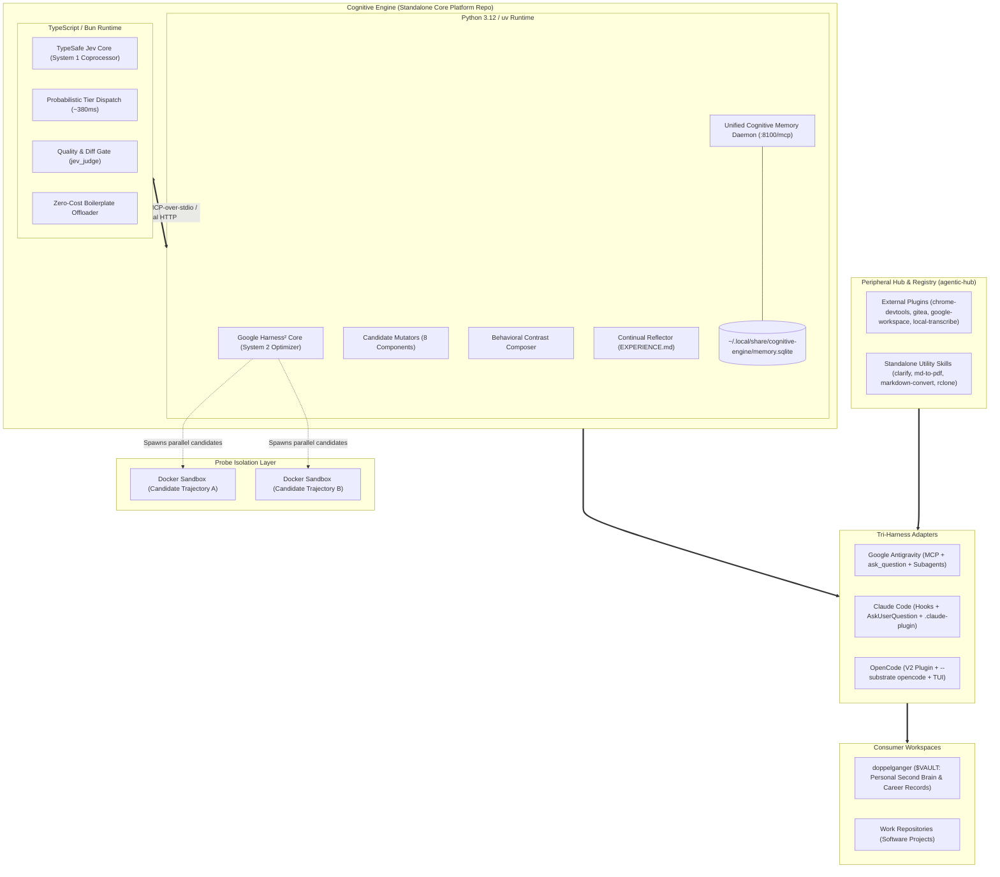

# RFC 001: Cognitive Engine — Autonomous Cognitive Substrate (Harness² + Jev + Memory)

- **RFC Number**: 001
- **Title**: Cognitive Engine: Unified Autonomous Cognitive Substrate (Harness² + Jev + Memory)
- **Status**: Formally Clarified / Ready for Execution
- **Authors**: Aleksandr Korolev ([@rockad](https://github.com/rockad)), Antigravity Pair Architect
- **Target Reviewers**: [@doc-cr](https://github.com/doc-cr), Aleksandr Korolev
- **Target Runtimes**: Google Antigravity, Claude Code, OpenCode

---

## 1. Executive Summary & Four Core Decisions

Through architectural clarification (`/clarify`), the design of **Cognitive Engine** is locked across four foundational dimensions:

| # | Architectural Dimension | Clarified Decision | Technical Specification |
|---|---|---|---|
| **1** | **Packaging & Language Boundary** | **Polyglot Monorepo** | Bun workspaces for TypeScript (Jev/MCP/adapters) + `uv` workspaces for Python 3.12 (Harness²/Memory). |
| **2** | **Internal Component IPC** | **Standard MCP-to-MCP** | Harness² exposes standard FastMCP tools (`harness2_propose`, `harness2_probe`, `harness2_compose`) consumed by Jev. |
| **3** | **Memory Substrate Engine** | **Consolidated Single-Daemon SQLite Engine** | Retire `basic-memory` Docker container; unify Recall (graph/notes) and Lookup (FTS5 search) into a single native SQLite daemon (`:8100/mcp`). |
| **4** | **Probe Execution Isolation** | **Docker Sandboxes** | Isolated agent micro-sandboxes ([Docker Sandboxes](https://www.docker.com/products/docker-sandboxes/)) for zero-risk parallel candidate execution. |

---

## 2. Component Specifications

### 2.1 Unified Cognitive Memory Engine (Replacing Basic Memory)
Retiring the `basic-memory` Docker container eliminates ~1GB of idle RAM in WSL2 and dual-port networking overhead. A single Python/SQLite service in `packages/memory` runs on `:8100/mcp` and maintains:
- **`notes` & `entities` tables**: Replaces Recall. Stores session handoffs (`session-memory:<workspace>`), active goals, and knowledge entities.
- **`fts_transcripts` & `fts_docs` tables**: Replaces Lookup. Full-text SQLite FTS5 search with BM25 ranking across session logs and documents.
- **`experiences` table**: Stores Harness² empirical playbooks per domain (`job-search`, `devops-infra`, `vault-curation`).
- **Storage**: Single local database file at `~/.local/share/cognitive-engine/memory.sqlite`.

### 2.2 Probing via Docker Sandboxes
Parallel candidate probing ($k \ge 2$) runs inside ephemeral [Docker Sandboxes](https://www.docker.com/products/docker-sandboxes/):
- **Safety**: Running untrusted agent mutations, experimental code, and compiler checks is strictly isolated from the host filesystem.
- **Fast Spin-up & Snapshotting**: Docker Sandboxes provide lightweight, near-instant containerized environments optimized specifically for autonomous coding agents.
- **Composition**: Trajectory outputs and diffs are evaluated by `jev_judge`, and only the winning patch is applied back to the consumer workspace.

### 2.3 Internal MCP-to-MCP Wiring
- Jev runs as the public entrypoint for harness integrations.
- When `jev_dispatch` detects low confidence (`<0.50`) or when `/probe` is triggered, Jev calls Harness²'s internal FastMCP server (`harness2_probe`).
- Harness² dispatches candidate runs into Docker Sandboxes, collects trajectories, synthesizes the result via `harness2_compose`, and returns the validated patch to Jev.

---

## 3. Implementation Roadmap

### Phase 1: Repository Initialization (`rockad/cognitive-engine`)
- Initialize polyglot monorepo with Bun (`package.json`) and `uv` (`pyproject.toml`).
- Migrate Jev from `agentic-hub/plugins/jev` into `packages/jev/`.
- Establish FastMCP Harness² wrapper in `packages/harness2/`.

### Phase 2: Unified Memory Daemon (`packages/memory`)
- Author native SQLite schema (`notes`, `entities`, `fts_transcripts`, `experiences`).
- Expose consolidated MCP server on `:8100` supporting both `read_note`/`write_note` and `search_archive`.
- Decommission legacy `basic-memory` Docker container.

### Phase 3: Docker Sandboxes Probing Engine
- Integrate Docker Sandboxes SDK / CLI into `packages/harness2/prober/`.
- Implement parallel candidate dispatch with timeout and memory clamps.
- Connect `harness2_compose` and `jev_judge` for contrastive synthesis.

### Phase 4: Tri-Harness Distribution & Vault Cleanup
- Build adapters for Google Antigravity, Claude Code, and OpenCode.
- Clean up legacy engine scripts from `doppelganger`.
