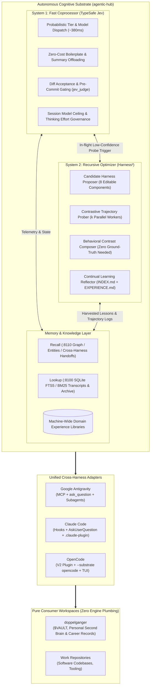

# RFC 001: Unifying Google Harness², TypeSafe Jev, and Memory into a Cross-Harness Cognitive Substrate

- **RFC Number**: 001
- **Title**: Unified Autonomous Cognitive Substrate (Harness² + Jev + Memory)
- **Status**: Proposed / Brainstorming
- **Authors**: Aleksandr Korolev ([@rockad](https://github.com/rockad)), Antigravity Pair Architect
- **Target Reviewers**: [@doc-cr](https://github.com/doc-cr), Aleksandr Korolev
- **Target Runtimes**: Google Antigravity, Claude Code, OpenCode

---

## 1. Executive Summary

This RFC proposes consolidating three complementary AI agent infrastructure layers currently scattered across `agentic-hub`, Google Research's `harness2`, and consumer repositories (`doppelganger`) into a unified **Autonomous Cognitive Substrate** hosted within `agentic-hub`.



By pairing **TypeSafe Jev** (sub-second System 1 coprocessor), **Google Harness²** (System 2 recursive optimizer and contrastive trajectory composer), and **Memory** (Recall entity graph + Lookup FTS5 transcript index), we establish a self-improving platform that:
1. **Decouples Engine from Vault**: Frees `doppelganger` (the user's knowledge vault) from housing runtime engine code, container orchestration, and optimization loops.
2. **Harmonizes Across Three Harnesses**: Delivers first-class, idiomatic experiences for Google Antigravity, Claude Code, and OpenCode from a single shared codebase.
3. **Solves the Open-World Verification Bottleneck**: Introduces Harness²'s contrastive *Propose–Probe–Compose* pattern to synthesize winning approaches on creative, unstructured tasks where unit tests do not exist.
4. **Eliminates System Prompt Bloat**: Enforces Harness²'s *Harnessing-Level Continual Learning* pattern, separating invariant base prompts from dynamic, indexed domain experience libraries (`EXPERIENCE.md`).

---

## 2. Motivation & Architectural Friction

### 2.1 The Vault / Infrastructure Conflation Problem
Currently, `doppelganger` serves two conflicting purposes:
- **Primary Purpose**: Aleksandr's personal second brain, notes, career master records, and working documents (`$VAULT`).
- **Incidental Burden**: Housing agent rules, experimental memory scaffolding, custom scripts, and subagent definitions.

Attempting to wire Harness²'s recursive optimization, evaluation sandboxes, and candidate probe workspaces directly into `doppelganger` severely pollutes the personal vault with agent infrastructure.

### 2.2 The Disconnected Cognitive Loops
We currently possess all necessary ingredients for an autonomous agent stack, but they run disconnected:
* **System 1 (Jev)**: Lightning-fast, probabilistic decisions (~380ms), cost-tiered routing, and diff validation. However, when faced with high-ambiguity tasks with no obvious single answer, Jev can only guess or ask the user.
* **System 2 (Harness²)**: Multi-trajectory probing, candidate prompt/tool mutation, and behavioral contrast synthesis. However, it currently lives in an isolated clone (`~/projects/harness2`), disconnected from daily chat.
* **Memory (Recall & Lookup)**: Daemonized long-term memory graph and transcript indexing. However, domain-specific lessons are currently scattered across random rules files without unified indexing.

### 2.3 The Multi-Harness Reality
The developer actively alternates between **Google Antigravity**, **Claude Code**, and **OpenCode** depending on task context and environment (CLI vs IDE). Today, feature additions (like Jev mode switches, subagent ceilings, or prompt guardrails) must be laboriously re-implemented or adapted across all three tools. A single platform repository (`agentic-hub`) must expose idiomatic bindings for all three harnesses.

---

## 3. Core Architecture: System 1 + System 2 + Memory

### 3.1 System 1: Fast Coprocessor (TypeSafe Jev)
Jev serves as the synchronous, in-flight decision engine:
- **Probabilistic Model Tier Dispatch (`jev_dispatch`)**: Evaluates task complexity in ~380ms and maps work to candidate subagents and model tiers (`openrouter_free`, `flash_lite`, `flash`, `pro`).
- **Quota Preservation & Free Offloading (`jev_execute_free`)**: Automatically offloads boilerplate generation, summaries, text formatting, and commit message drafting to `openrouter/free` at $0.00 cost (0 Gemini/Claude quota).
- **Session Model Ceiling Enforcement**: Clamps subagents and tasks to ensure child workers never exceed the model tier or version of the parent session without explicit user approval.
- **Instant Quality Gates (`jev_judge`)**: Binary acceptance testing for file diffs, test outcomes, and pre-commit checks.

### 3.2 System 2: Recursive Optimizer (Google Harness²)
Harness² provides deep, asynchronous recursive self-improvement without altering base model weights across two interconnected recursion loops:

#### A. Task-Level Recursion (*Propose–Probe–Compose*)
For ambiguous, open-ended tasks lacking ground-truth verifiers:
1. **Propose**: Generate $k$ candidate modifications across the **8 editable harness components**:
   - System prompt
   - Guardrails
   - Memory
   - Tool guidance
   - Subagents
   - Skills
   - Scripts
   - Plugins
2. **Probe**: Run candidate configurations simultaneously in isolated branch workspaces on low-cost/free models (`openrouter/free` or `flash_lite`).
3. **Compose**: Contrast the execution trajectories using behavioral diffs and synthesize a composed outcome retaining only evidence-backed enhancements.

#### B. Harnessing-Level Recursion (*Continual Reflection*)
Post-task reflection that harvests evidence-supported lessons into a persistent domain library (`EXPERIENCE.md` + `INDEX.md`), keeping the base system prompt invariant and lean (~1,500 tokens).

### 3.3 Memory Substrate (Recall, Lookup, and Domain Libraries)
- **Recall (`:8110`)**: High-level semantic memory graph, entity relationships, and cross-harness session handoffs (`session-memory:<workspace>`).
- **Lookup (`:8100`)**: SQLite FTS5 engine with BM25 ranking over session transcripts, project documentation, and knowledge archives.
- **Domain Experience Stores**: Centrally managed under `plugins/memory/experiences/<domain>/` and indexed by Lookup so any connected workspace can query empirical lessons on demand.

---

## 4. Cross-Harness Optimization Specification

To ensure a seamless developer experience across all three environments, the unified platform adapts its interaction patterns to the native idioms of each harness:

| Feature / Capability | Google Antigravity | Claude Code | OpenCode |
| :--- | :--- | :--- | :--- |
| **System 1 Coprocessor** | MCP Server (`jev-mcp`) | Lifecycle Hooks (`PreToolUse`, `PostToolUse`) | Native OpenCode V2 Plugin (`plugins/jev/opencode/`) |
| **System 2 Probing** | Native Subagent Delegation (`invoke_subagent`) | Multi-Agent Claude Workspaces / Subagents | Native Substrate Engine (`--substrate opencode`) |
| **Interactive Clarification** | `ask_question` Native UI Chips | `AskUserQuestion` Terminal Comparison Box | `question` Option Dialogs |
| **Quota Governance** | `quota-state.json` UI Dropdown Sync | Session Ceiling Hook (`session-ceiling.sh`) | OpenCode Model Swapper & Cost Guard |
| **Free Tier Offloader** | Direct MCP `jev_execute_free` | Hook-assisted Free Execution | Background OpenCode Worker (`openrouter/free`) |
| **Slash Commands** | Chat shortcuts (`/probe`, `/clarify`) | Slash Commands (`.claude-plugin/`) | Native TUI Slash Commands (`commands/`) |

### 4.1 Google Antigravity Adaptation
* Runs via registered MCP servers (`jev`, `memory`, `obsidian`, `gitea`).
* Contrastive probing utilizes Antigravity's native `invoke_subagent` tool with `Model: "inherit"` or `Model: "flash_lite"` running in ephemeral branch workspaces.
* Single-select interactive gates use `ask_question`.

### 4.2 Claude Code Adaptation
* Packaged as a standard Claude Code plugin (`.claude-plugin/marketplace.json`).
* Hooks intercept tool use before execution:
  - `PreToolUse`: Validates Jev tier dispatch and blocks consecutive un-dispatched edits.
  - `PostToolUse`: Gathers telemetry and detects failure patterns for experience harvesting.
* Interactive dialogs leverage Claude Code's native `AskUserQuestion` with terminal comparison preview blocks.

### 4.3 OpenCode Adaptation
* Uses the native OpenCode V2 plugin architecture already established in `plugins/jev/opencode/`.
* Harness² uses OpenCode as its **default, native execution substrate** (`--substrate opencode`), allowing headless batch benchmark sweeps (`harness2-bench`) to optimize prompts and skills directly against OpenCode's runtime.

---

## 5. Repository Structure & Boundary Separation

The resulting repository topology cleanly isolates infrastructure from consumer workspaces:

```text
agentic-hub/                          # The Cognitive Platform (Standalone Repo)
├── plugins/
│   ├── jev/                          # System 1 Coprocessor
│   │   ├── mcp/                      # jev-mcp server (TypeScript/Bun)
│   │   ├── opencode/                 # OpenCode V2 plugin
│   │   ├── claude/                   # Claude Code lifecycle hooks
│   │   └── scripts/                  # Semantic commit generator, CLI mode switches
│   ├── harness2/                     # System 2 Recursive Engine
│   │   ├── core/                     # Python 3.12 package (wrapped from google-research/harness2)
│   │   ├── substrate/                # OpenCode & Antigravity substrate adapters
│   │   ├── proposer/                 # Candidate harness mutators
│   │   ├── prober/                   # Dual-trajectory execution manager
│   │   └── composer/                 # Contrastive behavioral synthesizer
│   └── memory/                       # Unified Memory Stack
│       ├── docker-compose.yml        # Recall (:8110) & Lookup (:8100) daemons
│       ├── servers/lookup/           # SQLite FTS5 transcript & document search engine
│       └── experiences/              # Machine-Wide Domain Experience Libraries
│           ├── job-search/           # INDEX.md + EXPERIENCE.md
│           ├── devops-infra/         # INDEX.md + EXPERIENCE.md
│           └── vault-curation/       # INDEX.md + EXPERIENCE.md
├── skills/                           # Platform-Wide Skills
│   ├── clarify/                      # Cross-harness interactive clarification skill
│   ├── probe/                        # Contrastive Propose-Probe-Compose slash command
│   ├── md-to-pdf/                    # WeasyPrint PDF compiler
│   └── markdown-convert/             # OCR & document converter
└── .claude-plugin/                   # Cross-harness marketplace manifests

─────────────────────────────────────────────────────────────────────────────

doppelganger/                         # Pure Consumer Workspace ($VAULT)
├── .agents/                          # Ultra-lean consumer bindings
│   ├── rules/                        # Path-specific domain rules only
│   └── memory.json                   # Local session fallback cache
├── scripts/                          # User automation (backup, setup)
└── vault/                            # The Second Brain (Notes, Career, Personal)
```

---

## 6. Implementation Roadmap

### Phase 1: Repository Scaffolding & Substrate Integration
- [ ] Establish `docs/rfc/` in `agentic-hub` and review RFC with `@doc-cr`.
- [ ] Move the standalone Harness² engine package into `plugins/harness2/`.
- [ ] Configure `plugins/harness2/` to utilize OpenRouter (`OPENROUTER_API_KEY`) as its primary model substrate.

### Phase 2: Jev & Harness² In-Flight Wiring
- [ ] Wire `jev_dispatch`: when confidence is `<0.50` on complex tasks, recommend a contrastive probe.
- [ ] Implement the `/probe` cross-harness skill in `skills/probe/SKILL.md` (compatible with Antigravity, Claude Code, OpenCode).
- [ ] Connect `jev_judge` to serve as the trajectory comparison engine for candidate executions.

### Phase 3: Centralized Experience Store & Lookup Indexing
- [ ] Anchor canonical domain experience libraries (`job-search`, `devops-infra`, `vault-curation`) in `plugins/memory/experiences/`.
- [ ] Configure the Lookup daemon (`:8100`) to index `plugins/memory/experiences/` by default.
- [ ] Implement the interactive failure harvester prompt (Option A) across all three harnesses.

### Phase 4: Consumer Decoupling (`doppelganger`)
- [ ] Clean up redundant infrastructure and candidate files from `doppelganger`.
- [ ] Verify that `doppelganger` seamlessly consumes Jev, Harness², and Memory via MCP and standard hooks with zero local engine bloat.

---

## 7. Open Questions & Points for Brainstorming with `@doc-cr`

1. **Substrate Abstraction for Headless Probing**:
   In Harness², OpenCode is invoked headlessly (`--substrate opencode`). For Google Antigravity and Claude Code, should we rely on native subagent tools (`invoke_subagent` / Claude subagents) for live interactive sessions, while reserving headless OpenCode for offline batch benchmark sweeps (`harness2-bench`)?

2. **OpenRouter Rate Limits & Concurrency Caps**:
   Harness² probing can generate $k$ parallel trajectories. When offloading to `openrouter/free`, OpenRouter enforces a global 20 RPM limit. Should the Harness² probe manager enforce a hard queue with a maximum of 2 parallel workers on free tier, or fall back to low-cost paid models (e.g. `google/gemini-2.5-flash`) when concurrency exceeds 2?

3. **Experience Library Ingestion Latency**:
   Should subagents receive their domain's `INDEX.md` statically injected into their system prompt during initialization, or should all lookups go through the `:8100` Lookup daemon dynamically? (Our consensus in `/clarify` was a hybrid: static `INDEX.md` trigger table for workers, dynamic Lookup queries for orchestrators).

4. **Integration with OpenCode V2 Lifecycle Events**:
   How should Jev's existing OpenCode plugin (`plugins/jev/opencode/`) coordinate with Harness²'s substrate? Should Harness² be a sub-module of the Jev OpenCode plugin, or a standalone sibling plugin?
