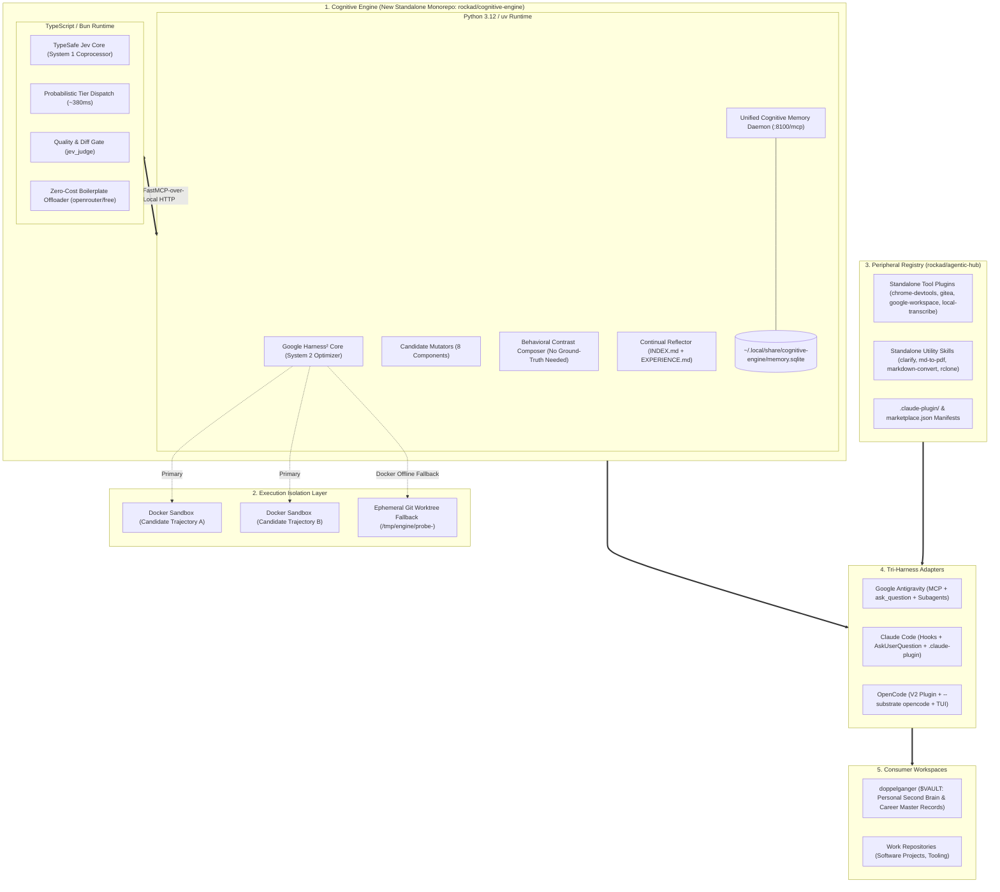
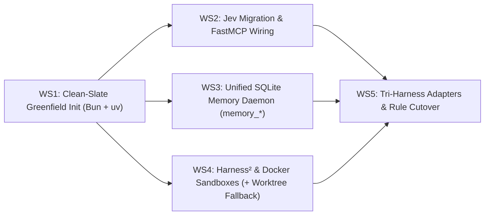

# RFC 001: Cognitive Engine — Autonomous Cognitive Substrate (Harness² + Jev + Memory)

- **Document Type**: Architecture RFC & Unified Implementation Plan
- **RFC Number**: 001
- **Status**: Formally Clarified / Implementation Blueprint
- **Authors**: Aleksandr Korolev ([@rockad](https://github.com/rockad)), Antigravity Pair Architect
- **Target Reviewers**: [@doc-cr](https://github.com/doc-cr), Aleksandr Korolev
- **Target Runtimes**: Google Antigravity, Claude Code, OpenCode
- **Upstream PR**: [rockad/agentic-hub#11](https://github.com/rockad/agentic-hub/pull/11)

> [!IMPORTANT]
> **Unified Entity Invariant**: This RFC serves simultaneously as the formal architectural proposal and the actionable engineering implementation plan. There is zero divergence between this document and the active execution roadmap. Following review feedback from [@Doc-Cr](https://github.com/Doc-Cr), this plan will be executed directly without intermediate translation layers.

---

## 1. Executive Summary & Tripartite Architecture

This plan establishes **Cognitive Engine** as a dedicated standalone core platform repository (`rockad/cognitive-engine`) consolidating three complementary AI agent infrastructure layers into an **Autonomous Cognitive Substrate**:

1. **System 1 (TypeSafe Jev)**: Sub-second (~380ms) probabilistic routing, model tier dispatch, free-tier offloading, quality gatekeeping (`jev_judge`), and session ceiling governance.
2. **System 2 (Google Harness²)**: Contrastive trajectory probing (*Propose–Probe–Compose*) without ground truth, automated harness component mutation across 8 dimensions, and continual learning via `EXPERIENCE.md`.
3. **Memory Substrate (Unified SQLite Engine)**: Single native daemon on `:8100/mcp` unifying notes, entities, transcripts, and domain playbooks, retiring the external `basic-memory` Docker container.



### Tripartite Separation of Concerns
* **`cognitive-engine` (The Core Platform)**: Holds Jev, Harness², the unified memory daemon, domain experience libraries, and native cross-harness adapters. Zero project-specific notes or application data.
* **`agentic-hub` (The Peripheral Registry)**: Repositioned as the community marketplace and distribution hub for peripheral, tool-specific plugins (`chrome-devtools`, `gitea`, `google-workspace`, `local-transcribe`) and standalone skills (`md-to-pdf`, `markdown-convert`).
* **`doppelganger` (The Consumer Vault)**: Preserved as Aleksandr's pure personal knowledge vault and second brain (`$VAULT`), holding zero container plumbing, optimizer loops, or engine code.

---

## 2. Eight Locked Architectural Decisions (Clarify Consensus)

Across two clarification rounds, all foundational architectural and operational forks have been formally resolved:

| # | Architectural Dimension | Clarified Decision | Operational Rationale |
|---|---|---|---|
| **1** | **Monorepo Packaging & Runtime** | **Polyglot Monorepo** | Bun workspaces for TypeScript (Jev/MCP) + `uv` workspaces for Python 3.12 (Harness²/Memory). Zero rewrite debt; native performance for both runtimes. |
| **2** | **Internal Component IPC** | **Standard MCP-to-MCP** | Harness² exposes standard FastMCP tools (`harness2_propose`, `harness2_probe`, `harness2_compose`) consumed by Jev. Standardized, inspectable, decoupled. |
| **3** | **Memory Substrate Engine** | **Consolidated Single-Daemon SQLite Engine** | Retire `basic-memory` Docker container; unify Recall (notes/entities) and Lookup (FTS5 search) into a single native SQLite daemon (`:8100/mcp`). Saves ~1GB RAM in WSL2. |
| **4** | **Probe Execution Isolation** | **Docker Sandboxes** | Isolated agent micro-sandboxes ([Docker Sandboxes](https://www.docker.com/products/docker-sandboxes/)) for secure, zero-risk parallel candidate execution. |
| **5** | **Sandbox Offline Fallback** | **Automatic Git Worktree Fallback** | If Docker is offline or uninstalled, seamlessly fallback to ephemeral `/tmp/engine/probe-<id>` git worktrees with a log warning; never block active sessions. |
| **6** | **Memory MCP API Contract** | **Strict Breaking Cutover (`memory_*`)** | Clean, minimal toolset (`memory_read`, `memory_write`, `memory_search`, `memory_list`, `memory_learn`); eliminate legacy tool name debt across all rules immediately. |
| **7** | **OpenRouter Rate Limits** | **Adaptive Concurrency Clamp** | Max 2 parallel workers, 3-second stagger, and internal 15 RPM token bucket; guarantees 100% free-tier probing without hitting HTTP 429 limits. |
| **8** | **Repository Bootstrapping** | **Clean-Slate Greenfield Init** | Initialize `rockad/cognitive-engine` as a pristine `v1.0.0` baseline; keep historical commit logs safely archived in `agentic-hub`. |

---

## 3. Deep Component Specifications

### 3.1 System 1: TypeSafe Jev Coprocessor (TypeScript / Bun)
- **Sub-Second Tier Dispatch (`jev_dispatch`)**: Evaluates task complexity in ~380ms and routes to optimal subagents and model tiers (`openrouter_free`, `flash_lite`, `flash`, `pro`).
- **Quota Preservation & Free Offloading (`jev_execute_free`)**: Automatically offloads boilerplate generation, summaries, text formatting, and commit message drafting to `openrouter/free` at $0.00 cost (0 Gemini/Claude quota).
- **Session Model Ceiling Enforcement**: Clamps child subagents to never exceed the active parent model tier without explicit manual user approval.
- **Diff Quality Gates (`jev_judge`)**: Binary acceptance testing for file diffs, test outcomes, and pre-commit checks.

### 3.2 System 2: Google Harness² Recursive Optimizer (Python 3.12 / uv)
- **Task-Level Recursion (*Propose–Probe–Compose*)**:
  - Automatically triggered when `jev_dispatch` reports low confidence (`<0.50`), or on-demand via `/probe`.
  - Probes $k$ candidate modifications across the **8 editable harness components** (System prompt, Guardrails, Memory, Tool guidance, Subagents, Skills, Scripts, Plugins) in parallel isolated Docker Sandboxes.
  - Contrasts execution trajectories using behavioral diffs and synthesizes winning enhancements without requiring ground-truth labels.
- **Harnessing-Level Recursion (*Continual Learning*)**:
  - Post-task reflection that harvests empirical, evidence-supported lessons into persistent domain libraries (`EXPERIENCE.md` + `INDEX.md`), keeping base system prompts invariant and lean (~1,500 tokens).

### 3.3 Memory Substrate: Unified Cognitive Memory Daemon (`:8100/mcp`)
Replaces the dual-container setup (`basic-memory:0.23.2` on `:8110` + `lookup` on `:8100`) with a single native Python SQLite daemon exposing the clean `memory_*` tool contract:
- **`memory_read(identifier)`**: Reads session memory notes (e.g. `session-memory:<workspace>`), active goals, and knowledge entities.
- **`memory_write(identifier, content, metadata)`**: Upserts durable structured notes and session handoffs.
- **`memory_search(query, domain)`**: Unified search across SQLite FTS5 transcripts, repository documents, and empirical domain experiences with BM25 ranking.
- **`memory_list(domain)`**: Lists stored notes and experience index manifests (`INDEX.md`).
- **Storage**: Single local database file at `~/.local/share/cognitive-engine/memory.sqlite` (<50MB RAM, zero Docker, <10ms queries).

### 3.4 Execution Isolation: Docker Sandboxes + Worktree Fallback
Parallel candidate probing ($k \ge 2$) runs inside ephemeral [Docker Sandboxes](https://www.docker.com/products/docker-sandboxes/):
- **Safety**: Running untrusted agent mutations, experimental code, and compiler checks is strictly isolated from the host filesystem.
- **Adaptive Fallback**: If Docker daemon is stopped, prober automatically branches an ephemeral git worktree at `/tmp/engine/probe-<id>`, executes candidate checks, and purges the worktree upon composition.
- **Rate Governance**: Candidate A starts immediately; Candidate B starts after a 3s stagger, governed by a local 15 RPM token bucket on `openrouter/free`.

### 3.5 Tri-Harness Optimization
| Feature / Capability | Google Antigravity | Claude Code | OpenCode |
| :--- | :--- | :--- | :--- |
| **System 1 Coprocessor** | MCP Server (`jev-mcp`) | Lifecycle Hooks (`PreToolUse`, `PostToolUse`) | Native OpenCode V2 Plugin |
| **System 2 Probing** | Native Subagent Delegation (`invoke_subagent`) | Multi-Agent Claude Workspaces / Subagents | Native Substrate Engine (`--substrate opencode`) |
| **Interactive Clarification** | `ask_question` Native UI Chips | `AskUserQuestion` Terminal Comparison Box | `question` Option Dialogs |
| **Quota Governance** | `quota-state.json` UI Dropdown Sync | Session Ceiling Hook (`session-ceiling.sh`) | OpenCode Model Swapper & Cost Guard |
| **Free Tier Offloader** | Direct MCP `jev_execute_free` | Hook-assisted Free Execution | Background OpenCode Worker (`openrouter/free`) |
| **Slash Commands** | Chat shortcuts (`/probe`, `/clarify`) | Slash Commands (`.claude-plugin/`) | Native TUI Slash Commands (`commands/`) |

---

## 4. Proposed Repository Topology (`rockad/cognitive-engine`)

```text
cognitive-engine/
├── packages/
│   ├── jev/                          # System 1: Router, Judge, Free-tier coprocessor
│   │   ├── src/                      # TypeScript / Bun MCP server & core logic
│   │   ├── hooks/                    # Claude Code Pre/PostToolUse lifecycle hooks
│   │   └── opencode/                 # OpenCode V2 plugin
│   ├── harness2/                     # System 2: Recursive Optimizer & Prober
│   │   ├── core/                     # Python 3.12 engine (wrapped from google-research/harness2)
│   │   ├── substrate/                # OpenCode & Antigravity substrate adapters
│   │   ├── proposer/                 # Candidate mutators (8 components)
│   │   ├── prober/                   # Docker Sandboxes parallel execution manager (with worktree fallback)
│   │   └── composer/                 # Contrastive behavioral synthesizer
│   └── memory/                       # Unified Memory Daemon (:8100/mcp)
│       ├── src/                      # Python SQLite service (FTS5 + Graph Notes + Experiences)
│       └── experiences/              # Machine-Wide Domain Experience Libraries
│           ├── job-search/           # INDEX.md + EXPERIENCE.md
│           ├── devops-infra/         # INDEX.md + EXPERIENCE.md
│           └── vault-curation/       # INDEX.md + EXPERIENCE.md
├── adapters/                         # First-Class Cross-Harness Integrations
│   ├── antigravity/                  # Antigravity sidecar & MCP registrations
│   ├── claude/                       # Claude Code plugin bundle
│   └── opencode/                     # OpenCode plugin bundle
├── package.json                      # Bun workspace manifest
└── pyproject.toml                    # uv workspace manifest
```

---

## 5. Implementation Roadmap & Parallel Workstream Breakdown



| Stream | Scope / File Targets | Description | Suggested Role | Recommended Tier |
|---|---|---|---|---|
| **WS1: Repo Provisioning** | `cognitive-engine/` (New Repo Root) | Scaffold pristine greenfield repo (`v1.0.0`) with Bun workspaces (`package.json`) and `uv` workspaces (`pyproject.toml`) | `system-operator` | `flash_lite` |
| **WS2: Jev Migration** | `packages/jev/` | Migrate TypeSafe Jev core, FastMCP server, and cross-harness hook bindings into the monorepo | `code-engineer` | `flash_lite` |
| **WS3: Unified Memory Daemon** | `packages/memory/` | Author native SQLite schema (`notes`, `entities`, `fts_transcripts`, `experiences`) and expose unified `:8100/mcp` daemon with clean `memory_*` tools | `code-engineer` | `flash_lite` |
| **WS4: Harness² & Sandboxes** | `packages/harness2/` | Package Google Harness² with FastMCP tool wrappers, Docker Sandboxes SDK, and `/tmp/` git worktree fallback | `code-engineer` | `flash_lite` |
| **WS5: Adapters & Rule Cutover** | `adapters/`, `doppelganger/` | Package Antigravity, Claude Code, and OpenCode adapters; cut over agent rules to `memory_*`; clean legacy engine scripts from `doppelganger` | `system-operator` | `flash_lite` |

---

## 6. Targeted Review Requests & Brainstorming Points for [@Doc-Cr](https://github.com/Doc-Cr)

We specifically invite [@Doc-Cr](https://github.com/Doc-Cr)'s architectural feedback on:

1. **Docker Sandboxes Graceful Fallback**:
   Confirming our decision: Docker Sandboxes provide primary container isolation, falling back automatically to ephemeral git worktrees in `/tmp/engine/probe-<id>` if Docker is offline.
2. **Unified Memory API (`memory_*`) Cutover**:
   Confirming our decision to perform a clean-slate cutover to `memory_read`, `memory_write`, `memory_search`, `memory_list` without legacy shims, migrating agent rules cleanly.
3. **Adaptive Concurrency Clamp**:
   Validating the 2-worker max clamp with 3-second stagger and 15 RPM token bucket for safe OpenRouter free-tier probing.
4. **Clean-Slate Greenfield Initialization**:
   Validating the pristine `v1.0.0` repository baseline on `rockad/cognitive-engine`, preserving past commit history safely archived in `agentic-hub`.
