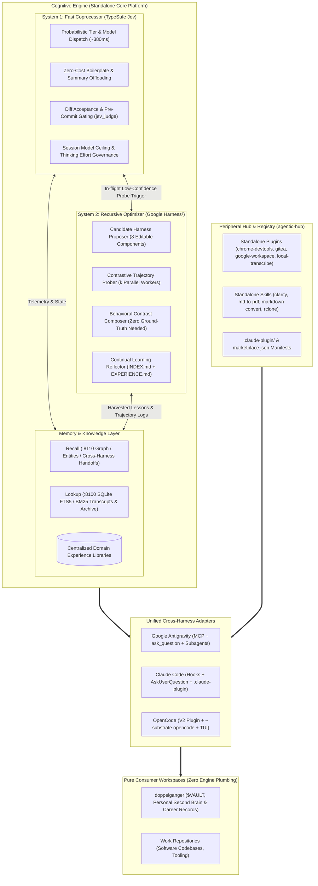

# RFC 001: Cognitive Engine — Autonomous Cognitive Substrate (Harness² + Jev + Memory)

- **RFC Number**: 001
- **Title**: Cognitive Engine: Unified Autonomous Cognitive Substrate (Harness² + Jev + Memory)
- **Status**: Proposed / Brainstorming
- **Authors**: Aleksandr Korolev ([@rockad](https://github.com/rockad)), Antigravity Pair Architect
- **Target Reviewers**: [@doc-cr](https://github.com/doc-cr), Aleksandr Korolev
- **Target Runtimes**: Google Antigravity, Claude Code, OpenCode

---

## 1. Executive Summary

This RFC establishes the architecture for **Cognitive Engine**—a dedicated, standalone repository consolidating three foundational AI agent layers into a unified **Autonomous Cognitive Substrate**:

1. **System 1 (TypeSafe Jev)**: Sub-second (~380ms) probabilistic routing, model tier dispatch, free-tier offloading, quality gatekeeping (`jev_judge`), and session ceiling governance.
2. **System 2 (Google Harness²)**: Contrastive trajectory probing (*Propose–Probe–Compose*) without ground truth, automated harness component mutation, and continual learning via `EXPERIENCE.md`.
3. **Memory Substrate (Recall & Lookup)**: Daemonized semantic entity graph (Recall `:8110`), SQLite FTS5 transcript & knowledge search (Lookup `:8100`), and machine-wide domain experience stores.



### Architectural Topology (Clean Separation of Concerns)
* **`cognitive-engine` (The Core Platform)**: Houses Jev, Harness², the Recall/Lookup daemon stack, domain experience libraries, and native cross-harness adapters.
* **`agentic-hub` (The Peripheral Registry)**: Serves as the community marketplace and distribution hub for peripheral, tool-specific plugins (`chrome-devtools`, `gitea`, `google-workspace`, `local-transcribe`) and standalone skills (`md-to-pdf`, `markdown-convert`).
* **`doppelganger` (The Consumer Vault)**: Preserved as Aleksandr's pure personal knowledge vault and second brain (`$VAULT`), holding zero container plumbing, optimizer loops, or engine code.

---

## 2. Motivation: The Tripartite Clarity

Previously, responsibilities were blurred across multiple repos:
- `doppelganger` was carrying agent rules, memory scaffolding, and subagent plumbing alongside personal notes and job applications.
- `agentic-hub` was attempting to be both a core cognitive decision engine (`plugins/jev`, `plugins/memory`) and a loose collection of third-party plugins (`chrome-devtools`, `gitea`, `local-transcribe`).
- `harness2` sat in a disconnected Google Research evaluation clone.

Creating **Cognitive Engine** as a dedicated greenfield platform establishes clean boundaries:
1. **Core vs. Peripheral**: Core reasoning, memory, and optimization belong in `cognitive-engine`. External integrations (browsers, email, transcription, git hosts) remain in `agentic-hub`.
2. **Platform vs. Consumer**: Consumers like `doppelganger` simply load `cognitive-engine` capabilities via standard MCP tools and harness hooks.
3. **Tri-Harness Cohesion**: Google Antigravity, Claude Code, and OpenCode are first-class peers communicating with one unified backend.

---

## 3. Cognitive Engine Core Systems

### 3.1 System 1: Fast Coprocessor (TypeSafe Jev)
Synchronous in-flight decision engine:
- **Probabilistic Model Tier Dispatch (`jev_dispatch`)**: Evaluates task complexity in ~380ms and routes to optimal subagents and model tiers (`openrouter_free`, `flash_lite`, `flash`, `pro`).
- **Quota Preservation & Free Offloading (`jev_execute_free`)**: Automatically offloads boilerplate generation, summaries, text formatting, and commit message drafting to `openrouter/free` at $0.00 cost (0 Gemini/Claude quota).
- **Session Model Ceiling Enforcement**: Clamps child subagents to never exceed the active parent model tier without explicit manual user approval.
- **Instant Quality Gates (`jev_judge`)**: Binary acceptance testing for file diffs, test outcomes, and pre-commit checks.

### 3.2 System 2: Recursive Optimizer (Google Harness²)
Deep asynchronous recursive self-improvement without altering base model weights:
- **Task-Level Recursion (*Propose–Probe–Compose*)**:
  - Automatically triggered when `jev_dispatch` reports low confidence (`<0.50`), or on-demand via `/probe`.
  - Probes $k$ candidate modifications across the **8 editable harness components** (System prompt, Guardrails, Memory, Tool guidance, Subagents, Skills, Scripts, Plugins) in parallel isolated workspaces on low-cost/free models.
  - Contrasts execution trajectories using behavioral diffs and synthesizes winning enhancements without requiring ground-truth labels.
- **Harnessing-Level Recursion (*Continual Learning*)**:
  - Post-task reflection that harvests empirical, evidence-supported lessons into persistent domain libraries (`EXPERIENCE.md` + `INDEX.md`), keeping base system prompts invariant and lean (~1,500 tokens).

### 3.3 Memory Substrate (Recall, Lookup, and Domain Libraries)
- **Recall (`:8110`)**: High-level semantic memory graph, entity relationships, and cross-harness session handoffs (`session-memory:<workspace>`).
- **Lookup (`:8100`)**: SQLite FTS5 engine with BM25 ranking over session transcripts, project documentation, and knowledge archives.
- **Centralized Domain Experience Stores**: Hosted under `packages/memory/experiences/<domain>/` and indexed by Lookup so any connected workspace can query empirical lessons on demand.

---

## 4. Cross-Harness Optimization Specification

| Feature / Capability | Google Antigravity | Claude Code | OpenCode |
| :--- | :--- | :--- | :--- |
| **System 1 Coprocessor** | MCP Server (`jev-mcp`) | Lifecycle Hooks (`PreToolUse`, `PostToolUse`) | Native OpenCode V2 Plugin |
| **System 2 Probing** | Native Subagent Delegation (`invoke_subagent`) | Multi-Agent Claude Workspaces / Subagents | Native Substrate Engine (`--substrate opencode`) |
| **Interactive Clarification** | `ask_question` Native UI Chips | `AskUserQuestion` Terminal Comparison Box | `question` Option Dialogs |
| **Quota Governance** | `quota-state.json` UI Dropdown Sync | Session Ceiling Hook (`session-ceiling.sh`) | OpenCode Model Swapper & Cost Guard |
| **Free Tier Offloader** | Direct MCP `jev_execute_free` | Hook-assisted Free Execution | Background OpenCode Worker (`openrouter/free`) |
| **Slash Commands** | Chat shortcuts (`/probe`, `/clarify`) | Slash Commands (`.claude-plugin/`) | Native TUI Slash Commands (`commands/`) |

---

## 5. Proposed Repository Topology

### `cognitive-engine/` (New Monorepo)
```text
cognitive-engine/
├── packages/
│   ├── jev/                          # System 1: Router, Judge, Free-tier coprocessor
│   │   ├── src/                      # TypeScript/Bun MCP server & core logic
│   │   ├── hooks/                    # Claude Code Pre/PostToolUse lifecycle hooks
│   │   └── opencode/                 # OpenCode V2 plugin
│   ├── harness2/                     # System 2: Recursive Optimizer & Prober
│   │   ├── core/                     # Python 3.12 engine (wrapped from google-research/harness2)
│   │   ├── substrate/                # OpenCode & Antigravity substrate adapters
│   │   ├── proposer/                 # Candidate mutators (8 components)
│   │   ├── prober/                   # Dual-trajectory execution manager
│   │   └── composer/                 # Contrastive behavioral synthesizer
│   └── memory/                       # Memory Substrate
│       ├── docker-compose.yml        # Recall (:8110) & Lookup (:8100) daemons
│       ├── lookup/                   # SQLite FTS5 search server
│       └── experiences/              # Machine-Wide Domain Experience Libraries
│           ├── job-search/           # INDEX.md + EXPERIENCE.md
│           ├── devops-infra/         # INDEX.md + EXPERIENCE.md
│           └── vault-curation/       # INDEX.md + EXPERIENCE.md
├── adapters/                         # First-Class Cross-Harness Integrations
│   ├── antigravity/                  # Antigravity sidecar & MCP registrations
│   ├── claude/                       # Claude Code plugin bundle
│   └── opencode/                     # OpenCode plugin bundle
└── package.json / pyproject.toml
```

### `agentic-hub/` (Peripheral Plugin & Skill Marketplace)
```text
agentic-hub/
├── plugins/                          # External & Tool-Specific Integrations
│   ├── chrome-devtools/              # Windows Chrome CDP browser automation
│   ├── gitea/                        # Gitea repo & issue management
│   ├── google-workspace/             # Gmail & Google Calendar connectors
│   └── local-transcribe/             # Local Whisper transcription pipeline
├── skills/                           # Standalone Utility Skills
│   ├── clarify/                      # Interactive clarification skill
│   ├── md-to-pdf/                    # WeasyPrint PDF compiler
│   ├── markdown-convert/             # OCR & document converter
│   └── rclone-cloud-storage/         # Multi-cloud storage operations
└── marketplace.json                  # Cross-harness distribution manifest
```

### `doppelganger/` (Pure Personal Knowledge Vault)
```text
doppelganger/
├── .agents/                          # Ultra-lean consumer bindings
│   ├── rules/                        # Path-specific domain rules only
│   └── memory.json                   # Local session fallback cache
├── scripts/                          # Personal automation (backup, setup)
└── vault/                            # The Second Brain ($VAULT: Notes, Career, Personal)
```

---

## 6. Implementation Roadmap

### Phase 1: Brainstorming & Review with `@doc-cr`
- [ ] Review RFC 001 on [PR #11](https://github.com/rockad/agentic-hub/pull/11) to align on monorepo structure and boundaries.
- [ ] Agree on packaging and IPC between TypeScript (`jev`), Python (`harness2`), and Go/Rust/Docker (`memory`).

### Phase 2: Greenfield Repository Initialization (`cognitive-engine`)
- [ ] Initialize `github.com/rockad/cognitive-engine`.
- [ ] Migrate `plugins/jev` and `plugins/memory` from `agentic-hub` into `cognitive-engine/packages/`.
- [ ] Integrate the Harness² engine package into `cognitive-engine/packages/harness2/` with OpenRouter configuration.

### Phase 3: Tri-Harness Adapter Layer
- [ ] Package unified adapters for Antigravity, Claude Code, and OpenCode in `cognitive-engine/adapters/`.
- [ ] Implement the `/probe` contrastive slash command across all three harnesses.
- [ ] Wire the interactive failure harvester prompt (Option A) into turn completion hooks.

### Phase 4: Repositioning & Vault Cleanup
- [ ] Update `agentic-hub` to reference `cognitive-engine` as its upstream core substrate.
- [ ] Clean up redundant infrastructure and candidate files from `doppelganger`, verifying pure consumer operation.

---

## 7. Open Questions & Points for Brainstorming with `@doc-cr`

1. **Packaging & Language Boundary in `cognitive-engine`**:
   Jev is currently built with TypeScript/Bun (`jev-mcp`), while Harness² is Python 3.12 (`uv`), and Lookup is a Python/SQLite service. In the new `cognitive-engine` repo, should we keep them as a polyglot monorepo (Bun workspaces + `uv` workspaces), or expose everything through a unified TypeScript or Python daemon?

2. **Substrate Abstraction for Headless Probing**:
   In Harness², OpenCode is invoked headlessly (`--substrate opencode`). For Google Antigravity and Claude Code, should we rely on native subagent tools (`invoke_subagent` / Claude subagents) for live interactive sessions, while reserving headless OpenCode for offline batch benchmark sweeps (`harness2-bench`)?

3. **OpenRouter Rate Limits & Concurrency Caps**:
   Harness² probing can generate $k$ parallel trajectories. When offloading to `openrouter/free`, OpenRouter enforces a global 20 RPM limit. Should the probe manager enforce a hard queue with a maximum of 2 parallel workers on free tier, or fall back to low-cost paid models (e.g. `google/gemini-2.5-flash`) when concurrency exceeds 2?

4. **Experience Library Ingestion Latency**:
   Should subagents receive their domain's `INDEX.md` statically injected into their system prompt during initialization, or should all lookups go through the `:8100` Lookup daemon dynamically? (Our consensus in `/clarify` was a hybrid: static `INDEX.md` trigger table for workers, dynamic Lookup queries for orchestrators).
