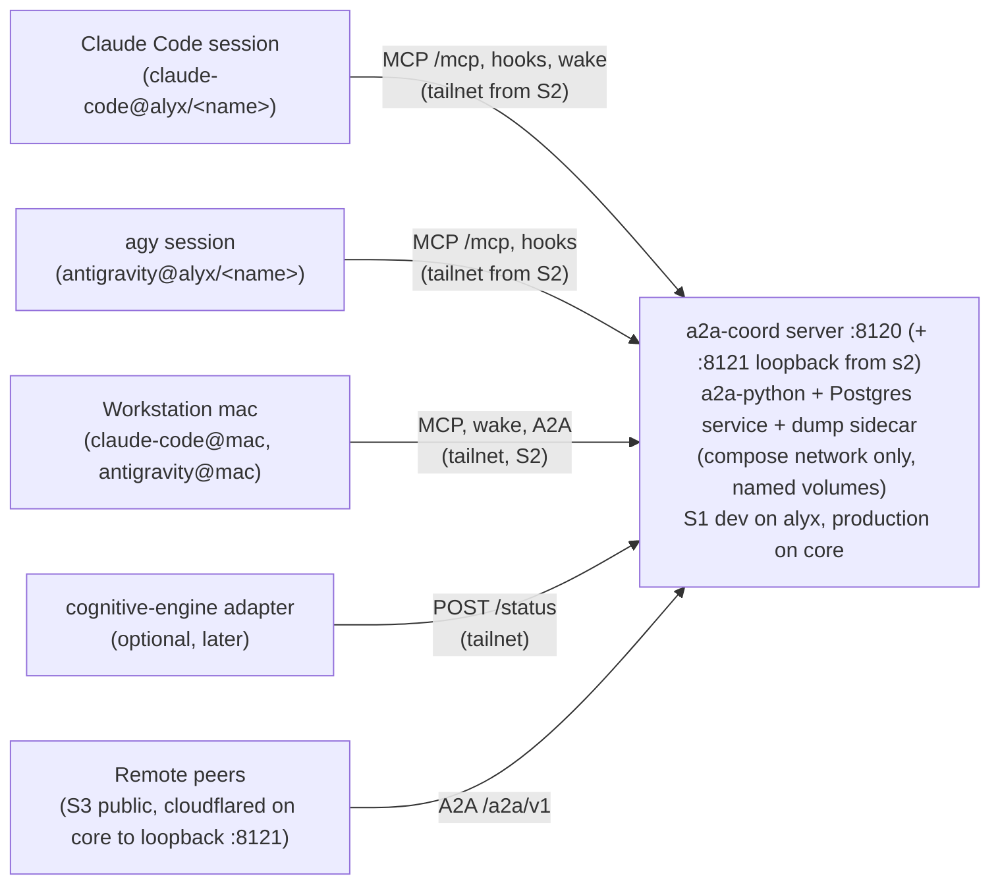
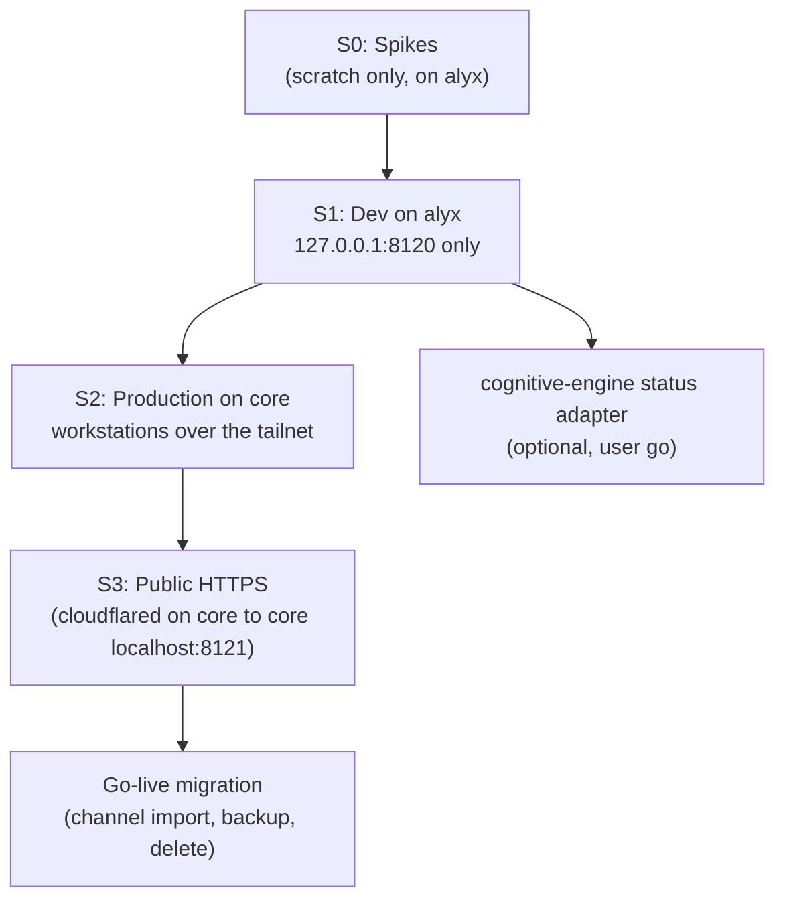

# A2A Coordination Plugin: Consolidated Architecture and Roadmap

> [!NOTE]
> **Canonical document** for the A2A coordination plugin: one A2A (Agent2Agent 1.0.1) server so live, side-by-side coding-agent sessions (Claude Code and Google Antigravity `agy`) exchange tasks, with remote agents joining later over HTTPS.
> Home: [`agentic-hub/plugins/coordination`](file:///home/rockad/projects/agentic-hub/plugins/coordination), branch `feat/coordination` (repo [`agentic-hub`](file:///home/rockad/projects/agentic-hub)).
> The former research repo `~/projects/agents-bridge` is **retired**; its `plans/`, `research/` and `specs/` were copied into this plugin's `docs/` and this file is the continuation of its plan (the filename is kept for link stability).
> Status (2026-11-09): **DDR-004 ACCEPTED** with 40 binding decisions (13 from the `/clarify` session, 14 to 36 from the later `/cplain` decisions of 2026-11-04 and 2026-11-05, 37 to 40 from the `/clarify` session of 2026-11-09, which also reverses decision 4's starting engine to Postgres; Section 3; plus the eight round-2 decisions R1 to R8 of the same day, a second `/clarify` round, which refine decisions 20, 37, 38 and 39 and are recorded in [`master-tasklist.md`](file:///home/rockad/projects/agentic-hub/plugins/coordination/docs/plans/master-tasklist.md); a third round R9 to R14 of the same day and a fourth round X1 to X5 on 2026-11-10 follow, recorded there too); **PLANNING ONLY** (implementation only where strictly necessary for a spike). Planning is complete; the S0 spikes are recorded (SP3 and SP4 on 2026-11-10 and 2026-11-11, [results](file:///home/rockad/projects/agentic-hub/plugins/coordination/docs/research/spike-results-2026-11-10-sp3-sp4.md)) and the next step is the S1 kickoff, which needs the user's go. SP5b (SP5 rerun on Postgres) passed on 2026-11-10 and satisfies the S1 storage gate; the overall S1 entry gate is satisfied as of 2026-11-11 (SP3 passed, SP4 recorded). No urgency. No public route exists (Risk 13).
> Evidence labels used below: **verified** (read in code or official docs by an auditor), **reported** (README or PR text, or a user-relayed statement), **unverified** (not yet tested). The audits were run by Sonnet subagents; the labels are theirs.

---

## 1. Executive Summary & Core Consensus

### Purpose & Scope
The plugin provides a provider-agnostic coordination substrate for N >= 2 autonomous agents across heterogeneous harnesses: [Google Antigravity](file:///home/rockad/.gemini/antigravity-cli), [Claude Code](file:///home/rockad/.claude), and later remote agents. OpenCode stays a candidate third peer (unconfirmed by the user).

### Core Consensus (Architectural Foundations)
- **Symmetric Peer Agency**: all communicating agents interact as equals; either side can open tasks to the other. Master/dependent or caller/subordinate patterns are prohibited.
- **Live Conversation-to-Conversation**: transports connect long-lived interactive sessions with warm context. One-shot ephemeral subprocess execution (`agy -p`, `claude -p`) is prohibited, and nothing may launch, drive or wrap `agy` (DDR-003).
- **One server, A2A on the wire**: a single containerised server on `a2a-python` (>= 1.3.0) owns the task store and speaks A2A (JSON-RPC and REST, all 11 core operations). The old "A2A principles over a file carrier, ACP drop-in later" approach is superseded (DDR-002).
- **Core of cognitive-engine stays daemon-free**: the server sits outside [`rockad/cognitive-engine`](file:///home/rockad/projects/cognitive-engine); cognitive-engine is at most an optional one-way status client (decision 13).
- **Resource contention via BuildSlot**: Docker and GPU arbitration stays with the zero-daemon `BuildSlot` protocol (cognitive-engine PR #13); see Section 5.
- **Untrusted by default**: every message body is data, never an approval and never a command; tasks are parked, never auto-executed.

### Architecture at a glance

Deployment host (decision 23): the service is a portable image that can run anywhere. Production runs on `core` (always on, live while the workstations are shut down); S1 development and the spikes run on alyx. Nothing in the image names a host: the public origin and the deploy-host label are configuration (`A2A_PUBLIC_URL`, `A2A_DEPLOY_HOST`).

Server endpoints (port 8120, decision 5):
- `/mcp`: MCP tools, streamable HTTP, served by the server itself (precedent: lookup at `127.0.0.1:8100/mcp`, already configured in agy). Write tools behind an opt-in flag.
- `/a2a/v1`: A2A JSON-RPC and REST, all 11 core operations.
- `/wake/listen`: long-poll wake endpoint, one parked listener per handle.
- `/sessions`: session registration (handle binding).
- `/status`: one-way status intake (`POST` only).
- `/.well-known/agent-card.json`: Agent Card with `securitySchemes` bearer, declaring only what is implemented.
- Port 8121 (from stage `s2`, bound to host loopback only, `127.0.0.1:8121`; decision 20 as amended on 2026-11-09, R8): a dedicated listener in the same process, the public listener for the Cloudflare Tunnel: `remote-peer` keys only, only `/a2a/v1` and the public Agent Card, `CF-Connecting-IP` believed only there, remote-peer rules active from the first start so they are tested in S2. Off at stage `s1`. The exposure gate is the Cloudflare Tunnel route, created only at the S3 go. Port 8120 stays tailnet-only.

Identity (decision 6):
- One Agent Card per harness and machine: `claude-code@alyx`, `antigravity@alyx`, and the same pair on `mac` (decision 23); a harness on `core` gets its own card (`claude-code@core`, `antigravity@core`).
- Per-session handles under a card: `claude-code@alyx/<name>~<sid8>` (handle grammar of 2026-11-09, separator `~` by round-4 X1).
- Address a handle: that session. Address a card: newest live listener, else queued.
- Every `remote-peer` key may address session handles, not only cards (decision 38, 2026-11-09, refined by R1): a handle that exists inside a card in the key's `cards_allowed` yields a held task, while an unknown, ended or disallowed handle yields the uniform "not available" `REJECTED` task. A per-API-key rate limit on handle-addressed "not available" responses (the guess counter; round-4 X3: card-addressed sends are outside it) writes an audit row when it trips.
- Handles are our extension; the mapping to A2A (`contextId` and `metadata`) is documented in [`server-api.md`](file:///home/rockad/projects/agentic-hub/plugins/coordination/docs/specs/server-api.md).

Inbound trust by origin (decision 10):
- Own local handles: `SUBMITTED`; the session takes the task through `a2a_inbox`.
- Allowlisted remote (a peer that holds a `remote-peer` API key, decision 18): `QUARANTINED` (our extension, shown to the sender as `INPUT_REQUIRED`) until a human releases it with `a2a-coord review` on a real TTY, one typed decision per task (decision 19). No code path releases a task automatically.
- Unknown remote: `REJECTED`.
- "Offered until confirmed": `SUBMITTED` to `WORKING` only by tool call; unconfirmed offers are re-offered.

Auth scopes (decisions 11 and 24): service-issued API keys, sent as an HTTP bearer credential, created by `a2a-coord key create`, shown once, stored hashed. Format `a2ak_<env>_<keyid>_<secret>` (for example `a2ak_live_...`):
- `local-harness`: `/mcp`, `/wake/*`, `/sessions`, `/a2a/v1` (`/sessions` is implied by the decision 6 binding). One key per harness per machine; the server also checks that the Tailscale node identity matches the machine the key was issued for, for every harness key including alyx (decisions 17 and 23).
- `remote-peer`: `/a2a` only; never `/mcp`, `/wake` or `/sessions`. One key per peer, hashed, revocable, rate-limited (decision 18).
- `status-client`: `POST /status` only.

Admin access (decisions 15 and 23): `a2a-coord` admin commands (`key create|list|rotate|revoke`, `review`) run inside the container, on whichever host runs it (core in production): `ssh core`, then `docker compose exec -it coordination a2a-coord ...`, over an in-container Unix socket that is not published on any port. There is no admin HTTP endpoint and no admin API-key scope. Docker access on that host is the credential.

---

## 2. Mandatory Requirements & Constraints

### Operational & Behavioral Constraints
- **Vertical Markdown Lists Only**: all documentation and bridge communications use `- item` lists. Inline enumerations are prohibited.
- **Clickable File Links**: referenced paths use Markdown links with the `file://` scheme.
- **Licensing Constraint (Standing User Rule)**: any tool, library or protocol whose terms restrict Anthropic, Claude Code or partner agents is excluded from adoption, benchmarking and testing. This applies symmetrically to Antigravity (DDR-003).
- **Host Configuration Hygiene**: third-party tools and system services (Tailscale, `cloudflared`) must be approved and installed by the user; agents never silently edit host systemd units, harness hook settings or dotfiles. None of `tailscale`, `cloudflared` or `caddy` is installed on alyx today (reported by the user's decision record). The user's existing Cloudflare Tunnel (`cloudflared`) runs on core (reported by the user, decision 20); the S3 ingress rule is added by the user.
  - Exception by decisions 16 and 24: the planned `a2a-coord install --claude --agy` installer writes harness hook and MCP configuration, and only when the user runs it. Non-secret parts that live in chezmoi-managed files are edited through chezmoi (edit the chezmoi source, then apply), never by writing the targets directly. API keys never go into chezmoi-managed files (decision 24). Until the installer exists, agents still write none of these files.
- **Scope Rule (amended by DDR-004)**: the daemon and container restrictions are lifted for this plugin. **Planning only remains**: implementation happens only where strictly necessary for a spike (S0), until the user starts S1. Code on [`cognitive-engine`](file:///home/rockad/projects/cognitive-engine) (BuildSlot PR #13, the later status adapter) follows that repository's own process.
- **Structural reference only**: the `memory` plugin (`plugin.json`, `docker-compose.yml`, `servers/lookup`) is a layout reference; this plugin never depends on it, because it may be retired.

---

## 3. Architectural Decision Records (DDRs)

### DDR-001: Hybrid Architecture & Exclusion of Restrictive Tooling
- **Status**: **ACCEPTED & APPROVED** (`2026-11-03T14:07:22+02:00`), then **PARTLY SUPERSEDED** (`2026-11-03T14:30:00+02:00`). **Exclusions remain IN FORCE.**
- **Context**: explored embedding mailbox daemons vs. CLI relays vs. decoupled substrates.
- **Decisions**:
  - `phone-a-friend` (Apache-2.0): adopted initially, then purged and uninstalled when the audit showed it only supported one-way caller-to-subordinate subprocess execution.
  - `mcp_agent_mail_rust`: permanently excluded because of the `OpenAI/Anthropic Rider` restricting Claude Code and Anthropic agents. **In force.**
  - `BuildSlot` protocol: retained and adopted for resource serialization in [`packages/harness2`](file:///home/rockad/projects/cognitive-engine/packages/harness2). **In force.**

### DDR-002: Communication Foundation: ACP with A2A Principles
- **Status**: **SUPERSEDED by DDR-004 (2026-11-04)**, both the file-channel carrier and ACP. Kept as history.
- Originally **ACCEPTED & APPROVED BY USER** (`2026-11-03T15:21:25+02:00`), phasing approved (`2026-11-03T15:30:55+02:00`).
- **Verbatim user approval (historical)**: *"Do you approve Claude's "A2A principles immediately + ACP carrier drop-in ready" phasing plan? - Yes"*
- **What it decided (historical)**:
  - Phase 1: adopt the A2A task-state vocabulary and agent-card-style identity in JSON-RPC envelopes over the live file channel.
  - Phase 2: move the wire to ACP once remote transports and live TUI participation matured.
- **What replaces it**: A2A is now the real wire (`a2a-python` server, HTTP bindings), not a vocabulary over files. ACP is removed from the plan entirely (decision 7). The file channel is frozen (decision 7).

### DDR-003: Side-by-Side Peer Architecture & Symmetric Antigravity Protection
- **Status**: **ACCEPTED & APPROVED BY USER** (`2026-11-03T16:01:41+02:00` and `2026-11-03T16:02:43+02:00`). **IN FORCE.**
- **Verbatim user directives**:
  - *"all agents/harnesses would be run side by side, not 'agy from claude' or similar"* (recorded first-hand by Antigravity at 16:01:41)
  - *"Keep, but never wrap agy"* (recorded first-hand by Claude Code at 16:02:43)
  - *"Yes, apply to Antigravity"* (recorded first-hand by Claude Code at 16:02:43)
- **Decisions**:
  - **Hard prohibition on agent wrapping**: nothing launches, drives, wraps or executes `agy` (no `agy -p`, no PTY or tmux, no `agentapi`, no caller/subordinate relays). Both harnesses run side by side as independent peers.
  - **Symmetric restrictive-terms rule**: "skip options whose terms restrict Claude Code" applies to Antigravity too. No design may depend on Antigravity access patterns that Google's Terms or FAQ prohibit.
- **Amendment 2026-11-04 (by DDR-004)**: the sentence "communicating through local files and standard protocol envelopes" no longer describes the carrier; peers communicate through the A2A server. The wrapping ban and the terms rule are unchanged.

### DDR-004: A2A Coordination Server (Container + MCP at /mcp + Hook Wake, Staged Exposure)
- **Status**: **ACCEPTED (2026-11-04)**, after the `/clarify` session with the user. The 13 decisions below are binding, and so are decisions 14 to 36 from the later `/cplain` decisions and 37 to 40 from the `/clarify` session of 2026-11-09 (second table below), which amend decisions 4, 7, 9, 10, 11, 12, 13 and 20. The second `/clarify` round of the same day (R1 to R8, final) refines decisions 20, 37, 38 and 39 and is folded into those rows, with the ids kept.
- **User direction (2026-11-04, Claude Code session)**: *"I want to expore a2a path more and build an mcp+hooks+ a docker container with the persistent volumes mounted to store the data. I want to expose it at some point to the web, where other agents could connect via https or other protocol."*
- **Evidence**: [`a2a-mcp-wake-audit-2026-11-04.md`](file:///home/rockad/projects/agentic-hub/plugins/coordination/docs/research/a2a-mcp-wake-audit-2026-11-04.md) and its four input reports.
- **Why build, not adopt**: no audited project combines an A2A server, persistent tasks, per-session addressing, an MCP facade and a compliant wake; several spawn agent CLIs (DDR-003 or live-session violations) (verified by audit).
- **Standing rules this changed**:
  - Zero-daemon principle: lifted for this component; the cognitive-engine core stays daemon-free.
  - DDR-002 carrier and ACP: superseded.
  - DDR-003 carrier wording: amended; the wrapping ban is unchanged.
  - Planning-only scope: remains, with the spike exception.
  - Old Phase 2 ledger forks A and B, Phase 3 swarmail, Phase 4 ACP: superseded.

#### Decision table (the user's choices, 2026-11-04)

| # | Decision | Rationale |
| :-- | :--- | :--- |
| 1 | **DDR-004 accepted.** User's answer, as recorded: *"Daemon and container restrictions lifted. Planning-only remains: implementation only where strictly necessary for a spike."* | A container-hosted server cannot exist under the old zero-daemon rule; planning-only stays so nothing is built before the spikes answer the open questions. |
| 2 | **One home.** User's answer, as recorded: *"Everything lives in agentic-hub/plugins/coordination (one repo, one branch feat/coordination). agents-bridge retired. Memory plugin = structural reference only; do not depend on it (it may be retired)."* | One repo and one branch avoid split sources of truth; depending on a plugin that may be retired would strand the server. |
| 3 | **Stack**: Python on `a2a-python` (>= 1.3.0), `uv`, Docker. | Official SDK with all 11 operations and a SQL task store (verified); Python and `uv` match cognitive-engine. |
| 4 | **Storage: Postgres in the compose project from S1 (user decision, 2026-11-09, `/clarify` session; reverses this row's earlier starting engine, SQLite).** The server is still **one process** (parked wake listeners live in memory), so the single-server-process rule stays and everyone else uses HTTP; only the database is now a second compose service, and `A2A_DB_URL` points at Postgres. Kept from the SP5 amendment (SP5, 2026-11-05, [results](file:///home/rockad/projects/agentic-hub/plugins/coordination/docs/research/spike-results-2026-11-05-sp5.md)): the plain `DatabaseTaskStore` loses updates under a race and is not sufficient, so the server uses our `CoordTaskStore` (a thin subclass) over the SDK `VersionedDatabaseTaskStore` with a **version row seeded at task creation** (verified on Postgres in SP5 D10: 22 retried deadlocks without the seed, none with it), a custom parked-task request handler (server-api 1.2), the `task_index` side table, and our tables on SQLAlchemy Core. Retired: the single-connection `BEGIN IMMEDIATE` write engine (the SQLite compare-and-swap lost 259 of 300 on Postgres), the WAL and `busy_timeout` setup, the filesystem caveats (named volume, `/mnt/c`, 9p), `sqlite3 .backup`, and the "Postgres by URL change" wording (Postgres is now the default engine). Operation: decision 37. S1 gate: decision 39 (SP5b). **Why SQLite would have been enough (recorded, not deleted):** SP5 on SQLite measured about 23 writes/s at 10x realistic load, p99 write 17 to 35 ms, a single-connection ceiling of about 430 saves/s, and 0 lost acked writes after `kill -9`. Tripwires that would have forced a move: more than one writer process, a network filesystem, a failover need, around 100x load. The user chose Postgres anyway. | The database is a separate service with its own backup route, and the SDK versioned store is the portable concurrency control (verified on both engines); the SQLite evidence stays in the record to explain why the wrappers exist. |
| 5 | **Surface**: the server itself serves MCP tools at `/mcp` (streamable HTTP, like lookup) plus `/a2a/v1`, `/wake/listen`, `/sessions`, `/status` and the Agent Card, on port 8120; write tools behind an opt-in flag. | One process and one URL work the same for agy and Claude Code and survive the move to tailnet or public exposure; 8120 avoids 8100-8110 and 11434. |
| 6 | **Identity**: one Agent Card per harness and machine; per-session handles under it; handle addresses a session, card addresses the newest live listener else queues. Binding for Claude Code (**verified, SP2 C1 to C9, 2026-11-06, Claude Code 2.1.319**): `SessionStart` hook `POST /sessions`, handle injected into context, first MCP call `a2a_hello(handle)` ties `Mcp-Session-Id` to the handle; 10 of 10 launches bound unprompted, the binding survives `/compact`, `/clear`, a subagent and idle, is lost on `--resume` and on a server restart and is rebuilt from the constant error text; the registration and listener hooks run in parallel (the 15 s retry on `410 unregistered` is required); the real server makes handles unique itself and requires the key on `POST /sessions`. **Binding for agy (verified on the wire, SP2 A1 and A4, 2026-11-04): the handle binds to `_meta["antigravity.google/conversation_id"]` on each `tools/call`, never to `Mcp-Session-Id`, which is per agy process and shared across conversations.** The id is distinct per conversation, stable across exit and `agy --conversation <id>` resume, and subagent calls carry their own `conversation_id` plus `root_conversation_id` and `parent_conversation_id`; the server groups sub-invocations under the parent handle by `root_conversation_id`. `/clear` in agy creates a new conversation and so a new handle. | Cards stay honest and few while sessions stay individually addressable; the agy route needs no wrapping and is verified, the Claude Code route is still untested. Handles are our extension (mapping documented in `server-api.md`). |
| 7 | **ACP out; channel frozen then migrated.** User's answer, as recorded: *"ACP removed from the plan entirely. The file channel (~/.agents/bridge-v2-coordination-channel.md and other ~/.agents channel files) is frozen now: nobody uses it. After go-live, a one-time migration imports those channel files into the plugin's store, then the channel is deleted."* **Amended by decision 14: go-live is after S3, and Antigravity may use the channel for research on this work until then.** | ACP's remote transport and live-TUI participation stayed unproven and Terms-risky; a frozen channel avoids two sources of truth, and a one-time import keeps the history. |
| 8 | **Claude Code wake**: `asyncRewake` command hook on `SessionStart` and `Stop` running a `sh`+`curl` script (`a2a-listen`) that long-polls `POST :8120/wake/listen` in 900 s rounds (in production the hooks on alyx and mac poll core over the tailnet, decision 23); `UserPromptSubmit` HTTP hook for the busy path; one parked listener per handle; wake budget 20/h per handle; Claude Code >= 2.1.290 (reported; **SP1 2026-11-05: `asyncRewake` verified on 2.1.318 and 2.1.319, the first version that has it is only known to be at or before 2.1.287**), interactive CLI only. **SP1 amendments (verified):** the listener's owner is `$CLAUDE_PID`, not `$PPID`; the listener also arms on `SessionStart` source `clear` (a new `session_id`); `Stop` does not fire after Esc, so a `UserPromptSubmit` re-arm is planned (design, unverified); there is no cap on `Stop` continuations, so loop control is the server's wake budget. Inbox socket is a later spike candidate; Channels not used. | The only compliant idle wake found (hook semantics verified, design borrowed from switchboard); the stub-only wake and the budget bound the injection and runaway-loop risk. |
| 9 | **agy**: MCP (`url` `:8120/mcp`; `serverUrl` is accepted as the legacy key per agy's `mcp_servers.md`, line 66) plus our `SessionStart` hook (register handle, `injectSteps` carrying the handle, the pending count and "check a2a_inbox now", decision 27) plus a `PreInvocation` hook (curl pending count, 2-5 s, `injectSteps`, the backstop if `SessionStart` does not fire) plus an `a2a_wait` tool. No `AGENTS.md` is written (decision 27); the hook entries live in the user-level `~/.gemini/config/hooks.json` (decision 26). Held-`Stop` park is **spike only, not shipped**. No idle wake for agy (accepted asymmetry). Nothing may launch, drive or wrap agy. | The official hooks page documents no async or rewake option (verified), so only surfacing at the next model call is compliant; DDR-003 forbids everything else. |
| 10 | **Inbound trust by origin** (allowlist and release refined by decisions 18 and 19): local handles `SUBMITTED`; allowlisted remote `QUARANTINED` until a human releases it with `a2a-coord review` on a real TTY with typed confirmation; unknown remote `REJECTED`. Bodies framed as untrusted data; wake text is a constant stub; bodies only in tool results; tasks parked, never auto-executed; "offered until confirmed". | Remote text must never reach an agent as an instruction or approval; a human gate on a real TTY mirrors cognitive-engine's typed-approval model. |
| 11 | **Auth**: scoped bearer credentials per agent: service-issued API keys from `a2a-coord key create` (shown once, stored hashed; renamed from "token" by decision 24); scopes `local-harness`, `remote-peer`, `status-client`; card declares `securitySchemes` bearer; loopback still needs a key; constant-time compare; Host and Origin checks; refuse non-loopback bind without TLS proxy config. Add-ons by stage: tailnet identity check, then rate limits and optional mTLS (refined by decisions 17, 18 and 24; admin access by decision 15). | Least privilege per agent; a remote peer can never reach `/mcp`, `/wake` or `/sessions`; loopback is not a trust boundary on a multi-process host. |
| 12 | **Exposure**: S1 localhost `127.0.0.1:8120` on alyx; S2 tailnet via `tailscale serve` for own machines alyx, mac, core; S3 public HTTPS. **Revised by decision 23: S1 is dev and spikes on alyx; S2 is production on core, with alyx and mac reaching core over the tailnet from day one; S3 is the existing Cloudflare Tunnel on core pointing at core's own loopback port 8121 (decision 20, as amended on 2026-11-09: 8120 stays tailnet-only).** The S1 entry gate is changed by decision 39. The earlier "bigrockad.com reverse proxy or Cloudflare Tunnel, choice deferred" is closed. Gates in Section 5. | Each step widens the audience only after the controls for that audience exist; the user keeps the explicit go for public. |
| 13 | **cognitive-engine**: optional one-way status client, contract specified now, built after S1 in a cognitive-engine adapter package, off by default, on the user's go: `POST /status`, scope `status-client`, body `{run_id, run_scope, state, report_path, ts}`. Never prompts, model text, transcripts or denial counts. Never receives tasks; the server is never a second approval path; `audit.jsonl` stays the source of truth; model sessions (sbx) never reach `:8120` or `:8121` (R1). **Amended by decision 23: in production the status client posts to core over the tailnet; sbx model sessions still never reach the service, at any address.** | Keeps the deterministic core and its typed-approval gate authoritative; R-18: `sessions_summary.denied_requests` counts path denials only, so no field of it may be shown as a general denial count. |

#### Decisions 14-36 (2026-11-04 and 2026-11-05, /cplain)

The user's later choices: 14 to 24 on 2026-11-04 (14 to 22 in the `/cplain` session; 23 and 24 afterwards, with the S3 hostname and route facts of that day), 25 to 36 on 2026-11-05 (`/cplain`, answering the open items of [`implementation-plan.md`](file:///home/rockad/projects/agentic-hub/plugins/coordination/docs/plans/implementation-plan.md) section 6), and 37 to 40 on 2026-11-09 (`/clarify`; the same session also reversed decision 4's engine and decided the S3 listener of decision 20, as marked in those rows). A second `/clarify` round on 2026-11-09 produced R1 to R8, which refine decisions 20, 37, 38 and 39 and are folded into those rows. Binding. Section 7 (open decisions) is closed by them. Decisions 23 and 24 revise 15, 16, 17 and 20, and decision 27 amends decision 9, as marked in those rows.

| # | Decision | Rationale and consequences |
| :-- | :--- | :--- |
| 14 | **Go-live is after S3** (public stage). The `~/.agents` file channel stays frozen until then, with **one exception: Antigravity may still use it for research on this work.** Import, tar backup and deletion happen after S3. Amends decision 7. | Keeps the old channel available to the one agent still researching until the whole server is public. Consequence: the import must tolerate appends made after 2026-11-04 (expected counts are re-measured at go-live). [`go-live-migration.md`](file:///home/rockad/projects/agentic-hub/plugins/coordination/docs/plans/go-live-migration.md) is updated. |
| 15 | **Admin access**: `a2a-coord` admin commands (`key create\|list\|rotate\|revoke`, `review`) run inside the container with `docker compose exec -it coordination a2a-coord ...`, over an in-container Unix socket that is not published on any port. **No admin HTTP endpoint, no admin API-key scope.** Docker access on the host is the credential; `review` requires a TTY. **Per decision 23 the host is whichever one runs the container (core in production): `ssh core`, then the `docker compose exec -it` command.** | No admin surface on the network at any stage, so S3 exposure cannot reach it. Closes the "admin plane" open point in [`server-api.md`](file:///home/rockad/projects/agentic-hub/plugins/coordination/docs/specs/server-api.md) 3.7. |
| 16 | **Harness setup**: one installer, `a2a-coord install --claude --agy`, configures both harnesses (Claude Code hooks and MCP entry; agy MCP entry with `headers.Authorization` plus agy hooks). **Non-secret parts that live in chezmoi-managed files go through chezmoi** (edit the chezmoi source, then apply), never by writing the targets. **Keys never go into chezmoi-managed files (decision 24).** The user accepted the R8 grey area (our software writing agy's config). Nothing launches, drives or wraps agy (DDR-003 unchanged). | Replaces the "snippets versus plugin manifest" question. **Rewritten by decision 24, which replaces the earlier "chezmoi secret template" approach:** the Claude Code key comes from the environment (`A2A_API_KEY`); the agy key is written literally into an unmanaged user-level plugin file `~/.gemini/config/plugins/<name>/mcp_config.json` (mode 0600, unique `<name>`, verified in SP2 A8b on 2026-11-09) outside chezmoi, because agy does not interpolate env vars in `headers` (verified on the wire in the SP2 A6 follow-up). `~/.gemini/config/mcp_config.json` (chezmoi-managed as `dot_gemini/config/private_mcp_config.json.tmpl`) is not edited for the key. |
| 17 | **Own machines on the tailnet** (alyx, mac, and core where a harness runs) get one `local-harness` API key per machine with their own cards (`claude-code@mac`, `antigravity@core`). The server additionally checks that the Tailscale identity (node or user) matches the machine the key was issued for. **Per decision 23 this applies to all harness keys, including alyx, because production is on core and every workstation reaches it over the tailnet.** | Replaces the "assumed" wording. A stolen key alone does not work from another machine. How the server obtains the identity from `tailscale serve` on core is **unverified** (later-stage spike, [`spikes.md`](file:///home/rockad/projects/agentic-hub/plugins/coordination/docs/specs/spikes.md) section 13). |
| 18 | **Remote peers (S3)**: one API key per peer (`remote-peer` scope), hashed, revocable, rate-limited. Quarantine is the backstop. mTLS is optional later, per peer. **Allowlist = peers that hold a `remote-peer` key** (modelled as `cards_allowed` on the key, as in server-api.md). | One identity mechanism, no separate peer registry. A key holder is still untrusted: quarantine and human release apply to everything it sends. Per decision 24 a remote peer receives its key out of band. |
| 19 | **Quarantine release**: only a human, one typed decision per task on a TTY via `a2a-coord review`. **No auto-release path in code**: no rules, no agent pre-screen. | Keeps decision 10's human gate absolute. Expiry of an unreleased task moves it to `REJECTED`, never to released. |
| 20 | **Public front door (S3)**: the user's **existing Cloudflare Tunnel (`cloudflared`) on core**. An ingress rule for a hostname like `a2a.bigrockad.com` forwards to core's own loopback (decision 23: the service runs on core in production, so there is no tunnel-to-tailnet hop). **Decided by the user on 2026-11-09 (D-F, `/clarify`): the tunnel targets a dedicated loopback port 8121, which the server treats as the public listener: `remote-peer` keys only, only `/a2a/v1` and the public Agent Card, and `CF-Connecting-IP` trusted only on that port. Port 8120 stays tailnet-only (`tailscale serve`, `local-harness` keys). Timing (R8, 2026-11-09, replaces "the server opens 8121 only at stage `s3`"): the server starts the 8121 public listener from stage `s2`, bound to host loopback only (`127.0.0.1:8121`), with the remote-peer rules active, so the public-listener rules, handle errors, rate limits and the fuzz pass are tested in S2; the exposure gate is the Cloudflare Tunnel route, which is created only at the S3 go (the user's explicit decision). Stage flip (R13, 2026-11-09, third round): before the route, the user runs the read-only `a2a-coord expose check` (non-zero exit if any S3 gate item is not met), sets `A2A_EXPOSURE_STAGE=s3` and the public host in the compose environment and restarts the stack (the server's `s3` start-up checks refuse to start if a condition fails), and only then creates the route to `127.0.0.1:8121`; no runtime admin command, and the stage is not derived from other configuration.** The earlier `Host`-based `A2A_TUNNEL_HOSTS` design (tunnel to 8120) is no longer the plan and is kept only as a rejected alternative (forged-header weakness, server-api.md 8.4.1; server-api.md and spikes.md L2 are amended and keep it only as a rejected alternative). Consequences, documented in server-api.md 8.4.1: Cloudflare sees decrypted traffic; client IP only via `CF-Connecting-IP`, trusted only on the 8121 listener; Host and Origin checks and rate limits account for it; Cloudflare's request timeout of about 100 s (**reported**, unverified for the user's plan). | Closes the "reverse proxy versus Cloudflare" point and the "pending user decision at S3" listener question. The chosen hostname is `a2a.bigrockad.com`. No route exists now: one was created and deleted on 2026-11-04, and it is created only at the S3 go (Risk 13). `bigrockad.com` runs no separate reverse proxy for this. The server still never binds a non-loopback address: workstations reach it through `tailscale serve` on core (S2), and `cloudflared` reaches the 8121 listener on core's loopback (S3). That listener is off at stage `s1`, on from `s2` (R8), and unreachable from outside until the user creates the route at the S3 go. |
| 23 | **Deployment host**: the service is a portable image that can run anywhere; **production runs on `core`** (always on, live while the workstations are shut down). Revised stages: **S1** dev and spikes on alyx, `127.0.0.1:8120` only; **S2** production on core, every workstation (alyx, mac) reaches core over the tailnet from day one, and the Tailscale node binding of decision 17 applies to all harness keys including alyx; **S3** public via the existing `cloudflared` tunnel on core pointing at core's own loopback port 8121 (decision 20, as amended on 2026-11-09). Wake hooks on alyx and mac long-poll core over the tailnet; the woken sessions are still local; core only holds tasks while workstations are offline. Admin (decision 15) runs on the host that runs the container: `ssh core`, then `docker compose exec -it coordination a2a-coord ...`. The cognitive-engine status client posts to core over the tailnet; sbx model sessions still never reach the service. Go-live (decision 14) is unchanged: after S3. Production references to `alyx:8120` are replaced by core; alyx stays for S1 and dev. The host is configuration (`A2A_PUBLIC_URL`, `A2A_DEPLOY_HOST`), so the image stays portable. | An always-on host means coordination keeps working with the workstations off and tasks wait for them. Consequences: wake latency and tailnet availability become dependencies (Risk 12); the Tailscale check and Cloudflare front door now terminate on the same host, which changes how `CF-Connecting-IP` and Tailscale identity are told apart (server-api.md 8.4.1, `spikes.md` section 13). Amends decisions 12, 15, 17 and 20. |
| 24 | **API keys and client key storage** (replaces the earlier chezmoi-secret approach). Credentials are **service-issued API keys**, like Claude API keys: format `a2ak_<env>_<keyid>_<secret>` (for example `a2ak_live_...`), created by `a2a-coord key create --scope <local-harness\|remote-peer\|status-client> --agent <card> [--tailnet-node <node>] --expires <dur>`, shown once, stored hashed with the `keyid` indexed. Fields: scope, owner card, tailnet node binding, created, expires, last used, revoked. Commands `key create\|list\|rotate\|revoke` run through the admin socket (decision 15). "Token" is renamed "API key" wherever it means these credentials; "bearer" stays for the HTTP scheme. **Client storage**: Claude Code keeps the key in the environment variable `A2A_API_KEY`, referenced from the MCP entry's `Authorization` header by env expansion (Claude Code header expansion is **unverified**, added to SP2 Claude half); agy gets the key written literally (agy does not expand env vars in headers, verified on the wire) into an **unmanaged** plugin-scoped file `.agents/plugins/coordination/mcp_config.json`, mode 0600, outside chezmoi. Whether agy loads a user-level plugin config from `~/.agents/plugins/` (versus workspace level only), and whether `~/.agents` collides with the frozen bridge folder, are **unverified** (new check SP2 A8); the fallback is a non-chezmoi include chosen by the user. **Update 2026-11-09 (SP2 A8 and A8b, [A8 results](file:///home/rockad/projects/agentic-hub/plugins/coordination/docs/research/spike-results-2026-11-08-sp2-agy.md), [A8b results](file:///home/rockad/projects/agentic-hub/plugins/coordination/docs/research/spike-results-2026-11-09-a8b-agy.md)): the agy file is the user-level `~/.gemini/config/plugins/<name>/mcp_config.json` (native `mcp_config.json`), which runs its tools with no `agy plugin enable` and no `config.json` entry, on a warm restart and on a cold first load (verified, A8b runs A, A2, A3, A4). `~/.agents/plugins/` is ignored by agy and the `~/.agents` collision check was clean (verified, A8), so nothing goes to `~/.agents`. Rules: `<name>` must not equal any workspace plugin name and the plugin never ships a same-named workspace plugin (with one present the user-level tools were "not enabled" in both observed runs; which scope wins is unverified); the post-install health check is a real tool call, because a server with `initialize` and `tools/list` at 200 still had its tools disabled: **the user runs a real `a2a_hello` in a fresh agy session and the installer confirms the bind on the server** (user decision, 2026-11-09, D-C; the installer never starts or drives agy, DDR-003). Still unverified, now the A8c runbook and not blocking S1 (decision 39): `.mcp.json` at user level, `agy plugin install` and uninstall, and whether tool use needs a live sign-in. Fallback if the placement ever stops running tools: the `agy mcp add` global entry in `~/.gemini/config/mcp_config.json` (verified, SP2 A6 and A4, 2026-11-04); that file is chezmoi-managed, so using it for the key reopens this decision with the user.** **chezmoi-managed files never hold keys and are not edited for keys.** The cognitive-engine status client and remote peers hold keys the same way; a remote peer receives its key out of band. | Keeps secrets out of the dotfiles repository by construction instead of by template. The installer (decision 16) still configures non-secret parts through chezmoi where those files are chezmoi-managed. The earlier "secret backend" open point is removed. Amends decisions 11 and 16. |
| 25 | **Spike host changes: "borrow and put back"** (2026-11-05, `/cplain`). Each spike backs up every file it touches; adds test entries through the harness's own CLI (`claude mcp add`, `agy mcp add`); prefers project-scoped config (Claude `.claude/settings.local.json` in a scratch directory, an agy scratch workspace); writes user-level files only when unavoidable; removes the entries afterwards and verifies the file matches the backup (and `chezmoi diff` is clean for managed files). agy-side changes are made only by agy itself or the user. Spike sessions are fresh sessions started after the config edits. | Spikes may touch the host, but leave it as they found it. Recorded as a ground rule in [`spikes.md`](file:///home/rockad/projects/agentic-hub/plugins/coordination/docs/specs/spikes.md) section 1. Closes implementation-plan section 6 item 2. |
| 26 | **agy hook location**: the agy hook entries live in the user-level `~/.gemini/config/hooks.json` (exists, not chezmoi-managed, verified). Hooks exit fast and silently when the server is unreachable or the project has an opt-out marker [proposal: a file named `.a2a-optout` in the workspace root]. Whether agy reads the user-level hooks file in all workspaces is checked in SP3. | Per-workspace `.agents/hooks.json` would need an entry in every project. Closes implementation-plan item 10, part 1. |
| 27 | **agy inbox instruction comes from `SessionStart` `injectSteps`** (handle, pending count, "check a2a_inbox now"). **The installer never writes any `AGENTS.md`.** The `PreInvocation` "N pending" line is the backstop if `SessionStart` does not fire (SP2 A3). The installer keeps its general refuse-to-write-through-symlinks rule. Amends decision 9 (no "AGENTS.md rule"). | On alyx `~/.gemini/config/AGENTS.md` is a symlink into the git-tracked `doppelganger/.agents/user-AGENTS.md`, shared with Claude Code's global instructions; writing there would change both and commit-track the change in another repository. Closes item 10, part 2. |
| 28 | **Hook script install**: scripts are copied from the plugin `bin/` to `~/.local/share/a2a-coord/<version>/bin/` with a `current` symlink; both harnesses' hooks reference `.../current/bin/...`; an upgrade switches the symlink; uninstall removes the directory. A `--dev` link mode is a proposal. The `~/.agents/bin` references are dropped. | Keeps scripts out of `~/.agents` (shared with the frozen bridge folder, SP2 A8) and out of chezmoi. Closes item 10, part 3. |
| 29 | **Card routing order**: a parked listener, then the newest `active` session (seen within 15 minutes), then a card-level queue once the offer TTL expires (the first session to call `a2a_inbox` claims the task). | Needed because agy never listens. Resolves server-api.md 12.2 point 17 and implementation-plan item 4. |
| 30 | **Unseen-conversation registration accepted**: an unknown agy `conversation_id` on a `local-harness` key auto-registers a handle `antigravity@<host>/<first 8 chars>` on its first `tools/call`, grouped under the `root_conversation_id` handle when that is known; a later `SessionStart` name becomes an alias; the registration is logged; it is never done for other key scopes. | Covers a conversation (for example after `/clear`) for which `SessionStart` did not fire. Closes item 5. |
| 31 | **Card discovery**: one path per card, `/agents/<card>/.well-known/agent-card.json`, and each card's `supported_interfaces` URL points at its own path. The root `/.well-known/agent-card.json` serves a "front desk" card for the service [proposal: member listing through an extension field; a task sent to the front desk routes by `metadata.target` or is rejected with a pointer]. The `?agent=` plus `300` design is dropped. | Standard clients can use a normal card URL per member. Closes item 6. |
| 32 | **Card access**: the root front-desk card is public and generic (name, description, bearer auth declared, no member names). Member cards, the member listing and extended cards need any valid API key (`401` otherwise). The user first chose all-public, then switched to this. | Public discovery of the service without exposing which agents exist. Closes item 7. |
| 33 | **`A2A-Version` strict**: a missing header or `0.3` returns `VersionNotSupported` with a message telling the client to send `A2A-Version: 1.0`. Our MCP tools and hooks always send it. The TCK confirms the reading (the spec reading is labelled as from server-api.md 12.2 point 14, not re-verified). | Closes item 8. |
| 34 | **Claude key delivery**: a mode-0600 `~/.config/a2a-coord/api-key` (unmanaged) is the single source. Hook scripts read it directly. One non-secret, chezmoi-managed shell-rc line exports `A2A_API_KEY` from it if readable. The Claude MCP header is `Authorization: Bearer ${A2A_API_KEY}`. If SP2 C9 shows no env expansion in Claude MCP headers, the installer writes the literal into user-scope MCP config (`~/.claude.json`, unmanaged). A GUI-launched Claude may not see the environment variable (hooks are unaffected; MCP needs the fallback). Rotation: `a2a-coord install --rotate-key` rewrites the one file (plus the fallback copy if used). | Refines decision 24's Claude storage. Closes item 9. |
| 35 | **Streaming and push deferred** until a real peer needs them. Cards declare `streaming: false` and `pushNotifications: false`. S2-STREAM stays optional and unscheduled. | Closes item 11. |
| 36 | **Go-live importer built early**: GL-IMPORT is built during S2 and S3 against copies of the channel files. The S3 final gate (FG) covers the server and the importer together; the separate FG-GL gate is removed. After S3 exit: GL-REHEARSE, then the user's go, then GL-APPLY, then GL-RETIRE. The importer must tolerate messages Antigravity appends after the freeze (the decision 14 exception); the dry run is rerun at go-live. | Go-live (decision 14) timing is unchanged: after S3. Closes item 14. Updates the implementation plan's DAG, waves, critical path and effort roll-up. |
| 21 | **Research clones**: all six evaluation clones in `~/projects` are deleted, including the `A2A` spec clone. Their sources and pinned commits are recorded in Section 8. | Pinned GitHub URLs replace every local-clone reference (the former `file://` links to the `A2A` clone). |
| 22 | **`SendMessage` waiting**: blocking requests are capped at **60 s** (below Cloudflare's ~100 s), then the server returns the current non-terminal Task (`SUBMITTED` or `WORKING`). Non-blocking requests are honoured as they are. Documented deviation from A2A 1.0.1's default wait; stated in the Agent Card `description` (server-api.md 8.5). | Fits inside the front door's timeout. The deviation stays a deviation: a TCK run in CI may still flag it. |
| 37 | **Postgres operation (2026-11-09, `/clarify`, D-B; operates decision 4).** A Postgres service in the same compose project, in a named volume, with **no published port** (reachable only on the compose network). - **Image (R3):** pinned by **exact tag plus a recorded digest**, chosen when SP5b runs; the same image runs in S1, S2 and S3. Upgrades are a deliberate change: `pg_dump`, upgrade, restore test. No major-only tag, no `latest`. No version number is fixed here (SP5 D10 happened to use 17.11; that is a record, not the pin). - **Password (R2):** a secret file, mode 0600, outside the repo. Postgres reads `POSTGRES_PASSWORD_FILE`; the server reads `A2A_DB_PASSWORD_FILE` and composes its SQLAlchemy connection at startup; `A2A_DB_URL` contains no password. No password environment variable and no trust authentication. - **Dump scheduling (R4):** a **dump sidecar container** in the same compose project runs `pg_dump` nightly (about 02:00, default [design]) and writes dated files into a host directory on core, `/media/media2/backup/a2a/` (R9, 2026-11-09, third round; replaces the earlier `/srv/a2a-dumps`): a user-owned directory in the existing backup area, next to `/media/media2/backup/gitea/`, where the nightly Gitea backup already lands. No systemd timer on core (it would need root on core), and the server process does not run the dump. The sidecar needs only `pg_dump` and `pg_restore` tooling and read access to the database. - **Dump role (R11, 2026-11-09):** the sidecar connects as a separate read-only role `dump_ro` (`CREATE ROLE dump_ro LOGIN; GRANT pg_read_all_data TO dump_ro`) with its own secret file (for example `secrets/pg_dump_password`, mode 0600, outside the repo), mounted only into the sidecar. The server's role and secret are never in the sidecar. **Role setup (X2, 2026-11-10, fourth round; replaces the earlier Postgres init script and the one-off migration step):** the host command `a2a-coord db init-dump-role` (idempotent; run by the installer after Postgres is up and again on rotation) reads the secret file on the host and feeds `psql` in the Postgres container over stdin with `docker compose exec -T`: `CREATE ROLE dump_ro LOGIN` if it does not exist, else `ALTER ROLE dump_ro PASSWORD`, then `GRANT pg_read_all_data TO dump_ro`. No init script mounts the secret into Postgres. One mechanism covers a fresh volume, an existing volume and rotation. SP5b tested the init-script route, so the role setup is retested through the command route in the SP5b follow-up (spikes 8b). - **Dump format (R12, 2026-11-09):** `pg_dump` custom format (`-Fc`). File names `a2a-<UTC timestamp>.dump` for nightly dumps and `pre-import-<run_id>.dump` for the go-live snapshot. Before the sidecar writes the `last_ok` stamp it verifies the new file with `pg_restore --list`; a failed verification means no `last_ok` update. Defaults applied by the assistant (the user may veto): the daily prune never deletes `pre-import-*` files; `dump_age_h` is null before the first successful dump. - **Compose profile (R14, 2026-11-09):** the dump sidecar is a compose service defined from S1 with `profiles: ["backup"]`; it does not start by default (S1 dev on alyx). At S2 on core the stack runs with `COMPOSE_PROFILES=backup`. SP5b D7 runs it once with `docker compose --profile backup run --rm dump` so the real sidecar is tested. A mis-set profile (backups silently off) is caught by the `dump_age_h` stale flag (stale when older than 36 h, R5). - **Restic hand-off (R9, 2026-11-09; closes the earlier "adding the path to the existing restic job is [unverified]"):** the existing job is `/media/media2/knowledge-archive/ops/restic-backup.sh`, run from the user's crontab at 05:30; it is single-source (`SRC=/media/media2/knowledge-archive`, tag `knowledge-archive`, aborts if `SRC` is not a git repo, `forget --keep-last 3 --prune` scoped to its tag), so it cannot simply be extended. A **second small restic job** is added (it is a new job, not an addition): its own script (for example `a2a-restic-backup.sh`, same style as the existing one), its own user-crontab line (about 05:45, [design]), its own tag `a2a-dumps`, tag-scoped retention (for example `keep-last 3 --prune --tag a2a-dumps`, [design]); whether it uses the same restic repository on Drive or its own is [design]. The installer never edits core's crontab; it prints the script and the crontab line for the user to install. **Values fixed by X4 (2026-11-10, fourth round; verified read-only on core the same day: the rclone remotes are `gdrive-aleks:` and `odrive-aleks:`, core's time zone is Europe/Helsinki so cron runs in local time, `/media/media2/knowledge-archive` is a clean git repo):** its own repository `rclone:gdrive-aleks:backups/restic-a2a` with its own password file `~/.config/a2a-coord/restic-password` (mode 0600, created by the user); script `~/.local/share/a2a-coord/<version>/bin/a2a-restic-backup.sh` (decision 28 location; printed by the installer for the user to install, never written into the knowledge-archive git repo); crontab line `45 5 * * *` in core's local time, after the existing 05:30 job; retention `restic forget --keep-last 3 --prune --tag a2a-dumps` (same rule as the existing job); tag `a2a-dumps`; source directory `/media/media2/backup/a2a/`. Verified read-only on core, 2026-11-09: the cron line and script above; rsnapshot covers only `/etc`, `/usr/local` and `/home` into `/media/media2/backup/rsnapshot/`; `media1` and `media2` are two partitions of one disk, so there is no disk redundancy and the Drive copy is the offsite copy; core runs Docker 29.7.2 and the user is in the `docker` group. - **Retention and failure notice (R5):** the sidecar keeps 14 daily dumps and 3 monthly dumps (the first dump of each of the last 3 months); these numbers are [design] defaults. It writes a `last_ok` timestamp file; the server reads it (read-only mount) and reports `dump_age_h` in `/status`, flagged stale when older than 36 h, and the status client shows it. If the server is down, the second restic job's own log is the second check. - **`/data` volume and pre-import dump (R6):** the `a2a-data` volume stays, for go-live import run artefacts only (`/data/imports/<run_id>/`); it is not part of the backup scope. The go-live pre-apply snapshot is a `pg_dump` named `pre-import-<run_id>.dump` (R12) written into the same dump directory (`/media/media2/backup/a2a/`, R9) so the second restic job collects it; the host-side importer runs it through the compose stack. The daily prune never deletes `pre-import-*` files (R12 default, the user may veto); removing them is a manual step. - **Restore:** tested like SP5 D7 (scratch restore with `pg_restore` from the `-Fc` dump, integrity and row-count check; R12). Up to about one day of loss is accepted. - **Not adopted:** WAL archiving and point-in-time restore, and a host-installed Postgres. | The database is one more service, so its credentials, network exposure and backup need an explicit rule; a nightly dump matches the loss the user accepts and lands next to the existing backups on core, with its own small restic job beside the existing single-source one (R9). |
| 38 | **Handle addressing and protection (2026-11-09, `/clarify`, D-G, D-H, D-I).** Every `remote-peer` key may address **session handles**, not only cards (reverses open point 11 of server-api 12.2). **Refined by R1 (2026-11-09, second round):** a handle that exists inside a card in the key's `cards_allowed` yields a held task, while an unknown, ended or disallowed handle yields the **uniform "not available" `REJECTED` task** (same error class and response shape; ended handles return "not available", unchanged). Existence visibility inside `cards_allowed` is "accepted by the user 2026-11-09, mitigated by the guess counter": a **per-API-key rate limit on handle-addressed "not available" responses** that writes an **audit row when the limit trips** (guess detection). **Counter policy (R10, 2026-11-09, third round; completes R1):** per API key, 10 "not available" answers within 60 s trips the counter. While tripped, any handle-addressed `SendMessage` from that key gets `429` with `Retry-After: 60`. One audit row per trip with event name `handle_probe_limited` and fields `key_id` and `window_count`. It clears by itself after 60 s without further misses. No key quarantine, no human release. **Scope (X3, 2026-11-10, fourth round; confirms and completes R10):** the counter covers handle-addressed sends only ("not available" answers: unknown, ended or disallowed handle). Card-addressed sends stay outside it (an unknown or disallowed card is `403 CardNotAllowed`, not counted) and remain under the existing per-key `SendMessage` limit of 10 per minute (server-api 3.3.2). Card existence is public by design (decision 32: the front-desk card is public, member cards and listings need any valid key), so there is nothing to enumerate; bypassing the counter with card-addressed sends does not allow an unthrottled flood because of the 10 per minute limit. **Handle form (X1, 2026-11-10):** `card/name~sid8` (for example `claude-code@alyx/c6-same~3f2a9c1d`; session part `^[a-z0-9][a-z0-9._-]{0,38}~[0-9a-f]{8}$`, `sid8` the first 8 hex characters of the session id, always present); the `#` separator is rejected because it starts a URL fragment and needs `%23`; `@` and `/` stay because handles travel in JSON bodies and query parameters, never as URL path segments. The handle list is never returned to `remote-peer` keys and the `A2A_ADVERTISE_HANDLES_TO_PEERS` flag stays dropped. The sbx isolation test covers port 8121 as well as 8120. Sessions that share one API key can still claim each other's handles (accepted, no bind code; resolves open point 12 as an accepted risk with the uniform-error mitigation). Exposure is only to peers that hold a `remote-peer` key (the decision 18 allowlist), not the open internet. The read-only status tool `a2a_runs`, scoped to the caller, is **kept** (resolves open point 10). | A uniform error for unknown, ended and disallowed handles stops a peer from using the error text to learn which handles exist outside its allowed cards; inside `cards_allowed` existence is visible by design (accepted) and the guess counter limits and records guessing; the residual risk is limited to key holders, and quarantine and human release still apply to everything they send (decisions 10 and 19). Amends decision 6 and server-api 12.2. |
| 39 | **S1 entry gate and spikes (2026-11-09, `/clarify`, D-D, D-E).** Before S1: SP1, SP2, SP3, SP4 (record only), and a **new SP5b**, the SP5 rerun on Postgres: D3 lost-update test on the versioned store, D7 backup and restore integrity check (R12, R14: a `-Fc` dump taken by the real dump sidecar, run once with `docker compose --profile backup run --rm dump`, verified with `pg_restore --list` and restored with `pg_restore` on alyx), D8 `kill -9` of the server and a restart of the Postgres container with zero lost acked writes, plus the D2 load mix **including the steady-state session-register and budget-counter writes that SP5 skipped**. Pass criteria are SP5's numbers: 0 lost updates, 0 lost acked writes, p99 write under 200 ms. **If SP5b fails its pass criteria (R7, 2026-11-09):** up to two revise-and-rerun cycles (wrapper tuning, isolation level, the seeded version row, a Postgres setting), then stop S1 storage work and ask the user; there is no automatic fallback to SQLite. The image tag and digest are chosen and recorded when SP5b runs (R3). SP5 (SQLite) stays in the record as passed but no longer gates. **Status (2026-11-10, C1):** SP5b passed; S1 storage gate satisfied by SP5b; overall S1 entry gate is NOT yet satisfied (SP3 and SP4 are still open) (result recorded 2026-11-10, see [results](../research/spike-results-2026-11-10-sp3-sp4.md)). A non-gating SP5b follow-up (owner: an agy run on alyx) retests the D7 role setup through the command route of X2, records separator evidence with `~` and tries to find the cause of a 1,036.82 ms `CancelTask` outlier seen during the D7 dump (spikes 8b). Inside S1 (not before): `asyncRewake` on a `UserPromptSubmit` command hook (re-arm after Esc) and the GUI-launched Claude test (decision 34), each with its own exit test. **A8c** (new agy spike runbook, **not blocking S1**) tests the three items A8b left open: (1) `.mcp.json` at user level in `~/.gemini/config/plugins/<name>/`, (2) `agy plugin install <path>` and uninstall, (3) tool use while signed out of agy. The signed-out run changes the user's real agy login, so it is the **last** run, with an explicit backup of the agy credential files and a put-back step and a check, and the helper never signs the user out (the user does). Same rules as A8b: the helper never starts or drives agy, the user starts agy, agy answers prompts, labels verified, reported or unverified, borrow and put back (decision 25). **Gate additions by R8 (2026-11-09):** the S2 exit gate gains the public-listener tests on the 8121 listener that runs on core's loopback from stage `s2` (scope and path rules, handle errors including the guess counter, per-key rate limits, the fuzz pass); the S3 gate keeps the tunnel route and the user's explicit go (Section 5). **Stage flip by R13 (2026-11-09, third round; refines R8):** the flip to `A2A_EXPOSURE_STAGE=s3` is a deliberate human step, in this order: - (1) the user runs the read-only command `a2a-coord expose check`, which prints the S3 gate list and exits 0 when all conditions are met, 1 when at least one is unmet (itemised report) and 2 when it could not evaluate (admin socket or database error; refined by X5, 2026-11-10: the server checks quarantine for remote-peer keys, per-key rate limits and the guess counter, `dump_age_h` below 36 h with null counted as unmet, and port 8121 bound to host loopback only; fuzz report green, honest card and extension URI fixed are listed as manual items until S3, [design]); - (2) the user sets `A2A_EXPOSURE_STAGE=s3` (and the public host) in the compose environment and restarts the stack; - (3) the server's start-up checks for `s3` refuse to start if a condition fails; - (4) the user then creates the Cloudflare Tunnel route to `127.0.0.1:8121`. There is no runtime admin command for this and the stage is not derived from other configuration. Default applied by the assistant (the user may veto): S2 loopback tests of the 8121 listener send `Host: 127.0.0.1:8121`. | The engine change invalidates SP5's SQLite-specific gate items: only a Postgres run can show that the versioned store, the backup and the crash behaviour hold on the engine S1 ships, and the SP5 load skipped two write paths that S1 will have. Amends decision 12 and `spikes.md` section 11. |
| 40 | **Extension URI (2026-11-09, `/clarify`, D-J).** The extension URI stays the placeholder `urn:agentic-hub:coordination:v1` through S1 and S2. Choosing and publishing the final URI is an **S3 gate item**: it must be fixed before the public card goes live. Open point 13 of server-api 12.2 stays open until then, now assigned to the S3 gate. | The placeholder is not resolvable and nothing outside our own sessions reads it before S3; the public card is the first place a fixed URI matters. |

Never exposed by the server (decision 13, reported by the cognitive-engine session):
- Anything that starts a sweep or grants an approval.
- Credentials: OpenRouter key, the RFC 006 credential route, Claude or agy tokens.
- Run directories and transcripts.
- Jev config tools such as `jev_set_mode`.

---

## 4. Candidate Audit & Evidence Matrix

| Candidate / Technology | License | Verdict | Evidence Label | Key Findings & Limitations |
| :--- | :--- | :--- | :--- | :--- |
| **`a2a-python` >= 1.3.0 (official SDK)** | Apache-2.0 | **ADOPTED (build base, decision 3)** | `[VERIFIED]` by Sonnet audit | All 11 core operations, JSON-RPC, REST and gRPC; SQLAlchemy `DatabaseTaskStore` (SQLite, Postgres, MySQL); about 1,700 tests with TCK in CI. Gaps we fill: inbound auth, push-notification SSRF screening (opt-in, default off), `/wake/listen`, `/mcp`, and (SP5) the versioned store with a seeded version row plus a parked-task request handler, because the plain store loses updates under a race. The engine is Postgres (decision 4, 2026-11-09). Cluster mode (about five weeks old) is **not used**. See [`t1c-bridges-and-sdks.md`](file:///home/rockad/projects/agentic-hub/plugins/coordination/docs/research/a2a-audit-2026-11-04/t1c-bridges-and-sdks.md). |
| **`A2A` spec 1.0.1** | Apache-2.0 | **Adopted as the wire protocol** | `[VERIFIED]` | Eight task states and the Agent Card; we add `QUARANTINED` as a documented extension, surfaced to senders as `INPUT_REQUIRED`. Spec sources: [`a2aproject/A2A` at commit `4735f48`](https://github.com/a2aproject/A2A/tree/4735f4876449c6f381825d8a841b31b16c6ad0c4) (the local clone is deleted, decision 21). |
| **`a2a-js` 1.3.0** | Apache-2.0 | Not chosen (second choice) | `[VERIFIED]` | All 11 operations; DB stores only since 2026-09-29; Bun unverified. |
| **`a2a-go` 2.7.0, `a2a-rs` 0.x** | Apache-2.0 | Not chosen | `[VERIFIED]` | Go language fit (a2a-go); in-memory only and partial (a2a-rs). |
| **A2A/MCP bridges and wake projects** (`mgcrea/mcp-a2a`, `TonPC64/mcp-a2a-bridge`, `toshiotomikawa/a2a-bridge`, `GongRzhe/A2A-MCP-Server`, Docker Agent, `switchboard`, `interlink`, `agent-group-mcp`) | MIT / Apache-2.0, no riders | **Borrow patterns or Reject** | `[VERIFIED]` by Sonnet audit | None adoptable. Four spawn or drive agent CLIs: toshiotomikawa (`agy -p`, `claude -p`, `codex exec`), TonPC64 examples (`claude -p`, `copilot -p`), Docker Agent harness (`claude --print`), zb-ss (`agy agentapi send-message`). Borrowed: park inbound as `SUBMITTED`, stub-only wake, offered-until-confirmed, one listener per session, wake budget, write tools opt-in, honest cards. Matrix in [`a2a-mcp-wake-audit-2026-11-04.md`](file:///home/rockad/projects/agentic-hub/plugins/coordination/docs/research/a2a-mcp-wake-audit-2026-11-04.md). |
| **Current file channel + watchers** | N/A (in-house) | **FROZEN (decision 7; Antigravity research exception, decision 14); imported after S3, then deleted** | `[VERIFIED]` | [`bridge-v2-coordination-channel.md`](file:///home/rockad/.agents/bridge-v2-coordination-channel.md) and [`watch-bridge-coordination.sh`](file:///home/rockad/.local/bin/watch-bridge-coordination.sh); inotify-reactive but no liveness signals or task states. Nobody uses it now, except that Antigravity may still use it for research on this work until go-live (decision 14). |
| **`BuildSlot` protocol** | MIT / Project | **Implemented / PR open** (separate track, Section 5) | `[VERIFIED]` for branch and PR; `[REPORTED]` for test counts | Zero-daemon `fcntl.flock` slot manager in `cognitive-engine/packages/harness2`. Branch `da1b199` and PR #13 verified; 65 tests in test_coordination.py pass at da1b199; full suite 5508 passed / 22 skipped measured at 6c0ac4d only (reported). |
| **`ACP` (Agent Client Protocol v1)** | Apache-2.0 | **REMOVED from the plan (decision 7)** | `[VERIFIED]` for spec; `[REPORTED]` for adapters; `[UNVERIFIED]` for live TUI | Was the planned future carrier. Dropped: remote transport unfinalized, live-TUI participation unproven, Antigravity adapters wrap `agy` (DDR-003). Background in [`r1-antigravity-terms-and-acp-gate-2026-11-03.md`](file:///home/rockad/projects/agentic-hub/plugins/coordination/docs/research/r1-antigravity-terms-and-acp-gate-2026-11-03.md). |
| **`bompus/swarmail`** | Clean MIT | **SUPERSEDED** (old Phase 3) | `[VERIFIED]` for code and docs | Daemon plus SQLite on `127.0.0.1:18765`; its installer writes agy `PreInvocation` and `Stop` hooks and its docs tested `agy -p` (R8, DDR-003). Replaced by the A2A server over tailnet (S2). |
| **`steveyegge/beads` (`bd`)** | Clean MIT | **SUPERSEDED** (old Phase 2 Fork B) | `[VERIFIED]` for code and docs | Dolt-backed ledger; single-writer by default; edits host configs unless opted out. Replaced by the A2A task store. Research kept in [`r2-beads-concurrency-and-footprint-2026-11-03.md`](file:///home/rockad/projects/agentic-hub/plugins/coordination/docs/research/r2-beads-concurrency-and-footprint-2026-11-03.md). |
| **In-house JSONL ledger** | N/A | **SUPERSEDED** (old Phase 2 Fork A) | n/a | Replaced by `DatabaseTaskStore` (our `CoordTaskStore` over the versioned store) on Postgres (decision 4). |
| **`dannystocker/mcp-multiagent-bridge`** | MIT | **REJECTED** | `[VERIFIED]` | 12 months unmaintained; 10 req/min limit; 3-hour session expiry; no task synchronization. |
| **`agent-bus`** | Clean MIT | **Watch item** | `[VERIFIED]` | Hash-chained event log with optional NATS or ntfy; possible audit-log engine later. |

---

## 5. Phased Implementation Roadmap

The old Phases 0-4 (baseline, heartbeat, ledger, swarmail, ACP) are replaced. The heartbeat sidecar files are superseded: liveness is now a parked listener or a registered session; [`heartbeat-spec.md`](file:///home/rockad/projects/agentic-hub/plugins/coordination/docs/specs/heartbeat-spec.md) stays as history.

Notes on gates (interpretation, see Section 7):
- "Entry gate" is the condition that must hold before the stage's exposure or build starts.
- "Exit gate" is the evidence that closes the stage.
- Every stage that adds a listener needs the user's explicit go; the gates are necessary, not sufficient.

### S0: Spikes
- **Objective**: answer the unverified mechanisms before any server code is shipped. Detail and pass criteria: [`docs/specs/spikes.md`](file:///home/rockad/projects/agentic-hub/plugins/coordination/docs/specs/spikes.md).
- **Deliverables** (summary; `spikes.md` is authoritative):
  - Claude Code wake: `asyncRewake` on `SessionStart` and `Stop` with the `sh`+`curl` listener; 200 wakes with the stub, 409 and 408 behaviour, honoured `timeout` 604800, whether wakes count toward the Stop continuation cap, Esc-interrupt behaviour (reported failure modes, unverified in practice).
  - Handle binding: `SessionStart` `POST /sessions`, handle in context, `a2a_hello(handle)` ties `Mcp-Session-Id` (unverified).
  - agy: `url` MCP entry at `:8120/mcp` (`serverUrl` accepted as legacy), `SessionStart` `injectSteps`, `PreInvocation` count injection within 2-5 s, whether `SessionStart` fires on resume.
  - Key storage (decision 24): whether Claude Code expands `${A2A_API_KEY}` in MCP header values (SP2 C9); whether agy loads an unmanaged plugin-scoped `.agents/plugins/coordination/mcp_config.json` from a user-level location and whether `~/.agents` collides with the frozen bridge folder (SP2 A8). Both now answered: C9 in the SP2 Claude half (2026-11-06); agy placement settled by A8 and A8b on 2026-11-08 and 2026-11-09 (`~/.gemini/config/plugins/<name>/`, decision 24 update).
  - agy held-`Stop` park (maximum timeout, whether it blocks typing, whether `Stop` fires per turn, whether a background command wakes an idle session): spike only, never shipped.
  - Server: `DatabaseTaskStore` on SQLite with WAL and `busy_timeout` under concurrent HTTP clients; A2A app and streamable-HTTP MCP in one process (SP5, done on SQLite; the engine is now Postgres, so SP5b reruns the gate items on Postgres, decision 39).
  - Candidate for later: Claude Code inbox socket frame shape.
- **Entry gate**: user approves each host change a spike needs (hook entries, MCP config); spikes run in a scratch directory and scratch container.
- **Status (2026-11-11)**: the S1 entry gate is satisfied. SP5b passed on 2026-11-10 (S1 storage gate); SP3 passed and SP4 was recorded on 2026-11-10 and 2026-11-11 (see `spikes.md` section 11). The S1 kickoff still needs the user's go. (Earlier wording of 2026-11-09 and 2026-11-10, "S0 not complete" and "SP3 and SP4 still open", is superseded.)
  - Done: SP1 (PASS, decision 8 go), SP2 Claude half (PASS with spec changes), SP2 agy half (A2 to A8, 2026-11-08, PASS on all gate items; A8 resolved as pass with the unique-name caveat by A8b, 2026-11-09), SP5 (PASS with four wrappers, on SQLite; stays in the record as passed but **no longer gates S1**, decision 39), the scaffolding and SP2 agy A1, A4 and A6. Results: [`spike-results-2026-11-05-sp1.md`](file:///home/rockad/projects/agentic-hub/plugins/coordination/docs/research/spike-results-2026-11-05-sp1.md), [`spike-results-2026-11-06-sp2-claude.md`](file:///home/rockad/projects/agentic-hub/plugins/coordination/docs/research/spike-results-2026-11-06-sp2-claude.md), [`spike-results-2026-11-08-sp2-agy.md`](file:///home/rockad/projects/agentic-hub/plugins/coordination/docs/research/spike-results-2026-11-08-sp2-agy.md), [`spike-results-2026-11-09-a8b-agy.md`](file:///home/rockad/projects/agentic-hub/plugins/coordination/docs/research/spike-results-2026-11-09-a8b-agy.md) (runbook: [`spike-runbook-a8b-user-level-plugin-2026-11-08.md`](file:///home/rockad/projects/agentic-hub/plugins/coordination/docs/research/spike-runbook-a8b-user-level-plugin-2026-11-08.md)), [`spike-results-2026-11-05-sp5.md`](file:///home/rockad/projects/agentic-hub/plugins/coordination/docs/research/spike-results-2026-11-05-sp5.md). The consequences are folded into `server-api.md` (1.2, 3.4, 3.5, 4.5, 5.4, 5.4.1, 5.5, 7.1, 8.2, 11.0, 11.1, 11.2, 12.1).
  - agy findings in brief (verified): `SessionStart` `injectSteps` uses `systemMessage` (the only type that persists); 10 of 10 bound unprompted; `SessionStart` fires after `/clear`, not on resume; declining workspace trust exits agy before hooks or MCP run; MCP tool calls are capped at 180 s; the user-level plugin at `~/.gemini/config/plugins/<name>/` runs tools with no enable step if no workspace plugin has the same name.
  - Engine reversal (2026-11-09): the user moved the starting engine to Postgres (decision 4). SP5 measured SQLite; its Postgres coverage was only D10 (D4, D5, D6 passed by URL change; the D2 mix ran with 22 retried deadlocks cured by seeding the version row; stress, backup and crash were not run). The new **SP5b** reruns SP5 on Postgres and gates S1.
  - SP3 (`PreInvocation`) passed and SP4 was recorded (2026-11-10 and 2026-11-11); nothing in S0 is open before S1 except the non-gating follow-ups. SP5b (decision 39) passed on 2026-11-10 (results: [`spike-results-2026-11-10-sp5b.md`](file:///home/rockad/projects/agentic-hub/plugins/coordination/docs/research/spike-results-2026-11-10-sp5b.md)); a non-gating follow-up is open (spikes 8b: D7 role setup through the X2 command route, separator evidence with `~`, optional cause of the 1,036.82 ms D7 outlier).
  - Open inside S1 (not before it, each with its own exit test): `asyncRewake` on a `UserPromptSubmit` command hook (re-arm after Esc) and the GUI-launched Claude test for decision 34.
  - Open, not blocking: **A8c** (agy runbook for `.mcp.json` at user level, `agy plugin install` and uninstall, and tool use while signed out of agy; the signed-out run last, decision 39).
- **Exit gate**: the S1 entry gate is met: SP1, SP2, SP3 passed or failed-with-fallback; SP4 recorded; **SP5b passed on Postgres** (0 lost updates, 0 lost acked writes, p99 write under 200 ms; decision 39); SP6 optional. Results in `docs/research/spike-results-<date>.md`. (`spikes.md` section 11 names SP5b and carries the R7 failure rule.)
- **Kill switch**: remove the spike hook and MCP entries, delete the scratch container and directory. Nothing persists on the host.

### S1: Dev on alyx (127.0.0.1:8120 only)
- **Objective**: a working server for the two live harnesses on alyx, with API keys, wake and the full trust model, loopback only. S1 is the development and verification stage (decision 23); production is S2 on core. Keys issued here are `a2ak_dev_...` and never work on production (`A2A_ENV`).
- **Deliverables**:
  - Plugin layout modelled on `memory` without depending on it:
    - `plugin.json`
    - `docker-compose.yml` with the server service, a Postgres service pinned by exact tag plus a recorded digest (R3; no published port, named volume, password from a mode-0600 secret file outside the repo through `POSTGRES_PASSWORD_FILE` and `A2A_DB_PASSWORD_FILE`, R2; decision 37) and the dump sidecar (R4; a compose service with `profiles: ["backup"]` that does not start by default, R14; it connects as the read-only role `dump_ro` with its own secret file mounted only into the sidecar, R11); the `a2a-data` volume at `/data` stays for go-live import run artefacts only (`/data/imports/<run_id>/`, R6) and is not part of the backup scope [design: the Postgres volume name]
    - `servers/<name>`
  - Storage on Postgres (decisions 4 and 37): `A2A_DB_URL` points at the Postgres service, `CoordTaskStore` over the SDK `VersionedDatabaseTaskStore` with the version row seeded at task creation, the custom parked-task request handler, the `task_index` side table, our tables on SQLAlchemy Core.
  - Backup (task S1-BKP, decision 37, R4 to R6, R9, R11, R12, R14): the dump sidecar (compose profile `backup`, not started by default on alyx) runs `pg_dump -Fc` nightly (about 02:00, [design]) as the read-only role `dump_ro` into `/media/media2/backup/a2a/` on core (R9; on alyx the directory is whatever the compose bind mount names, [design]), files `a2a-<UTC timestamp>.dump`, 14 daily and 3 monthly dumps kept ([design] defaults; the daily prune never deletes `pre-import-*` files), verifies each new file with `pg_restore --list` before it writes the `last_ok` file, which the server reads read-only to report `dump_age_h` in `/status` (stale over 36 h; null before the first successful dump); the host command `a2a-coord db init-dump-role` creates or updates `dump_ro` for a fresh volume, an existing volume and rotation (X2, 2026-11-10; the secret is mounted only into the sidecar, no init script); the second restic job (its own script, repository, password file, crontab line and tag `a2a-dumps`, X4) is printed for the user, not installed (S2-DEPLOY); restore test like SP5 D7, with `pg_restore`.
  - Server on `a2a-python` with all endpoints from Section 1; API contract in [`server-api.md`](file:///home/rockad/projects/agentic-hub/plugins/coordination/docs/specs/server-api.md).
  - `a2a-coord` CLI: `key create|list|rotate|revoke` and `review` as admin commands run inside the container over an in-container Unix socket, no admin HTTP endpoint (decisions 15 and 24); `install --claude --agy` on the host (decision 16).
  - Agent Cards `claude-code@alyx` and `antigravity@alyx`, honest `securitySchemes`.
  - Claude Code: `a2a-listen` hook script, `UserPromptSubmit` hook, wake budget.
  - agy: MCP entry, `SessionStart` and `PreInvocation` hooks in the user-level `~/.gemini/config/hooks.json` (decision 26), inbox instruction through `SessionStart` `injectSteps` (decision 27, no `AGENTS.md`), `a2a_wait`.
  - Hook scripts installed by copy to `~/.local/share/a2a-coord/<version>/bin/` with a `current` symlink (decision 28).
  - Inside S1, each with its own exit test (decision 39): `asyncRewake` on a `UserPromptSubmit` command hook (re-arm after Esc) and the GUI-launched Claude test (decision 34).
  - Harness setup by the installer `a2a-coord install --claude --agy` (decisions 16 and 24): writes the Claude Code hooks and MCP entry (key referenced as `A2A_API_KEY`), the agy hooks, and the agy MCP entry with the key written literally into the unmanaged `~/.gemini/config/plugins/<name>/mcp_config.json` (mode 0600; `<name>` unique across user and workspace scopes; post-install health check: the user runs a real `a2a_hello` in a fresh agy session and the installer confirms the bind on the server, decision 24). Non-secret parts in chezmoi-managed files go through the chezmoi source and `chezmoi apply`, never the targets; no key ever enters a chezmoi-managed file. Detail in [`server-api.md`](file:///home/rockad/projects/agentic-hub/plugins/coordination/docs/specs/server-api.md) section 11.0.
  - Trust model: `SUBMITTED`, `QUARANTINED`, `REJECTED`, offered-until-confirmed, untrusted-data framing.
  - Tests for state machine, auth scopes, Host and Origin checks, wake budget and listener supersession.
- **Entry gate**: SP1, SP2, SP3, SP4 (record only) and SP5b done (decision 39); user go for S1. A8c does not block.
- **Exit gate**:
  - The `asyncRewake` `UserPromptSubmit` re-arm test and the GUI-launched Claude test pass (decision 39).
  - A `pg_dump -Fc` backup restores with `pg_restore` into a scratch Postgres with equal row counts, the sidecar (run with the `backup` profile) writes a dated dump and the `last_ok` file after `pg_restore --list` passes, `dump_age_h` appears in `/status`, and the database service is not reachable from outside the compose network.
  - A task round-trips in both directions between a live Claude Code session and a live agy session.
  - An idle Claude Code session is woken by a stub; an agy session sees the pending count at its next model call.
  - A request without an API key, or with a wrong-scope key, is refused on loopback.
  - Quarantine and review work end to end with a local test peer.
- **Kill switch**: `docker compose down` (the Postgres volume survives; removing it is a separate, deliberate step), remove the hook and MCP entries (`a2a-coord install --uninstall`; chezmoi-managed parts through chezmoi), revoke API keys. Until the go-live migration runs (after S3, decision 14), the frozen channel files are untouched by the server.

### S2: Production on core (workstations alyx and mac over the tailnet)
- **Objective**: run the service on `core`, always on, so coordination works while the workstations are shut down; every workstation reaches it over Tailscale from day one (decision 23). No public route exists at this stage, but from `s2` the server runs the 8121 public listener on core's loopback only, with the remote-peer rules active, so they are tested here (R8).
- **Deliverables**:
  - The same image as S1, deployed on core with `A2A_ENV=live`, `A2A_DEPLOY_HOST=core` and `A2A_PUBLIC_URL` set for the tailnet name; the compose port mapping stays `127.0.0.1:8120` on core. The Postgres service deploys with it (the same exact tag plus digest as S1, named volume, no published port, mode-0600 secret file created by the user on core), together with the dump sidecar (the stack runs with `COMPOSE_PROFILES=backup`, R14); the nightly dumps land in `/media/media2/backup/a2a/` (R9, a user-owned directory the user creates on core), a second restic job collects them (its own script, user-crontab line `45 5 * * *` in core's local time, own repository `rclone:gdrive-aleks:backups/restic-a2a` with a user-created password file, and tag `a2a-dumps`, X4; the installer prints the script and the line and never edits core's crontab, R9), and a restore drill runs (decisions 37, R2 to R5, R9, R12).
  - The 8121 public listener on `127.0.0.1:8121` from stage `s2` (compose mapping `127.0.0.1:8121`, remote-peer rules active, R8), with the public-listener tests, the handle "not available" rule and the guess counter (R1), and the per-key rate limits run against it on core.
  - User installs Tailscale where missing (not installed on alyx today); `tailscale serve` on core fronts the loopback server, so the server itself never binds a non-loopback address. Workstation traffic goes over the tailnet, not the public hostname.
  - Agent Cards per machine (`claude-code@alyx`, `antigravity@alyx`, `claude-code@mac`, `antigravity@mac`, and `core` cards if a harness runs there); one `local-harness` API key per harness per machine (decisions 17 and 24).
  - Tailscale identity (node or user) as an extra check on top of the bearer key, for **all** harness keys including alyx's: the server accepts a key only from the Tailscale identity it was issued for (decisions 17 and 23). The mechanism that delivers the identity to the server is unverified (spike, [`spikes.md`](file:///home/rockad/projects/agentic-hub/plugins/coordination/docs/specs/spikes.md) section 13).
  - Hooks on alyx and mac long-poll core over the tailnet (wake); the woken sessions are still local. Core holds tasks only while workstations are offline. Wake latency and the dependency on the tailnet are risks (Risk 12).
  - Admin on core: `ssh core`, then `docker compose exec -it coordination a2a-coord ...` (decision 15).
  - Cross-host wake test from the workstations.
- **Entry gate (decision 12)**: API keys and scopes live (S1 exit). **Public-route rule:** no public route exists. The service is never started on core while a public route to it is present, and no route is created before the S3 gate (Risk 13).
- **Exit gate (decision 12, extended by R8)**:
  - Cross-host wake works from alyx and mac to core, shown on at least one workstation before the rest are added.
  - Public-listener tests pass against `127.0.0.1:8121` on core: it is bound to loopback only; `remote-peer` keys only; only `/a2a/v1` and the public Agent Card; `CF-Connecting-IP` believed only there; an unknown, ended or disallowed handle returns the uniform "not available" task; the guess counter trips (10 handle-addressed "not available" answers within 60 s from one key, then `429` with `Retry-After: 60`) and writes one `handle_probe_limited` audit row (R10; X3: card-addressed sends are not counted and stay under the per-key `SendMessage` limit of 10 per minute); per-key rate limits; the fuzz pass. The loopback tests send `Host: 127.0.0.1:8121` (R13 default).
  - The dump sidecar has run under `COMPOSE_PROFILES=backup` and `dump_age_h` is shown in `/status`; the restore drill passed; the user has created the restic password file `~/.config/a2a-coord/restic-password` and the second restic job's script and crontab line (`45 5 * * *` in core's local time, repository `rclone:gdrive-aleks:backups/restic-a2a`, X4) have been printed and installed by the user, and a dump in `/media/media2/backup/a2a/` appears in its restic snapshots under the tag `a2a-dumps`.
  - No public route exists.
- **Kill switch**: turn off the `tailscale serve` configuration on core (exact command depends on the installed Tailscale version, unverified) and revoke the per-machine API keys; the server stays on core's loopback. Or `docker compose down` on core.

### S3: Public HTTPS
- **Objective**: let allowlisted remote agents reach `/a2a/v1` and the public Agent Card over HTTPS.
- **Deliverables**:
  - Front door (decisions 20 and 23): the user's existing Cloudflare Tunnel (`cloudflared`) on core. `a2a.bigrockad.com` is the chosen S3 hostname, but **no route exists now**: the user created a route to `localhost:8120` on 2026-11-04 and deleted it the same day (verified by Claude Code: the hostname no longer resolves, curl returns 000). The route is created only at S3, after the S3 gate passes and on the user's explicit go, and it points at `localhost:8121`, not 8120 (decided 2026-11-09). When it exists, `cloudflared` reaches the service on core's own loopback; there is no tunnel-to-tailnet hop. The ingress routes only `/a2a/v1` and the Agent Card path. TLS terminates at Cloudflare; the server stays on loopback and never binds a non-loopback address.
  - **Decided 2026-11-09 (D-F, decision 20):** the tunnel targets a dedicated loopback port, `localhost:8121`, which the server treats as the public listener (`remote-peer` keys only, only `/a2a/v1` and the public Agent Card, `CF-Connecting-IP` trusted only there), while 8120 stays tailnet-only (`tailscale serve`, `local-harness` keys). The listener is a second socket in the one server process, off at stage `s1` and on from `s2` on `127.0.0.1:8121` (R8); the exposure gate is the route, created only at the S3 go. This replaces the `Host`-based `A2A_TUNNEL_HOSTS` workaround and its forged-header weakness (`server-api.md` 8.4.1, `spikes.md` L2), which survives only as a rejected alternative; both files are amended for it (2026-11-09).
  - No route before the S3 gate (Risk 13). Since R8 the 8121 listener runs on core's loopback from `s2` with the remote-peer rules active, so what the route will point at has already been tested in S2; it stays unreachable from outside until the route exists. S2 workstation traffic goes over the tailnet through `tailscale serve`, not through the public hostname, so it does not depend on Cloudflare.
  - Consequences to design for (details in `server-api.md` 8.4.1):
    - Cloudflare sees decrypted traffic on the public hostname (accepted by the user's choice; see Risk 11).
    - Client IP comes only from `CF-Connecting-IP`, believed only on the dedicated 8121 listener (decided 2026-11-09), so `cloudflared` traffic is told apart from `tailscale serve` traffic (also from core's loopback) by the listener port, not by the Host value (`spikes.md` section 13, L2, is amended for this and keeps the Host-based check only as a rejected alternative).
    - Host and Origin checks and rate limits account for the public hostname.
    - Cloudflare's request timeout of about 100 s (reported, unverified for the user's plan); `SendMessage` blocking is capped at 60 s (decision 22).
  - Rate limits per API key and per client IP in the server, plus whatever Cloudflare offers on the user's plan (unverified); optional mTLS later, per peer (decision 18).
  - Remote peers: one `remote-peer` API key per peer, delivered out of band (decision 24), hashed, revocable, rate-limited; the allowlist is the set of peers that hold one (decision 18); quarantine review flow in daily use, human release only (decision 19).
  - Honest public card: declares only the bearer scheme and capabilities actually enforced.
  - Final extension URI chosen and published before the public card goes live (decision 40; the placeholder `urn:agentic-hub:coordination:v1` stays through S1 and S2).
  - Fuzz pass for header smuggling, request splitting and SSRF, per cognitive-engine RFC 006 section 3 (proxy-class surface).
- **Gate (decision 12, R8)**: quarantine live, rate limits and fuzz pass (tested against the 8121 listener in S2 and still green), honest card, the final extension URI fixed (decision 40), and an explicit user go. The S3 gate keeps the tunnel route and the go: passing it is the condition for the user to create the route `a2a.bigrockad.com`.
- **Stage flip procedure (R13, 2026-11-09)**: the flip to `A2A_EXPOSURE_STAGE=s3` is a deliberate human step, with no runtime admin command and no stage derived from other configuration:
  - (1) the user runs the read-only `a2a-coord expose check`, exit 0 all conditions met, 1 at least one unmet (itemised report), 2 could not evaluate (admin socket or database error). Checked by the server now (X5, 2026-11-10): quarantine enforced for remote-peer keys; per-key rate limits and the guess counter enabled; `dump_age_h` below 36 h (null counts as unmet); port 8121 bound to host loopback only. Listed as manual until S3 and marked [design]: fuzz report green, honest card, extension URI fixed. Implementing this command is a task (S3-EXPOSE-CHECK).
  - (2) the user sets `A2A_EXPOSURE_STAGE=s3` (and the public host) in the compose environment and restarts the stack.
  - (3) the server's start-up checks for `s3` refuse to start if a condition fails.
  - (4) the user then creates the Cloudflare Tunnel route to `127.0.0.1:8121`.
- **Exit gate**: one allowlisted test peer completes a task through quarantine and human release; an unknown peer is rejected; the fuzz report is filed in `docs/research/`.
- **Kill switch**: delete the route from the Cloudflare Tunnel configuration on core, and revoke all `remote-peer` API keys; S1 and S2 keep working.

### Go-live migration
- **Timing (decision 14)**: go-live is after S3 (the public stage). Until then the `~/.agents` file channel stays frozen, with one exception: Antigravity may still use it for research on this work. Import, tar backup and deletion all happen after S3.
- **Objective**: one-time import of the frozen channel files into the store, then deletion of the channel. Procedure: [`docs/plans/go-live-migration.md`](file:///home/rockad/projects/agentic-hub/plugins/coordination/docs/plans/go-live-migration.md).
- **Deliverables** (summary; the migration plan is authoritative):
  - Importer for [`~/.agents/bridge-v2-coordination-channel.md`](file:///home/rockad/.agents/bridge-v2-coordination-channel.md) and the other `~/.agents` channel files, including whatever Antigravity appended for research before go-live.
  - Verification of the import and a tar backup of the channel files taken before deletion (decision 14).
  - Pre-apply store snapshot (R6): a `pg_dump -Fc` named `pre-import-<run_id>.dump` (R12) written into `/media/media2/backup/a2a/` so the second restic job collects it (R9), run by the host-side importer through the compose stack; import run artefacts go under `/data/imports/<run_id>/` (the `a2a-data` volume, not in the backup scope). The daily prune never deletes `pre-import-*` files (R12 default, the user may veto); removing them is manual.
  - Stop the turn watcher and delete the channel after the typed confirmation on a real TTY.
- **Entry gate**: S3 exit gate passed and the user declares go-live (decision 14).
- **Exit gate**: store holds the imported history, tar backup verified, watcher stopped, channel files deleted.
- **Kill switch**: the importer is repeatable on a fresh store; restore the channel files from the tar backup.

### Related: cognitive-engine status adapter (optional, after S1, user go)
- **Objective**: sweep state visible to peers without a second approval path.
- **Contract**: [`status-client.md`](file:///home/rockad/projects/agentic-hub/plugins/coordination/docs/specs/status-client.md): `POST /status`, scope `status-client`, body `{run_id, run_scope, state, report_path, ts}`.
- **Built in**: a cognitive-engine adapter package, off by default, never in the deterministic core.
- **Kill switch**: disable the adapter; revoke the `status-client` API key.

### Related: cognitive-engine BuildSlot
Former Phase 0 substrate content, unchanged in substance; it is independent of the server.
- **Objective**: eliminate rootless Docker and GPU build contention without a daemon.
- **Deliverables**:
  - Merge PR #13 (`feat/buildslot-protocol` @ `da1b199`, `2c814eb`) into `feat/stage1-integration` on [`rockad/cognitive-engine`](file:///home/rockad/projects/cognitive-engine).
  - Adoption call sites in cognitive-engine (gated on the user's go; spec section 7: `GATE` in `model_gate`, Docker suite wrapper, `stage1.py` teardown).
  - Spec: [`buildslot-spec.md`](file:///home/rockad/projects/agentic-hub/plugins/coordination/docs/specs/buildslot-spec.md).
- **Exit criteria**: PR #13 merged and the full suite passes under rootless Docker flocking with zero leftover containers.
- **Kill switch**: zero daemons; delete lock files under `$XDG_STATE_HOME/cognitive-engine/slots/` to clear held locks.
- **Installer role**: none; standard git workflow.

---

## 6. Risk Analysis & Mitigations

- **Risk 1: Google Terms of Service and Antigravity hooks**
  - *Description*: Google's FAQ says third-party tools accessing Antigravity violate its Terms and that wrapping `agy` in third-party agents is unsupported on consumer plans. ACP wrappers are gone from the plan, but our own `SessionStart` and `PreInvocation` hooks and MCP entry are third-party software attached to the product (the R8 grey area).
  - *Impact*: High if enforced (account suspension, per third-party reporting; enforcement against this pattern is not demonstrated).
  - *Mitigation*: nothing launches, drives or wraps `agy` (DDR-003); hooks and MCP run inside the user's own session and were chosen by the user (decision 9); the held-`Stop` park is spike only. The user owns the residual terms risk.
  - *Decision 16 widens the grey area knowingly*: the installer `a2a-coord install --claude --agy` is our software writing agy's MCP entry (an unmanaged plugin-scoped `mcp_config.json`, decision 24) and hooks (through chezmoi where that file is managed). The user accepted this R8 grey area. It still does not launch, drive or wrap agy.
- **Risk 2: Nesting deadlocks in concurrency slots**
  - *Description*: a pytest suite under shell `flock(1)` calling Python `slots.hold()` on the same lock file blocks on its own parent.
  - *Impact*: High (silent hangs). *Mitigation*: verified in PR #13 via `CE_BUILDSLOT_HELD_<SLOT>=1` and strict `[a-z0-9-]` slot names.
- **Risk 3: Daemon and host footprint (revised)**
  - *Description*: the zero-daemon rule is lifted for this plugin, so a resident container, hook entries and host ports now exist.
  - *Impact*: Medium. *Mitigation*: three compose services (the server, its Postgres and the dump sidecar, decisions 4 and 37) and their named volumes, the database with no published port; stage kill switches in Section 5; user installs Tailscale; the Cloudflare Tunnel already exists on core, with no route for this service until S3 (Risk 13); host config is written only by the installer the user runs, chezmoi-managed parts through chezmoi (decisions 16 and 24); port 8120 checked free on alyx with `ss -ltn` on 2026-11-04 (core: nothing listens on 8120, verified by Claude Code on 2026-11-04). In production the resident container lives on core (decision 23).
- **Risk 4: Prompt injection from remote peers**
  - *Description*: a remote message could try to steer a session, impersonate an approval, or smuggle a command into the wake text.
  - *Impact*: High. *Mitigation*: inbound trust by origin (decision 10); allowlisted remote tasks sit in `QUARANTINED` until a human releases them on a real TTY, one typed decision per task, with no auto-release path in code (decision 19); bodies framed as untrusted data and delivered only in tool results; wake text is a constant stub; tasks never auto-execute; `remote-peer` API keys cannot reach `/mcp`. Residual: a released task is still text a model reads. Peers may address session handles (decision 38, R1): an unknown, ended or disallowed handle returns the same "not available" `REJECTED` task, the handle list is never returned to `remote-peer` keys, and a handle that exists inside the key's `cards_allowed` yields a held task, so existence is visible to a key holder there (accepted by the user 2026-11-09, mitigated by the per-key guess counter that writes an audit row when it trips); two sessions that share one key can still claim each other's handles (accepted, no bind code).
- **Risk 5: Wake runaway loop**
  - *Description*: a hook that exits 2 repeatedly re-wakes the session about once per second (reported failure mode); a peer could also flood wakes.
  - *Impact*: Medium to High (token burn). *Mitigation*: server wake budget of 20/h per handle; marker-guarded single notice on 401/403/410; one parked listener per handle with 409 to the old one; 5xx and 429 backoff; listener exits when the owning pid dies. To be exercised in S0.
- **Risk 6: agy idle-wake asymmetry**
  - *Description*: agy has no compliant idle wake; pending tasks surface only at the next model call or by an inbox check at session start.
  - *Impact*: Medium (an idle agy session can sit on a task, the old silent-stall gap in one direction). *Mitigation*: accepted by the user (decision 9); `SessionStart` `injectSteps` inbox instruction (decision 27), `PreInvocation` count, `a2a_wait`; revisit if the S0 held-`Stop` spike proves safe.
- **Risk 7: Cluster-mode immaturity (not used)**
  - *Description*: a2a-python cluster mode is about five weeks old with unproven maturity (verified in code).
  - *Impact*: Low, because it is avoided. *Mitigation*: decision 4 keeps a single server process (parked wake listeners live in memory) as the only client of the Postgres service; no clustering, no failover and no second writer process is planned (the tripwires recorded in decision 4).
- **Risk 8: API key leakage**
  - *Description*: API keys in hook scripts, MCP config, the environment or logs could leak and grant scoped access; a leaked `remote-peer` key exposes `/a2a`. agy's key is a literal in a config file because agy does not expand env vars in headers (verified on the wire).
  - *Impact*: High at S3, Medium earlier. *Mitigation*: keys shown once and stored hashed (`keyid` indexed); per-agent scopes; `a2ak_<env>_...` format so a dev key never works on production; constant-time compare; never log `Authorization`; key files mode 0600; `key rotate` and `key revoke` via `a2a-coord`; rate limits and optional mTLS at S3; **no key is ever written to a chezmoi-managed file or the dotfiles repository** (decision 24): the Claude Code key lives in `A2A_API_KEY` in the environment, the agy key in the unmanaged `~/.gemini/config/plugins/<name>/mcp_config.json` (mode 0600, decision 24 update); a local-harness key is also bound to its machine's Tailscale node (decisions 17 and 23); remote peers get their keys out of band; no credentials (OpenRouter key, Claude or agy tokens) are ever stored in or served by the server.
- **Risk 9: SDK gaps on top of a2a-python**
  - *Description*: the plain `DatabaseTaskStore` loses updates under a race (SP5: 300 of 300 lost on the plain store), the SDK ships no inbound auth, and its push-notification SSRF screening is off by default (verified).
  - *Impact*: Medium. *Mitigation*: `CoordTaskStore` over the SDK `VersionedDatabaseTaskStore` with the version row seeded at task creation (0 lost updates on SQLite and on Postgres in SP5; SP5b reruns it on Postgres as the S1 gate, decision 39), auth middleware, and push notifications disabled or SSRF-screened.
- **Risk 10: Handle binding (agy side and Claude side verified)**
  - *Description*: for Claude Code, tying `Mcp-Session-Id` to a handle through a context-injected `a2a_hello` depends on the model following the injected instruction (verified in the SP2 Claude half, 2026-11-06, [results](file:///home/rockad/projects/agentic-hub/plugins/coordination/docs/research/spike-results-2026-11-06-sp2-claude.md)). For agy the binding does not rely on the model: the handle binds to `_meta["antigravity.google/conversation_id"]` on each `tools/call`, verified on the wire on 2026-11-04 (SP2 A1 and A4: distinct per conversation, stable across exit and resume, sub-invocations carry `root_conversation_id` and `parent_conversation_id`). `Mcp-Session-Id` is per process in agy and is never used as its session key.
  - *Impact*: Medium for Claude Code (mis-addressed or unbound sessions), Low for agy. *Mitigation*: the SP2 Claude half gated the Claude route and passed; unbound sessions are addressable only by card (newest live listener, else queued). Remaining agy detail: whether `SessionStart` fires on a `/clear`-created conversation (SP2 A3), covered by registering an unknown `conversation_id` on first call. Settled 2026-11-08 (SP2 A3, verified): it fires after `/clear` and not on resume, where the earlier `systemMessage` stays in context and the model re-binds on its own; A4 counted 10 of 10 unprompted bindings.
- **Risk 11: Cloudflare as the public front door (decision 20)**
  - *Description*: Cloudflare terminates TLS, so it sees decrypted remote-peer traffic and API keys; the real client IP is only visible through `CF-Connecting-IP`, which a client can forge if the server believes it from the wrong source; Cloudflare's request timeout is about 100 s (reported, unverified for the user's plan), shorter than a long poll.
  - *Impact*: Medium (confidentiality of remote-peer traffic; wrong rate-limit or audit identity if the header is trusted blindly; broken long requests).
  - *Mitigation*: the user chose this knowingly. Only `/a2a/v1` and the Agent Card are routed through the tunnel, so no session, wake or MCP traffic passes Cloudflare. `CF-Connecting-IP` is believed only on the dedicated 8121 listener, so `cloudflared` traffic is told apart from `tailscale serve` traffic by the listener port (decision 20; the L2 check confirms it at the S3 go). Host and Origin checks and rate limits account for the public hostname. Blocking `SendMessage` is capped at 60 s (decision 22). `remote-peer` API keys are per peer and revocable. Residual: Cloudflare can read remote-peer task text; never send secrets through it.
- **Risk 12: Wake latency and tailnet dependency (decision 23)**
  - *Description*: in production the hooks on alyx and mac long-poll core over the tailnet. A wake now crosses a network hop; when the tailnet, Tailscale or core is down, listeners get errors, back off and cannot wake their sessions, and workstation sessions cannot send or read tasks.
  - *Impact*: Medium (delayed or missed wakes; coordination stops, with no data loss). *Mitigation*: tasks are durable on core, so nothing is lost and the listener re-parks when the hop returns; 5xx and 429 backoff in the listener; the wake budget still bounds a flapping link; `a2a_inbox` and `a2a_wait` work as soon as the link is back; the wake latency target is measured in the S2 cross-host wake test, not assumed (the 900 s round and TCP keepalive behaviour over Tailscale are unverified). A workstation-local fallback server is not planned.
- **Risk 13: A public route before the S3 gates (historical, mitigated)**
  - *History*: the user created the Cloudflare Tunnel route `a2a.bigrockad.com` to `localhost:8120` on core early on 2026-11-04 and deleted it the same day (verified by Claude Code: it returned 502 through Cloudflare while nothing listened on core:8120; the hostname no longer resolves and curl returns 000). No route exists now.
  - *Why it is kept*: a route to core:8120 makes whatever listens there internet-reachable, before quarantine, rate limits, the fuzz pass and the honest card (the S3 gate) exist. Since 2026-11-09 the S3 route is to port 8121 instead (decision 20); the rule below applies to whichever port the route names.
  - *Rule (revised by R8, 2026-11-09)*: never create the route before the S3 gate. The route is created at S3 only, after the gate passes and on the user's explicit go. R8 replaces the earlier "never let anything listen where it would point": the 8121 listener now runs on core's loopback from stage `s2`, with the remote-peer rules active and tested in S2, and the **route is the exposure gate**. The service is still never started on core while a public route to it is present. If a route is created early for testing, it must sit behind a Cloudflare Access deny-all or service-token-only policy.
  - *Mitigation*: no route exists, so a listener on core's loopback is unreachable from outside; 8121 accepts `remote-peer` keys only and serves only `/a2a/v1` and the public Agent Card. The server's public-`Host` refusal tied to `A2A_EXPOSURE_STAGE` (server-api.md 1.6) as a second layer is restated in server-api 1.5 and 1.6 for a listener that is on from `s2`: the public `Host` in `A2A_ALLOWED_HOSTS` is refused until `A2A_EXPOSURE_STAGE=s3`, and the S2 loopback tests use `Host: 127.0.0.1:8121` (default applied by R13; the user may veto). The flip to `s3` is a human step (R13): the read-only `a2a-coord expose check`, the compose environment change and restart, the server's `s3` start-up checks, then the tunnel route. S2 workstation traffic goes over the tailnet through `tailscale serve`, not through the public hostname, so Cloudflare sees none of it.
- **Risk 14: Postgres backup and restore, and the database as a second service (decisions 4 and 37)**
  - *Description*: the data now lives in a Postgres volume behind a second compose service. A failed nightly `pg_dump`, an untested restore, a lost volume or a leaked database password would lose or expose every task, key hash and audit row. Up to about one day of loss is accepted; point-in-time restore is not adopted.
  - *Impact*: Medium (loss bounded by the nightly cadence; High if the dump silently stops).
  - *Mitigation*: a dump sidecar (compose profile `backup`; `COMPOSE_PROFILES=backup` on core, R14) runs `pg_dump -Fc` nightly as the read-only role `dump_ro` into `/media/media2/backup/a2a/` on core (R9, R11, R12), collected by a second restic job with its own script, crontab line and tag `a2a-dumps` that the installer prints and the user installs (R9; the existing job is single-source and is not extended); the restore tested like SP5 D7 with `pg_restore` (SP5b for the first proof, a restore drill in S2-DEPLOY); no published port, so the database is reachable only on the compose network; the password comes from a mode-0600 secret file outside the repo (`POSTGRES_PASSWORD_FILE`, `A2A_DB_PASSWORD_FILE`; no password in `A2A_DB_URL` or an environment variable, no trust authentication); image pinned by exact tag plus a recorded digest, upgrades only by `pg_dump`, upgrade and restore test (R2 to R4).
  - *Failure notice (R5)*: the sidecar writes a `last_ok` file; the server reads it read-only and reports `dump_age_h` in `/status`, stale over 36 h, shown by the status client; if the server is down, the second restic job's own log is the second check. A dump file counts only after `pg_restore --list` verifies it (no `last_ok` update otherwise, R12), and a mis-set compose profile (backups silently off) shows as the same stale flag (R14). Retention: 14 daily and 3 monthly dumps ([design] defaults); the daily prune never deletes `pre-import-*` files (R12 default).
  - *Residual*: a loss window of about one day, and nothing replays writes after the last dump. `media1` and `media2` are two partitions of one disk (verified read-only on core, 2026-11-09), so the dump directory has no disk redundancy and the Drive copy is the offsite copy. The `a2a-data` volume holds go-live import run artefacts only and is not in the backup scope (R6).

---

## 7. Open Decisions for the User

DDR-004's 13 decisions closed the old items 0 to 3 and 5 (server, ledger, daemons, heartbeat approval, agents-bridge remote). Decisions 14 to 36 (2026-11-04 and 2026-11-05, Section 3) close everything that was still open here. The `/clarify` session of 2026-11-09 closed the S3 listener question and reversed the starting engine (decisions 4, 20 and 37 to 40); its second round (R1 to R8, same day) settled the database password, image pinning, dump scheduling, retention, the `/data` volume, the SP5b failure rule, the 8121 listener timing and the handle guess counter; its third round (R9 to R14, same day) settled the dump location and the second restic job, the guess counter policy, the read-only dump role, the dump format, the stage flip procedure and the backup compose profile; its fourth round (X1 to X5, 2026-11-10) fixed the handle separator (`~`), the `dump_ro` role setup by a host command, the guess counter scope, the restic job values and the `a2a-coord expose check` exit codes and checks. Nothing is waiting on a user decision now. What remains is the S1 kickoff go (SP3 and SP4 are recorded; the SP5b follow-up does not gate S1) and the final extension URI, which falls due at the S3 gate (item 1). There is no urgency: the next step is the remaining S0 spikes on alyx.

Closed since the last revision:

- Starting engine: Postgres in the compose project from S1, reversing the SQLite start (decisions 4 and 37, 2026-11-09).
- S3 listener: the tunnel targets the dedicated loopback port 8121, the public listener; 8120 stays tailnet-only (decision 20, 2026-11-09). The `Host`-based `A2A_TUNNEL_HOSTS` design is a rejected alternative. Timing (R8): the server starts the 8121 listener from stage `s2` on loopback and the route is created only at the S3 go.
- Open points 10, 11 and 12 of server-api 12.2: `a2a_runs` kept; every `remote-peer` key may address handles; handle protection by a uniform error, accepted risk (decision 38, 2026-11-09); existence visibility inside `cards_allowed` accepted, mitigated by the per-key guess counter with an audit row (R1); counter policy fixed by R10 (10 misses within 60 s, then `429` with `Retry-After: 60`, one `handle_probe_limited` audit row per trip, self-clearing, no quarantine and no human release).
- Postgres operation, round 2 (R2 to R7, 2026-11-09): secret file with `POSTGRES_PASSWORD_FILE` and `A2A_DB_PASSWORD_FILE` (R2); exact image tag plus recorded digest (R3); dump sidecar (R4; its path now `/media/media2/backup/a2a/`, R9); 14 daily and 3 monthly dumps with `last_ok` and `dump_age_h` (R5); `a2a-data` for import artefacts only and the `pre-import-<run_id>` dump (R6; now `pre-import-<run_id>.dump`, R12); SP5b failure rule (R7).
- Postgres backup, round 3 (R9 to R14, 2026-11-09):
  - Dump location and restic hand-off (R9): `/media/media2/backup/a2a/`, collected by a second small restic job (own script, own user-crontab line, tag `a2a-dumps`); the earlier "adding the path to the existing restic job is [unverified]" is closed (a new job, not an addition); the installer prints the script and the crontab line and never edits core's crontab.
  - Guess counter policy (R10): see the line above.
  - Dump role (R11): read-only `dump_ro` with its own secret file, mounted only into the sidecar; the role is created or updated by the host command `a2a-coord db init-dump-role` (X2, 2026-11-10, which replaced the Postgres init script).
  - Dump format (R12): `-Fc`, `a2a-<UTC timestamp>.dump` and `pre-import-<run_id>.dump`, `pg_restore --list` before `last_ok`, SP5b D7 restores with `pg_restore`.
  - Round 4 (X1 to X5, 2026-11-10): see the decision rows 37 to 39 and the tasklist for the handle separator `~` (X1), the `dump_ro` command route (X2), the guess counter scope (X3), the restic job values (X4) and the expose check (X5).
  - Exposure stage flip (R13): `a2a-coord expose check`, then `A2A_EXPOSURE_STAGE=s3` in the compose environment and a restart, the server's `s3` start-up checks, then the tunnel route to `127.0.0.1:8121`.
  - Backup compose profile (R14): the sidecar has `profiles: ["backup"]`, `COMPOSE_PROFILES=backup` on core, and a stale `dump_age_h` catches a mis-set profile.
  - Defaults applied by the assistant, which the user may veto: the daily prune never deletes `pre-import-*` files; `dump_age_h` is null before the first successful dump; S2 loopback tests of the 8121 listener send `Host: 127.0.0.1:8121`.
- agy post-install health check: the user runs a real `a2a_hello` in a fresh agy session and the installer confirms the bind (decision 24 update, 2026-11-09).
- SP2 A8 and Claude C9: resolved (the S0 status block, decisions 24 and 34).
- Public front-end choice: the user's existing Cloudflare Tunnel on core (decision 20).
- Allowlist policy for remote peers: peers that hold a `remote-peer` API key; identification by that key, mTLS optional later per peer; release only by a human on a TTY (decisions 18 and 19).
- Admin access and how `a2a-coord` is installed and reaches the server: `docker compose exec -it` over an in-container Unix socket, no admin endpoint, on whichever host runs the container, `ssh core` in production (decisions 15 and 23).
- How hooks and MCP entries reach each harness: the `a2a-coord install --claude --agy` installer (decisions 16 and 24). The "user-applied snippets versus plugin manifest" question is gone, and so is the earlier "secret backend" question: keys never enter chezmoi-managed files.
- What "go-live" means: after S3 (decision 14).
- Where the service runs: production on core, dev on alyx (decision 23).
- Whether own-machine harnesses on the tailnet use `local-harness`: yes, one API key per harness per machine, with a Tailscale identity check, for all harness keys including alyx (decisions 17 and 23).
- The S3 hostname: `a2a.bigrockad.com`. The route was created early on 2026-11-04 and deleted the same day; none exists now and it is created only at S3 (Risk 13).
- Research clones: all six deleted (decision 21; table in Section 8).
- `SendMessage` waiting versus the front door's timeout: 60 s cap (decision 22).
- Spike host changes: "borrow and put back" (decision 25).
- agy install targets: hooks in the user-level `~/.gemini/config/hooks.json`, inbox instruction through `SessionStart` `injectSteps` with no `AGENTS.md`, scripts copied to `~/.local/share/a2a-coord/<version>/bin/` (decisions 26 to 28).
- Card routing, unseen-conversation registration, card discovery and access, `A2A-Version` strictness (decisions 29 to 33).
- Claude key delivery (decision 34); streaming and push deferred (decision 35); go-live importer built during S2 and S3 under the one final gate (decision 36).

Still open (not user decisions of the earlier kind):

1. **Needed at the S3 gate: the final extension URI** (server-api 12.2 open point 13, decision 40). The placeholder `urn:agentic-hub:coordination:v1` stays through S1 and S2; the final URI is chosen and published before the public card goes live.
2. **Spike outcomes that can reopen a decision**:
   - **SP5b before S1** (decisions 4 and 39): SP5 rerun on Postgres: D3 on the versioned store, D7 backup and restore (a `-Fc` dump from the real sidecar run with `docker compose --profile backup run --rm dump`, restored with `pg_restore`, R12 and R14), D8 `kill -9` of the server and a restart of the Postgres container, and the D2 load mix with the session-register and budget-counter writes SP5 skipped. It gates S1. If it fails (R7): up to two revise-and-rerun cycles (wrapper tuning, isolation level, the seeded version row, a Postgres setting), then S1 storage work stops and the user is asked; no automatic fallback to SQLite. The exact Postgres image tag plus digest is chosen and recorded when it runs (R3).
   - **A8c, not blocking S1** (decision 39): `.mcp.json` at user level, `agy plugin install` and uninstall, tool use while signed out of agy (the last run, with a credential backup and put-back).
   - SP2 A6: result 2026-11-04, PASS per Antigravity's run ([results](file:///home/rockad/projects/agentic-hub/plugins/coordination/docs/research/spike-results-2026-11-04-sp2-a6.md)): agy sends the header on every `/mcp` request (verified, wire log). Env-var interpolation is verified not supported (literal on the wire, follow-up pass). SP2 A4 (identity part): PASS, [results](file:///home/rockad/projects/agentic-hub/plugins/coordination/docs/research/spike-results-2026-11-04-sp2-a4.md) (verified on the wire): the agy binding by `conversation_id` (decision 6 note) is unconditional; `Mcp-Session-Id` is per process. What remains for agy is A3 (`SessionStart` on `/clear` and resume) and the 10-session hook-compliance count. Both done 2026-11-08 ([results](file:///home/rockad/projects/agentic-hub/plugins/coordination/docs/research/spike-results-2026-11-08-sp2-agy.md)): A3 recorded, A4 10 of 10.
   - SP3 (decision 26): P8 (2026-11-11) showed agy runs the user-level `~/.gemini/config/hooks.json` hooks in trusted workspaces and that `.a2a-optout` is honoured; behaviour in an untrusted workspace beyond the trust dialog is unverified. SP4 was record only and is recorded.
   - Tailnet identity: how the server learns the Tailscale node or user behind a request that came through `tailscale serve` on core (decisions 17 and 23). Unverified. (How the server tells `cloudflared` traffic from `tailscale serve` traffic is settled by the dedicated 8121 listener, decision 20; `spikes.md` L2 is amended and keeps the Host-based design only as a rejected alternative.) See [`spikes.md`](file:///home/rockad/projects/agentic-hub/plugins/coordination/docs/specs/spikes.md) section 13 (later-stage checks, not part of the S1 gate).
   - Cloudflare's request timeout on the user's plan: about 100 s is reported, not verified. The 60 s cap holds either way.
3. **Design details, not user decisions**: the `[design]` defaults of R4 to R6 (the dump time of about 02:00, the 14 daily and 3 monthly retention numbers) and of R9 to R14 (the second restic job's crontab time, retention and repository, and the `dump_ro` migration for an existing volume are fixed by X4 and X2 of round 4; the manual items that `a2a-coord expose check` lists until S3 stay [design], X5); the dump directory path and the restic hand-off are no longer open (R9); final directory layout (server-api.md 1.4 is the single illustrative layout), the compose service name (server-api.md uses `coordination`), and the `[design]` defaults in server-api.md 1.5. They are settled when S1 starts.

---

## 8. Appendix: Document & Specification Index

- **Plugin entry points**:
  - [`README.md`](file:///home/rockad/projects/agentic-hub/plugins/coordination/README.md)
  - [`AGENTS.md`](file:///home/rockad/projects/agentic-hub/plugins/coordination/AGENTS.md)
- **Plans** (`docs/plans/`):
  - [`master-tasklist.md`](file:///home/rockad/projects/agentic-hub/plugins/coordination/docs/plans/master-tasklist.md): decision records and workstream checklist.
  - [`go-live-migration.md`](file:///home/rockad/projects/agentic-hub/plugins/coordination/docs/plans/go-live-migration.md): channel-file import and deletion.
  - [`claude-a2a-server-tasklist.md`](file:///home/rockad/projects/agentic-hub/plugins/coordination/docs/plans/claude-a2a-server-tasklist.md): research workstream (historical).
  - [`2026-11-03-multi-agent-coordination-alignment.md`](file:///home/rockad/projects/agentic-hub/plugins/coordination/docs/plans/2026-11-03-multi-agent-coordination-alignment.md): earlier alignment note (historical).
- **Specifications** (`docs/specs/`):
  - [`server-api.md`](file:///home/rockad/projects/agentic-hub/plugins/coordination/docs/specs/server-api.md): endpoints, handles, trust states, auth scopes, admin socket, installer, front-door consequences.
  - [`status-client.md`](file:///home/rockad/projects/agentic-hub/plugins/coordination/docs/specs/status-client.md): cognitive-engine one-way status contract.
  - [`spikes.md`](file:///home/rockad/projects/agentic-hub/plugins/coordination/docs/specs/spikes.md): S0 spike definitions.
  - [`buildslot-spec.md`](file:///home/rockad/projects/agentic-hub/plugins/coordination/docs/specs/buildslot-spec.md): BuildSlot protocol (in force).
  - [`heartbeat-spec.md`](file:///home/rockad/projects/agentic-hub/plugins/coordination/docs/specs/heartbeat-spec.md): historical, superseded.
  - [`paf-trial-protocol-obsolete.md`](file:///home/rockad/projects/agentic-hub/plugins/coordination/docs/specs/paf-trial-protocol-obsolete.md): obsolete.
- **Research** (`docs/research/`):
  - [`a2a-mcp-wake-audit-2026-11-04.md`](file:///home/rockad/projects/agentic-hub/plugins/coordination/docs/research/a2a-mcp-wake-audit-2026-11-04.md): DDR-004 synthesis; inputs in `a2a-audit-2026-11-04/`:
    - [`t1a-a2a-mcp-bridges.md`](file:///home/rockad/projects/agentic-hub/plugins/coordination/docs/research/a2a-audit-2026-11-04/t1a-a2a-mcp-bridges.md)
    - [`t1b-wake-mechanisms.md`](file:///home/rockad/projects/agentic-hub/plugins/coordination/docs/research/a2a-audit-2026-11-04/t1b-wake-mechanisms.md)
    - [`t1c-bridges-and-sdks.md`](file:///home/rockad/projects/agentic-hub/plugins/coordination/docs/research/a2a-audit-2026-11-04/t1c-bridges-and-sdks.md)
    - [`t2-cognitive-engine-integration.md`](file:///home/rockad/projects/agentic-hub/plugins/coordination/docs/research/a2a-audit-2026-11-04/t2-cognitive-engine-integration.md)
  - [`a2a-deep-dive-side-by-side-coordination.md`](file:///home/rockad/projects/agentic-hub/plugins/coordination/docs/research/a2a-deep-dive-side-by-side-coordination.md) and [`a2a-deep-dive-verification-by-claude-2026-11-03.md`](file:///home/rockad/projects/agentic-hub/plugins/coordination/docs/research/a2a-deep-dive-verification-by-claude-2026-11-03.md): historical file-binding analysis and its verification.
  - [`claude-acp-a2a-findings-2026-11-03.md`](file:///home/rockad/projects/agentic-hub/plugins/coordination/docs/research/claude-acp-a2a-findings-2026-11-03.md) and [`r1-antigravity-terms-and-acp-gate-2026-11-03.md`](file:///home/rockad/projects/agentic-hub/plugins/coordination/docs/research/r1-antigravity-terms-and-acp-gate-2026-11-03.md): ACP findings and the Antigravity terms check (ACP now removed).
  - [`r2-beads-concurrency-and-footprint-2026-11-03.md`](file:///home/rockad/projects/agentic-hub/plugins/coordination/docs/research/r2-beads-concurrency-and-footprint-2026-11-03.md): beads (superseded).
  - [`r4-claude-code-hooks-and-wake-for-heartbeat-2026-11-03.md`](file:///home/rockad/projects/agentic-hub/plugins/coordination/docs/research/r4-claude-code-hooks-and-wake-for-heartbeat-2026-11-03.md): Claude hook research (heartbeat use superseded; hook facts still useful).
  - [`bridge-v2-ecosystem-analysis.md`](file:///home/rockad/projects/agentic-hub/plugins/coordination/docs/research/bridge-v2-ecosystem-analysis.md), [`bridge-v2-nonfile-p2p-update.md`](file:///home/rockad/projects/agentic-hub/plugins/coordination/docs/research/bridge-v2-nonfile-p2p-update.md), [`AGENTS-EXCHANGE-RULES.md`](file:///home/rockad/projects/agentic-hub/plugins/coordination/docs/research/AGENTS-EXCHANGE-RULES.md): earlier ecosystem analysis and channel rules (channel frozen).
  - **Evaluation clones, all deleted 2026-11-04 (decision 21)**. The audits cite these projects at the commits below; the local clones in `~/projects` no longer exist. Re-clone from the URL and check out the commit to re-verify a claim.

    | Project | Source | Commit |
    | :--- | :--- | :--- |
    | agent-bus | [https://github.com/TadMSTR/agent-bus](https://github.com/TadMSTR/agent-bus) | `b718785` |
    | agent-client-protocol | [https://github.com/agentclientprotocol/agent-client-protocol](https://github.com/agentclientprotocol/agent-client-protocol) | `dc011f0` |
    | beads | [https://github.com/steveyegge/beads](https://github.com/steveyegge/beads) | `dbe6699` |
    | mcp-multiagent-bridge | [https://github.com/dannystocker/mcp-multiagent-bridge](https://github.com/dannystocker/mcp-multiagent-bridge) | `9cb6fc4` |
    | swarmail | [https://github.com/bompus/swarmail](https://github.com/bompus/swarmail) | `a772c84` |
    | A2A (spec 1.0.1) | [https://github.com/a2aproject/A2A](https://github.com/a2aproject/A2A) | `4735f4876449c6f381825d8a841b31b16c6ad0c4` |

    - Spec references in this plugin use pinned URLs of the form `https://github.com/a2aproject/A2A/blob/4735f4876449c6f381825d8a841b31b16c6ad0c4/specification/a2a.proto`.
- **Retired repo copies**:
  - [`agents-bridge-AGENTS.md`](file:///home/rockad/projects/agentic-hub/plugins/coordination/docs/agents-bridge-AGENTS.md) and [`agents-bridge-README.md`](file:///home/rockad/projects/agentic-hub/plugins/coordination/docs/agents-bridge-README.md): historical.
- **Verification status of earlier unchecked items**:
  - Antigravity hooks page: read 2026-11-04 (six events, `command` handlers only, no async or rewake option); see `t1b-wake-mechanisms.md` section 4.
  - Whether `~/.gemini` is shared between Gemini CLI and agy (relevant to `bd setup gemini`): still unverified; moot while beads is superseded.
- **Frozen operational channel** (until the go-live migration after S3, decision 14; Antigravity may still use it for research on this work):
  - [`~/.agents/bridge-v2-coordination-channel.md`](file:///home/rockad/.agents/bridge-v2-coordination-channel.md)
