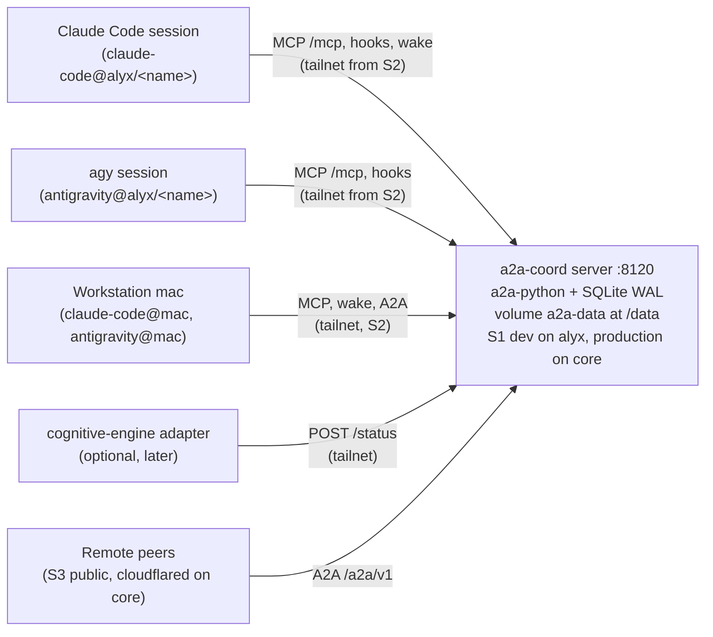

# A2A Coordination Plugin: Consolidated Architecture and Roadmap

> [!NOTE]
> **Canonical document** for the A2A coordination plugin: one A2A (Agent2Agent 1.0.1) server so live, side-by-side coding-agent sessions (Claude Code and Google Antigravity `agy`) exchange tasks, with remote agents joining later over HTTPS.
> Home: [`agentic-hub/plugins/coordination`](file:///home/rockad/projects/agentic-hub/plugins/coordination), branch `feat/coordination` (repo [`agentic-hub`](file:///home/rockad/projects/agentic-hub)).
> The former research repo `~/projects/agents-bridge` is **retired**; its `plans/`, `research/` and `specs/` were copied into this plugin's `docs/` and this file is the continuation of its plan (the filename is kept for link stability).
> Status (2026-11-04): **DDR-004 ACCEPTED** with 24 binding decisions (13 from the `/clarify` session, 14 to 24 from the later `/cplain` decisions, Section 3); **PLANNING ONLY** (implementation only where strictly necessary for a spike). Planning is complete; the next step is the S0 spikes on alyx. No urgency. No public route exists (Risk 13).
> Evidence labels used below: **verified** (read in code or official docs by an auditor), **reported** (README or PR text, or a user-relayed statement), **unverified** (not yet tested). The audits were run by Sonnet subagents; the labels are theirs.

---

## 1. Executive Summary & Core Consensus

### Purpose & Scope
The plugin provides a provider-agnostic coordination substrate for N >= 2 autonomous agents across heterogeneous harnesses: [Google Antigravity](file:///home/rockad/.gemini/antigravity-cli), [Claude Code](file:///home/rockad/.claude), and later remote agents. OpenCode stays a candidate third peer (unconfirmed by the user).

### Core Consensus (Architectural Foundations)
- **Symmetric Peer Agency**: all communicating agents interact as equals; either side can open tasks to the other. Master/dependent or caller/subordinate patterns are prohibited.
- **Live Conversation-to-Conversation**: transports connect long-lived interactive sessions with warm context. One-shot ephemeral subprocess execution (`agy -p`, `claude -p`) is prohibited, and nothing may launch, drive or wrap `agy` (DDR-003).
- **One server, A2A on the wire**: a single containerised server on `a2a-python` (>= 1.3.0) owns the task store and speaks A2A (JSON-RPC and REST, all 11 core operations). The old "A2A principles over a file carrier, ACP drop-in later" approach is superseded (DDR-002).
- **Core of cognitive-engine stays daemon-free**: the server sits outside [`rockad/cognitive-engine`](file:///home/rockad/projects/cognitive-engine); cognitive-engine is at most an optional one-way status client (decision 13).
- **Resource contention via BuildSlot**: Docker and GPU arbitration stays with the zero-daemon `BuildSlot` protocol (cognitive-engine PR #13); see Section 5.
- **Untrusted by default**: every message body is data, never an approval and never a command; tasks are parked, never auto-executed.

### Architecture at a glance

Deployment host (decision 23): the service is a portable image that can run anywhere. Production runs on `core` (always on, live while the workstations are shut down); S1 development and the spikes run on alyx. Nothing in the image names a host: the public origin and the deploy-host label are configuration (`A2A_PUBLIC_URL`, `A2A_DEPLOY_HOST`).

Server endpoints (port 8120, decision 5):
- `/mcp`: MCP tools, streamable HTTP, served by the server itself (precedent: lookup at `127.0.0.1:8100/mcp`, already configured in agy). Write tools behind an opt-in flag.
- `/a2a/v1`: A2A JSON-RPC and REST, all 11 core operations.
- `/wake/listen`: long-poll wake endpoint, one parked listener per handle.
- `/sessions`: session registration (handle binding).
- `/status`: one-way status intake (`POST` only).
- `/.well-known/agent-card.json`: Agent Card with `securitySchemes` bearer, declaring only what is implemented.

Identity (decision 6):
- One Agent Card per harness and machine: `claude-code@alyx`, `antigravity@alyx`, and the same pair on `mac` (decision 23); a harness on `core` gets its own card (`claude-code@core`, `antigravity@core`).
- Per-session handles under a card: `claude-code@alyx/<session-name>`.
- Address a handle: that session. Address a card: newest live listener, else queued.
- Handles are our extension; the mapping to A2A (`contextId` and `metadata`) is documented in [`server-api.md`](file:///home/rockad/projects/agentic-hub/plugins/coordination/docs/specs/server-api.md).

Inbound trust by origin (decision 10):
- Own local handles: `SUBMITTED`; the session takes the task through `a2a_inbox`.
- Allowlisted remote (a peer that holds a `remote-peer` API key, decision 18): `QUARANTINED` (our extension, shown to the sender as `INPUT_REQUIRED`) until a human releases it with `a2a-coord review` on a real TTY, one typed decision per task (decision 19). No code path releases a task automatically.
- Unknown remote: `REJECTED`.
- "Offered until confirmed": `SUBMITTED` to `WORKING` only by tool call; unconfirmed offers are re-offered.

Auth scopes (decisions 11 and 24): service-issued API keys, sent as an HTTP bearer credential, created by `a2a-coord key create`, shown once, stored hashed. Format `a2ak_<env>_<keyid>_<secret>` (for example `a2ak_live_...`):
- `local-harness`: `/mcp`, `/wake/*`, `/sessions`, `/a2a/v1` (`/sessions` is implied by the decision 6 binding). One key per harness per machine; the server also checks that the Tailscale node identity matches the machine the key was issued for, for every harness key including alyx (decisions 17 and 23).
- `remote-peer`: `/a2a` only; never `/mcp`, `/wake` or `/sessions`. One key per peer, hashed, revocable, rate-limited (decision 18).
- `status-client`: `POST /status` only.

Admin access (decisions 15 and 23): `a2a-coord` admin commands (`key create|list|rotate|revoke`, `review`) run inside the container, on whichever host runs it (core in production): `ssh core`, then `docker compose exec -it coordination a2a-coord ...`, over an in-container Unix socket that is not published on any port. There is no admin HTTP endpoint and no admin API-key scope. Docker access on that host is the credential.

---

## 2. Mandatory Requirements & Constraints

### Operational & Behavioral Constraints
- **Vertical Markdown Lists Only**: all documentation and bridge communications use `- item` lists. Inline enumerations are prohibited.
- **Clickable File Links**: referenced paths use Markdown links with the `file://` scheme.
- **Licensing Constraint (Standing User Rule)**: any tool, library or protocol whose terms restrict Anthropic, Claude Code or partner agents is excluded from adoption, benchmarking and testing. This applies symmetrically to Antigravity (DDR-003).
- **Host Configuration Hygiene**: third-party tools and system services (Tailscale, `cloudflared`) must be approved and installed by the user; agents never silently edit host systemd units, harness hook settings or dotfiles. None of `tailscale`, `cloudflared` or `caddy` is installed on alyx today (reported by the user's decision record). The user's existing Cloudflare Tunnel (`cloudflared`) runs on core (reported by the user, decision 20); the S3 ingress rule is added by the user.
  - Exception by decisions 16 and 24: the planned `a2a-coord install --claude --agy` installer writes harness hook and MCP configuration, and only when the user runs it. Non-secret parts that live in chezmoi-managed files are edited through chezmoi (edit the chezmoi source, then apply), never by writing the targets directly. API keys never go into chezmoi-managed files (decision 24). Until the installer exists, agents still write none of these files.
- **Scope Rule (amended by DDR-004)**: the daemon and container restrictions are lifted for this plugin. **Planning only remains**: implementation happens only where strictly necessary for a spike (S0), until the user starts S1. Code on [`cognitive-engine`](file:///home/rockad/projects/cognitive-engine) (BuildSlot PR #13, the later status adapter) follows that repository's own process.
- **Structural reference only**: the `memory` plugin (`plugin.json`, `docker-compose.yml`, `servers/lookup`) is a layout reference; this plugin never depends on it, because it may be retired.

---

## 3. Architectural Decision Records (DDRs)

### DDR-001: Hybrid Architecture & Exclusion of Restrictive Tooling
- **Status**: **ACCEPTED & APPROVED** (`2026-11-03T14:07:22+02:00`), then **PARTLY SUPERSEDED** (`2026-11-03T14:30:00+02:00`). **Exclusions remain IN FORCE.**
- **Context**: explored embedding mailbox daemons vs. CLI relays vs. decoupled substrates.
- **Decisions**:
  - `phone-a-friend` (Apache-2.0): adopted initially, then purged and uninstalled when the audit showed it only supported one-way caller-to-subordinate subprocess execution.
  - `mcp_agent_mail_rust`: permanently excluded because of the `OpenAI/Anthropic Rider` restricting Claude Code and Anthropic agents. **In force.**
  - `BuildSlot` protocol: retained and adopted for resource serialization in [`packages/harness2`](file:///home/rockad/projects/cognitive-engine/packages/harness2). **In force.**

### DDR-002: Communication Foundation: ACP with A2A Principles
- **Status**: **SUPERSEDED by DDR-004 (2026-11-04)**, both the file-channel carrier and ACP. Kept as history.
- Originally **ACCEPTED & APPROVED BY USER** (`2026-11-03T15:21:25+02:00`), phasing approved (`2026-11-03T15:30:55+02:00`).
- **Verbatim user approval (historical)**: *"Do you approve Claude's "A2A principles immediately + ACP carrier drop-in ready" phasing plan? - Yes"*
- **What it decided (historical)**:
  - Phase 1: adopt the A2A task-state vocabulary and agent-card-style identity in JSON-RPC envelopes over the live file channel.
  - Phase 2: move the wire to ACP once remote transports and live TUI participation matured.
- **What replaces it**: A2A is now the real wire (`a2a-python` server, HTTP bindings), not a vocabulary over files. ACP is removed from the plan entirely (decision 7). The file channel is frozen (decision 7).

### DDR-003: Side-by-Side Peer Architecture & Symmetric Antigravity Protection
- **Status**: **ACCEPTED & APPROVED BY USER** (`2026-11-03T16:01:41+02:00` and `2026-11-03T16:02:43+02:00`). **IN FORCE.**
- **Verbatim user directives**:
  - *"all agents/harnesses would be run side by side, not 'agy from claude' or similar"* (recorded first-hand by Antigravity at 16:01:41)
  - *"Keep, but never wrap agy"* (recorded first-hand by Claude Code at 16:02:43)
  - *"Yes, apply to Antigravity"* (recorded first-hand by Claude Code at 16:02:43)
- **Decisions**:
  - **Hard prohibition on agent wrapping**: nothing launches, drives, wraps or executes `agy` (no `agy -p`, no PTY or tmux, no `agentapi`, no caller/subordinate relays). Both harnesses run side by side as independent peers.
  - **Symmetric restrictive-terms rule**: "skip options whose terms restrict Claude Code" applies to Antigravity too. No design may depend on Antigravity access patterns that Google's Terms or FAQ prohibit.
- **Amendment 2026-11-04 (by DDR-004)**: the sentence "communicating through local files and standard protocol envelopes" no longer describes the carrier; peers communicate through the A2A server. The wrapping ban and the terms rule are unchanged.

### DDR-004: A2A Coordination Server (Container + MCP at /mcp + Hook Wake, Staged Exposure)
- **Status**: **ACCEPTED (2026-11-04)**, after the `/clarify` session with the user. The 13 decisions below are binding, and so are decisions 14 to 24 from the later `/cplain` decisions (second table below), which amend decisions 7, 10, 11, 12 and 13.
- **User direction (2026-11-04, Claude Code session)**: *"I want to expore a2a path more and build an mcp+hooks+ a docker container with the persistent volumes mounted to store the data. I want to expose it at some point to the web, where other agents could connect via https or other protocol."*
- **Evidence**: [`a2a-mcp-wake-audit-2026-11-04.md`](file:///home/rockad/projects/agentic-hub/plugins/coordination/docs/research/a2a-mcp-wake-audit-2026-11-04.md) and its four input reports.
- **Why build, not adopt**: no audited project combines an A2A server, persistent tasks, per-session addressing, an MCP facade and a compliant wake; several spawn agent CLIs (DDR-003 or live-session violations) (verified by audit).
- **Standing rules this changed**:
  - Zero-daemon principle: lifted for this component; the cognitive-engine core stays daemon-free.
  - DDR-002 carrier and ACP: superseded.
  - DDR-003 carrier wording: amended; the wrapping ban is unchanged.
  - Planning-only scope: remains, with the spike exception.
  - Old Phase 2 ledger forks A and B, Phase 3 swarmail, Phase 4 ACP: superseded.

#### Decision table (the user's choices, 2026-11-04)

| # | Decision | Rationale |
| :-- | :--- | :--- |
| 1 | **DDR-004 accepted.** User's answer, as recorded: *"Daemon and container restrictions lifted. Planning-only remains: implementation only where strictly necessary for a spike."* | A container-hosted server cannot exist under the old zero-daemon rule; planning-only stays so nothing is built before the spikes answer the open questions. |
| 2 | **One home.** User's answer, as recorded: *"Everything lives in agentic-hub/plugins/coordination (one repo, one branch feat/coordination). agents-bridge retired. Memory plugin = structural reference only; do not depend on it (it may be retired)."* | One repo and one branch avoid split sources of truth; depending on a plugin that may be retired would strand the server. |
| 3 | **Stack**: Python on `a2a-python` (>= 1.3.0), `uv`, Docker. | Official SDK with all 11 operations and a SQL task store (verified); Python and `uv` match cognitive-engine. |
| 4 | **Storage**: one server process owns SQLite (WAL, `busy_timeout`) on named volume `a2a-data` mounted at `/data`, via a2a-python `DatabaseTaskStore`; everyone else uses HTTP; Postgres later only by a SQLAlchemy URL change. | A single writer sidesteps SQLite multi-process hazards and the immature cluster mode; WAL and busy timeout are gaps the SDK does not fill (verified). |
| 5 | **Surface**: the server itself serves MCP tools at `/mcp` (streamable HTTP, like lookup) plus `/a2a/v1`, `/wake/listen`, `/sessions`, `/status` and the Agent Card, on port 8120; write tools behind an opt-in flag. | One process and one URL work the same for agy and Claude Code and survive the move to tailnet or public exposure; 8120 avoids 8100-8110 and 11434. |
| 6 | **Identity**: one Agent Card per harness and machine; per-session handles under it; handle addresses a session, card addresses the newest live listener else queues. Binding for Claude Code (**unverified, SP2 C-half**): `SessionStart` hook `POST /sessions`, handle injected into context, first MCP call `a2a_hello(handle)` ties `Mcp-Session-Id` to the handle. **Binding for agy (verified on the wire, SP2 A1 and A4, 2026-11-04): the handle binds to `_meta["antigravity.google/conversation_id"]` on each `tools/call`, never to `Mcp-Session-Id`, which is per agy process and shared across conversations.** The id is distinct per conversation, stable across exit and `agy --conversation <id>` resume, and subagent calls carry their own `conversation_id` plus `root_conversation_id` and `parent_conversation_id`; the server groups sub-invocations under the parent handle by `root_conversation_id`. `/clear` in agy creates a new conversation and so a new handle. | Cards stay honest and few while sessions stay individually addressable; the agy route needs no wrapping and is verified, the Claude Code route is still untested. Handles are our extension (mapping documented in `server-api.md`). |
| 7 | **ACP out; channel frozen then migrated.** User's answer, as recorded: *"ACP removed from the plan entirely. The file channel (~/.agents/bridge-v2-coordination-channel.md and other ~/.agents channel files) is frozen now: nobody uses it. After go-live, a one-time migration imports those channel files into the plugin's store, then the channel is deleted."* **Amended by decision 14: go-live is after S3, and Antigravity may use the channel for research on this work until then.** | ACP's remote transport and live-TUI participation stayed unproven and Terms-risky; a frozen channel avoids two sources of truth, and a one-time import keeps the history. |
| 8 | **Claude Code wake**: `asyncRewake` command hook on `SessionStart` and `Stop` running a `sh`+`curl` script (`a2a-listen`) that long-polls `POST :8120/wake/listen` in 900 s rounds (in production the hooks on alyx and mac poll core over the tailnet, decision 23); `UserPromptSubmit` HTTP hook for the busy path; one parked listener per handle; wake budget 20/h per handle; Claude Code >= 2.1.290 (reported), interactive CLI only. Inbox socket is a later spike candidate; Channels not used. | The only compliant idle wake found (hook semantics verified, design borrowed from switchboard); the stub-only wake and the budget bound the injection and runaway-loop risk. |
| 9 | **agy**: MCP (`url` `:8120/mcp`; `serverUrl` is accepted as the legacy key per agy's `mcp_servers.md`, line 66) plus our `SessionStart` hook (register handle, `injectSteps`) plus a `PreInvocation` hook (curl pending count, 2-5 s, `injectSteps`) plus an `AGENTS.md` rule to check the inbox at session start plus an `a2a_wait` tool. Held-`Stop` park is **spike only, not shipped**. No idle wake for agy (accepted asymmetry). Nothing may launch, drive or wrap agy. | The official hooks page documents no async or rewake option (verified), so only surfacing at the next model call is compliant; DDR-003 forbids everything else. |
| 10 | **Inbound trust by origin** (allowlist and release refined by decisions 18 and 19): local handles `SUBMITTED`; allowlisted remote `QUARANTINED` until a human releases it with `a2a-coord review` on a real TTY with typed confirmation; unknown remote `REJECTED`. Bodies framed as untrusted data; wake text is a constant stub; bodies only in tool results; tasks parked, never auto-executed; "offered until confirmed". | Remote text must never reach an agent as an instruction or approval; a human gate on a real TTY mirrors cognitive-engine's typed-approval model. |
| 11 | **Auth**: scoped bearer credentials per agent: service-issued API keys from `a2a-coord key create` (shown once, stored hashed; renamed from "token" by decision 24); scopes `local-harness`, `remote-peer`, `status-client`; card declares `securitySchemes` bearer; loopback still needs a key; constant-time compare; Host and Origin checks; refuse non-loopback bind without TLS proxy config. Add-ons by stage: tailnet identity check, then rate limits and optional mTLS (refined by decisions 17, 18 and 24; admin access by decision 15). | Least privilege per agent; a remote peer can never reach `/mcp`, `/wake` or `/sessions`; loopback is not a trust boundary on a multi-process host. |
| 12 | **Exposure**: S1 localhost `127.0.0.1:8120` on alyx; S2 tailnet via `tailscale serve` for own machines alyx, mac, core; S3 public HTTPS. **Revised by decision 23: S1 is dev and spikes on alyx; S2 is production on core, with alyx and mac reaching core over the tailnet from day one; S3 is the existing Cloudflare Tunnel on core pointing at core's own localhost:8120** (decision 20). The earlier "bigrockad.com reverse proxy or Cloudflare Tunnel, choice deferred" is closed. Gates in Section 5. | Each step widens the audience only after the controls for that audience exist; the user keeps the explicit go for public. |
| 13 | **cognitive-engine**: optional one-way status client, contract specified now, built after S1 in a cognitive-engine adapter package, off by default, on the user's go: `POST /status`, scope `status-client`, body `{run_id, run_scope, state, report_path, ts}`. Never prompts, model text, transcripts or denial counts. Never receives tasks; the server is never a second approval path; `audit.jsonl` stays the source of truth; model sessions (sbx) never reach `:8120`. **Amended by decision 23: in production the status client posts to core over the tailnet; sbx model sessions still never reach the service, at any address.** | Keeps the deterministic core and its typed-approval gate authoritative; R-18: `sessions_summary.denied_requests` counts path denials only, so no field of it may be shown as a general denial count. |

#### Decisions 14-24 (2026-11-04, /cplain)

The user's later choices, same day as the 13 above (14 to 22 in the `/cplain` session; 23 and 24 afterwards, with the S3 hostname and route facts of the same day). Binding. Section 7 (open decisions) is closed by them. Decisions 23 and 24 revise 15, 16, 17 and 20 as marked in those rows.

| # | Decision | Rationale and consequences |
| :-- | :--- | :--- |
| 14 | **Go-live is after S3** (public stage). The `~/.agents` file channel stays frozen until then, with **one exception: Antigravity may still use it for research on this work.** Import, tar backup and deletion happen after S3. Amends decision 7. | Keeps the old channel available to the one agent still researching until the whole server is public. Consequence: the import must tolerate appends made after 2026-11-04 (expected counts are re-measured at go-live). [`go-live-migration.md`](file:///home/rockad/projects/agentic-hub/plugins/coordination/docs/plans/go-live-migration.md) is updated. |
| 15 | **Admin access**: `a2a-coord` admin commands (`key create\|list\|rotate\|revoke`, `review`) run inside the container with `docker compose exec -it coordination a2a-coord ...`, over an in-container Unix socket that is not published on any port. **No admin HTTP endpoint, no admin API-key scope.** Docker access on the host is the credential; `review` requires a TTY. **Per decision 23 the host is whichever one runs the container (core in production): `ssh core`, then the `docker compose exec -it` command.** | No admin surface on the network at any stage, so S3 exposure cannot reach it. Closes the "admin plane" open point in [`server-api.md`](file:///home/rockad/projects/agentic-hub/plugins/coordination/docs/specs/server-api.md) 3.7. |
| 16 | **Harness setup**: one installer, `a2a-coord install --claude --agy`, configures both harnesses (Claude Code hooks and MCP entry; agy MCP entry with `headers.Authorization` plus agy hooks). **Non-secret parts that live in chezmoi-managed files go through chezmoi** (edit the chezmoi source, then apply), never by writing the targets. **Keys never go into chezmoi-managed files (decision 24).** The user accepted the R8 grey area (our software writing agy's config). Nothing launches, drives or wraps agy (DDR-003 unchanged). | Replaces the "snippets versus plugin manifest" question. **Rewritten by decision 24, which replaces the earlier "chezmoi secret template" approach:** the Claude Code key comes from the environment (`A2A_API_KEY`); the agy key is written literally into an unmanaged, plugin-scoped `.agents/plugins/coordination/mcp_config.json` (mode 0600) outside chezmoi, because agy does not interpolate env vars in `headers` (verified on the wire in the SP2 A6 follow-up). `~/.gemini/config/mcp_config.json` (chezmoi-managed as `dot_gemini/config/private_mcp_config.json.tmpl`) is not edited for the key. |
| 17 | **Own machines on the tailnet** (alyx, mac, and core where a harness runs) get one `local-harness` API key per machine with their own cards (`claude-code@mac`, `antigravity@core`). The server additionally checks that the Tailscale identity (node or user) matches the machine the key was issued for. **Per decision 23 this applies to all harness keys, including alyx, because production is on core and every workstation reaches it over the tailnet.** | Replaces the "assumed" wording. A stolen key alone does not work from another machine. How the server obtains the identity from `tailscale serve` on core is **unverified** (later-stage spike, [`spikes.md`](file:///home/rockad/projects/agentic-hub/plugins/coordination/docs/specs/spikes.md) section 13). |
| 18 | **Remote peers (S3)**: one API key per peer (`remote-peer` scope), hashed, revocable, rate-limited. Quarantine is the backstop. mTLS is optional later, per peer. **Allowlist = peers that hold a `remote-peer` key** (modelled as `cards_allowed` on the key, as in server-api.md). | One identity mechanism, no separate peer registry. A key holder is still untrusted: quarantine and human release apply to everything it sends. Per decision 24 a remote peer receives its key out of band. |
| 19 | **Quarantine release**: only a human, one typed decision per task on a TTY via `a2a-coord review`. **No auto-release path in code**: no rules, no agent pre-screen. | Keeps decision 10's human gate absolute. Expiry of an unreleased task moves it to `REJECTED`, never to released. |
| 20 | **Public front door (S3)**: the user's **existing Cloudflare Tunnel (`cloudflared`) on core**. An ingress rule for a hostname like `a2a.bigrockad.com` forwards to core's own `localhost:8120` (decision 23: the service runs on core in production, so there is no tunnel-to-tailnet hop). Consequences, documented in server-api.md 8.4.1: Cloudflare sees decrypted traffic; client IP only via `CF-Connecting-IP`, trusted only for requests that arrive from `cloudflared` on the same host; Host and Origin checks and rate limits account for it; Cloudflare's request timeout of about 100 s (**reported**, unverified for the user's plan). | Closes the "reverse proxy versus Cloudflare" point. The chosen hostname is `a2a.bigrockad.com`. No route exists now: one was created and deleted on 2026-11-04, and it is created only at S3 (Risk 13). `bigrockad.com` runs no separate reverse proxy for this. The server still never binds a non-loopback address: workstations reach it through `tailscale serve` on core (S2), and `cloudflared` reaches it on core's loopback (S3). |
| 23 | **Deployment host**: the service is a portable image that can run anywhere; **production runs on `core`** (always on, live while the workstations are shut down). Revised stages: **S1** dev and spikes on alyx, `127.0.0.1:8120` only; **S2** production on core, every workstation (alyx, mac) reaches core over the tailnet from day one, and the Tailscale node binding of decision 17 applies to all harness keys including alyx; **S3** public via the existing `cloudflared` tunnel on core pointing at core's own `localhost:8120`. Wake hooks on alyx and mac long-poll core over the tailnet; the woken sessions are still local; core only holds tasks while workstations are offline. Admin (decision 15) runs on the host that runs the container: `ssh core`, then `docker compose exec -it coordination a2a-coord ...`. The cognitive-engine status client posts to core over the tailnet; sbx model sessions still never reach the service. Go-live (decision 14) is unchanged: after S3. Production references to `alyx:8120` are replaced by core; alyx stays for S1 and dev. The host is configuration (`A2A_PUBLIC_URL`, `A2A_DEPLOY_HOST`), so the image stays portable. | An always-on host means coordination keeps working with the workstations off and tasks wait for them. Consequences: wake latency and tailnet availability become dependencies (Risk 12); the Tailscale check and Cloudflare front door now terminate on the same host, which changes how `CF-Connecting-IP` and Tailscale identity are told apart (server-api.md 8.4.1, `spikes.md` section 13). Amends decisions 12, 15, 17 and 20. |
| 24 | **API keys and client key storage** (replaces the earlier chezmoi-secret approach). Credentials are **service-issued API keys**, like Claude API keys: format `a2ak_<env>_<keyid>_<secret>` (for example `a2ak_live_...`), created by `a2a-coord key create --scope <local-harness\|remote-peer\|status-client> --agent <card> [--tailnet-node <node>] --expires <dur>`, shown once, stored hashed with the `keyid` indexed. Fields: scope, owner card, tailnet node binding, created, expires, last used, revoked. Commands `key create\|list\|rotate\|revoke` run through the admin socket (decision 15). "Token" is renamed "API key" wherever it means these credentials; "bearer" stays for the HTTP scheme. **Client storage**: Claude Code keeps the key in the environment variable `A2A_API_KEY`, referenced from the MCP entry's `Authorization` header by env expansion (Claude Code header expansion is **unverified**, added to SP2 Claude half); agy gets the key written literally (agy does not expand env vars in headers, verified on the wire) into an **unmanaged** plugin-scoped file `.agents/plugins/coordination/mcp_config.json`, mode 0600, outside chezmoi. Whether agy loads a user-level plugin config from `~/.agents/plugins/` (versus workspace level only), and whether `~/.agents` collides with the frozen bridge folder, are **unverified** (new check SP2 A8); the fallback is a non-chezmoi include chosen by the user. **chezmoi-managed files never hold keys and are not edited for keys.** The cognitive-engine status client and remote peers hold keys the same way; a remote peer receives its key out of band. | Keeps secrets out of the dotfiles repository by construction instead of by template. The installer (decision 16) still configures non-secret parts through chezmoi where those files are chezmoi-managed. The "secret backend" open point of round 2 is removed. Amends decisions 11 and 16. |
| 21 | **Research clones**: all six evaluation clones in `~/projects` are deleted, including the `A2A` spec clone. Their sources and pinned commits are recorded in Section 8. | Pinned GitHub URLs replace every local-clone reference (the former `file://` links to the `A2A` clone). |
| 22 | **`SendMessage` waiting**: blocking requests are capped at **60 s** (below Cloudflare's ~100 s), then the server returns the current non-terminal Task (`SUBMITTED` or `WORKING`). Non-blocking requests are honoured as they are. Documented deviation from A2A 1.0.1's default wait; stated in the Agent Card `description` (server-api.md 8.5). | Fits inside the front door's timeout. The deviation stays a deviation: a TCK run in CI may still flag it. |

Never exposed by the server (decision 13, reported by the cognitive-engine session):
- Anything that starts a sweep or grants an approval.
- Credentials: OpenRouter key, the RFC 006 credential route, Claude or agy tokens.
- Run directories and transcripts.
- Jev config tools such as `jev_set_mode`.

---

## 4. Candidate Audit & Evidence Matrix

| Candidate / Technology | License | Verdict | Evidence Label | Key Findings & Limitations |
| :--- | :--- | :--- | :--- | :--- |
| **`a2a-python` >= 1.3.0 (official SDK)** | Apache-2.0 | **ADOPTED (build base, decision 3)** | `[VERIFIED]` by Sonnet audit | All 11 core operations, JSON-RPC, REST and gRPC; SQLAlchemy `DatabaseTaskStore` (SQLite, Postgres, MySQL); about 1,700 tests with TCK in CI. Gaps we fill: SQLite WAL and busy timeout, inbound auth, push-notification SSRF screening (opt-in, default off), `/wake/listen`, `/mcp`. Cluster mode (about five weeks old) is **not used**. See [`t1c-bridges-and-sdks.md`](file:///home/rockad/projects/agentic-hub/plugins/coordination/docs/research/a2a-audit-2026-11-04/t1c-bridges-and-sdks.md). |
| **`A2A` spec 1.0.1** | Apache-2.0 | **Adopted as the wire protocol** | `[VERIFIED]` | Eight task states and the Agent Card; we add `QUARANTINED` as a documented extension, surfaced to senders as `INPUT_REQUIRED`. Spec sources: [`a2aproject/A2A` at commit `4735f48`](https://github.com/a2aproject/A2A/tree/4735f4876449c6f381825d8a841b31b16c6ad0c4) (the local clone is deleted, decision 21). |
| **`a2a-js` 1.3.0** | Apache-2.0 | Not chosen (second choice) | `[VERIFIED]` | All 11 operations; DB stores only since 2026-09-29; Bun unverified. |
| **`a2a-go` 2.7.0, `a2a-rs` 0.x** | Apache-2.0 | Not chosen | `[VERIFIED]` | Go language fit (a2a-go); in-memory only and partial (a2a-rs). |
| **A2A/MCP bridges and wake projects** (`mgcrea/mcp-a2a`, `TonPC64/mcp-a2a-bridge`, `toshiotomikawa/a2a-bridge`, `GongRzhe/A2A-MCP-Server`, Docker Agent, `switchboard`, `interlink`, `agent-group-mcp`) | MIT / Apache-2.0, no riders | **Borrow patterns or Reject** | `[VERIFIED]` by Sonnet audit | None adoptable. Four spawn or drive agent CLIs: toshiotomikawa (`agy -p`, `claude -p`, `codex exec`), TonPC64 examples (`claude -p`, `copilot -p`), Docker Agent harness (`claude --print`), zb-ss (`agy agentapi send-message`). Borrowed: park inbound as `SUBMITTED`, stub-only wake, offered-until-confirmed, one listener per session, wake budget, write tools opt-in, honest cards. Matrix in [`a2a-mcp-wake-audit-2026-11-04.md`](file:///home/rockad/projects/agentic-hub/plugins/coordination/docs/research/a2a-mcp-wake-audit-2026-11-04.md). |
| **Current file channel + watchers** | N/A (in-house) | **FROZEN (decision 7; Antigravity research exception, decision 14); imported after S3, then deleted** | `[VERIFIED]` | [`bridge-v2-coordination-channel.md`](file:///home/rockad/.agents/bridge-v2-coordination-channel.md) and [`watch-bridge-coordination.sh`](file:///home/rockad/.local/bin/watch-bridge-coordination.sh); inotify-reactive but no liveness signals or task states. Nobody uses it now, except that Antigravity may still use it for research on this work until go-live (decision 14). |
| **`BuildSlot` protocol** | MIT / Project | **Implemented / PR open** (separate track, Section 5) | `[VERIFIED]` for branch and PR; `[REPORTED]` for test counts | Zero-daemon `fcntl.flock` slot manager in `cognitive-engine/packages/harness2`. Branch `da1b199` and PR #13 verified; 65 tests in test_coordination.py pass at da1b199; full suite 5508 passed / 22 skipped measured at 6c0ac4d only (reported). |
| **`ACP` (Agent Client Protocol v1)** | Apache-2.0 | **REMOVED from the plan (decision 7)** | `[VERIFIED]` for spec; `[REPORTED]` for adapters; `[UNVERIFIED]` for live TUI | Was the planned future carrier. Dropped: remote transport unfinalized, live-TUI participation unproven, Antigravity adapters wrap `agy` (DDR-003). Background in [`r1-antigravity-terms-and-acp-gate-2026-11-03.md`](file:///home/rockad/projects/agentic-hub/plugins/coordination/docs/research/r1-antigravity-terms-and-acp-gate-2026-11-03.md). |
| **`bompus/swarmail`** | Clean MIT | **SUPERSEDED** (old Phase 3) | `[VERIFIED]` for code and docs | Daemon plus SQLite on `127.0.0.1:18765`; its installer writes agy `PreInvocation` and `Stop` hooks and its docs tested `agy -p` (R8, DDR-003). Replaced by the A2A server over tailnet (S2). |
| **`steveyegge/beads` (`bd`)** | Clean MIT | **SUPERSEDED** (old Phase 2 Fork B) | `[VERIFIED]` for code and docs | Dolt-backed ledger; single-writer by default; edits host configs unless opted out. Replaced by the A2A task store. Research kept in [`r2-beads-concurrency-and-footprint-2026-11-03.md`](file:///home/rockad/projects/agentic-hub/plugins/coordination/docs/research/r2-beads-concurrency-and-footprint-2026-11-03.md). |
| **In-house JSONL ledger** | N/A | **SUPERSEDED** (old Phase 2 Fork A) | n/a | Replaced by `DatabaseTaskStore` on SQLite. |
| **`dannystocker/mcp-multiagent-bridge`** | MIT | **REJECTED** | `[VERIFIED]` | 12 months unmaintained; 10 req/min limit; 3-hour session expiry; no task synchronization. |
| **`agent-bus`** | Clean MIT | **Watch item** | `[VERIFIED]` | Hash-chained event log with optional NATS or ntfy; possible audit-log engine later. |

---

## 5. Phased Implementation Roadmap

The old Phases 0-4 (baseline, heartbeat, ledger, swarmail, ACP) are replaced. The heartbeat sidecar files are superseded: liveness is now a parked listener or a registered session; [`heartbeat-spec.md`](file:///home/rockad/projects/agentic-hub/plugins/coordination/docs/specs/heartbeat-spec.md) stays as history.

Notes on gates (interpretation, see Section 7):
- "Entry gate" is the condition that must hold before the stage's exposure or build starts.
- "Exit gate" is the evidence that closes the stage.
- Every stage that adds a listener needs the user's explicit go; the gates are necessary, not sufficient.

### S0: Spikes
- **Objective**: answer the unverified mechanisms before any server code is shipped. Detail and pass criteria: [`docs/specs/spikes.md`](file:///home/rockad/projects/agentic-hub/plugins/coordination/docs/specs/spikes.md).
- **Deliverables** (summary; `spikes.md` is authoritative):
  - Claude Code wake: `asyncRewake` on `SessionStart` and `Stop` with the `sh`+`curl` listener; 200 wakes with the stub, 409 and 408 behaviour, honoured `timeout` 604800, whether wakes count toward the Stop continuation cap, Esc-interrupt behaviour (reported failure modes, unverified in practice).
  - Handle binding: `SessionStart` `POST /sessions`, handle in context, `a2a_hello(handle)` ties `Mcp-Session-Id` (unverified).
  - agy: `url` MCP entry at `:8120/mcp` (`serverUrl` accepted as legacy), `SessionStart` `injectSteps`, `PreInvocation` count injection within 2-5 s, whether `SessionStart` fires on resume.
  - Key storage (decision 24): whether Claude Code expands `${A2A_API_KEY}` in MCP header values (SP2 C9); whether agy loads an unmanaged plugin-scoped `.agents/plugins/coordination/mcp_config.json` from a user-level location and whether `~/.agents` collides with the frozen bridge folder (SP2 A8). Both unverified.
  - agy held-`Stop` park (maximum timeout, whether it blocks typing, whether `Stop` fires per turn, whether a background command wakes an idle session): spike only, never shipped.
  - Server: `DatabaseTaskStore` on SQLite with WAL and `busy_timeout` under concurrent HTTP clients; A2A app and streamable-HTTP MCP in one process.
  - Candidate for later: Claude Code inbox socket frame shape.
- **Entry gate**: user approves each host change a spike needs (hook entries, MCP config); spikes run in a scratch directory and scratch container.
- **Exit gate**: the S1 entry gate in `spikes.md` section 11 is met (SP1, SP2, SP3, SP5 passed or failed-with-fallback; SP4 recorded; SP6 optional), with results in `docs/research/spike-results-<date>.md`.
- **Kill switch**: remove the spike hook and MCP entries, delete the scratch container and directory. Nothing persists on the host.

### S1: Dev on alyx (127.0.0.1:8120 only)
- **Objective**: a working server for the two live harnesses on alyx, with API keys, wake and the full trust model, loopback only. S1 is the development and verification stage (decision 23); production is S2 on core. Keys issued here are `a2ak_dev_...` and never work on production (`A2A_ENV`).
- **Deliverables**:
  - Plugin layout modelled on `memory` without depending on it:
    - `plugin.json`
    - `docker-compose.yml` with named volume `a2a-data`
    - `servers/<name>`
  - Server on `a2a-python` with all endpoints from Section 1; API contract in [`server-api.md`](file:///home/rockad/projects/agentic-hub/plugins/coordination/docs/specs/server-api.md).
  - `a2a-coord` CLI: `key create|list|rotate|revoke` and `review` as admin commands run inside the container over an in-container Unix socket, no admin HTTP endpoint (decisions 15 and 24); `install --claude --agy` on the host (decision 16).
  - Agent Cards `claude-code@alyx` and `antigravity@alyx`, honest `securitySchemes`.
  - Claude Code: `a2a-listen` hook script, `UserPromptSubmit` hook, wake budget.
  - agy: MCP entry, `SessionStart` and `PreInvocation` hooks, `AGENTS.md` inbox rule, `a2a_wait`.
  - Harness setup by the installer `a2a-coord install --claude --agy` (decisions 16 and 24): writes the Claude Code hooks and MCP entry (key referenced as `A2A_API_KEY`), the agy hooks, and the agy MCP entry with the key written literally into the unmanaged `.agents/plugins/coordination/mcp_config.json` (mode 0600). Non-secret parts in chezmoi-managed files go through the chezmoi source and `chezmoi apply`, never the targets; no key ever enters a chezmoi-managed file. Detail in [`server-api.md`](file:///home/rockad/projects/agentic-hub/plugins/coordination/docs/specs/server-api.md) section 11.0.
  - Trust model: `SUBMITTED`, `QUARANTINED`, `REJECTED`, offered-until-confirmed, untrusted-data framing.
  - Tests for state machine, auth scopes, Host and Origin checks, wake budget and listener supersession.
- **Entry gate**: S0 done; user go for S1.
- **Exit gate**:
  - A task round-trips in both directions between a live Claude Code session and a live agy session.
  - An idle Claude Code session is woken by a stub; an agy session sees the pending count at its next model call.
  - A request without an API key, or with a wrong-scope key, is refused on loopback.
  - Quarantine and review work end to end with a local test peer.
- **Kill switch**: `docker compose down`, remove the hook and MCP entries (`a2a-coord install --uninstall`; chezmoi-managed parts through chezmoi), revoke API keys. Until the go-live migration runs (after S3, decision 14), the frozen channel files are untouched by the server.

### S2: Production on core (workstations alyx and mac over the tailnet)
- **Objective**: run the service on `core`, always on, so coordination works while the workstations are shut down; every workstation reaches it over Tailscale from day one (decision 23). Still no public listener at this stage.
- **Deliverables**:
  - The same image as S1, deployed on core with `A2A_ENV=live`, `A2A_DEPLOY_HOST=core` and `A2A_PUBLIC_URL` set for the tailnet name; the compose port mapping stays `127.0.0.1:8120` on core.
  - User installs Tailscale where missing (not installed on alyx today); `tailscale serve` on core fronts the loopback server, so the server itself never binds a non-loopback address. Workstation traffic goes over the tailnet, not the public hostname.
  - Agent Cards per machine (`claude-code@alyx`, `antigravity@alyx`, `claude-code@mac`, `antigravity@mac`, and `core` cards if a harness runs there); one `local-harness` API key per harness per machine (decisions 17 and 24).
  - Tailscale identity (node or user) as an extra check on top of the bearer key, for **all** harness keys including alyx's: the server accepts a key only from the Tailscale identity it was issued for (decisions 17 and 23). The mechanism that delivers the identity to the server is unverified (spike, [`spikes.md`](file:///home/rockad/projects/agentic-hub/plugins/coordination/docs/specs/spikes.md) section 13).
  - Hooks on alyx and mac long-poll core over the tailnet (wake); the woken sessions are still local. Core holds tasks only while workstations are offline. Wake latency and the dependency on the tailnet are risks (Risk 12).
  - Admin on core: `ssh core`, then `docker compose exec -it coordination a2a-coord ...` (decision 15).
  - Cross-host wake test from the workstations.
- **Entry gate (decision 12)**: API keys and scopes live (S1 exit). **Public-route rule:** no public route exists. The service is never started on core while a public route to it is present, and no route is created before the S3 gate (Risk 13).
- **Exit gate (decision 12)**: cross-host wake works from alyx and mac to core, shown on at least one workstation before the rest are added.
- **Kill switch**: turn off the `tailscale serve` configuration on core (exact command depends on the installed Tailscale version, unverified) and revoke the per-machine API keys; the server stays on core's loopback. Or `docker compose down` on core.

### S3: Public HTTPS
- **Objective**: let allowlisted remote agents reach `/a2a/v1` and the public Agent Card over HTTPS.
- **Deliverables**:
  - Front door (decisions 20 and 23): the user's existing Cloudflare Tunnel (`cloudflared`) on core. `a2a.bigrockad.com` is the chosen S3 hostname, but **no route exists now**: the user created a route to `localhost:8120` on 2026-11-04 and deleted it the same day (verified by Claude Code: the hostname no longer resolves, curl returns 000). The route is created only at S3, after the S3 gate passes and on the user's explicit go. When it exists, `cloudflared` reaches the service on core's own loopback; there is no tunnel-to-tailnet hop. The ingress routes only `/a2a/v1` and the Agent Card path. TLS terminates at Cloudflare; the server stays on loopback and never binds a non-loopback address.
  - **Pending user decision at S3 (recommended, not decided):** the tunnel targets a dedicated loopback port (`localhost:8121`) that the server treats as the public listener (`remote-peer` keys only, `CF-Connecting-IP` trusted only there), while 8120 stays tailnet-only. This replaces the `Host`-based `A2A_TUNNEL_HOSTS` workaround and its forged-header weakness (`server-api.md` 8.4.1, `spikes.md` L2). Until the user decides, the `Host`-based design in `server-api.md` stands as the fallback.
  - No route and nothing listening where a route would point before the S3 gate (Risk 13). S2 workstation traffic goes over the tailnet through `tailscale serve`, not through the public hostname, so it does not depend on Cloudflare.
  - Consequences to design for (details in `server-api.md` 8.4.1):
    - Cloudflare sees decrypted traffic on the public hostname (accepted by the user's choice; see Risk 11).
    - Client IP comes only from `CF-Connecting-IP`, believed only for requests that arrive from `cloudflared` on the same host, told apart from `tailscale serve` traffic (also from core's loopback) by the Host value, or, if the user chooses the dedicated-port design above, by the listener port (`spikes.md` section 13, L2).
    - Host and Origin checks and rate limits account for the public hostname.
    - Cloudflare's request timeout of about 100 s (reported, unverified for the user's plan); `SendMessage` blocking is capped at 60 s (decision 22).
  - Rate limits per API key and per client IP in the server, plus whatever Cloudflare offers on the user's plan (unverified); optional mTLS later, per peer (decision 18).
  - Remote peers: one `remote-peer` API key per peer, delivered out of band (decision 24), hashed, revocable, rate-limited; the allowlist is the set of peers that hold one (decision 18); quarantine review flow in daily use, human release only (decision 19).
  - Honest public card: declares only the bearer scheme and capabilities actually enforced.
  - Fuzz pass for header smuggling, request splitting and SSRF, per cognitive-engine RFC 006 section 3 (proxy-class surface).
- **Gate (decision 12)**: quarantine live, rate limits, fuzz pass, honest card, and an explicit user go. Passing it is the condition for the user to create the route `a2a.bigrockad.com`.
- **Exit gate**: one allowlisted test peer completes a task through quarantine and human release; an unknown peer is rejected; the fuzz report is filed in `docs/research/`.
- **Kill switch**: delete the route from the Cloudflare Tunnel configuration on core, and revoke all `remote-peer` API keys; S1 and S2 keep working.

### Go-live migration
- **Timing (decision 14)**: go-live is after S3 (the public stage). Until then the `~/.agents` file channel stays frozen, with one exception: Antigravity may still use it for research on this work. Import, tar backup and deletion all happen after S3.
- **Objective**: one-time import of the frozen channel files into the store, then deletion of the channel. Procedure: [`docs/plans/go-live-migration.md`](file:///home/rockad/projects/agentic-hub/plugins/coordination/docs/plans/go-live-migration.md).
- **Deliverables** (summary; the migration plan is authoritative):
  - Importer for [`~/.agents/bridge-v2-coordination-channel.md`](file:///home/rockad/.agents/bridge-v2-coordination-channel.md) and the other `~/.agents` channel files, including whatever Antigravity appended for research before go-live.
  - Verification of the import and a tar backup of the channel files taken before deletion (decision 14).
  - Stop the turn watcher and delete the channel after the typed confirmation on a real TTY.
- **Entry gate**: S3 exit gate passed and the user declares go-live (decision 14).
- **Exit gate**: store holds the imported history, tar backup verified, watcher stopped, channel files deleted.
- **Kill switch**: the importer is repeatable on a fresh store; restore the channel files from the tar backup.

### Related: cognitive-engine status adapter (optional, after S1, user go)
- **Objective**: sweep state visible to peers without a second approval path.
- **Contract**: [`status-client.md`](file:///home/rockad/projects/agentic-hub/plugins/coordination/docs/specs/status-client.md): `POST /status`, scope `status-client`, body `{run_id, run_scope, state, report_path, ts}`.
- **Built in**: a cognitive-engine adapter package, off by default, never in the deterministic core.
- **Kill switch**: disable the adapter; revoke the `status-client` API key.

### Related: cognitive-engine BuildSlot
Former Phase 0 substrate content, unchanged in substance; it is independent of the server.
- **Objective**: eliminate rootless Docker and GPU build contention without a daemon.
- **Deliverables**:
  - Merge PR #13 (`feat/buildslot-protocol` @ `da1b199`, `2c814eb`) into `feat/stage1-integration` on [`rockad/cognitive-engine`](file:///home/rockad/projects/cognitive-engine).
  - Adoption call sites in cognitive-engine (gated on the user's go; spec section 7: `GATE` in `model_gate`, Docker suite wrapper, `stage1.py` teardown).
  - Spec: [`buildslot-spec.md`](file:///home/rockad/projects/agentic-hub/plugins/coordination/docs/specs/buildslot-spec.md).
- **Exit criteria**: PR #13 merged and the full suite passes under rootless Docker flocking with zero leftover containers.
- **Kill switch**: zero daemons; delete lock files under `$XDG_STATE_HOME/cognitive-engine/slots/` to clear held locks.
- **Installer role**: none; standard git workflow.

---

## 6. Risk Analysis & Mitigations

- **Risk 1: Google Terms of Service and Antigravity hooks**
  - *Description*: Google's FAQ says third-party tools accessing Antigravity violate its Terms and that wrapping `agy` in third-party agents is unsupported on consumer plans. ACP wrappers are gone from the plan, but our own `SessionStart` and `PreInvocation` hooks and MCP entry are third-party software attached to the product (the R8 grey area).
  - *Impact*: High if enforced (account suspension, per third-party reporting; enforcement against this pattern is not demonstrated).
  - *Mitigation*: nothing launches, drives or wraps `agy` (DDR-003); hooks and MCP run inside the user's own session and were chosen by the user (decision 9); the held-`Stop` park is spike only. The user owns the residual terms risk.
  - *Decision 16 widens the grey area knowingly*: the installer `a2a-coord install --claude --agy` is our software writing agy's MCP entry (an unmanaged plugin-scoped `mcp_config.json`, decision 24) and hooks (through chezmoi where that file is managed). The user accepted this R8 grey area. It still does not launch, drive or wrap agy.
- **Risk 2: Nesting deadlocks in concurrency slots**
  - *Description*: a pytest suite under shell `flock(1)` calling Python `slots.hold()` on the same lock file blocks on its own parent.
  - *Impact*: High (silent hangs). *Mitigation*: verified in PR #13 via `CE_BUILDSLOT_HELD_<SLOT>=1` and strict `[a-z0-9-]` slot names.
- **Risk 3: Daemon and host footprint (revised)**
  - *Description*: the zero-daemon rule is lifted for this plugin, so a resident container, hook entries and host ports now exist.
  - *Impact*: Medium. *Mitigation*: one container and one named volume; stage kill switches in Section 5; user installs Tailscale; the Cloudflare Tunnel already exists on core, with no route for this service until S3 (Risk 13); host config is written only by the installer the user runs, chezmoi-managed parts through chezmoi (decisions 16 and 24); port 8120 checked free on alyx with `ss -ltn` on 2026-11-04 (core: nothing listens on 8120, verified by Claude Code on 2026-11-04). In production the resident container lives on core (decision 23).
- **Risk 4: Prompt injection from remote peers**
  - *Description*: a remote message could try to steer a session, impersonate an approval, or smuggle a command into the wake text.
  - *Impact*: High. *Mitigation*: inbound trust by origin (decision 10); allowlisted remote tasks sit in `QUARANTINED` until a human releases them on a real TTY, one typed decision per task, with no auto-release path in code (decision 19); bodies framed as untrusted data and delivered only in tool results; wake text is a constant stub; tasks never auto-execute; `remote-peer` API keys cannot reach `/mcp`. Residual: a released task is still text a model reads.
- **Risk 5: Wake runaway loop**
  - *Description*: a hook that exits 2 repeatedly re-wakes the session about once per second (reported failure mode); a peer could also flood wakes.
  - *Impact*: Medium to High (token burn). *Mitigation*: server wake budget of 20/h per handle; marker-guarded single notice on 401/403/410; one parked listener per handle with 409 to the old one; 5xx and 429 backoff; listener exits when the owning pid dies. To be exercised in S0.
- **Risk 6: agy idle-wake asymmetry**
  - *Description*: agy has no compliant idle wake; pending tasks surface only at the next model call or by an inbox check at session start.
  - *Impact*: Medium (an idle agy session can sit on a task, the old silent-stall gap in one direction). *Mitigation*: accepted by the user (decision 9); `PreInvocation` count, `AGENTS.md` rule, `a2a_wait`; revisit if the S0 held-`Stop` spike proves safe.
- **Risk 7: Cluster-mode immaturity (not used)**
  - *Description*: a2a-python cluster mode is about five weeks old with unproven maturity (verified in code).
  - *Impact*: Low, because it is avoided. *Mitigation*: decision 4 keeps a single server process as the only database writer; Postgres later only through the SQLAlchemy URL.
- **Risk 8: API key leakage**
  - *Description*: API keys in hook scripts, MCP config, the environment or logs could leak and grant scoped access; a leaked `remote-peer` key exposes `/a2a`. agy's key is a literal in a config file because agy does not expand env vars in headers (verified on the wire).
  - *Impact*: High at S3, Medium earlier. *Mitigation*: keys shown once and stored hashed (`keyid` indexed); per-agent scopes; `a2ak_<env>_...` format so a dev key never works on production; constant-time compare; never log `Authorization`; key files mode 0600; `key rotate` and `key revoke` via `a2a-coord`; rate limits and optional mTLS at S3; **no key is ever written to a chezmoi-managed file or the dotfiles repository** (decision 24): the Claude Code key lives in `A2A_API_KEY` in the environment, the agy key in the unmanaged `.agents/plugins/coordination/mcp_config.json` (mode 0600); a local-harness key is also bound to its machine's Tailscale node (decisions 17 and 23); remote peers get their keys out of band; no credentials (OpenRouter key, Claude or agy tokens) are ever stored in or served by the server.
- **Risk 9: SDK gaps on top of a2a-python**
  - *Description*: the SDK does not set SQLite WAL or busy timeout, ships no inbound auth, and its push-notification SSRF screening is off by default (verified).
  - *Impact*: Medium. *Mitigation*: we set WAL and `busy_timeout` ourselves (S0 spike), add auth middleware, and keep push notifications disabled or SSRF-screened.
- **Risk 10: Handle binding (agy side verified, Claude side pending)**
  - *Description*: for Claude Code, tying `Mcp-Session-Id` to a handle through a context-injected `a2a_hello` depends on the model following the injected instruction (unverified, SP2 C-half). For agy the binding does not rely on the model: the handle binds to `_meta["antigravity.google/conversation_id"]` on each `tools/call`, verified on the wire on 2026-11-04 (SP2 A1 and A4: distinct per conversation, stable across exit and resume, sub-invocations carry `root_conversation_id` and `parent_conversation_id`). `Mcp-Session-Id` is per process in agy and is never used as its session key.
  - *Impact*: Medium for Claude Code (mis-addressed or unbound sessions), Low for agy. *Mitigation*: the SP2 Claude half gates the Claude route; unbound sessions are addressable only by card (newest live listener, else queued). Remaining agy detail: whether `SessionStart` fires on a `/clear`-created conversation (SP2 A3), covered by registering an unknown `conversation_id` on first call.
- **Risk 11: Cloudflare as the public front door (decision 20)**
  - *Description*: Cloudflare terminates TLS, so it sees decrypted remote-peer traffic and API keys; the real client IP is only visible through `CF-Connecting-IP`, which a client can forge if the server believes it from the wrong source; Cloudflare's request timeout is about 100 s (reported, unverified for the user's plan), shorter than a long poll.
  - *Impact*: Medium (confidentiality of remote-peer traffic; wrong rate-limit or audit identity if the header is trusted blindly; broken long requests).
  - *Mitigation*: the user chose this knowingly. Only `/a2a/v1` and the Agent Card are routed through the tunnel, so no session, wake or MCP traffic passes Cloudflare. `CF-Connecting-IP` is believed only for requests that arrive from `cloudflared` on the same host, told apart from `tailscale serve` traffic by Host (L2, unverified). Host and Origin checks and rate limits account for the public hostname. Blocking `SendMessage` is capped at 60 s (decision 22). `remote-peer` API keys are per peer and revocable. Residual: Cloudflare can read remote-peer task text; never send secrets through it.
- **Risk 12: Wake latency and tailnet dependency (decision 23)**
  - *Description*: in production the hooks on alyx and mac long-poll core over the tailnet. A wake now crosses a network hop; when the tailnet, Tailscale or core is down, listeners get errors, back off and cannot wake their sessions, and workstation sessions cannot send or read tasks.
  - *Impact*: Medium (delayed or missed wakes; coordination stops, with no data loss). *Mitigation*: tasks are durable on core, so nothing is lost and the listener re-parks when the hop returns; 5xx and 429 backoff in the listener; the wake budget still bounds a flapping link; `a2a_inbox` and `a2a_wait` work as soon as the link is back; the wake latency target is measured in the S2 cross-host wake test, not assumed (the 900 s round and TCP keepalive behaviour over Tailscale are unverified). A workstation-local fallback server is not planned.
- **Risk 13: A public route before the S3 gates (historical, mitigated)**
  - *History*: the user created the Cloudflare Tunnel route `a2a.bigrockad.com` to `localhost:8120` on core early on 2026-11-04 and deleted it the same day (verified by Claude Code: it returned 502 through Cloudflare while nothing listened on core:8120; the hostname no longer resolves and curl returns 000). No route exists now.
  - *Why it is kept*: a route to core:8120 makes whatever listens there internet-reachable, before quarantine, rate limits, the fuzz pass and the honest card (the S3 gate) exist.
  - *Rule (stands)*: never create the route, and never let anything listen where it would point, before the S3 gate. The route is created at S3 only, after the gate passes and on the user's explicit go. If a route is created early for testing, it must sit behind a Cloudflare Access deny-all or service-token-only policy.
  - *Mitigation*: the server refuses the public `Host` until `A2A_EXPOSURE_STAGE` is `s3` (server-api.md 1.6) as a second layer. S2 workstation traffic goes over the tailnet through `tailscale serve`, not through the public hostname, so Cloudflare sees none of it.

---

## 7. Open Decisions for the User

DDR-004's 13 decisions closed the old items 0 to 3 and 5 (server, ledger, daemons, heartbeat approval, agents-bridge remote). Decisions 14 to 24 (2026-11-04, Section 3) close everything that was still open here. Nothing is waiting on a user decision now. What remains is spike outcomes and one design choice that falls due at S3 (item 1). There is no urgency: the next step is the S0 spikes on alyx.

Closed since the last revision:

- Public front-end choice: the user's existing Cloudflare Tunnel on core (decision 20).
- Allowlist policy for remote peers: peers that hold a `remote-peer` API key; identification by that key, mTLS optional later per peer; release only by a human on a TTY (decisions 18 and 19).
- Admin access and how `a2a-coord` is installed and reaches the server: `docker compose exec -it` over an in-container Unix socket, no admin endpoint, on whichever host runs the container, `ssh core` in production (decisions 15 and 23).
- How hooks and MCP entries reach each harness: the `a2a-coord install --claude --agy` installer (decisions 16 and 24). The "user-applied snippets versus plugin manifest" question is gone, and so is the earlier "secret backend" question: keys never enter chezmoi-managed files.
- What "go-live" means: after S3 (decision 14).
- Where the service runs: production on core, dev on alyx (decision 23).
- Whether own-machine harnesses on the tailnet use `local-harness`: yes, one API key per harness per machine, with a Tailscale identity check, for all harness keys including alyx (decisions 17 and 23).
- The S3 hostname: `a2a.bigrockad.com`. The route was created early on 2026-11-04 and deleted the same day; none exists now and it is created only at S3 (Risk 13).
- Research clones: all six deleted (decision 21; table in Section 8).
- `SendMessage` waiting versus the front door's timeout: 60 s cap (decision 22).

Still open (not user decisions of the earlier kind):

1. **Pending user decision at S3 (recommended, not decided): which listener the tunnel targets.** Recommended: the tunnel points at a dedicated loopback port, `localhost:8121`, which the server treats as the public listener (`remote-peer` keys only, `CF-Connecting-IP` trusted only there), while 8120 stays tailnet-only (`tailscale serve`). This replaces the `Host`-based `A2A_TUNNEL_HOSTS` workaround and its forged-header weakness. The alternative, if the user declines, is the `Host`-based design in server-api.md 8.4.1, pointing the tunnel at 8120. Not needed before S3.
2. **Spike outcomes that can reopen a decision**:
   - SP2 A6: result 2026-11-04, PASS per Antigravity's run ([results](file:///home/rockad/projects/agentic-hub/plugins/coordination/docs/research/spike-results-2026-11-04-sp2-a6.md)): agy sends the header on every `/mcp` request (verified, wire log). Env-var interpolation is verified not supported (literal on the wire, follow-up pass). SP2 A4 (identity part): PASS, [results](file:///home/rockad/projects/agentic-hub/plugins/coordination/docs/research/spike-results-2026-11-04-sp2-a4.md) (verified on the wire): the agy binding by `conversation_id` (decision 6 note) is unconditional; `Mcp-Session-Id` is per process. What remains for agy is A3 (`SessionStart` on `/clear` and resume) and the 10-session hook-compliance count.
   - SP2 A8 (decision 24): whether agy loads a user-level plugin config from `~/.agents/plugins/` (versus workspace level only), and whether `~/.agents` collides with the frozen bridge folder. Unverified. If unsupported, the fallback is a non-chezmoi include chosen by the user.
   - SP2 Claude half (decision 24): whether Claude Code expands `${A2A_API_KEY}` in MCP header values. Unverified.
   - Tailnet identity: how the server learns the Tailscale node or user behind a request that came through `tailscale serve` on core (decisions 17 and 23), and how it tells `cloudflared` traffic from `tailscale serve` traffic, both arriving on core's loopback (decision 20). Both unverified; [`spikes.md`](file:///home/rockad/projects/agentic-hub/plugins/coordination/docs/specs/spikes.md) section 13 (later-stage checks, not part of the S1 gate).
   - Cloudflare's request timeout on the user's plan: about 100 s is reported, not verified. The 60 s cap holds either way.
3. **Design details, not user decisions**: final directory layout (server-api.md 1.4 is the single illustrative layout), the compose service name (server-api.md uses `coordination`), and the `[design]` defaults in server-api.md 1.5. They are settled when S1 starts.

---

## 8. Appendix: Document & Specification Index

- **Plugin entry points**:
  - [`README.md`](file:///home/rockad/projects/agentic-hub/plugins/coordination/README.md)
  - [`AGENTS.md`](file:///home/rockad/projects/agentic-hub/plugins/coordination/AGENTS.md)
- **Plans** (`docs/plans/`):
  - [`master-tasklist.md`](file:///home/rockad/projects/agentic-hub/plugins/coordination/docs/plans/master-tasklist.md): decision records and workstream checklist.
  - [`go-live-migration.md`](file:///home/rockad/projects/agentic-hub/plugins/coordination/docs/plans/go-live-migration.md): channel-file import and deletion.
  - [`claude-a2a-server-tasklist.md`](file:///home/rockad/projects/agentic-hub/plugins/coordination/docs/plans/claude-a2a-server-tasklist.md): research workstream (historical).
  - [`2026-11-03-multi-agent-coordination-alignment.md`](file:///home/rockad/projects/agentic-hub/plugins/coordination/docs/plans/2026-11-03-multi-agent-coordination-alignment.md): earlier alignment note (historical).
- **Specifications** (`docs/specs/`):
  - [`server-api.md`](file:///home/rockad/projects/agentic-hub/plugins/coordination/docs/specs/server-api.md): endpoints, handles, trust states, auth scopes, admin socket, installer, front-door consequences.
  - [`status-client.md`](file:///home/rockad/projects/agentic-hub/plugins/coordination/docs/specs/status-client.md): cognitive-engine one-way status contract.
  - [`spikes.md`](file:///home/rockad/projects/agentic-hub/plugins/coordination/docs/specs/spikes.md): S0 spike definitions.
  - [`buildslot-spec.md`](file:///home/rockad/projects/agentic-hub/plugins/coordination/docs/specs/buildslot-spec.md): BuildSlot protocol (in force).
  - [`heartbeat-spec.md`](file:///home/rockad/projects/agentic-hub/plugins/coordination/docs/specs/heartbeat-spec.md): historical, superseded.
  - [`paf-trial-protocol-obsolete.md`](file:///home/rockad/projects/agentic-hub/plugins/coordination/docs/specs/paf-trial-protocol-obsolete.md): obsolete.
- **Research** (`docs/research/`):
  - [`a2a-mcp-wake-audit-2026-11-04.md`](file:///home/rockad/projects/agentic-hub/plugins/coordination/docs/research/a2a-mcp-wake-audit-2026-11-04.md): DDR-004 synthesis; inputs in `a2a-audit-2026-11-04/`:
    - [`t1a-a2a-mcp-bridges.md`](file:///home/rockad/projects/agentic-hub/plugins/coordination/docs/research/a2a-audit-2026-11-04/t1a-a2a-mcp-bridges.md)
    - [`t1b-wake-mechanisms.md`](file:///home/rockad/projects/agentic-hub/plugins/coordination/docs/research/a2a-audit-2026-11-04/t1b-wake-mechanisms.md)
    - [`t1c-bridges-and-sdks.md`](file:///home/rockad/projects/agentic-hub/plugins/coordination/docs/research/a2a-audit-2026-11-04/t1c-bridges-and-sdks.md)
    - [`t2-cognitive-engine-integration.md`](file:///home/rockad/projects/agentic-hub/plugins/coordination/docs/research/a2a-audit-2026-11-04/t2-cognitive-engine-integration.md)
  - [`a2a-deep-dive-side-by-side-coordination.md`](file:///home/rockad/projects/agentic-hub/plugins/coordination/docs/research/a2a-deep-dive-side-by-side-coordination.md) and [`a2a-deep-dive-verification-by-claude-2026-11-03.md`](file:///home/rockad/projects/agentic-hub/plugins/coordination/docs/research/a2a-deep-dive-verification-by-claude-2026-11-03.md): historical file-binding analysis and its verification.
  - [`claude-acp-a2a-findings-2026-11-03.md`](file:///home/rockad/projects/agentic-hub/plugins/coordination/docs/research/claude-acp-a2a-findings-2026-11-03.md) and [`r1-antigravity-terms-and-acp-gate-2026-11-03.md`](file:///home/rockad/projects/agentic-hub/plugins/coordination/docs/research/r1-antigravity-terms-and-acp-gate-2026-11-03.md): ACP findings and the Antigravity terms check (ACP now removed).
  - [`r2-beads-concurrency-and-footprint-2026-11-03.md`](file:///home/rockad/projects/agentic-hub/plugins/coordination/docs/research/r2-beads-concurrency-and-footprint-2026-11-03.md): beads (superseded).
  - [`r4-claude-code-hooks-and-wake-for-heartbeat-2026-11-03.md`](file:///home/rockad/projects/agentic-hub/plugins/coordination/docs/research/r4-claude-code-hooks-and-wake-for-heartbeat-2026-11-03.md): Claude hook research (heartbeat use superseded; hook facts still useful).
  - [`bridge-v2-ecosystem-analysis.md`](file:///home/rockad/projects/agentic-hub/plugins/coordination/docs/research/bridge-v2-ecosystem-analysis.md), [`bridge-v2-nonfile-p2p-update.md`](file:///home/rockad/projects/agentic-hub/plugins/coordination/docs/research/bridge-v2-nonfile-p2p-update.md), [`AGENTS-EXCHANGE-RULES.md`](file:///home/rockad/projects/agentic-hub/plugins/coordination/docs/research/AGENTS-EXCHANGE-RULES.md): earlier ecosystem analysis and channel rules (channel frozen).
  - **Evaluation clones, all deleted 2026-11-04 (decision 21)**. The audits cite these projects at the commits below; the local clones in `~/projects` no longer exist. Re-clone from the URL and check out the commit to re-verify a claim.

    | Project | Source | Commit |
    | :--- | :--- | :--- |
    | agent-bus | [https://github.com/TadMSTR/agent-bus](https://github.com/TadMSTR/agent-bus) | `b718785` |
    | agent-client-protocol | [https://github.com/agentclientprotocol/agent-client-protocol](https://github.com/agentclientprotocol/agent-client-protocol) | `dc011f0` |
    | beads | [https://github.com/steveyegge/beads](https://github.com/steveyegge/beads) | `dbe6699` |
    | mcp-multiagent-bridge | [https://github.com/dannystocker/mcp-multiagent-bridge](https://github.com/dannystocker/mcp-multiagent-bridge) | `9cb6fc4` |
    | swarmail | [https://github.com/bompus/swarmail](https://github.com/bompus/swarmail) | `a772c84` |
    | A2A (spec 1.0.1) | [https://github.com/a2aproject/A2A](https://github.com/a2aproject/A2A) | `4735f4876449c6f381825d8a841b31b16c6ad0c4` |

    - Spec references in this plugin use pinned URLs of the form `https://github.com/a2aproject/A2A/blob/4735f4876449c6f381825d8a841b31b16c6ad0c4/specification/a2a.proto`.
- **Retired repo copies**:
  - [`agents-bridge-AGENTS.md`](file:///home/rockad/projects/agentic-hub/plugins/coordination/docs/agents-bridge-AGENTS.md) and [`agents-bridge-README.md`](file:///home/rockad/projects/agentic-hub/plugins/coordination/docs/agents-bridge-README.md): historical.
- **Verification status of earlier unchecked items**:
  - Antigravity hooks page: read 2026-11-04 (six events, `command` handlers only, no async or rewake option); see `t1b-wake-mechanisms.md` section 4.
  - Whether `~/.gemini` is shared between Gemini CLI and agy (relevant to `bd setup gemini`): still unverified; moot while beads is superseded.
- **Frozen operational channel** (until the go-live migration after S3, decision 14; Antigravity may still use it for research on this work):
  - [`~/.agents/bridge-v2-coordination-channel.md`](file:///home/rockad/.agents/bridge-v2-coordination-channel.md)
