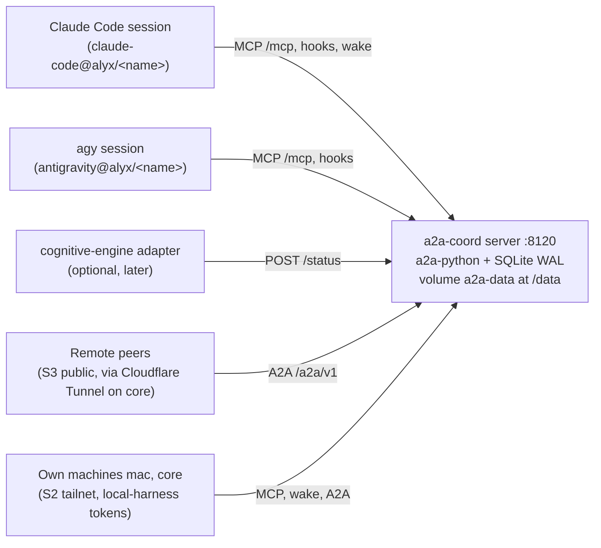
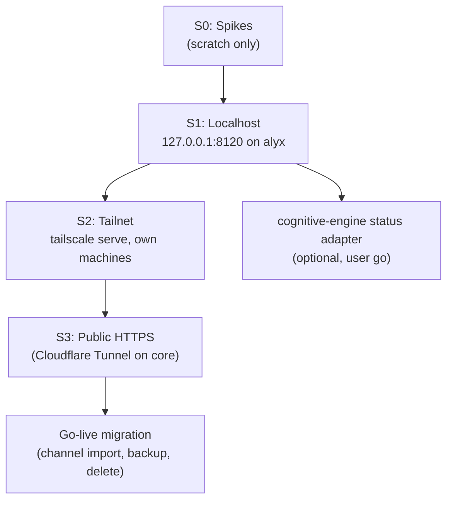

# A2A Coordination Plugin: Consolidated Architecture and Roadmap

> [!NOTE]
> **Canonical document** for the A2A coordination plugin: one A2A (Agent2Agent 1.0.1) server so live, side-by-side coding-agent sessions (Claude Code and Google Antigravity `agy`) exchange tasks, with remote agents joining later over HTTPS.
> Home: [`agentic-hub/plugins/coordination`](file:///home/rockad/projects/agentic-hub/plugins/coordination), branch `feat/coordination` (repo [`agentic-hub`](file:///home/rockad/projects/agentic-hub)).
> The former research repo `~/projects/agents-bridge` is **retired**; its `plans/`, `research/` and `specs/` were copied into this plugin's `docs/` and this file is the continuation of its plan (the filename is kept for link stability).
> Status (2026-11-04): **DDR-004 ACCEPTED** with 22 binding decisions (13 from the `/clarify` session, 14 to 22 from the `/cplain` session, Section 3); **PLANNING ONLY** (implementation only where strictly necessary for a spike); S0 spikes not started.
> Evidence labels used below: **verified** (read in code or official docs by an auditor), **reported** (README or PR text, or a user-relayed statement), **unverified** (not yet tested). The audits were run by Sonnet subagents; the labels are theirs.

---

## 1. Executive Summary & Core Consensus

### Purpose & Scope
The plugin provides a provider-agnostic coordination substrate for N >= 2 autonomous agents across heterogeneous harnesses: [Google Antigravity](file:///home/rockad/.gemini/antigravity-cli), [Claude Code](file:///home/rockad/.claude), and later remote agents. OpenCode stays a candidate third peer (unconfirmed by the user).

### Core Consensus (Architectural Foundations)
- **Symmetric Peer Agency**: all communicating agents interact as equals; either side can open tasks to the other. Master/dependent or caller/subordinate patterns are prohibited.
- **Live Conversation-to-Conversation**: transports connect long-lived interactive sessions with warm context. One-shot ephemeral subprocess execution (`agy -p`, `claude -p`) is prohibited, and nothing may launch, drive or wrap `agy` (DDR-003).
- **One server, A2A on the wire**: a single containerised server on `a2a-python` (>= 1.3.0) owns the task store and speaks A2A (JSON-RPC and REST, all 11 core operations). The old "A2A principles over a file carrier, ACP drop-in later" approach is superseded (DDR-002).
- **Core of cognitive-engine stays daemon-free**: the server sits outside [`rockad/cognitive-engine`](file:///home/rockad/projects/cognitive-engine); cognitive-engine is at most an optional one-way status client (decision 13).
- **Resource contention via BuildSlot**: Docker and GPU arbitration stays with the zero-daemon `BuildSlot` protocol (cognitive-engine PR #13); see Section 5.
- **Untrusted by default**: every message body is data, never an approval and never a command; tasks are parked, never auto-executed.

### Architecture at a glance

Server endpoints (port 8120, decision 5):
- `/mcp`: MCP tools, streamable HTTP, served by the server itself (precedent: lookup at `127.0.0.1:8100/mcp`, already configured in agy). Write tools behind an opt-in flag.
- `/a2a/v1`: A2A JSON-RPC and REST, all 11 core operations.
- `/wake/listen`: long-poll wake endpoint, one parked listener per handle.
- `/sessions`: session registration (handle binding).
- `/status`: one-way status intake (`POST` only).
- `/.well-known/agent-card.json`: Agent Card with `securitySchemes` bearer, declaring only what is implemented.

Identity (decision 6):
- One Agent Card per harness and machine: `claude-code@alyx`, `antigravity@alyx`.
- Per-session handles under a card: `claude-code@alyx/<session-name>`.
- Address a handle: that session. Address a card: newest live listener, else queued.
- Handles are our extension; the mapping to A2A (`contextId` and `metadata`) is documented in [`server-api.md`](file:///home/rockad/projects/agentic-hub/plugins/coordination/docs/specs/server-api.md).

Inbound trust by origin (decision 10):
- Own local handles: `SUBMITTED`; the session takes the task through `a2a_inbox`.
- Allowlisted remote (a peer that holds a `remote-peer` token, decision 18): `QUARANTINED` (our extension, shown to the sender as `INPUT_REQUIRED`) until a human releases it with `a2a-coord review` on a real TTY, one typed decision per task (decision 19). No code path releases a task automatically.
- Unknown remote: `REJECTED`.
- "Offered until confirmed": `SUBMITTED` to `WORKING` only by tool call; unconfirmed offers are re-offered.

Auth scopes (decision 11), bearer tokens issued by `a2a-coord token new`, shown once, stored hashed:
- `local-harness`: `/mcp`, `/wake/*`, `/sessions`, `/a2a/v1` (`/sessions` is implied by the decision 6 binding). One token per machine; on the tailnet the server also checks that the Tailscale identity matches the machine the token was issued for (decision 17).
- `remote-peer`: `/a2a` only; never `/mcp`, `/wake` or `/sessions`. One token per peer, hashed, revocable, rate-limited (decision 18).
- `status-client`: `POST /status` only.

Admin access (decision 15): `a2a-coord` admin commands (`token new|list|revoke`, `review`) run inside the container with `docker compose exec -it coordination a2a-coord ...`, over an in-container Unix socket that is not published on any port. There is no admin HTTP endpoint and no admin token scope. Docker access on the host is the credential.

---

## 2. Mandatory Requirements & Constraints

### Operational & Behavioral Constraints
- **Vertical Markdown Lists Only**: all documentation and bridge communications use `- item` lists. Inline enumerations are prohibited.
- **Clickable File Links**: referenced paths use Markdown links with the `file://` scheme.
- **Licensing Constraint (Standing User Rule)**: any tool, library or protocol whose terms restrict Anthropic, Claude Code or partner agents is excluded from adoption, benchmarking and testing. This applies symmetrically to Antigravity (DDR-003).
- **Host Configuration Hygiene**: third-party tools and system services (Tailscale, `cloudflared`) must be approved and installed by the user; agents never silently edit host systemd units, harness hook settings or dotfiles. None of `tailscale`, `cloudflared` or `caddy` is installed on alyx today (reported by the user's decision record). The user's existing Cloudflare Tunnel (`cloudflared`) runs on core (reported by the user, decision 20); the S3 ingress rule is added by the user.
  - Exception by decision 16: the planned `a2a-coord install --claude --agy` installer writes harness hook and MCP configuration, and only when the user runs it. Chezmoi-managed dotfiles are edited through chezmoi (edit the chezmoi source, then apply), never by writing the targets directly. Until the installer exists, agents still write none of these files.
- **Scope Rule (amended by DDR-004)**: the daemon and container restrictions are lifted for this plugin. **Planning only remains**: implementation happens only where strictly necessary for a spike (S0), until the user starts S1. Code on [`cognitive-engine`](file:///home/rockad/projects/cognitive-engine) (BuildSlot PR #13, the later status adapter) follows that repository's own process.
- **Structural reference only**: the `memory` plugin (`plugin.json`, `docker-compose.yml`, `servers/lookup`) is a layout reference; this plugin never depends on it, because it may be retired.

---

## 3. Architectural Decision Records (DDRs)

### DDR-001: Hybrid Architecture & Exclusion of Restrictive Tooling
- **Status**: **ACCEPTED & APPROVED** (`2026-11-03T14:07:22+02:00`), then **PARTLY SUPERSEDED** (`2026-11-03T14:30:00+02:00`). **Exclusions remain IN FORCE.**
- **Context**: explored embedding mailbox daemons vs. CLI relays vs. decoupled substrates.
- **Decisions**:
  - `phone-a-friend` (Apache-2.0): adopted initially, then purged and uninstalled when the audit showed it only supported one-way caller-to-subordinate subprocess execution.
  - `mcp_agent_mail_rust`: permanently excluded because of the `OpenAI/Anthropic Rider` restricting Claude Code and Anthropic agents. **In force.**
  - `BuildSlot` protocol: retained and adopted for resource serialization in [`packages/harness2`](file:///home/rockad/projects/cognitive-engine/packages/harness2). **In force.**

### DDR-002: Communication Foundation: ACP with A2A Principles
- **Status**: **SUPERSEDED by DDR-004 (2026-11-04)**, both the file-channel carrier and ACP. Kept as history.
- Originally **ACCEPTED & APPROVED BY USER** (`2026-11-03T15:21:25+02:00`), phasing approved (`2026-11-03T15:30:55+02:00`).
- **Verbatim user approval (historical)**: *"Do you approve Claude's "A2A principles immediately + ACP carrier drop-in ready" phasing plan? - Yes"*
- **What it decided (historical)**:
  - Phase 1: adopt the A2A task-state vocabulary and agent-card-style identity in JSON-RPC envelopes over the live file channel.
  - Phase 2: move the wire to ACP once remote transports and live TUI participation matured.
- **What replaces it**: A2A is now the real wire (`a2a-python` server, HTTP bindings), not a vocabulary over files. ACP is removed from the plan entirely (decision 7). The file channel is frozen (decision 7).

### DDR-003: Side-by-Side Peer Architecture & Symmetric Antigravity Protection
- **Status**: **ACCEPTED & APPROVED BY USER** (`2026-11-03T16:01:41+02:00` and `2026-11-03T16:02:43+02:00`). **IN FORCE.**
- **Verbatim user directives**:
  - *"all agents/harnesses would be run side by side, not 'agy from claude' or similar"* (recorded first-hand by Antigravity at 16:01:41)
  - *"Keep, but never wrap agy"* (recorded first-hand by Claude Code at 16:02:43)
  - *"Yes, apply to Antigravity"* (recorded first-hand by Claude Code at 16:02:43)
- **Decisions**:
  - **Hard prohibition on agent wrapping**: nothing launches, drives, wraps or executes `agy` (no `agy -p`, no PTY or tmux, no `agentapi`, no caller/subordinate relays). Both harnesses run side by side as independent peers.
  - **Symmetric restrictive-terms rule**: "skip options whose terms restrict Claude Code" applies to Antigravity too. No design may depend on Antigravity access patterns that Google's Terms or FAQ prohibit.
- **Amendment 2026-11-04 (by DDR-004)**: the sentence "communicating through local files and standard protocol envelopes" no longer describes the carrier; peers communicate through the A2A server. The wrapping ban and the terms rule are unchanged.

### DDR-004: A2A Coordination Server (Container + MCP at /mcp + Hook Wake, Staged Exposure)
- **Status**: **ACCEPTED (2026-11-04)**, after the `/clarify` session with the user. The 13 decisions below are binding, and so are decisions 14 to 22 from the later `/cplain` session (second table below), which amend decisions 7, 10, 11 and 12.
- **User direction (2026-11-04, Claude Code session)**: *"I want to expore a2a path more and build an mcp+hooks+ a docker container with the persistent volumes mounted to store the data. I want to expose it at some point to the web, where other agents could connect via https or other protocol."*
- **Evidence**: [`a2a-mcp-wake-audit-2026-11-04.md`](file:///home/rockad/projects/agentic-hub/plugins/coordination/docs/research/a2a-mcp-wake-audit-2026-11-04.md) and its four input reports.
- **Why build, not adopt**: no audited project combines an A2A server, persistent tasks, per-session addressing, an MCP facade and a compliant wake; several spawn agent CLIs (DDR-003 or live-session violations) (verified by audit).
- **Standing rules this changed**:
  - Zero-daemon principle: lifted for this component; the cognitive-engine core stays daemon-free.
  - DDR-002 carrier and ACP: superseded.
  - DDR-003 carrier wording: amended; the wrapping ban is unchanged.
  - Planning-only scope: remains, with the spike exception.
  - Old Phase 2 ledger forks A and B, Phase 3 swarmail, Phase 4 ACP: superseded.

#### Decision table (the user's choices, 2026-11-04)

| # | Decision | Rationale |
| :-- | :--- | :--- |
| 1 | **DDR-004 accepted.** User's answer, as recorded: *"Daemon and container restrictions lifted. Planning-only remains: implementation only where strictly necessary for a spike."* | A container-hosted server cannot exist under the old zero-daemon rule; planning-only stays so nothing is built before the spikes answer the open questions. |
| 2 | **One home.** User's answer, as recorded: *"Everything lives in agentic-hub/plugins/coordination (one repo, one branch feat/coordination). agents-bridge retired. Memory plugin = structural reference only; do not depend on it (it may be retired)."* | One repo and one branch avoid split sources of truth; depending on a plugin that may be retired would strand the server. |
| 3 | **Stack**: Python on `a2a-python` (>= 1.3.0), `uv`, Docker. | Official SDK with all 11 operations and a SQL task store (verified); Python and `uv` match cognitive-engine. |
| 4 | **Storage**: one server process owns SQLite (WAL, `busy_timeout`) on named volume `a2a-data` mounted at `/data`, via a2a-python `DatabaseTaskStore`; everyone else uses HTTP; Postgres later only by a SQLAlchemy URL change. | A single writer sidesteps SQLite multi-process hazards and the immature cluster mode; WAL and busy timeout are gaps the SDK does not fill (verified). |
| 5 | **Surface**: the server itself serves MCP tools at `/mcp` (streamable HTTP, like lookup) plus `/a2a/v1`, `/wake/listen`, `/sessions`, `/status` and the Agent Card, on port 8120; write tools behind an opt-in flag. | One process and one URL work the same for agy and Claude Code and survive the move to tailnet or public exposure; 8120 avoids 8100-8110 and 11434. |
| 6 | **Identity**: one Agent Card per harness and machine; per-session handles under it; handle addresses a session, card addresses the newest live listener else queues. Binding (**unverified, spike**): `SessionStart` hook `POST /sessions`, handle injected into context, first MCP call `a2a_hello(handle)` ties `Mcp-Session-Id` to the handle. **Note (SP2 A6 result, 2026-11-04): for agy the handle binds to `_meta["antigravity.google/conversation_id"]` on each `tools/call`, not to `Mcp-Session-Id`, which is process-scoped in agy and shared across conversations. Verified on one call; conditional on the follow-up pass confirming presence on every call and per-conversation distinctness. Claude Code keeps the `a2a_hello` path.** | Cards stay honest and few while sessions stay individually addressable; the binding route is the only one found that needs no wrapping, but it is untested. Handles are our extension (mapping documented in `server-api.md`). |
| 7 | **ACP out; channel frozen then migrated.** User's answer, as recorded: *"ACP removed from the plan entirely. The file channel (~/.agents/bridge-v2-coordination-channel.md and other ~/.agents channel files) is frozen now: nobody uses it. After go-live, a one-time migration imports those channel files into the plugin's store, then the channel is deleted."* **Amended by decision 14: go-live is after S3, and Antigravity may use the channel for research on this work until then.** | ACP's remote transport and live-TUI participation stayed unproven and Terms-risky; a frozen channel avoids two sources of truth, and a one-time import keeps the history. |
| 8 | **Claude Code wake**: `asyncRewake` command hook on `SessionStart` and `Stop` running a `sh`+`curl` script (`a2a-listen`) that long-polls `POST :8120/wake/listen` in 900 s rounds; `UserPromptSubmit` HTTP hook for the busy path; one parked listener per handle; wake budget 20/h per handle; Claude Code >= 2.1.290 (reported), interactive CLI only. Inbox socket is a later spike candidate; Channels not used. | The only compliant idle wake found (hook semantics verified, design borrowed from switchboard); the stub-only wake and the budget bound the injection and runaway-loop risk. |
| 9 | **agy**: MCP (`url` `:8120/mcp`; `serverUrl` is accepted as the legacy key per agy's `mcp_servers.md`, line 66) plus our `SessionStart` hook (register handle, `injectSteps`) plus a `PreInvocation` hook (curl pending count, 2-5 s, `injectSteps`) plus an `AGENTS.md` rule to check the inbox at session start plus an `a2a_wait` tool. Held-`Stop` park is **spike only, not shipped**. No idle wake for agy (accepted asymmetry). Nothing may launch, drive or wrap agy. | The official hooks page documents no async or rewake option (verified), so only surfacing at the next model call is compliant; DDR-003 forbids everything else. |
| 10 | **Inbound trust by origin** (allowlist and release refined by decisions 18 and 19): local handles `SUBMITTED`; allowlisted remote `QUARANTINED` until a human releases it with `a2a-coord review` on a real TTY with typed confirmation; unknown remote `REJECTED`. Bodies framed as untrusted data; wake text is a constant stub; bodies only in tool results; tasks parked, never auto-executed; "offered until confirmed". | Remote text must never reach an agent as an instruction or approval; a human gate on a real TTY mirrors cognitive-engine's typed-approval model. |
| 11 | **Auth**: scoped bearer tokens per agent from `a2a-coord token new` (shown once, stored hashed); scopes `local-harness`, `remote-peer`, `status-client`; card declares `securitySchemes` bearer; loopback still needs a token; constant-time compare; Host and Origin checks; refuse non-loopback bind without TLS proxy config. Add-ons by stage: tailnet identity check, then rate limits and optional mTLS (refined by decisions 17 and 18; admin access by decision 15). | Least privilege per agent; a remote peer can never reach `/mcp`, `/wake` or `/sessions`; loopback is not a trust boundary on a multi-process host. |
| 12 | **Exposure**: S1 localhost `127.0.0.1:8120` on alyx; S2 tailnet via `tailscale serve` for own machines alyx, mac, core; S3 public HTTPS. **Front door decided by decision 20: the user's existing Cloudflare Tunnel on core** (the earlier "bigrockad.com reverse proxy or Cloudflare Tunnel, choice deferred" is closed). Gates in Section 5. | Each step widens the audience only after the controls for that audience exist; the user keeps the explicit go for public. |
| 13 | **cognitive-engine**: optional one-way status client, contract specified now, built after S1 in a cognitive-engine adapter package, off by default, on the user's go: `POST /status`, scope `status-client`, body `{run_id, run_scope, state, report_path, ts}`. Never prompts, model text, transcripts or denial counts. Never receives tasks; the server is never a second approval path; `audit.jsonl` stays the source of truth; model sessions (sbx) never reach `:8120`. | Keeps the deterministic core and its typed-approval gate authoritative; R-18: `sessions_summary.denied_requests` counts path denials only, so no field of it may be shown as a general denial count. |

#### Decisions 14-22 (2026-11-04, /cplain)

The user's choices in the `/cplain` session, same day as the 13 above. Binding. Section 7 (open decisions) is closed by them.

| # | Decision | Rationale and consequences |
| :-- | :--- | :--- |
| 14 | **Go-live is after S3** (public stage). The `~/.agents` file channel stays frozen until then, with **one exception: Antigravity may still use it for research on this work.** Import, tar backup and deletion happen after S3. Amends decision 7. | Keeps the old channel available to the one agent still researching until the whole server is public. Consequence: the import must tolerate appends made after 2026-11-04 (expected counts are re-measured at go-live). [`go-live-migration.md`](file:///home/rockad/projects/agentic-hub/plugins/coordination/docs/plans/go-live-migration.md) is updated. |
| 15 | **Admin access**: `a2a-coord` admin commands (`token new\|list\|revoke`, `review`) run inside the container with `docker compose exec -it coordination a2a-coord ...`, over an in-container Unix socket that is not published on any port. **No admin HTTP endpoint, no admin token scope.** Docker access on the host is the credential; `review` requires a TTY. | No admin surface on the network at any stage, so S3 exposure cannot reach it. Closes the "admin plane" open point in [`server-api.md`](file:///home/rockad/projects/agentic-hub/plugins/coordination/docs/specs/server-api.md) 3.7. |
| 16 | **Harness setup**: one installer, `a2a-coord install --claude --agy`, configures both harnesses (Claude Code hooks and MCP entry; agy `mcp_config.json` entry with `headers.Authorization` plus agy hooks). It edits chezmoi-managed dotfiles **through chezmoi** (edit the chezmoi source, then apply), never by writing the targets. The user accepted the R8 grey area (our software writing agy's config). Nothing launches, drives or wraps agy (DDR-003 unchanged). | Replaces the "snippets versus plugin manifest" question. Tokens must not be committed to dotfiles in plain text where avoidable. **Update 2026-11-04 (SP2 A6, reported by Antigravity, live confirmation pending): agy does not interpolate env vars in `headers`, so the token must be a literal in `~/.gemini/config/mcp_config.json`**, which chezmoi manages as `dot_gemini/config/private_mcp_config.json.tmpl`. Rule: the installer writes the token through a chezmoi template function that reads a secret source (a password manager or keyring, or an encrypted file), never as a literal in the chezmoi source repository. The secret backend is an open point for the user (Section 7). |
| 17 | **Own machines on the tailnet** (mac, core) get one `local-harness` token per machine with their own cards (`claude-code@mac`, `antigravity@core`). The server additionally checks that the Tailscale identity (node or user) matches the machine the token was issued for. | Replaces the "assumed" wording. A stolen token alone does not work from another machine. How the server obtains the identity from `tailscale serve` is **unverified** (later-stage spike, [`spikes.md`](file:///home/rockad/projects/agentic-hub/plugins/coordination/docs/specs/spikes.md) section 13). |
| 18 | **Remote peers (S3)**: one bearer token per peer (`remote-peer` scope), hashed, revocable, rate-limited. Quarantine is the backstop. mTLS is optional later, per peer. **Allowlist = peers that hold a `remote-peer` token** (modelled as `cards_allowed` on the token, as in server-api.md). | One identity mechanism, no separate peer registry. A token holder is still untrusted: quarantine and human release apply to everything it sends. |
| 19 | **Quarantine release**: only a human, one typed decision per task on a TTY via `a2a-coord review`. **No auto-release path in code**: no rules, no agent pre-screen. | Keeps decision 10's human gate absolute. Expiry of an unreleased task moves it to `REJECTED`, never to released. |
| 20 | **Public front door (S3)**: the user's **existing Cloudflare Tunnel (`cloudflared`) on core**. An ingress rule for a hostname like `a2a.bigrockad.com` forwards over the tailnet to `alyx:8120`. Consequences, documented in server-api.md 8.4: Cloudflare sees decrypted traffic; client IP only via `CF-Connecting-IP`, trusted only for requests arriving from the tunnel on core; Host and Origin checks and rate limits account for it; Cloudflare's request timeout of about 100 s (**reported**, unverified for the user's plan). | Closes the "reverse proxy versus Cloudflare" point. The hostname is an example until the user confirms it (Section 7). `bigrockad.com` runs no separate reverse proxy for this. The server still never binds a non-loopback address: the tailnet hop is `tailscale serve` (S2). |
| 21 | **Research clones**: all six evaluation clones in `~/projects` are deleted, including the `A2A` spec clone. Their sources and pinned commits are recorded in Section 8. | Pinned GitHub URLs replace every local-clone reference (the former `file://` links to the `A2A` clone). |
| 22 | **`SendMessage` waiting**: blocking requests are capped at **60 s** (below Cloudflare's ~100 s), then the server returns the current non-terminal Task (`SUBMITTED` or `WORKING`). Non-blocking requests are honoured as they are. Documented deviation from A2A 1.0.1's default wait; stated in the Agent Card `description` (server-api.md 8.5). | Fits inside the front door's timeout. The deviation stays a deviation: a TCK run in CI may still flag it. |

Never exposed by the server (decision 13, reported by the cognitive-engine session):
- Anything that starts a sweep or grants an approval.
- Credentials: OpenRouter key, the RFC 006 credential route, Claude or agy tokens.
- Run directories and transcripts.
- Jev config tools such as `jev_set_mode`.

---

## 4. Candidate Audit & Evidence Matrix

| Candidate / Technology | License | Verdict | Evidence Label | Key Findings & Limitations |
| :--- | :--- | :--- | :--- | :--- |
| **`a2a-python` >= 1.3.0 (official SDK)** | Apache-2.0 | **ADOPTED (build base, decision 3)** | `[VERIFIED]` by Sonnet audit | All 11 core operations, JSON-RPC, REST and gRPC; SQLAlchemy `DatabaseTaskStore` (SQLite, Postgres, MySQL); about 1,700 tests with TCK in CI. Gaps we fill: SQLite WAL and busy timeout, inbound auth, push-notification SSRF screening (opt-in, default off), `/wake/listen`, `/mcp`. Cluster mode (about five weeks old) is **not used**. See [`t1c-bridges-and-sdks.md`](file:///home/rockad/projects/agentic-hub/plugins/coordination/docs/research/a2a-audit-2026-11-04/t1c-bridges-and-sdks.md). |
| **`A2A` spec 1.0.1** | Apache-2.0 | **Adopted as the wire protocol** | `[VERIFIED]` | Eight task states and the Agent Card; we add `QUARANTINED` as a documented extension, surfaced to senders as `INPUT_REQUIRED`. Spec sources: [`a2aproject/A2A` at commit `4735f48`](https://github.com/a2aproject/A2A/tree/4735f4876449c6f381825d8a841b31b16c6ad0c4) (the local clone is deleted, decision 21). |
| **`a2a-js` 1.3.0** | Apache-2.0 | Not chosen (second choice) | `[VERIFIED]` | All 11 operations; DB stores only since 2026-09-29; Bun unverified. |
| **`a2a-go` 2.7.0, `a2a-rs` 0.x** | Apache-2.0 | Not chosen | `[VERIFIED]` | Go language fit (a2a-go); in-memory only and partial (a2a-rs). |
| **A2A/MCP bridges and wake projects** (`mgcrea/mcp-a2a`, `TonPC64/mcp-a2a-bridge`, `toshiotomikawa/a2a-bridge`, `GongRzhe/A2A-MCP-Server`, Docker Agent, `switchboard`, `interlink`, `agent-group-mcp`) | MIT / Apache-2.0, no riders | **Borrow patterns or Reject** | `[VERIFIED]` by Sonnet audit | None adoptable. Four spawn or drive agent CLIs: toshiotomikawa (`agy -p`, `claude -p`, `codex exec`), TonPC64 examples (`claude -p`, `copilot -p`), Docker Agent harness (`claude --print`), zb-ss (`agy agentapi send-message`). Borrowed: park inbound as `SUBMITTED`, stub-only wake, offered-until-confirmed, one listener per session, wake budget, write tools opt-in, honest cards. Matrix in [`a2a-mcp-wake-audit-2026-11-04.md`](file:///home/rockad/projects/agentic-hub/plugins/coordination/docs/research/a2a-mcp-wake-audit-2026-11-04.md). |
| **Current file channel + watchers** | N/A (in-house) | **FROZEN (decision 7; Antigravity research exception, decision 14); imported after S3, then deleted** | `[VERIFIED]` | [`bridge-v2-coordination-channel.md`](file:///home/rockad/.agents/bridge-v2-coordination-channel.md) and [`watch-bridge-coordination.sh`](file:///home/rockad/.local/bin/watch-bridge-coordination.sh); inotify-reactive but no liveness signals or task states. Nobody uses it now, except that Antigravity may still use it for research on this work until go-live (decision 14). |
| **`BuildSlot` protocol** | MIT / Project | **Implemented / PR open** (separate track, Section 5) | `[VERIFIED]` for branch and PR; `[REPORTED]` for test counts | Zero-daemon `fcntl.flock` slot manager in `cognitive-engine/packages/harness2`. Branch `da1b199` and PR #13 verified; 65 tests in test_coordination.py pass at da1b199; full suite 5508 passed / 22 skipped measured at 6c0ac4d only (reported). |
| **`ACP` (Agent Client Protocol v1)** | Apache-2.0 | **REMOVED from the plan (decision 7)** | `[VERIFIED]` for spec; `[REPORTED]` for adapters; `[UNVERIFIED]` for live TUI | Was the planned future carrier. Dropped: remote transport unfinalized, live-TUI participation unproven, Antigravity adapters wrap `agy` (DDR-003). Background in [`r1-antigravity-terms-and-acp-gate-2026-11-03.md`](file:///home/rockad/projects/agentic-hub/plugins/coordination/docs/research/r1-antigravity-terms-and-acp-gate-2026-11-03.md). |
| **`bompus/swarmail`** | Clean MIT | **SUPERSEDED** (old Phase 3) | `[VERIFIED]` for code and docs | Daemon plus SQLite on `127.0.0.1:18765`; its installer writes agy `PreInvocation` and `Stop` hooks and its docs tested `agy -p` (R8, DDR-003). Replaced by the A2A server over tailnet (S2). |
| **`steveyegge/beads` (`bd`)** | Clean MIT | **SUPERSEDED** (old Phase 2 Fork B) | `[VERIFIED]` for code and docs | Dolt-backed ledger; single-writer by default; edits host configs unless opted out. Replaced by the A2A task store. Research kept in [`r2-beads-concurrency-and-footprint-2026-11-03.md`](file:///home/rockad/projects/agentic-hub/plugins/coordination/docs/research/r2-beads-concurrency-and-footprint-2026-11-03.md). |
| **In-house JSONL ledger** | N/A | **SUPERSEDED** (old Phase 2 Fork A) | n/a | Replaced by `DatabaseTaskStore` on SQLite. |
| **`dannystocker/mcp-multiagent-bridge`** | MIT | **REJECTED** | `[VERIFIED]` | 12 months unmaintained; 10 req/min limit; 3-hour session expiry; no task synchronization. |
| **`agent-bus`** | Clean MIT | **Watch item** | `[VERIFIED]` | Hash-chained event log with optional NATS or ntfy; possible audit-log engine later. |

---

## 5. Phased Implementation Roadmap

The old Phases 0-4 (baseline, heartbeat, ledger, swarmail, ACP) are replaced. The heartbeat sidecar files are superseded: liveness is now a parked listener or a registered session; [`heartbeat-spec.md`](file:///home/rockad/projects/agentic-hub/plugins/coordination/docs/specs/heartbeat-spec.md) stays as history.

Notes on gates (interpretation, see Section 7):
- "Entry gate" is the condition that must hold before the stage's exposure or build starts.
- "Exit gate" is the evidence that closes the stage.
- Every stage that adds a listener needs the user's explicit go; the gates are necessary, not sufficient.

### S0: Spikes
- **Objective**: answer the unverified mechanisms before any server code is shipped. Detail and pass criteria: [`docs/specs/spikes.md`](file:///home/rockad/projects/agentic-hub/plugins/coordination/docs/specs/spikes.md).
- **Deliverables** (summary; `spikes.md` is authoritative):
  - Claude Code wake: `asyncRewake` on `SessionStart` and `Stop` with the `sh`+`curl` listener; 200 wakes with the stub, 409 and 408 behaviour, honoured `timeout` 604800, whether wakes count toward the Stop continuation cap, Esc-interrupt behaviour (reported failure modes, unverified in practice).
  - Handle binding: `SessionStart` `POST /sessions`, handle in context, `a2a_hello(handle)` ties `Mcp-Session-Id` (unverified).
  - agy: `url` MCP entry at `:8120/mcp` (`serverUrl` accepted as legacy), `SessionStart` `injectSteps`, `PreInvocation` count injection within 2-5 s, whether `SessionStart` fires on resume.
  - agy held-`Stop` park (maximum timeout, whether it blocks typing, whether `Stop` fires per turn, whether a background command wakes an idle session): spike only, never shipped.
  - Server: `DatabaseTaskStore` on SQLite with WAL and `busy_timeout` under concurrent HTTP clients; A2A app and streamable-HTTP MCP in one process.
  - Candidate for later: Claude Code inbox socket frame shape.
- **Entry gate**: user approves each host change a spike needs (hook entries, MCP config); spikes run in a scratch directory and scratch container.
- **Exit gate**: the S1 entry gate in `spikes.md` section 11 is met (SP1, SP2, SP3, SP5 passed or failed-with-fallback; SP4 recorded; SP6 optional), with results in `docs/research/spike-results-<date>.md`.
- **Kill switch**: remove the spike hook and MCP entries, delete the scratch container and directory. Nothing persists on the host.

### S1: Localhost (127.0.0.1:8120 on alyx)
- **Objective**: a working server for the two live harnesses on alyx, with tokens, wake and the full trust model, loopback only.
- **Deliverables**:
  - Plugin layout modelled on `memory` without depending on it:
    - `plugin.json`
    - `docker-compose.yml` with named volume `a2a-data`
    - `servers/<name>`
  - Server on `a2a-python` with all endpoints from Section 1; API contract in [`server-api.md`](file:///home/rockad/projects/agentic-hub/plugins/coordination/docs/specs/server-api.md).
  - `a2a-coord` CLI: `token new|list|revoke` and `review` as admin commands run inside the container over an in-container Unix socket, no admin HTTP endpoint (decision 15); `install --claude --agy` on the host (decision 16).
  - Agent Cards `claude-code@alyx` and `antigravity@alyx`, honest `securitySchemes`.
  - Claude Code: `a2a-listen` hook script, `UserPromptSubmit` hook, wake budget.
  - agy: MCP entry, `SessionStart` and `PreInvocation` hooks, `AGENTS.md` inbox rule, `a2a_wait`.
  - Harness setup by the installer `a2a-coord install --claude --agy` (decision 16): writes Claude Code hooks and MCP entry and the agy `mcp_config.json` entry and hooks, editing chezmoi-managed dotfiles through the chezmoi source and `chezmoi apply`, never the targets. Detail in [`server-api.md`](file:///home/rockad/projects/agentic-hub/plugins/coordination/docs/specs/server-api.md) section 11.0.
  - Trust model: `SUBMITTED`, `QUARANTINED`, `REJECTED`, offered-until-confirmed, untrusted-data framing.
  - Tests for state machine, auth scopes, Host and Origin checks, wake budget and listener supersession.
- **Entry gate**: S0 done; user go for S1.
- **Exit gate**:
  - A task round-trips in both directions between a live Claude Code session and a live agy session.
  - An idle Claude Code session is woken by a stub; an agy session sees the pending count at its next model call.
  - A request without a token, or with a wrong-scope token, is refused on loopback.
  - Quarantine and review work end to end with a local test peer.
- **Kill switch**: `docker compose down`, remove the hook and MCP entries (through chezmoi, the same way the installer wrote them), revoke tokens. Until the go-live migration runs (after S3, decision 14), the frozen channel files are untouched by the server.

### S2: Tailnet (own machines alyx, mac, core)
- **Objective**: cross-host coordination between the user's own machines over Tailscale, still no public listener.
- **Deliverables**:
  - User installs Tailscale where missing (not installed on alyx today); `tailscale serve` fronts the loopback server, so the server itself never binds a non-loopback address.
  - Agent Cards per machine (`claude-code@mac`, `antigravity@core`); one `local-harness` token per machine (decision 17).
  - Tailscale identity (node or user) as an extra check on top of the bearer token: the server accepts a machine's token only from the Tailscale identity it was issued for (decision 17). The mechanism that delivers the identity to the server is unverified (spike, [`spikes.md`](file:///home/rockad/projects/agentic-hub/plugins/coordination/docs/specs/spikes.md) section 13).
  - Cross-host wake test from the other machines.
- **Entry gate (decision 12)**: tokens and scopes live (S1 exit).
- **Exit gate (decision 12)**: cross-host wake works, shown on at least one second machine before the rest are added.
- **Kill switch**: turn off the `tailscale serve` configuration (exact command depends on the installed Tailscale version, unverified) and revoke the per-machine tokens; the server stays on loopback.

### S3: Public HTTPS
- **Objective**: let allowlisted remote agents reach `/a2a/v1` and the public Agent Card over HTTPS.
- **Deliverables**:
  - Front door (decision 20): the user's existing Cloudflare Tunnel (`cloudflared`) on core, with an ingress rule for a hostname like `a2a.bigrockad.com` forwarding over the tailnet to `alyx:8120`, in practice the S2 `tailscale serve` front of the loopback server. The ingress routes only `/a2a/v1` and the Agent Card path. TLS terminates at Cloudflare; the server stays on loopback and never binds a non-loopback address.
  - Consequences to design for (details in `server-api.md` 8.4):
    - Cloudflare sees decrypted traffic (accepted by the user's choice; see Risk 11).
    - Client IP comes only from `CF-Connecting-IP`, believed only for requests that arrive from the tunnel on core.
    - Host and Origin checks and rate limits account for the public hostname and the tunnel hop.
    - Cloudflare's request timeout of about 100 s (reported, unverified for the user's plan); `SendMessage` blocking is capped at 60 s (decision 22).
  - Rate limits per token and per client IP in the server, plus whatever Cloudflare offers on the user's plan (unverified); optional mTLS later, per peer (decision 18).
  - Remote peers: one `remote-peer` token per peer, hashed, revocable, rate-limited; the allowlist is the set of peers that hold one (decision 18); quarantine review flow in daily use, human release only (decision 19).
  - Honest public card: declares only the bearer scheme and capabilities actually enforced.
  - Fuzz pass for header smuggling, request splitting and SSRF, per cognitive-engine RFC 006 section 3 (proxy-class surface).
- **Gate (decision 12)**: quarantine live, rate limits, fuzz pass, honest card, and an explicit user go.
- **Exit gate**: one allowlisted test peer completes a task through quarantine and human release; an unknown peer is rejected; the fuzz report is filed in `docs/research/`.
- **Kill switch**: remove the ingress rule from the Cloudflare Tunnel configuration on core (or the DNS route) and revoke all `remote-peer` tokens; S1 and S2 keep working.

### Go-live migration
- **Timing (decision 14)**: go-live is after S3 (the public stage). Until then the `~/.agents` file channel stays frozen, with one exception: Antigravity may still use it for research on this work. Import, tar backup and deletion all happen after S3.
- **Objective**: one-time import of the frozen channel files into the store, then deletion of the channel. Procedure: [`docs/plans/go-live-migration.md`](file:///home/rockad/projects/agentic-hub/plugins/coordination/docs/plans/go-live-migration.md).
- **Deliverables** (summary; the migration plan is authoritative):
  - Importer for [`~/.agents/bridge-v2-coordination-channel.md`](file:///home/rockad/.agents/bridge-v2-coordination-channel.md) and the other `~/.agents` channel files, including whatever Antigravity appended for research before go-live.
  - Verification of the import and a tar backup of the channel files taken before deletion (decision 14).
  - Stop the turn watcher and delete the channel after the typed confirmation on a real TTY.
- **Entry gate**: S3 exit gate passed and the user declares go-live (decision 14).
- **Exit gate**: store holds the imported history, tar backup verified, watcher stopped, channel files deleted.
- **Kill switch**: the importer is repeatable on a fresh store; restore the channel files from the tar backup.

### Related: cognitive-engine status adapter (optional, after S1, user go)
- **Objective**: sweep state visible to peers without a second approval path.
- **Contract**: [`status-client.md`](file:///home/rockad/projects/agentic-hub/plugins/coordination/docs/specs/status-client.md): `POST /status`, scope `status-client`, body `{run_id, run_scope, state, report_path, ts}`.
- **Built in**: a cognitive-engine adapter package, off by default, never in the deterministic core.
- **Kill switch**: disable the adapter; revoke the `status-client` token.

### Related: cognitive-engine BuildSlot
Former Phase 0 substrate content, unchanged in substance; it is independent of the server.
- **Objective**: eliminate rootless Docker and GPU build contention without a daemon.
- **Deliverables**:
  - Merge PR #13 (`feat/buildslot-protocol` @ `da1b199`, `2c814eb`) into `feat/stage1-integration` on [`rockad/cognitive-engine`](file:///home/rockad/projects/cognitive-engine).
  - Adoption call sites in cognitive-engine (gated on the user's go; spec section 7: `GATE` in `model_gate`, Docker suite wrapper, `stage1.py` teardown).
  - Spec: [`buildslot-spec.md`](file:///home/rockad/projects/agentic-hub/plugins/coordination/docs/specs/buildslot-spec.md).
- **Exit criteria**: PR #13 merged and the full suite passes under rootless Docker flocking with zero leftover containers.
- **Kill switch**: zero daemons; delete lock files under `$XDG_STATE_HOME/cognitive-engine/slots/` to clear held locks.
- **Installer role**: none; standard git workflow.

---

## 6. Risk Analysis & Mitigations

- **Risk 1: Google Terms of Service and Antigravity hooks**
  - *Description*: Google's FAQ says third-party tools accessing Antigravity violate its Terms and that wrapping `agy` in third-party agents is unsupported on consumer plans. ACP wrappers are gone from the plan, but our own `SessionStart` and `PreInvocation` hooks and MCP entry are third-party software attached to the product (the R8 grey area).
  - *Impact*: High if enforced (account suspension, per third-party reporting; enforcement against this pattern is not demonstrated).
  - *Mitigation*: nothing launches, drives or wraps `agy` (DDR-003); hooks and MCP run inside the user's own session and were chosen by the user (decision 9); the held-`Stop` park is spike only. The user owns the residual terms risk.
  - *Decision 16 widens the grey area knowingly*: the installer `a2a-coord install --claude --agy` is our software writing agy's `mcp_config.json` and hooks (through chezmoi). The user accepted this R8 grey area. It still does not launch, drive or wrap agy.
- **Risk 2: Nesting deadlocks in concurrency slots**
  - *Description*: a pytest suite under shell `flock(1)` calling Python `slots.hold()` on the same lock file blocks on its own parent.
  - *Impact*: High (silent hangs). *Mitigation*: verified in PR #13 via `CE_BUILDSLOT_HELD_<SLOT>=1` and strict `[a-z0-9-]` slot names.
- **Risk 3: Daemon and host footprint (revised)**
  - *Description*: the zero-daemon rule is lifted for this plugin, so a resident container, hook entries and host ports now exist.
  - *Impact*: Medium. *Mitigation*: one container and one named volume; stage kill switches in Section 5; user installs Tailscale; the Cloudflare Tunnel already exists on core and the user adds the ingress rule; host config is written only by the installer the user runs, through chezmoi (decision 16); port 8120 checked free on alyx with `ss -ltn` on 2026-11-04.
- **Risk 4: Prompt injection from remote peers**
  - *Description*: a remote message could try to steer a session, impersonate an approval, or smuggle a command into the wake text.
  - *Impact*: High. *Mitigation*: inbound trust by origin (decision 10); allowlisted remote tasks sit in `QUARANTINED` until a human releases them on a real TTY, one typed decision per task, with no auto-release path in code (decision 19); bodies framed as untrusted data and delivered only in tool results; wake text is a constant stub; tasks never auto-execute; `remote-peer` tokens cannot reach `/mcp`. Residual: a released task is still text a model reads.
- **Risk 5: Wake runaway loop**
  - *Description*: a hook that exits 2 repeatedly re-wakes the session about once per second (reported failure mode); a peer could also flood wakes.
  - *Impact*: Medium to High (token burn). *Mitigation*: server wake budget of 20/h per handle; marker-guarded single notice on 401/403/410; one parked listener per handle with 409 to the old one; 5xx and 429 backoff; listener exits when the owning pid dies. To be exercised in S0.
- **Risk 6: agy idle-wake asymmetry**
  - *Description*: agy has no compliant idle wake; pending tasks surface only at the next model call or by an inbox check at session start.
  - *Impact*: Medium (an idle agy session can sit on a task, the old silent-stall gap in one direction). *Mitigation*: accepted by the user (decision 9); `PreInvocation` count, `AGENTS.md` rule, `a2a_wait`; revisit if the S0 held-`Stop` spike proves safe.
- **Risk 7: Cluster-mode immaturity (not used)**
  - *Description*: a2a-python cluster mode is about five weeks old with unproven maturity (verified in code).
  - *Impact*: Low, because it is avoided. *Mitigation*: decision 4 keeps a single server process as the only database writer; Postgres later only through the SQLAlchemy URL.
- **Risk 8: Token leakage**
  - *Description*: bearer tokens in hook scripts, MCP config or logs could leak and grant scoped access; a leaked `remote-peer` token exposes `/a2a`.
  - *Impact*: High at S3, Medium earlier. *Mitigation*: tokens shown once and stored hashed; per-agent scopes; constant-time compare; never log `Authorization`; token files mode 0600; revoke via `a2a-coord`; rate limits and optional mTLS at S3; tokens in agy and Claude config are kept out of the chezmoi source repository in plain text: the installer writes them through a chezmoi template function reading a secret source (decision 16; agy cannot interpolate env vars, so its token is a literal in the rendered file, reported, live confirmation pending); a local-harness token is also bound to its machine's Tailscale identity (decision 17); no credentials (OpenRouter key, Claude or agy tokens) are ever stored in or served by the server.
- **Risk 9: SDK gaps on top of a2a-python**
  - *Description*: the SDK does not set SQLite WAL or busy timeout, ships no inbound auth, and its push-notification SSRF screening is off by default (verified).
  - *Impact*: Medium. *Mitigation*: we set WAL and `busy_timeout` ourselves (S0 spike), add auth middleware, and keep push notifications disabled or SSRF-screened.
- **Risk 10: Handle binding unverified**
  - *Description*: tying `Mcp-Session-Id` to a handle through a context-injected `a2a_hello` depends on the model following the injected instruction (unverified).
  - *Impact*: Medium (mis-addressed or unbound sessions). *Mitigation*: S0 spike gates the route; unbound sessions are addressable only by card (newest live listener, else queued).
- **Risk 11: Cloudflare as the public front door (decision 20)**
  - *Description*: Cloudflare terminates TLS, so it sees decrypted remote-peer traffic and bearer tokens; the real client IP is only visible through `CF-Connecting-IP`, which a client can forge if the server believes it from the wrong source; Cloudflare's request timeout is about 100 s (reported, unverified for the user's plan), shorter than a long poll.
  - *Impact*: Medium (confidentiality of remote-peer traffic; wrong rate-limit or audit identity if the header is trusted blindly; broken long requests).
  - *Mitigation*: the user chose this knowingly. Only `/a2a/v1` and the Agent Card are routed through the tunnel, so no session, wake or MCP traffic passes Cloudflare. `CF-Connecting-IP` is believed only for requests that arrive from the tunnel on core. Host and Origin checks and rate limits account for the public hostname. Blocking `SendMessage` is capped at 60 s (decision 22). `remote-peer` tokens are per peer and revocable. Residual: Cloudflare can read remote-peer task text; never send secrets through it.

---

## 7. Open Decisions for the User

DDR-004's 13 decisions closed the old items 0 to 3 and 5 (server, ledger, daemons, heartbeat approval, agents-bridge remote). Decisions 14 to 22 (2026-11-04, `/cplain`, Section 3) close everything that was still open here. Nothing is waiting on a user decision except the hostname confirmation, the secret backend for the agy token, and the spike outcomes below.

Closed since the last revision:

- Public front-end choice: the user's existing Cloudflare Tunnel on core (decision 20).
- Allowlist policy for remote peers: peers that hold a `remote-peer` token; identification by that token, mTLS optional later per peer; release only by a human on a TTY (decisions 18 and 19).
- Admin access and how `a2a-coord` is installed and reaches the server: `docker compose exec -it` over an in-container Unix socket, no admin endpoint (decision 15).
- How hooks and MCP entries reach each harness: the `a2a-coord install --claude --agy` installer through chezmoi (decision 16). The "user-applied snippets versus plugin manifest" question is gone.
- What "go-live" means: after S3 (decision 14).
- Whether own-machine harnesses on the tailnet use `local-harness`: yes, one token per machine, with a Tailscale identity check (decision 17).
- Research clones: all six deleted (decision 21; table in Section 8).
- `SendMessage` waiting versus the front door's timeout: 60 s cap (decision 22).

Still open (not user decisions of the earlier kind):

1. **S3 hostname confirmation**: `a2a.bigrockad.com` is an example given by the user ("a hostname like"). The user confirms the exact name before the ingress rule is added; it then goes into `A2A_PUBLIC_URL`, `A2A_ALLOWED_HOSTS` and the Agent Card URLs.
2. **Secret backend for the agy token (decision 16)**: the installer renders the token into `~/.gemini/config/mcp_config.json` through a chezmoi template function. Which secret source the user wants (a password manager or keyring chezmoi supports, or a chezmoi-encrypted file such as one using `age`) is the user's choice and is not decided. Until then the installer does not write an agy token.
3. **Spike outcomes that can reopen a decision**:
   - SP2 A6: result 2026-11-04, PASS per Antigravity's run ([results](file:///home/rockad/projects/agentic-hub/plugins/coordination/docs/research/spike-results-2026-11-04-sp2-a6.md)): agy sends the header on every `/mcp` request (verified, wire log). Env-var interpolation is reported not supported; a live confirmation is pending. The agy binding by `conversation_id` (decision 6 note) awaits the same follow-up pass.
   - Tailnet identity: how the server learns the Tailscale node or user behind a request that came through `tailscale serve` (decision 17), and whether `CF-Connecting-IP` survives the cloudflared-to-`tailscale serve` hop (decision 20). Both unverified; [`spikes.md`](file:///home/rockad/projects/agentic-hub/plugins/coordination/docs/specs/spikes.md) section 13 (later-stage checks, not part of the S1 gate).
   - Cloudflare's request timeout on the user's plan: about 100 s is reported, not verified. The 60 s cap holds either way.
4. **Design details, not user decisions**: final directory layout (server-api.md 1.4 is the single illustrative layout), the compose service name (server-api.md uses `coordination`), and the `[design]` defaults in server-api.md 1.5. They are settled when S1 starts.

---

## 8. Appendix: Document & Specification Index

- **Plugin entry points**:
  - [`README.md`](file:///home/rockad/projects/agentic-hub/plugins/coordination/README.md)
  - [`AGENTS.md`](file:///home/rockad/projects/agentic-hub/plugins/coordination/AGENTS.md)
- **Plans** (`docs/plans/`):
  - [`master-tasklist.md`](file:///home/rockad/projects/agentic-hub/plugins/coordination/docs/plans/master-tasklist.md): decision records and workstream checklist.
  - [`go-live-migration.md`](file:///home/rockad/projects/agentic-hub/plugins/coordination/docs/plans/go-live-migration.md): channel-file import and deletion.
  - [`claude-a2a-server-tasklist.md`](file:///home/rockad/projects/agentic-hub/plugins/coordination/docs/plans/claude-a2a-server-tasklist.md): research workstream (historical).
  - [`2026-11-03-multi-agent-coordination-alignment.md`](file:///home/rockad/projects/agentic-hub/plugins/coordination/docs/plans/2026-11-03-multi-agent-coordination-alignment.md): earlier alignment note (historical).
- **Specifications** (`docs/specs/`):
  - [`server-api.md`](file:///home/rockad/projects/agentic-hub/plugins/coordination/docs/specs/server-api.md): endpoints, handles, trust states, auth scopes, admin socket, installer, front-door consequences.
  - [`status-client.md`](file:///home/rockad/projects/agentic-hub/plugins/coordination/docs/specs/status-client.md): cognitive-engine one-way status contract.
  - [`spikes.md`](file:///home/rockad/projects/agentic-hub/plugins/coordination/docs/specs/spikes.md): S0 spike definitions.
  - [`buildslot-spec.md`](file:///home/rockad/projects/agentic-hub/plugins/coordination/docs/specs/buildslot-spec.md): BuildSlot protocol (in force).
  - [`heartbeat-spec.md`](file:///home/rockad/projects/agentic-hub/plugins/coordination/docs/specs/heartbeat-spec.md): historical, superseded.
  - [`paf-trial-protocol-obsolete.md`](file:///home/rockad/projects/agentic-hub/plugins/coordination/docs/specs/paf-trial-protocol-obsolete.md): obsolete.
- **Research** (`docs/research/`):
  - [`a2a-mcp-wake-audit-2026-11-04.md`](file:///home/rockad/projects/agentic-hub/plugins/coordination/docs/research/a2a-mcp-wake-audit-2026-11-04.md): DDR-004 synthesis; inputs in `a2a-audit-2026-11-04/`:
    - [`t1a-a2a-mcp-bridges.md`](file:///home/rockad/projects/agentic-hub/plugins/coordination/docs/research/a2a-audit-2026-11-04/t1a-a2a-mcp-bridges.md)
    - [`t1b-wake-mechanisms.md`](file:///home/rockad/projects/agentic-hub/plugins/coordination/docs/research/a2a-audit-2026-11-04/t1b-wake-mechanisms.md)
    - [`t1c-bridges-and-sdks.md`](file:///home/rockad/projects/agentic-hub/plugins/coordination/docs/research/a2a-audit-2026-11-04/t1c-bridges-and-sdks.md)
    - [`t2-cognitive-engine-integration.md`](file:///home/rockad/projects/agentic-hub/plugins/coordination/docs/research/a2a-audit-2026-11-04/t2-cognitive-engine-integration.md)
  - [`a2a-deep-dive-side-by-side-coordination.md`](file:///home/rockad/projects/agentic-hub/plugins/coordination/docs/research/a2a-deep-dive-side-by-side-coordination.md) and [`a2a-deep-dive-verification-by-claude-2026-11-03.md`](file:///home/rockad/projects/agentic-hub/plugins/coordination/docs/research/a2a-deep-dive-verification-by-claude-2026-11-03.md): historical file-binding analysis and its verification.
  - [`claude-acp-a2a-findings-2026-11-03.md`](file:///home/rockad/projects/agentic-hub/plugins/coordination/docs/research/claude-acp-a2a-findings-2026-11-03.md) and [`r1-antigravity-terms-and-acp-gate-2026-11-03.md`](file:///home/rockad/projects/agentic-hub/plugins/coordination/docs/research/r1-antigravity-terms-and-acp-gate-2026-11-03.md): ACP findings and the Antigravity terms check (ACP now removed).
  - [`r2-beads-concurrency-and-footprint-2026-11-03.md`](file:///home/rockad/projects/agentic-hub/plugins/coordination/docs/research/r2-beads-concurrency-and-footprint-2026-11-03.md): beads (superseded).
  - [`r4-claude-code-hooks-and-wake-for-heartbeat-2026-11-03.md`](file:///home/rockad/projects/agentic-hub/plugins/coordination/docs/research/r4-claude-code-hooks-and-wake-for-heartbeat-2026-11-03.md): Claude hook research (heartbeat use superseded; hook facts still useful).
  - [`bridge-v2-ecosystem-analysis.md`](file:///home/rockad/projects/agentic-hub/plugins/coordination/docs/research/bridge-v2-ecosystem-analysis.md), [`bridge-v2-nonfile-p2p-update.md`](file:///home/rockad/projects/agentic-hub/plugins/coordination/docs/research/bridge-v2-nonfile-p2p-update.md), [`AGENTS-EXCHANGE-RULES.md`](file:///home/rockad/projects/agentic-hub/plugins/coordination/docs/research/AGENTS-EXCHANGE-RULES.md): earlier ecosystem analysis and channel rules (channel frozen).
  - **Evaluation clones, all deleted 2026-11-04 (decision 21)**. The audits cite these projects at the commits below; the local clones in `~/projects` no longer exist. Re-clone from the URL and check out the commit to re-verify a claim.

    | Project | Source | Commit |
    | :--- | :--- | :--- |
    | agent-bus | [https://github.com/TadMSTR/agent-bus](https://github.com/TadMSTR/agent-bus) | `b718785` |
    | agent-client-protocol | [https://github.com/agentclientprotocol/agent-client-protocol](https://github.com/agentclientprotocol/agent-client-protocol) | `dc011f0` |
    | beads | [https://github.com/steveyegge/beads](https://github.com/steveyegge/beads) | `dbe6699` |
    | mcp-multiagent-bridge | [https://github.com/dannystocker/mcp-multiagent-bridge](https://github.com/dannystocker/mcp-multiagent-bridge) | `9cb6fc4` |
    | swarmail | [https://github.com/bompus/swarmail](https://github.com/bompus/swarmail) | `a772c84` |
    | A2A (spec 1.0.1) | [https://github.com/a2aproject/A2A](https://github.com/a2aproject/A2A) | `4735f4876449c6f381825d8a841b31b16c6ad0c4` |

    - Spec references in this plugin use pinned URLs of the form `https://github.com/a2aproject/A2A/blob/4735f4876449c6f381825d8a841b31b16c6ad0c4/specification/a2a.proto`.
- **Retired repo copies**:
  - [`agents-bridge-AGENTS.md`](file:///home/rockad/projects/agentic-hub/plugins/coordination/docs/agents-bridge-AGENTS.md) and [`agents-bridge-README.md`](file:///home/rockad/projects/agentic-hub/plugins/coordination/docs/agents-bridge-README.md): historical.
- **Verification status of earlier unchecked items**:
  - Antigravity hooks page: read 2026-11-04 (six events, `command` handlers only, no async or rewake option); see `t1b-wake-mechanisms.md` section 4.
  - Whether `~/.gemini` is shared between Gemini CLI and agy (relevant to `bd setup gemini`): still unverified; moot while beads is superseded.
- **Frozen operational channel** (until the go-live migration after S3, decision 14; Antigravity may still use it for research on this work):
  - [`~/.agents/bridge-v2-coordination-channel.md`](file:///home/rockad/.agents/bridge-v2-coordination-channel.md)
