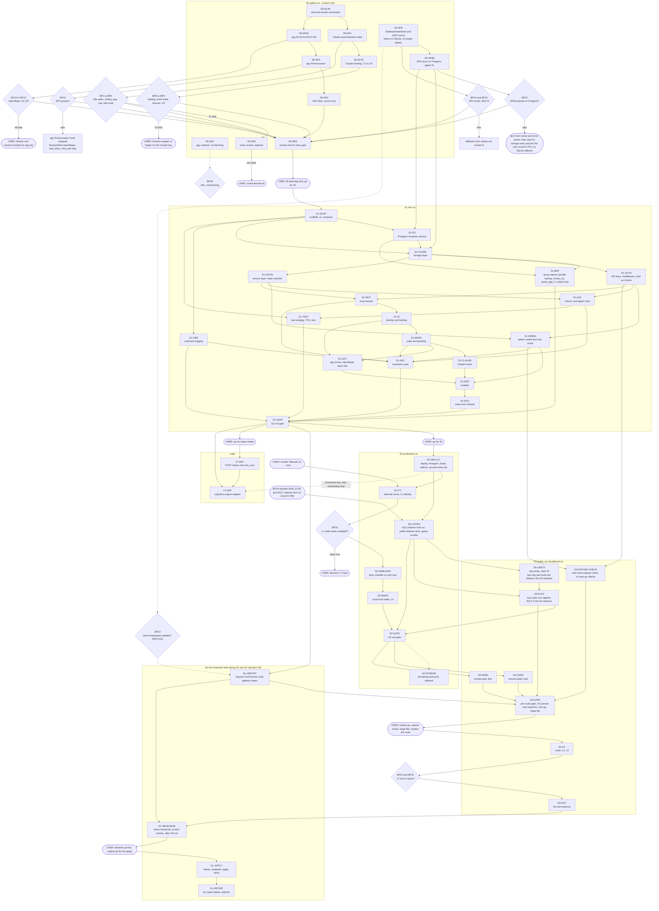

# Coordination plugin: master plan

This is the whole plan: one of the two live planning documents (the other is [`master-tasklist.md`](master-tasklist.md), which holds the status, milestones and todo). New design goes here; new status goes there. The file was `implementation-plan.md` until 2026-11-15; sections 9 to 13 were folded in from `go-live-migration.md`, `history-rewrite-plan.md`, the decision records of the old tasklist, the decision tables of `pickup-handoff.md` and the S1 plan drafts on 2026-11-15.

## Contents

1. [Purpose, status, scope, links](#1-purpose-status-scope-links)
2. [Phase overview](#2-phase-overview)
3. [Dependency DAG and branch points](#3-dependency-dag-and-branch-points)
4. [Workstream catalogue](#4-workstream-catalogue) (4.1 S0, 4.2 S1, 4.3 S2, 4.4 S3, 4.5 go-live, 4.6 LT)
5. [Parallelisation plan](#5-parallelisation-plan)
6. [Decisions still needed from the user](#6-decisions-still-needed-from-the-user)
7. [Traceability](#7-traceability)
8. [Effort roll-up](#8-effort-roll-up)
9. [Go-live migration](#9-go-live-migration) (folded from `go-live-migration.md`)
10. [Git history rewrite](#10-git-history-rewrite) (folded from `history-rewrite-plan.md`)
11. [Decision records](#11-decision-records) (DDR-001 to DDR-004)
12. [Decision rounds](#12-decision-rounds) (Y1 to Y10, Z1 to Z19, and the earlier rounds in short form)
13. [Waves and workflow process](#13-waves-and-workflow-process)

Status (2026-11-11; first written 2026-11-09; the status text in this paragraph is kept as written on that date, S1 has been running since the user's go of 2026-11-11 and the live status is in [`master-tasklist.md`](master-tasklist.md)): **PLANNING ONLY until the S1 kickoff starts.** SP5b passed on 2026-11-10 and satisfied the S1 storage gate (round-4 C1); SP3 passed and SP4 was recorded (2026-11-10 and 2026-11-11), so the overall S1 entry gate is **satisfied (2026-11-11)** and the user approved the S1 kickoff (Y10); see section 12.1 of this plan and the status in `master-tasklist.md`. Nothing here is built. This file turns the accepted DDR-004 (40 binding decisions: 25 to 36 of 2026-11-05 closing the former section 6 items, 37 to 40 of 2026-11-09, which also reverse D4's starting engine to Postgres and decide the S3 listener of D20; plus the round-2 decisions R1 to R8 and the round-3 decisions R9 to R14 of the same day, which refine D20, D37, D38 and D39, and the round-4 decisions X1 to X5 of 2026-11-10, which refine or replace R9, R10, R11 and R13; in this file they are written "round-4 X1" to "round-4 X5" so they do not collide with risk ids) and the specs into workstreams that can be started, parallelised and gated. It adds no decisions. Anything not already decided or specified is labelled **[proposal]**.

Home: `agentic-hub/plugins/coordination`, branch `feat/coordination`. Authoritative inputs, in this order: the [archived consolidated plan][plan] (decisions D1 to D40, roadmap, risks, section 7; its status text is out of date, see section 11), the decision records and rounds in sections 11 and 12 of this plan, [server-api][api], [spikes][spikes], [status-client][status], [section 9 of this plan][golive] (the go-live migration), [master-tasklist][tasklist] (status), the two agy results ([A6][a6], [A4][a4]), and the plugin [AGENTS.md][agentsmd].

Evidence labels follow the inputs: **verified** (read in code or docs, or observed on the wire), **reported** (a project or user statement, not reproduced), **unverified** (not yet tested). Decision numbers are written D1 to D40 (D37 to D40 of 2026-11-09 are in plan section 3); the round-2 decisions of 2026-11-09 are R1 to R8 and the round-3 decisions of the same day are R9 to R14 (recorded in section 11.4 of this plan and folded into plan decisions 20, 37, 38 and 39). Where this file says "SP5" it means the SQLite run of 2026-11-05; "SP5b" is the Postgres rerun that gates S1 (D39). Risk numbers are R1 to R14 from plan section 6 and appear in the `risks` columns and as "plan R12"; every other "R1" to "R8" in this file is a round-2 decision, written "round-2 R<n>" wherever a risk id could be meant, and every "R9" to "R14" that is a decision is written "round-3 R<n>" (a bare "R9" to "R14" in a `risks` column is a risk id).

## 1. Purpose, status, scope, links
### 1.1 Purpose
- One place that lists every unit of work from the S0 spikes to go-live, with dependencies, acceptance tests, owner, model tier and effort.
- Spike outcomes that change the work appear as explicit branch points (section 3.2); parallelism and user actions are in sections 5 and 6.

### 1.2 Status and the planning-only rule
- DDR-004 is accepted (D1): daemon and container restrictions are lifted, **planning only remains**, implementation only where strictly necessary for a spike.
- Today the repo may hold documents only. Spike code lives in `~/scratch/a2a-spikes/<id>/`, outside every git repo, and is never merged ([spikes 1][spikes]).
- Lifting the rule is the user's explicit go for S1. In practice it means (from [AGENTS.md][agentsmd] Status rules, D1, D16):
  - Real files may be created in this plugin: `plugin.json`, `docker-compose.yml`, Dockerfile, `servers/coordination/...`, `bin/` scripts, `hooks/hooks.json`, `config/cards.yaml`.
  - The status rules in `AGENTS.md` and the tasklist are then updated by the S1-SCAF stream, with that same go.
- Lifting it does **not** mean any of these (they stay separate user decisions or user actions):
  - installing `tailscale`, `cloudflared` or `caddy`, or editing the Cloudflare Tunnel configuration
  - creating the public route before the S3 gate, or starting the service on <storage-host> while a route exists (R13)
  - writing harness hook or MCP configuration by hand or by script: only the installer, run by the user, does that (D16)
  - putting any API key into a chezmoi-managed file (D24)
  - committing or switching branches without the user's word
  - launching, driving or wrapping agy (DDR-003)

### 1.3 Scope boundaries
In scope:
- The server (`/mcp`, `/a2a/v1`, `/wake/*`, `/sessions`, `/status`, Agent Card), the `a2a-coord` CLI (admin and host parts), the installer, the Claude Code and agy hook scripts, tests, docs.
- Deploy to <storage-host> (S2), public exposure through the existing tunnel (S3), the one-time channel import (go-live).
- The server side of status intake, and the cognitive-engine adapter as a separate repo workstream (LT).

Out of scope (all from plan or specs):
- BuildSlot (cognitive-engine PR #13): independent track.
- OpenCode as a third peer: unconfirmed by the user.
- ACP.
- gRPC binding.
- Cluster mode.
- Admin HTTP endpoint or admin scope.
- A workstation-local fallback server.
- mTLS (later, per peer).
- WAL archiving and point-in-time restore, and a host-installed Postgres (D37; Postgres itself is now in scope as a compose service, D4).
- Any change to cognitive-engine's deterministic core.
- Anything that starts, steers or wraps an agy process.

### 1.4 Owner key and ground rules
- **CC**: Claude Code (a helper session or a subagent). **AGY**: the user's own interactive agy session, or agy itself inside that session at the user's request. **USER**: the user, at a terminal or dashboard.
- No workstream contains a step that launches, drives or wraps agy. Every agy-side step below has owner AGY or USER; CC only prepares files and reads logs ([spikes 1][spikes]).
- Claude Code test sessions are started by the user in a terminal, interactive CLI only; no `claude -p`.
- Tiers (user rule, Claude Code, CLAUDE.md "Claude Code subagent model rule"):
  - **sonnet** by default; pass `model` explicitly on every subagent call.
  - **opus** only for adversarial verification, design proposals and subtle debugging. Run `jev_judge` in parallel with each such escalation when Jev is available.
  - One final verification gate per body of work on **opus** (the highest tier available in the subscription; Fable is not in the subscription), per the user rule. FG at S3-GATE closes the server body of work and the go-live importer and retirement code together (D36; there is no separate go-live gate, section 4.5).
  - Low-Quota Protocol: with Jev mode `on` and under 20% quota remaining, ask the user before any opus escalation.
  - Agy-side work runs in Antigravity, tier not applicable.
- Size key: S is an upper bound of 6 h, M up to 18 h, L above. Hours are focused work including tests and user time (assumptions in section 8). They are estimates **[proposal]**, not measurements.
- Tools: `rg`, `fd`, `jq`, `yq`, `mdq`, `sd` before Python glue; real Python through `uv` ([AGENTS.md][agentsmd]).

### 1.5 State of the evidence this plan stands on
| fact | label | where |
| --- | --- | --- |
| agy sends the configured `Authorization` header on every `/mcp` request | verified (wire log, 2026-11-04) | [A6][a6] section 2 |
| agy does not expand env vars in `headers` | verified (wire) | [A6][a6] section 5.1 |
| agy handle binds to `_meta["antigravity.google/conversation_id"]` on `tools/call`; `Mcp-Session-Id` is per process | verified (wire) | [A4][a4] T1 to T4, [api 5.4.1][api] |
| Claude Code 2.1.318 on <workstation>; minimum for the wake is 2.1.290 | version verified; minimum reported | [spikes 4][spikes] |
| `asyncRewake` idle wake, Esc gap, stop cap, timeout ceiling | reported, unverified in practice | SP1 |
| Claude Code expands `${A2A_API_KEY}` in MCP headers (C9) | unverified | SP2 |
| agy `SessionStart` on `/clear` and resume (A3); user-level plugin config (A8); `PreInvocation` cost | unverified | SP2, SP3 |
| `DatabaseTaskStore` fit for parked tasks, visibility, held tasks; `mcp` app mounted in the SDK's Starlette app | unverified | SP5 D11, D12 |
| Tailscale identity delivery through `tailscale serve`; `CF-Connecting-IP` from `cloudflared` on the same host | unverified | [spikes 13][spikes] L1, L2 |
| Cloudflare request timeout about 100 s | reported | [plan R11][plan] |
| Port 8120 free on <workstation> | reported; free on <storage-host>: verified | [api 1.4][api] |
| `~/.gemini/config/AGENTS.md` and `~/.claude/CLAUDE.md` are both symlinks to `~/projects/doppelganger/.agents/user-AGENTS.md`, a git-tracked file in another repository; `chezmoi source-path ~/.gemini/config/AGENTS.md` reports "not managed" | verified (`ls -l`, `chezmoi source-path`, 2026-11-04) | <workstation> |
| `~/.gemini/config/hooks.json` exists and is unmanaged; `~/.gemini/config/plugins` holds 11 plugin directories and is chezmoi-managed (source `dot_gemini/config/plugins`) | verified (2026-11-04) | <workstation> |

## 2. Phase overview
Every stage that adds a listener needs the user's explicit go. The gates are necessary, not sufficient ([plan 5][plan]).

| phase | entry gate | exit gate | kill switch | cites |
| --- | --- | --- | --- | --- |
| S0 | user approves each host change a spike needs; scratch dir and scratch container only | S1 entry gate (D39): SP1, SP2, SP3 passed or failed-with-fallback; SP4 recorded; **SP5b passed on Postgres** (SP5 on SQLite stays as passed but no longer gates; status 2026-11-11: **gate satisfied**: SP5b passed 2026-11-10, SP3 passed, SP4 recorded; earlier round-4 C1 wording "not yet satisfied" is superseded; see section 12.1 and `master-tasklist.md`); SP6 optional; A8c does not block; results written and linked from `master-tasklist.md` (edit made with the user's go) | remove spike hook and MCP entries, delete scratch container and directory | [plan 5 S0][plan], [spikes 11][spikes] |
| S1 | SP1, SP2, SP3, SP4 (record only) and SP5b done (D39) and the user's go for S1 (lifts planning-only) | round trip both ways between live Claude Code and live agy; idle Claude woken by the stub; agy sees the pending count at its next model call; keyless and wrong-scope requests refused on loopback; quarantine and review end to end with a local test peer; `asyncRewake` `UserPromptSubmit` re-arm test and the GUI-launched Claude test pass (D39); a `pg_dump -Fc` backup restores with `pg_restore` into a scratch Postgres with equal counts; the dump sidecar (compose profile `backup`) writes a dated dump and, once `pg_restore --list` passes, the `last_ok` file, and `dump_age_h` shows in `/status` (round-2 R4, R5; round-3 R12, R14) | `docker compose down` (the Postgres volume survives); `a2a-coord install --uninstall` (chezmoi parts through chezmoi); revoke keys; frozen channel untouched | [plan 5 S1][plan], [api 11.0][api] |
| S2 | S1 exit; no public route exists; service never started on <storage-host> while a route is present | cross-host wake works from <workstation> and mac to <storage-host>, shown on one workstation before the rest; **public-listener tests on `127.0.0.1:8121` pass (round-2 R8, S2-LISTEN: bound to loopback only, `remote-peer` keys only, only `/a2a/v1` and the public card, uniform "not available" handle errors, the guess counter trips (10 handle-addressed misses within 60 s, then `429` with `Retry-After: 60`) with a `handle_probe_limited` audit row (round-3 R10; round-4 X3: card-addressed sends are outside the counter), per-key rate limits, the fuzz pass)**; the dump sidecar has run under `COMPOSE_PROFILES=backup` and `dump_age_h` shows in `/status`; the second restic job (printed for and installed by the user, with the user-created password file; round-4 X4) has collected a dump from `<media-root>/backup/a2a/`; no public route | turn off `tailscale serve` on <storage-host> (exact command depends on the Tailscale version, unverified) and revoke per-machine keys; or `docker compose down` on <storage-host> | [plan 5 S2][plan], [spikes 13][spikes] L1, L4 |
| S3 | S2 exit and the user's go to start S3 work (no route; <storage-host> stays at stage `s2`, with the 8121 listener already on loopback since S2, round-2 R8). Route condition, separate: S3 gate passed (quarantine live, rate limits and fuzz pass tested against the 8121 listener in S2 and still green, honest card, final extension URI fixed per D40) and the user's explicit go; then the stage flip (round-3 R13 and round-4 X5: the user runs `a2a-coord expose check`, which must exit 0 and whose manual items the user confirms, sets `A2A_EXPOSURE_STAGE=s3` and the public host in the compose environment and restarts, the server's `s3` start-up checks pass), and only then the user creates the route (the exposure gate) | allowlisted test peer completes a task through quarantine and human release; unknown peer rejected; fuzz report filed in `docs/research/` | delete the route in the tunnel configuration on <storage-host>; revoke all `remote-peer` keys; S1 and S2 keep working | [plan 5 S3][plan], [api 8.4.1, 9][api] |
| go-live | S3 exit gate passed and the user declares go-live (D14) | store holds the imported history; tar backup verified; watcher stopped; channel files deleted | importer is repeatable on a fresh store; restore files from the tar | [plan 5][plan], [golive 2, 13][golive] |
| LT (later) | S1 exit and the user's go; off by default | adapter posts the five fields to `/status`; sender isolation and leak tests pass | disable the adapter; revoke the `status-client` key | [status 12][status] |

## 3. Dependency DAG and branch points
### 3.1 Flowchart
Diamonds are spike branch points (table in 3.2). Rounded nodes are user actions or decisions.



### 3.2 Branch points
Each row says what to do on either outcome. The fallbacks are copied in substance from [spikes][spikes]; nothing is new. The branch id is referenced from the workstreams.

| id | spike and test | if it passes | if it fails (fallback) | workstreams affected | who decides |
| --- | --- | --- | --- | --- | --- |
| BP1 | SP1 T1, idle wake | S1-CLAUDE as sketched in [api 11.1][api] | promote SP6 to a gate item; if SP6 also fails Claude gets the agy-style surfacing (`UserPromptSubmit` count, `a2a_inbox`, `a2a_wait`) and the asymmetry applies to both. **Changes D8, goes back to the user; S1 is stopped** | S1-WAKE, S1-CLAUDE | USER |
| BP2 | SP1 T4, timeout ceiling | `timeout: 604800` kept | keep in-script rounds, add re-arm at `UserPromptSubmit`, shorten the documented idle window | S1-CLAUDE, S1-DOC | CC |
| BP3 | SP1 T5, Esc gap | nothing | show a "not listening" flag on the card and in `/sessions` (planned) and re-arm at `UserPromptSubmit` | S1-ID, S1-CLAUDE | CC |
| BP4 | SP1 T6, stop continuation cap | budget 20/h stays | lower the per-handle budget; each wake text asks for a tool call; the spec names the real cap | S1-WAKE | CC |
| BP5 | SP1 T11, HTTP hook shape | `POST /wake/pending` as in [api 7.5][api] | command hook `a2a-pending` (curl `--max-time 2`, exit 0 on every failure); update api 7.5 to the observed shape. Counts as "failed with fallback", does not block S1 | S1-WAKE, S1-CLAUDE | CC |
| BP6 | SP2 C1 to C6, Claude binding | `a2a_hello(handle)` chain as designed | name unavailable: the unnamed-session form is [design, open] (api 3.5: `<card>/<first 8 chars of session id>` with no suffix, or the always-present `~<sid8>` with a default name), `a2a_hello(name=...)` gives a name hint and the server builds the handle `name~sid8` (decision 2026-11-09; separator `~` by round-4 X1); id unstable: `as_handle` argument on write tools; handle not seen by the model: put it in the `AGENTS.md` rule; unreliable overall: card-level addressing only for Claude (reopens D6 for that harness) | S1-ID, S1-MCP, S1-CLAUDE | USER if D6 reopens, else CC |
| BP7 | SP2 C7, `SessionStart` hook order | hooks in order, registration first: drop the 15 s `410 unregistered` retry | hooks parallel: keep the retry | S1-WAKE, S1-CLAUDE | CC |
| BP8 | SP2 C8 and A7, MCP tool timeout | `a2a_wait` default 30 s and maximum `A2A_MAX_WAIT_S` 240, and `a2a_send` `wait_seconds` maximum 240, stay if inside the limit | lower both below the measured limit and document it (both are blocking MCP tool calls) | S1-MCP, S1-DOC | CC |
| BP9 | SP2 C9, `${A2A_API_KEY}` in Claude MCP headers | installer writes the env reference | key cannot live in the environment for the MCP entry: a user-chosen wrapper or headers helper, never a literal key in a chezmoi-managed file | S1-INST | USER |
| BP10 | SP2 A2 and A4 compliance, agy `injectSteps` | at least one `injectSteps` type reaches the model; at least 8 of 10 bind after the injected text or the error | none of the types reaches the model: move the handle into the `AGENTS.md` rule. A6 and A4 identity are already verified, so agy binding itself does not depend on the model | S1-AGY, S1-ID | CC |
| BP11 | SP2 A3, agy `SessionStart` on `/clear` and resume | hook registers the new conversation | server registers an unknown `conversation_id` on its first `tools/call` ([api 5.4.1][api], accepted by D30). This becomes the only registration path | S1-ID, S1-AGY | CC |
| BP12 | SP2 A8 and A8b, user-level plugin config and `~/.agents` collision (resolved 2026-11-09) | installer writes `~/.gemini/config/plugins/<name>/mcp_config.json` (0600), provided `chezmoi source-path` returns "not managed" for both the file and its plugin directory (verified 2026-11-09: `~/.gemini/config/plugins` itself is a chezmoi-managed directory with no `exact_` prefix, `coordination` and `gitea` inside it are not managed, `obsidian` is, so `<name>` must not be a chezmoi-managed name); `<name>` unique across user and workspace scopes; `~/.agents/plugins` is ignored by agy | the `agy mcp add` global entry in the chezmoi-managed `~/.gemini/config/mcp_config.json` (reopens decision 24), or a per-workspace plugin written by the user | S1-INST, S1-AGY | USER |
| BP13 | SP3, `PreInvocation` | agy hook ships | `systemMessage` is the chosen item type (Y5, 2026-11-11; quoted back several turns later in one conversation, verified in SP3, reliability over many conversations unverified), plus the tested dedupe rule; `ephemeralMessage` is not used. If it stops surfacing: try `userMessage`, else drop; hook blocks the turn and cannot be avoided: do not ship it. Dropping does not block S1 | S1-AGY | CC |
| BP14 | SP4, held `Stop` | recorded as usable or not | nothing ships either way. K6 "background command wakes agy" is recorded as a candidate for a later user decision | none | USER (later) |
| BP15 | SP5 D2, D3, D1 (engine), run on SQLite (resolved 2026-11-05 and 2026-11-09; superseded for the gate by BP24) | SP5 result: the plain `DatabaseTaskStore` is **not** sufficient (300 of 300 lost updates); the cure is `CoordTaskStore` over the SDK `VersionedDatabaseTaskStore` with a version row seeded at task creation. SQLite engine findings (`BEGIN IMMEDIATE`, single write connection, WAL) are retired by the 2026-11-09 engine decision (D4, D37) and kept only as evidence that SQLite would have been enough | the Postgres move is decided (D4), no longer a fallback needing confirmation; what SP5 did not show on Postgres is BP24 | S1-STORE, S1-STATE | CC |
| BP16 | SP5 D11, D12, D6 | SDK request handler, visibility wrapper, `mcp` app mount and two migration streams work | D11: own request handler and `TaskStore` wrapper, keep only SDK types, card and wire code; D12: `/mcp` as a second ASGI app on an internal port behind the same auth middleware; D6 clash: our tables with their own migration history, separated from the SDK's [design: how, on Postgres, is open until S1-STORE; SP5 D6 passed on both engines, so the fallback was not needed] | S1-STORE, S1-A2A, S1-MCP, S1-STATE | CC |
| BP17 | SP6 X1 to X5 | candidate to replace or back up `asyncRewake` | stay on `asyncRewake`, no change | S1-CLAUDE (only if BP1 fails) | USER |
| BP18 | L1, tailnet identity | node name available: bind each key to `tailnet_node` | only a user login: the check cannot tell <workstation> from mac, so D17 needs the user's input before S2 | S2-TS, S1-AUTH | USER |
| BP19 | S3 listener port (**decided by the user on 2026-11-09, D20, D-F; timing decided the same day, round-2 R8**) | the tunnel targets a dedicated loopback port 8121, the public listener (`remote-peer` keys only, only `/a2a/v1` and the public Agent Card, `CF-Connecting-IP` trusted only there); 8120 stays tailnet-only; the server starts the 8121 listener from stage `s2`, bound to `127.0.0.1:8121`, and the route (created only at the S3 go) is the exposure gate | none: the Host-based `A2A_TUNNEL_HOSTS` design (tunnel to 8120) is a rejected alternative | S2-LISTEN, S3-LIMITS, S3-CF | decided |
| BP20 | L2, `CF-Connecting-IP` | believed only by the 8121 listener | per-key limits only | S3-LIMITS, S3-CF | CC reports, USER confirms |
| BP21 | L3, Cloudflare timeout and path routing | 60 s hold succeeds; unrouted path refused | server-side refusal of paths outside `/a2a/v1` and the card is the safe default (already planned) | S3-CF, S3-CARD | CC |
| BP22 | L4, wake over the tailnet | latency recorded; re-park without a loop after a 30 s and a 5 min break | back-off tuning; wake budget bounds a flapping link (R12) | S2-WAKE | CC |
| BP23 | go-live: can `DatabaseTaskStore` set its own created and updated timestamps ([golive 15][golive] point 7) | import timestamps from the source | ordering and dates come from `coord.import.seq` and `begin_ts` | GL-IMPORT | CC |
| BP24 | SP5b (new, D39): SP5 rerun on Postgres. D3 lost-update test on the versioned store; D7 backup and restore integrity check (a `-Fc` dump from the real sidecar, `pg_restore --list` and `pg_restore`, round-3 R12 and R14); D8 `kill -9` of the server and a restart of the Postgres container with zero lost acked writes; D2 load mix **including the steady-state session-register and budget-counter writes SP5 skipped** | 0 lost updates, 0 lost acked writes, p99 write under 200 ms (SP5's numbers); the exact Postgres image tag is chosen and its digest recorded, one image for S1, S2 and S3 (D37, round-2 R3) | **round-2 R7:** up to two revise-and-rerun cycles (wrapper tuning, isolation level, the seeded version row, a Postgres setting), then stop S1 storage work and ask the user; no automatic fallback to SQLite. A deadlock count above zero in the Postgres log is recorded, since the SP5 D10 deadlocks were cured by seeding the version row | S1-PG, S1-STORE, S1-BKP, S1-STATE, S1-GATE | CC runs it; no user time needed unless both reruns of R7 fail |
| BP25 | A8c (new, D39 and D-E): `.mcp.json` at user level in `~/.gemini/config/plugins/<name>/`; `agy plugin install <path>` and uninstall; tool use while signed out of agy | each item has an observed answer labelled verified, reported or unverified | recorded, and BP12 stays as decided; if a placement stops running tools the BP12 fallback applies. **Not blocking S1** | S1-INST (record only) | USER runs it |
| closed | SP2 A6, agy header | **PASS, verified 2026-11-04** | n/a | S1-INST, S1-AGY | n/a |

## 4. Workstream catalogue
Link shorthand: `api N` is [server-api.md][api] section N; `spk N` is [spikes.md][spikes]; `plan N` is section N of the [archived consolidated plan][plan] (full text of D1 to D40, the risks R1 to R14 and the open-decision list; see section 11); `gl N` is section 9.N of this plan ([the folded go-live migration][golive], formerly `go-live-migration.md` section N); `st N` is [status-client.md][status]. The target tree is the single layout in [api 1.4][api]: `servers/coordination/src/coordination/...`, `servers/coordination/tests/`, `bin/`, `hooks/hooks.json`, `config/cards.yaml`, `docker-compose.yml`, `plugin.json`.

### 4.1 S0: spikes (scratch only)
All S0 code lives in `~/scratch/a2a-spikes/<id>/`, stub on port 18120, throwaway key `spike-token`, wake budget 12/h and a kill file ([spk 1][spikes]). Real hook files and user-level configs are not touched.

| ID | what | owner | tier | size, hours | risks | gates | branch points |
| --- | --- | --- | --- | --- | --- | --- | --- |
| S0-SCAF | shared stub and results convention | CC | sonnet | S, 3-5 | R5 | SP1 to SP3 | none |
| S0-SP1 | Claude `asyncRewake` wake | USER starts and Esc; CC runs stub | sonnet | M, 5-8 (+ one passive overnight run) | R5, R12 | S1-WAKE, S1-CLAUDE | BP1 to BP5 |
| S0-SP2C | Claude binding, hook order, tool timeout, C9 | USER starts; CC runs stub | sonnet | M, 6-9 | R10, R8 | S1-ID, S1-INST, S1-MCP | BP6 to BP9 |
| S0-SP2A | agy remaining checks | AGY or USER; CC prepares files | n/a (Antigravity) | S, 3-4 | R1, R6, R10 | S1-AGY, S1-ID, S1-INST | BP8 (A7), BP10 to BP12 |
| S0-SP3 | agy `PreInvocation` | AGY or USER | n/a | S, 1.5-2.5 | R6 | S1-AGY | BP13 |
| S0-SP4 | agy held `Stop` park | AGY or USER | n/a | S, 2-3 | R1, R6 | none (recorded) | BP14 |
| S0-SP5 | `DatabaseTaskStore`, MCP mount (done on SQLite 2026-11-05; passed, no longer gates S1) | CC | sonnet; opus only for subtle debugging of D3 | M, 8-12 (+2 stretch D10) | R7, R9 | S1-STATE, S1-A2A, S1-MCP (SDK fit, D11 and D12) | BP15, BP16, BP23 |
| S0-SP5B | SP5 rerun on Postgres (D39) | CC | sonnet; opus only for subtle debugging of D3 | to be estimated | R7, R9, R14 | S1-PG, S1-STORE, S1-BKP, S1-STATE | BP24 |
| S0-SP5B-FU | SP5b follow-up (round-4 C4, 2026-11-10; not gating S1): (a) D7 role setup through the `a2a-coord db init-dump-role` command route (round-4 X2), (b) separator evidence with `~` (round-4 X1), (c) cause of the 1,036.82 ms D7 outlier (optional) | an agy run on <workstation> | n/a | to be estimated | R14 | none (records only) | BP24 |
| S0-A8C | agy runbook A8c: user-level `.mcp.json`, `agy plugin install`, signed-out tool use (D39, not blocking) | USER runs; CC writes the runbook | n/a (runbook) | S, to be estimated | R1, R8 | none (records only) | BP25 |
| S0-SP6 | inbox socket (optional) | USER starts; CC runs stub | sonnet | S, 2-3 | R5 | S1-CLAUDE only if BP1 fails | BP17 |
| S0-RES | results write-up and S1 entry gate (D39) | CC | sonnet | S, 2-3 | all | S1 start | all |

#### S0-SCAF: shared spike scaffolding and results convention
- Goal: one throwaway stub that all agent-side spikes share, and one convention for recording results.
- Scope: `~/scratch/a2a-spikes/stub/`, single file, standard library only (a hand-written stateful streamable-HTTP MCP endpoint; fallback `uv run --with mcp` in scratch after telling the user).
- Spec: [spk 3][spikes].
- Stub endpoints: `POST /wake/listen` (parks on `ctl/<session>.release`, 408 at round end, 409 to the older listener, wake budget, `ctl/KILL`), `POST /sessions`, `GET /pending`, `POST /mcp` (stateful, `Authorization: Bearer spike-token` else 401, fake tools `a2a_hello`, `a2a_inbox`, `a2a_wait`, logs every header and the full body including `_meta`), `POST /wake/pending` for SP1 T11.
- Results convention **[proposal]**: [spikes 1][spikes] says `docs/research/spike-results-<date>.md`, but the two existing results use `spike-results-<date>-<spike>-<step>.md`. Use the suffix form, one file per run, each section carrying tool versions, the exact run, raw log lines, pass or fail per criterion and a one-line decision consequence. S0-RES indexes them.
- Acceptance:
  - Stub answers every endpoint above, logs one line per request with a timestamp, and runs MCP stateful on purpose (Recall's stateless setting is not reused).
  - `ctl/KILL` stops all wakes; the budget caps releases at 12/h; a headerless `/mcp` request gets 401 and is logged as headerless.

#### S0-SP1: Claude Code `asyncRewake` long-poll
- Goal: settle whether the listener wakes an idle interactive session and how it fails.
- Scope: scratch project `~/scratch/a2a-spikes/sp1/` with `.claude/settings.local.json` only; draft `a2a-listen` in POSIX sh plus curl.
- Spec: [spk 4][spikes], D8, [api 7, 11.1][api].
- Inputs: S0-SCAF. Run first with `timeout: 600` and 60 s rounds, later `timeout: 604800` and 900 s rounds, on `haiku`; check the 5h and 7d quota first.
- Tests T1 to T11 as in spikes 4. Gate items: T1 (latency under 10 s, stub text visible), T2, T3, T4, T7, T9, T11. Record only: T4 overnight, T5, T6, T8, T10.
- Acceptance: the "must pass" list in spikes 4 met with logs; the results file carries the hooks JSON, listener script, T1 to T11 table, longest idle period that woke, cap number or "no cap in 12", and `claude --version`.
- Owner detail: USER starts one interactive `claude --model haiku`, presses Esc; CC runs the stub in the background and writes the result. No `claude -p`, no PTY driver.

#### S0-SP2C: Claude Code binding half
- Goal: prove the chain hook, context, `a2a_hello(handle)`, one stable `Mcp-Session-Id`, and answer the key-storage question C9.
- Scope: SP1 scratch project plus the stub registered as an MCP server in the scratch project's own config.
- Spec: [spk 5][spikes] C1 to C9, D6, D24, [api 5.4, 8.2][api].
- Inputs: S0-SP1 (reuses its project, hooks and listener).
- Acceptance (gate): C1 and C2 pass; C3 keeps binding across `/compact` and resume or shows a clean re-bind; C5 at least 8 of 10 bind unprompted and 10 of 10 after the error text; C6 two sessions never share a binding; C7 order result stated; C8 effective MCP tool timeout recorded and `a2a_wait` default shown inside it. Record: C4, C9 (header expansion, with and without the variable set), hook stdin keys, the `Mcp-Session-Id` lifecycle table, and the statement that binding is an assertion by a key holder, not authentication.

#### S0-SP2A: agy remaining checks
- Goal: close what the A6 and A4 runs left open. Already **verified** (do not rerun): A1 conversation id, A4 identity (distinctness, resume stability, sub-invocation ids), A6 header on every request and no env expansion.
- Scope: a scratch trusted workspace with a scratch `.agents/hooks.json` and the stub MCP entry, prepared by CC; run by AGY or USER.
- Spec: [spk 5][spikes] A2, A3, A4 (10-session compliance count only), A5, A7, A8.
- Steps:
  - A2: each documented `injectSteps` item type (`systemMessage`, `userMessage`, `ephemeralMessage`); which the model sees; still visible five turns later.
  - A3: does `SessionStart` fire on resume and on a `/clear`-created conversation.
  - A4 count: 10 fresh sessions, how many call `a2a_hello` after the injected instruction or the error text.
  - A5: hook runs only in a trusted workspace (record).
  - A7: blocking `a2a_wait` at 30, 120 and 240 s (gate item with C8).
  - A8 (original method; done 2026-11-08, and A8b on 2026-11-09 settled the placement as `~/.gemini/config/plugins/<name>/mcp_config.json`, see BP12): place `.agents/plugins/coordination/mcp_config.json` (0600) at workspace level and at user level (`~/.agents/plugins/coordination/`, created for the test and removed after); record which loads, what `/mcp` shows, whether agy reads anything else in `~/.agents`, that the frozen channel watcher (`watch-bridge-coordination.sh`) is unaffected, and that no file is left behind.
  - A8 extra check: whether agy loads plugin `mcp_config.json` from `~/.gemini/config/plugins/<name>/`. Record it, but note that this tree is chezmoi-managed (verified: `chezmoi source-path` gives `dot_gemini/config/plugins`), so it can never hold the literal key (D24).
- Acceptance (gate): at least one `injectSteps` type reaches the model and the model calls `a2a_hello`; at least 8 of 10 bind; A7 recorded and `a2a_wait`'s default shown inside it. A8 record: a placement found that agy loads, is outside chezmoi and disturbs nothing in `~/.agents`.
- Owner detail: AGY or USER in its own session. Antigravity may use the frozen channel for research (D14); A8 must not write into it.

#### S0-SP3: agy `PreInvocation` surfacing
- Goal: show the hook surfaces a pending count cheaply and fails open.
- Spec: [spk 6][spikes], D9, [api 11.2][api].
- Inputs: S0-SP2A (same workspace, hooks file and MCP entry; `a2a_inbox` needs the binding result).
- Acceptance (gate): P1 model sees the stub and calls `a2a_inbox` in at least 4 of 5 trials; P3 median hook time under 100 ms and p95 under 500 ms on loopback; P5 every failure mode fail-open (exit non-zero, invalid JSON, nothing, timeout, server down, exit 2), with the safe script behaviour stated; P4 a dedupe rule exists. Record: P2, P6, P7.
- Owner detail: AGY or USER; CC prepares scratch files and reads logs.

#### S0-SP4: agy held `Stop` park (record only)
- Goal: give the user the facts to revisit the accepted no-idle-wake asymmetry. Nothing ships on it.
- Spec: [spk 7][spikes], D9.
- Safety: own scratch workspace and session, second terminal with `pkill -f spike-stop-park`, timeouts 30 then 300 then 1800. Owner: AGY or USER only.
- Acceptance: every K1 to K6 question has an observed answer and a one-line recommendation (usable, usable with caveats, not usable).

#### S0-SP5: `a2a-python` on SQLite, SDK fit, MCP mount
- Status (2026-11-09): **done on SQLite, passed (2026-11-05), no longer gates S1** (D39). The user moved the starting engine to Postgres (D4); S0-SP5B below reruns the engine-dependent items on Postgres. The SQLite evidence stays as the record of why the SDK wrappers exist and of why SQLite would have been enough; the D11, D12 and D6 results still stand.
- Goal: show one process with `DatabaseTaskStore` on SQLite (WAL, busy timeout set by us) carries the mixed traffic, and that the three SDK extension points and the `mcp` mount work.
- Scope: `~/scratch/a2a-spikes/sp5/` as a `uv` project with `a2a-sdk` pinned; Docker only for the volume steps. Read the store constructor and migration CLI source first (not in the audit).
- Spec: [spk 8][spikes], D3, D4, [api 1.2, 1.3, 3.3.3, 10][api].
- Acceptance (gate):
  - D2: zero unhandled `SQLITE_BUSY` in 10 min, p99 write under 200 ms, event-loop lag under 100 ms, wake p99 under 500 ms with 200 parked listeners.
  - D3: no lost update, or a named passing cure.
  - D4: extension data round-trips (`coord.to`, `coord.from`, held task as `INPUT_REQUIRED` plus `coord.hold`, `context_id` per originator and recipient card), and handle lookup is chosen (filter or side table).
  - D5: no cross-owner read or cancel.
  - D6: migrations idempotent, newer-than-code refused, our tables coexist.
  - D7: backup and restore with integrity check and equal counts.
  - D8: `kill -9` loses no committed task.
  - D11 and D12: work, or the fallback is shown working.
- Added check **[proposal]** D13: can the store set its own created and updated timestamps (answers go-live open point 7). Record only.
- Record: exact `a2a-sdk`, Python, SQLite, `aiosqlite` and SQLAlchemy versions; the passing engine and PRAGMA configuration; latency and error table; the backup and restore command sequence; wrappers we need. Escalate to opus only for subtle debugging if D3 shows a lost update.

#### S0-SP5B: SP5 rerun on Postgres (gates S1)
- Goal: show that the engine S1 ships, Postgres in the compose project, keeps the three properties SP5 measured on SQLite: no lost update, no lost acked write, write p99 under 200 ms. SP5 D10 ran only D4, D5, D6 and a 3-minute D2 mix on Postgres; stress, backup and crash were not run.
- Scope: `~/scratch/a2a-spikes/sp5b/` as a `uv` project (reuse of the SP5 driver and server is [proposal]); Postgres as a scratch container on a user network with throwaway credentials, no published port. The image is pinned by **exact tag plus a recorded digest, chosen here** (D37 and round-2 R3; the same image then runs in S1, S2 and S3; no major-only tag, no `latest`; this plan states no version number, SP5 D10's 17.11 is a record, not the pin); record the choice, the digest and why.
- Spec: [spk 8b][spikes] (the SP5b spec; spk 8 is the SQLite SP5 record), D4, D37, D39; the SP5 results ([sp5][sp5res]) D2, D3, D7, D8 and D10 rows.
- Inputs: the SP5 results file; the SP5 D2 load driver; the SDK versioned store with the version row seeded at task creation.
- Acceptance (gate; same numbers as SP5):
  - D3 on Postgres: cancel versus complete and double take on the versioned store, 0 lost updates and 0 double takes; the plain store shown unsafe again.
  - D7 (round-3 R12, R14): a custom-format (`-Fc`) dump taken under load by the real dump sidecar, run once with `docker compose --profile backup run --rm dump` as the `dump_ro` role (so the sidecar, its role and its secret are tested, not only a hand-run `pg_dump`); the file verified with `pg_restore --list`; restored with `pg_restore` into a scratch Postgres, with an integrity check and equal row counts; the command sequence recorded. SP5b runs on <workstation>, so the dump directory is a scratch bind mount, not `<media-root>/backup/a2a/`.
  - D8: `kill -9` of the server under load and a restart of the Postgres container: 0 lost acked writes (creates, completions, cancels counted as in SP5 D8).
  - D2: the SP5 mix (10x, 200 parked listeners) **plus the steady-state session-register and budget-counter writes that SP5 skipped**: p99 write under 200 ms, event-loop lag under 100 ms, wake p99 under 500 ms; the Postgres log checked for deadlocks (SP5 D10 saw 22 without the seed).
  - Separator check (decision 2026-11-09, spikes 8b): handles with `#` and with `~` through URL use (`coord.to` in JSON-RPC and REST, percent-encoding), shell use (`curl` with and without quoting, the `a2a_send` argument), JSON and storage as a database key. Pass: `#` works everywhere, or `~` is adopted; the choice is recorded and feeds S1-ID and the hook scripts. Result (2026-11-10): both passed as run and `#` needs `%23` in URL queries; round-4 X1 (user decision 2026-11-10) adopted `~`, so S1-ID builds `card/name~sid8`.
  - 8b status (2026-11-10, round-4 C1 to C3): SP5b passed on Postgres; the 200 ms p99 gate was evaluated on D2 only (p99 18.66 ms); "0 deadlocks" is inferred from an empty `db_errors` count (no separate deadlock counter in the logs); one 1,036.82 ms `CancelTask` outlier during the D7 dump has an unverified cause (the `ACCESS SHARE` explanation is not accepted).
- Record: exact `a2a-sdk`, Python, Postgres image tag and digest, `asyncpg` and SQLAlchemy versions; the separator check result and the adopted separator; the latency and error table; the backup and restore command sequence; wrappers we need. The pin is recorded for S1-PG and for the S2 deploy and the upgrade runbook (an upgrade is `pg_dump`, upgrade, restore test). Also recorded: the sidecar invocation, the `dump_ro` role statements that worked, and the `pg_restore` sequence, as inputs to S1-PG and S1-BKP.
- Owner: CC; no user time needed. Tier sonnet; opus only for subtle debugging if D3 shows a lost update.
- Failure rule (round-2 R7, decided 2026-11-09): if SP5b fails its pass criteria, up to two revise-and-rerun cycles (wrapper tuning, isolation level, the seeded version row, a Postgres setting), then S1 storage work stops and the user is asked. There is no automatic fallback to SQLite.

#### S0-SP5B-FU: SP5b follow-up (round-4 C4, 2026-11-10; not gating S1)
- Status: **done 2026-11-10, not gating S1.** Result file: `docs/research/spike-results-2026-11-10-sp5b-followup.md` (agy's sections 1 to 6; Claude Code's independent check in section 7). Verdicts:
  - (a) PASS for the mechanism. [verified] script matches X2, secret mounted only into the sidecar, 0 files in saved logs contain the secret value, four more sidecar dumps with 71 `pg_restore --list` entries each. [reported] by agy, no saved log: idempotency, rotation with the old credential rejected, restored row counts (226 of 226 tasks and index, 210 sessions, 223 wakes, orphan tasks 0), the Postgres container log scan. These are re-covered by the S1-PG and S1-BKP exit tests below.
  - (b) PASS. [verified] `~` needs no encoding in URL query, shell, JSON-RPC and REST `coord.to`, or the database insert and select.
  - (c) Cause UNVERIFIED. [verified] no reproduction over 4 consecutive dumps (max 100.27 ms); lock contention and slow queries ruled out. [unverified] WSL2 host scheduling pause is a guess.
- Goal: close the three loose ends of SP5b. Owner: an agy run on <workstation>. Result file: `docs/research/spike-results-2026-11-10-sp5b-followup.md`. Spec: [spk 8b][spikes].
- Scope:
  - (a) D7 role setup through the command route of round-4 X2: on a fresh volume, an existing volume and a rotation, `a2a-coord db init-dump-role` (or its scratch stand-in, [design, open]) creates or updates `dump_ro` from the secret file that only the sidecar mounts, then the sidecar dumps and `pg_restore --list` passes. SP5b tested the init-script route.
  - (b) Separator evidence with `~` (round-4 X1): URL query, shell, JSON body (value and key) and storage key, plus the regex `^[a-z0-9][a-z0-9._-]{0,38}~[0-9a-f]{8}$` on valid and invalid examples.
  - (c) Try to establish the cause of the 1,036.82 ms `CancelTask` seen during the D7 dump (optional; cause unverified; not a `pg_dump` `ACCESS SHARE` lock, which does not conflict with row-level writes).
- Acceptance: each of (a) and (b) has an observed answer with a label; (c) has a recorded finding or "cause stayed unknown". No gate for S1 hangs on it; S1-PG and S1-BKP take the command route as designed and fix it if (a) shows a defect.

#### S0-A8C: agy runbook for the three items A8b left open (not blocking)
- Goal: observed answers for (1) `.mcp.json` at user level in `~/.gemini/config/plugins/<name>/`, (2) `agy plugin install <path>` and uninstall, (3) tool use while signed out of agy. Not blocking S1 (D39).
- Rules, as the A8b runbook ([runbook][a8brun]) and D25: the helper never starts or drives agy (DDR-003); the user starts agy and agy answers the prompts; every finding is labelled verified, reported or unverified; borrow and put back (back up every touched file, restore, verify against the backup).
- Order: runs for items 1 and 2 first. **Item 3 is the last run**, because signing out changes the user's real agy login. Before it: an explicit backup of the agy credential files (their paths are read from the agy docs and the machine during the runbook, not assumed here) and a written put-back step. **The helper never signs the user out of agy; the user does.** After it: the user signs back in, and the check shows the credential files and the login state match the backup.
- Deliverable: the runbook file in `docs/research/` (name follows the A8b pattern) and, after the user's runs, a results file. Owner: CC writes the runbook; USER runs it.
- Acceptance: each of the three items has an answer and a label; the put-back check after item 3 passes; BP12 and D24 are amended only if an answer contradicts them.

#### S0-SP6: inbox socket (optional)
- Goal: a candidate replacement or fallback for the exit-2 wake.
- Spec: [spk 9][spikes]. Needs SP1 T10 variables; Claude Code 2.1.224 or later (verified in official docs). Outside the gate; run only if BP1 fails or the user asks.
- Acceptance (candidate for adoption): X1 works in default mode with latency comparable to SP1; X3 shows no hold in the modes the user uses; frame shape stable across two minor versions.

#### S0-RES: results write-up and S1 entry gate
- Goal: one reviewed statement that the S1 entry gate is met. Status (2026-11-11): **satisfied**. S1 storage gate satisfied by SP5b (2026-11-10); SP3 passed and SP4 was recorded (2026-11-11), so the overall S1 entry gate is met (supersedes the round-4 C1 "not yet" wording); see section 12.1 and `master-tasklist.md`.
- Spec: [spk 10, 11][spikes], [plan 5 S0][plan].
- Deliverables: an index of the results files (each spike marked passed, failed-with-fallback or recorded; SP5b is the storage gate and SP5 on SQLite is listed as passed but not gating; A8c is listed as not blocking); the BP decisions taken; spec corrections owed (for example the api 7.5 shape if BP5 fired), listed and not applied silently; a go or no-go line for the user.
- Acceptance: every must-pass criterion in spikes 11 (as changed by D39: SP5b on Postgres replaces SP5 on SQLite) is met with logs, or its fallback is stated and, where spikes says so, confirmed by the user. The results are linked from `master-tasklist.md` ([spk 11][spikes] makes this part of the S1 entry gate); the link is a separate edit in another file, made with the user's go, and counts as an S0-RES deliverable, not an optional extra.
- Owner: CC drafts; USER confirms. Tier sonnet.

### 4.2 S1: dev on <workstation>
All S1 work lands under `servers/coordination/` unless stated. Keys issued at S1 are `a2ak_dev_...` and never work on production (`A2A_ENV`, D24). Unit tests ship inside each stream and are counted in its hours; cross-cutting test work is S1-TEST.

| ID | what | owner | tier | size, hours | risks | spikes and branch points |
| --- | --- | --- | --- | --- | --- | --- |
| S1-SCAF | repo scaffolding, uv, Docker, compose | CC | sonnet | M, 6-10 | R3 | none |
| S1-PG | Postgres compose service and the `a2a-coord db init-dump-role` command (D37, round-3 R11, round-4 X2) | CC | sonnet | to be estimated | R3, R14 | SP5b, BP24 |
| S1-BKP | dump sidecar (profile `backup`), `-Fc` dump, `pg_restore` test (D37, round-3 R9, R11, R12, R14) | CC; USER installs the second restic job on <storage-host> in S2 | sonnet | to be estimated | R14 | SP5b D7, BP24 |
| S1-STORE | storage layer | CC | sonnet; opus for subtle debugging | L, 16-24 | R7, R9 | SP5b, BP15, BP16, BP24 |
| S1-AUTH | API keys, middleware, start-up checks | CC | sonnet | M, 10-16 | R8, R13 | none |
| S1-ADMIN | admin socket and `a2a-coord` | CC (USER tests the TTY paths) | sonnet | M, 12-18 | R4, R8 | none |
| S1-STATE | service layer, state machine, trust | CC | sonnet | L, 14-22 | R4, R5 | SP5 D4, D11, BP16 |
| S1-A2A | `/a2a/v1`, Agent Card, push | CC | sonnet | L, 16-24 | R9, R11 | SP5 D11, BP16 |
| S1-MCP | `/mcp` facade | CC | sonnet | M, 12-18 | R4, R10 | SP5 D12, SP2 C8 and A7, BP8, BP16 |
| S1-ID | identity and binding, `/sessions` | CC | sonnet | M, 8-12 | R10 | SP2, BP6, BP10, BP11 |
| S1-WAKE | wake, pending count, budget | CC | sonnet | M, 12-18 | R5, R12 | SP1, SP2 C7, BP1 to BP5, BP7 |
| S1-CLAUDE | Claude Code hooks | CC; USER runs live checks | sonnet | M, 6-10 | R5, R8 | SP1, SP2C, BP1 to BP9 |
| S1-AGY | agy hooks, rule, `a2a_wait` | CC writes; AGY or USER verifies live | sonnet | M, 6-10 | R1, R6 | SP2A, SP3, BP10 to BP13 |
| S1-INST | installer | CC; USER runs it | sonnet | M, 12-18 | R1, R8 | BP9, BP12 |
| S1-SEC | security invariants suite | CC; opus adversarial review (with `jev_judge` in parallel when Jev is available) | sonnet for the suite, opus for review | M, 10-16 | R4, R8, R13 | all |
| S1-OBS | audit log and observability | CC | sonnet | S, 4-6 | R8 | none |
| S1-TEST | test strategy, TCK, end to end | CC; USER for live e2e | sonnet | L, 14-22 | all | SP5 load driver reused |
| S1-DOC | setup guide and operations runbook | CC | sonnet | M, 6-10 | R3 | BP2, BP8 |
| S1-GATE | S1 exit gate | USER with CC and AGY | sonnet | M, 6-10 | all | all |

#### S1-SCAF: repo scaffolding, uv project, Docker and compose
- Goal: a skeleton every other stream can add modules to without touching each other's files.
- Scope and target files: `plugin.json`, `docker-compose.yml` (service `coordination`, the Postgres service is S1-PG, port mapping `127.0.0.1:${A2A_PORT:-8120}:8120`, `read_only`, `cap_drop: [ALL]`, `no-new-privileges`, tmpfs `/tmp` and `/run/a2a`, healthcheck), `servers/coordination/{Dockerfile,pyproject.toml,uv.lock}`, `src/coordination/` module skeleton (app, service, store, mcp, wake, auth, cli, config), `config/cards.yaml`, CI config **[proposal]**.
- Spec: api 1.1, 1.4, 1.5, plan decisions D2, D3, D5, D23.
- Inputs: the user's go for S1 (GO1). `a2a-sdk` pinned to an exact 1.3.x release at or above 1.3.0, the one SP5 ran on.
- Deliverables:
  - The tree above, `uv sync --frozen` image build, non-root user, `/data` ownership set so a fresh volume inherits it (the `a2a-data` volume stays, for go-live import run artefacts only, `/data/imports/<run_id>/`, and is not part of the backup scope; round-2 R6), base image `python:3.14-slim` (matches `servers/lookup`).
  - Module interfaces as typed protocols (service layer, store, clock, notifier) so streams code against interfaces. **[proposal]** to prevent merge conflicts.
  - One config module that reads every variable in api 1.5 and nothing else; no host name in the image.
  - Updated `AGENTS.md` status rules and README, with the user's go (another-file edit, done here).
- Acceptance:
  - `docker compose build` and `up` give a container that passes `/healthz`; `docker compose exec coordination id` shows non-root.
  - Root filesystem is read-only: a write outside `/data`, `/tmp`, `/run/a2a` fails (the sidecar's `last_ok` file is mounted read-only into the server, S1-BKP).
  - At stage `s1`, `docker port` shows only `127.0.0.1:8120`; no other published port (the Postgres service of S1-PG and the dump sidecar of S1-BKP publish none; the `127.0.0.1:8121` mapping and listener start from stage `s2`, S2-LISTEN).
  - The image contains no host name and no `memory` plugin import (`rg` over the tree).
  - `uv.lock` committed; tests run in the build stage.
- Branch: none. Open design detail settled here: compose service name `coordination`, final tree ([plan 7 item 3][plan]).

#### S1-STORE: storage layer
- Goal: one server process uses Postgres through `A2A_DB_URL`, our tables and the SDK's tables coexist, migrations are safe, and task transitions are compare-and-swap on the versioned store (D4, D37).
- Scope: `src/coordination/store/` (engine, tables, migrations, retention).
- Spec: api 1.2, 1.3, 10; D4, D37.
- Inputs: S0-SP5 results (D4 handle lookup choice, D6 migration result, the version-row cure) and **S0-SP5B results (engine and pool configuration on Postgres, the pinned image)**; S1-SCAF; S1-PG.
- Deliverables:
  - Async engine on Postgres (`postgresql+asyncpg://...`) from `A2A_DB_URL`, which contains no password: the server reads the mode-0600 secret file named by `A2A_DB_PASSWORD_FILE` and composes the SQLAlchemy connection at start-up (D37, round-2 R2); pool settings from the SP5b results [design: values open until SP5b]. No `BEGIN IMMEDIATE`, no single-connection write engine, no WAL or PRAGMA setup (retired by D4).
  - `CoordTaskStore` over the SDK `VersionedDatabaseTaskStore` with the **version row seeded in the same transaction as the task at creation** (SP5 D10 cure), wired with the custom parked-task request handler (BP16); `interrupted_task_timeout` set long or off.
  - Our tables via SQLAlchemy Core only: `cards`, `sessions`, `api_keys`, `task_index`, `wakes`, `audit`; later `status_runs` and `status_events` (LT-SRV). Listeners are in memory ([api 1.1][api]) and quarantine lives in `task_index.hold` plus `coord.hold`.
  - Two migration streams (SDK first, ours second), `coord_schema_version`, refusal of a newer schema.
  - Retention job: terminal tasks purged after `A2A_RETAIN_DAYS` (30), remote REJECTED after 24 h; `audit` is not pruned.
- Acceptance:
  - Every task is created with its version row (a test fails if a task exists without one); a cancel versus complete race and a double take give 0 lost updates against the Postgres service.
  - Starting against a database with a newer `coord_schema_version` exits non-zero with a one-line reason.
  - Migrations run twice with no change; run from the oldest SDK revision with data present.
  - `kill -9` of the server container mid-load, and a restart of the Postgres container, lose no acked write (the SP5b D8 criterion, kept as a regression test).
  - The backup and restore test is S1-BKP.
  - No dialect-specific SQL in our tables (SQLAlchemy Core only); the unit suite runs against a Postgres container, the only engine S1 supports.
  - A retention test with a fake clock purges exactly the rows the rule names.
  - Audit atomicity (handed over from S1-OBS, `audit-events.md` section 2) [design]: the store offers a way for `append_audit` to join the caller's transaction, and a test against the Postgres service shows that a failed audit insert rolls back the surrounding write and leaves no row.
- Branch: BP15, BP16, BP24. Blocked until SP5b passes (D39). Escalate to opus for subtle debugging only if lost updates or deadlocks survive the version-row seeding.

#### S1-PG: Postgres compose service (new, D37)
- Goal: the database is a second service in the same compose project, reachable only by the server.
- Scope: `docker-compose.yml` (the Postgres service, the named volume, the secret file wiring), the host command `a2a-coord db init-dump-role` that creates or updates `dump_ro` (round-4 X2; there is no init script), `secrets/` handling documented in S1-DOC. Spec: D4, D37, plan risk R14; round-2 R2 and R3; round-3 R11; round-4 X2.
- Inputs: S1-SCAF; S0-SP5B (the exact tag is chosen there and its digest recorded).
- Deliverables:
  - A Postgres service with the image pinned by **exact tag plus the digest recorded in SP5b** (round-2 R3; the same image runs in S1, S2 and S3; no major-only tag, no `latest`; an upgrade is a deliberate change: `pg_dump`, upgrade, restore test), a named volume for its data, and **no published port** (reachable only on the compose network).
  - Password wiring (round-2 R2): one secret file, mode 0600, outside the repo and never committed (where it lives on <workstation> and on <storage-host> is [design], open until here). Postgres reads it through `POSTGRES_PASSWORD_FILE`; the server reads it through `A2A_DB_PASSWORD_FILE` and composes its SQLAlchemy connection at start-up. `A2A_DB_URL` contains no password. No password environment variable and no trust authentication.
  - The server's `A2A_DB_URL` points at this service; the server starts only after the database reports healthy [design: healthcheck form open].
  - **`dump_ro` role and its secret (round-3 R11, refined by round-4 X2):** the host command `a2a-coord db init-dump-role` (idempotent; run by the installer after Postgres is up and again on rotation) reads the second secret file on the host (for example `secrets/pg_dump_password`, mode 0600, outside the repo) and feeds `psql` in the Postgres container over stdin with `docker compose exec -T`: `CREATE ROLE dump_ro LOGIN` if it does not exist, else `ALTER ROLE dump_ro PASSWORD`, then `GRANT pg_read_all_data TO dump_ro`. The secret file is mounted only into the dump sidecar (S1-BKP); no init script mounts it into Postgres (the earlier `01-init.sh` and `0444` mount are removed); the server's role and secret are never in the sidecar, and the `dump_ro` secret is never in the server container. The command is added to the `a2a-coord` command list (S1-ADMIN).
  - **One mechanism (round-4 X2):** the same command covers a fresh volume, a volume that already exists and a rotation, so there is no separate migration step. SP5b tested the init-script route, so the command route is retested in the SP5b follow-up (S0-SP5B-FU, item (a)). A test shows the command is repeatable without error.
- Acceptance:
  - `docker compose up` gives a healthy database and a server that connects; `docker port` shows no published port for the Postgres service.
  - From the host, a connection to the Postgres port on `127.0.0.1` and on the host address is refused.
  - The password does not appear in `docker inspect` output of either service, in logs, in `A2A_DB_URL`, in any environment variable of either container, or in the image history (`rg` over the captured output with a canary value); the secret file has mode 0600 and lies outside the repo; a connection without the password is refused (no trust authentication).
  - The running image reference is the recorded exact tag plus digest, not a major-only tag or `latest` (a test over the compose file and `docker inspect`).
  - `docker compose down` then `up` keeps the data (volume survives).
  - After `a2a-coord db init-dump-role` on a fresh volume, `dump_ro` exists (login works with its own secret; `pg_read_all_data` is granted; a write as `dump_ro` is refused); the same command on a volume that already exists creates it, and after a rotation (new secret file content, command run again) the new password works and the old one is refused; the secret file is not mounted into the Postgres container; the server's secret does not open a session as `dump_ro` and the reverse.
  - From the SP5b follow-up (S0-SP5B-FU (a); the agy-reported items with no saved log are asserted here, [design]): `a2a-coord db init-dump-role` is idempotent on a fresh and on an existing volume (repeated runs end without error); rotation works and the old password is rejected; the `dump_ro` secret value is absent from the container logs and from process arguments (a canary scan over both).
- Branch: BP24. Owner: CC; tier sonnet.

#### S1-BKP: dump sidecar, `-Fc` dump, `dump_age_h` and restore test (new, D37; rewritten by round-2 R4 to R6; refined by round-3 R9, R11, R12, R14)
- Goal: a nightly dump written by a sidecar container into a host directory that a second restic job on <storage-host> collects (the installer prints the job, the user installs it, S2-DEPLOY), a failed or stale dump that is noticed, and a restore that is tested, not assumed. Up to about one day of loss is accepted; WAL archiving and point-in-time restore are not adopted.
- Scope: the dump sidecar service in the compose project, its small script and image (only the `pg_dump` and `pg_restore` client tooling and the read-only `dump_ro` login; location and names in the plugin tree [design]), the compose profile, the `last_ok` file and its read-only mount into the server, the `dump_age_h` field, the restore test, the runbook text. The second restic script and crontab line are written here as printed text and installed in S2-DEPLOY. There is **no systemd timer on <storage-host>** (it would need root on <storage-host>) and the server process does not run the dump (round-2 R4).
- Spec: D37; SP5 D7 as the model for the restore test; plan risk R14; round-2 R4, R5, R6; round-3 R9, R11, R12, R14.
- Inputs: S0-SP5B D7 (the recorded command sequence); S1-PG (the `dump_ro` role and its secret).
- Deliverables:
  - **Dump sidecar** in the same compose project, defined from S1 as a compose service with `profiles: ["backup"]` (round-3 R14): it does not start by default (S1 dev on <workstation>); on <storage-host> the stack runs with `COMPOSE_PROFILES=backup` (S2-DEPLOY). It connects as `dump_ro` with the secret file of S1-PG, mounted only into the sidecar (round-4 X2: the only place the file is mounted). It runs `pg_dump -Fc` nightly (about 02:00, default [design]) and writes dated files into the host directory `<media-root>/backup/a2a/` on <storage-host> (round-3 R9; on <workstation> for S1 the host directory is [design]): `a2a-<UTC timestamp>.dump` for nightly dumps and `pre-import-<run_id>.dump` for the go-live snapshot (GL-APPLY; round-3 R12).
  - **Second restic job** (round-3 R9; replaces the earlier "restic path check [unverified]", which is closed: it is a new job, not an addition to the existing one). The existing job, `<media-root>/knowledge-archive/ops/restic-backup.sh` run from the user's crontab at 05:30, is single-source (`SRC=<media-root>/knowledge-archive`, tag `knowledge-archive`, aborts if `SRC` is not a git repo, `forget --keep-last 3 --prune` scoped to its tag), so it cannot be extended. Deliverable (values fixed by round-4 X4, verified read-only on <storage-host> on 2026-11-10: rclone remotes `<gdrive-remote>:` and `<odrive-remote>:`, <storage-host>'s time zone Europe/Helsinki so cron runs in local time, `<media-root>/knowledge-archive` a clean git repo): the text of a small script of the same style, `~/.local/share/a2a-coord/<version>/bin/a2a-restic-backup.sh` (decision 28 location; never written into the knowledge-archive git repo), with `SRC=<media-root>/backup/a2a/`, tag `a2a-dumps`, repository `rclone:<gdrive-remote>:backups/restic-a2a` (its own repository), its own password file `~/.config/a2a-coord/restic-password` (mode 0600, created by the user, never in a doc or a repo), retention `restic forget --keep-last 3 --prune --tag a2a-dumps` (same rule as the existing job), and one user-crontab line `45 5 * * *` in <storage-host>'s local time, after the existing 05:30 job. Removed from the earlier text: `rclone:gdrive:`, "05:45 UTC", a script path inside `knowledge-archive/ops` and `--keep-daily 7`. The installer never edits <storage-host>'s crontab: it prints the script and the line for the user to install in S2-DEPLOY.
  - **Retention** ([design] defaults): the sidecar keeps 14 daily dumps and 3 monthly dumps (the first dump of each of the last 3 months) and prunes the rest; the daily prune never deletes `pre-import-*` files (round-3 R12 default, the user may veto), which are removed manually.
  - **`last_ok`**: before it writes the timestamp file the sidecar verifies the new dump with `pg_restore --list`; a failed verification means no `last_ok` update (round-3 R12). The server reads the file through a read-only mount and reports **`dump_age_h` in `/status`**, null before the first successful dump (round-3 R12 default), flagged stale when older than 36 h (which also catches a mis-set profile, round-3 R14); the status client shows it. If the server is down, the second restic job's own log is the second check. Api 3.6 carries `dump_age_h` as one numeric field in the `POST /status` response [design]; `status-client.md` section 4 carries the field, the stale display and `null` before the first dump.
  - A restore test: a `-Fc` dump taken under load, restored with `pg_restore` into a scratch Postgres, integrity check and equal row counts, as in SP5 D7 (round-3 R12).
  - Runbook text: what the nightly dump covers, the loss window of about one day, where the dumps and `last_ok` are, how to read `dump_age_h`, how to restore with `pg_restore`, the compose profile (`COMPOSE_PROFILES=backup` on <storage-host>), and the text of the second restic script and crontab line.
- Acceptance:
  - `docker compose up` without the profile does not start the sidecar; `docker compose --profile backup run --rm dump once` (the service's default command is `loop`, the nightly mode) writes `a2a-<UTC timestamp>.dump` into the dump directory; restoring a dump taken during the S1 load test with `pg_restore` passes the integrity check with equal counts.
  - `last_ok` is updated after a good dump that passes `pg_restore --list`; with `last_ok` older than 36 h the server reports the dump as stale in `/status`, and before the first successful dump `dump_age_h` is null; a failed dump, or a file that fails `pg_restore --list` (a truncated or corrupted file in a test), does not update `last_ok` and is not silently ignored.
  - The daily prune with a fake clock keeps 14 daily and 3 monthly dumps and never deletes a `pre-import-*.dump` file.
  - The sidecar container has no published port, only the `pg_dump` and `pg_restore` tooling and the read-only `dump_ro` login, and holds only the `dump_ro` secret; the server has the `last_ok` file read-only.
  - The text of the second restic script and crontab line exists in the runbook and is marked as user-installed; its collection of the dump directory is checked on <storage-host> in S2-DEPLOY, and the label of that check is recorded (verified or not) there.
  - A copy of the Postgres data directory taken from the running volume is **not** treated as a backup (the runbook says the dump is the backup).
  - The `a2a-data` volume is not in the backup scope; it holds go-live import run artefacts only (round-2 R6).
  - From the SP5b follow-up (S0-SP5B-FU (a); [design]): the restore row counts match the counts taken at dump time (tasks and index, sessions, wakes) and the orphan-task count after the restore is 0; the `dump_ro` secret value is absent from the container logs and from process arguments of the sidecar run.
- Branch: BP24. Owner: CC builds the sidecar and the check scripts and writes the restic script text; USER installs the second restic job and runs its check on <storage-host> in S2 (S2-DEPLOY). Tier sonnet.

#### S1-AUTH: API keys, middleware, start-up checks
- Goal: every request is authenticated and scoped before any handler runs.
- Scope: `src/coordination/auth/` and `src/coordination/app.py` middleware stack.
- Spec: api 2.1, 8.1, 8.2, 1.6; D11, D17, D18, D24.
- Deliverables:
  - Key format `a2ak_<env>_<keyid>_<secret>`: 8 hex key id (indexed), 43 characters base64url secret; stored as SHA-256 or HMAC-SHA-256 with `A2A_KEY_PEPPER`; verification by key id lookup then `hmac.compare_digest`, with a dummy comparison when the id is missing; `env` must equal `A2A_ENV`.
  - Check order from api 2.1: size limits (413), `Host` (421), `Origin` (403, CORS off), bearer (401 with `WWW-Authenticate`), scope (403 without detail), rate limit (429 with `Retry-After`), tailnet identity (403, off at S1, `A2A_ENFORCE_TAILNET_IDENTITY`).
  - Scope matrix over the endpoint map in api 2.
  - Start-up checks of api 1.6 (ten conditions, the list in api 1.6) as one function that exits non-zero with a one-line reason.
  - Problem-details errors (`application/problem+json`), `Cache-Control: no-store` except the card.
- Acceptance:
  - Matrix test: every endpoint times every scope times {valid, expired, revoked, wrong env, missing} returns the documented status; a `remote-peer` or `status-client` key gets 403 on `/mcp`, `/wake/*`, `/sessions`.
  - Parametrised start-up test: each of the ten conditions exits non-zero with one line. The ten:
    - schema newer than the code
    - `s2` or `s3` without an `https://` public URL
    - `s2` or `s3` with empty trusted proxies
    - the public listener (`A2A_PUBLIC_LISTEN`, 8121) not enabled at `s2` or `s3`, or enabled at `s1` (replaces the dropped "`s3` with empty tunnel hosts" rule, D20; the 8121 listener is on from `s2` and bound to loopback only, round-2 R8; api 1.6)
    - public host in `A2A_ALLOWED_HOSTS` before `s3` (api 1.6; the S2 public-listener tests reach 8121 on loopback with `Host: 127.0.0.1:8121`, which api 1.5 lists in `A2A_ALLOWED_HOSTS` at `s2` [design])
    - `A2A_ENV` not `dev` or `live`
    - `s2` or `s3` with tailnet enforcement off
    - push enabled without its encryption key
    - cards file missing or invalid
    - more than one worker
  - Unit test with `A2A_ENV=live`: a dev key (`a2ak_dev_...`) is refused. (S2-DEPLOY repeats it live on core.)
  - Hash storage: after creating a key the secret does not appear in the database, logs or audit (`rg` over a plain-text rendering of a `-Fc` dump, for example `pg_restore -f -` (a `-Fc` file is binary, compressed by default, so `rg` over the raw file proves nothing), and over the captured logs; how the plain-text rendering is made is [design]).
  - Loopback requests without a key get 401.
  - Timing test of valid and invalid key ids stays within noise (loose statistical bound).
  - Tailnet identity logic unit-tested with a fake identity: mismatch gives 403, forged identity header from a non-proxy peer is ignored. (The real identity source is S2-TS.)

#### S1-ADMIN: admin socket and `a2a-coord`
- Goal: all admin actions run inside the container over an unpublished Unix socket; no admin surface on the network.
- Scope: `src/coordination/cli/` (host wrapper part and in-container socket client), `src/coordination/admin/` (server side of the socket).
- Spec: api 3.7, 8.3; D15, D19, D23, D24.
- Deliverables:
  - Socket `/run/a2a/admin.sock` on tmpfs, mode 0600, no TCP fallback.
  - Commands: `key create|list|rotate|revoke`, `review` (list, show, release, deny), `status`, `card check`, `db init-dump-role` (round-4 X2; a host command, idempotent, see S1-PG: it feeds `psql` in the Postgres container over stdin with `docker compose exec -T` and does not use the admin socket), `expose check` (S3-EXPOSE-CHECK); `admin-apply` is added by GL-IMPORT.
  - TTY rules: `key create`, `key rotate`, `review show|release|deny` refuse without a TTY on stdin and stdout; the confirmation is read from `/dev/tty`, refused when an agent-session marker (`CLAUDE*`, agy variables, `CI`) is set; typed phrase `release <last 6 chars of the task id>`; no batch form, no `--yes`, no release-all, no skip flag.
  - `key create` options: `--scope`, `--agent`, `--tailnet-node` (required at S2 and S3), `--tailnet-login` (not built in S1; waits for S2-TS, decision Z14), `--cards` for `remote-peer`, `--expires` (required; ceilings 365/90/90 days at `s1`/`s2`/`s3`, ratified by Z14); rotation with `--grace` (default 24 h); revoke closes parked listeners and MCP sessions of that key at once.
- Acceptance:
  - Inside the container only the HTTP listener is open (port 8120): no `/admin` route (404) and no admin scope exists.
  - `docker compose exec -T coordination a2a-coord key create ...` (no TTY) refuses; with `-it` it prints the secret once; `key list` never prints a secret.
  - Static and runtime test: the only code path that moves a held task to `SUBMITTED` is the admin-socket `release` command ([api 8.3][api] test).
  - `release` with a wrong phrase, with `CLAUDE_CODE_SESSION_ATTENDED` set, or with piped stdin does nothing.
  - Revoking a key closes its parked `/wake/listen` request (403) and its MCP session.
  - `status` shows sessions, listeners, pending, budgets, stale offers, schema version.
  - USER runs the TTY paths once by hand; automated tests use a pty only for the refusal logic.

#### S1-STATE: service layer, state machine, trust and offers
- Goal: all task behaviour lives in one service layer called identically by `/a2a/v1` and `/mcp`.
- Scope: `src/coordination/service/`.
- Spec: api 3.3.2, 3.3.3, 5.2, 6 (6.1 to 6.4), 7.4; D6, D10, D19, D22.
- Inputs: S1-STORE; SP5 D4 and D11 results; the decided card routing order (D29: parked listener, then newest `active` session, then card-level queue after the offer TTL; the first `a2a_inbox` caller claims).
- Deliverables:
  - Transition table of api 6.2 including `QUARANTINED` stored as `INPUT_REQUIRED` plus `coord.hold`.
  - Trust by origin: local gives `SUBMITTED`; allowlisted remote gives held; unknown remote or card not in `cards_allowed` gives `REJECTED` (identical for "not allowed" and "does not exist"); quotas (20 held per peer, 10 `SendMessage` per minute per peer).
  - Routing: handle goes to that session only, orphaned when ended; card goes to the newest `listening`, then `active` (15 min), else queued; remote peers may address handles under a card in their `cards_allowed` (D38, 2026-11-09, reverses "cards only"; round-2 R1: a handle that exists inside a card in `cards_allowed` yields a held task; an unknown, ended or disallowed handle yields the uniform "not available" `REJECTED` task, same error class and response shape; the handle list is never returned to `remote-peer` keys).
  - Guess counter (round-2 R1): a per-API-key rate limit on handle-addressed "not available" responses; when it trips the server writes an `audit` row (guess detection). Scope (round-4 X3): handle-addressed sends only; card-addressed sends are outside it (an unknown or disallowed card is `403 CardNotAllowed`, not counted) and stay under the per-key `SendMessage` limit of 10 per minute above. Policy (round-3 R10): per API key, 10 handle-addressed "not available" answers within 60 s trips the counter; while tripped, any handle-addressed `SendMessage` from that key gets `429` with `Retry-After: 60`; one audit row per trip, event `handle_probe_limited`, fields `key_id` and `window_count`; it clears by itself after 60 s without further misses; no key quarantine and no human release. Exposure stays limited to peers holding a `remote-peer` key. Built with S2-LISTEN.
  - "Offered until confirmed": offer counting, `next_offer_at = last_offered_at + A2A_REOFFER_AFTER_S * 3^(n-1)`, stop at `A2A_REOFFER_MAX`; follow-ups (6.4); atomic claim of card-addressed tasks.
  - TTL sweeps: `A2A_SUBMITTED_TTL_H`, `A2A_QUARANTINE_TTL_H` (expiry goes to `REJECTED`, never released), `A2A_WORKING_TTL_H`, `A2A_SESSION_IDLE_TTL_H`.
  - Visibility rules (originator or recipient; remote sees only its own; `coord.origin=import` visible to `local-harness` only).
  - `message_id` idempotency.
- Acceptance:
  - Table-driven test over every (from, to, actor) pair in api 6.2: allowed pairs succeed, all others return `invalid_transition`; terminal states have no outgoing transition; a message to a terminal or held task gives -32004.
  - Property test over random event sequences with a fake clock: no task leaves a terminal state; no held task becomes `SUBMITTED` except through the admin release hook.
  - Re-offer schedule matches the formula for n = 1 to 5; after `A2A_REOFFER_MAX` no wake is produced but the task stays in inbox and pending count.
  - Two concurrent claims of one card task: one succeeds, the other gets `already_claimed`.
  - Remote key plus `coord.to` gives InvalidParams; `coord.*` metadata other than `coord.to` from a client is dropped.
  - A held task is not returned to any recipient through the service until released; the originator sees `INPUT_REQUIRED` plus the hold marker and a constant status message.
  - `interrupted_task_timeout` does not auto-release a held task.
  - Exactly one audit row per transition (handed over from S1-OBS, `audit-events.md` section 2): against the real state machine and the Postgres service, a normal transition leaves one `state_transition` row naming the actor, and a forced audit-insert failure leaves the task state and version unchanged and no row. This replaces the skipped placeholder `test_transition_and_its_audit_row_commit_together_against_postgres` in `tests/test_audit.py`.

#### S1-A2A: `/a2a/v1`, Agent Card, push configuration
- Goal: a compliant A2A 1.0.1 surface for the 11 operations, honest about what is on.
- Scope: `src/coordination/a2a/` (JSON-RPC and REST bindings, card builder, push validator).
- Spec: api 3.2, 3.3 (3.3.1 to 3.3.4), 8.5, 10; D5, D22.
- Deliverables:
  - The 11 operations as in api 3.3.1: SendMessage, GetTask, ListTasks (wrapper over the store with `task_index`), CancelTask, GetExtendedAgentCard work at S1; SendStreamingMessage and SubscribeToTask return -32004; the four push operations return -32003 while `A2A_PUSH_ENABLED=0`.
  - `A2A-Version: 1.0` required (D33: missing or `0.3` gives -32009 with a message to send `1.0`), content types `text/plain` and `application/json`, limits (8 parts, 32 KiB per text part, 200 history messages).
  - Blocking `SendMessage` capped at `A2A_SEND_BLOCK_MAX_S` (60 s); non-blocking honoured.
  - Card builder: ProtoJSON camelCase, all eight required fields, `tenant` equals card id, interface URLs from `A2A_PUBLIC_URL`, `securitySchemes` bearer, `streaming` and `pushNotifications` false at S1, the 60 s deviation sentence in `description`, extension URI `urn:agentic-hub:coordination:v1`; one card path per member, `/agents/<card>/.well-known/agent-card.json`, each card's interface URL pointing at its own path, and a root `/.well-known/agent-card.json` "front desk" card (public and generic: name, description, bearer auth declared, no member names); member cards, the member listing and extended cards need any valid API key, `401` otherwise (D31, D32). The front desk's member listing through an extension field, and routing by `metadata.target` or rejection with a pointer, are **[proposal]**. The `?agent=` selector and the `300` reply are dropped. Cards declare `streaming: false` and `pushNotifications: false` (D35).
  - Push (code present, off): `DatabasePushNotificationConfigStore` with Fernet, `validate_push_notification_url` always passed, our resolve-and-pin screen at config and send time, originator only, 3 configs per task.
- Acceptance:
  - Wire test per operation over JSON-RPC and REST against the pinned spec commit `4735f48`.
  - **A2A TCK in CI** (the SDK's, per api 10): deviations are an explicit allowlist reviewed by the user; any failure not on it blocks. The spec only says the TCK may flag the 60 s cap. The initial list is **[proposal]**:
    - the 60 s blocking cap
    - `A2A-Version` strictness (D33: missing or `0.3` returns `VersionNotSupported` with the message to send `1.0`; our MCP tools and hooks always send it)
    - `QUARANTINED` shown as `INPUT_REQUIRED`
    - card access (D32): the front-desk card is reachable without a key, member cards and the listing return `401` without one
    - candidate entry: the tenant rules
  - The TCK's invocation is unverified: read its source first.
  - With `A2A_SEND_BLOCK_MAX_S=2` a blocking request on a parked task returns the `SUBMITTED` task after about 2 s; `returnImmediately` returns at once.
  - Push with the flag on: refuses `http`, userinfo, loopback, link-local, private, metadata address, `100.64.0.0/10`; a name that resolves public at config and private at send time is refused at send time; redirects not followed; a fourth config on one task refused; a non-originator gets nothing.
  - Card test: for each capability flag set true the operation works, set false the documented error is returned; interface URLs never contain the listen address.
  - Same `message_id` twice returns the existing task.

#### S1-MCP: `/mcp` facade and tool catalogue
- Goal: the closed set of nine tools, stateful, framed as untrusted data.
- Scope: `src/coordination/mcp/` mounted in the same ASGI app behind the shared middleware.
- Spec: api 3.4, 4 (4.1 to 4.10); D5, D10.
- Inputs: S1-STATE, S1-AUTH; SP5 D12; SP2 C8 and A7 for the `a2a_wait` default.
- Deliverables:
  - `a2a_hello`, `a2a_inbox`, `a2a_get`, `a2a_wait`, `a2a_peers`, `a2a_runs` (empty while status is off); `a2a_send`, `a2a_respond`, `a2a_cancel` only when `A2A_ALLOW_WRITES=1`.
  - Result frame of api 4.1: `untrusted: true`, constant notice string in source, server-derived `origin`, control characters and escape sequences stripped, 32 KiB per part and 64 KiB per result with truncation flagged, only `text/plain` and `application/json` inlined, URLs never fetched, same structure as `structuredContent` and a JSON text block.
  - Stateful `Mcp-Session-Id` to `(key_id, handle)` map in memory, **for non-agy clients only** (Claude Code); the "Not bound. Call a2a_hello." constant error as the normal recovery path for that map; optional `handle` argument fallback (card-checked). agy is bound per `tools/call` through `_meta["antigravity.google/conversation_id"]` and the durable `sessions` table ([api 5.4.1][api], S1-ID); `a2a_hello` is only a confirmation for agy.
  - Tool annotations (`readOnlyHint` on reads; `destructiveHint: false` on writes).
- Acceptance:
  - `tools/list` returns exactly 6 tools with writes off and 9 with writes on; no tool reads a path, runs a command or proxies another server.
  - A `remote-peer` or `status-client` key gets 403 on `/mcp`.
  - Claude-card test: after a server restart a tool call from a Claude-card key returns the constant "Not bound" error; after `a2a_hello` it works.
  - agy test: after a server restart a `tools/call` from an `antigravity@` key carrying a registered `conversation_id` works without `a2a_hello`; an unknown `conversation_id` is registered per [api 5.4.1][api] (D30).
  - Result frame test: a body containing ANSI escapes, a 100 KiB part and text that claims approval comes back stripped, truncated, flagged and inside `untrusted: true`; the notice is byte-identical to the source constant.
  - `a2a_inbox` never lists held tasks; it reports only the held count; each listed task increments `offer_count`.
  - `a2a_respond` rules: `working` on `SUBMITTED` confirms; any other state confirms and moves; `canceled` and `auth_required` not offered; non-bound caller refused.
  - `a2a_send` to own handle refused; `wait_seconds` caps at `A2A_MAX_WAIT_S` (default 50; the text said 240 before decision Z15, 2026-11-15).
  - `a2a_wait` default 30 s and maximum are inside the effective tool timeout recorded by SP2 C8 and A7 (BP8).
  - `a2a_send` with `wait_seconds` at its maximum is also inside that effective tool timeout (BP8); if the measured limit is lower, both caps are lowered and the test uses the lowered value.

#### S1-ID: identity and binding
- Goal: sessions are addressable by handle, for both harnesses, with agy bound by conversation id.
- Scope: `src/coordination/identity/`, `POST /sessions`, `GET /sessions`, `POST /sessions/end`.
- Spec: api 3.5, 5 (5.1 to 5.5); D6, D9.
- Deliverables:
  - Handle grammar `<harness>@<machine>/<name>~<sid8>` (decision 2026-11-09, api 5.1; separator `~` by round-4 X1 of 2026-11-10, which replaces the `#` of commit `db17ada`; replaces the earlier `<session-name>` form with a 4-hex collision suffix): the `~` plus the first 8 hex characters of the harness session id is always present (for example `claude-code@<workstation>/c6-same~3f2a9c1d`); session-part regex `^[a-z0-9][a-z0-9._-]{0,38}~[0-9a-f]{8}$` (name at most 39 characters, whole session part at most 48, lowercase; `~` is outside the name charset, so the split is exact); `@` and `/` stay in the handle because they are legal unencoded in a URL query string (RFC 3986 section 3.4) and handles travel in JSON bodies and query parameters (`/wake/pending?session=`, `/sessions?handle=`), never as URL path segments; `#` is rejected because it starts a URL fragment and needs `%23`; name derivation (lowercase, `[a-z0-9._-]`, at most 39 characters); the server builds the handle and checks uniqueness; a same-`<sid8>` collision is rejected with a clear error, never suffixed [design]; handles never reused for another session; resume or `clear` of the same harness session returns the same handle; no working directory or path stored. The unnamed-session form is [design, open] (api 3.5, two readings, not decided). Separator evidence with `~` across URL query, shell, JSON body and storage key is part of the SP5b follow-up (S0-SP5B-FU, item (b)); S1-ID and the hook scripts use the `~` form.
  - Claude path: `POST /sessions` from the `SessionStart` hook, then `a2a_hello(handle)` binds `Mcp-Session-Id`.
  - agy path (verified design, api 5.4.1): bind to `_meta["antigravity.google/conversation_id"]` on each `tools/call`; map it to the `harness_session_id` from the agy hook (`conversationId`); sub-invocations group under the parent by `root_conversation_id` and record `parent_conversation_id`; `Mcp-Session-Id` is never used for agy identity; `/clear` gives a new conversation and so a new handle.
  - Unseen-conversation registration (D30, accepted): an unknown agy `conversation_id` on a `local-harness` key auto-registers a handle on its first `tools/call` (today `antigravity@<host>/<first 8 chars>`; whether it takes the `~<sid8>` form is the unnamed-session question, [design, open], api 3.5), grouped under the handle of its `root_conversation_id` when known; a later `SessionStart` name becomes an alias; every registration is logged; never done for other key scopes.
  - Liveness states `listening`, `active` (15 min), `registered`, `ended`.
  - `_meta` ids are read only on requests that passed the `local-harness` check (and at S2 the tailnet check), and only accepted when they belong to the key's card.
- Acceptance:
  - Registration is idempotent on (card, harness session id); a key for `claude-code@<workstation>` cannot register under `antigravity@<workstation>` (403).
  - Two concurrent Claude sessions with different and with equal requested names never share a handle or a binding (the equal-name case gets two different `~<sid8>` suffixes; SP2 C6 pair 3, which ran with the `#` form, the suffix mechanism being the same).
  - Handle validation: a handle without the `~<sid8>` suffix, with a `#` separator, with uppercase, or with a name part over 39 characters is refused by the regex; a forced same-`<sid8>` registration under one card is rejected with the clear error and no suffix is appended [design].
  - agy test with a replay of the recorded `_meta` shapes from [A4][a4]: same process two conversations gives two handles; resume gives the same handle; a subagent call groups under the root; `Mcp-Session-Id` shared across conversations does not merge them.
  - A `remote-peer` request with a crafted `_meta` is never interpreted.
  - `POST /sessions/end` marks ended and closes the parked listener with 410.

#### S1-WAKE: wake endpoint, pending count, budget
- Goal: a Claude session is woken by a constant stub; busy sessions see counts at the next prompt; a runaway loop is bounded.
- Scope: `src/coordination/wake/`, `POST /wake/listen`, `GET|POST /wake/pending`.
- Spec: api 7 (7.1 to 7.6); D8; R5, R12.
- Inputs: S1-STATE, S1-ID; SP1 results (BP1 to BP5), SP2 C7 (BP7).
- Deliverables:
  - Listener table (in memory, newest wins, older gets 409 `superseded`); revocation closes parked requests with 403; session end gives 410; SIGTERM answers parked listeners 503 with `Retry-After: 5`.
  - Round up to `A2A_WAKE_ROUND_S` (900), 408 at round end; 200 body is one integer only.
  - Budget `A2A_WAKE_BUDGET_PER_H` (20) per handle per rolling hour from `wakes` rows; over budget stays parked and answers 408; audit event.
  - Wakeable rules (7.4) and the anti-loop rule (three unconfirmed wakes for the same pending set stop wakes for it for an hour or until the set changes).
  - Wake confirmation within 120 s by `a2a_inbox`, `a2a_wait`, `a2a_hello` or `/wake/pending`; an unconfirmed wake counts as lost and the next listener gets an immediate 200 inside budget.
  - `/wake/pending` with `announce` dedupe (changed count or 10 min); `POST` form for the Claude `UserPromptSubmit` HTTP hook in the shape SP1 T11 recorded (or the command-hook fallback).
  - The `410 unregistered` 15 s client retry stays or goes per BP7.
- Acceptance:
  - One test per row of the api 7.1 status table.
  - Property test: a 200 body always matches `^[0-9]{1,4}$` whatever the task bodies contain; no task text ever reaches the wake path.
  - The 21st wake in an hour is not answered 200; listener is released with 408 at round end.
  - A wake with no confirmation in 120 s is re-delivered to the next listener; a handle killed mid-wake gets the task offered again.
  - Revoking the key during a parked request returns 403 to that request.
  - Regression of the SP5 D2 load: 200 parked listeners, wake latency p99 under 500 ms.
  - `announce` is true once for a stable count and again after 10 min or a change.

#### S1-CLAUDE: Claude Code hooks and scripts
- Goal: idle wake and registration for Claude Code, written to what SP1 showed.
- Scope: `bin/a2a-register`, `bin/a2a-listen`, `hooks/hooks.json` (the plugin hooks of api 11.1). POSIX `sh` plus `curl`, no other runtime.
- Spec: api 7.1, 7.5, 11.1; D8, D24.
- Deliverables:
  - `a2a-register start|end`: reads hook JSON, calls `/sessions`, prints the constant `SessionStart` template with the handle validated against the handle regex (api 5.1, including the `~<sid8>` suffix; the model never composes the handle); `end` uses a 1 s limit; exits 0 on every failure.
  - `a2a-listen`: guards (`CLAUDE_CODE_SESSION_ATTENDED=0`, event not `Stop`, `UserPromptSubmit` or `SessionStart` with `startup`, `resume` or `clear` (api 11.1: `clear` arms a listener, `compact` does not), bad `session_id`), 900 s rounds, the status table of api 7.1, marker file so the notice is shown once, exit when the owner process dies, key passed with `curl -K -` (never argv).
  - `UserPromptSubmit` hook in the form BP5 selects.
  - `SessionEnd` hook.
- Acceptance:
  - `shellcheck` clean and runs under `dash`.
  - Against the S1 server: 200 prints `[a2a] N pending. Call a2a_inbox.` on stderr and exits 2; 408 loops; 409 exits 0 silently; 401, 403, 410 write the marker and exit 2 once, the second occurrence is silent; 429 and 5xx back off; reset backoff when the call lasted 10 s or more.
  - While the script runs, `/proc/<pid>/cmdline` of curl and the script never contain the key.
  - Guard tests: attended=0, a bad session id and the `compact` source exit 0 at once (the `clear` source arms a listener, api 11.1).
  - Owner-pid watch ends the listener within a few seconds of `kill -9` of the parent (scratch parent).
  - Live, USER: an idle interactive session starts a turn from a stub release with latency under 10 s (SP1 T1 criterion); `claude --version` is at or above 2.1.290.
- Inside S1, not before it (D39), each with its own exit test:
  - `asyncRewake` on a `UserPromptSubmit` command hook that re-arms the listener after Esc (SP1: `Stop` does not fire after Esc). Exit test: after Esc interrupts a turn, a stub release still wakes the session. [design: exact test steps open until here]
  - The GUI-launched Claude test for D34: a Claude launched from the GUI may not see `A2A_API_KEY`; hooks (which read `~/.config/a2a-coord/api-key` directly) are unaffected, MCP needs the fallback. Exit test: a GUI-launched session registers and calls `a2a_hello` successfully. [design: exact test steps open until here]

#### S1-AGY: agy hooks, `injectSteps` inbox instruction, `a2a_wait`
- Goal: agy surfaces pending tasks at its next model call and checks the inbox at session start; no idle wake (accepted, D9).
- Scope: `bin/a2a-agy-session`, `bin/a2a-agy-pending` and the agy hook entries. Decided (D26 to D28): the entries go in the user-level `~/.gemini/config/hooks.json`; the inbox instruction comes from the `SessionStart` hook's `injectSteps` (handle, pending count, "check a2a_inbox now") and **no `AGENTS.md` is written**; the scripts are copied to `~/.local/share/a2a-coord/<version>/bin/` with a `current` symlink and the hook entries reference `.../current/bin/...`.
- Spec: api 11.2, 11.0, 5.4.1, 4.5; D9, D26, D27, D28; R1, R6.
- Inputs: S1-ID, S1-WAKE (`a2a-agy-pending` calls `GET /wake/pending`), SP2A, SP3 (including P8, whether agy reads the user-level hooks file in all workspaces).
- Deliverables:
  - `a2a-agy-session`: reads `conversationId`, calls `/sessions` (card `antigravity@<machine>`), prints `injectSteps` with a constant message, the handle, the pending count and "check a2a_inbox now".
  - `a2a-agy-pending`: `GET /wake/pending?session=...&announce=1` with a 2 s limit; prints `injectSteps` only when `announce` is true; exits 0 on every failure. It is the backstop if `SessionStart` does not fire (SP2 A3, BP11).
  - Both scripts exit fast and silently (exit 0, no output) when the server is unreachable or the workspace root has an opt-out marker **[proposal: `.a2a-optout`]** (D26).
  - Hook set has `SessionStart` and `PreInvocation` only; no `Stop` hook ships.
  - If SP3 fails (BP13) the `PreInvocation` hook is dropped and the `SessionStart` `injectSteps` instruction, `a2a_inbox` and `a2a_wait` carry the load.
- Acceptance:
  - Script failure matrix (SP3 P5): non-zero exit, invalid server JSON, empty body, 2 s timeout and server down all produce exit 0 and no output.
  - Output is byte-constant apart from one validated integer and the validated handle.
  - A scan of the shipped `hooks.json` finds no `Stop` entry and no `agy` execution anywhere in the scripts.
  - Live, AGY or USER: the next model call sees the pending count and calls `a2a_inbox` in at least 4 of 5 trials (SP3 P1); a new conversation after `/clear` gets a handle (BP11).

#### S1-INST: installer `a2a-coord install --claude --agy`
- Goal: one host-side command configures both harnesses, safely and reversibly, only when the user runs it.
- Scope: `src/coordination/cli/install/`; runs on the host (via `uv run` **[proposal]**, packaging unverified), not through the admin socket.
- Spec: api 11.0, 8.2; D16, D24, D26, D27, D28, D34; R1, R8.
- Inputs: S1-CLAUDE, S1-AGY, S1-ADMIN; BP9 (C9) and BP12 (A8). The former section 6 item 10 and item 9 questions are decided (D26 to D28, D34).
- Deliverables:
  - `--server <url>` (`http://127.0.0.1:8120` at S1, the tailnet URL of <storage-host> in production).
  - Script install (D28): copy the scripts from the plugin `bin/` to `~/.local/share/a2a-coord/<version>/bin/`, point the `current` symlink at it, reference `.../current/bin/...` from both harnesses' hooks; upgrade switches the symlink; uninstall removes the directory; `--dev` link mode **[proposal]**.
  - `--claude`: hooks of api 11.1 (the hook scripts read `~/.config/a2a-coord/api-key` directly), the `a2a` MCP entry with `Authorization: Bearer ${A2A_API_KEY}` (or, if C9 shows no env expansion, the literal key written into the unmanaged user-scope `~/.claude.json`), `claude --version` check against 2.1.290. Key delivery (D34): the 0600 `~/.config/a2a-coord/api-key` is the single source, one non-secret chezmoi-managed shell-rc line exports `A2A_API_KEY` from it if readable; a GUI-launched Claude may not see the variable (hooks are unaffected; MCP needs the fallback).
  - `--agy`: the `a2a` entry in the unmanaged user-level plugin file `~/.gemini/config/plugins/<name>/mcp_config.json` (`url` plus `headers.Authorization` with the literal key, mode 0600; `<name>` unique across user and workspace scopes, BP12); a post-install check that a real tool call works in a fresh agy session (the user makes the call, the installer confirms it on the server); the agy hook entries in the user-level `~/.gemini/config/hooks.json` (D26; exists, not chezmoi-managed; backed up and written after a printed diff). **No `AGENTS.md` is ever written** (D27).
  - `install --rotate-key` (D34): rewrites the one key file, plus the `~/.claude.json` fallback copy if it is in use.
  - Symlink and git guard (kept as a general safety rule, D27): the installer never writes through a symlink into another repository. It resolves every target, refuses when a target resolves outside the intended config directory or into a git work tree, and prints the resolved path in the dry run (see the verified doppelganger symlink of `~/.gemini/config/AGENTS.md` in section 1.5). The `current` symlink it creates itself is the only exception.
  - Chezmoi-directory guard: the installer refuses any target inside a chezmoi-managed directory for the literal-key file.
  - For each target `chezmoi source-path <target>` first: managed files are edited in the chezmoi source (a template stays a template), then `chezmoi apply` for that target; unmanaged files after a printed diff and confirmation.
  - Default is dry run with a unified diff; `--apply` writes; entries carry a marker; `--uninstall` removes exactly what was added.
  - Shared `~/.gemini/config/hooks.json` (Y9, 2026-11-11; the user's own tab-sync tool also edits it): merge by the installer's own key only, take a byte-copy backup first, re-read the file right before writing, write atomically.
  - The key comes from a named environment variable or file path, is never printed and is written only to the 0600 files named above. The one shell-startup export line is a chezmoi-managed, non-secret edit (D34).
- Acceptance:
  - Dry run changes nothing (file hashes before and after).
  - Second `--apply` changes nothing; `--uninstall` restores the pre-install state byte for byte.
  - Test with a scratch `HOME` and a scratch chezmoi source: managed target is changed only through its source and `chezmoi apply`; the target is never written directly.
  - A fixture key string never appears in any file under the chezmoi source or in any chezmoi-managed target (`rg` over both).
  - The agy file has mode 0600; `~/.gemini/config/mcp_config.json` is untouched; nothing is written into `~/.agents` until BP12 names the location.
  - BP12 location check: the chosen location returns "not managed" from `chezmoi source-path` for both the file and its parent; the installer refuses any target inside a chezmoi-managed directory (test with a managed-directory fixture).
  - Symlink test: a fixture target that is a symlink into a git work tree outside the scratch `HOME` is refused, nothing is written, and the dry run prints the resolved path.
  - No-`AGENTS.md` test (D27): after `install --claude --agy` on a scratch `HOME`, no file named `AGENTS.md` or `CLAUDE.md` was created or modified anywhere.
  - Script install test (D28): the version directory and `current` symlink exist, hooks reference `.../current/bin/...`, an upgrade switches the symlink, `--uninstall` removes the directory and the hook entries.
  - Static test: no code path executes an `agy` binary or any `-p` flag; the only subprocess to a harness is `claude --version`.
  - Whether agy actually loads the written file is shown by USER or AGY in their own session (the installer never starts agy).

#### S1-SEC: security invariants suite
- Goal: every invariant in api 9 has a failing-first test, run in CI.
- Scope: `servers/coordination/tests/security/`.
- Spec: api 9; [AGENTS.md][agentsmd] Security invariants; D8, D10, D11, D13, D15, D17, D19, D24.
- Inputs: S1-A2A, S1-MCP, S1-WAKE, S1-ADMIN and S1-OBS (the canary test over log, audit and wake capture needs the audit and redaction work).
- Tests (each named after its invariant):
  - Wake text is a constant stub: no free text on `/wake/listen`; body integer only; stub wording lives only in the scripts.
  - Bodies are data: log, audit and wake capture over a run with canary body strings finds zero hits; tool results always frame bodies as untrusted.
  - Never approval or command: no tool, endpoint or transition grants approval; MCP tool set is closed (nine names); a body claiming "approved by the user" changes nothing.
  - Refuse public `Host` before S3: runtime 421 for `<a2a-host>` on the 8120 listener while `A2A_EXPOSURE_STAGE` is not `s3`, and the start-up refusal when it is in `A2A_ALLOWED_HOSTS`. The 8121 listener is on from `s2` (round-2 R8); api 1.5 and 1.6 refuse the public `Host` there too until `A2A_EXPOSURE_STAGE=s3`, and the S2 loopback tests use `Host: 127.0.0.1:8121` [design].
  - Scopes: `remote-peer` never reaches `/mcp`, `/wake/*`, `/sessions`, `/status`; `status-client` only `POST /status`.
  - No admin HTTP endpoint or scope; admin socket mode 0600, not published.
  - A dev key is refused on `A2A_ENV=live`.
  - Keys hashed, constant-time compare, `Authorization` never logged.
  - sbx never reaches the service: host-side half at S1: from a scratch container not on the compose network, the container's own IP and the Docker bridge gateway are tried on **both port 8120 and port 8121** (round-2 R1); the compose file attaches no sbx network and publishes only `127.0.0.1`. The in-sandbox half belongs to LT-ADP with the cognitive-engine session ([st 11][status]).
  - No code path launches, drives or messages a harness process: scoped static search.
    - Runtime server modules (everything under `src/coordination/` except `cli/install/`) and the `bin/` scripts: no `subprocess`, `pty`, `tmux`, `agentapi`, `claude -p`, `agy`.
    - `cli/install/`: an explicit allowlist of the `chezmoi` and `claude --version` invocations only.
    - `pty` is allowed only under `tests/` (S1-ADMIN refusal tests).
- Review: **opus adversarial verification** of the suite and of the code paths it protects (headers, binding, quarantine, wake path), in a fresh context, with the brief "find a way a remote body reaches a model as an instruction, or a held task reaches a session". Findings become tests. Tier opus (adversarial verification); run `jev_judge` in parallel when Jev is available.
- Acceptance: suite green; every api 9 bullet maps to at least one test (a table in the test README); review findings closed or accepted by the user in writing.

#### S1-OBS: audit log and observability
- Goal: a security log that records decisions but never content.
- Scope: `src/coordination/audit/`, structured logging, `/healthz`, `a2a-coord status` data.
- Spec: api 1.3 audit rules, 2.1, 3.7; R8.
- Deliverables:
  - `audit` events:
    - key created, rotated, revoked
    - auth failure as a sampled count
    - registration
    - wake sent
    - hold entered, release, deny
    - state transition with actor
    - budget exhaustion
    - guess-counter trip (per-key limit on "not available" responses, round-2 R1)
  - Log level `A2A_LOG_LEVEL`.
  - Redaction of `Authorization`. The redaction middleware edits `app.py` (a hot spot, section 5.5), so S1-OBS works in a worktree.
  - `/healthz` returning only `{"ok":true}`.
- Gates: S1-SEC (its canary test over log, audit and wake capture depends on this stream) and S1-GATE.
- Acceptance: canary test with a secret key and a body string yields zero hits in audit rows, log output and the healthcheck; one sampled-count row per window rather than one per failed request; every state transition has exactly one audit row naming its actor.
  - Split (written by the S1-OBS builder in repair round 1, 2026-11-14; **ratified by the user on 2026-11-15, decision Z6**, section 12.3): S1-OBS shows the writer half (one append per `state_transition` call, actor required, a failed append reaches the caller). "The transition and its row commit together" needs the state machine, so it is an exit test of **S1-STATE** (its acceptance list, last bullet), using the `audit` table S1-STORE built. S1-STATE also adds the transaction-joining `append_audit` [design: session argument, unit-of-work object or bound `AuditLog`]. S1-OBS counts as done on its writer half; the end-to-end half stays open and unverified until S1-STATE passes it, and S1-SEC and S1-GATE cannot pass without it. See `audit-events.md` section 2.

#### S1-TEST: test strategy, TCK and end-to-end
- Goal: one place that owns how the system is tested at each level.
- Scope: `servers/coordination/tests/` layout, CI config, fixtures, a scripted peer, the TCK job. Stream-level unit tests stay with their streams.
- Layers:
  - Unit (pytest per module, fake clock, a Postgres test container) and integration (ASGI test client on the real app; long-poll tests against a real `uvicorn` in a container).
  - TCK: the A2A TCK against the running server in CI with the deviation allowlist (S1-A2A). Security: S1-SEC.
  - Load regression **[proposal]**: the SP5 D2 driver kept as an on-demand job.
  - Scripted peers: a Python `remote-peer` test peer and two fake local harnesses, HTTP only; they never start a harness.
  - Live end-to-end: S1-GATE, real Claude Code and agy started by the user.
- Acceptance: `uv run pytest` runs the offline suites; CI runs them plus the TCK on every change; the live checklist is a runnable list in `docs/`; no test launches `claude` or `agy`.

#### S1-DOC: setup guide and operations runbook
- Goal: someone other than the author can install, run, back up and kill the service.
- Scope: `docs/` (setup, operations runbook), README, `a2a-coord --help` text.
- Deliverables:
  - Setup: build, compose, key create on a TTY, installer.
  - Operations:
    - backup with the dump sidecar (compose profile `backup`) and restore with `pg_restore` (S1-BKP), reading `dump_age_h`, the second restic job's log as the second check, and the Postgres upgrade routine (`pg_dump`, upgrade, restore test)
    - the database secret file and the `dump_ro` secret file (mode 0600, outside the repo; the `dump_ro` file mounted only into the sidecar and applied with `a2a-coord db init-dump-role`, also on rotation; round-2 R2, round-3 R11, round-4 X2)
    - the user-created restic password file `~/.config/a2a-coord/restic-password` (mode 0600) and the printed second restic script and crontab line (round-4 X4)
    - the stage flip to `s3` (round-3 R13, round-4 X5: `a2a-coord expose check` with its exit codes 0, 1 and 2 and its manual items, the compose environment change and restart, then the route)
    - key rotate and revoke
    - review procedure
    - reading `status`
    - kill switches per stage
    - upgrade of the pinned SDK with the changelog and TCK step
  - Known limits:
    - interactive CLI only
    - Esc gap
    - agy has no idle wake
    - binding is an assertion by a key holder
- Acceptance: a dry walk-through on a clean machine (or clean `HOME`) reaches a working S1 using only the docs; docs lint: vertical lists only, `file://` links, no inline enumerations.

#### S1-GATE: S1 exit gate
- Goal: the evidence that closes S1 and makes S2 possible.
- Spec: [plan 5 S1][plan]. Run by USER with CC and AGY in their own sessions (no launching or driving of agy by CC).
- Checklist (all must hold, results in `docs/research/s1-gate-<date>.md` **[proposal]**):
  - Task round trip in both directions between a live Claude Code session and a live agy session (A sends, B reads with `a2a_inbox`, B answers with `a2a_respond`, A reads with `a2a_get`; then reversed).
  - An idle Claude Code session is woken by a stub-only wake; an agy session sees the pending count at its next model call.
  - A request without a key and with a wrong-scope key is refused on loopback. (The "dev key refused on `A2A_ENV=live`" check is an S1-AUTH unit test, since an S1 dev instance cannot run live; S2-DEPLOY repeats it on core.)
  - Quarantine and `a2a-coord review` end to end with a local test peer holding a `remote-peer` dev key, release typed by the user on a TTY.
  - `asyncRewake` on a `UserPromptSubmit` command hook re-arms the listener after Esc, and the GUI-launched Claude test for D34 passes (D39; each has its own exit test and runs inside S1, not before it).
  - The S1-BKP restore test (`pg_restore` of a `-Fc` dump) passes, the dump sidecar (run with the `backup` profile) has written a dated dump and, after `pg_restore --list` passed, `last_ok`, `dump_age_h` shows in `/status`, and the Postgres service publishes no port (S1-PG; `dump_ro` exists and is read-only). The second restic job is written as text in S1-BKP and installed and checked on <storage-host> in S2-DEPLOY; it is not an S1 gate item.
  - **[proposal]** The offline suites, S1-SEC and the TCK job are green; the deviation allowlist is the one reviewed by the user (S1-A2A).
  - Frozen channel untouched (hash of `~/.agents/bridge-v2-coordination-channel.md` unchanged by the server and installer; Antigravity's own research appends are expected and not a failure).
  - Spec corrections found during S1 are listed for the user, not silently applied.
- Acceptance: the user signs off S1; the next step is the user's go for S2.

### 4.2a AW: agy idle wake (opt-in listener plus cron backstop)

Status: designed in a `/clarify` round (user, 2026-11-27, Z23). Branch `feat/coordination-agy-idle-wake`, worktree `../agentic-hub-wt-agywake`. Status per stream is in the tasklist, section 3.9. Supersedes D9 ("agy surfacing, no idle wake") **if the AW0 test passes**; until then D9 stands.

Problem: an idle Antigravity session is not woken by a message (D9, accepted). The 2026-11-04 audit (`docs/research/a2a-audit-2026-11-04/t1b-wake-mechanisms.md`) found no documented compliant wake for `agy` and marked a session-started background watcher as `unverified`.

Research findings (2026-11-27):
- **Background command completion:** Antigravity harness docs now explicitly state that the system automatically resumes a session when a background `run_command` finishes (though this remains `[unverified]` in practice until AW0 passes, and whether `agy remote-control` / daemon unloads idle conversations is unknown).
- **`schedule` tool:** Antigravity now exposes a `schedule` tool for one-shot timers and recurring 5-field cron jobs (with jitter unless `ExactTiming` is set). Cron-only polling (`*/10 * * * *`) is viable as a fallback but re-sends the full conversation context on every empty tick.
- **`ConversationService` (`conversations` skill):** Exposes `CreateConversation`, `ListConversations`, `GetConversation`, `UpdateConversation`, `DeleteConversation` over Connect HTTP+JSON. It cannot inject a message into an existing conversation, and using `CreateConversation` from the server would violate DDR-003.
- **Rejected paths:** `agy agentapi send-message`, `tmux send-keys`, `agy -p` (all DDR-003 violations); held `Stop` hook (keeps TUI showing "Working" and blocks typing, timeout limits undocumented).
- **API keys:** `bin/a2a-lib.sh` already resolves `antigravity` keys via `A2A_AGY_KEY_FILE` -> `$CFGDIR/keys/antigravity.key` -> `~/.gemini/config/mcp_config.json` (fallback).

Design decisions (all from the `/clarify` round of 2026-11-27):

| # | Decision | Choice |
| --- | --- | --- |
| 1 | Validation | Manual test first (AW0) using TWO agy sessions (Claude quota exhausted). It gates AW1 to AW4 |
| 2 | Topology | A background listener started by the session through `run_command` (no `NotificationTimeoutSeconds`) is primary. A `schedule` cron `0 * * * *`, `MaxIterations` 12, Prompt "[a2a] heartbeat: re-arm the listener if it is not running; call a2a_inbox" is the backstop |
| 3 | Listener shape | Standalone `bin/a2a-agy-listen` forked from `bin/a2a-listen`. Later phase AW5 (plan only): a shared core in `a2a-lib.sh` with thin per-harness wrappers for listen AND pending |
| 4 | Re-arm and discovery | Server column `sessions.wake_opted_in`, set on a session's first successful park. `GET /wake/pending` gains a `listening` boolean. `a2a-agy-pending`: opted in and not listening gives the systemMessage "[a2a] listener not armed: re-arm it (skill a2a-wake)." at most once per 10 min (the existing announce dedupe). `a2a-agy-session` appends "Ask me to arm the a2a listener to stay reachable while idle." New MCP tool `a2a_wake_off` clears the flag |
| 5 | Lifecycle | Silent exit 0 on 409, on 410 (after the existing 15 s race window), on 401/403, and when the PPID recorded at start is gone (polled every `A2A_POLL_S`). After `A2A_LISTEN_MAX_S` (default 43200) it prints "[a2a] listener expired; re-arm." and exits 0 |
| 6 | Payload | On 200: exactly `[a2a] N pending. Call a2a_inbox. Then re-arm the listener.` on stdout, exit 0. N is validated as `[1-9][0-9]{0,3}`. The `/wake/listen` contract is unchanged |
| 7 | Rollout | Opt-in per session: the agent arms only when the USER asks, never because a peer message asks. Sub-invocation conversations are never armed |

Invariants: DDR-003 (only the session itself starts the process); keys never printed, never in argv or the environment (`curl -K -`); the wake channel carries only an integer.

Streams:

| Stream | Scope | Deliverable and acceptance | Depends on |
| --- | --- | --- | --- |
| AW0 | `docs/research/spike-runbook-2026-11-27-agy-idle-wake.md` and its results file | Two-session manual test, checks C1 to C7, results recorded as verified or unverified. **The user runs both sessions** | none |
| AW1 | `servers/coordination/` (migration m0005, wake service, `/wake/pending`, MCP `a2a_wake_off`) | `wake_opted_in` nullable column set on first park, `listening` in the pending reply, `a2a_wake_off`, tests, `uv run pytest` green | AW0 pass |
| AW2 | `bin/a2a-agy-listen`, tests | Fork of `a2a-listen` per decisions 5 and 6, tests modelled on `test_hooks_listen.py`, `shellcheck` clean | AW0 pass |
| AW3 | `bin/a2a-agy-session`, `bin/a2a-agy-pending`, `skills/a2a-wake/SKILL.md`, `rules/AGENTS.md` | Advert clause, opted-in re-arm line, the exact `run_command` and `schedule` recipe, rule "arm only on the user's request" | AW1, AW2 |
| AW4 | `docs/specs/agy-hooks.md`, `wake.md`, README, `a2a-doctor` | Docs, D9 revised, doctor check | AW1 to AW3 |
| AW5 | `a2a-lib.sh`, both listen and both pending scripts | **Later phase, plan only:** one shared loop and pending core, thin wrappers per harness | AW4 |
| AW6 | `plugins/clarify/docs/case-studies/`, GitHub issue | Case study of the option-label mismatch seen in this round, plus an issue on `rockad/agentic-hub` | none |

Re-plan if: the AW0 test fails C1 or C5 (then cron-only), C3 shows no stable PPID (drop the pid watch), or conversations are unloaded while idle.

### 4.3 S2: production on <storage-host>
The same image runs with `A2A_ENV=live`, `A2A_DEPLOY_HOST=<storage-host>`, `A2A_EXPOSURE_STAGE=s2` ([api 1.5][api]). The server still binds only loopback; `tailscale serve` on <storage-host> fronts port 8120, and from stage `s2` the server also runs the 8121 public listener on `127.0.0.1:8121` (round-2 R8), unrouted until the S3 go. Host changes on <storage-host> are done by the USER; CC drafts the runbook and reads logs it is allowed to read.

| ID | what | owner | tier | size, hours | risks | gates and branch points |
| --- | --- | --- | --- | --- | --- | --- |
| S2-DEPLOY | deploy on <storage-host>, Postgres, dump sidecar (`COMPOSE_PROFILES=backup`), `a2a-coord db init-dump-role`, user-created restic password file, second restic job | USER on <storage-host>; CC drafts | sonnet | M, 6-10 | R3, R13 | S1 exit |
| S2-LISTEN | 8121 public listener from stage `s2` on loopback, public-listener tests, guess counter for handle-addressed sends (round-2 R1, R8, round-4 X3; was S3-LISTEN) | CC | sonnet | M, 8-14 | R11, R13 | BP19 |
| S2-TS | `tailscale serve`, L1 tailnet identity binding | USER installs; CC implements and runs L1 stub | sonnet | M, 6-10 | R12 | L1, BP18 |
| S2-ONBOARD | per-machine keys, installer on <workstation> and mac | USER | sonnet (helper) | M, 4-8 | R8 | BP9, BP12 |
| S2-WAKE | cross-host wake, L4 | USER and CC | sonnet | M, 4-8 | R12 | L4, BP22 |
| S2-STREAM (optional, unscheduled) | streaming and push, deferred until a real peer needs them (D35) | CC | sonnet | L, 12-20 | R9 | a real peer's need |
| S2-GATE | S2 exit gate | USER | sonnet | S, 3-5 | R13 | all |

#### S2-DEPLOY: deploy on <storage-host>
- Goal: the S1 image, its Postgres service and the dump sidecar run on <storage-host>, always on (the sidecar through `COMPOSE_PROFILES=backup`, round-3 R14), with the database on a named volume and a tested nightly `pg_dump -Fc` backup collected by a second restic job (D4, D37, round-2 R2 to R6, round-3 R9 to R14).
- Spec: plan 5 S2; api 1.4, 1.5, 1.6; D23.
- Deliverables:
  - Compose on <storage-host> with `A2A_ENV=live`, `A2A_DEPLOY_HOST=<storage-host>`, `A2A_EXPOSURE_STAGE=s2`, `A2A_PUBLIC_URL=https://<tailnet name of <storage-host>>` (name not yet known), `A2A_TRUSTED_PROXY_IPS` set to the `tailscale serve` front, host mapping `127.0.0.1:8120` only.
  - The Postgres service of S1-PG on <storage-host> (the same exact tag plus digest as S1, named volume, no published port, password from a mode-0600 secret file outside the repo, created by the USER on <storage-host>).
  - The dump sidecar of S1-BKP on <storage-host>, run with `COMPOSE_PROFILES=backup` set in the compose environment on <storage-host> (round-3 R14; without it the sidecar does not start and backups are silently off, which only the stale `dump_age_h` flag shows), writing nightly dated `-Fc` dumps into `<media-root>/backup/a2a/` (round-3 R9). The USER creates that user-owned directory on <storage-host> (next to `<media-root>/backup/gitea/`; the installer does not create it for the user and never needs root) and the `dump_ro` secret file (mode 0600, outside the repo; mounted only into the sidecar, round-4 X2); then `a2a-coord db init-dump-role` runs (the installer runs it after Postgres is up; it covers a fresh and an existing volume, so there is no separate migration step). No systemd timer and no change to <storage-host>'s crontab by the installer (round-2 R4, round-3 R9).
  - **Second restic job** (round-3 R9; values fixed by round-4 X4, verified read-only on <storage-host> on 2026-11-10): the USER first creates the restic password file `~/.config/a2a-coord/restic-password` on <storage-host> (mode 0600; the installer and the docs never write its value). The installer prints the script text (`a2a-restic-backup.sh`, installed by the USER at `~/.local/share/a2a-coord/<version>/bin/a2a-restic-backup.sh`, decision 28 location, never inside the knowledge-archive git repo; same style as `<media-root>/knowledge-archive/ops/restic-backup.sh`; tag `a2a-dumps`; repository `rclone:<gdrive-remote>:backups/restic-a2a`, its own repository; source `<media-root>/backup/a2a/`; retention `restic forget --keep-last 3 --prune --tag a2a-dumps`) and one user-crontab line `45 5 * * *` in <storage-host>'s local time (Europe/Helsinki), after the existing 05:30 job; the USER saves the script on <storage-host> and adds the line with `crontab -e`. The existing job and its script are not edited.
  - Restore drill into a scratch Postgres with `pg_restore` (round-3 R12).
  - The server's read-only mount of the sidecar's `last_ok` file; `dump_age_h` shown in `/status`, null before the first successful dump, stale over 36 h (round-2 R5, round-3 R12).
  - A check that no public route exists before every start: the hostname `<a2a-host>` does not resolve and curl returns 000.
- Acceptance:
  - The container starts with the stage checks of api 1.6; it refuses to start with `A2A_PUBLIC_URL` not `https://`, with empty trusted proxies, or with the public hostname in `A2A_ALLOWED_HOSTS`.
  - A key from <workstation> S1 (`a2ak_dev_`) is refused on <storage-host>.
  - `ss -ltn` on <storage-host> shows nothing on 8120 except the `127.0.0.1` mapping, and 8121 only on `127.0.0.1` (S2-LISTEN).
  - Restore drill: the nightly dump restored with `pg_restore` into a scratch Postgres passes the integrity check with equal counts.
  - After the first run of the second restic job, `restic snapshots --tag a2a-dumps` lists a snapshot containing the dump from `<media-root>/backup/a2a/`, and a restic restore of one dump into a scratch directory passes `pg_restore --list` (recorded as verified, with the date, or as not done).
  - The `docker compose config` on <storage-host> with `COMPOSE_PROFILES=backup` lists the sidecar service; with the variable unset it does not (the stale flag is the safety net, not the only check).
  - `dump_age_h` appears in `/status` and goes stale in a test with an old `last_ok` (over 36 h).
  - `ss -ltn` on <storage-host> shows no listener for the Postgres port.
  - Port 8120 is free on <storage-host> before first start (verified once on 2026-11-04; recheck).
- Branch: none. Owner detail: if CC cannot reach <storage-host>, USER runs the commands from the runbook and pastes output.

#### S2-LISTEN: 8121 public listener from stage `s2`, public-listener tests, guess counter
- Goal: the public listener that the tunnel will target exists, runs on <storage-host>'s loopback from stage `s2` with the remote-peer rules active, and is tested in S2, so that the S3 go adds only the route. The two traffic paths on <storage-host>'s loopback (tailnet and tunnel) are told apart by something a client cannot forge: the listener port.
- Spec: [api 8.4.1][api], 1.5, 1.6; [spk 13][spikes] L2; D20, D23, D38; round-2 R1 and R8. **Decided by the user on 2026-11-09 (BP19, D20): the dedicated loopback port 8121; timing (round-2 R8): from stage `s2`, host loopback only, the route (created only at the S3 go) is the exposure gate.** The api 1.5, 1.6 and 8.4.1 text and the stage table are amended for this (2026-11-09); this plan section is the build side of it. This section replaces the former S3-LISTEN.
- Design (decided):
  - A second listener in the one process on `127.0.0.1:8121`, **off at stage `s1`, on from `s2`**; compose publishes `127.0.0.1:8121` only (no other address) from `s2`. `A2A_TUNNEL_HOSTS` is not needed. The old start-up rule "`s3` needs `A2A_TUNNEL_HOSTS`" is replaced in the spec by a listener-based check (api 1.6 and 8.4.1; the stage table and the start-up checks are amended together).
  - 8121 accepts `remote-peer` keys only, serves only `/a2a/v1` and the public Agent Card, and is the only place `CF-Connecting-IP` is believed; 8120 never believes it and stays tailnet-only (`tailscale serve`, `local-harness` keys).
  - The remote-peer rules are active from the first start: quarantine and human release, the handle rule (round-2 R1: a handle that exists inside a card in `cards_allowed` yields a held task; an unknown, ended or disallowed handle yields the uniform "not available" `REJECTED` task), per-key rate limits (S3-LIMITS, the per-key part), and the **guess counter** (round-3 R10, scope by round-4 X3: per API key, 10 handle-addressed "not available" answers (unknown, ended or disallowed handle) within 60 s trips it; card-addressed sends are outside it, an unknown or disallowed card is `403 CardNotAllowed` and is not counted, and they stay under the per-key `SendMessage` limit of 10 per minute (api 3.3.2); card existence is public by design (D32), so there is nothing to enumerate; while tripped, any handle-addressed `SendMessage` from that key gets `429` with `Retry-After: 60`; one `audit` row per trip, event `handle_probe_limited`, fields `key_id` and `window_count`; it clears by itself after 60 s without further misses; no key quarantine, no human release).
  - Any request to a path outside `/a2a/v1` (and its tenant paths) and the card gets 404 with no body; `/mcp`, `/wake/*`, `/sessions`, `/status` are never served on the public listener.
- Rejected alternative (kept for the record only, not built): the Host-based design, with the tunnel at 8120 and `CF-Connecting-IP` believed only when `Host` is in `A2A_TUNNEL_HOSTS` and the peer is in `A2A_TRUSTED_PROXY_IPS`. Its known weakness: a tailnet client can send the public `Host` itself.
- Where it runs: built on <workstation> or in a scratch container, then run on <storage-host> from the S2 deploy on loopback. No route exists on <storage-host> at any point before the S3 go (R13).
- Acceptance (public-listener tests, part of the S2 gate):
  - Forged `CF-Connecting-IP` on 8120 is ignored and stripped.
  - A `local-harness` key on 8121 gets 403; a `remote-peer` key on 8120 is allowed only for `/a2a/v1` per scope (unchanged).
  - `ss -ltn` on <storage-host>: 8121 bound to `127.0.0.1` only, present at stages `s2` and `s3`, absent at `s1`; no listener on a non-loopback address.
  - Paths outside the two routed ones return 404 without a body on 8121.
  - Handle errors: for one `remote-peer` key, an unknown handle, an ended handle and a handle outside `cards_allowed` return the same "not available" response (same error class and response shape); a handle that exists inside a card in `cards_allowed` yields a held task; no response contains the handle list.
  - **Guess counter tests** (fake clock, round-3 R10):
    - the 10th handle-addressed "not available" answer within 60 s from one key trips the counter (the 9th does not); the next handle-addressed `SendMessage` from that key gets `429` with `Retry-After: 60`
    - exactly one audit row per trip, event `handle_probe_limited`, with `key_id` and `window_count`, and no second row while the key stays tripped
    - the counter clears by itself after 60 s without further misses, and the key then works again; no key is quarantined and no human release is needed
    - another key's counter is not affected
    - the counter does not reveal, in any response, whether a handle exists outside the key's `cards_allowed`
    - a handle-addressed request that returns a held task (a handle inside `cards_allowed`) is not counted as a miss
    - card-addressed sends are not counted (round-4 X3): a send to an unknown or disallowed card gets `403 CardNotAllowed` without touching the counter and stays under the per-key `SendMessage` limit of 10 per minute (the 11th within a minute is refused by that limit)
    - what counts while tripped (whether the 429 itself extends the window) is [design]; round-3 R10 says only that it clears after 60 s without further misses
  - The loopback tests send `Host: 127.0.0.1:8121` (round-3 R13 default).
  - Per-key rate limits (the S3-LIMITS per-key part) tested against the live 8121 listener; the fuzz pass (S3-FUZZ) is run against it on <storage-host>'s loopback, still with no route.
- Only the 8121 design is built. The rejected Host-based variant is not built.

#### S2-TS: `tailscale serve` and tailnet identity binding
- Goal: workstations reach <storage-host> only over the tailnet and every harness key is bound to its machine.
- Spec: api 2.1 check 7, 8.1, 8.4; [spk 13][spikes] L1; D17, D23, D11.
- Inputs: user installs Tailscale where missing (not installed on <workstation> today); S2-DEPLOY.
- Deliverables:
  - `tailscale serve` on <storage-host> fronting the loopback server, read timeout above 930 s for `/wake/*` (reported need); exact command depends on the installed version (unverified).
  - **L1** run first against a stub on <storage-host> from <workstation> and mac: log every header and the source address; record whether `Tailscale-User-Login` or a node identity is present and whether a source-address lookup returns the node name; record which header names a client can forge when it reaches the server some other way.
  - Server identity extraction, trusted only from `A2A_TRUSTED_PROXY_IPS`; `A2A_ENFORCE_TAILNET_IDENTITY=1`; `--tailnet-node` required on `key create` for every harness key including <workstation>.
- Acceptance:
  - L1 pass: the server can bind a key to one machine; or the user accepts a user-level check (BP18).
  - <workstation>'s key presented from mac is refused with 403 and no detail; a forged `Tailscale-User-Login` header sent straight to loopback from a non-proxy peer is ignored.
  - `A2A_ENFORCE_TAILNET_IDENTITY=0` at stage `s2` makes the server refuse to start (api 1.6).
  - Kill switch drill: turning off `tailscale serve` leaves the server up on <storage-host>'s loopback and workstations get connection errors, not data.

#### S2-ONBOARD: keys and installer per machine
- Goal: <workstation> and mac each have a card, a key bound to the machine, and hooks pointing at <storage-host>.
- Spec: api 11.0, 8.1, 8.3; D16, D17, D24.
- Steps (USER, on a TTY): `ssh <storage-host>`, `docker compose exec -it coordination a2a-coord key create --scope local-harness --agent claude-code@mac --tailnet-node mac --expires 365d` and the other three; carry each key to its machine; run `a2a-coord install --claude --agy --server <tailnet URL>` per workstation (dry run, review, apply).
- Deliverables: cards `claude-code@<workstation>`, `antigravity@<workstation>`, `claude-code@mac`, `antigravity@mac` in `cards.yaml` (<storage-host> cards only if a harness runs there); version check of `claude --version` on mac and <storage-host>; a check whether `~/.claude/settings.json` and the agy config are chezmoi-managed on mac (only <workstation> was checked, unverified).
- Acceptance: one workstation first, then the rest; each workstation shows its own card in `a2a_peers`; no key in any chezmoi-managed file on any machine (`rg` over each chezmoi source); installer uninstall works on each.

#### S2-WAKE: cross-host wake
- Goal: show the wake works from <storage-host> to a workstation and measure it.
- Spec: [spk 13][spikes] L4; plan R12; D23.
- Deliverables: the SP1 listener against <storage-host> over the tailnet; latency from task creation to the wake line; behaviour across a tailnet break of 30 s and 5 min; whether 900 s rounds survive idle NAT or relay paths.
- Acceptance:
  - Wake latency recorded (not assumed).
  - After each break the listener re-parks without a loop; the wake budget bounds a flapping link.
  - A wake from <storage-host> reaches an idle session on <workstation> and on mac, shown on one workstation before the other.
  - `a2a_inbox` and `a2a_wait` work as soon as the link returns; no task is lost while a workstation is offline.

#### S2-STREAM (optional): streaming and push enablement
- Goal: only if a remote peer needs it. [api 3.3.1][api] assigns the work to S2, but also says it is not worth doing before a peer needs it.
- Scope: own status-event fan-out for `SendStreamingMessage` and `SubscribeToTask` driven by the service layer (SP5 D11 recorded the fit); `A2A_PUSH_ENABLED=1` with the Fernet key and the SSRF screen; keep-alive events well under 100 s for the tunnel (design, unverified).
- Acceptance: card flags flip only when the operations work (S3-CARD test); push tests of S1-A2A rerun with the flag on; streaming survives a reverse-proxy buffering test.
- Decided (D35, 2026-11-05): deferred until a real peer needs streaming or push. Cards declare `streaming: false` and `pushNotifications: false`. This stream stays optional and unscheduled; it is not in any wave.

#### S2-GATE: S2 exit gate
- Checklist:
  - S1 exit evidence still green on <storage-host>.
  - Keys and scopes live.
  - Cross-host wake works from <workstation> and mac, shown on at least one workstation before the rest.
  - **[proposal]** L1 recorded.
  - No public route exists.
  - Admin works by `ssh <storage-host>` plus `docker compose exec -it`.
  - **[proposal]** Backup and restore drill done; the dump sidecar has run on <storage-host> under `COMPOSE_PROFILES=backup`, the second restic job's check result is recorded (the USER created the restic password file and installed the job, round-4 X4), and `dump_age_h` shows in `/status` (round-2 R4, R5; round-3 R9, R14).
  - Public-listener tests green on <storage-host>'s loopback (S2-LISTEN, round-2 R8): 8121 bound to `127.0.0.1` only; `remote-peer` keys only; only `/a2a/v1` and the public card; handle errors uniform; guess counter trips (10 handle-addressed misses within 60 s, `429` with `Retry-After: 60`) with a `handle_probe_limited` audit row (round-3 R10; card-addressed sends are outside the counter, round-4 X3); per-key rate limits; the fuzz pass (S3-FUZZ harness) run against 8121.
- Acceptance: results in `docs/research/s2-gate-<date>.md` **[proposal]**; the user signs off S2.

### 4.4 S3: public via the existing Cloudflare Tunnel
Preconditions that never change: no route exists before the S3 gate; the service is never started on <storage-host> while a route is present; an early test route, if the user ever creates one, sits behind a Cloudflare Access deny-all or service-token-only policy and fronts a stub ([R13][plan]). CC does not create or ask for the route before the gate ([AGENTS.md][agentsmd]).

Where S3 work runs (R13; round-2 R8 replaces the older rule "never let anything listen where it would point, before the S3 gate"; the plugin README.md and [AGENTS.md][agentsmd] carry the revised rule and the 8121 route target):
- The 8121 listener runs on <storage-host>'s loopback from stage `s2` (S2-LISTEN), with no route; the **route is the exposure gate**. S3-LIMITS (the per-key part) and S3-FUZZ are built on <workstation> or in a scratch container and run against that listener, on <storage-host>'s loopback and on <workstation>, during the S2 window, before the S2 gate (round-2 R8). S3-CARD and S3-PEER are built on <workstation> or in a scratch container.
- Core stays at `A2A_EXPOSURE_STAGE=s2` until S3-GATE passes and the user gives the explicit go; then the stage flip (round-3 R13, below), then the user creates the route (S3-CF). Per api 1.5 and 1.6, `A2A_EXPOSURE_STAGE=s3` is what allows the public `Host` (`<a2a-host>`) in `A2A_ALLOWED_HOSTS`; the listener check treats `s2` and `s3` alike.
- **Stage flip procedure (round-3 R13, decided 2026-11-09; replaces the earlier "[design]: the exact moment the stage value is switched to `s3` is not specified")**, a deliberate human step with no runtime admin command; the stage is not derived from other configuration:
  - (1) the USER runs the read-only `a2a-coord expose check` (S3-EXPOSE-CHECK; round-4 X5), which prints the S3 gate list and exits 0 when all conditions are met, 1 when at least one is unmet and 2 when it could not evaluate; the manual items (fuzz report, honest card, extension URI) are confirmed by the user.
  - (2) the USER sets `A2A_EXPOSURE_STAGE=s3` (and the public host) in the compose environment on <storage-host> and restarts the stack.
  - (3) the server's start-up checks for `s3` refuse to start if a condition fails (api 1.6).
  - (4) the USER creates the Cloudflare Tunnel route to `127.0.0.1:8121` (S3-CF).
  - The S2 loopback tests of the 8121 listener send `Host: 127.0.0.1:8121` (round-3 R13 default, the user may veto).

| ID | what | owner | tier | size, hours | risks | gates and branch points |
| --- | --- | --- | --- | --- | --- | --- |
| S3-LIMITS | rate limits and client IP (per-key part built with S2-LISTEN and tested in S2; client-IP part confirmed by L2 at the S3 go) | CC | sonnet | M, 8-12 | R11 | BP19, BP20 |
| S3-CARD | honest public card | CC | sonnet | S, 3-5 | R11 | BP21 |
| S3-PEER | remote-peer flow | CC; USER releases | sonnet | M, 8-12 | R4, R8 | none |
| S3-FUZZ | fuzz pass | CC; opus adversarial review (with `jev_judge` in parallel when Jev is available) | sonnet for harness, opus for review | L, 12-20 | R4, R11 | all S3 streams |
| S3-EXPOSE-CHECK | `a2a-coord expose check` (read-only) and the `s3` start-up checks (round-3 R13) | CC | sonnet | to be estimated | R13 | S1-ADMIN, S1-AUTH, S3-GATE |
| S3-GATE | pre-route gate, final verification, user go, stage flip | USER | opus for FG | M, 6-10 | R4, R13 | FG |
| S3-CF | route creation, L2, L3 | USER creates route; CC stub and logs | sonnet | M, 4-8 | R11 | BP20, BP21 |
| S3-EXIT | S3 exit evidence through the public route | USER with CC evidence | sonnet | S, 2-4 | R4, R11, R13 | S3-CF, BP20, BP21 |

#### S3-LISTEN (moved to S2-LISTEN)
- The public listener is no longer an S3 task: round-2 R8 (2026-11-09) starts the 8121 listener from stage `s2`, so its design, build and acceptance are in section 4.3 (S2-LISTEN). The S3 stage keeps the route (S3-CF) and the explicit go; the id S3-LISTEN is retired.

#### S3-LIMITS: rate limits and client IP
- Goal: per-key and per-IP limits that cannot be bypassed or turned against others.
- Spec: api 2.1, 3.3.2, 8.4, 8.4.1; D18, D20.
- Deliverables: per remote-peer key limits (10 `SendMessage` per minute, 20 held tasks per peer, 429 with `Retry-After`); per-client-IP limit keyed on `CF-Connecting-IP` under the BP19 trust rule (believed only on the 8121 listener); fallback to key-only when no trusted header; never keyed on <storage-host>'s loopback address; Cloudflare-side limits are an optional extra, availability on the user's plan unverified.
- Timing (round-2 R8): the per-key limits and the guess counter (round-2 R1, S2-LISTEN) are built and tested against the 8121 listener in S2; the per-client-IP limit is confirmed against the real tunnel by L2 at the S3 go.
- Acceptance: with a fake clock, the 11th message in a minute gets 429; a peer cannot exhaust another peer's bucket; without a trusted `CF-Connecting-IP` the limiter still works per key; a forged header from the untrusted path does not change the bucket.

#### S3-CARD: honest public card
- Goal: the public card declares only what is enforced.
- Spec: api 3.2, 8.5, 9; D20, D22.
- Deliverables: card URLs from `A2A_PUBLIC_URL` (`https://<a2a-host>`), bearer scheme only, `streaming` and `pushNotifications` matching what is on, the 60 s deviation sentence, no handle list to peers (D38: the handle list is never returned to `remote-peer` keys; the `A2A_ADVERTISE_HANDLES_TO_PEERS` switch of api 1.5 stays dropped (round-2 R1, confirmed without change) and is already removed from the api 1.5 table and noted in api 3.3.3), optional signed card left off.
- Acceptance: card-versus-behaviour test (S1-A2A card test) run against the public listener; the card contains no internal host name, tailnet name or port; the `description` contains the 60 s sentence.
- S3 gate item (D40): the final extension URI is chosen and published here, before the public card goes live; the placeholder `urn:agentic-hub:coordination:v1` stays through S1 and S2.

#### S3-PEER: remote-peer flow in daily use
- Goal: an allowlisted peer's tasks are held, a human releases them, an unknown peer is rejected, and nothing else is reachable.
- Spec: api 3.3.2, 6.3, 8.1, 8.3; D10, D18, D19; R4.
- Deliverables: `key create --scope remote-peer --agent <peer-label> --cards <card> --expires 90d` runbook; delivery of the key out of band (never through the service); quota and expiry tests; review runbook (TTL 72 h expires to `REJECTED`, never released).
- Acceptance:
  - A test peer with a valid key and the card in `cards_allowed`: task is `INPUT_REQUIRED` plus hold on the wire, invisible to any local session, released only by USER on a TTY, then offered as untrusted data.
  - Same peer addressing a card not in its list, and a card that does not exist: identical `REJECTED` responses.
  - D38 and round-2 R1: a peer may address a session handle under a card in its `cards_allowed`; a handle that exists inside a card in `cards_allowed` yields a held task, while an unknown, ended or disallowed handle returns the same "not available" `REJECTED` task (same error class and response shape); no response to a `remote-peer` key contains the handle list. The guess counter and its audit row are tested in S2-LISTEN and rerun here with the test peer.
  - A peer cannot see another peer's tasks, cannot reach `/mcp`, `/wake/*`, `/sessions`, `/status`.
  - A revoked key stops immediately; rotation grace works.
- Open: which test peer is used for the S3 exit gate (section 6).

#### S3-FUZZ: fuzz pass
- Goal: the proxy-class surface survives hostile input before it is public.
- Spec: [api 9, 10][api] S3 gate checks; [plan 5 S3][plan]; cognitive-engine RFC 006 section 3 (reported by T2; the RFC is in the cognitive-engine repo and has not been read for this plan, read it first).
- Scope: a fuzz harness under `servers/coordination/tests/fuzz/` driven against the public listener (8121, BP19) and the tailnet listener, running on <workstation> or in a scratch container and against <storage-host>'s loopback 8121 during the S2 window (round-2 R8: the fuzz pass is tested in S2, with no route; section 4.4 preamble); findings filed in `docs/research/s3-fuzz-<date>.md` **[proposal]**.
- Cases:
  - header smuggling and repeated or conflicting headers (`Host`, `Content-Length`, `Transfer-Encoding`, `Authorization`)
  - request splitting
  - forged `CF-Connecting-IP` and `Tailscale-*` on paths that did not come through the tunnel or `tailscale serve`
  - SSRF through push configuration (private, metadata, `100.64.0.0/10`, DNS rebinding, redirects)
  - oversized and malformed bodies, malformed `Host`, invalid UTF-8, deep JSON
  - paths outside the two routed ones on the public listener
  - handle guessing through the "not available" path (round-2 R1, round-3 R10): the guess counter trips after 10 misses within 60 s, answers `429` with `Retry-After: 60` and writes its `handle_probe_limited` audit row, and no response differs between an unknown, an ended and a disallowed handle
- Tool choice is made in the stream and must pass the standing licence rule (no tool whose terms restrict Anthropic or Claude Code, applied symmetrically).
- Review: **opus adversarial verification** of the harness coverage and of the findings, in a fresh context; run `jev_judge` in parallel when Jev is available.
- Acceptance: zero unexplained 5xx or hangs; every finding fixed with a regression test or accepted in writing by the user; the report states the corpus size and the seed.

#### S3-CF: route, L2, L3
- Goal: the user creates the route only after the gate; the two tunnel checks run and their results confirm or change the S3 design.
- Spec: [spk 13][spikes] L2, L3; [api 8.4.1][api]; D20, D22.
- Steps:
  - USER, after the explicit go (the tunnel route is the exposure gate, created only at the S3 go; the 8121 listener has been running on <storage-host>'s loopback since stage `s2`, round-2 R8): adds the ingress rule for `<a2a-host>` to the BP19 target (`localhost:8121`, decided 2026-11-09), restricted by path if the ingress supports it (reported, unverified). CC never edits the tunnel configuration.
  - L2: with the route pointing at a stub (preferred for the first run), record the `Host`, `CF-Connecting-IP` and TCP peer; send the same request through `tailscale serve` with a forged header and with `Host: <a2a-host>`; record what tells the paths apart.
  - L3: a stub endpoint that holds a request for 30, 60, 90 and 120 s; a request to a path outside the two routed ones.
- Acceptance:
  - L2 pass: `CF-Connecting-IP` arrives as the real client address and the server believes it only for tunnel traffic (by port or by `Host`); else BP20 (key-only limits).
  - L3 pass: a 60 s hold succeeds; the observed limit is recorded (about 100 s reported); the unrouted path is refused (404).
- Branch: BP20, BP21. The kill switch (delete the route) is rehearsed once **[proposal]**, recorded in S3-EXIT.

#### S3-EXPOSE-CHECK: `a2a-coord expose check` and the `s3` start-up checks (new, round-3 R13)
- Goal: the S3 gate is something the user can run and read, not a list kept in the head, and the flip to `s3` cannot succeed while a condition fails.
- Spec: round-3 R13 as refined by round-4 X5 (which replaces agy's seven rules); D12, D20, D40; api 1.6 (start-up checks and the stage flip; the `s3` conditions are named there); section 4.4 preamble (the flip procedure).
- Inputs: S1-ADMIN (the `a2a-coord` CLI), S1-AUTH (the start-up check function), S2-LISTEN, S3-LIMITS, S3-FUZZ, S3-CARD.
- Deliverables:
  - **`a2a-coord expose check`** (round-4 X5): a read-only command. It prints each item as met or not met with a one-line reason. Exit codes: 0 all conditions met, 1 at least one unmet (itemised report), 2 could not evaluate (admin socket or database error). It changes nothing: it does not set the stage, edit configuration or touch the tunnel. Whether the command runs in the container like the other admin commands (`docker compose exec`) or on the host is [design].
    - **Runtime checks, built now** (evaluated by the server): quarantine enforced for `remote-peer` keys; per-key rate limits and the guess counter enabled; `dump_age_h` below 36 h (null counts as unmet); port 8121 bound to host loopback only.
    - **Manual items, listed until S3** ([design], the mechanism is not decided): fuzz report green (S3-FUZZ), honest card (S3-CARD), extension URI fixed (D40). The command lists them as items the user confirms; it does not read a fuzz-report file path, apply a freshness rule or run a card-honesty query.
    - Proposal, not adopted (round-4 X5): agy's fuzz-report file path, 30-day freshness rule and card-honesty query.
  - **The `s3` start-up checks** (round-3 R13 step 3): with `A2A_EXPOSURE_STAGE=s3` the server refuses to start, with one line on why, if a condition fails (which conditions beyond those the api 1.6 already lists is [design]).
  - No runtime admin command and no endpoint that changes the stage; the stage is read from the compose environment only, never derived from other configuration.
- Acceptance:
  - With every runtime condition met in a test fixture (and the manual items listed) the command exits 0; with any one runtime condition unmet (parametrised over each: quarantine, rate limits, guess counter, `dump_age_h` at 36 h and above and null, port 8121 not loopback-only) it exits 1 and names that item; with the admin socket or the database unavailable it exits 2.
  - The command is read-only: a before and after snapshot of the configuration, the database and the compose environment is identical.
  - There is no way to change the stage at runtime: the admin socket and every HTTP endpoint expose no stage command (a test over the endpoint and command maps).
  - `A2A_EXPOSURE_STAGE=s3` with an unmet start-up condition exits non-zero with one line; with all conditions met it starts; the stage is not inferred when the variable is unset or `s2`.
- Branch: none. Owner: CC builds; USER runs it at the S3 go. Tier sonnet.

#### S3-GATE: pre-route gate, final verification, user go
- Checklist (the S3 gate of [plan 5][plan], D12), all before any route exists:
  - quarantine live
  - rate limits live (including the guess counter, round-2 R1 and round-3 R10)
  - fuzz pass filed
  - honest card
  - S1-SEC green on the public listener (run on <workstation> or in a scratch container)
  - S2 exit still holding
  - **[proposal]** L1 recorded
  - `ss -ltn` on <storage-host> shows 8121 bound to `127.0.0.1` only (listener on since `s2`, round-2 R8), stage `s2`, and no route (the hostname does not resolve)
  - the S2 public-listener tests, rate limits and the fuzz pass (S2-LISTEN, S3-LIMITS, S3-FUZZ) are green and current
  - `a2a-coord expose check` and the `s3` start-up checks are built and tested (S3-EXPOSE-CHECK, round-3 R13, round-4 X5); the check itself is run by the user at the flip, after the go, and the manual items (fuzz report, honest card, extension URI) are confirmed then
  - GL-IMPORT, `admin-apply` and the GL-RETIRE code are built, fixture-tested and in FG's scope (D36): parser strictness, server re-validation, credential scan, idempotency, rollback, TTY deletion preconditions, and tolerance of post-freeze appended messages
- **FG: the one final verification gate** for the server body of work, on **opus** (highest available tier; Fable is not in the subscription), per the user rule (CLAUDE.md "Claude Code subagent model rule"); verify `message.model` in the transcript before attributing it. A fresh-context adversarial review of the whole server against [AGENTS.md][agentsmd] Security invariants and api 9, with `jev_judge` on the diff when Jev is on (user rule). FG findings are closed before the go. Low-Quota Protocol: with Jev `on` and quota under 20%, ask the user before running it.
- Then the user's explicit go; then the stage flip (round-3 R13, section 4.4 preamble: the USER runs `a2a-coord expose check`, which must exit 0 (round-4 X5), sets `A2A_EXPOSURE_STAGE=s3` and the public host in the compose environment and restarts the stack, and the server's `s3` start-up checks must pass); then the user creates the route (S3-CF).
- Owner: USER signs off; CC prepares evidence. Passing the gate is the condition for the user to flip the stage and create the route; it is neither of them.
- The S3 exit evidence (needs the route) is not part of this gate; it is S3-EXIT.

#### S3-EXIT: S3 exit evidence
- Goal: the evidence D14 and [gl 2][golive] require before go-live, gathered after the route exists and the L2 and L3 checks (BP20, BP21) are in.
- Spec: [plan 5 S3][plan], [api 8.4.1, 9][api]; D14.
- Owner: USER, with CC preparing and reading evidence. Tier sonnet. About 2-4 h.
- Checklist:
  - One allowlisted test peer completes a task through quarantine and human release via `<a2a-host>`.
  - An unknown peer is rejected.
  - The fuzz report is filed in `docs/research/`.
  - **[proposal]** The kill switch (delete the route) is rehearsed.
- Acceptance: results in `docs/research/s3-exit-<date>.md` **[proposal]**; the user signs off S3. This node, not S3-CF or BP20, leads to the user's go-live declaration.

### 4.5 GL: go-live migration
Decision 36 (2026-11-05) sets the timing. GL-IMPORT, and the GL-RETIRE code, are built during S2 and S3 against copies of the channel files, so they are ready when S3 exits. The real go-live steps still start only after the S3 exit gate and the user's declaration (D14): GL-REHEARSE, the user's go, GL-APPLY, GL-RETIRE. Antigravity may use the frozen channel for research until the freeze instant the user sets on go-live day. The source files live on <workstation>; the store lives on <storage-host> ([gl 7][golive]).

| ID | what | owner | tier | size, hours | risks | gates and branch points |
| --- | --- | --- | --- | --- | --- | --- |
| GL-IMPORT | importer and fixtures only: parser, plan, apply and verify code, rollback code; built during S2 and S3 against copies of the channel files (D36) | CC | sonnet | L, 16-24 | R4 | BP23; inside FG's scope |
| GL-REHEARSE | dress rehearsal on a scratch volume and runbook dry run, after S3 exit | CC; USER approves | sonnet | M, 6-10 | none | GL-IMPORT, S3-EXIT |
| GL-APPLY | the real import: freeze record, snapshot, apply, verify | USER with CC | sonnet | S, 4-6 | R4 | GL-REHEARSE, the user's explicit go ([gl 2][golive]) |
| GL-RETIRE | tar backup, typed deletion, watcher retirement (code built with GL-IMPORT, run at go-live) | CC; USER on TTY | sonnet | M, 6-10 | none | GL-APPLY; inside FG's scope |

Chain: GL-IMPORT during S2 and S3 (before S3-GATE), then after S3 exit GL-REHEARSE, the user's go, GL-APPLY, GL-RETIRE. The rehearsal runs before the real volume is written ([gl 2, 12][golive]).

**No separate go-live gate (D36).** The earlier FG-GL proposal is removed. The importer writes to the production store and GL-RETIRE deletes the user's files, so the importer, `admin-apply` and the retirement code fall inside the scope of the one final gate, FG at S3-GATE (section 4.4), together with the server:
- parser strictness
- server re-validation of every record
- the credential scan
- idempotency
- rollback
- the TTY deletion preconditions of GL-RETIRE
- tolerance of messages appended after the freeze by Antigravity's research use (D14 exception)

The dry run is rerun at go-live on the live channel files, and its report is compared with the numbers re-measured then ([gl 10, 14][golive]); that is a runbook step, not a gate.

#### GL-IMPORT: `a2a-coord import-channels`
- Goal: a one-time, idempotent, reviewable importer for the two channel files (as `COMPLETED` tasks that never reach a session). This stream builds the importer and its fixtures only; it does not run against the real volume (that is GL-APPLY).
- Scope: host-side parse and plan (`uv run`, on <workstation>), in-container `admin-apply` over the admin socket (the production invocation, `ssh <storage-host> docker compose exec -T coordination a2a-coord admin-apply -`, is used by GL-APPLY), verify through the server's HTTP surface.
- Spec: [gl 1 to 10][golive]; D7, D14, D15; [api 3.3.3, 5.3][api].
- Deliverables:
  - Fixed profiles for `coordination-channel` and `cognitive-engine-channel` (archive region flagged).
  - Strict parser with the quirks list.
  - uuid5 ids from the fixed namespace.
  - Reply-to resolution across files.
  - Dry-run report and plan file.
  - `--apply --plan`.
  - `--verify`.
  - `--rollback`.
  - Server-side re-validation of every record.
  - Credential scan.
  - Hard limits.
  - Batches of 50.
- Acceptance:
  - One synthetic fixture per quirk in [gl 12][golive]:
    - end fence without reply-to
    - 30 s timestamp gap
    - non-monotonic timestamps
    - comma `reply-to`
    - cross-file reply-to
    - number gap
    - key collision across files
    - indented archive region with a deeper fake fence
    - nested begin
    - unterminated block
    - stray text
    - mismatched end
    - CRLF
    - NUL
    - oversize block
    - credential-like string
  - Property tests: parse, render, re-parse is stable; applying twice reports `inserted: 0` the second time; a one-byte change in a block produces a conflict (exit 3).
  - A credential match aborts with the line number and never prints the matched text.
  - Verification reads back over HTTP and checks counts per context, per author and per conversation, every body hash, every task `COMPLETED` with `coord.origin == "import"`, and compares to the numbers re-measured at go-live (2026-11-04 baseline: 51 + 65 + 3 = 119 tasks, 116 without the archive region, [gl 10.2][golive]).
  - Wake canary: a parked listener on a throwaway handle sees no 200 during the apply; wake budget counters do not move.
  - Imported tasks are visible to `local-harness` keys only and are never listed by `a2a_inbox`.
- Branch: BP23 (timestamps). Open points for the user are in section 6 (item 15: freeze instant, `ROLE_AGENT`, machine name, turns archive).
- Timing (D36, decided): built during S2 and S3 against copies of the channel files, so it needs no host change and is ready at S3 exit; the real run still waits for the S3 exit and the user's go. Hot files (`app.py`, migrations) are shared with S2-LISTEN (formerly S3-LISTEN) and S3-LIMITS, so it runs in its own worktree (section 5.5).
- Tolerance (D14, D36): Antigravity may append research messages after the copies are taken. The parser treats late blocks like any other (same fence grammar), and fixtures include a file with blocks appended after the plan was made (the plan hash then no longer matches, so the dry run is rerun and a new plan taken).

#### GL-REHEARSE: dress rehearsal
- Goal: no surprise on go-live day.
- Spec: [gl 12, 14][golive].
- Deliverables: copy the two real files read-only into a scratch directory, run the full dry run and apply against a scratch volume, run the verify list, drop the volume; walk the runbook of [gl 14][golive] with the user; inspect mac and <storage-host> for their own channel copies, watcher scripts and state files (only <workstation>-wsl has been inspected, [gl 15][golive] point 6).
- Acceptance: dry-run numbers match the re-measured file counts; verify passes on the scratch store; the wake canary passes; the mac and <storage-host> inspection result is written down.
- Runs against a scratch volume only; nothing touches the real store (the real apply is GL-APPLY, after the user's go).
- Runs after S3 exit, on fresh copies of the live channel files (so it includes whatever Antigravity appended since the copies GL-IMPORT was built against).

#### GL-APPLY: the real import
- Goal: the one real `--apply` on the production store, in the order [gl 14][golive] sets, with the rollback anchor taken first.
- Spec: [gl 2, 13, 14][golive]; D7, D14, D15.
- Owner: USER with CC (CC prepares commands and reads output; the user gives the go). Tier sonnet. Hours moved from GL-IMPORT so the GL roll-up total is unchanged.
- Inputs: GL-REHEARSE passed, FG findings (which cover the importer, D36) closed, S3-EXIT signed off, the user's declaration of go-live, the user's open-point answers (section 6 item 15).
- Steps, in order:
  - The user records the freeze instant and the sha256 of both channel files in the run manifest.
  - Any running watcher is stopped ([gl 11][golive]).
  - Dry-run; the report is compared with the re-measured numbers and every error and ambiguous reply-to is resolved.
  - The user's explicit go for the apply.
  - Pre-apply store snapshot taken with `pg_dump -Fc` (D4, D37, round-2 R6, round-3 R9 and R12): the file is named `pre-import-<run_id>.dump` and written into the same dump directory as the nightly dumps (`<media-root>/backup/a2a/`) so the second restic job collects it; the host-side importer runs it through the compose stack. Import run artefacts go under `/data/imports/<run_id>/` (the `a2a-data` volume, not in the backup scope). The daily prune never deletes `pre-import-*` files (round-3 R12 default, the user may veto); removing them is manual. [gl 13][golive] describes the same Postgres form. It is the rollback anchor.
  - `--apply --plan`, in production via `ssh <storage-host> docker compose exec -T coordination a2a-coord admin-apply -`.
  - Automatic verify.
  - Three spot checks through a normal MCP `a2a_get` call.
- Acceptance:
  - The snapshot `pre-import-<run_id>.dump` exists in `<media-root>/backup/a2a/`, passes `pg_restore --list`, and a restore of it with `pg_restore` into a scratch Postgres passes the integrity check with equal row counts before the apply starts (the `PRAGMA integrity_check` of the SQLite form no longer applies).
  - Verify output matches the dry-run plan; the wake canary shows no wake during the apply.
  - Three imported tasks read back through `a2a_get` with body hash equal to the source block.
  - If verify fails: `import-channels --rollback --run <run_id>` per [gl 13][golive], full snapshot restore as the heavy alternative.

#### GL-RETIRE: backup, deletion, watcher retirement
- Goal: the channel files are backed up, verified, then deleted only on typed confirmation.
- Spec: [gl 11, 13][golive]; D7, D14.
- Deliverables:
  - Gzip tar of the listed files (paths relative to `$HOME`, outside `~/.agents`) verified by extraction and per-file hash.
  - `retire-channels --run <run_id>` with preconditions in order.
  - The user's manual retirement list (watchers, state files, `session-registry.json`).
  - Annotation of dangling references.
  - Completion recorded in the master tasklist with run id and tar path.
- The pre-apply store snapshot is not a deliverable here: it is taken in GL-APPLY, before the apply.
- Acceptance:
  - Deletion refuses unless verification passed, the tar verified, source hashes match the plan, stdin and stdout are a TTY, and the user types `delete 2 channel files after verified import <run_id>` (a bare `yes` fails).
  - Only the two in-scope channel files are deleted; the tool prints the removed paths and records them.
  - Rollback drill on the scratch store: store rolled back by run id, files restored with `tar --keep-old-files`, dry run reports the same hashes.
  - `cognitive-engine-docker-tests.lock` (BuildSlot) is untouched.
- Owner detail: typed steps by USER only; CC cannot run them.

### 4.6 LT: cognitive-engine status adapter (later)
| ID | what | owner | tier | size, hours | risks | gates | branch points |
| --- | --- | --- | --- | --- | --- | --- | --- |
| LT-SRV | `POST /status`, tables, `a2a_runs` | CC | sonnet | M, 8-12 | R4 | S1 exit, user go (D13: built after S1) | none (`a2a_runs` is kept, D38) |
| LT-ADP | adapter in the cognitive-engine repo | CC in the cognitive-engine session; USER go | sonnet; opus review of the leak and sbx tests (with `jev_judge` in parallel when Jev is available) | M, 10-16 | R4 | S1 exit, LT-SRV, user go | Q1 to Q11 answers ([st 13][status]) |

#### LT-SRV: server side of status intake
- Goal: the status contract exists on the server, off by default, never a task path.
- Scope: `src/coordination/status/`, tables `status_runs` and `status_events`, the `a2a_runs` MCP read tool, migration in our stream.
- Spec: [st 3 to 7, 12][status], api 3.6, 4.7; D13. Built only after S1 and enabled (`A2A_STATUS_ENABLED=1`) on the user's go.
- Acceptance (server side of [st 12][status]):
  - Strict schema: each rejected case returns 422 and never echoes the value; unknown fields refused; body over 4 KiB gives 413.
  - Scope matrix: a `status-client` key is 403 on `/mcp`, `/wake/listen`, `/sessions`, `/a2a/v1` and on `GET /status`; `remote-peer` and `local-harness` keys are 403 on `POST /status`.
  - Replaying one post 10 times leaves one event row; `WORKING` after `COMPLETED` is stored with `applied: false` and the run row unchanged; terminal is sticky.
  - `report_path` is never opened: a test monkeypatches file access and posts a path; zero opens.
  - The response is the fixed acknowledgement only; no Agent Card entry for `/status`; not routed at S3; no wake on status.
  - `a2a_runs` output is framed as data and carries only stored fields.
- Branch: the `a2a_runs` tool (read-only status, scoped to the caller) is kept (D38, 2026-11-09; it was this spec's addition and could have been dropped without effect).

#### LT-ADP: adapter in the cognitive-engine repository
- Goal: `stage1` posts the five fields fire-and-forget; no model data ever leaves.
- Scope: `adapters/coordination` is a placeholder path, to be confirmed by the cognitive-engine session (Q1). Follows that repository's own process; nothing changes in the deterministic core. Off by default.
- Spec: [st 2, 5, 8, 9, 11, 12][status]; D13, D23.
- Inputs: the cognitive-engine session answers Q1 to Q11 of [st 13][status] first; the key:
  - Development uses an `a2ak_dev_` `status-client` key on the <workstation> S1 instance. This needs no S2.
  - The production key is a later onboarding step after S2-DEPLOY, issued on <storage-host> (`ssh <storage-host>`, then `docker compose exec -it coordination a2a-coord key create --scope status-client --agent cognitive-engine --expires 90d`).
  - Either way, decision 13 (whether the tailnet binding applies to `status-client` keys, section 6 item 13) stays open and is not settled here.
- Acceptance ([st 12][status]):
  - Sender isolation: with the server stopped a full sweep has the same exit code, report and audit content as with the adapter off; each post is capped at 3 s and no gating phase waits on it.
  - Leak test: the stage1 log and the wire capture contain zero hits for the API key, prompt text or any `denied_requests` value.
  - Only the five fields are sent; nothing in the response is parsed except the status code.
  - sbx acceptance test ([st 11][status]): from a real sbx session a connection to the host's service ports (**8120 and 8121**, round-2 R1) fails on loopback, the Docker bridge gateway, `host.docker.internal`-style names, the coordination container's own IP and the compose network gateway; sbx networks are not attached to the compose network. Run by the cognitive-engine session with the user.
- Review: opus adversarial check of the leak test and the sbx test (security-critical); run `jev_judge` in parallel when Jev is available.

## 5. Parallelisation plan
### 5.1 What can run concurrently
- S0: SP5 needs no user time; start it first and run it beside everything. Claude chain (SP1 then SP2C) and agy chain (SP2A, SP3, then SP4 in its own session) run in parallel with each other.
- S1 after S1-SCAF: STORE, OBS and the TEST skeleton together; AUTH and STATE once the `api_keys` and `task_index` schema exist; then ADMIN, A2A and MCP in parallel; ID after the minimal `a2a_hello`; WAKE after ID; CLAUDE and AGY in parallel; INST, SEC and DOC close the stage. LT-SRV is not part of S1: it follows D13 (built after S1) and starts on S1 exit plus the user's go (W11).
- S2 is mostly sequential and USER-bound; S2-LISTEN (with the per-key part of S3-LIMITS, then S3-FUZZ against the loopback 8121 listener) is CC work that runs beside the USER-bound steps, on <workstation> until the S2 deploy and then on <storage-host>'s loopback (round-2 R8). In S3, CARD and PEER run in parallel after the S2 gate. GL-IMPORT runs during S2 and S3 (D36), in its own worktree beside them, and must finish before S3-GATE so FG covers it.

### 5.2 Critical path
- S0: S0-SCAF to S0-SP1 to S0-SP2C to S0-RES, plus the passive overnight leg of SP1. SP5 is done (SQLite). SP5b gates the storage part of S1 (D39) and passed on 2026-11-10; SP3 passed and SP4 was recorded, so the overall S1 entry gate is satisfied (2026-11-11). The SP5b follow-up (S0-SP5B-FU, round-4 C4) does not gate S1.
- S1: S1-SCAF, S1-PG, S1-STORE, S1-STATE, S1-MCP, S1-ID, S1-WAKE, S1-CLAUDE, S1-INST, S1-DOC, S1-GATE (S1-DOC follows S1-INST in the DAG and S1-GATE needs it). Sum of the stream estimates on this chain: 98 to 152 h. Everything else fits beside it.
- Whole project: S0, then S1 chain, then S2 (sequential, user-bound), with S2-LISTEN and S3-FUZZ before the S2 gate (round-2 R8), then S3 (S3-CARD and S3-PEER, S3-GATE, route, S3-EXIT), then GL (GL-REHEARSE, the user's go, GL-APPLY, GL-RETIRE). GL-IMPORT is built beside S2 and S3 (D36), so it adds nothing to the critical path unless it is still unfinished at S3-GATE; the S3 critical path now includes GL-IMPORT's finish as a precondition of S3-GATE. User availability for TTY steps, Tailscale install, the route and the typed deletions is the main schedule risk, not agent hours.

### 5.3 Suggested waves
| wave | streams | who | notes |
| --- | --- | --- | --- |
| W0 | S0-SCAF; S0-SP5 starts; S0-SP1 T1 to T3, T9, T10 and overnight leg | CC (sonnet helper), USER starts sessions | day 1 of [spk 10][spikes] |
| W1 | S0-SP1 finish; S0-SP2C; S0-SP5 continues; S0-RES drafted | CC, USER | day 2 |
| W2 | S0-SP2A then S0-SP3 (one sitting, about 3.5 h of USER time); S0-SP4 in a separate session; S0-SP5B (the Postgres rerun, replaces "SP5 finishes"; SP5 itself is done); S0-SP6 only if BP1 fails; S0-A8C is not scheduled and does not block | AGY or USER; CC prepares files | day 3 |
| gate | S0-RES, user go for S1 | USER | lifts planning-only |
| W3 | S1-SCAF, then S1-PG, S1-STORE (with S1-BKP after both) with S1-OBS and the S1-TEST skeleton | one sonnet subagent, then S1-STORE and S1-OBS in worktrees (S1-OBS edits `app.py` middleware) and the S1-TEST skeleton in the main tree | schema first, in the first hours of S1-STORE |
| W4 | S1-AUTH, S1-STATE, then S1-ADMIN; S1-A2A, S1-MCP | up to three sonnet subagents at a time, worktrees | AUTH and STATE touch different modules |
| W5 | S1-ID, then S1-WAKE; S1-CLAUDE and S1-AGY | sonnet subagents; AGY or USER for live agy checks | CLAUDE and AGY need no worktree |
| W6 | S1-INST, S1-SEC (suite), S1-DOC; opus review of S1-SEC; then S1-GATE | sonnet subagents, opus reviewer; USER with CC and AGY for the gate | live sessions at the gate |
| W7 | S2-DEPLOY, S2-TS, S2-ONBOARD, S2-WAKE, S2-GATE | USER on <storage-host> and workstations; CC drafts | sequential |
| W8 | S2-LISTEN and the per-key part of S3-LIMITS, then S3-FUZZ against the 8121 listener, all before S2-GATE (round-2 R8); then S3-CARD, S3-PEER after the S2 gate | sonnet subagents; opus review of the fuzz | built on <workstation> or in a scratch container; run on <storage-host>'s loopback 8121 once S2-DEPLOY is up; no route on <storage-host> |
| W7b | GL-IMPORT (and the GL-RETIRE code), beside S2 and the S3 build, against copies of the channel files | one sonnet subagent in its own worktree | D36; must be done before S3-GATE |
| W9 | S3-GATE with FG (server and importer together); user go; S3-CF; S3-EXIT | FG on opus; USER | FG per the user rule |
| W10 | GL-REHEARSE, the user's go, GL-APPLY, GL-RETIRE | CC; USER on TTY and for the apply go | no separate gate (D36) |
| W11 | LT-SRV and LT-ADP | CC in the cognitive-engine session for the adapter; USER go for status intake | on S1 exit and the user's go (D13) |

### 5.4 Claude Code subagents, Antigravity and the user
- **Claude Code subagents (sonnet)**: one subagent per server stream, with a written brief first (stream section of this plan, files it owns, interface contract from S1-SCAF, acceptance tests, "do not touch files outside your scope"). Run at most three or four at once **[proposal]** so the orchestrator can review each diff. The orchestrator checks idle subagents before spawning, and reuses only subagents that were spawned on sonnet. Pass `model` explicitly on every Agent call.
- **opus**: only S1-SEC review, S3-FUZZ review, LT-ADP leak and sbx review, and subtle debugging if SP5 D3 or S1-STORE busy errors survive the fallbacks. Run `jev_judge` in parallel with each when Jev is available. When unsure whether a task needs opus, ask the user (user rule).
- **Final gates on opus** (highest available tier, per the user rule), one per body of work:
  - FG at S3-GATE for the server and the go-live importer and retirement code together (D36; the separate FG-GL gate is removed, section 4.5).
  - With Jev `on` and quota under 20%, ask the user before any opus escalation (Low-Quota Protocol).
- **Antigravity**: every agy-side spike and live check (S0-SP2A, S0-SP3, S0-SP4, the agy leg of S1-AGY and S1-GATE) runs in the user's own agy session. CC prepares files and reads logs; it never starts agy.
- **User**: starts Claude test sessions and presses Esc; runs agy sessions; every typed step on a real TTY (`key create`, `review`, `retire-channels`); installs Tailscale; creates the `<media-root>/backup/a2a/` directory, the secret files and the restic password file `~/.config/a2a-coord/restic-password` on <storage-host>; installs the second restic script and its crontab line (round-3 R9, round-4 X4); runs `a2a-coord expose check` (exit 0 required; round-4 X5), sets `A2A_EXPOSURE_STAGE=s3` and restarts the stack (round-3 R13); creates the route; gives each go.

### 5.5 Where a git worktree per stream is needed
- Needed, because streams edit overlapping server files at the same time: S1-STORE, S1-STATE, S1-AUTH, S1-ADMIN, S1-A2A, S1-MCP, S1-ID, S1-WAKE, S2-LISTEN, S3-LIMITS, GL-IMPORT, LT-SRV. Hot spots are `app.py` (router mounting), `pyproject.toml`, `uv.lock` and the migration directory; S1-SCAF pre-creates one module and one migration file per stream to keep them apart **[proposal]**.
- Worktree needed as well: S1-OBS (its redaction middleware edits `app.py`).
- Not needed by file overlap: S0 spikes (scratch, outside git), S1-DOC, S1-TEST skeleton. S1-CLAUDE and S1-AGY own separate files under `bin/`, `hooks/` and `agy/` but both edit `docs/specs/server-api.md` (11.1 and 11.2), and were built in worktrees (W5b, 2026-11-21).
- LT-ADP is a separate repository with its own process.
- Branch naming **[proposal]**: topic branches `feat/coordination-<stream>` off `feat/coordination`, merged by the user's word. [AGENTS.md][agentsmd] says no commits or branch switches unless the user asks, so this needs the user's go at S1.

## 6. Decisions still needed from the user
Nothing in the plan is waiting on a decision today ([plan 7][plan]). Decisions 25 to 36 (2026-11-05) closed the items numbered 2, 4, 5, 6, 7, 8, 9, 10, 11 and 14 of the earlier list (summary below the table); decisions 4 (reversed), 20 and 37 to 40 (2026-11-09) closed items 3 and 16 and parts of items 13 and 19. The items that remain are later decisions or defaults, with when each starts to block. The default in the last column is a **[proposal]**, never applied without the user. The numbers are kept from the earlier list so references stay valid.

| # | decision | needed by | blocks | source | default if the user is silent |
| --- | --- | --- | --- | --- | --- |
| 1 | Lift planning-only (the go for S1) | after S0-RES | S1-SCAF onwards | D1, [spk 11][spikes] | stay planning-only |
| 3 | S3 listener (BP19): **decided 2026-11-09, dedicated loopback port 8121, started from stage `s2` on loopback, route only at the S3 go** (D20, round-2 R8); the Host-based design is a rejected alternative | closed | S2-LISTEN, S3-LIMITS, S3-CF | plan 3 D20, api 8.4.1 | none (decided) |
| 12 | Which test peer completes the S3 exit evidence (a script on another host, a second machine) | before S3-EXIT | S3-EXIT | plan 5 S3 | a script run from a host that is not <storage-host> or a workstation |
| 13 | Status extras: `a2a_runs` tool (**kept, decided 2026-11-09, D38**); `--allow-from` versus the tailnet binding for `status-client` keys; whether the binding applies to `status-client` keys; Q1 to Q11 for cognitive-engine | before LT-SRV and LT-ADP | LT | api 12.2 point 10, st 2, 13, 14 | keep `a2a_runs`; no `--allow-from`; binding not applied until decided |
| 15 | Go-live open points: freeze instant (set on go-live day), `ROLE_AGENT` versus `ROLE_USER` for imported messages, machine name in handles (`<workstation>` versus host `<workstation>-wsl`), turns archive left in the tar, retention of the channel backup tar (not the database dumps, which are decided by round-2 R5), the three `handoff/` prompts | go-live day (role and machine name before GL-IMPORT, which now starts during S2, D36) | GL | gl 15 | `ROLE_AGENT`, `<workstation>`, archive left, user keeps the tar |
| 16 | Postgres from S1: **decided 2026-11-09 (D4, D37); no longer conditional on SP5** | closed | S1-STORE, S1-PG, S1-BKP | plan 3 D4, D37 | none (decided); SP5b gates S1 |
| 17 | Spec amendments owed after spikes and decisions. **Applied 2026-11-09**: api 1.6 start-up rule and 8.4.1 for the 8121 listener, api 1.2 storage text and 12.2 points 10 to 12 for D4, D37, D38, spk 8 and 11 for SP5b, spk L2. **Applied 2026-11-09 (round-2 R1 to R8)**: the api text (8121 listener from `s2` in api 1.5, 1.6, 8.4.1 and the stage table, `A2A_DB_PASSWORD_FILE`, `dump_age_h` in api 3.6, the guess counter and audit event, `A2A_ADVERTISE_HANDLES_TO_PEERS` dropped) and the plan and spikes text. The round-2 amendments to `README.md` (the Risk 13 rule), `AGENTS.md` (route target 8121) and `status-client.md` (`dump_age_h`, the sbx isolation test for 8121 as well as 8120) are in those files. **Applied 2026-11-09 (round-3 R9 to R14)**: the api text (dump directory and second restic job, `dump_ro`, `-Fc` and `pg_restore --list`, the `backup` profile in 1.2, 1.4 and 1.5; the guess counter numbers and the `handle_probe_limited` event in 1.3, 3.3.2, 5.2 and 9; `dump_age_h` null in 3.6; the stage flip and `a2a-coord expose check` in 1.6, 8.3, 8.4.1 and 9), this plan's section 9.7 and 9.13 (the folded go-live migration, formerly `go-live-migration.md` 7 and 13), `spikes.md` SP5b and sections 11 and 13, `status-client.md` section 4, and the stage flip in `README.md` and `AGENTS.md`. **Owed by round 4 (X1 to X5, 2026-11-10; the files other than this plan, spikes and the tasklist are amended in the same round, so check them)**: the handle separator `~` and its regex in api 3.5, 5.1 and the hook templates (X1), `a2a-coord db init-dump-role` and the sidecar-only secret in api 1.2, 1.4, 11 and 12.2 (X2), the guess counter scope in api 3.3.2, 5.2 and 9 (X3), the restic job values in the go-live and ops text (X4), the `expose check` exit codes and checks in api 1.6, 8.3, 8.4.1 and 9 (X5). **Still owed**: api 7.5 hook shape, spk results naming | after the owning spike or decision | docs only | this plan | list the remaining ones in S0-RES and S3-GATE |
| 18 | Remaining design defaults in api 1.5 (TTLs, quotas, 15 min `active` window) | tuned after S1-GATE | none | api 12.2 point 7 | keep the starting values |
| 19 | Remaining design questions: extension URI. (Peer handles for remote peers and handle spoofing within one key are **decided 2026-11-09, D38**: handles addressable, uniform "not available" error, no bind code, accepted risk; round-2 R1: "accepted by the user 2026-11-09, mitigated by the guess counter".) | **at the S3 gate** (D40), before the public card goes live | S3-CARD, S3-GATE | api 12.2 point 13 | keep the placeholder `urn:agentic-hub:coordination:v1` |

Closed by decisions 25 to 36 (2026-11-05), with where each landed:

| earlier item | closed by | resolution | where |
| --- | --- | --- | --- |
| 2 host changes each spike needs | D25 | "borrow and put back": back up, harness CLI, project scope first, restore and verify, `chezmoi diff` clean, agy-side changes only by agy or the user, fresh sessions | [spk 1][spikes] |
| 4 card routing fallback | D29 | parked listener, then newest `active` session (15 min), then card-level queue after the offer TTL; first `a2a_inbox` caller claims | [api 5.2][api] |
| 5 unseen-conversation registration | D30 | accepted: auto-register `antigravity@<host>/<first 8 chars>` on first `tools/call` of a `local-harness` key, grouped by `root_conversation_id`, later name is an alias, logged, never for other scopes | [api 5.4.1][api] |
| 6 card discovery | D31 | a path per card (`/agents/<card>/.well-known/agent-card.json`), root front-desk card; `?agent=` and `300` dropped | [api 3.2][api] |
| 7 public or key-gated card | D32 | front-desk card public and generic; member cards, listing, extended cards need any valid API key | [api 3.2][api] |
| 8 `A2A-Version` strictness | D33 | strict; missing or `0.3` returns `VersionNotSupported` with a message to send `1.0` | [api 3.3][api] |
| 9 Claude key delivery | D34 | `~/.config/a2a-coord/api-key` (0600, unmanaged) as the single source, one non-secret chezmoi shell line exports `A2A_API_KEY`, `~/.claude.json` literal fallback if SP2 C9 shows no header expansion; `install --rotate-key` | [api 11.0][api] |
| 10 agy install targets | D26, D27, D28 | hooks in user-level `~/.gemini/config/hooks.json` with an opt-out marker; inbox instruction from `SessionStart` `injectSteps`, never an `AGENTS.md`; scripts copied to `~/.local/share/a2a-coord/<version>/bin/` with a `current` symlink | [api 11.0, 11.2][api] |
| 11 streaming and push | D35 | deferred until a real peer needs them; flags stay false; S2-STREAM unscheduled | [api 3.3.1][api] |
| 14 build GL-IMPORT early | D36 | built during S2 and S3; one final gate (FG) for server and importer; separate FG-GL removed | section 4.5 |

## 7. Traceability
### 7.1 Decisions to workstreams
| decision | implemented or enforced by |
| --- | --- |
| D1 accepted, planning only | S0-*, S1-SCAF (lifting), section 1.2 |
| D2 one home, memory plugin not a dependency | S1-SCAF, S1-DOC |
| D3 Python, a2a-python, uv, Docker | S1-SCAF, S1-A2A, S0-SP5 |
| D4 single server process, Postgres in the compose project (reversed from SQLite on 2026-11-09), versioned store with seeded version row | S1-STORE, S1-PG, S0-SP5 (evidence), S0-SP5B (gate), S2-DEPLOY |
| D5 surface on :8120 | S1-A2A, S1-MCP, S1-ID, S1-WAKE, LT-SRV |
| D6 identity, per-session handles, agy binding | S1-ID, S1-MCP, S1-A2A (card), S0-SP2C, S0-SP2A |
| D7 ACP out; channel frozen then migrated | GL-IMPORT, GL-APPLY, GL-RETIRE; S1-INST (no writes to `~/.agents`) |
| D8 Claude wake | S1-WAKE, S1-CLAUDE, S0-SP1, S0-SP6, S2-WAKE |
| D9 agy surfacing, no idle wake | S1-AGY, S1-MCP (`a2a_wait`), S0-SP2A, S0-SP3, S0-SP4 |
| D10 trust by origin | S1-STATE, S1-MCP (framing), S1-SEC |
| D11 scoped bearer auth | S1-AUTH, S1-SEC, S2-TS, S3-LIMITS |
| D12 staged exposure and gates | section 2, S2-GATE, S3-GATE, S3-EXIT |
| D13 cognitive-engine status client | LT-SRV, LT-ADP, S1-SEC (sbx half) |
| D14 go-live after S3 | GL-*, S3-GATE, S3-EXIT |
| D15 admin over in-container socket | S1-ADMIN, S1-SEC |
| D16 installer, chezmoi rules | S1-INST, S2-ONBOARD, S0-SP2A (A8) |
| D17 tailnet identity per machine | S2-TS, S1-AUTH (binding fields), S2-ONBOARD |
| D18 remote-peer keys, allowlist | S3-PEER, S1-AUTH, S3-LIMITS |
| D19 human-only release | S1-ADMIN, S1-STATE, S1-SEC |
| D20 Cloudflare Tunnel on <storage-host> (8121 listener from `s2`, route at the S3 go, round-2 R8) | S2-LISTEN, S3-CF, S3-CARD |
| D21 research clones deleted | none (done); S1-TEST pins the spec commit `4735f48` |
| D22 60 s `SendMessage` cap | S1-A2A, S3-CF (L3), S3-CARD |
| D23 production on <storage-host>, portable image | S1-SCAF, S2-DEPLOY, S2-TS, S2-WAKE, LT-ADP |
| D24 API keys and client storage | S1-AUTH, S1-ADMIN, S1-INST, S0-SP2C (C9), S0-SP2A (A8) |
| D25 spike host changes, "borrow and put back" | all S0 spikes (ground rule, [spk 1][spikes]) |
| D26 agy hooks in user-level `~/.gemini/config/hooks.json` (revised for agy by Z20: the hooks ship inside the agy plugin) | S1-AGY, S1-INST, S0-SP3 (P8) |
| D27 agy inbox via `SessionStart` `injectSteps`, no `AGENTS.md` | S1-AGY, S1-INST, S0-SP2A (A3) |
| D28 hook scripts under `~/.local/share/a2a-coord/<version>/bin/` (revised for agy by Z20: the scripts live in the plugin folder) | S1-INST, S1-CLAUDE, S1-AGY |
| D29 card routing order | S1-STATE |
| D30 unseen-conversation registration | S1-ID |
| D31 card discovery per path, front-desk card | S1-A2A, S3-CARD |
| D32 card access (front desk public, members need a key) | S1-A2A, S1-AUTH, S3-CARD |
| D33 `A2A-Version` strict | S1-A2A, S1-TEST (TCK) |
| D34 Claude key delivery | S1-INST, S1-CLAUDE, S0-SP2C (C9) |
| D35 streaming and push deferred | S1-A2A (flags false), S2-STREAM (unscheduled), S3-CARD |
| D36 go-live importer built during S2 and S3, one FG | GL-IMPORT, S3-GATE (FG), GL-REHEARSE, GL-APPLY, GL-RETIRE |
| D37 Postgres operation (exact tag plus digest, no published port, secret file, dump sidecar to `<media-root>/backup/a2a/` as the read-only `dump_ro` role in `-Fc` format under compose profile `backup`, second restic job, retention, `dump_age_h`; round-2 R2 to R6, round-3 R9, R11, R12, R14; round-4 X2 `a2a-coord db init-dump-role` and X4 restic values) | S1-PG, S1-BKP, S1-ADMIN, S2-DEPLOY, S0-SP5B (tag and digest, D7 sidecar run), S0-SP5B-FU, GL-APPLY (`pre-import-<run_id>.dump`) |
| D20 stage flip to `s3` (round-3 R13, round-4 X5) and D38 guess counter policy (round-3 R10, round-4 X3 scope) | S3-EXPOSE-CHECK, S3-GATE, S3-CF; S1-STATE, S2-LISTEN |
| D6 handle grammar `card/name~sid8` (decision 2026-11-09; separator `~` by round-4 X1) | S1-ID, S1-CLAUDE, S1-AGY, S0-SP5B-FU |
| D38 handle addressing and protection, `a2a_runs` kept; round-2 R1 (existence visible inside `cards_allowed`, guess counter with audit row, sbx test on 8120 and 8121) | S1-ID, S1-MCP, S1-STATE, S1-OBS, S1-SEC (sbx half), S2-LISTEN, S3-PEER, S3-CARD, LT-SRV, LT-ADP |
| D39 S1 entry gate (SP5b, SP3, SP4; SP5b passed 2026-11-10, SP3 passed, SP4 recorded, the overall gate is satisfied 2026-11-11), asyncRewake and GUI tests inside S1, A8c not blocking; round-2 R7 failure rule | S0-SP5B, S0-SP5B-FU, S0-A8C, S0-RES, S1-CLAUDE, S1-GATE |
| D40 extension URI placeholder through S2, final URI at the S3 gate | S3-CARD, S3-GATE |

### 7.2 Spikes and later checks to the workstreams they gate
| spike or check | gates | if it fails |
| --- | --- | --- |
| SP1 | S1-WAKE, S1-CLAUDE, S1-DOC | BP1 to BP5 |
| SP2 Claude half (C1 to C9) | S1-ID, S1-MCP (C8), S1-WAKE (C7), S1-CLAUDE, S1-INST (C9) | BP6 to BP9 |
| SP2 agy half (A2, A3, A4 count, A5, A7, A8) | S1-AGY, S1-ID, S1-MCP (A7), S1-INST (A8) | BP8, BP10 to BP12 |
| SP2 A1, A4 identity, A6 | already verified; S1-ID, S1-INST, S1-AGY build on them | n/a |
| SP3 | S1-AGY | BP13 |
| SP4 | nothing (recorded) | BP14 |
| SP5 | S1-STORE, S1-STATE, S1-A2A, S1-MCP, GL-IMPORT (D13) | BP15, BP16, BP23 |
| SP6 | S1-CLAUDE only if BP1 fails | BP17 |
| L1 | S2-TS, S2-ONBOARD | BP18 |
| L2 | S2-LISTEN, S3-LIMITS, S3-CF | BP20 |
| L3 | S3-CF, S3-CARD | BP21 |
| L4 | S2-WAKE | BP22 |

## 8. Effort roll-up
Hours are focused work for the owner named in the workstream, including its own tests and, for spikes, the user's time. They exclude waiting for the user.

| phase | workstreams counted | hours (low to high) | not counted |
| --- | --- | --- | --- |
| S0 | SCAF 3-5, SP1 5-8, SP2C 6-9, SP2A 3-4, SP3 1.5-2.5, SP4 2-3, SP5 8-12, RES 2-3 | 30.5-46.5 (rounded 31-47) | SP6 (2-3, optional), SP5 D10 stretch (2), the SP1 overnight run, **SP5B and A8C (new 2026-11-09, not yet estimated)** |
| S1 | SCAF 6-10, STORE 16-24, AUTH 10-16, ADMIN 12-18, STATE 14-22, A2A 16-24, MCP 12-18, ID 8-12, WAKE 12-18, CLAUDE 6-10, AGY 6-10, INST 12-18, SEC 10-16, OBS 4-6, TEST 14-22, DOC 6-10, GATE 6-10 | 170-264 | opus review time beyond the hours shown in S1-SEC; **S1-PG and S1-BKP (new 2026-11-09, not yet estimated)** |
| S2 | DEPLOY 6-10, LISTEN 8-14 (moved from S3, round-2 R8), TS 6-10, ONBOARD 4-8, WAKE 4-8, GATE 3-5 | 31-55 | S2-STREAM (12-20, optional), the user's Tailscale install time |
| S3 | LIMITS 8-12, CARD 3-5, PEER 8-12, FUZZ 12-20, CF 4-8, GATE 6-10, EXIT 2-4 (LIMITS and FUZZ run in the S2 window, round-2 R8; their hours stay in S3) | 43-71 | (the BP19 variant is decided, so none is left unbuilt) |
| GL | IMPORT 16-24 (built during S2 and S3, D36), REHEARSE 6-10, APPLY 4-6, RETIRE 6-10 | 32-50 | the importer's share of the FG review time (the separate FG-GL review is removed) |
| LT | SRV 8-12, ADP 10-16 | 18-28 | the cognitive-engine session's own review time |
| total | all of the above (using the rounded S0 figure) | 325-515 | |

Assumptions behind the numbers:

- Decision 36 moves GL-IMPORT's hours into the S2 and S3 window and removes the separate FG-GL review; the GL row total and the project total are unchanged (the FG-GL review time was never counted).
- Estimates are **[proposal]**, made from the spec sizes and the spike estimates in [spikes.md][spikes] (SP1 about 4 h active, SP2 about 1 day plus 2 h, SP3 about 1.5 h, SP4 about 2 h, SP5 1 to 1.5 days, SP6 about 2 h); they were not measured.
- Unit tests ship inside each stream; S1-TEST covers only the cross-cutting layers (TCK, e2e, scripted peers, CI).
- Each S1 stream is done by one sonnet subagent with a written brief and an orchestrator diff review; review time is inside the range.
- The S1-STORE and S1-STATE hours above were estimated for the SQLite start with SP5 passing and at most one fallback from BP15 or BP16 (an earlier **[proposal]** put a move to Postgres at roughly 8 to 16 h on top). The 2026-11-09 move to Postgres (D4) is not re-estimated here; the new tasks S0-SP5B, S0-A8C, S1-PG and S1-BKP (S1-BKP now covers the dump sidecar (compose profile `backup`, `dump_ro`, `-Fc`), the text of the second restic job and `dump_age_h`, round-2 R4 to R6 and round-3 R9 to R14; the guess counter of round-2 R1 sits in S2-LISTEN) are not counted in the totals until estimated. The S3-LISTEN hours (8-14) moved to S2-LISTEN; the project total is unchanged.
- The pinned SDK is the one SP5 ran on; a new SDK minor during the work adds a changelog and TCK pass (about 2 h each time).
- S2 and S3 hours include the user's typed steps but not calendar delays for Tailscale installation, Cloudflare dashboard access or the user's availability.
- The S1 critical path (98 to 152 h) bounds the elapsed time of S1 if enough parallel capacity exists; elapsed time is not estimated here beyond the 3-day S0 plan in [spikes.md][spikes].
- Every BP that fires can add work as described in section 3.2; none is counted in the totals except where stated above.

## 9. Go-live migration

Folded from `go-live-migration.md` (written 2026-11-04) into this plan on 2026-11-15, with the text unchanged except for the headings, the heading numbers (old section N is now 9.N) and the internal "section N" citations, which follow them. In this section "open point N" means the numbered list in 9.15. The workstreams that build and run it are GL-IMPORT, GL-REHEARSE, GL-APPLY and GL-RETIRE in section 4.5; citations written `gl N` elsewhere in this plan mean section 9.N.

Status: PLANNING ONLY. Written 2026-11-04. Nothing in this document is built, and nothing in `~/.agents` was modified while writing it (read-only inspection).

Scope: implements decision 7 of the 2026-11-04 /clarify session, with the timing and exception set by decision 14 of the same day's /cplain session. The file channels are frozen. **Go-live is after S3 (the public stage)**, not after S1. Until then the channel stays frozen with one exception: Antigravity may still use it for research on this work. After S3, a one-time migration imports them into the coordination store, a tar backup of the originals is taken, and the channel files are deleted.

Build timing (decision 36, 2026-11-05): the importer (GL-IMPORT) is built during S2 and S3 against copies of the channel files, so it is ready when S3 exits. The S3 final gate (FG) covers the server and the importer together; there is no separate go-live gate. After S3 exit the order is: dress rehearsal (GL-REHEARSE), the user's go, the real import (GL-APPLY), then retirement (GL-RETIRE). Because Antigravity may append research messages after the copies were taken (decision 14), the importer must tolerate messages appended after the freeze, and the dry run is rerun at go-live on the live files.

Timing consequences (decision 14):

- The server is live at S1, S2 and S3 before this migration runs. The migration is the last step of the roadmap, not an S1 follow-on.
- The channel files can grow between now and go-live, because Antigravity may append research blocks. Every number in section 9.10.2 is a 2026-11-04 measurement and must be re-measured at go-live. The parser treats those late blocks like any other (same fence grammar, section 9.4).
- Late Antigravity appends are expected, not "post-freeze appends". The freeze instant for the import (section 9.2, open point 1) is therefore the start of go-live day, when the user tells Antigravity to stop.

Related documents:

- [Evidence synthesis](https://github.com/rockad/agentic-hub/blob/main/plugins/coordination/docs/research/a2a-mcp-wake-audit-2026-11-04.md)
- [Consolidated plan with DDR-001 to DDR-004 and decisions 1 to 22](https://github.com/rockad/agentic-hub/blob/main/plugins/coordination/docs/archive/consolidated-bridge-v2-plan.md)
- [Master tasklist](https://github.com/rockad/agentic-hub/blob/main/plugins/coordination/docs/plans/master-tasklist.md)
- [a2a-python and bridges audit (TaskStore, DatabaseTaskStore)](https://github.com/rockad/agentic-hub/blob/main/plugins/coordination/docs/research/a2a-audit-2026-11-04/t1c-bridges-and-sdks.md)

Evidence labels used below:

- `[verified]`: measured by reading the files on <workstation>-wsl on 2026-11-04.
- `[inferred]`: my reading of the evidence, not directly stated anywhere.
- `[reported]`: taken from the audit documents, not re-checked here.
- `[unverified]`: needs a spike or a user answer.

### 9.1 What this is and what it is not

- It is a one-time, idempotent, reviewable import of historical messages. The history becomes searchable A2A data.
- It is not a live bridge. Imported data never reaches a session as work: no wake, no inbox entry, no re-offer (section 9.6.4).
- It is a CLI subcommand, `a2a-coord import-channels`, written at go-live. It is not written now, and this document does not authorise any code.
- Bodies in the old channel are untrusted data like any other body (decision 10). Old instructions inside them ("to: claude, do X") are history, never commands.

### 9.2 Preconditions (the go-live gate for this migration)

- The S3 exit gate has passed (decision 14) and the user declares go-live. The server runs with the spikes done and the store in the compose project's Postgres service (named volume `a2a-pgdata`, user decision 2026-11-09 D-A, replacing the earlier SQLite file on `a2a-data`); the import goes through the in-container admin socket (section 9.7).
- Between 2026-11-04 and go-live the channel is frozen for everyone except Antigravity's research use (decision 14). On go-live day the user stops that too. The last write seen on 2026-11-04 was the final block of the coordination channel (conversation `01VA3JtCyASmfR8Q7Vcvehe7`, message 1, 14:22:23+02:00) `[verified]`; later blocks are expected.
- The user records the exact freeze instant in the run manifest (open point 1). Blocks that begin after it are reported as post-freeze appends. Blocks between 2026-11-04 and the freeze instant are ordinary imported content.
- No watcher is running (section 9.11). A running watcher is only a warning, but a stale one should be stopped before deletion.
- Explicit user go for the apply step, and a second explicit go (typed, on a real TTY) for the deletion step.
- Dress rehearsal done on a scratch store (section 9.12) before touching the real database.

### 9.3 Inventory and scope

Inventory of `~/.agents` on 2026-11-04 `[verified]`:

| File | Size (bytes) | What it is | Decision |
| --- | --- | --- | --- |
| `bridge-v2-coordination-channel.md` | 146056 | Live channel, 51 fenced blocks, 2026-11-03 13:50 to 2026-11-04 14:22 | IN SCOPE |
| `antigravity-claude-bridge-cognitive-engine.md` | 177834 | Live channel, 65 live fenced blocks plus 3 archived blocks, 2026-10-28 to 2026-11-03 | IN SCOPE |
| `cognitive-engine-bridge-turns-archive-2026-10.md` | 50249 | Older transcript in a different format ("### Turn N"), 10 turns, no conversation ids, no year | OUT (default) |
| `handoff/*.md` (3 files) | 3624 to 6274 | Kickoff prompts for fresh sessions | OUT |
| `cognitive-engine-tasklist.md`, `bridge-v2-coordination-tasklist.md` | 44763, 8768 | Hand-edited trackers | OUT |
| `agent-bridge-protocol.md` and the `bridge-v2-*-draft.md` files | various | Protocol notes and spec drafts (already copied into this repo as specs and research) | OUT |
| `session-registry.json` | 1573 | Two-entry registry of transcript paths (2026-10-28) | OUT, retire (section 9.11) |
| `watch-bridge.sh` | 1278 | Old watcher | OUT, retire (section 9.11) |
| `cognitive-engine-docker-tests.lock` | 0 | Docker/GPU contention lock | OUT, keep: BuildSlot (DDR-001..003 scope) is still in force |
| `cognitive-engine-stage*.md`, `cognitive-engine-wsb-threat-model.md` | various | cognitive-engine design notes | OUT |

Why each OUT decision:

- Turns archive: no author id, no conversation id, no year, no message numbers. Parsing it would need a second, guess-based parser for a file that is already an inert archive. It stays on disk, is included in the backup tar as a courtesy, and is not deleted by this tool. Optional later import is open point 2.
- Handoff prompts: documents addressed to a future session, no delimiters, no author, no per-message timestamp. They are not messages. The old watcher also counted files in that directory, so the mechanism retires with the watcher, but the files themselves are the user's to keep or delete.
- Tasklists and drafts: living documents, not a message stream. Their content is either already in this repo or is cognitive-engine's own tracker.
- `session-registry.json`: only two agent entries from 2026-10-28. The importer does not need it, because author and conversation id are in every fence. It is superseded by `POST /sessions`.

Two regions inside one in-scope file need a rule:

- `antigravity-claude-bridge-cognitive-engine.md` has a section `## ARCHIVE (inert copy of the blocks exchanged in the old hub file; fences indented, not counted)` at line 16, ending at `## LIVE BLOCKS` at line 127 `[verified]`. It holds 3 blocks (claude 317124a3 messages 1 and 2, antigravity 0e89deec message 1) with a 4-space indent.
- Default: import them, flagged `region: archive`. They are the only on-disk copy of those messages in the live file, and live `reply-to` fields point at them (for example `claude:317124a3-...:1`).
- Flag `--no-archive-region` skips them. Their reply-to targets then stay unresolved.

### 9.4 Observed format and the quirks the parser must tolerate

Fence grammar as actually used `[verified]`:

- Begin: `---<author> conversation <conv-id> message <n> [reply-to <harness>:<conv-id>:<m>[,<m2>...]] begin <ISO-8601>---`
- End: `---<author> conversation <conv-id> message <n> [reply-to ...] end <ISO-8601>---`
- Fences start at column 0 in live regions. All 119 observed timestamps carry the offset `+02:00`.
- First body line is `to: <list>`. Second line is usually `about: <one line>` (111 of 116 live blocks); 5 blocks in the cognitive channel use `status:` there instead. A `MODEL SERVING:` line appears inside the body of 63 blocks and is kept as body text.
- Observed `to:` values: `claude`, `antigravity`, `all`, and comma lists such as `antigravity, all`, `claude, all`, `antigravity, claude`.
- Authors observed: `claude` and `antigravity`. The watcher script accepts any `[a-zA-Z0-9_-]+`, so the parser accepts the same class.

Quirks measured on 2026-11-04 `[verified]`. The parser must handle each without failing:

- The end fence drops `reply-to` in 36 blocks (30 coordination, 6 cognitive). The begin fence is authoritative.
- Begin and end timestamps differ by 30 seconds in 4 blocks (conversation 0e89deec, messages 15 to 18). Both are kept.
- Begin timestamps are not monotonic once in the cognitive channel (12:54:49 after 12:55:00 on 2026-10-29). File order is the sequence; timestamps are data.
- `reply-to` can list several message numbers (`...:4,5`, `...:8,9`, `...:12,13`).
- `reply-to` can point into the other channel file. Examples: `claude:012hq2t73Akvdk6rcqPug6ea:8` and `antigravity:00000000-0000-4000-8000-0000000000f1:26` are cited from the coordination channel but live in the cognitive channel.
- Message numbers have gaps: conversation 0e89deec has no 12 to 14 and no 25 to 28 in the files, and 317124a3 has no 16. Gaps are reported as information, not errors.
- The pair (conversation, message number) is not unique across files: antigravity 0e89deec message 2 exists in both channels with different content. The idempotency key therefore includes the source file.
- `to:` can contain several recipients, and some blocks address `all`.
- Fence-looking lines at deeper indent (rule examples, the archive section) are inert text and are never fences.
- No CRLF, no NUL, no fence inside a ``` code block at column 0, and no stray text between blocks were found `[verified]`. The importer still checks for all of them.
- Largest block 8087 bytes, total body bytes 131987 (coordination) and 148249 (cognitive) `[verified]`.
- A scan of both files for four credential patterns (`sk-or-`, `ghp_`, `AKIA...`, PEM headers) found no match `[verified]`. The words "token" and "secret" appear only in discussion. The importer repeats a scan and refuses to import a block that matches (section 9.7).

### 9.5 Parse rules

Inputs: a fixed profile per channel file, not discovered at run time. The profile names the file, a slug, and optional region markers. Profiles for this migration:

- `coordination-channel`: file `bridge-v2-coordination-channel.md`, no archive region.
- `cognitive-engine-channel`: file `antigravity-claude-bridge-cognitive-engine.md`, archive region from the line matching `^## ARCHIVE` up to the line matching `^## LIVE BLOCKS`, with a 4-space indent.

Algorithm, per file:

- Read as strict UTF-8. Reject NUL. Reject a file larger than 16 MiB. Normalise CRLF to LF for hashing and record that a normalisation happened.
- Pass 1, scan lines in order, state machine with three states: preamble, between blocks, inside block.
  - In the live region only a column-0 line that matches the begin regex opens a block.
  - In the archive region, strip exactly 4 leading spaces from every line before matching. A line with more than 4 spaces keeps its remaining indent and cannot be a fence.
  - Inside a block, a second begin fence is an error (nested begin). The matching end fence must repeat author, conversation id and message number, otherwise error.
  - A reply-to on the end fence must equal the begin fence's if present. Absent is fine.
  - End of file inside a block is an error (unterminated).
  - Non-blank text outside any block after the first fence is an error (stray text). Blank lines are ignored.
  - Text before the first fence (the preamble) and the archive section heading are not messages. They are recorded in the run manifest by line range and sha256, and preserved in the backup. They are not stored as A2A objects.
- Block fields:
  - `author_harness`, `conversation_id`, `message_number` from the begin fence.
  - `begin_ts` and `end_ts` as the original strings, plus UTC-normalised values. A timestamp without an offset is a warning and is read as `+02:00`; none exist today.
  - `reply_to_raw` from the begin fence, split into `(harness, conversation_id, [numbers])`.
  - `inner` = the lines strictly between the fences joined with LF, no trailing LF, no stripping (de-indented in the archive region).
  - `to_raw` = text after `to:` on the first inner line. If the first line is not `to:`, warning and `to_raw` is empty.
  - `about` = text after `about:` on the second line when present. `status_header` = text after `status:` there when present.
  - `seq` = zero-based index in file order, archive region first.
  - `line_begin` and `line_end` = source line numbers.
  - `content_sha256` = sha256 of the UTF-8 bytes of `inner`.
- Pass 2, resolve `reply-to` (section 9.6.3) across both files, because refs cross files.
- Strict by default: any error aborts before anything is written, with a full report. Warnings never abort. `--allow-errors` is deliberately not provided (a bad parse must be fixed in the profile or the tool, not skipped).

### 9.6 Mapping to A2A objects

A2A objects follow `a2a.proto` (`Task`, `TaskStatus`, `Message`, `Part`, `Role`) `[verified]` against [`a2a.proto`](https://github.com/a2aproject/A2A/blob/4735f4876449c6f381825d8a841b31b16c6ad0c4/specification/a2a.proto) at commit `4735f48`. The handle and card names follow decision 6.

#### 9.6.1 Identity

- Author card: `claude` maps to `claude-code@<workstation>`, `antigravity` maps to `antigravity@<workstation>`. The machine part is `<workstation>` per the decisions; the host reports `<workstation>-wsl` `[verified]`, so the machine name is a profile setting and not read from the OS (open point 4).
- Author handle: `<card>/<lowercased conversation_id>`, for example `claude-code@<workstation>/012hq2t9cjjjdcy9jysndaej`. The name charset in server-api.md 5.1 is lowercase only (`[a-z0-9._-]`), and some conversation ids contain uppercase letters, so the handle uses the lowercased id (this option, not a hash). An imported handle is a historical author label, not a live session: it carries no `~<sid8>` suffix, so it does not fit the session part regex of 5.1 (`^[a-z0-9][a-z0-9._-]{0,38}~[0-9a-f]{8}$`, round-4 X1); whether imported handles are exempt from that regex is [design, open]. The raw conversation id is kept only in metadata (`coord.import.conversation_id`). The dry-run aborts if two distinct raw ids collide after lowercasing. Handles are our extension (decision 6). Imported handles are never registered as live sessions: no `/sessions` row, no listener, no card routing.
- `to:` mapping: `claude` to `claude-code@<workstation>`, `antigravity` to `antigravity@<workstation>`, `all` to the literal `*`. Unknown tokens are kept as raw strings and reported.

#### 9.6.2 Containers

- One A2A context per channel file. `context_id` = `uuid5(NS, "context|" + slug)`.
- `NS` is a fixed namespace uuid5 derived from the string `urn:agentic-hub:coordination:import:v1`, documented in the tool, never random. This is what makes ids reproducible and the import idempotent.
- One Task per channel message. Rationale `[inferred]`: `reply-to` refers to individual messages, and A2A's native cross-reference (`Message.reference_task_ids`) refers to tasks, so a per-message task is the smallest unit that keeps the reply graph queryable. `ListTasks` by `context_id` returns the thread.
- `task_id` = `uuid5(NS, "task|" + slug + "|" + region + "|" + author + "|" + conversation_id + "|" + message_number)`, where `region` is `live` or `archive`.
- `message_id` = `uuid5(NS, "msg|" + the same key)`.

#### 9.6.3 Task and Message fields

Task:

- `id`, `context_id` as above.
- `status.state` = `TASK_STATE_COMPLETED`. `status.timestamp` = `end_ts` in UTC. No `status.message`.
- `history` = the single Message below. `artifacts` = empty.
- `metadata.coord.origin` = `"import"` and `metadata.coord.import` = the compact import record (below). Both sit under the server-set `coord` key defined in server-api.md 5.3.

Message:

- `role` = `ROLE_AGENT` for every imported message `[inferred]`. A2A's `ROLE_USER` means "the client side of a request"; imported items are historical statements by agents, not requests, and giving them `ROLE_USER` would make old text look like a user instruction. Open point 3 asks the user to confirm.
- `parts` = one text Part with `inner` verbatim (including the `to:` and `about:` lines, so the body is lossless and the hash is checkable from the store).
- `context_id`, `task_id` as above.
- `reference_task_ids` = the resolved target task ids of `reply-to` (A2A-native).
- `metadata.coord.origin` = `"import"`, and `metadata.coord.import` with these keys:
  - `run_id`, `source_slug`, `source_file` (basename only), `region`, `seq`, `line_begin`, `line_end`
  - `content_sha256`, `begin_ts`, `end_ts`
  - `author_harness`, `author_card`, `author_handle`, `conversation_id`, `message_number`
  - `to_raw`, `to` (mapped list), `about`, `status_header`
  - `reply_to_raw` and `reply_to`, a list of objects `{harness, conversation_id, number, resolved_task_id|null, resolution}`
- `extensions` is left empty. Declaring an extension URI requires the card to declare it too, which belongs to the handle-mapping document.

Reply-to resolution:

- Look for the target `(harness, conversation_id, number)` among parsed blocks in the same channel file (live first, then archive). If none, look in the other file.
- If both files match, take the same-file match and record `resolution: "ambiguous-same-file"` with the other candidate id.
- Exactly one match: `resolution: "resolved"`. None: `resolved_task_id: null`, `resolution: "unresolved"`. No id is ever invented.
- Known on 2026-11-04 `[verified]`: every distinct `reply-to` target (including each number in a comma list) exists as a block in one of the two files, archive region included. Unresolved refs appear only if `--no-archive-region` is used.

#### 9.6.4 Never offered, never woken

- Terminal `COMPLETED` tasks are not offered by `a2a_inbox` (which lists SUBMITTED and queued items only). A2A forbids restarting a terminal task, so a stray `SendMessage` with an imported `task_id` fails by protocol.
- The apply path writes through the server's admin path directly into the task store. It does not publish queue events, does not touch the wake logic, and does not count against the 20/h wake budget.
- Imported tasks carry `metadata.coord.origin = "import"` (the trust field from decision 10; server-api.md 5.3 defines the value and 3.3.3 the visibility rule). They are visible to `local-harness` API keys only. The `remote-peer` and `status-client` scopes never see them, because the old channel discusses internal paths, plans and unreleased work.
- Imported tasks are exempt from any TTL or retention sweep the server later adds.
- Bodies reach a model only through tool results, framed as untrusted data like any other body. They are never placed in a wake stub or in injected context.

### 9.7 Import safety

- The import path is not network-reachable. It is an admin operation of the `a2a-coord` CLI (same family as `key create` and `review`), reached the way every admin command is (decision 15): inside the container, over the in-container Unix socket, with no admin HTTP endpoint and no admin API-key scope. No API-key scope grants it, including `local-harness`. Docker access on the host that runs the container is the credential.
- Packaging (the route is decided by decision 15; the exact wiring is `[unverified]` until built): the CLI parses and plans on the host (`uv run`), then sends the bundle on stdin to `docker compose exec -T coordination a2a-coord admin-apply -`. In production the container runs on <storage-host> (decision 23), so the command is `ssh <storage-host> docker compose exec -T coordination a2a-coord admin-apply -` with the bundle piped through the SSH session. The channel files live on <workstation> (`~/.agents`), so parse, plan, tar backup and deletion happen on <workstation>; the store is the Postgres service's, `/data/imports/<run_id>/` is on <storage-host>'s `a2a-data` volume, and the pre-apply store snapshot goes to `<media-root>/backup/a2a/` on <storage-host>'s host (R6, R9, section 9.13.1) (the service name `coordination` follows server-api.md 1.4 and stays a placeholder until S1 settles the layout). `-T` is correct here because `admin-apply` needs no TTY; the typed confirmations (`retire-channels`) run in the host-side part on a real TTY. `a2a-coord` has two parts, as server-api.md 3.7 states: the host-side wrapper does parse, plan, backup, retire and the TTY confirmation, and the in-container admin-socket client does `admin-apply`. The server process talks to the store, so decision 4 (one server process owns the store; Postgres since D-A) holds. No bind mount of `~/.agents` into the container is needed.
- The server re-validates every record from the bundle: recomputes the uuid5 ids, recomputes `content_sha256` from the text Part, checks `state == COMPLETED`, checks `coord.origin == "import"`. A bundle that disagrees with itself is rejected whole.
- Credential scan on every `inner` (same four patterns plus the generic `Bearer <long token>` form). A match aborts with the line number and never prints the matched text.
- Hard limits: block under 1 MiB, file under 16 MiB, at most 10,000 blocks per run. The current data is far below all of them.
- Parsing is plain text. No URL, `file://` link or path inside a body is fetched, opened or resolved.

### 9.8 CLI shape (specified now, built at go-live)

One entry, no flags needed for the safe default:

- `a2a-coord import-channels`: dry-run. Parses both profiles, resolves replies, diffs against the store, prints and writes the report. Changes nothing. Writes a plan file `plan-<plan_id>.json` holding source sha256 values and the full task-id list.
- `a2a-coord import-channels --apply --plan <plan_id>`: writes. Refuses if any source file hash changed since the plan, if the plan is older than 24 hours, or if the store now holds a conflict (section 9.9).
- `a2a-coord import-channels --verify --run <run_id>`: read-back verification (section 9.10). Also runs automatically at the end of `--apply`.
- `a2a-coord import-channels --rollback --run <run_id>`: removes exactly what that run created (section 9.13.3).
- `a2a-coord retire-channels --run <run_id>`: backup, verify the tar, confirm, delete (section 9.13). Separate command on purpose, so import and deletion can never be one keystroke.

Options:

- `--source-dir` (default `~/.agents`), `--no-archive-region`, `--report-dir`.
- `--batch-size` (default 50 tasks per transaction).

Exit codes:

- 0 success.
- 2 parse error.
- 3 idempotency conflict.
- 4 verification mismatch.
- 5 precondition failure (server down, plan stale, source changed, wrong TTY).

Run artefacts live on the server volume under `/data/imports/<run_id>/`: `manifest.json`, `report.md`, `plan.json`. They contain hashes, counts and keys, never message bodies. The `a2a-data` volume holds these import run artefacts only and is not part of the backup scope (server-api.md 1.2, R6).

### 9.9 Idempotency

- Identity: the uuid5 task id (section 9.6.2). Same source block gives the same id on every run.
- Content hash: `content_sha256` of `inner`.
- Per block, the apply step compares against the store:
  - id absent: insert.
  - id present with the same hash and `coord.origin == "import"`: skip, count as `unchanged`.
  - id present with a different hash: conflict. The run aborts before writing anything, with both hashes in the report. It never overwrites. (Channels are append-only; a changed block means the file was edited or the key collided.)
  - id present but without `coord.origin == "import"`: conflict, same handling. This protects live tasks from a bad key.
- Duplicate content under different keys (same hash, different ids) is reported, not merged.
- Writes go in batches of 50 inside one transaction each. A crash leaves complete batches only, and a re-run finishes the rest. No partial task exists.
- Running the apply twice must report `inserted: 0` the second time. This is a required test.

### 9.10 Dry-run report and verification

#### 9.10.1 Dry-run report (always produced, markdown plus json)

- Source files: path, size, mtime, sha256, line count.
- Counts per file, per region, per author, per conversation.
- First and last `begin_ts` per file (by file order) and the overall min and max in UTC.
- Warnings: end-fence reply-to dropped, begin/end timestamp differences, non-monotonic timestamps, message-number gaps, unknown `to:` tokens, post-freeze appends.
- Errors: nested, unterminated, mismatched, stray text, credential match, encoding.
- `reply-to` resolution table: resolved, ambiguous, unresolved counts.
- Store diff: would insert N, unchanged N, conflicts N.
- A sample of 3 mapped objects, bodies truncated to 200 characters.

#### 9.10.2 Expected numbers on 2026-11-04 `[verified]`, to re-measure at go-live

| File | Region | antigravity | claude | Total |
| --- | --- | --- | --- | --- |
| coordination channel | live | 18 | 33 | 51 |
| cognitive-engine channel | live | 27 | 38 | 65 |
| cognitive-engine channel | archive | 1 | 2 | 3 |

Per conversation:

- Coordination channel: `012hq2t73Akvdk6rcqPug6ea` 3, `012hq2t9CJjJdCY9JySndAEj` 29, `01VA3JtCyASmfR8Q7Vcvehe7` 1, `00000000-0000-4000-8000-0000000000f2` 1, `00000000-0000-4000-8000-0000000000f1` 17.
- Cognitive-engine channel, live: `012hq2t73Akvdk6rcqPug6ea` 13, `00000000-0000-4000-8000-0000000000f3` 25, `00000000-0000-4000-8000-0000000000f2` 23, `00000000-0000-4000-8000-0000000000f1` 4.

First and last begin timestamps (file order):

- Coordination: 2026-11-03T13:50:00+02:00 to 2026-11-04T14:22:23+02:00.
- Cognitive live: 2026-10-28T23:11:32+02:00 to 2026-11-03T16:03:43+02:00.
- Cognitive archive: 2026-10-28T23:06:08+02:00 to 2026-10-28T23:10:00+02:00.

Total imported tasks expected: 119 with the archive region, 116 without.

#### 9.10.3 Verification (after apply, and on demand)

Verification reads back over the server's HTTP surface (`ListTasks` by `context_id`, `GetTask`), not from the manifest, so it tests the real path.

- Count per context equals parsed count. Count per author equals parsed count. Count per conversation equals parsed count.
- Independent cross-check of the parser: for each file, `rg -c '^---<author> conversation .* end '` (the same primitive the old watchers used) equals the parsed live count per author. The archive region is checked with a 4-space-anchored pattern.
- First and last `begin_ts` read from the store (ordered by `metadata.coord.import.seq`) equal the report values, as exact strings.
- Every stored task re-hashed: sha256 of the text Part equals `metadata.coord.import.content_sha256` equals the source hash from the plan. All 119, not a sample; the data is small.
- Every task is `TASK_STATE_COMPLETED` with `coord.origin == "import"`.
- `reference_task_ids` count equals the number of resolved reply-to targets in the report.
- No wake side effects: for every registered handle, `a2a_inbox` shows nothing new, the wake budget counters did not move, and the server log window of the run contains no wake event.
- Verification result is written to the manifest. `--verify` exit code 4 means any mismatch, with a line per mismatch.

### 9.11 Retirement list (listed here, not touched by this document)

To retire after the import is verified, on the user's decision:

- `~/.local/bin/watch-bridge-coordination.sh`: watches `bridge-v2-coordination-channel.md`, inotify loop, state file `bridge-watch-coordination.seen` `[verified]`.
- `~/.agents/watch-bridge.sh`: watches the cognitive-engine channel and the `handoff/` directory `[verified]`.
- State files under `~/.local/state`: `bridge-watch.seen`, `bridge-watch-cognitive-engine.seen`, `bridge-watch-cognitive-engine-claude.seen`, `bridge-watch-coordination.seen`, `handoff-watch.seen` `[verified]`.
- `~/.agents/session-registry.json`: superseded by `POST /sessions`.
- Session-only loops that die with their sessions: the Claude Code Monitor (30-minute limit) and one-shot cron fallbacks, as described in `agent-bridge-protocol.md`. Nothing to delete, but they should not be re-armed.
- The Antigravity persistent watcher mentioned in the channel text (daemon task, PID 3444326, 2026-10-28) `[reported]`. No `watch-bridge` process was running on <workstation>-wsl at inspection time `[verified]`; other machines were not checked (open point 6).
- Copies of `watch-bridge.sh` under the Antigravity `brain/*/scratch` directories are session scratch and out of our control. Ignore.

Not retired:

- `~/.agents/cognitive-engine-docker-tests.lock`: BuildSlot contention lock, still in force.

References that will dangle once the channel files are deleted (annotate as historical, do not rewrite history):

- Outside the repo: `bridge-v2-coordination-tasklist.md`, `cognitive-engine-tasklist.md`, `agent-bridge-protocol.md`, `bridge-v2-heartbeat-spec-draft.md`, `handoff/2026-11-02-next-session-kickoff.md`.
- Inside the repo: `file://` links to the channel in [the consolidated plan](https://github.com/rockad/agentic-hub/blob/main/plugins/coordination/docs/archive/consolidated-bridge-v2-plan.md) (the baseline table row and the "Operational Channel" references).
- User-scope config: none found. A search of `~/.claude/CLAUDE.md` and `~/.claude/settings.json` found no reference to the channel files `[verified]`.

### 9.12 Dress rehearsal and tests (before the real run)

- Synthetic fixtures only. Real channel files stay out of the repo, since they contain internal paths and plans.
- Unit fixtures, one per quirk in section 9.4: end fence without reply-to, 30-second timestamp gap, non-monotonic timestamps, comma `reply-to`, cross-file reply-to, number gap, key collision across files, indented archive region with a deeper-indented fake fence, nested begin, unterminated block, stray text, mismatched end, CRLF, NUL, oversize block, credential-like string.
- Property tests: parse then render then re-parse is stable; applying twice inserts zero the second time; any one-byte change in a block produces a conflict.
- Dress rehearsal: copy the two real files read-only into a scratch directory, run the full dry-run and apply against a scratch Postgres database (a scratch compose project with its own volume), check the section 9.10.3 list, then drop the scratch database and its volume.
- Wake canary on the scratch server: park a listener on a throwaway handle, run the apply, expect no 200 on the listener (it must stay in 408 rounds).
- Run only the real store after the user's go.

### 9.13 Backup, deletion, rollback

#### 9.13.1 Backup before deletion

- Pre-apply store snapshot [R6, R9, R12]: a `pg_dump` of the coordination database in custom format (`-Fc`), taken while the server runs, named `pre-import-<run_id>.dump` and written into the same directory as the nightly dumps, `<media-root>/backup/a2a/` on <storage-host> (server-api.md 1.2), so the second restic job on `<storage-host>` (own script `~/.local/share/a2a-coord/<version>/bin/a2a-restic-backup.sh`, own repository `rclone:<gdrive-remote>:backups/restic-a2a`, tag `a2a-dumps`, user-crontab line `45 5 * * *` in <storage-host>'s local time; server-api.md 1.2, X4, user decision 2026-11-10) collects it. The host-side importer runs it through the compose stack; the exact command, and which database role it runs as, are [design]. It no longer goes to `/data`: `a2a-data` is for import run artefacts only and is not backed up. It is the rollback anchor for the store. Its restore into a scratch database is checked the way the nightly dump restore is, with `pg_restore` (server-api.md 1.2, D-B, R12). The nightly dump (`a2a-<UTC timestamp>.dump`) is written by the dump sidecar into the same directory and is not this snapshot. The daily prune never deletes `pre-import-*` files [R12, default applied by the assistant; the user may veto]; removing old ones is manual. Whether the restic job covers the directory is confirmed on <storage-host> in task S2-DEPLOY (S1-BKP writes the job's text; the second job is a new job, not an addition to the existing one, R9), so the runbook confirms the snapshot file is present in that directory before apply.
- Source backup: a tar of exactly the following, taken after verification and before deletion:
  - the two in-scope channel files
  - `cognitive-engine-bridge-turns-archive-2026-10.md`
  - the `handoff/` directory
  - `session-registry.json`
  - `watch-bridge.sh` and `~/.local/bin/watch-bridge-coordination.sh`
  - the five state files from section 9.11
  - the freeze manifest and the run manifest
- Format: gzip tar with paths relative to `$HOME` (for example `.agents/bridge-v2-coordination-channel.md`), mtimes and modes preserved. Default location `${XDG_DATA_HOME:-$HOME/.local/share}/a2a-coord/backups/channels-<run_id>.tar.gz` (outside `~/.agents`, which is being cleaned).
- The tar is verified, not trusted: list it, extract into a temporary directory, compare sha256 of every member against the plan. A mismatch aborts deletion.
- The tar's own sha256 goes into the run manifest. The tool never deletes a backup. The user decides retention.

#### 9.13.2 Deletion, only after confirmation

Preconditions the tool checks, in order. Any failure stops with exit 5:

- Verification for this run passed and is recorded.
- The backup tar verified.
- Each file still has the sha256 recorded in the plan (nothing was appended after backup).
- stdin and stdout are a real TTY. Agents cannot run this step, the same rule as `a2a-coord review`.
- The user types the exact phrase `delete 2 channel files after verified import <run_id>`. A bare `yes` is not accepted.

Deleted: the two in-scope channel files, nothing else. Everything else in section 9.11 is the user's manual decision. The tool prints the paths it removed and records them in the manifest.

#### 9.13.3 Rollback

- Store only (before file deletion): `a2a-coord import-channels --rollback --run <run_id>` deletes exactly the task ids listed in that run's manifest, and only those whose stored `content_sha256` and `coord.origin == "import"` still match. Anything that differs is left and reported. Uses `TaskStore.delete` `[reported]` (audit t1c). A full `pg_restore` of the `pre-import-<run_id>.dump` file from `<media-root>/backup/a2a/` is the heavy alternative.
- Files (after deletion): extract the tar back over `$HOME` with `tar -C "$HOME" -xzf <tar> --keep-old-files`, so an existing file is never overwritten. Then re-run the dry-run, which must again report the same hashes.
- Both: restore files first, roll the store back, then re-import from a fresh plan. Idempotency makes this safe to repeat.
- Rollback never touches live tasks, API keys or sessions.

### 9.14 Runbook (go-live day)

- Confirm the S3 exit gate has passed and the user has declared go-live (decision 14).
- Confirm the channel is frozen, including Antigravity's research use, which stops now. Record the freeze instant and the sha256 of both files.
- Stop any watcher still running (section 9.11).
- Dry-run. Read the report. Compare against the section 9.10.2 numbers. Resolve every error and every ambiguous reply-to.
- User go. Take the pre-apply store snapshot (`pre-import-<run_id>.dump` in `<media-root>/backup/a2a/`, section 9.13.1) and confirm the file is there. Apply with the plan id. Let the automatic verify finish.
- Read the verify output. Spot-check three tasks through a normal MCP `a2a_get` call.
- Run `retire-channels`: backup, tar verification, typed confirmation on a real TTY, delete.
- User retires the section 9.11 items by hand and annotates the dangling references.
- Record completion in the master tasklist with the run id and the tar path.

### 9.15 Open points

Not resolvable from the evidence, in rough priority:

- 1. Freeze instant. The decision says "frozen now" without a time, and decision 14 allows Antigravity research appends until go-live. The last write seen is 2026-11-04T14:22:23+02:00 `[verified]` and is no longer the last write that will exist. The user fixes the instant on go-live day (when Antigravity stops) so that only appends after it are flagged.
- 2. Turns archive. Import it with a second, guess-based parser (year inferred as 2026, no ids), or leave it as a plain file in the tar. Default here is leave it.
- 3. Role for imported messages. `ROLE_AGENT` for all (recommended) or `ROLE_USER` for the sender side. Needs user confirmation.
- 4. Machine name in handles. Decisions say `<workstation>`, the host name is `<workstation>-wsl`. Profile setting; confirm.
- 5. Closed by decision 15 (2026-11-04, /cplain): admin path is `docker compose exec -it` over an in-container Unix socket, no TCP, no API key scope. Defined in server-api.md 3.7.
- 6. Other machines. Only <workstation>-wsl was inspected. Whether the Mac or <storage-host> hold their own copies of the channel files, watcher scripts or state files was not checked. Closer to go-live this matters more, since mac and <storage-host> will be tailnet peers by then (S2).
- 7. Does `DatabaseTaskStore` let the importer set its own created and updated timestamps? Not confirmed in the audit. If it does not, ordering and dates come from `metadata.coord.import.seq` and `begin_ts`, and the store's own timestamps will show the import time. Needs a spike on a scratch store.
- 8. Closed: visibility is `metadata.coord.origin = "import"`, visible to local-harness API keys only (server-api.md 5.3 and 3.3.3).
- 9. Retention of the backup tar. The tool never deletes it; how long to keep it is the user's call.
- 10. Whether to keep the three `handoff/` prompts. They are untouched by this plan and backed up.

## 10. Git history rewrite

Folded from `history-rewrite-plan.md` (written 2026-11-11) into this plan on 2026-11-15; the text is unchanged except for the headings, which are numbered 10.1 to 10.7. Decision Y4 (section 12.1) decided to rewrite the history later, in a planned window; the window is not scheduled and nothing has been run. It is a user-only action: no agent rewrites history or force-pushes.

Status: PLANNING ONLY. Written 2026-11-11. Nothing in this document has been run. No rewriting command has been executed, and no ref has been changed.

Label convention: statements are marked verified (checked directly), reported (from documentation or the owner, not re-checked) or unverified (assumed).

### 10.1 Goal and non-goals

Goal:

- Remove machine-specific details from the full git history of `rockad/agentic-hub`, so history matches the scrubbed tip.

Context:

- The repository is public.
- The tip was scrubbed on 2026-11-11 (PR #30). The scrubbed details remain in earlier commits (verified by the nature of git history).
- The owner decided on 2026-11-11 to rewrite history later, in a planned window.

Non-goals and severity:

- No secrets were found in history (reported by the scrub review). Exposure is low severity, so this is hygiene, not incident response.
- No credential rotation is part of this plan.
- This plan does not change repository content at the tip.

### 10.2 What a rewrite changes and breaks

- Every commit SHA changes from the first rewritten commit onward.
- Tags and GitHub releases must be recreated, because they point at old SHAs. Known tags (verified locally): `jev-v2.3.0`, `jev-v2.3.1`, `pre-split-2026-10-05`. The remote list must be captured too, since local tags may be incomplete.
- Open PRs and non-default branches are orphaned or must be rebased onto the new history.
- Every local clone and every worktree diverges and must be reset or re-cloned.
- Other repositories or notes that cite agentic-hub SHAs (for example the cognitive-engine repo and vault notes) point at commits that no longer exist on the default branch.
- Forks and third-party clones keep the old history. Nothing in this plan can change them.

Documented limitation (reported, not verified):

- GitHub keeps old objects reachable through `refs/pull/*` and cached views, so a force-push alone does not fully remove them.
- Full removal needs a purge request to GitHub Support. Whether Support grants it is unverified.

### 10.3 Prerequisites

- Merge or close all open PRs.
- Tell every session that uses the repo: other Claude sessions, `agy`, and every worktree.
- Take a full mirror backup clone (`git clone --mirror`) and keep it offline.
- Capture the lists of tags, releases and branches (names, target SHAs, release notes) into a file outside the repo.
- Prepare the replacement map locally (see below).
- Complete a dry run on a mirror copy, with a diff of `git grep` results before and after.

Replacement map:

- The map is a text file for `git filter-repo --replace-text`.
- Each line has the form `literal==>replacement`.
- Example lines with fake values only: `old-host.example==>` followed by the placeholder `<storage-host>`, and `fake-home-prefix==>` followed by `~`.
- The real map is built locally from the placeholder table used in the scrub (workstation host, storage host, LAN IPs, mount root, cloud remotes, private domain hosts, home path, file links).
- The real map is kept outside git (for example under `~/.config/`), mode 0600, and deleted after the rewrite is verified.
- The real map is never committed, pasted into an issue or PR, or quoted in any public file.

### 10.4 Order of steps

1. Freeze. Announce the window, stop all sessions that write to the repo, and confirm no open PRs.
2. Mirror backup. Make the offline mirror clone and capture the tag, release and branch lists.
3. Dry run on a copy. Clone the mirror to a scratch location, run `git filter-repo --replace-text` there, then verify with `git log -S` and `git grep` over all refs. Compare against the pre-rewrite results.
4. Owner force-push. Only the owner pushes: all branches and all tags, with force. No agent pushes.
5. Recreate GitHub releases from the captured list, pointing at the new tags.
6. Reset or re-clone every worktree and clone. Do not merge old history into the new history.
7. Request the GitHub Support purge of unreachable objects and `refs/pull/*` caches (if the owner decides to ask).
8. Verify and record. Run the checklist below, then delete the local replacement map and record the outcome.

### 10.5 Verification checklist

- `git log -S` for each real literal, over all refs, returns nothing (run locally with the private map).
- `git grep` over every ref returns nothing for each placeholder source pattern (class of pattern, not the value).
- Commit count and the tree at the tip match the pre-rewrite tip, apart from SHAs. Compare file contents, not SHAs.
- All expected tags and releases exist and point at rewritten commits.
- A fresh clone builds and the plugin tests pass.
- Old SHAs cited elsewhere are listed and updated or annotated.
- GitHub Support reply recorded, if requested.

### 10.6 Rollback

- Before the force-push: discard the dry-run copy. Nothing changed.
- After the force-push: the offline mirror backup holds the old history. Rolling back means force-pushing the old refs from the mirror, which re-publishes the removed details. It restores SHAs for others, but undoes the hygiene goal.
- A force-push cannot be undone in the sense of un-publishing. Anyone who fetched the new history must reset again.
- Keep the mirror until the verification is complete and the owner confirms. The mirror itself contains the removed details, so store it privately and delete it when no longer needed.

### 10.7 Open decisions for the owner

- The window date and duration.
- Whether to ask GitHub Support for a purge.
- Whether forks or third-party clones exist (check the fork list and clone traffic on GitHub; unverified today).
- Which dependent repositories and notes to update after the SHAs change.
- How long to retain the offline mirror backup.

## 11. Decision records

Folded from section 1 of the old master tasklist (the full old tasklist is kept as `archive/master-tasklist-through-2026-11-14.md`) into this plan on 2026-11-15. The four records below keep their wording; only the headings are numbered 11.1 to 11.4. Where a record says "the plan, Section 3", it means [the archived consolidated plan][plan], which still holds the full text of decisions 1 to 13 and 37 to 40, the risk analysis (risks R1 to R14, cited as "plan R12" in this file) and the open-decision list; those texts are binding and this plan cites them by number. Decisions 14 to 36 and the rounds D-A to D-J, R1 to R14, X1 to X5 and C1 to C5 are written out in 11.4. The later rounds Y1 to Y10 and Z1 to Z9 are in section 12.

### 11.1 DDR-001: Option 4 Hybrid Adoption (Partial Superseded)
- **Status**: **ACCEPTED & APPROVED BY USER** (`2026-11-03T14:07:22+02:00`), then **PARTLY SUPERSEDED** the same day: the `phone-a-friend` half was withdrawn at the user's request (not two-way; removed completely, uninstalled and deleted). The `BuildSlot` half stands and is implemented (C6).

### 11.2 DDR-002: Communication Foundation — ACP with A2A Principles
- **Status**: **SUPERSEDED by DDR-004 (2026-11-04)**: both the file-channel carrier and ACP (ACP removed from the plan entirely, file channel frozen). Originally **ACCEPTED & APPROVED BY USER** (`2026-11-03T15:21:25+02:00`), **PHASING APPROVED BY USER** (`2026-11-03T15:30:55+02:00`). Text below is historical.
- **Note**: the "Context" and "Decision" blocks further down mix DDR-002 and DDR-001 (Option 4) content; left as recorded. The authoritative records are in [the archived consolidated plan][plan], Section 3, and in 11.4 below.
- **Verbatim User Approval**: `"Do you approve Claude's "A2A principles immediately + ACP carrier drop-in ready" phasing plan? - Yes"`
- **Phasing Architecture**:
  - **Phase 1 (Immediate / Principles)**: Adopt A2A task-state vocabulary (`SUBMITTED`, `WORKING`, `INPUT_REQUIRED`, `COMPLETED`, `CANCELED`, `FAILED`, `REJECTED`), agent-card-style identity in session heartbeats, and format messages in JSON-RPC envelopes over the existing live file channel.
  - **Phase 2 (Carrier Drop-In)**: Track ACP remote transport standards (HTTP/WebSocket) and live session exposure. Transition transport to ACP as a drop-in wire carrier once remote transports land and interactive TUI participation is supported.
- **Context**: Replacement for the synchronous delegation / task-sync layer after phone-a-friend retirement, satisfying the hard requirements of symmetric two-way communication and persistent conversation-to-conversation interaction.
- **Decision**:
  - **Adopt ACP (Agent Client Protocol) as the Standard Session Transport**: Standardized bidirectional JSON-RPC session protocol connecting live agent sessions across harnesses (OpenCode, Zed, Antigravity, Claude Code) with native stream, cancellation, and turn state.
  - **Apply A2A (Agent-to-Agent) Principles for Peer Mesh Coordination**: Decentralized peer-to-peer federation: symmetric peer agency (no caller/subordinate hierarchy), mutual capability advertisement, distributed task negotiation, and local advisory leases.
  - **Zero Daemon Overhead**: Decoupled from `cognitive-engine` <storage-host>; builds on native session hooks and standard JSON-RPC wire interfaces.
- **Context**: Evaluated embedding a multi-agent coordination daemon in `cognitive-engine` vs. decoupled alternatives vs. CLI relay frameworks.
- **Decision**:
  - **Adopt Option 4 (O4: Recommended Hybrid)**:
    - **Delegation & Reviews (Workflow Layer)**: Adopt `freibergergarcia/phone-a-friend` (Apache-2.0) for synchronous delegation and review loops, solving the 17+ hour silent stall without polling.
    - **Resource Contention (Substrate Layer)**: Adopt the zero-daemon `BuildSlot` Python Protocol in [`packages/harness2`](https://github.com/rockad/cognitive-engine/tree/main/packages/harness2) backed by cross-process flocking, serializing rootless Docker and GPU access.
    - **Zero Core Daemons**: No coordination daemon is embedded in `cognitive-engine`; no external mailbox daemon is required to run.
  - **Exclusion of `mcp_agent_mail_rust`**: Excluded due to the restrictive `OpenAI/Anthropic Rider`. Standing rule enforced: skip any option restricting partner agents.

### 11.3 DDR-003: Side-by-Side Peer Architecture (IN FORCE)
- **Status**: **ACCEPTED & APPROVED BY USER** (2026-11-03). Never launch, drive or wrap `agy`; the restrictive-terms rule applies to Antigravity too. Carrier wording amended by DDR-004 (peers communicate through the server). Full record in [the archived consolidated plan][plan], Section 3.

### 11.4 DDR-004: A2A Coordination Server (ACCEPTED 2026-11-04)
- **Status**: **ACCEPTED (2026-11-04)** after the `/clarify` session; 13 binding decisions plus decisions 14 to 36 from later (2026-11-04 and 2026-11-05, `/cplain` and after), decisions 37 to 40, the round-2 decisions R1 to R8, the round-3 decisions R9 to R14 (2026-11-09, `/clarify`) and the round-4 decisions X1 to X5 (2026-11-10, `/clarify`; the D-A to D-J, R1 to R8, R9 to R14 and X1 to X5 blocks below) recorded in [`consolidated-bridge-v2-plan.md`](https://github.com/rockad/agentic-hub/blob/main/plugins/coordination/docs/archive/consolidated-bridge-v2-plan.md) Section 3. Evidence in [`a2a-mcp-wake-audit-2026-11-04.md`](https://github.com/rockad/agentic-hub/blob/main/plugins/coordination/docs/research/a2a-mcp-wake-audit-2026-11-04.md).
- **Summary**:
  - A2A server on `a2a-python` (>= 1.3.0), `uv`, Docker; one server process owns the database, which is Postgres in the compose project from S1 (SQLite WAL on named volume `a2a-data` superseded 2026-11-09, D-A); MCP tools served at `/mcp` on port 8120.
  - Identity: one Agent Card per harness and machine, per-session handles under it.
  - Wake: Claude Code `asyncRewake` long-poll; agy surfacing only (accepted asymmetry; nothing wraps agy).
  - Inbound trust by origin (`SUBMITTED`, `QUARANTINED`, `REJECTED`); scoped bearer API keys.
  - Staged exposure (revised by decision 23): S1 dev on <workstation> (localhost), S2 production on <storage-host> with workstations over the tailnet, S3 public HTTPS (the user's existing Cloudflare Tunnel on <storage-host> pointing at <storage-host>'s own loopback port 8121, decision 20 as amended 2026-11-09 (D-F); the 8121 listener runs from stage `s2` and the route is created only at the S3 go (R8); hostname `<a2a-host>`).
  - cognitive-engine: optional one-way status client, built after S1; posts to <storage-host> over the tailnet.
  - Decisions 2026-11-09 (`/clarify` session, user decisions, final; D-A to D-J):
    - D-A: storage is Postgres from S1, reversing decision 4's starting engine. Kept: SDK `VersionedDatabaseTaskStore` with a version row seeded at task creation, `CoordTaskStore`, the custom parked-task `RequestHandler`, the `task_index` side table, our tables on SQLAlchemy Core. Retired: the single-connection `BEGIN IMMEDIATE` write engine, the WAL and filesystem caveats, "Postgres by URL change" language, `sqlite3 .backup`. `A2A_DB_URL` points at Postgres. The server is still one process. SQLite evidence kept as the reason a wrapper exists: [SP5 results](https://github.com/rockad/agentic-hub/blob/main/plugins/coordination/docs/research/spike-results-2026-11-05-sp5.md) (about 23 writes/s at 10x, p99 write 17 to 35 ms, ceiling about 430 saves/s, 0 lost after `kill -9`). Tripwires that would have forced a move, not hit (user chose Postgres anyway): more than one writer process, network filesystem, failover need, about 100x load.
    - D-B: Postgres operation: pinned image, chosen when SP5b runs (no major version stated; refined by R3 to exact tag plus digest); named volume; no published port (compose network only); password from a secret file (refined by R2); nightly `pg_dump` into the existing backup route on <storage-host> (mechanism settled by R4 to R6 and refined by R9 to R14: dump sidecar under compose profile `backup`, `<media-root>/backup/a2a/`, a second restic job), restore tested as SP5 D7 with `pg_restore`; up to about one day of loss accepted. WAL archiving and point-in-time restore not adopted. Host-installed Postgres not adopted.
    - D-C: agy post-install health check: the user runs a real `a2a_hello` in a fresh agy session and the installer confirms the bind on the server; the installer never starts or drives agy (DDR-003). Same as the decision 24 update.
    - D-D: S1 entry gate is SP1, SP2, SP3 and SP4 (record only) and the new SP5b (status 2026-11-10: SP5b passed; SP3 and SP4 were still open, so the gate was not yet satisfied, C1; result recorded 2026-11-11: SP3 passed and SP4 recorded, see [results](../research/spike-results-2026-11-10-sp3-sp4.md)). SP5 on SQLite stays recorded as passed but no longer gates. Inside S1, not before: `asyncRewake` on a `UserPromptSubmit` command hook and the GUI-launched Claude test (decision 34), each with its own exit test.
    - D-E: A8c, a new agy spike runbook, non-blocking for S1, tests the three items A8b left open (user-level `.mcp.json`, `agy plugin install` and uninstall, tool use while signed out). The signed-out run is the last run and changes the user's real agy login; the user signs out, the helper never does.
    - D-F: S3 listener is decided. The Cloudflare Tunnel targets loopback port 8121, the public listener (remote-peer keys only, only `/a2a/v1` and the public card, `CF-Connecting-IP` trusted only there). Port 8120 stays tailnet-only (local-harness keys). The `Host`-based `A2A_TUNNEL_HOSTS` design is a rejected alternative. Timing refined by R8: the listener runs from stage `s2` on loopback; the route is created only at the S3 go.
    - D-G: every remote-peer key may address session handles (before: cards only). Reverses open point 11 of `server-api` 12.2.
    - D-H: an unknown handle and a handle outside the key's `cards_allowed` return the same "not available" error (refined by R1: a handle that exists inside `cards_allowed` yields a held task, with a per-key guess counter and audit row); the handle list is never returned to remote-peer keys; sessions sharing one API key may claim each other's handles (accepted risk, no bind code). Exposure is only to peers holding a remote-peer key. Resolves open point 12.
    - D-I: `a2a_runs` (read-only, scoped to the caller) is kept. Resolves open point 10.
    - D-J: the extension URI stays the placeholder `urn:agentic-hub:coordination:v1` through S1 and S2; the final URI is an S3 gate item. Open point 13 stays open until then.
  - Round-2 decisions 2026-11-09 (second `/clarify` round, user decisions, final; R1 to R8; they refine D-B, D-F, D-H and the SP5b rule of D-D and are folded into plan decisions 20, 37, 38 and 39):
    - R1 (handles, refines D-H): a handle that exists inside a card in the key's `cards_allowed` yields a held task, while an unknown, ended or disallowed handle yields the uniform "not available" `REJECTED` task. A per-API-key rate limit on "not available" responses (the guess counter) writes an audit row when it trips. Exposure stays limited to peers holding a remote-peer key. Confirmed without change: ended handles return "not available"; the `A2A_ADVERTISE_HANDLES_TO_PEERS` flag stays dropped; the sbx isolation test text covers port 8121 as well as 8120. The spec's accepted-risk wording for existence visibility inside `cards_allowed` becomes "accepted by the user 2026-11-09, mitigated by the guess counter".
    - R2 (database password): secret file, mode 0600, outside the repo. Postgres reads `POSTGRES_PASSWORD_FILE`; the server reads `A2A_DB_PASSWORD_FILE` and composes its SQLAlchemy connection at start-up; `A2A_DB_URL` contains no password. No password environment variable, no trust authentication.
    - R3 (image pinning): the Postgres image is pinned by exact tag plus a recorded digest, chosen when SP5b runs; the same image runs in S1, S2 and S3. Upgrades are a deliberate change: `pg_dump`, upgrade, restore test. No major-only tag, no `latest`. No version number is stated (SP5 D10 happened to use 17.11; that is a record, not the pin).
    - R4 (dump scheduling): a dump sidecar container in the same compose project runs `pg_dump` nightly (about 02:00, default [design]) and writes dated files into a host directory on <storage-host>. **Path and restic hand-off replaced by R9 below**: the directory is `<media-root>/backup/a2a/` (the earlier `/srv/a2a-dumps` is gone), and the earlier "adding that directory to the existing restic job is [unverified]" is closed (R9 adds a second restic job instead). No systemd timer on <storage-host> (it would need root); the server process does not run the dump. The sidecar needs only `pg_dump` tooling and read access to the database (refined by R11: a separate read-only role `dump_ro`).
    - R5 (retention and failure notice): the sidecar keeps 14 daily and 3 monthly dumps (the first dump of each of the last 3 months), numbers [design] defaults, and writes a `last_ok` timestamp file. The server reads it (read-only mount) and reports `dump_age_h` in `/status`; stale when older than 36 h; the status client shows it. If the server is down, the second restic job's own log (R9) is the second check.
    - R6 (`/data` volume and pre-import dump): the `a2a-data` volume stays, for go-live import run artefacts only (`/data/imports/<run_id>/`); it is not part of the backup scope. The go-live pre-apply snapshot is a `pg_dump` named `pre-import-<run_id>` written into the same dump directory so restic collects it; the host-side importer runs it through the compose stack. **Replaced by R9 and R12 below**: the directory is `<media-root>/backup/a2a/`, the file is `pre-import-<run_id>.dump`, and the daily prune never deletes `pre-import-*` files (the earlier "kept with the monthly dumps or manual [design]" is gone).
    - R7 (SP5b failure): up to two revise-and-rerun cycles (wrapper tuning, isolation level, the seeded version row, a Postgres setting), then stop S1 storage work and ask the user. No automatic fallback to SQLite.
    - R8 (8121 listener timing): the server starts the 8121 public listener from stage `s2`, bound to host loopback only (`127.0.0.1:8121`), with the remote-peer rules active, so the public-listener rules, handle errors, rate limits and the fuzz pass are tested in S2. The exposure gate is the Cloudflare Tunnel route, created only at the S3 go (explicit user decision). Replaces "the server opens 8121 only when `A2A_EXPOSURE_STAGE` is `s3`" and any compose comment saying nothing listens on 8121 before the S3 gate; the start-up checks and the stage table are updated consistently; S2 gate lists gain the public-listener tests; the S3 gate keeps the tunnel route and the go.
    - Fact (verified over ssh on 2026-11-09): <storage-host> is a Raspberry Pi 5 Model B Rev 1.0, 4 cores at 2.4 GHz, 8 GB RAM, Debian 12 aarch64. The user states speed is not a concern, so there is no load-test-on-core task; SP5b runs on <workstation> as planned.
  - Round-3 decisions 2026-11-09 (third `/clarify` round, user decisions, final; R9 to R14; they refine R1, R4, R5, R6 and R8 and are folded into plan decisions 20, 37, 38 and 39):
    - R9 (dump location and restic hand-off; replaces the R4 and R6 path `/srv/a2a-dumps` and the R4 "restic job collects it [unverified]"): the dump sidecar writes dated dumps into `<media-root>/backup/a2a/` on <storage-host> (a user-owned directory in the existing backup area, next to `<media-root>/backup/gitea/` where the nightly Gitea backup already lands); the `pre-import-<run_id>.dump` snapshot (R12 name) goes there too. The existing restic job is `<media-root>/knowledge-archive/ops/restic-backup.sh`, run from the user's crontab at 05:30; it is single-source (`SRC=<media-root>/knowledge-archive`, tag `knowledge-archive`, aborts if `SRC` is not a git repo, `forget --keep-last 3 --prune` scoped to its tag), so it cannot simply be extended. A **second small restic job** is added: its own script (for example `a2a-restic-backup.sh`, same style as the existing one), its own user-crontab line (about 05:45, [design]), its own tag `a2a-dumps`, tag-scoped retention (for example `keep-last 3 --prune --tag a2a-dumps`, [design]); whether the restic repository on Drive is the same or its own is [design]. **Values fixed by X4 (2026-11-10):** own repository `rclone:<gdrive-remote>:backups/restic-a2a`, crontab line `45 5 * * *` in <storage-host>'s local time, retention `restic forget --keep-last 3 --prune --tag a2a-dumps`. The installer never edits <storage-host>'s crontab; it prints the script and the crontab line for the user to install. Verified read-only on <storage-host>, 2026-11-09: the cron line and script above; rsnapshot covers only `/etc`, `/usr/local` and `/home` into `<media-root>/backup/rsnapshot/`; `media1` and `media2` are two partitions of one disk, so there is no disk redundancy and the Drive copy is the offsite copy; <storage-host> runs Docker 29.7.2 and the user is in the `docker` group. "Adding the path to the existing restic job is [unverified]" is closed (a new job, not an addition).
    - R10 (guess counter policy; completes R1): per API key, 10 "not available" answers within 60 s trips the counter. While tripped, any handle-addressed `SendMessage` from that key gets `429` with `Retry-After: 60`. One audit row per trip, event `handle_probe_limited`, fields `key_id` and `window_count`. It clears by itself after 60 s without further misses. No key quarantine, no human release.
    - R11 (dump role; refines R4): the sidecar connects as a separate read-only role `dump_ro` (`CREATE ROLE dump_ro LOGIN; GRANT pg_read_all_data TO dump_ro`) with its own secret file (for example `secrets/pg_dump_password`, mode 0600, outside the repo), mounted only into the sidecar. The server's role and secret are never in the sidecar. A Postgres init script creates the role on first initialisation of the data volume; a volume that already exists needs a one-off migration step (how it is run is [design]). **Replaced by X2 (2026-11-10):** the host command `a2a-coord db init-dump-role` covers a fresh volume, an existing volume and rotation; no init script.
    - R12 (dump format; refines R4 and R5): `pg_dump` custom format (`-Fc`). File names `a2a-<UTC timestamp>.dump` for nightly dumps and `pre-import-<run_id>.dump` for the go-live snapshot. Before the sidecar writes the `last_ok` stamp it verifies the new file with `pg_restore --list`; a failed verification means no `last_ok` update. The SP5b D7 restore test restores with `pg_restore`. Defaults applied by the assistant (the user may veto): the daily prune never deletes `pre-import-*` files; `dump_age_h` is null before the first successful dump.
    - R13 (exposure stage flip; refines R8): the flip to `A2A_EXPOSURE_STAGE=s3` is a deliberate human step. (1) The user runs the read-only command `a2a-coord expose check`, which prints the S3 gate list (quarantine live, rate limits live, fuzz report green, honest card, extension URI fixed, and the other gate items) and exits non-zero if any item is not met (refined by X5, 2026-11-10: exit codes 0, 1 and 2; runtime checks now, the fuzz report, honest card and extension URI as manual items until S3). (2) The user sets `A2A_EXPOSURE_STAGE=s3` (and the public host) in the compose environment and restarts the stack. (3) The server's start-up checks for `s3` refuse to start if a condition fails. (4) The user then creates the Cloudflare Tunnel route to `127.0.0.1:8121`. There is no runtime admin command for this and the stage is not derived from other configuration. Default applied by the assistant (the user may veto): S2 loopback tests of the 8121 listener send `Host: 127.0.0.1:8121`.
    - R14 (backup compose profile; refines R4): the dump sidecar is a compose service defined from S1 with `profiles: ["backup"]`; it does not start by default (S1 dev on <workstation>). At S2 on <storage-host> the stack runs with `COMPOSE_PROFILES=backup`. SP5b D7 runs it once with `docker compose --profile backup run --rm dump` so the real sidecar is tested. A mis-set profile (backups silently off) is caught by the `dump_age_h` stale flag (stale when older than 36 h, R5).
  - Round-4 decisions 2026-11-10 (fourth `/clarify` round, user decisions, final; X1 to X5; they refine or replace R9, R10, R11 and R13 and the values agy wrote in commit `c17402b` and folded into plan decisions 37 to 39). The decisions follow an independent audit of the overnight SP5b work ([`audit-2026-11-10-sp5b-s1-gate.md`](https://github.com/rockad/agentic-hub/blob/main/plugins/coordination/docs/research/audit-2026-11-10-sp5b-s1-gate.md)); corrections C1 to C5 are listed after the decisions:
    - X1 (handle grammar; replaces the `#` separator of commit `db17ada`): the handle keeps the JID-like shape `card/name~sid8`, for example `claude-code@<workstation>/c6-same~3f2a9c1d`. Name first, `~` separator, `sid8` the first 8 hex characters of the session id, always present. Session part regex `^[a-z0-9][a-z0-9._-]{0,38}~[0-9a-f]{8}$` (`~` is outside the name charset, so the split is exact). `@` and `/` stay: they are legal unencoded in a URL query string (RFC 3986 section 3.4) and handles never appear as URL path segments (JSON bodies and query parameters such as `/wake/pending?session=` and `/sessions?handle=`). `#` is rejected: it starts a URL fragment and needs `%23` (a raw `#` silently truncates an unencoded `curl` URL). Prior art: XMPP addresses have the same shape (RFC 7622); Matrix identifiers need `%23` for `#`. The user chose this over a flat dotted token, a sid-first form and `#` with `%23`. The SP5b separator verdict becomes "`#` needs `%23` in URL queries, `~` adopted by user decision 2026-11-10"; the unnamed-session form stays [design, open]. The SP2 Claude results file records `#` on the wire and is a historical record, not edited.
    - X2 (`dump_ro` password; refines R11, replaces agy's wording that the secret is also mounted into Postgres): the host command `a2a-coord db init-dump-role` (idempotent; run by the installer after Postgres is up and again on rotation) reads the secret file on the host and feeds `psql` in the Postgres container over stdin with `docker compose exec -T`: `CREATE ROLE dump_ro LOGIN` if it does not exist, else `ALTER ROLE dump_ro PASSWORD`, then `GRANT pg_read_all_data TO dump_ro`. The secret file (for example `secrets/pg_dump_password`, mode 0600, outside the repo) is mounted only into the sidecar. No init script mounts it into Postgres (the `01-init.sh` and `0444` text is removed). One mechanism covers a fresh volume, an existing volume and rotation. SP5b tested the init-script route, so the D7 role setup is retested through the command route (SP5b follow-up item (a)). The command is added to the `a2a-coord` command list.
    - X3 (guess counter scope; confirms and completes R10): the counter covers handle-addressed sends only ("not available" answers: unknown, ended or disallowed handle). Card-addressed sends stay outside it (an unknown or disallowed card is `403 CardNotAllowed`, not counted) and remain under the per-key `SendMessage` limit of 10 per minute (`server-api` 3.3.2). Reason: card existence is public by design (D32: the front-desk card is public, member cards and listings need any valid key), so there is nothing to enumerate. The audit's claim that bypassing the counter allows an unthrottled flood is wrong because of the 10 per minute limit.
    - X4 (restic job on <storage-host>; replaces agy's values and the "about 05:45, [design]" of R9): verified read-only on <storage-host> 2026-11-10: the rclone remotes are `<gdrive-remote>:` and `<odrive-remote>:` (no remote named `gdrive:`), <storage-host>'s time zone is Europe/Helsinki (EET) so cron runs in local time, and `<media-root>/knowledge-archive` is a clean git repo. Chosen: repository `rclone:<gdrive-remote>:backups/restic-a2a` (its own repo); its own password file `~/.config/a2a-coord/restic-password` (mode 0600, created by the user); script `~/.local/share/a2a-coord/<version>/bin/a2a-restic-backup.sh` (decision 28 location; printed by the installer for the user to install; never written into the knowledge-archive git repo); crontab line `45 5 * * *` in <storage-host>'s local time, after the existing 05:30 knowledge-archive job; retention `restic forget --keep-last 3 --prune --tag a2a-dumps` (same rule as the existing job); tag `a2a-dumps`; source directory `<media-root>/backup/a2a/`. Removed: `rclone:gdrive:`, "05:45 UTC", the script path inside `knowledge-archive/ops` and `--keep-daily 7`.
    - X5 (`a2a-coord expose check`; refines R13, replaces agy's seven rules): exit codes 0 all conditions met, 1 at least one unmet (itemised report), 2 could not evaluate (admin socket or database error). Checked by the server now: quarantine enforced for remote-peer keys; per-key rate limits and the guess counter enabled; `dump_age_h` below 36 h (null counts as unmet); port 8121 bound to host loopback only. Listed as manual until S3 and marked [design] (task S3-EXPOSE-CHECK): fuzz report green, honest card, extension URI fixed. Agy's fuzz-report file path, 30-day freshness rule and card-honesty query are not adopted (proposal, not adopted).
    - Corrections after the audit (user, 2026-11-10):
      - C1 (gate wording): the S1 entry gate is NOT satisfied. S1 storage gate satisfied by SP5b; overall S1 entry gate is NOT yet satisfied (SP3 and SP4 are still open). (Update 2026-11-11: SP3 and SP4 are now recorded, so the gate is satisfied; see spikes section 11.) Every statement that S0 is complete or the S1 entry gate is passed is withdrawn.
      - C2 (D7 outlier): a 1,036.82 ms `CancelTask` (`transition.versioned` n=95, p99 = max = 1,036.82 ms in `logs/d7-load.out`) was observed during the D7 dump; the cause is unverified (the `pg_dump` `ACCESS SHARE` explanation is not accepted: `ACCESS SHARE` does not conflict with row-level writes). The 200 ms p99 gate was evaluated on D2 only (p99 18.66 ms).
      - C3 ("0 deadlocks"): inferred from an empty `db_errors` count in `d2.out`; there is no separate deadlock counter in the logs.
      - C4 (SP5b follow-up, owner: an agy run on <workstation>, not gating S1): (a) D7 role setup through the command route of X2, (b) separator evidence with `~` across URL query, shell, JSON body and storage key, (c) try to establish the cause of the 1,036.82 ms outlier. Result file: `docs/research/spike-results-<date>-sp5b-followup.md`.
      - C5 (handoff and audit): the audit file exists and is not rewritten; the pickup handoff carries the corrected gate wording and the new next actions.
  - Decisions 14 to 36 (14 to 24 on 2026-11-04, 25 to 36 on 2026-11-05):
    - 14: go-live after S3; the file channel stays frozen until then, except that Antigravity may use it for research on this work.
    - 15: admin commands run inside the container over an unpublished Unix socket; no admin endpoint or scope; on <storage-host> in production (`ssh <storage-host>`).
    - 16: one installer `a2a-coord install --claude --agy`; non-secret parts of chezmoi-managed files go through chezmoi; the R8 grey area accepted.
    - 17: every harness machine gets one `local-harness` API key plus a Tailscale identity check (all harness keys, including <workstation>, from decision 23).
    - 18: remote peers hold per-peer API keys; the allowlist is the key holders.
    - 19: quarantine release only by a human on a TTY, one typed decision per task.
    - 20: public front door is the existing Cloudflare Tunnel on <storage-host>.
    - 21: all six research clones deleted.
    - 22: blocking `SendMessage` capped at 60 s.
    - 23: portable image; production on <storage-host>, dev and spikes on <workstation>; workstations reach <storage-host> over the tailnet from day one.
    - 24: service-issued API keys (`a2ak_<env>_<keyid>_<secret>`, `a2a-coord key create|list|rotate|revoke`); Claude Code key in `A2A_API_KEY`, agy key literal in an unmanaged 0600 plugin-scoped file; chezmoi-managed files never hold keys.
    - 25: spike host changes allowed under "borrow and put back" (back up, use the harness CLI, prefer project scope, restore, verify, `chezmoi diff` clean).
    - 26: agy hook entries in the user-level `~/.gemini/config/hooks.json`; hooks exit fast and silently if the server is unreachable or a workspace has an opt-out marker.
    - 27: agy inbox instruction from `SessionStart` `injectSteps`; the installer never writes any `AGENTS.md`.
    - 28: hook scripts copied to `~/.local/share/a2a-coord/<version>/bin/` with a `current` symlink.
    - 29: card routing: parked listener, then newest `active` session, then card queue.
    - 30: an unseen agy `conversation_id` on a `local-harness` key auto-registers a handle on its first `tools/call`.
    - 31: card discovery per path (`/agents/<card>/.well-known/agent-card.json`) plus a front-desk root card.
    - 32: the front-desk card is public and generic; member cards and listings need a valid API key.
    - 33: `A2A-Version` strict (missing or 0.3 returns `VersionNotSupported`).
    - 34: Claude key from `~/.config/a2a-coord/api-key` (0600, unmanaged), env export through one non-secret chezmoi shell line, `~/.claude.json` fallback.
    - 35: streaming and push deferred until a peer needs them.
    - 36: go-live importer built during S2 and S3; one final gate (FG) for server and importer; GL-REHEARSE, user go, GL-APPLY, GL-RETIRE after S3 exit.
- **Scope**: daemon and container restrictions lifted; **planning only remains**, implementation only where strictly necessary for a spike.
- **Superseded by it**: DDR-002 (carrier and ACP), old Phase 2 ledger forks A and B, Phase 3 swarmail, Phase 4 ACP, heartbeat sidecar files. **Still in force**: DDR-001 exclusions (`mcp_agent_mail_rust`), DDR-003, BuildSlot (PR #13), symmetric agency.

## 12. Decision rounds

Folded on 2026-11-15 from sections 1, 9, 10, 11 and 12 of `pickup-handoff.md`, from the decision tables of the S1 plan drafts (`s1-remaining-plan.md` and its consolidated successor) and from the old master tasklist. Decisions in these tables are final: do not reopen them. Anything the docs leave open stays marked [design] or [unverified]. 12.1 to 12.3 are the rounds after DDR-004; the earlier rounds are in 11.4 and in short form in 12.4.

### 12.1 Fifth round, 2026-11-11 (Y1 to Y10)

The user decided these on 2026-11-11, after the SP3 and SP4 results (`docs/research/spike-results-2026-11-10-sp3-sp4.md` section 4 holds the evidence for Y5 to Y8). They are final: do not reopen them. Status labels: **done** (reported by the user), **decided** (the docs follow it; the code or spec text is not written yet), **open** (needs a user action), **in progress**.

| ID | Decision | Status | What it changes |
| --- | --- | --- | --- |
| Y1 | PR #21 (GHCR hardening) merged now. | done 2026-11-11 (reported) | The GHCR publishing hardening is on `main`; nothing in the coordination docs. |
| Y2 | Delete the old `ghcr.io/rockad/lookup:latest` tag. | open, user action | Package settings only; the helper's token has no package scope, so an agent cannot do it. |
| Y3 | The default host in `plugins/gitea/.mcp.json` becomes a placeholder URL. | in progress (separate branch) | The gitea plugin default; no coordination spec changes. |
| Y4 | Rewrite the agentic-hub git history later, in a planned window. | decided, not scheduled | Plan note: [section 10 of this plan](#10-git-history-rewrite) (formerly `history-rewrite-plan.md`). Needs an owner force-push; until then no history rewrite and no force-push by any agent. |
| Y5 | The agy `PreInvocation` hook injects with `systemMessage` plus the tested dedupe rule (not `ephemeralMessage`). | decided | Decision 9 (note appended); the hook spec in `server-api.md` 11.2 and BP13 in this plan (then `implementation-plan.md`) were aligned on 2026-11-11 (`systemMessage` chosen, about 200 ms connect timeout, `{}` on no announcement). |
| Y6 | Hook timing: connect timeout about 200 ms, keep the tested dedupe, no throttle, always exit 0 with `{}`. | decided | Decision 9 (note appended); the shipped hook script at S1-AGY. Evidence: a down stub costs about 1.03 s at a 1 s connect timeout, and agy does not kill a slow hook at its timeout (P5, P6, verified). |
| Y7 | Decision 26 stands: agy hooks in the user-level `~/.gemini/config/hooks.json`, opt-out by the `.a2a-optout` marker. | decided | Nothing changes; decision 26 stays as written. Evidence: user-level hooks ran in trusted workspaces and `.a2a-optout` was honoured with no network call (P8, verified); behaviour in an untrusted workspace past the trust dialog stays unverified. |
| Y8 | No held `Stop` park for now. agy keeps `SessionStart` `injectSteps` plus `a2a_inbox` and `a2a_wait` (decision 27 baseline, no idle wake). The K6 background-watcher route stays a future option. | decided | Decision 27 (note appended); SP4 stays record-only. K6 (a finished background command wakes an idle agy, verified) is not built. |
| Y9 | The installer merges into `~/.gemini/config/hooks.json` by its own key only, takes a byte-copy backup first, re-reads the file right before writing, and writes atomically. | decided | Installer rules for S1 (`server-api.md` 11 to be aligned when S1 starts). Reason: the user's own tab-sync tool also edits that file (it did so twice during the SP3 run, reported). |
| Y10 | Start S1 now; run A8c, the `asyncRewake` test and the GUI-launched Claude test inside S1. | approved | `master-tasklist.md` sections 3 and 4: the S1 kickoff needs no further go; the three attended tests move from "open spikes" to S1 exit tests. |

User-only actions (an agent must not do these):

- Delete the old `ghcr.io/rockad/lookup:latest` tag in the package settings (Y2).
- Schedule the history-rewrite window and run the owner force-push when the plan is ready (Y4; the plan note is [section 10 of this plan](#10-git-history-rewrite); not scheduled).
- Earlier user-only items stay in `master-tasklist.md` section 4 (restic password file and crontab at S2, the S3 go, hygiene actions).

Superseded by this round: the former section 10 was a list of proposals from the SP3 and SP4 results; Y5 to Y9 decide them. The SP4 findings (K1 to K6: `Stop` timeout not enforced at 30 s, orphan scripts on Esc, Ctrl-C and `/exit`, a cap of 10 continues, typed input queued) remain the reason Y8 ships no park.

### 12.2 Sixth round, 2026-11-14 (Z1 to Z5)

Final, like 12.1. The user decided these on 2026-11-14 (sixth clarify round).

| # | Question | Decision |
| --- | --- | --- |
| Z1 | First wave | W3a: STORE and OBS in parallel, two worktrees (`feat/coordination-store`, `feat/coordination-obs`); TEST-skel in the main tree. |
| Z2 | PR granularity | One PR per stream to `main`, merged on the user's word; the next wave branches from the merged `main`. |
| Z3 | Execution engine | One `Workflow` script reused per wave (section 13). The user's choice counts as the opt-in for the `Workflow` tool. |
| Z4 | Plan PR | Open the docs PR with this plan, the ticked tasklist and the handoff; the user merges it before STORE and OBS start. |
| Z5 | agy side | The user runs A8c now in agy, in parallel with W3a, with the signed-out run last. A helper never drives agy. |

Open at the time: the agent count for W4b (decided on 2026-11-15 as Z8, 12.3).

### 12.3 Round of 2026-11-15 (Z6 to Z15), Z16 (2026-11-16), Z17 and Z18 (2026-11-18), Z19 (2026-11-20), Z20 and Z21 (2026-11-23)

Final, like 12.1. Z6 was decided after W3a (S1-STORE PR #61 and S1-OBS PR #62 merged on 2026-11-15); Z7 to Z9 in the open-items round of the same day; Z10 to Z15 in the W4b /clarify round of the same day.

| # | Question | Decision |
| --- | --- | --- |
| Z6 | S1-OBS acceptance 3b ("every state transition has exactly one audit row naming its actor") | Ratify the split. OBS keeps the writer half (done, merged). The atomic half (transition and its audit row commit in one transaction; a failed audit insert leaves state and version unchanged and no row) is an exit test of S1-STATE, on the `audit` table STORE built. S1-STATE adds the transaction-joining `append_audit` [design]. S1-SEC and S1-GATE cannot pass without it. |
| Z7 | Secret files for a real stack run | The user provides the database password and `dump_ro` secret files at W6 (INST and GATE); never before. |
| Z8 | W4b agent count | One stream at a time. Order confirmed by the user on 2026-11-15 (Z10 to Z12): MCP, then A2A, then ADMIN. |
| Z9 | Jev PRs #54, #55, #58 | Left alone; not part of this work. |
| Z10 | Who runs W4b and when (the main account had almost no weekly quota left) | Another Claude account or Antigravity runs W4b now, from the handoff in `master-tasklist.md` section 0.7; the main account reviews and merges. The first task of that session is the independent check of S1-STATE. |
| Z11 | W4b branching and merge flow | Stacked branches, merged in order: MCP branches from merged `main` (after AUTH and STATE), A2A from the MCP branch, ADMIN from the A2A branch; PRs target `main` in that order and each rebases after the one before it merges. Merge only on the user's word per PR. |
| Z12 | W4b verification depth | Full pipeline (build, independent check, up to two repairs, main-session review) for MCP and A2A; lean for ADMIN (build plus main-session re-run; S1-SEC reviews it at W6). |
| Z13 | S1-A2A front-desk [proposal] items | Build only the decided parts plus a rejection: a generic public root card, per-member authenticated cards, and a root `SendMessage` rejected with an error pointing to the member card path. No member listing through an extension field and no `metadata.target` routing; discovery is designed in S3-CARD and S3-PEER. |
| Z14 | S1-ADMIN key-create [proposal] items | Ratify the `--expires` ceilings (365 days at `s1`, 90 at `s2` and `s3`; a larger value is refused). `--tailnet-node` stays. `--tailnet-login` is not built in S1; it waits for the real identity source (S2-TS). |
| Z15 | S1-MCP wait cap (plan text said 240, the config table says 50) | The spec table decides: `a2a_wait` and `a2a_send` `wait_seconds` are capped by `A2A_MAX_WAIT_S` (default 50, verified fit from SP2 C8 and A7), not 240. The S1-MCP acceptance text is corrected. |
| Z16 | S1-A2A TCK allowlist review (2026-11-16; the 14 proposed entries in `tests/tck/allowlist.yaml`) | Keys inside `Task.metadata.coord` are camelCase (`createdAt`, `recipientListening`, `expiresAt`), so the TCK camelCase check passes; MCP tool output keeps its snake_case contract. REST (HTTP+JSON) error responses use `application/a2a+json` (spec 11.1 and 11.6). The 10 parked-task entries (no artifacts, no direct Message reply) and the 2 `CORE-SEND-003` entries (a TCK defect: no `expected_error`, confirmed at `104a7b4`) are reviewed and accepted. The TCK CI job runs on changes under `plugins/coordination/`. An upstream issue for `CORE-SEND-003` is drafted; it is posted only on the user's word. |
| Z17 | S1-ID open design questions (2026-11-18, `/clarify` round on the built S1-ID) | (1) An unnamed session's handle is always suffixed, with the sid8 as the default name: `<card>/<sid8>~<sid8>`; one handle form and one regex (api 3.5 reading B). (2) A resumed ended session revives: the same harness session id brings back the same handle (`ended_at` cleared) and its orphaned tasks are offered again (api 5.2); this applies to `POST /sessions`, the agy path and `a2a_hello`. (3) `a2a_hello` on a handle bound to another live `Mcp-Session-Id` of the same card rebinds: the newest binding wins and the old one is dropped (replaces the api 3.5 "refuses" sentence; D-H). (4) S1-ID adds lifecycle audit events: `session_registered` (with `via`: hook, hello or auto_agy, and `revived`), `session_ended` (with `via`: explicit or idle_ttl), `session_rebound`, `alias_added`; an idle-TTL expiry ends each session by name so the end hooks fire (WAKE answers its parked listener 410). (5) Aliases are for display and lookup only, not addresses in `coord.to`. (6) The `/sessions` additions are kept and documented in api 3.5: 404 `unknown_handle`, 409 `handle_collision`, a `code` member in problem+json, `aliases`, strict bodies, `GET /sessions` filters; `include_ended` defaults to false. |
| Z18 | Where the TTL sweep runs (2026-11-18, raised while parking W5a) | The app lifespan starts the TTL sweep (`CoordinationService.run_forever`) and stops it on shutdown. The sweep ends idle sessions through `IdentityService.end_idle` (by name, so the end hooks fire, WAKE answers the parked listener `410`, and one `session_ended` row with `via` `idle_ttl` is written), not through `Directory.end_idle`, which does neither. Built in the S1-WAKE stream. |
| Z19 | S1-WAKE built defaults (2026-11-20, `/clarify` round on PR #86, `docs/specs/wake.md` section 10) | (1) An unconfirmed wake younger than 120 s blocks a second `200`; after 120 s it counts as lost and the next listener is woken. (2) **Changed:** the anti-loop streak is derived from the `wakes` rows, not kept in memory, so it survives a restart. Each row stores `set_hash` (the first 16 hex characters of the SHA-256 of the sorted pending task ids, migration m0004). The rule as built and kept (user, 2026-11-21) reads the handle's three newest rows: wakes for the set stop when all three are for this `set_hash`, none is confirmed, each is under an hour after the one before, and the newest is under an hour old; the stop ends when the set changes, a wake is confirmed, or an hour passes after the third wake. A wake for another set or a confirmed wake between them breaks the run (spec 7.4 "consecutive"). No new index: the read uses `ix_wakes_handle_at`. This replaces the round's sketch (count the set's unconfirmed wakes in the last hour, stop at three, new partial index `(handle, set_hash, at) WHERE NOT confirmed`); the two differ only when wakes for different sets or confirmed wakes are interleaved. Built in `7946398`, merged with PR #86 (`0322a9b`). (3) Park limiter: 30 parks per 60 s per handle, then `429` with `Retry-After`. (4) The parked listener re-checks every 20 s, fixed in code (no setting). (5) The `200` body is the pending count, clamped to 1 to 9999. (6) A zero count seen on the prompt hook clears the announce memory. (7) The latency gate is p99 under 500 ms at a steady 100 wakes per second with 200 listeners; the all-at-once burst is recorded and must finish within 30 s. (8) The TTL sweep runs immediately at start-up, downtime included. (9) `/wake/listen` is strict (`400`, `403` on a handle mismatch, `410 unregistered` for another card's session); the prompt hook fails open (`200 {}`). |
| Z20 | Every harness integration is a plugin, installed by the harness's own install path, with its settings stored outside the plugin (user, 2026-11-23, corrected the same evening) | (1) **Plugin per harness, built like Jev.** One plugin directory, `plugins/coordination`, that carries the manifests of every harness it supports: `plugin.json` at the root (agy), `.claude-plugin/plugin.json` (Claude Code), each harness's hooks file (`hooks.json` at the root for agy, `hooks/hooks.json` for Claude), the scripts, and the MCP entry. Any later harness follows the same rule. (2) **Install path is the harness's own, and the only one**: Claude Code from the `agentic-hub` marketplace (`claude plugin install coordination@agentic-hub`, which needs an entry in `.claude-plugin/marketplace.json` and in the root `marketplace.json`, and a manifest that `claude plugin validate` accepts); agy with `agy plugin install https://github.com/rockad/agentic-hub/tree/main/plugins/coordination`. Never by copying or symlinking a plugin folder, never by merging into a shared user-level file (`~/.gemini/config/hooks.json`, `~/.claude/settings.json`). The memory rule "plugins install from the remote `main`" applies. **This reverses the first form of Z20 (copy into `~/.gemini/config/plugins/<name>/`) and revises D26 and D28 for agy**, and it removes the Y9 merge rules and most of what the S1-INST installer was to write into user files. (3) **Settings and secrets live outside the plugin**, in `~/.config/a2a-coord/` as for Jev in `~/.config/jev/`: the API key files (`api-key` for Claude Code, a separate file for agy), the server URL and the machine's card (a small 0600 file or env-style file next to the keys), all unmanaged by chezmoi and never in the plugin folder, so an install, update or reinstall (`agy plugin install` replaces the folder) loses nothing. The hook scripts read them from there (the agy script's default key file moves from the plugin's `mcp_config.json` to this directory). D24 and D34 keep their rule (no key in a chezmoi-managed file or the dotfiles repository, keys created by the user on a TTY); only D34's agy placement (a literal in the plugin's `mcp_config.json`) is replaced. (4) **The key for the MCP entry (user, 2026-11-23, option C):** Claude Code needs nothing outside the plugin: its MCP entry ships in the plugin's `.mcp.json` with the header `Bearer ` (Claude expands environment variables, SP2 C9) and the key file is `~/.config/a2a-coord/api-key`. agy cannot do that: agy's docs say plugin MCP configs expand only ``, `` and variables declared in `variables` (filled in by the user in `/plugin`, storage and update survival undocumented), not OS environment variables. So for agy the MCP entry is a **user-scope server in `~/.gemini/config/mcp_config.json`** (documented: "MCP servers can be configured globally or packaged within plugins"), with the key as a literal `Authorization` header, as Jev does for its own server. The plugin ships hooks (and rules) but **no `mcp_config.json`**, so there is no duplicate server and nothing in the plugin folder holds a secret. That file is not managed by chezmoi (checked 2026-11-23 with `chezmoi source-path`; BP12 had assumed otherwise) and holds other servers' keys; it must be mode 0600 (it was 0664 on 2026-11-23) and stays out of the dotfiles repository (D24). The user adds the entry once (a snippet printed by the `doctor` command, or `agy mcp add`); the installer never edits the file. The agy hook scripts read the key from that same file (first `a2ak_` token; default `A2A_AGY_KEY_FILE`), so there is one place for the agy key. Consequences: the entry is not removed by `agy plugin uninstall` and is not tied to the plugin being enabled (the doctor command reports an orphan). Rejected: plugin `variables` (key entered twice, storage unknown) and a stdio bridge (adds a runtime). (5) The installer `a2a-coord install --claude --agy` of S1-INST shrinks to a `doctor`-style command: it prints the two install commands, creates `~/.config/a2a-coord/` with the right modes, checks the keys exist and makes a real `a2a_hello` as the health check; it never edits harness config. (6) Not decided here: the plugin name (it must be unique across user and workspace scopes, A8b; `coordination` is the current name) and whether the Claude and agy script copies come from one source. |
| Z21 | Open details of Z20, decided by the main session on the user's instruction "decisions for me" (2026-11-23) | (1) The plugin name stays `coordination` (directory, both manifests, marketplace id). (2) One shared `bin/` serves both harnesses: Claude hooks call `/bin/...`, agy hooks call `./bin/...` (agy runs a plugin hook with the plugin folder as its working directory, A8c part 3); no generated copies. The agy-only scripts stay `a2a-agy-session` and `a2a-agy-pending`. (3) Claude is listed in `.claude-plugin/marketplace.json` and in the root `marketplace.json` with source `./plugins/coordination`; `claude plugin validate .` and the manifest drift check must pass. (4) `a2a-register` exits at once when `CLAUDE_CODE_SESSION_ATTENDED=0`, like the listener: a session that never has a listener is not announced as a live handle through the hook; its MCP tools still register through `a2a_hello` (answers the Doc-Cr question D3). (5) Settings: `~/.config/a2a-coord/settings` (named `config` here until PR #102, renamed because `~/.config/a2a-coord/config/` is the hand-run stack's cards directory; the variable is `A2A_SETTINGS_FILE`), plain `KEY=value` lines (no quoting rules, no shell), read by every script for a fixed list of names (`A2A_SERVER_URL`, `A2A_CARD`, `A2A_AGY_CARD`, `A2A_KEY_FILE`, `A2A_AGY_KEY_FILE`); the file is never sourced or evaluated; an environment variable overrides the file; an unreadable file or an unknown name is ignored. Keys stay in their own files. (6) The agy key is the first `a2ak_` token of `~/.gemini/config/mcp_config.json` (default `A2A_AGY_KEY_FILE`); the Claude key stays in `~/.config/a2a-coord/api-key`. (7) `bin/a2a-doctor` (POSIX `sh`) prints the two install commands and the agy MCP snippet, checks the config directory and key file modes, reports an orphan agy entry or a missing one, calls `/healthz` and registers a probe session; it never edits harness config or writes a key. (8) Build order: check the server against agy's opening calls (`server/discover`, `initialize`, `notifications/roots/list_changed`), then the follow-up PR for the review minors, then the plugin restructure; each PR merges after an Opus MERGE review and green CI. |
| Z22 | Per-harness API key design, clarified with the user in a /clarify session (2026-11-24); amends Z20 and Z21 items 5 and 6 and the key delivery of D34 | (1) Every harness has one canonical 0600 key file `~/.config/a2a-coord/keys/<harness>.key` (`claude-code`, `antigravity`), read by its hooks, the doctor and (Claude) the MCP helper; the harness's own MCP config holds a **documented second copy** where it cannot read the file (agy); the user accepted the second copy and every doc that describes agy's key must state it. (2) Claude Code's MCP credential is a plugin `headersHelper` (`claude/mcp.json`, `bin/a2a-mcp-headers`, fail closed) reading `keys/claude-code.key`: no second copy, no `A2A_API_KEY` environment variable, no `A2A_*` namespace reserved for Claude; verified 2026-11-24 on Claude Code 2.1.331 against a stub and the real server. Rejected: plugin `userConfig` (a second copy the doctor cannot read), a user-scope literal in `~/.claude.json` (mode 644), an environment variable (shell export, GUI launch, restart on rotation), the `settings.json` env block (the key in every subprocess). (3) The agy hooks read `keys/antigravity.key`, not the first token of `mcp_config.json`; fallbacks to the old sources for one release with a doctor WARN. (4) Keys are per card, 90 days, rotated with `key rotate --grace 24h`: update the key file, then agy's literal inside the grace window; the doctor hash-compares the two agy copies. (5) The contract is `docs/specs/harness-keys.md` plus one table in `bin/a2a-lib.sh` shared with the doctor; a new harness is one row, one section, one test. (6) Guards: table-driven doctor, a key-shaped-string rule in `scripts/check-public-leaks.sh`, a contract test, and gitleaks in CI and pre-commit for this repository (the dotfiles repository is the user's own follow-up). Streams: WS1 to WS3 code (one PR), WS4 docs, WS5 guards; each with an Opus review. |
| Z23 | Agy idle wake: opt-in background listener plus hourly cron backstop (user, 2026-11-27, `/clarify` round, 7 forks) | See section 4.2a for the full table. In short: (1) manual two-agy-session test first (AW0); (2) a session-started background listener is primary, a sparse `schedule` cron is the backstop; (3) standalone `bin/a2a-agy-listen` now, shared-core refactor later (AW5); (4) server-tracked `wake_opted_in` plus a `listening` field drive a `PreInvocation` re-arm line, `SessionStart` only advertises, `a2a_wake_off` clears; (5) exits on 409, 410, 401, 403, parent death, or 12 h; (6) the wake line is constant text with an integer count; (7) opt-in per session, armed only on the user's request. **Supersedes D9 if AW0 passes; D9 stands until then.** |

No question is open after this round (Z20 leaves its three details to S1-INST).

### 12.4 Earlier rounds in short form (2026-11-09 and 2026-11-10)

These are the short summaries kept from `pickup-handoff.md` section 1 and 9; the full wording of every item is in 11.4 (DDR-004) and, for decisions 1 to 13 and 37 to 40, in [the archived consolidated plan][plan] section 3.

- The five S1 `[design]` points of commit `c17402b` were proposals by the overnight agy run, not settled facts. The user decided them on 2026-11-10 in a fourth `/clarify` round (X1 to X5); the docs follow these decisions, and `docs/specs/server-api.md` 12.2 and the tasklist were aligned to them in the same round:
  - X1, handle grammar: `card/name~sid8` (for example `claude-code@<workstation>/c6-same~3f2a9c1d`), session part regex `^[a-z0-9][a-z0-9._-]{0,38}~[0-9a-f]{8}$`; replaces the `#` separator of commit `db17ada`. `@` and `/` stay (legal in a URL query string); `#` is rejected (URL fragment, needs `%23`).
  - X2, `dump_ro` password: the host command `a2a-coord db init-dump-role` (idempotent; run by the installer after Postgres is up and again on rotation) feeds `psql` in the Postgres container over stdin. The secret file is mounted only into the sidecar; no init script mounts it into Postgres. The D7 role setup is retested through the command route in the SP5b follow-up.
  - X3, guess counter scope: handle-addressed sends only ("not available" answers). Card-addressed sends stay outside it (403 `CardNotAllowed`, not counted) and stay under the per-key `SendMessage` limit of 10 per minute.
  - X4, second restic job: repository `rclone:<gdrive-remote>:backups/restic-a2a`, password file `~/.config/a2a-coord/restic-password` (mode 0600, created by the user), cron `45 5 * * *` in <storage-host>'s local time (Europe/Helsinki), `restic forget --keep-last 3 --prune --tag a2a-dumps`, source `<media-root>/backup/a2a/`.
  - X5, `a2a-coord expose check`: exit 0 all met, 1 at least one unmet, 2 could not evaluate. Runtime checks now; fuzz report, honest card and extension URI listed as manual until S3 ([design], task S3-EXPOSE-CHECK).
- Decisions from 2026-11-09 `/clarify` rounds:
  - **D-A to D-J:** Postgres in the compose project from S1 (reverses decision 4's SQLite), SP5b gate, 8121 public listener, handle addressing, A8c, final extension URI at S3.
  - **R1 to R8:** handle guess counter, DB password via secret file, exact image pin, dump sidecar, retention, `a2a-data` for import artefacts only, SP5b failure rule, 8121 listener from stage s2.
  - **R9 to R14:** dumps in `<media-root>/backup/a2a/` plus a second restic job, guess counter numbers (10 misses per 60 s, 429), read-only role `dump_ro`, `pg_dump -Fc` verified with `pg_restore --list`, manual s3 flip after `a2a-coord expose check`, compose profile `backup`.
  - **Handle grammar:** `name#sid8` was adopted across specs, plans and tasklists in commit `db17ada`; round-4 X1 replaces the separator with `~` (`name~sid8`).

- **Postgres image pin settled**: `postgres:17.11-alpine@sha256:3540c0362c809df084ffac0ae69fe794515f9de92692f02178bcdce0ef0302ac` (D-B, R3).
- **Guess counter scope (X3)**: the counter covers handle-addressed sends only ("not available" answers). Card-addressed sends are outside it (403 `CardNotAllowed`) and stay under the per-key `SendMessage` limit of 10 per minute; card existence is public by design (D32), so there is nothing to enumerate.

## 13. Waves and workflow process

Folded on 2026-11-15 from the S1 plan drafts (`s1-remaining-plan.md` sections 2 to 4 and the consolidated draft that succeeded it). It refines the suggested waves of 5.3 for the remaining S1 streams and records how a wave is built and checked. Which wave is running, and which streams are done, is status and lives in `master-tasklist.md`. Waves are a sequence, not a schedule: no dates are given for work that has not started.

### 13.1 Waves

- **W3a**: STORE and OBS in two worktrees. STORE goes first because the schema and the migration directory are the shared hot spot (`app.py`, `pyproject.toml`, `uv.lock`, migrations). TEST-skel runs in the main tree beside it (decision Z1).
- **W4a**: AUTH and STATE, two worktrees in parallel (different modules). They start only after STORE is merged.
- **W4b**: MCP, A2A and ADMIN, one stream at a time (decision Z8), in the order MCP, A2A, ADMIN (confirmed, Z8 and Z10 to Z12), on stacked branches merged in order (Z11), run by another account or Antigravity (Z10). It starts after AUTH and STATE are merged (the independent check of STATE comes first). Verification: full for MCP and A2A, lean for ADMIN (Z12).
- **W5a**: ID, then WAKE (sequential, same session surface).
- **W5b**: CLAUDE and AGY in parallel (own files). They were built in their own worktrees and branches anyway (`feat/coordination-claude`, `feat/coordination-agy`), because both also edit `docs/specs/server-api.md` and the shared checkout is not safe to build in; the second PR to merge needs a rebase of that file. The user's live checks follow.
- **W6**: INST, DOC, the SEC suite and the full TEST; then the opus review of SEC; then GATE.
- **W7** (S2): DEPLOY, TS, ONBOARD, WAKE and GATE, sequential, the user on <storage-host> and the workstations.
- **W8** (S2 and S3 build): S2-LISTEN and the per-key part of S3-LIMITS, then S3-FUZZ against the 8121 listener before the S2 gate; then S3-CARD and S3-PEER after the S2 gate. No route on <storage-host>.
- **W7b**: GL-IMPORT beside S2 and the S3 build, in its own worktree; done before S3-GATE (D36).
- **W9**: S3-GATE with the final verification, the user's go, S3-CF and S3-EXIT.
- **W10**: GL-REHEARSE, the user's go, GL-APPLY and GL-RETIRE.
- **W11**: LT-SRV and LT-ADP, on S1 exit and the user's go (D13).

### 13.2 Merge rule

- One pull request per stream to `main`, merged only on the user's word ("merge it"); the next wave branches from the merged `main` (decision Z2). The same rule applied to S1-PG and S1-BKP.
- Docs updates are committed straight to `main` (user decision of 2026-11-15, no pull request for docs).

### 13.3 One `Workflow` script per wave

One script is reused for every wave (decision Z3; the user's choice counts as the opt-in for the `Workflow` tool). It is plain JavaScript and takes `args = {wave, streams:[{id, planSection, base}]}`. Stages per stream, with no barrier between streams:

- **build** (sonnet, own worktree): reads the stream section of this plan and the interface protocols from S1-SCAF, builds, runs its own unit tests and commits on `feat/coordination-<id>`. The brief says not to touch files outside its scope.
- **independent check** (a separate sonnet, no edit rights beyond throwaway files): re-runs the stream's acceptance list from section 4 with throwaway secrets, its own project name and port, canary scans with pattern files and a positive control. It returns structured `{criterion, pass, evidence}`.
- **repair** (sonnet, at most 2 rounds): only for failed criteria. Still failing after 2 rounds, the stream returns `blocked` and stops; there is no silent third try.
- **scope check**: the stream returns `{stream, branch, sha, passed, failed, filesOutsideScope}`, and a diff-scope check flags edits outside the stream's files.

Decided in script code from the results, not by a model:

- A stream whose `filesOutsideScope` touches another stream's module is held, not merged.
- When STORE reports a schema change, the script marks AUTH and STATE `needsRebase` before they start.
- The wave list shrinks to the streams whose dependencies show `passed`.

### 13.4 Verification rules

- After each workflow the main session reads each diff and re-runs the stream's suite and acceptance itself (as for S1-PG and S1-BKP). Agents inside the workflow do not replace that review.
- The main session uses `jev_judge` on each diff as a weak signal, opens one pull request per stream, discloses caveats in the pull request body, and merges only on the user's word.
- Every statement is labelled verified, reported or unverified, and a label is never upgraded without a re-run.

### 13.5 Models and size

- Sonnet for every build, check and repair agent; the model is passed explicitly on every call.
- Opus only for the SEC adversarial review (3 independent skeptics, the majority refutes) and for the single final verification at GATE. Quota under 20% means ask before any opus escalation.
- Size: the session guideline is under 5 agents per workflow. One stream is 2 to 4 agents (build, check, and repair), so two streams fit roughly and W4b with three streams (about 6 to 9 agents) does not. Decision Z8 resolves it: W4b runs one stream at a time.

### 13.6 User-bound steps that cannot be automated

- ADMIN: the TTY paths (`key create`, `review release`) by hand.
- CLAUDE: live hook checks in the user's Claude sessions.
- AGY: live checks in the user's own agy session; the A8c result decides the placement for INST and the health check. A helper never launches, drives or probes agy.
- INST: the user runs the installer.
- GATE: live sessions with CC and AGY.
- S2 and S3: everything on <storage-host>, Tailscale, the tunnel route and the stage flip.

[plan]: https://github.com/rockad/agentic-hub/blob/main/plugins/coordination/docs/archive/consolidated-bridge-v2-plan.md
[api]: https://github.com/rockad/agentic-hub/blob/main/plugins/coordination/docs/specs/server-api.md
[spikes]: https://github.com/rockad/agentic-hub/blob/main/plugins/coordination/docs/specs/spikes.md
[status]: https://github.com/rockad/agentic-hub/blob/main/plugins/coordination/docs/specs/status-client.md
[golive]: https://github.com/rockad/agentic-hub/blob/main/plugins/coordination/docs/plans/master-plan.md#9-go-live-migration
[tasklist]: https://github.com/rockad/agentic-hub/blob/main/plugins/coordination/docs/plans/master-tasklist.md
[a6]: https://github.com/rockad/agentic-hub/blob/main/plugins/coordination/docs/research/spike-results-2026-11-04-sp2-a6.md
[a4]: https://github.com/rockad/agentic-hub/blob/main/plugins/coordination/docs/research/spike-results-2026-11-04-sp2-a4.md
[sp5res]: https://github.com/rockad/agentic-hub/blob/main/plugins/coordination/docs/research/spike-results-2026-11-05-sp5.md
[a8brun]: https://github.com/rockad/agentic-hub/blob/main/plugins/coordination/docs/research/spike-runbook-a8b-user-level-plugin-2026-11-08.md
[agentsmd]: https://github.com/rockad/agentic-hub/blob/main/plugins/coordination/AGENTS.md
