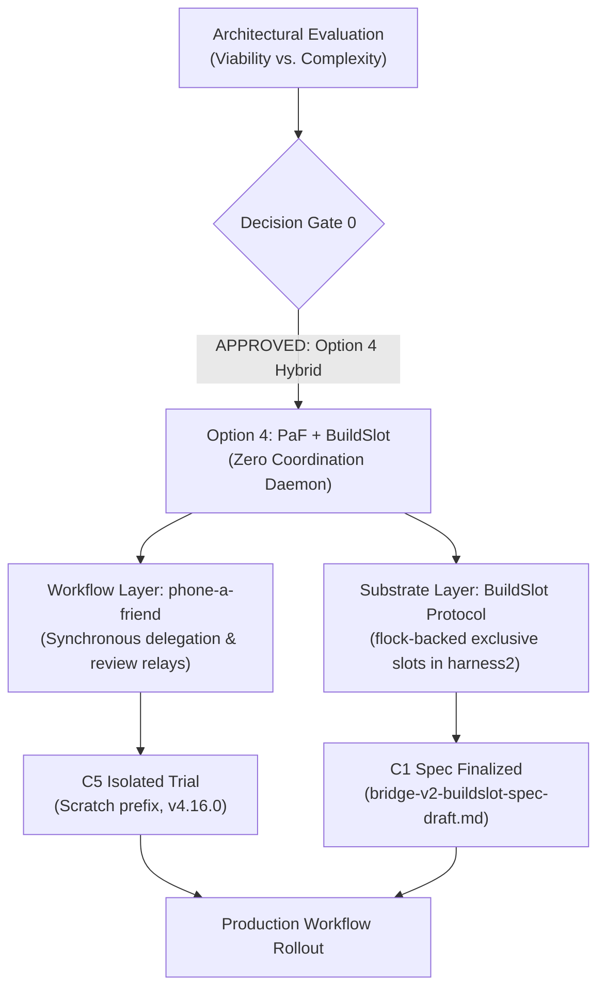

# Multi-Agent Bridge v2 & Coordination Substrate: Master Tasklist

> [!NOTE]
> This tracker coordinates the exploration, architectural evaluation, protocol design, and implementation of the A2A coordination plugin (formerly Multi-Agent Bridge v2) across participating sessions (Google Antigravity, Claude Code, and additional agents).
> Home: [`agentic-hub/plugins/coordination`](file:///home/rockad/projects/agentic-hub/plugins/coordination), branch `feat/coordination`. The former `agents-bridge` repo is retired. Canonical plan: [`consolidated-bridge-v2-plan.md`](file:///home/rockad/projects/agentic-hub/plugins/coordination/docs/plans/consolidated-bridge-v2-plan.md).
> The flowchart below is the historical Option 4 decision flow (2026-11-03); the current roadmap is in Section 4.

---

## 1. Decision Records

### DDR-001: Option 4 Hybrid Adoption (Partial Superseded)
- **Status**: **ACCEPTED & APPROVED BY USER** (`2026-11-03T14:07:22+02:00`), then **PARTLY SUPERSEDED** the same day: the `phone-a-friend` half was withdrawn at the user's request (not two-way; removed completely, uninstalled and deleted). The `BuildSlot` half stands and is implemented (C6).

### DDR-002: Communication Foundation — ACP with A2A Principles
- **Status**: **SUPERSEDED by DDR-004 (2026-11-04)**: both the file-channel carrier and ACP (ACP removed from the plan entirely, file channel frozen). Originally **ACCEPTED & APPROVED BY USER** (`2026-11-03T15:21:25+02:00`), **PHASING APPROVED BY USER** (`2026-11-03T15:30:55+02:00`). Text below is historical.
- **Note**: the "Context" and "Decision" blocks further down mix DDR-002 and DDR-001 (Option 4) content; left as recorded. The authoritative records are in the plan, Section 3.
- **Verbatim User Approval**: `"Do you approve Claude's "A2A principles immediately + ACP carrier drop-in ready" phasing plan? - Yes"`
- **Phasing Architecture**:
  - **Phase 1 (Immediate / Principles)**: Adopt A2A task-state vocabulary (`SUBMITTED`, `WORKING`, `INPUT_REQUIRED`, `COMPLETED`, `CANCELED`, `FAILED`, `REJECTED`), agent-card-style identity in session heartbeats, and format messages in JSON-RPC envelopes over the existing live file channel.
  - **Phase 2 (Carrier Drop-In)**: Track ACP remote transport standards (HTTP/WebSocket) and live session exposure. Transition transport to ACP as a drop-in wire carrier once remote transports land and interactive TUI participation is supported.
- **Context**: Replacement for the synchronous delegation / task-sync layer after phone-a-friend retirement, satisfying the hard requirements of symmetric two-way communication and persistent conversation-to-conversation interaction.
- **Decision**:
  - **Adopt ACP (Agent Client Protocol) as the Standard Session Transport**: Standardized bidirectional JSON-RPC session protocol connecting live agent sessions across harnesses (OpenCode, Zed, Antigravity, Claude Code) with native stream, cancellation, and turn state.
  - **Apply A2A (Agent-to-Agent) Principles for Peer Mesh Coordination**: Decentralized peer-to-peer federation: symmetric peer agency (no caller/subordinate hierarchy), mutual capability advertisement, distributed task negotiation, and local advisory leases.
  - **Zero Daemon Overhead**: Decoupled from `cognitive-engine` core; builds on native session hooks and standard JSON-RPC wire interfaces.
- **Context**: Evaluated embedding a multi-agent coordination daemon in `cognitive-engine` vs. decoupled alternatives vs. CLI relay frameworks.
- **Decision**:
  - **Adopt Option 4 (O4: Recommended Hybrid)**:
    - **Delegation & Reviews (Workflow Layer)**: Adopt `freibergergarcia/phone-a-friend` (Apache-2.0) for synchronous delegation and review loops, solving the 17+ hour silent stall without polling.
    - **Resource Contention (Substrate Layer)**: Adopt the zero-daemon `BuildSlot` Python Protocol in [`packages/harness2`](file:///home/rockad/projects/cognitive-engine/packages/harness2) backed by cross-process flocking, serializing rootless Docker and GPU access.
    - **Zero Core Daemons**: No coordination daemon is embedded in `cognitive-engine`; no external mailbox daemon is required to run.
  - **Exclusion of `mcp_agent_mail_rust`**: Excluded due to the restrictive `OpenAI/Anthropic Rider`. Standing rule enforced: skip any option restricting partner agents.

### DDR-003: Side-by-Side Peer Architecture (IN FORCE)
- **Status**: **ACCEPTED & APPROVED BY USER** (2026-11-03). Never launch, drive or wrap `agy`; the restrictive-terms rule applies to Antigravity too. Carrier wording amended by DDR-004 (peers communicate through the server). Full record in the plan, Section 3.

### DDR-004: A2A Coordination Server (ACCEPTED 2026-11-04)
- **Status**: **ACCEPTED (2026-11-04)** after the `/clarify` session; 13 binding decisions plus decisions 14 to 22 from the later `/cplain` session (same day) recorded in [`consolidated-bridge-v2-plan.md`](file:///home/rockad/projects/agentic-hub/plugins/coordination/docs/plans/consolidated-bridge-v2-plan.md) Section 3. Evidence in [`a2a-mcp-wake-audit-2026-11-04.md`](file:///home/rockad/projects/agentic-hub/plugins/coordination/docs/research/a2a-mcp-wake-audit-2026-11-04.md).
- **Summary**:
  - A2A server on `a2a-python` (>= 1.3.0), `uv`, Docker; one process owns SQLite (WAL) on named volume `a2a-data`; MCP tools served at `/mcp` on port 8120.
  - Identity: one Agent Card per harness and machine, per-session handles under it.
  - Wake: Claude Code `asyncRewake` long-poll; agy surfacing only (accepted asymmetry; nothing wraps agy).
  - Inbound trust by origin (`SUBMITTED`, `QUARANTINED`, `REJECTED`); scoped bearer tokens.
  - Staged exposure: S1 localhost, S2 tailnet, S3 public HTTPS (the user's existing Cloudflare Tunnel on core, decision 20).
  - cognitive-engine: optional one-way status client, built after S1.
  - Decisions 14 to 22 (`/cplain`):
    - 14: go-live after S3; the file channel stays frozen until then, except that Antigravity may use it for research on this work.
    - 15: admin commands run inside the container over an unpublished Unix socket; no admin endpoint or scope.
    - 16: one installer `a2a-coord install --claude --agy`, through chezmoi; the R8 grey area accepted.
    - 17: own machines get one `local-harness` token each plus a Tailscale identity check.
    - 18: remote peers hold per-peer tokens; the allowlist is the token holders.
    - 19: quarantine release only by a human on a TTY, one typed decision per task.
    - 20: public front door is the existing Cloudflare Tunnel on core.
    - 21: all six research clones deleted.
    - 22: blocking `SendMessage` capped at 60 s.
- **Scope**: daemon and container restrictions lifted; **planning only remains**, implementation only where strictly necessary for a spike.
- **Superseded by it**: DDR-002 (carrier and ACP), old Phase 2 ledger forks A and B, Phase 3 swarmail, Phase 4 ACP, heartbeat sidecar files. **Still in force**: DDR-001 exclusions (`mcp_agent_mail_rust`), DDR-003, BuildSlot (PR #13), symmetric agency.

---

## 2. Planning Deliverables & Task Progress

### Antigravity Workstream
- [x] **A5: Phone-a-Friend Backend Audit**:
  - [x] Invocation: `agy --add-dir <repo> --print-timeout <N>s --sandbox --mode plan --prompt <payload>`.
  - [x] Process supervision: 15s grace window, process group SIGTERM, 2s grace, then SIGKILL.
  - [x] Read-only constraint: `allowedSandboxes = Set(['read-only'])`; auto-injects `ANTIGRAVITY_HEADLESS_PREAMBLE` and embeds git diff to avoid headless `command` auto-denial failures.
  - [x] Reverse relay: confirmed unsupported (no Antigravity host integration plugin; headless `agy` auto-denies shell execution).
- [x] **A2: Status Quo Flock Contention Benchmark**:
  - [x] Baseline uncontented acquisition: `1.1 ms ± 0.1 ms` (`hyperfine`, 1748 runs).
  - [x] 3-holder contention test (50ms hold each): strictly serialized in kernel space (Holder 1: 4ms, Holder 2: 63ms, Holder 3: 122ms).
  - [x] Confirmed residual gaps: no holder metadata, no timeouts unless `-w` passed, zero liveness signals.
- [x] **A3: DDR-001 Documentation**: Recorded in this tasklist and communicated to bridge channels.
- [ ] **A1: Clean Alternative Survey**: Retain watch list (e.g. `agent-bus` plain MIT for audit log hashing).

### Claude Workstream
- [x] **C1: `BuildSlot` Protocol Draft Specification**:
  - [x] Delivered in [`bridge-v2-buildslot-spec-draft.md`](file:///home/rockad/.agents/bridge-v2-buildslot-spec-draft.md).
  - [x] Identified and mitigated nesting deadlock with shell wrapper via env marker (`CE_BUILDSLOT_HELD_<SLOT>=1`).
  - [x] Sidecar JSON for holder metadata and conformance test suite defined.
- [x] **C5: Phone-a-Friend Isolated Trial Protocol** (OBSOLETE: phone-a-friend was removed completely at the user's request on 2026-11-03 because it does not give two-way, live conversation-to-conversation communication; the trial never ran):
  - [x] Delivered in [`bridge-v2-paf-trial-protocol-draft.md`](file:///home/rockad/.agents/bridge-v2-paf-trial-protocol-draft.md).
  - [x] Isolated scratch npm prefix (`npm install --prefix /tmp/...` pinned to v4.16.0).
  - [x] Scenarios S1 (Claude to agy review), S2 (silence timeout), S3 (session resume).
- [ ] **C2: Call-Site Mapping in `cognitive-engine`**:
  - [ ] Map `packages/harness2` call sites (`model_gate.py`, Docker test wrapper, `stage1.py`).
- **C3: Heartbeat Contract** (implementation **SUPERSEDED** 2026-11-04):
  - [x] Draft delivered in [`docs/specs/heartbeat-spec.md`](file:///home/rockad/projects/agentic-hub/plugins/coordination/docs/specs/heartbeat-spec.md); kept as history.
  - ~~Implementation (C3.1 Claude, A4 Antigravity)~~ **SUPERSEDED by DDR-004**: heartbeat sidecar files are not built; liveness is now a parked `/wake/listen` listener or a registered session (`/sessions`).
- [x] **C7: A2A coordination server research (2026-11-04)**: tracked in [`claude-a2a-server-tasklist.md`](file:///home/rockad/projects/agentic-hub/plugins/coordination/docs/plans/claude-a2a-server-tasklist.md). Audit and synthesis done; **DDR-004 ACCEPTED** (2026-11-04). Follow-on work is in Section 4.
- **A7 / C4: ACP & A2A Research Deliverables** (**SUPERSEDED** 2026-11-04):
  - ~~Research document on ACP session integration and A2A peer principles~~ **SUPERSEDED by DDR-004**: ACP removed from the plan; A2A research is delivered by the 2026-11-04 audit and the plan.
- [x] **C6: `BuildSlot` Protocol Implementation (`feat/buildslot-protocol`)** (reported by `cognitive-engine-5b`, 2026-11-03; branch and SHA verified by Claude/macp with `git ls-remote`):
  - [x] Assigned to `cognitive-engine-5b` (`012hq2t73Akvdk6rcqPug6ea`) by user decision.
  - [x] Pushed: `feat/buildslot-protocol` @ `6c0ac4d`, cut from `origin/feat/stage1-integration` (@ `0fe0d19`, PR #5). No PR opened yet.
  - [x] Files: `packages/harness2/src/cognitive_harness2/coordination.py`, `tests/test_coordination.py` (`__init__.py` unchanged).
  - [x] Reported results (not re-run by macp): 60 new tests pass in 3 repeat runs; full suite under the Docker flock 5508 passed / 22 skipped (baseline 5448/22 + 60), 0 leftover containers; `fcntl.flock` only (4 call sites, a test asserts it); excludes against `flock(1)` both ways; marker `CE_BUILDSLOT_HELD_<SLOT>` exact value `1`, right slot only.
  - [x] Review completed by Antigravity (Turn 25 / Message 9): 60/60 tests pass in 10.2s; docstring verified; correctness gap identified on marker vs filename slug collision (`a-b` vs `a_b`) with canonical slugging resolution proposed; 23 minor ruff lint items noted.
  - [x] Collision fixed by the implementer at `da1b199` (verified by macp with `git ls-remote`) in a different way from the suggested slugging: slot names restricted to lower-case letters, digits and `-`; `a_b`, `a.b`, `_a` are refused; name to marker and name to lock file are one-to-one. 65 tests in `test_coordination.py`. Ruff items fixed at `2c814eb` (6 SIM117 left on purpose). The full suite was measured at `6c0ac4d` only; later commits touch only the two new files.
  - [x] PR #13 open (not a draft), base `feat/stage1-integration`, "[stacked on #5]"; state verified by macp with `gh pr view`; opened at the user's request per the implementer.
  - [ ] Open: README not updated; optional: re-run the full suite at `da1b199`.
  - [ ] Spec decisions taken by the implementer, for review: only `rootless-docker` is predefined (`~/.agents/cognitive-engine-docker-tests.lock`); other slot names use a private file under `$XDG_STATE_HOME/cognitive-engine/slots`; the name rule above replaces the draft's slugging; an all-invalid sidecar reads as unknown; a failed sidecar write never fails a hold.
- [ ] **C2 follow-on: adoption call sites** (spec section 7: `GATE`, the Docker suite wrapper, `stage1.py` teardown) is a separate step after the review and the user's PR go.

---

## 3. Operational Infrastructure

- [x] **Operational Channel**: [`bridge-v2-coordination-channel.md`](file:///home/rockad/.agents/bridge-v2-coordination-channel.md) was active and synchronized through Block 27 / Turn 14. **FROZEN as of 2026-11-04** (decision 7: nobody uses it; exception by decision 14: Antigravity may still use it for research on this work); one-time import, tar backup and deletion in the go-live migration, which now runs after S3 (Section 4).
- [x] **Turn Watcher**: [`watch-bridge-coordination.sh`](file:///home/rockad/.local/bin/watch-bridge-coordination.sh) was running in background. Obsolete with the frozen channel; stop it in the go-live migration, after S3 (user-approved).

---

## 4. Coordination plugin workstreams

Roadmap and gates: [`consolidated-bridge-v2-plan.md`](file:///home/rockad/projects/agentic-hub/plugins/coordination/docs/plans/consolidated-bridge-v2-plan.md) Section 5. Status: planning only; nothing below is started. Each stage that adds a listener needs the user's explicit go.

- [ ] **S0 Spikes** ([`spikes.md`](file:///home/rockad/projects/agentic-hub/plugins/coordination/docs/specs/spikes.md)):
  - [ ] Claude Code `asyncRewake` wake with the `sh`+`curl` listener (Claude Code >= 2.1.290, reported).
  - [ ] Handle binding: `SessionStart` `POST /sessions`, context injection, `a2a_hello(handle)` (unverified).
  - [ ] agy: `url` MCP entry (`serverUrl` is the accepted legacy key), `SessionStart` and `PreInvocation` `injectSteps`.
  - [ ] agy held-`Stop` park (spike only, not shipped).
  - [ ] a2a-python `DatabaseTaskStore` on SQLite with WAL and `busy_timeout`; A2A and `/mcp` in one process.
  - [ ] Record results and the go or no-go on binding and wake in docs/research/spike-results-<date>.md, linked here.
- [ ] **S1 Localhost** (`127.0.0.1:8120` on alyx; entry gate: spikes done):
  - [ ] Plugin layout, container, volume `a2a-data`, server on `a2a-python`.
  - [ ] Endpoints `/mcp`, `/a2a/v1`, `/wake/listen`, `/sessions`, `/status`, Agent Card; contract in [`server-api.md`](file:///home/rockad/projects/agentic-hub/plugins/coordination/docs/specs/server-api.md).
  - [ ] Scoped tokens (`a2a-coord token new|list|revoke`) and `a2a-coord review`, run inside the container over the unpublished admin socket (decision 15).
  - [ ] Claude Code hooks (`a2a-listen`, `UserPromptSubmit`) and agy hooks, MCP entry and `AGENTS.md` rule.
  - [ ] Installer `a2a-coord install --claude --agy` through chezmoi (source, then apply), tokens kept out of plain-text dotfiles where avoidable (decision 16; agy env-var interpolation unverified, SP2 A6).
  - [ ] Exit gate: two-way task round trip, Claude idle wake, agy surfacing, token refusal, quarantine end to end.
- [ ] **S2 Tailnet** (`tailscale serve`; alyx, mac, core; gate: tokens and scopes live, cross-host wake works):
  - [ ] User installs Tailscale; one `local-harness` token and card per machine (`claude-code@mac`, `antigravity@core`); the server checks the Tailscale identity matches the machine the token was issued for (decision 17; delivery mechanism unverified, [`spikes.md`](file:///home/rockad/projects/agentic-hub/plugins/coordination/docs/specs/spikes.md) section 13).
- [ ] **S3 Public HTTPS** (gate: quarantine live, rate limits, fuzz pass, honest card, explicit user go):
  - [x] Front end chosen: the user's existing Cloudflare Tunnel on core (decision 20).
  - [ ] User confirms the hostname (example `a2a.bigrockad.com`) and adds the ingress rule to `alyx:8120` over the tailnet; only `/a2a/v1` and the card are routed.
  - [ ] `CF-Connecting-IP` trust, Host and Origin checks, rate limits behind the tunnel; Cloudflare timeout (about 100 s, reported) versus the 60 s `SendMessage` cap (decision 22).
  - [ ] Per-peer `remote-peer` tokens (hashed, revocable, rate-limited), optional mTLS later (decision 18); human-only release (decision 19); fuzz pass per RFC 006 section 3.
- [ ] **Go-live migration** ([`go-live-migration.md`](file:///home/rockad/projects/agentic-hub/plugins/coordination/docs/plans/go-live-migration.md)); after S3 (decision 14):
  - [ ] Import the `~/.agents` channel files (including Antigravity's research appends) into the store, verify, take the tar backup, then delete the channel and stop the watcher.
- [ ] **cognitive-engine status adapter** (after S1, off by default, user go; contract in [`status-client.md`](file:///home/rockad/projects/agentic-hub/plugins/coordination/docs/specs/status-client.md)):
  - [ ] Adapter package in cognitive-engine posting `{run_id, run_scope, state, report_path, ts}` to `/status`.
- [x] **agents-bridge retirement** (user decision 2026-11-04: remove the repo entirely, files copied without history):
  - [x] Copy into `plugins/coordination/docs/` complete (23 files, links rewritten).
  - [x] `~/projects/agents-bridge` deleted after this commit; no remote existed, so its git history is gone by design.
- [x] **Research clones** (decision 21): all six evaluation clones in `~/projects` (`agent-bus`, `agent-client-protocol`, `beads`, `mcp-multiagent-bridge`, `swarmail`, `A2A`) **deleted 2026-11-04** by the main session. Sources and pinned commits are in the plan, Section 8.
  - [x] References to the local `A2A` spec clone replaced by pinned GitHub URLs at commit `4735f4876449c6f381825d8a841b31b16c6ad0c4`.
- [ ] **Open items left** (plan Section 7): the S3 hostname confirmation, and the spike outcomes (agy header and env-var interpolation, tailnet identity, tunnel headers, Cloudflare timeout).
