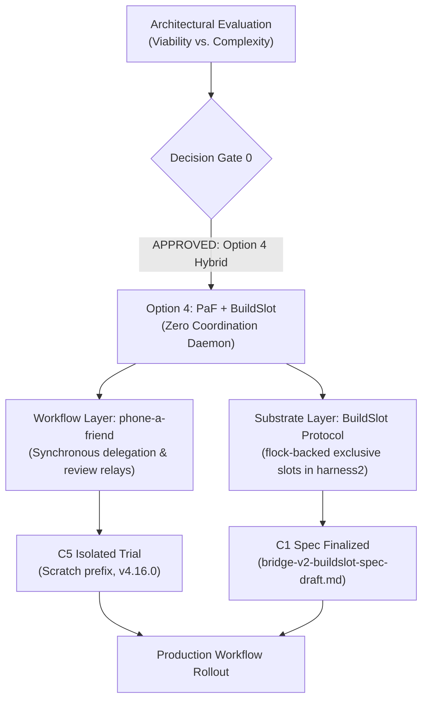

# Multi-Agent Bridge v2 & Coordination Substrate: Master Tasklist

> [!NOTE]
> This tracker coordinates the exploration, architectural evaluation, protocol design, and implementation of the A2A coordination plugin (formerly Multi-Agent Bridge v2) across participating sessions (Google Antigravity, Claude Code, and additional agents).
> Home: [`agentic-hub/plugins/coordination`](file:///home/rockad/projects/agentic-hub/plugins/coordination), branch `feat/coordination`. The former `agents-bridge` repo is retired. Canonical plan: [`consolidated-bridge-v2-plan.md`](file:///home/rockad/projects/agentic-hub/plugins/coordination/docs/plans/consolidated-bridge-v2-plan.md).
> The flowchart below is the historical Option 4 decision flow (2026-11-03); the current roadmap is in Section 4.

---

## 1. Decision Records

### DDR-001: Option 4 Hybrid Adoption (Partial Superseded)
- **Status**: **ACCEPTED & APPROVED BY USER** (`2026-11-03T14:07:22+02:00`), then **PARTLY SUPERSEDED** the same day: the `phone-a-friend` half was withdrawn at the user's request (not two-way; removed completely, uninstalled and deleted). The `BuildSlot` half stands and is implemented (C6).

### DDR-002: Communication Foundation — ACP with A2A Principles
- **Status**: **SUPERSEDED by DDR-004 (2026-11-04)**: both the file-channel carrier and ACP (ACP removed from the plan entirely, file channel frozen). Originally **ACCEPTED & APPROVED BY USER** (`2026-11-03T15:21:25+02:00`), **PHASING APPROVED BY USER** (`2026-11-03T15:30:55+02:00`). Text below is historical.
- **Note**: the "Context" and "Decision" blocks further down mix DDR-002 and DDR-001 (Option 4) content; left as recorded. The authoritative records are in the plan, Section 3.
- **Verbatim User Approval**: `"Do you approve Claude's "A2A principles immediately + ACP carrier drop-in ready" phasing plan? - Yes"`
- **Phasing Architecture**:
  - **Phase 1 (Immediate / Principles)**: Adopt A2A task-state vocabulary (`SUBMITTED`, `WORKING`, `INPUT_REQUIRED`, `COMPLETED`, `CANCELED`, `FAILED`, `REJECTED`), agent-card-style identity in session heartbeats, and format messages in JSON-RPC envelopes over the existing live file channel.
  - **Phase 2 (Carrier Drop-In)**: Track ACP remote transport standards (HTTP/WebSocket) and live session exposure. Transition transport to ACP as a drop-in wire carrier once remote transports land and interactive TUI participation is supported.
- **Context**: Replacement for the synchronous delegation / task-sync layer after phone-a-friend retirement, satisfying the hard requirements of symmetric two-way communication and persistent conversation-to-conversation interaction.
- **Decision**:
  - **Adopt ACP (Agent Client Protocol) as the Standard Session Transport**: Standardized bidirectional JSON-RPC session protocol connecting live agent sessions across harnesses (OpenCode, Zed, Antigravity, Claude Code) with native stream, cancellation, and turn state.
  - **Apply A2A (Agent-to-Agent) Principles for Peer Mesh Coordination**: Decentralized peer-to-peer federation: symmetric peer agency (no caller/subordinate hierarchy), mutual capability advertisement, distributed task negotiation, and local advisory leases.
  - **Zero Daemon Overhead**: Decoupled from `cognitive-engine` core; builds on native session hooks and standard JSON-RPC wire interfaces.
- **Context**: Evaluated embedding a multi-agent coordination daemon in `cognitive-engine` vs. decoupled alternatives vs. CLI relay frameworks.
- **Decision**:
  - **Adopt Option 4 (O4: Recommended Hybrid)**:
    - **Delegation & Reviews (Workflow Layer)**: Adopt `freibergergarcia/phone-a-friend` (Apache-2.0) for synchronous delegation and review loops, solving the 17+ hour silent stall without polling.
    - **Resource Contention (Substrate Layer)**: Adopt the zero-daemon `BuildSlot` Python Protocol in [`packages/harness2`](file:///home/rockad/projects/cognitive-engine/packages/harness2) backed by cross-process flocking, serializing rootless Docker and GPU access.
    - **Zero Core Daemons**: No coordination daemon is embedded in `cognitive-engine`; no external mailbox daemon is required to run.
  - **Exclusion of `mcp_agent_mail_rust`**: Excluded due to the restrictive `OpenAI/Anthropic Rider`. Standing rule enforced: skip any option restricting partner agents.

### DDR-003: Side-by-Side Peer Architecture (IN FORCE)
- **Status**: **ACCEPTED & APPROVED BY USER** (2026-11-03). Never launch, drive or wrap `agy`; the restrictive-terms rule applies to Antigravity too. Carrier wording amended by DDR-004 (peers communicate through the server). Full record in the plan, Section 3.

### DDR-004: A2A Coordination Server (ACCEPTED 2026-11-04)
- **Status**: **ACCEPTED (2026-11-04)** after the `/clarify` session; 13 binding decisions plus decisions 14 to 36 from later (2026-11-04 and 2026-11-05, `/cplain` and after), decisions 37 to 40, the round-2 decisions R1 to R8 and the round-3 decisions R9 to R14 (2026-11-09, `/clarify`; the D-A to D-J, R1 to R8 and R9 to R14 blocks below) recorded in [`consolidated-bridge-v2-plan.md`](file:///home/rockad/projects/agentic-hub/plugins/coordination/docs/plans/consolidated-bridge-v2-plan.md) Section 3. Evidence in [`a2a-mcp-wake-audit-2026-11-04.md`](file:///home/rockad/projects/agentic-hub/plugins/coordination/docs/research/a2a-mcp-wake-audit-2026-11-04.md).
- **Summary**:
  - A2A server on `a2a-python` (>= 1.3.0), `uv`, Docker; one server process owns the database, which is Postgres in the compose project from S1 (SQLite WAL on named volume `a2a-data` superseded 2026-11-09, D-A); MCP tools served at `/mcp` on port 8120.
  - Identity: one Agent Card per harness and machine, per-session handles under it.
  - Wake: Claude Code `asyncRewake` long-poll; agy surfacing only (accepted asymmetry; nothing wraps agy).
  - Inbound trust by origin (`SUBMITTED`, `QUARANTINED`, `REJECTED`); scoped bearer API keys.
  - Staged exposure (revised by decision 23): S1 dev on alyx (localhost), S2 production on core with workstations over the tailnet, S3 public HTTPS (the user's existing Cloudflare Tunnel on core pointing at core's own loopback port 8121, decision 20 as amended 2026-11-09 (D-F); the 8121 listener runs from stage `s2` and the route is created only at the S3 go (R8); hostname `a2a.bigrockad.com`).
  - cognitive-engine: optional one-way status client, built after S1; posts to core over the tailnet.
  - Decisions 2026-11-09 (`/clarify` session, user decisions, final; D-A to D-J):
    - D-A: storage is Postgres from S1, reversing decision 4's starting engine. Kept: SDK `VersionedDatabaseTaskStore` with a version row seeded at task creation, `CoordTaskStore`, the custom parked-task `RequestHandler`, the `task_index` side table, our tables on SQLAlchemy Core. Retired: the single-connection `BEGIN IMMEDIATE` write engine, the WAL and filesystem caveats, "Postgres by URL change" language, `sqlite3 .backup`. `A2A_DB_URL` points at Postgres. The server is still one process. SQLite evidence kept as the reason a wrapper exists: [SP5 results](file:///home/rockad/projects/agentic-hub/plugins/coordination/docs/research/spike-results-2026-11-05-sp5.md) (about 23 writes/s at 10x, p99 write 17 to 35 ms, ceiling about 430 saves/s, 0 lost after `kill -9`). Tripwires that would have forced a move, not hit (user chose Postgres anyway): more than one writer process, network filesystem, failover need, about 100x load.
    - D-B: Postgres operation: pinned image, chosen when SP5b runs (no major version stated; refined by R3 to exact tag plus digest); named volume; no published port (compose network only); password from a secret file (refined by R2); nightly `pg_dump` into the existing backup route on core (mechanism settled by R4 to R6 and refined by R9 to R14: dump sidecar under compose profile `backup`, `/media/media2/backup/a2a/`, a second restic job), restore tested as SP5 D7 with `pg_restore`; up to about one day of loss accepted. WAL archiving and point-in-time restore not adopted. Host-installed Postgres not adopted.
    - D-C: agy post-install health check: the user runs a real `a2a_hello` in a fresh agy session and the installer confirms the bind on the server; the installer never starts or drives agy (DDR-003). Same as the decision 24 update.
    - D-D: S1 entry gate is SP1, SP2, SP3 and SP4 (record only) and the new SP5b. SP5 on SQLite stays recorded as passed but no longer gates. Inside S1, not before: `asyncRewake` on a `UserPromptSubmit` command hook and the GUI-launched Claude test (decision 34), each with its own exit test.
    - D-E: A8c, a new agy spike runbook, non-blocking for S1, tests the three items A8b left open (user-level `.mcp.json`, `agy plugin install` and uninstall, tool use while signed out). The signed-out run is the last run and changes the user's real agy login; the user signs out, the helper never does.
    - D-F: S3 listener is decided. The Cloudflare Tunnel targets loopback port 8121, the public listener (remote-peer keys only, only `/a2a/v1` and the public card, `CF-Connecting-IP` trusted only there). Port 8120 stays tailnet-only (local-harness keys). The `Host`-based `A2A_TUNNEL_HOSTS` design is a rejected alternative. Timing refined by R8: the listener runs from stage `s2` on loopback; the route is created only at the S3 go.
    - D-G: every remote-peer key may address session handles (before: cards only). Reverses open point 11 of `server-api` 12.2.
    - D-H: an unknown handle and a handle outside the key's `cards_allowed` return the same "not available" error (refined by R1: a handle that exists inside `cards_allowed` yields a held task, with a per-key guess counter and audit row); the handle list is never returned to remote-peer keys; sessions sharing one API key may claim each other's handles (accepted risk, no bind code). Exposure is only to peers holding a remote-peer key. Resolves open point 12.
    - D-I: `a2a_runs` (read-only, scoped to the caller) is kept. Resolves open point 10.
    - D-J: the extension URI stays the placeholder `urn:agentic-hub:coordination:v1` through S1 and S2; the final URI is an S3 gate item. Open point 13 stays open until then.
  - Round-2 decisions 2026-11-09 (second `/clarify` round, user decisions, final; R1 to R8; they refine D-B, D-F, D-H and the SP5b rule of D-D and are folded into plan decisions 20, 37, 38 and 39):
    - R1 (handles, refines D-H): a handle that exists inside a card in the key's `cards_allowed` yields a held task, while an unknown, ended or disallowed handle yields the uniform "not available" `REJECTED` task. A per-API-key rate limit on "not available" responses (the guess counter) writes an audit row when it trips. Exposure stays limited to peers holding a remote-peer key. Confirmed without change: ended handles return "not available"; the `A2A_ADVERTISE_HANDLES_TO_PEERS` flag stays dropped; the sbx isolation test text covers port 8121 as well as 8120. The spec's accepted-risk wording for existence visibility inside `cards_allowed` becomes "accepted by the user 2026-11-09, mitigated by the guess counter".
    - R2 (database password): secret file, mode 0600, outside the repo. Postgres reads `POSTGRES_PASSWORD_FILE`; the server reads `A2A_DB_PASSWORD_FILE` and composes its SQLAlchemy connection at start-up; `A2A_DB_URL` contains no password. No password environment variable, no trust authentication.
    - R3 (image pinning): the Postgres image is pinned by exact tag plus a recorded digest, chosen when SP5b runs; the same image runs in S1, S2 and S3. Upgrades are a deliberate change: `pg_dump`, upgrade, restore test. No major-only tag, no `latest`. No version number is stated (SP5 D10 happened to use 17.11; that is a record, not the pin).
    - R4 (dump scheduling): a dump sidecar container in the same compose project runs `pg_dump` nightly (about 02:00, default [design]) and writes dated files into a host directory on core. **Path and restic hand-off replaced by R9 below**: the directory is `/media/media2/backup/a2a/` (the earlier `/srv/a2a-dumps` is gone), and the earlier "adding that directory to the existing restic job is [unverified]" is closed (R9 adds a second restic job instead). No systemd timer on core (it would need root); the server process does not run the dump. The sidecar needs only `pg_dump` tooling and read access to the database (refined by R11: a separate read-only role `dump_ro`).
    - R5 (retention and failure notice): the sidecar keeps 14 daily and 3 monthly dumps (the first dump of each of the last 3 months), numbers [design] defaults, and writes a `last_ok` timestamp file. The server reads it (read-only mount) and reports `dump_age_h` in `/status`; stale when older than 36 h; the status client shows it. If the server is down, the second restic job's own log (R9) is the second check.
    - R6 (`/data` volume and pre-import dump): the `a2a-data` volume stays, for go-live import run artefacts only (`/data/imports/<run_id>/`); it is not part of the backup scope. The go-live pre-apply snapshot is a `pg_dump` named `pre-import-<run_id>` written into the same dump directory so restic collects it; the host-side importer runs it through the compose stack. **Replaced by R9 and R12 below**: the directory is `/media/media2/backup/a2a/`, the file is `pre-import-<run_id>.dump`, and the daily prune never deletes `pre-import-*` files (the earlier "kept with the monthly dumps or manual [design]" is gone).
    - R7 (SP5b failure): up to two revise-and-rerun cycles (wrapper tuning, isolation level, the seeded version row, a Postgres setting), then stop S1 storage work and ask the user. No automatic fallback to SQLite.
    - R8 (8121 listener timing): the server starts the 8121 public listener from stage `s2`, bound to host loopback only (`127.0.0.1:8121`), with the remote-peer rules active, so the public-listener rules, handle errors, rate limits and the fuzz pass are tested in S2. The exposure gate is the Cloudflare Tunnel route, created only at the S3 go (explicit user decision). Replaces "the server opens 8121 only when `A2A_EXPOSURE_STAGE` is `s3`" and any compose comment saying nothing listens on 8121 before the S3 gate; the start-up checks and the stage table are updated consistently; S2 gate lists gain the public-listener tests; the S3 gate keeps the tunnel route and the go.
    - Fact (verified over ssh on 2026-11-09): core is a Raspberry Pi 5 Model B Rev 1.0, 4 cores at 2.4 GHz, 8 GB RAM, Debian 12 aarch64. The user states speed is not a concern, so there is no load-test-on-core task; SP5b runs on alyx as planned.
  - Round-3 decisions 2026-11-09 (third `/clarify` round, user decisions, final; R9 to R14; they refine R1, R4, R5, R6 and R8 and are folded into plan decisions 20, 37, 38 and 39):
    - R9 (dump location and restic hand-off; replaces the R4 and R6 path `/srv/a2a-dumps` and the R4 "restic job collects it [unverified]"): the dump sidecar writes dated dumps into `/media/media2/backup/a2a/` on core (a user-owned directory in the existing backup area, next to `/media/media2/backup/gitea/` where the nightly Gitea backup already lands); the `pre-import-<run_id>.dump` snapshot (R12 name) goes there too. The existing restic job is `/media/media2/knowledge-archive/ops/restic-backup.sh`, run from the user's crontab at 05:30; it is single-source (`SRC=/media/media2/knowledge-archive`, tag `knowledge-archive`, aborts if `SRC` is not a git repo, `forget --keep-last 3 --prune` scoped to its tag), so it cannot simply be extended. A **second small restic job** is added: its own script (for example `a2a-restic-backup.sh`, same style as the existing one), its own user-crontab line (about 05:45, [design]), its own tag `a2a-dumps`, tag-scoped retention (for example `keep-last 3 --prune --tag a2a-dumps`, [design]); whether the restic repository on Drive is the same or its own is [design]. The installer never edits core's crontab; it prints the script and the crontab line for the user to install. Verified read-only on core, 2026-11-09: the cron line and script above; rsnapshot covers only `/etc`, `/usr/local` and `/home` into `/media/media2/backup/rsnapshot/`; `media1` and `media2` are two partitions of one disk, so there is no disk redundancy and the Drive copy is the offsite copy; core runs Docker 29.7.2 and the user is in the `docker` group. "Adding the path to the existing restic job is [unverified]" is closed (a new job, not an addition).
    - R10 (guess counter policy; completes R1): per API key, 10 "not available" answers within 60 s trips the counter. While tripped, any handle-addressed `SendMessage` from that key gets `429` with `Retry-After: 60`. One audit row per trip, event `handle_probe_limited`, fields `key_id` and `window_count`. It clears by itself after 60 s without further misses. No key quarantine, no human release.
    - R11 (dump role; refines R4): the sidecar connects as a separate read-only role `dump_ro` (`CREATE ROLE dump_ro LOGIN; GRANT pg_read_all_data TO dump_ro`) with its own secret file (for example `secrets/pg_dump_password`, mode 0600, outside the repo), mounted only into the sidecar. The server's role and secret are never in the sidecar. A Postgres init script creates the role on first initialisation of the data volume; a volume that already exists needs a one-off migration step (how it is run is [design]).
    - R12 (dump format; refines R4 and R5): `pg_dump` custom format (`-Fc`). File names `a2a-<UTC timestamp>.dump` for nightly dumps and `pre-import-<run_id>.dump` for the go-live snapshot. Before the sidecar writes the `last_ok` stamp it verifies the new file with `pg_restore --list`; a failed verification means no `last_ok` update. The SP5b D7 restore test restores with `pg_restore`. Defaults applied by the assistant (the user may veto): the daily prune never deletes `pre-import-*` files; `dump_age_h` is null before the first successful dump.
    - R13 (exposure stage flip; refines R8): the flip to `A2A_EXPOSURE_STAGE=s3` is a deliberate human step. (1) The user runs the read-only command `a2a-coord expose check`, which prints the S3 gate list (quarantine live, rate limits live, fuzz report green, honest card, extension URI fixed, and the other gate items) and exits non-zero if any item is not met. (2) The user sets `A2A_EXPOSURE_STAGE=s3` (and the public host) in the compose environment and restarts the stack. (3) The server's start-up checks for `s3` refuse to start if a condition fails. (4) The user then creates the Cloudflare Tunnel route to `127.0.0.1:8121`. There is no runtime admin command for this and the stage is not derived from other configuration. Default applied by the assistant (the user may veto): S2 loopback tests of the 8121 listener send `Host: 127.0.0.1:8121`.
    - R14 (backup compose profile; refines R4): the dump sidecar is a compose service defined from S1 with `profiles: ["backup"]`; it does not start by default (S1 dev on alyx). At S2 on core the stack runs with `COMPOSE_PROFILES=backup`. SP5b D7 runs it once with `docker compose --profile backup run --rm dump` so the real sidecar is tested. A mis-set profile (backups silently off) is caught by the `dump_age_h` stale flag (stale when older than 36 h, R5).
  - Decisions 14 to 36 (14 to 24 on 2026-11-04, 25 to 36 on 2026-11-05):
    - 14: go-live after S3; the file channel stays frozen until then, except that Antigravity may use it for research on this work.
    - 15: admin commands run inside the container over an unpublished Unix socket; no admin endpoint or scope; on core in production (`ssh core`).
    - 16: one installer `a2a-coord install --claude --agy`; non-secret parts of chezmoi-managed files go through chezmoi; the R8 grey area accepted.
    - 17: every harness machine gets one `local-harness` API key plus a Tailscale identity check (all harness keys, including alyx, from decision 23).
    - 18: remote peers hold per-peer API keys; the allowlist is the key holders.
    - 19: quarantine release only by a human on a TTY, one typed decision per task.
    - 20: public front door is the existing Cloudflare Tunnel on core.
    - 21: all six research clones deleted.
    - 22: blocking `SendMessage` capped at 60 s.
    - 23: portable image; production on core, dev and spikes on alyx; workstations reach core over the tailnet from day one.
    - 24: service-issued API keys (`a2ak_<env>_<keyid>_<secret>`, `a2a-coord key create|list|rotate|revoke`); Claude Code key in `A2A_API_KEY`, agy key literal in an unmanaged 0600 plugin-scoped file; chezmoi-managed files never hold keys.
    - 25: spike host changes allowed under "borrow and put back" (back up, use the harness CLI, prefer project scope, restore, verify, `chezmoi diff` clean).
    - 26: agy hook entries in the user-level `~/.gemini/config/hooks.json`; hooks exit fast and silently if the server is unreachable or a workspace has an opt-out marker.
    - 27: agy inbox instruction from `SessionStart` `injectSteps`; the installer never writes any `AGENTS.md`.
    - 28: hook scripts copied to `~/.local/share/a2a-coord/<version>/bin/` with a `current` symlink.
    - 29: card routing: parked listener, then newest `active` session, then card queue.
    - 30: an unseen agy `conversation_id` on a `local-harness` key auto-registers a handle on its first `tools/call`.
    - 31: card discovery per path (`/agents/<card>/.well-known/agent-card.json`) plus a front-desk root card.
    - 32: the front-desk card is public and generic; member cards and listings need a valid API key.
    - 33: `A2A-Version` strict (missing or 0.3 returns `VersionNotSupported`).
    - 34: Claude key from `~/.config/a2a-coord/api-key` (0600, unmanaged), env export through one non-secret chezmoi shell line, `~/.claude.json` fallback.
    - 35: streaming and push deferred until a peer needs them.
    - 36: go-live importer built during S2 and S3; one final gate (FG) for server and importer; GL-REHEARSE, user go, GL-APPLY, GL-RETIRE after S3 exit.
- **Scope**: daemon and container restrictions lifted; **planning only remains**, implementation only where strictly necessary for a spike.
- **Superseded by it**: DDR-002 (carrier and ACP), old Phase 2 ledger forks A and B, Phase 3 swarmail, Phase 4 ACP, heartbeat sidecar files. **Still in force**: DDR-001 exclusions (`mcp_agent_mail_rust`), DDR-003, BuildSlot (PR #13), symmetric agency.

---

## 2. Planning Deliverables & Task Progress

### Antigravity Workstream
- [x] **A5: Phone-a-Friend Backend Audit**:
  - [x] Invocation: `agy --add-dir <repo> --print-timeout <N>s --sandbox --mode plan --prompt <payload>`.
  - [x] Process supervision: 15s grace window, process group SIGTERM, 2s grace, then SIGKILL.
  - [x] Read-only constraint: `allowedSandboxes = Set(['read-only'])`; auto-injects `ANTIGRAVITY_HEADLESS_PREAMBLE` and embeds git diff to avoid headless `command` auto-denial failures.
  - [x] Reverse relay: confirmed unsupported (no Antigravity host integration plugin; headless `agy` auto-denies shell execution).
- [x] **A2: Status Quo Flock Contention Benchmark**:
  - [x] Baseline uncontented acquisition: `1.1 ms ± 0.1 ms` (`hyperfine`, 1748 runs).
  - [x] 3-holder contention test (50ms hold each): strictly serialized in kernel space (Holder 1: 4ms, Holder 2: 63ms, Holder 3: 122ms).
  - [x] Confirmed residual gaps: no holder metadata, no timeouts unless `-w` passed, zero liveness signals.
- [x] **A3: DDR-001 Documentation**: Recorded in this tasklist and communicated to bridge channels.
- [ ] **A1: Clean Alternative Survey**: Retain watch list (e.g. `agent-bus` plain MIT for audit log hashing).

### Claude Workstream
- [x] **C1: `BuildSlot` Protocol Draft Specification**:
  - [x] Delivered in [`bridge-v2-buildslot-spec-draft.md`](file:///home/rockad/.agents/bridge-v2-buildslot-spec-draft.md).
  - [x] Identified and mitigated nesting deadlock with shell wrapper via env marker (`CE_BUILDSLOT_HELD_<SLOT>=1`).
  - [x] Sidecar JSON for holder metadata and conformance test suite defined.
- [x] **C5: Phone-a-Friend Isolated Trial Protocol** (OBSOLETE: phone-a-friend was removed completely at the user's request on 2026-11-03 because it does not give two-way, live conversation-to-conversation communication; the trial never ran):
  - [x] Delivered in [`bridge-v2-paf-trial-protocol-draft.md`](file:///home/rockad/.agents/bridge-v2-paf-trial-protocol-draft.md).
  - [x] Isolated scratch npm prefix (`npm install --prefix /tmp/...` pinned to v4.16.0).
  - [x] Scenarios S1 (Claude to agy review), S2 (silence timeout), S3 (session resume).
- [ ] **C2: Call-Site Mapping in `cognitive-engine`**:
  - [ ] Map `packages/harness2` call sites (`model_gate.py`, Docker test wrapper, `stage1.py`).
- **C3: Heartbeat Contract** (implementation **SUPERSEDED** 2026-11-04):
  - [x] Draft delivered in [`docs/specs/heartbeat-spec.md`](file:///home/rockad/projects/agentic-hub/plugins/coordination/docs/specs/heartbeat-spec.md); kept as history.
  - ~~Implementation (C3.1 Claude, A4 Antigravity)~~ **SUPERSEDED by DDR-004**: heartbeat sidecar files are not built; liveness is now a parked `/wake/listen` listener or a registered session (`/sessions`).
- [x] **C7: A2A coordination server research (2026-11-04)**: tracked in [`claude-a2a-server-tasklist.md`](file:///home/rockad/projects/agentic-hub/plugins/coordination/docs/plans/claude-a2a-server-tasklist.md). Audit and synthesis done; **DDR-004 ACCEPTED** (2026-11-04). Follow-on work is in Section 4.
- **A7 / C4: ACP & A2A Research Deliverables** (**SUPERSEDED** 2026-11-04):
  - ~~Research document on ACP session integration and A2A peer principles~~ **SUPERSEDED by DDR-004**: ACP removed from the plan; A2A research is delivered by the 2026-11-04 audit and the plan.
- [x] **C6: `BuildSlot` Protocol Implementation (`feat/buildslot-protocol`)** (reported by `cognitive-engine-5b`, 2026-11-03; branch and SHA verified by Claude/macp with `git ls-remote`):
  - [x] Assigned to `cognitive-engine-5b` (`012hq2t73Akvdk6rcqPug6ea`) by user decision.
  - [x] Pushed: `feat/buildslot-protocol` @ `6c0ac4d`, cut from `origin/feat/stage1-integration` (@ `0fe0d19`, PR #5). No PR opened yet.
  - [x] Files: `packages/harness2/src/cognitive_harness2/coordination.py`, `tests/test_coordination.py` (`__init__.py` unchanged).
  - [x] Reported results (not re-run by macp): 60 new tests pass in 3 repeat runs; full suite under the Docker flock 5508 passed / 22 skipped (baseline 5448/22 + 60), 0 leftover containers; `fcntl.flock` only (4 call sites, a test asserts it); excludes against `flock(1)` both ways; marker `CE_BUILDSLOT_HELD_<SLOT>` exact value `1`, right slot only.
  - [x] Review completed by Antigravity (Turn 25 / Message 9): 60/60 tests pass in 10.2s; docstring verified; correctness gap identified on marker vs filename slug collision (`a-b` vs `a_b`) with canonical slugging resolution proposed; 23 minor ruff lint items noted.
  - [x] Collision fixed by the implementer at `da1b199` (verified by macp with `git ls-remote`) in a different way from the suggested slugging: slot names restricted to lower-case letters, digits and `-`; `a_b`, `a.b`, `_a` are refused; name to marker and name to lock file are one-to-one. 65 tests in `test_coordination.py`. Ruff items fixed at `2c814eb` (6 SIM117 left on purpose). The full suite was measured at `6c0ac4d` only; later commits touch only the two new files.
  - [x] PR #13 open (not a draft), base `feat/stage1-integration`, "[stacked on #5]"; state verified by macp with `gh pr view`; opened at the user's request per the implementer.
  - [ ] Open: README not updated; optional: re-run the full suite at `da1b199`.
  - [ ] Spec decisions taken by the implementer, for review: only `rootless-docker` is predefined (`~/.agents/cognitive-engine-docker-tests.lock`); other slot names use a private file under `$XDG_STATE_HOME/cognitive-engine/slots`; the name rule above replaces the draft's slugging; an all-invalid sidecar reads as unknown; a failed sidecar write never fails a hold.
- [ ] **C2 follow-on: adoption call sites** (spec section 7: `GATE`, the Docker suite wrapper, `stage1.py` teardown) is a separate step after the review and the user's PR go.

---

## 3. Operational Infrastructure

- [x] **Operational Channel**: [`bridge-v2-coordination-channel.md`](file:///home/rockad/.agents/bridge-v2-coordination-channel.md) was active and synchronized through Block 27 / Turn 14. **FROZEN as of 2026-11-04** (decision 7: nobody uses it; exception by decision 14: Antigravity may still use it for research on this work); one-time import, tar backup and deletion in the go-live migration, which now runs after S3 (Section 4).
- [x] **Turn Watcher**: [`watch-bridge-coordination.sh`](file:///home/rockad/.local/bin/watch-bridge-coordination.sh) was running in background. Obsolete with the frozen channel; stop it in the go-live migration, after S3 (user-approved).

---

## 4. Coordination plugin workstreams

Roadmap and gates: [`consolidated-bridge-v2-plan.md`](file:///home/rockad/projects/agentic-hub/plugins/coordination/docs/plans/consolidated-bridge-v2-plan.md) Section 5. Status: planning, with S0 spikes in progress (2026-11-05). The headless S0 parts are done; the interactive Claude Code spikes and the agy spikes (user-run) remain. Each stage that adds a listener needs the user's explicit go.

- [ ] **S0 Spikes** ([`spikes.md`](file:///home/rockad/projects/agentic-hub/plugins/coordination/docs/specs/spikes.md); runbooks: [`spike-runbooks-2026-11-05.md`](file:///home/rockad/projects/agentic-hub/plugins/coordination/docs/research/spike-runbooks-2026-11-05.md)):
  - [x] Scaffolding (2026-11-05): scratch stub on `127.0.0.1:18120` built and self-tested (all cases pass), stub patched for SP1 T11, SP2 A4 and `/sessions/end`; agy SP2 helper prep done ([results](file:///home/rockad/projects/agentic-hub/plugins/coordination/docs/research/spike-results-2026-11-05-s0-scaf-sp2-c9.md)). Stub is stopped; restart command in results section 5.
  - [x] SP1 listener draft, offline only (2026-11-05): `sh`+`curl` `a2a-listen` follows the decision 8 status table against the stub with a fake stdin and owner pid (L1 to L9 pass). Nothing about real hook behaviour is learned yet.
  - [x] SP1 interactive (2026-11-05 to 06, **PASS, go for decision 8**; [results](file:///home/rockad/projects/agentic-hub/plugins/coordination/docs/research/spike-results-2026-11-05-sp1.md)): `asyncRewake` wake works on Claude Code 2.1.318 (idle wake 0.4 s to turn start, 10 h 39 m overnight park woke in 0.3 s). Findings for the plan: owner pid is `$CLAUDE_PID` (`$PPID` is the hook's `sh -c` wrapper); `/clear` gives a new `session_id` and orphans the old listener; `Stop` does not fire after Esc (re-arm from `UserPromptSubmit`); no cap on `Stop` continuations (loop control server side); the hook timeout signal is SIGTERM; wake header spelling on the wire is `X-Session`, `X-Wait`, `X-Again`; only `hookSpecificOutput.additionalContext` is accepted from an HTTP hook, fail open everywhere. `asyncRewake` first version still only reported (changelog 2.1.287 fix), not 2.1.290. Cleanup and restore check (runbook 1.7) is combined with SP2's at its end.
  - [x] SP2 C9, headless (2026-11-05): Claude Code 2.1.318 expands `${A2A_API_KEY}` in an MCP header in `claude mcp list|get`, local scope (verified on the wire). Project scope is not checked until approved. Still unverified: expansion on `tools/call` and `DELETE`, project scope after approval, and a GUI-launched Claude seeing `A2A_API_KEY`.
  - [x] Handle binding, Claude Code half (SP2 C1 to C9, 2026-11-06, Claude Code 2.1.319, **PASS with spec changes**; [results](file:///home/rockad/projects/agentic-hub/plugins/coordination/docs/research/spike-results-2026-11-06-sp2-claude.md)): handle injection and `a2a_hello` binding work; the binding survives `/compact`, `/clear`, a subagent and a 67 min idle gap, and is lost on `--resume` with a clean rebind from the error text. Spec changes: handle format `claude-code@alyx/<name>#<first 8 of session_id>` (two same-name sessions shared a handle; adopted as the grammar by the user decision of 2026-11-09, see the S1 handle grammar task); keep the 15 s retry on `410 unregistered` (hooks run in parallel, first park 2.1 s before registration); per-call MCP limit is 60 s, so cap `a2a_wait` at about 50 s or set `MCP_TOOL_TIMEOUT` (calls over 120 s go to the background and die with the session); no `DELETE` on exit, so liveness uses the parked listener or TTL plus pid; the real `POST /sessions` must require the key; hook stdin carries `session_title` (the `--name` value) and 2.1.319 stores project MCP approval in `.claude/settings.local.json`. C9: `${A2A_API_KEY}` expands on every request incl. `tools/call` in project scope; an unset variable sends the literal placeholder (401, message does not name the variable). Still unverified: GUI-launched Claude seeing `A2A_API_KEY` (decision 34 fallback stays), and the C5 launch that failed with a 401.
  - [x] SP5, a2a-python on SQLite (2026-11-05): **passes, but only with four wrappers of ours** (`BEGIN IMMEDIATE` single-connection write engine, `VersionedDatabaseTaskStore` CAS, `CoordTaskStore` with `task_index`, custom parked-task `RequestHandler`); plain `DatabaseTaskStore` is not sufficient (decision 4 wording needs amending). New S1 work from it: bind `Mcp-Session-Id` to the API key (a foreign key re-using another key's session id was accepted), advertise a stateful era on `server/discover` (mcp 2.3.0 default is sessionless), make uvicorn stop while `/wake/listen` is parked. Rerun D2 with session-register and budget writes before S1 (superseded 2026-11-09: the SQLite result stays as evidence and no longer gates; the rerun is SP5b on Postgres, D-D) ([results](file:///home/rockad/projects/agentic-hub/plugins/coordination/docs/research/spike-results-2026-11-05-sp5.md)).
  - [x] Spec fold-in (2026-11-07): SP1, SP2 Claude half and SP5 consequences written into `server-api.md` (1.2, 3.4, 3.5, 4.5, 5.4, 5.5, 7.1, 11.1, 12.1), the plan (decisions 4, 6, 8 and the S0 status) and `spikes.md` section 11 (gate status). Wake header spelling decided: `X-Coord-*` canonical (the spikes used the short names; the stub accepted both). `a2a_wait` cap default lowered from 240 to 50 s.
  - [ ] S1 backlog from the spikes: key-bound `Mcp-Session-Id` with `403` on mismatch; `server/discover` advertising only stateful versions; uvicorn `handle_exit` releasing parked listeners with `503`; the four storage wrappers (the `BEGIN IMMEDIATE` write engine part is superseded 2026-11-09, D-A; the other three stay); `POST /sessions` requires the key and makes handles unique; listener guard accepts `clear`, owner is `$CLAUDE_PID`; rerun SP5 D2 with session-register and budget writes (now SP5b, D-D).
  - [ ] Spike to add: `asyncRewake` on a `UserPromptSubmit` command hook (re-arm after Esc, design in 11.1); GUI-launched Claude seeing `A2A_API_KEY` (decision 34). Moved into S1 on 2026-11-09 (D-D).
  - [x] Handle binding, agy half (2026-11-04): SP2 A1 and A4 identity checks PASS, verified on the wire ([A4 results](file:///home/rockad/projects/agentic-hub/plugins/coordination/docs/research/spike-results-2026-11-04-sp2-a4.md)). Binds to `_meta["antigravity.google/conversation_id"]`; `Mcp-Session-Id` is per process.
  - [x] SP2 A6, agy `Authorization` header (2026-11-04): PASS, verified on the wire; env-var interpolation verified unsupported ([A6 results](file:///home/rockad/projects/agentic-hub/plugins/coordination/docs/research/spike-results-2026-11-04-sp2-a6.md)).
  - [x] SP2 agy half (A2 to A8, 2026-11-08, agy 1.5.3, **PASS across all gate items**; [results](file:///home/rockad/projects/agentic-hub/plugins/coordination/docs/research/spike-results-2026-11-08-sp2-agy.md)): A8 user-level plugin in `~/.gemini/config/plugins` connected over HTTP (`X-Spike-Via: gemini`) but its tools were "not enabled" and the same-named workspace copy did not load (the results file's "needs session enablement" and "user level shadows workspace" readings are superseded by A8b, below); `~/.agents/plugins` is completely ignored; A2 `systemMessage` is 100% persistent and quoted verbatim (canonical injection mode); `/clear` serves as clean session reset; A4 compliance achieved 10 of 10 unprompted bindings (`a2a_hello, a2a_inbox`); A5 untrusted workspace trust refusal immediately exits without executing hooks; A7 tool timeout hard-capped at 180.0 s (`context deadline exceeded`).
  - [x] SP2 A8b, user-level agy plugin tools (2026-11-09, agy 1.5.3, **PASS with the unique-name caveat**; [results](file:///home/rockad/projects/agentic-hub/plugins/coordination/docs/research/spike-results-2026-11-09-a8b-agy.md), [runbook](file:///home/rockad/projects/agentic-hub/plugins/coordination/docs/research/spike-runbook-a8b-user-level-plugin-2026-11-08.md)): `~/.gemini/config/plugins/<name>/` with a native `mcp_config.json` runs `a2a_hello` and `a2a_inbox` with no `agy plugin enable`, no `config.json` entry, warm and on a cold first load (runs A, A2, A3, A4, verified). The 2026-11-08 failure was not sign-in, not a missing enable and not a cold load; it correlates with a same-named workspace plugin being present (which scope wins is unverified). A connected server is not proof the tools are callable. Folded into `server-api.md` 8.2, 11.0 and 11.2, plan decision 24 and `spikes.md` A8 (2026-11-09).
  - [ ] Open from A8b, untested (not blocking): `.mcp.json` at user level; `agy plugin install`; whether agy tool use needs a live sign-in (every successful call was signed in; the startup sign-in warning is harmless).
  - [ ] SP2 A8c, agy spike (2026-11-09, D-E; not blocking S1; runbook written 2026-11-09: [`spike-runbook-a8c-agy-open-items-2026-11-09.md`](file:///home/rockad/projects/agentic-hub/plugins/coordination/docs/research/spike-runbook-a8c-agy-open-items-2026-11-09.md)). The helper never starts or drives agy; the user starts agy and answers its prompts. Same labels (verified, reported, unverified) and borrow-and-put-back rules as the A8b runbook. Items:
    - [ ] (1) `.mcp.json` at user level in `~/.gemini/config/plugins/<name>/`.
    - [ ] (2) `agy plugin install <path>` and uninstall.
    - [ ] (3) Tool use while signed out of agy. This changes the user's real agy login, so it is the LAST run: back up the agy credential files explicitly, put them back, and check. The user signs out; the helper never signs the user out.
  - Note, out of scope, observed in A8b: `lookup` and `recall` time out at startup in every agy session and delay MCP startup by about 2 minutes (memory plugin setup, not this plugin).
  - [ ] S0 still open: SP3 (agy `PreInvocation`), SP4 (record only), and SP5b (2026-11-09, D-D, S1 entry gate, see below). The GUI-launched Claude test (decision 34) and the `asyncRewake` on `UserPromptSubmit` spike moved into S1 (D-D).
  - [ ] agy held-`Stop` park (spike only, not shipped).
  - [ ] a2a-python `DatabaseTaskStore` on SQLite with WAL and `busy_timeout` (superseded 2026-11-09 by Postgres, D-A); A2A and `/mcp` in one process.
  - [ ] Record results and the go or no-go on binding and wake in docs/research/spike-results-<date>.md, linked here.
  - [ ] SP5b, SP5 rerun on Postgres (2026-11-09, D-D; new; S1 entry gate; the exact Postgres image tag is chosen and its digest recorded when this runs, D-B and R3). Pass criteria as SP5: 0 lost updates, 0 lost acked writes, p99 write under 200 ms. Runs on alyx; no load test on core (the user states speed is not a concern). Failure rule (R7): up to two revise-and-rerun cycles (wrapper tuning, isolation level, the seeded version row, a Postgres setting), then stop S1 storage work and ask the user; no automatic fallback to SQLite.
    - [ ] D3: lost-update test on the versioned store.
    - [ ] D7 (R12, R14): custom-format (`-Fc`) dump taken by the real dump sidecar, run once with `docker compose --profile backup run --rm dump`; verified with `pg_restore --list`; restored with `pg_restore`; integrity check and equal row counts.
    - [ ] D8: `kill -9` of the server and restart of the Postgres container, zero lost acked writes.
    - [ ] D2 load mix including the steady-state session-register and budget-counter writes that SP5 skipped.
    - [ ] Separator check (2026-11-09, handle grammar decision `name#sid8`; [spikes 8b](file:///home/rockad/projects/agentic-hub/plugins/coordination/docs/specs/spikes.md)): handles with `#` and with `~` through URL use (`coord.to` in JSON-RPC and REST, percent-encoding), shell use (`curl` with and without quoting in the hook scripts, the `a2a_send` argument), JSON, and storage as a database key. Pass: `#` works everywhere, or `~` is adopted; record the choice in the SP5b results.
    - [ ] Keep the SP5 SQLite run (passed) in the record; it no longer gates.
- [ ] **S1 Dev on alyx** (`127.0.0.1:8120` only; entry gate: spikes done, including SP5b on Postgres, D-D):
  - [ ] Plugin layout, container, volume `a2a-data`, server on `a2a-python` (the SQLite file on this volume is superseded 2026-11-09; the database is the Postgres service below, D-A). The `a2a-data` volume stays for go-live import run artefacts only (`/data/imports/<run_id>/`) and is not part of the backup scope (R6).
  - [ ] Postgres compose service and dump sidecar with restore test (2026-11-09, D-A, D-B, R2 to R6, R9 to R12, R14):
    - [ ] Postgres image pinned by exact tag plus the digest recorded in SP5b (R3; same image in S1, S2 and S3; no major-only tag, no `latest`; upgrade = `pg_dump`, upgrade, restore test); named volume; no published port (compose network only).
    - [ ] Secret file wiring (R2): mode 0600 secret file outside the repo; `POSTGRES_PASSWORD_FILE` for Postgres; `A2A_DB_PASSWORD_FILE` for the server, which composes its SQLAlchemy connection at start-up; `A2A_DB_URL` points at the service and contains no password; no password environment variable, no trust authentication.
    - [ ] Dump sidecar container in the same compose project (R4, R14): a compose service with `profiles: ["backup"]` from S1, not started by default; nightly `pg_dump -Fc` (about 02:00, [design]) into the host directory `/media/media2/backup/a2a/` on core (R9); files `a2a-<UTC timestamp>.dump` (R12); only `pg_dump` and `pg_restore` tooling and the read-only `dump_ro` login; no systemd timer on core, the server does not run the dump.
    - [ ] `dump_ro` role (R11): Postgres init script on first initialisation of the data volume (`CREATE ROLE dump_ro LOGIN; GRANT pg_read_all_data TO dump_ro`); its own secret file (for example `secrets/pg_dump_password`, mode 0600, outside the repo) mounted only into the sidecar; the server's role and secret never in the sidecar.
    - [ ] One-off migration step for a data volume that already exists, creating `dump_ro` (R11; how it is run is [design]).
    - [ ] Second restic script and crontab line for core (R9): text of the script (for example `a2a-restic-backup.sh`, same style as `/media/media2/knowledge-archive/ops/restic-backup.sh`, tag `a2a-dumps`, tag-scoped retention such as `keep-last 3 --prune --tag a2a-dumps` [design]) and one user-crontab line (about 05:45 [design]), written in S1-BKP; the installer prints both and never edits core's crontab; the user installs them in S2 (task below). Replaces the closed "restic path check [unverified]".
    - [ ] Retention and `last_ok` (R5, R12): 14 daily and 3 monthly dumps ([design] defaults); the daily prune never deletes `pre-import-*` files; before it writes the `last_ok` timestamp file the sidecar verifies the new dump with `pg_restore --list`, and a failed verification means no `last_ok` update.
    - [ ] `dump_age_h` in `/status` (R5, R12): the server reads `last_ok` through a read-only mount; null before the first successful dump; stale when older than 36 h (this also catches a mis-set compose profile, R14); the status client shows it; if the server is down the second restic job's log is the second check.
    - [ ] Restore tested as SP5 D7, with `pg_restore` (R12); up to about one day of loss accepted.
    - [ ] Not adopted: WAL archiving and point-in-time restore; host-installed Postgres.
  - [ ] `asyncRewake` on a `UserPromptSubmit` command hook, re-arm after Esc (moved from S0, D-D; design in `server-api` 11.1). [design] Exit test to write: after Esc, the next prompt re-arms the listener and a parked wake still reaches the turn.
  - [ ] GUI-launched Claude seeing `A2A_API_KEY` (moved from S0, D-D; decision 34). [design] Exit test to write: a GUI-launched session reads the variable; if not, the `~/.claude.json` fallback of decision 34 applies.
  - [ ] MCP tool `a2a_runs`: read-only status, scoped to the caller (kept 2026-11-09, D-I).
  - [ ] Endpoints `/mcp`, `/a2a/v1`, `/wake/listen`, `/sessions`, `/status`, Agent Card; contract in [`server-api.md`](file:///home/rockad/projects/agentic-hub/plugins/coordination/docs/specs/server-api.md).
  - [ ] Session handle grammar `name#sid8` (user decision 2026-11-09; replaces the rule that forbade `#` and appended 4 hex characters on collision; `server-api` 3.5 and 5.1, evidence SP2 C6 pair 3): `register` and `a2a_hello(name=...)` build `<card-id>/<name>#<sid8>` on the server, `#` plus the first 8 hex characters of the session id always present; session-part regex `^[a-z0-9][a-z0-9._-]{0,38}#[0-9a-f]{8}$` (name at most 39 characters, lowercase); handle validation in `coord.to`, `a2a_hello(handle)` and the hook scripts' check of the returned handle; server-side uniqueness, with a same-`<sid8>` collision rejected by a clear error [design]; the SessionStart text and the register call show the new form. Open [design]: the unnamed-session form (`server-api` 3.5, two readings). The separator follows the SP5b separator check.
  - [ ] API keys (`a2a-coord key create|list|rotate|revoke`, `a2ak_<env>_<keyid>_<secret>`) and `a2a-coord review`, run inside the container over the unpublished admin socket (decisions 15 and 24).
  - [ ] Claude Code hooks (`a2a-listen`, `UserPromptSubmit`) and agy hooks (user-level `~/.gemini/config/hooks.json`, decision 26), MCP entries, and the agy inbox instruction through `SessionStart` `injectSteps` (decision 27; no `AGENTS.md` is written). Hook scripts copied to `~/.local/share/a2a-coord/<version>/bin/` with a `current` symlink (decision 28).
  - [ ] Installer `a2a-coord install --claude --agy`: non-secret parts of chezmoi-managed files through chezmoi; Claude key from the unmanaged 0600 `~/.config/a2a-coord/api-key`, exported as `A2A_API_KEY` by one non-secret chezmoi-managed shell line, with a `~/.claude.json` fallback if SP2 C9 shows no header env expansion (decision 34); agy key literal in the unmanaged `~/.gemini/config/plugins/<name>/mcp_config.json` (mode 0600); no key in any chezmoi-managed file (decisions 16, 24 and 34). The installer never writes an `AGENTS.md` and refuses to write through symlinks (decision 27). `a2a-coord install --rotate-key` rotates the key file.
  - [ ] Installer agy placement rules from SP2 A8b (decision 24, `server-api.md` 11.0): the plugin `<name>` is unique across user and workspace scopes; never ship a workspace plugin with the same name; the post-install health check makes a real tool call (`a2a_hello` or `a2a_inbox`), not only a connection check; fallback if the placement breaks is the `agy mcp add` global entry, which reopens decision 24 with the user.
  - [ ] Exit gate: two-way task round trip, Claude idle wake, agy surfacing, API key refusal, quarantine end to end.
- [ ] **S2 Production on core** (`tailscale serve` on core; workstations alyx and mac over the tailnet; gate: API keys and scopes live, cross-host wake works, and the public-listener tests on the loopback 8121 listener pass (R8); decision 23):
  - [ ] Deploy the image on core (`A2A_ENV=live`, `A2A_DEPLOY_HOST=core`); user installs Tailscale; one `local-harness` API key and card per machine (`claude-code@alyx`, `antigravity@alyx`, `claude-code@mac`, ...); the server checks the Tailscale identity matches the machine the key was issued for, for all harness keys including alyx (decisions 17 and 23; delivery mechanism unverified, [`spikes.md`](file:///home/rockad/projects/agentic-hub/plugins/coordination/docs/specs/spikes.md) section 13).
  - [ ] Wake latency and tailnet dependency measured in the cross-host wake test (plan Risk 12).
  - [x] No public route exists: the route `a2a.bigrockad.com` was created and deleted on 2026-11-04 (plan Risk 13, historical). Rule (revised by R8, 2026-11-09): no route before the S3 gate; the 8121 listener runs on core's loopback from stage `s2`, so the route is the exposure gate.
  - [ ] Dump sidecar and Postgres deploy on core (R4, R5, R9, R11, R14): the same image tag plus digest as S1; the stack runs with `COMPOSE_PROFILES=backup`; `dump_age_h` shown in `/status`; restore drill into a scratch Postgres with `pg_restore`.
  - [ ] Create the directory `/media/media2/backup/a2a/` on core (R9; the user does it, user-owned, next to `/media/media2/backup/gitea/`; no root needed) and the `dump_ro` secret file (R11).
  - [ ] Install the second restic script and its crontab line on core (R9; the user does it from the text the installer prints; the existing job is not edited); record whether `restic snapshots --tag a2a-dumps` shows a dump from `/media/media2/backup/a2a/` and whether the repository on Drive is the existing one or its own ([design]).
  - [ ] 8121 public listener from stage `s2` (R8): the server binds `127.0.0.1:8121` only, remote-peer rules active, off at `s1`; start-up checks and the stage table in `server-api.md` updated consistently (api 1.4, 1.5, 1.6, 8.4.1 and the stage table are amended; the build and the S2 tests are this task).
  - [ ] S2 public-listener tests on core's loopback (R8, spikes L6): `remote-peer` keys only, only `/a2a/v1` and the public card, `CF-Connecting-IP` believed only on 8121, per-key rate limits, the fuzz pass, no route created.
  - [ ] Guess counter (R1, R10): a per-API-key rate limit on "not available" responses: 10 within 60 s trips it; while tripped, a handle-addressed `SendMessage` from that key gets `429` with `Retry-After: 60`; one audit row per trip (event `handle_probe_limited`, fields `key_id` and `window_count`); it clears by itself after 60 s without further misses; no key quarantine, no human release. Handle rule: a handle inside `cards_allowed` yields a held task, an unknown, ended or disallowed handle yields the uniform "not available" `REJECTED` task.
  - [ ] Guess counter tests (R1, R10; fake clock): the 10th miss within 60 s trips the counter and the 9th does not; the next handle-addressed `SendMessage` gets `429` with `Retry-After: 60`; exactly one `handle_probe_limited` audit row per trip, with `key_id` and `window_count`; the counter clears by itself after 60 s without further misses; another key is unaffected; responses never reveal handle existence outside `cards_allowed`; the sbx isolation test covers ports 8120 and 8121. S2 loopback tests of the 8121 listener send `Host: 127.0.0.1:8121` (R13 default).
- [ ] **S3 Public HTTPS** (gate: quarantine live, rate limits and fuzz pass (tested against the 8121 listener in S2, R8), honest card, final extension URI (D-J), explicit user go; then the stage flip to `s3` (R13); the tunnel route is created only after both):
  - [x] Front end chosen: the user's existing Cloudflare Tunnel on core (decision 20).
  - [x] Hostname chosen: `a2a.bigrockad.com`. The route is created only at S3, after the gate and on the user's explicit go (an early route was created and deleted on 2026-11-04). Only `/a2a/v1` and the card are to be routed.
  - [x] Listener decided 2026-11-09 (D-F): the Cloudflare Tunnel targets loopback port `localhost:8121`, the public listener (remote-peer keys only, only `/a2a/v1` and the public card, `CF-Connecting-IP` trusted only on that port); port 8120 stays tailnet-only (`tailscale serve`, local-harness keys). The `Host`-based `A2A_TUNNEL_HOSTS` design is a rejected alternative. Timing (R8): the listener runs from stage `s2` on `127.0.0.1:8121` and is tested in S2; the tunnel route is created only at the S3 go.
  - [ ] Implement the read-only command `a2a-coord expose check` (R13, task S3-EXPOSE-CHECK): prints the S3 gate list (quarantine live, rate limits live, fuzz report green, honest card, extension URI fixed, and the other gate items; the full list is [design]) and exits non-zero if any item is not met; changes nothing.
  - [ ] Server start-up checks for `A2A_EXPOSURE_STAGE=s3` (R13): the server refuses to start if a condition fails; no runtime admin command changes the stage and the stage is not derived from other configuration.
  - [ ] Stage flip at the S3 go (R13, the user does it, in order): run `a2a-coord expose check` (must exit zero); set `A2A_EXPOSURE_STAGE=s3` and the public host in the compose environment and restart the stack; the `s3` start-up checks pass; then the tunnel route below.
  - [ ] Tunnel route to `127.0.0.1:8121` (`localhost:8121`) created by the user at the S3 go only, after the S3 gate (R8) and the stage flip (R13); then L2 and L3 run.
  - [ ] `CF-Connecting-IP` from `cloudflared` on the same host, told apart from `tailscale serve` traffic by the listener port; Host and Origin checks, rate limits; Cloudflare timeout (about 100 s, reported) versus the 60 s `SendMessage` cap (decision 22).
  - [ ] Per-peer `remote-peer` API keys, delivered out of band (hashed, revocable, rate-limited), optional mTLS later (decision 18); human-only release (decision 19); fuzz pass per RFC 006 section 3; create the route only after the gate.
  - [ ] Peer handles (2026-11-09, D-G, D-H): every remote-peer key may address session handles (before: cards only; reverses `server-api` 12.2 open point 11). Sessions sharing one API key may claim each other's handles (accepted risk, no bind code; open point 12 resolved; refined by R1: "accepted by the user 2026-11-09, mitigated by the guess counter").
  - [ ] Uniform-error enumeration test (D-H, R1), in the fuzz pass (RFC 006 section 3; run against the 8121 listener in S2, R8): an unknown, an ended and a disallowed handle give the same "not available" error class and response shape, a handle inside `cards_allowed` yields a held task, and the handle list is never returned to remote-peer keys; existence visibility inside `cards_allowed` is "accepted by the user 2026-11-09, mitigated by the guess counter".
  - [ ] Final extension URI (D-J, S3 gate, before the public card goes live): the placeholder `urn:agentic-hub:coordination:v1` stays through S1 and S2. Open point 13 stays open until this is done.
- [ ] **Go-live migration** ([`go-live-migration.md`](file:///home/rockad/projects/agentic-hub/plugins/coordination/docs/plans/go-live-migration.md)); after S3 (decision 14):
  - [ ] Build the importer (GL-IMPORT) during S2 and S3 against copies of the channel files; the S3 final gate covers server and importer together (decision 36).
  - [ ] Pre-apply snapshot (R6, R9, R12): a `pg_dump -Fc` named `pre-import-<run_id>.dump` into `/media/media2/backup/a2a/` (collected by the second restic job), run by the host-side importer through the compose stack; import run artefacts under `/data/imports/<run_id>/` (not in the backup scope); the daily prune never deletes `pre-import-*` files (R12 default, the user may veto); removing them is manual.
  - [ ] After S3 exit: dress rehearsal, the user's go, then import the `~/.agents` channel files (including Antigravity's research appends, so the dry run is rerun at go-live), verify, take the tar backup, then delete the channel and stop the watcher.
- [ ] **cognitive-engine status adapter** (after S1, off by default, user go; contract in [`status-client.md`](file:///home/rockad/projects/agentic-hub/plugins/coordination/docs/specs/status-client.md)):
  - [ ] Adapter package in cognitive-engine posting `{run_id, run_scope, state, report_path, ts}` to `/status`.
- [x] **agents-bridge retirement** (user decision 2026-11-04: remove the repo entirely, files copied without history):
  - [x] Copy into `plugins/coordination/docs/` complete (23 files, links rewritten).
  - [x] `~/projects/agents-bridge` deleted after this commit; no remote existed, so its git history is gone by design.
- [x] **Research clones** (decision 21): all six evaluation clones in `~/projects` (`agent-bus`, `agent-client-protocol`, `beads`, `mcp-multiagent-bridge`, `swarmail`, `A2A`) **deleted 2026-11-04** by the main session. Sources and pinned commits are in the plan, Section 8.
  - [x] References to the local `A2A` spec clone replaced by pinned GitHub URLs at commit `4735f4876449c6f381825d8a841b31b16c6ad0c4`.
- [ ] **Open items left** (plan Section 7): user actions are pending (see the next line). Planning is complete; next is S0 on alyx, no urgency. Remaining: the spike outcomes (SP2 A4 and A8 done 2026-11-08 and 2026-11-09, Claude Code header env expansion, tailnet identity, tunnel versus `tailscale serve` traffic, Cloudflare timeout).
  - [ ] User actions (2026-11-09, for the user only; agents do not run these): rotate the Obsidian MCP bearer found in `~/scratch/a2a-spikes/runlogs/chezmoi-diff.baseline`, then delete that file; prune `sp2-agy` and `sp2-agy-a8b` from `trustedWorkspaces` in `~/.gemini/antigravity-cli/settings.json`; remove the `sp1` project entry from `~/.claude.json`. The bearer value is never written in this file.
