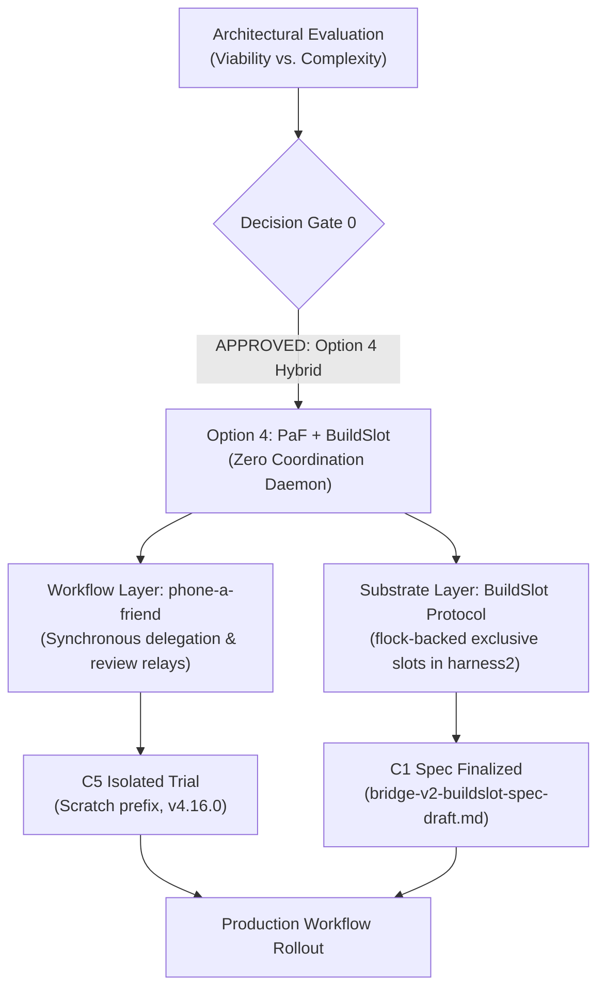

# Multi-Agent Bridge v2 & Coordination Substrate: Master Tasklist

> [!NOTE]
> This tracker coordinates the exploration, architectural evaluation, protocol design, and implementation of the A2A coordination plugin (formerly Multi-Agent Bridge v2) across participating sessions (Google Antigravity, Claude Code, and additional agents).
> Home: [`agentic-hub/plugins/coordination`](file:///home/rockad/projects/agentic-hub/plugins/coordination), branch `feat/coordination`. The former `agents-bridge` repo is retired. Canonical plan: [`consolidated-bridge-v2-plan.md`](file:///home/rockad/projects/agentic-hub/plugins/coordination/docs/plans/consolidated-bridge-v2-plan.md).
> The flowchart below is the historical Option 4 decision flow (2026-11-03); the current roadmap is in Section 4.

---

## 1. Decision Records

### DDR-001: Option 4 Hybrid Adoption (Partial Superseded)
- **Status**: **ACCEPTED & APPROVED BY USER** (`2026-11-03T14:07:22+02:00`), then **PARTLY SUPERSEDED** the same day: the `phone-a-friend` half was withdrawn at the user's request (not two-way; removed completely, uninstalled and deleted). The `BuildSlot` half stands and is implemented (C6).

### DDR-002: Communication Foundation — ACP with A2A Principles
- **Status**: **SUPERSEDED by DDR-004 (2026-11-04)**: both the file-channel carrier and ACP (ACP removed from the plan entirely, file channel frozen). Originally **ACCEPTED & APPROVED BY USER** (`2026-11-03T15:21:25+02:00`), **PHASING APPROVED BY USER** (`2026-11-03T15:30:55+02:00`). Text below is historical.
- **Note**: the "Context" and "Decision" blocks further down mix DDR-002 and DDR-001 (Option 4) content; left as recorded. The authoritative records are in the plan, Section 3.
- **Verbatim User Approval**: `"Do you approve Claude's "A2A principles immediately + ACP carrier drop-in ready" phasing plan? - Yes"`
- **Phasing Architecture**:
  - **Phase 1 (Immediate / Principles)**: Adopt A2A task-state vocabulary (`SUBMITTED`, `WORKING`, `INPUT_REQUIRED`, `COMPLETED`, `CANCELED`, `FAILED`, `REJECTED`), agent-card-style identity in session heartbeats, and format messages in JSON-RPC envelopes over the existing live file channel.
  - **Phase 2 (Carrier Drop-In)**: Track ACP remote transport standards (HTTP/WebSocket) and live session exposure. Transition transport to ACP as a drop-in wire carrier once remote transports land and interactive TUI participation is supported.
- **Context**: Replacement for the synchronous delegation / task-sync layer after phone-a-friend retirement, satisfying the hard requirements of symmetric two-way communication and persistent conversation-to-conversation interaction.
- **Decision**:
  - **Adopt ACP (Agent Client Protocol) as the Standard Session Transport**: Standardized bidirectional JSON-RPC session protocol connecting live agent sessions across harnesses (OpenCode, Zed, Antigravity, Claude Code) with native stream, cancellation, and turn state.
  - **Apply A2A (Agent-to-Agent) Principles for Peer Mesh Coordination**: Decentralized peer-to-peer federation: symmetric peer agency (no caller/subordinate hierarchy), mutual capability advertisement, distributed task negotiation, and local advisory leases.
  - **Zero Daemon Overhead**: Decoupled from `cognitive-engine` core; builds on native session hooks and standard JSON-RPC wire interfaces.
- **Context**: Evaluated embedding a multi-agent coordination daemon in `cognitive-engine` vs. decoupled alternatives vs. CLI relay frameworks.
- **Decision**:
  - **Adopt Option 4 (O4: Recommended Hybrid)**:
    - **Delegation & Reviews (Workflow Layer)**: Adopt `freibergergarcia/phone-a-friend` (Apache-2.0) for synchronous delegation and review loops, solving the 17+ hour silent stall without polling.
    - **Resource Contention (Substrate Layer)**: Adopt the zero-daemon `BuildSlot` Python Protocol in [`packages/harness2`](file:///home/rockad/projects/cognitive-engine/packages/harness2) backed by cross-process flocking, serializing rootless Docker and GPU access.
    - **Zero Core Daemons**: No coordination daemon is embedded in `cognitive-engine`; no external mailbox daemon is required to run.
  - **Exclusion of `mcp_agent_mail_rust`**: Excluded due to the restrictive `OpenAI/Anthropic Rider`. Standing rule enforced: skip any option restricting partner agents.

### DDR-003: Side-by-Side Peer Architecture (IN FORCE)
- **Status**: **ACCEPTED & APPROVED BY USER** (2026-11-03). Never launch, drive or wrap `agy`; the restrictive-terms rule applies to Antigravity too. Carrier wording amended by DDR-004 (peers communicate through the server). Full record in the plan, Section 3.

### DDR-004: A2A Coordination Server (ACCEPTED 2026-11-04)
- **Status**: **ACCEPTED (2026-11-04)** after the `/clarify` session; 13 binding decisions plus decisions 14 to 36 from later (2026-11-04 and 2026-11-05, `/cplain` and after) recorded in [`consolidated-bridge-v2-plan.md`](file:///home/rockad/projects/agentic-hub/plugins/coordination/docs/plans/consolidated-bridge-v2-plan.md) Section 3. Evidence in [`a2a-mcp-wake-audit-2026-11-04.md`](file:///home/rockad/projects/agentic-hub/plugins/coordination/docs/research/a2a-mcp-wake-audit-2026-11-04.md).
- **Summary**:
  - A2A server on `a2a-python` (>= 1.3.0), `uv`, Docker; one process owns SQLite (WAL) on named volume `a2a-data`; MCP tools served at `/mcp` on port 8120.
  - Identity: one Agent Card per harness and machine, per-session handles under it.
  - Wake: Claude Code `asyncRewake` long-poll; agy surfacing only (accepted asymmetry; nothing wraps agy).
  - Inbound trust by origin (`SUBMITTED`, `QUARANTINED`, `REJECTED`); scoped bearer API keys.
  - Staged exposure (revised by decision 23): S1 dev on alyx (localhost), S2 production on core with workstations over the tailnet, S3 public HTTPS (the user's existing Cloudflare Tunnel on core pointing at core's own localhost:8120, decision 20; hostname `a2a.bigrockad.com`).
  - cognitive-engine: optional one-way status client, built after S1; posts to core over the tailnet.
  - Decisions 14 to 36 (14 to 24 on 2026-11-04, 25 to 36 on 2026-11-05):
    - 14: go-live after S3; the file channel stays frozen until then, except that Antigravity may use it for research on this work.
    - 15: admin commands run inside the container over an unpublished Unix socket; no admin endpoint or scope; on core in production (`ssh core`).
    - 16: one installer `a2a-coord install --claude --agy`; non-secret parts of chezmoi-managed files go through chezmoi; the R8 grey area accepted.
    - 17: every harness machine gets one `local-harness` API key plus a Tailscale identity check (all harness keys, including alyx, from decision 23).
    - 18: remote peers hold per-peer API keys; the allowlist is the key holders.
    - 19: quarantine release only by a human on a TTY, one typed decision per task.
    - 20: public front door is the existing Cloudflare Tunnel on core.
    - 21: all six research clones deleted.
    - 22: blocking `SendMessage` capped at 60 s.
    - 23: portable image; production on core, dev and spikes on alyx; workstations reach core over the tailnet from day one.
    - 24: service-issued API keys (`a2ak_<env>_<keyid>_<secret>`, `a2a-coord key create|list|rotate|revoke`); Claude Code key in `A2A_API_KEY`, agy key literal in an unmanaged 0600 plugin-scoped file; chezmoi-managed files never hold keys.
    - 25: spike host changes allowed under "borrow and put back" (back up, use the harness CLI, prefer project scope, restore, verify, `chezmoi diff` clean).
    - 26: agy hook entries in the user-level `~/.gemini/config/hooks.json`; hooks exit fast and silently if the server is unreachable or a workspace has an opt-out marker.
    - 27: agy inbox instruction from `SessionStart` `injectSteps`; the installer never writes any `AGENTS.md`.
    - 28: hook scripts copied to `~/.local/share/a2a-coord/<version>/bin/` with a `current` symlink.
    - 29: card routing: parked listener, then newest `active` session, then card queue.
    - 30: an unseen agy `conversation_id` on a `local-harness` key auto-registers a handle on its first `tools/call`.
    - 31: card discovery per path (`/agents/<card>/.well-known/agent-card.json`) plus a front-desk root card.
    - 32: the front-desk card is public and generic; member cards and listings need a valid API key.
    - 33: `A2A-Version` strict (missing or 0.3 returns `VersionNotSupported`).
    - 34: Claude key from `~/.config/a2a-coord/api-key` (0600, unmanaged), env export through one non-secret chezmoi shell line, `~/.claude.json` fallback.
    - 35: streaming and push deferred until a peer needs them.
    - 36: go-live importer built during S2 and S3; one final gate (FG) for server and importer; GL-REHEARSE, user go, GL-APPLY, GL-RETIRE after S3 exit.
- **Scope**: daemon and container restrictions lifted; **planning only remains**, implementation only where strictly necessary for a spike.
- **Superseded by it**: DDR-002 (carrier and ACP), old Phase 2 ledger forks A and B, Phase 3 swarmail, Phase 4 ACP, heartbeat sidecar files. **Still in force**: DDR-001 exclusions (`mcp_agent_mail_rust`), DDR-003, BuildSlot (PR #13), symmetric agency.

---

## 2. Planning Deliverables & Task Progress

### Antigravity Workstream
- [x] **A5: Phone-a-Friend Backend Audit**:
  - [x] Invocation: `agy --add-dir <repo> --print-timeout <N>s --sandbox --mode plan --prompt <payload>`.
  - [x] Process supervision: 15s grace window, process group SIGTERM, 2s grace, then SIGKILL.
  - [x] Read-only constraint: `allowedSandboxes = Set(['read-only'])`; auto-injects `ANTIGRAVITY_HEADLESS_PREAMBLE` and embeds git diff to avoid headless `command` auto-denial failures.
  - [x] Reverse relay: confirmed unsupported (no Antigravity host integration plugin; headless `agy` auto-denies shell execution).
- [x] **A2: Status Quo Flock Contention Benchmark**:
  - [x] Baseline uncontented acquisition: `1.1 ms ± 0.1 ms` (`hyperfine`, 1748 runs).
  - [x] 3-holder contention test (50ms hold each): strictly serialized in kernel space (Holder 1: 4ms, Holder 2: 63ms, Holder 3: 122ms).
  - [x] Confirmed residual gaps: no holder metadata, no timeouts unless `-w` passed, zero liveness signals.
- [x] **A3: DDR-001 Documentation**: Recorded in this tasklist and communicated to bridge channels.
- [ ] **A1: Clean Alternative Survey**: Retain watch list (e.g. `agent-bus` plain MIT for audit log hashing).

### Claude Workstream
- [x] **C1: `BuildSlot` Protocol Draft Specification**:
  - [x] Delivered in [`bridge-v2-buildslot-spec-draft.md`](file:///home/rockad/.agents/bridge-v2-buildslot-spec-draft.md).
  - [x] Identified and mitigated nesting deadlock with shell wrapper via env marker (`CE_BUILDSLOT_HELD_<SLOT>=1`).
  - [x] Sidecar JSON for holder metadata and conformance test suite defined.
- [x] **C5: Phone-a-Friend Isolated Trial Protocol** (OBSOLETE: phone-a-friend was removed completely at the user's request on 2026-11-03 because it does not give two-way, live conversation-to-conversation communication; the trial never ran):
  - [x] Delivered in [`bridge-v2-paf-trial-protocol-draft.md`](file:///home/rockad/.agents/bridge-v2-paf-trial-protocol-draft.md).
  - [x] Isolated scratch npm prefix (`npm install --prefix /tmp/...` pinned to v4.16.0).
  - [x] Scenarios S1 (Claude to agy review), S2 (silence timeout), S3 (session resume).
- [ ] **C2: Call-Site Mapping in `cognitive-engine`**:
  - [ ] Map `packages/harness2` call sites (`model_gate.py`, Docker test wrapper, `stage1.py`).
- **C3: Heartbeat Contract** (implementation **SUPERSEDED** 2026-11-04):
  - [x] Draft delivered in [`docs/specs/heartbeat-spec.md`](file:///home/rockad/projects/agentic-hub/plugins/coordination/docs/specs/heartbeat-spec.md); kept as history.
  - ~~Implementation (C3.1 Claude, A4 Antigravity)~~ **SUPERSEDED by DDR-004**: heartbeat sidecar files are not built; liveness is now a parked `/wake/listen` listener or a registered session (`/sessions`).
- [x] **C7: A2A coordination server research (2026-11-04)**: tracked in [`claude-a2a-server-tasklist.md`](file:///home/rockad/projects/agentic-hub/plugins/coordination/docs/plans/claude-a2a-server-tasklist.md). Audit and synthesis done; **DDR-004 ACCEPTED** (2026-11-04). Follow-on work is in Section 4.
- **A7 / C4: ACP & A2A Research Deliverables** (**SUPERSEDED** 2026-11-04):
  - ~~Research document on ACP session integration and A2A peer principles~~ **SUPERSEDED by DDR-004**: ACP removed from the plan; A2A research is delivered by the 2026-11-04 audit and the plan.
- [x] **C6: `BuildSlot` Protocol Implementation (`feat/buildslot-protocol`)** (reported by `cognitive-engine-5b`, 2026-11-03; branch and SHA verified by Claude/macp with `git ls-remote`):
  - [x] Assigned to `cognitive-engine-5b` (`012hq2t73Akvdk6rcqPug6ea`) by user decision.
  - [x] Pushed: `feat/buildslot-protocol` @ `6c0ac4d`, cut from `origin/feat/stage1-integration` (@ `0fe0d19`, PR #5). No PR opened yet.
  - [x] Files: `packages/harness2/src/cognitive_harness2/coordination.py`, `tests/test_coordination.py` (`__init__.py` unchanged).
  - [x] Reported results (not re-run by macp): 60 new tests pass in 3 repeat runs; full suite under the Docker flock 5508 passed / 22 skipped (baseline 5448/22 + 60), 0 leftover containers; `fcntl.flock` only (4 call sites, a test asserts it); excludes against `flock(1)` both ways; marker `CE_BUILDSLOT_HELD_<SLOT>` exact value `1`, right slot only.
  - [x] Review completed by Antigravity (Turn 25 / Message 9): 60/60 tests pass in 10.2s; docstring verified; correctness gap identified on marker vs filename slug collision (`a-b` vs `a_b`) with canonical slugging resolution proposed; 23 minor ruff lint items noted.
  - [x] Collision fixed by the implementer at `da1b199` (verified by macp with `git ls-remote`) in a different way from the suggested slugging: slot names restricted to lower-case letters, digits and `-`; `a_b`, `a.b`, `_a` are refused; name to marker and name to lock file are one-to-one. 65 tests in `test_coordination.py`. Ruff items fixed at `2c814eb` (6 SIM117 left on purpose). The full suite was measured at `6c0ac4d` only; later commits touch only the two new files.
  - [x] PR #13 open (not a draft), base `feat/stage1-integration`, "[stacked on #5]"; state verified by macp with `gh pr view`; opened at the user's request per the implementer.
  - [ ] Open: README not updated; optional: re-run the full suite at `da1b199`.
  - [ ] Spec decisions taken by the implementer, for review: only `rootless-docker` is predefined (`~/.agents/cognitive-engine-docker-tests.lock`); other slot names use a private file under `$XDG_STATE_HOME/cognitive-engine/slots`; the name rule above replaces the draft's slugging; an all-invalid sidecar reads as unknown; a failed sidecar write never fails a hold.
- [ ] **C2 follow-on: adoption call sites** (spec section 7: `GATE`, the Docker suite wrapper, `stage1.py` teardown) is a separate step after the review and the user's PR go.

---

## 3. Operational Infrastructure

- [x] **Operational Channel**: [`bridge-v2-coordination-channel.md`](file:///home/rockad/.agents/bridge-v2-coordination-channel.md) was active and synchronized through Block 27 / Turn 14. **FROZEN as of 2026-11-04** (decision 7: nobody uses it; exception by decision 14: Antigravity may still use it for research on this work); one-time import, tar backup and deletion in the go-live migration, which now runs after S3 (Section 4).
- [x] **Turn Watcher**: [`watch-bridge-coordination.sh`](file:///home/rockad/.local/bin/watch-bridge-coordination.sh) was running in background. Obsolete with the frozen channel; stop it in the go-live migration, after S3 (user-approved).

---

## 4. Coordination plugin workstreams

Roadmap and gates: [`consolidated-bridge-v2-plan.md`](file:///home/rockad/projects/agentic-hub/plugins/coordination/docs/plans/consolidated-bridge-v2-plan.md) Section 5. Status: planning, with S0 spikes in progress (2026-11-05). The headless S0 parts are done; the interactive Claude Code spikes and the agy spikes (user-run) remain. Each stage that adds a listener needs the user's explicit go.

- [ ] **S0 Spikes** ([`spikes.md`](file:///home/rockad/projects/agentic-hub/plugins/coordination/docs/specs/spikes.md); runbooks: [`spike-runbooks-2026-11-05.md`](file:///home/rockad/projects/agentic-hub/plugins/coordination/docs/research/spike-runbooks-2026-11-05.md)):
  - [x] Scaffolding (2026-11-05): scratch stub on `127.0.0.1:18120` built and self-tested (all cases pass), stub patched for SP1 T11, SP2 A4 and `/sessions/end`; agy SP2 helper prep done ([results](file:///home/rockad/projects/agentic-hub/plugins/coordination/docs/research/spike-results-2026-11-05-s0-scaf-sp2-c9.md)). Stub is stopped; restart command in results section 5.
  - [x] SP1 listener draft, offline only (2026-11-05): `sh`+`curl` `a2a-listen` follows the decision 8 status table against the stub with a fake stdin and owner pid (L1 to L9 pass). Nothing about real hook behaviour is learned yet.
  - [x] SP1 interactive (2026-11-05 to 06, **PASS, go for decision 8**; [results](file:///home/rockad/projects/agentic-hub/plugins/coordination/docs/research/spike-results-2026-11-05-sp1.md)): `asyncRewake` wake works on Claude Code 2.1.318 (idle wake 0.4 s to turn start, 10 h 39 m overnight park woke in 0.3 s). Findings for the plan: owner pid is `$CLAUDE_PID` (`$PPID` is the hook's `sh -c` wrapper); `/clear` gives a new `session_id` and orphans the old listener; `Stop` does not fire after Esc (re-arm from `UserPromptSubmit`); no cap on `Stop` continuations (loop control server side); the hook timeout signal is SIGTERM; wake header spelling on the wire is `X-Session`, `X-Wait`, `X-Again`; only `hookSpecificOutput.additionalContext` is accepted from an HTTP hook, fail open everywhere. `asyncRewake` first version still only reported (changelog 2.1.287 fix), not 2.1.290. Cleanup and restore check (runbook 1.7) is combined with SP2's at its end.
  - [x] SP2 C9, headless (2026-11-05): Claude Code 2.1.318 expands `${A2A_API_KEY}` in an MCP header in `claude mcp list|get`, local scope (verified on the wire). Project scope is not checked until approved. Still unverified: expansion on `tools/call` and `DELETE`, project scope after approval, and a GUI-launched Claude seeing `A2A_API_KEY`.
  - [x] Handle binding, Claude Code half (SP2 C1 to C9, 2026-11-06, Claude Code 2.1.319, **PASS with spec changes**; [results](file:///home/rockad/projects/agentic-hub/plugins/coordination/docs/research/spike-results-2026-11-06-sp2-claude.md)): handle injection and `a2a_hello` binding work; the binding survives `/compact`, `/clear`, a subagent and a 67 min idle gap, and is lost on `--resume` with a clean rebind from the error text. Spec changes: handle format `claude-code@alyx/<name>#<first 8 of session_id>` (two same-name sessions shared a handle); keep the 15 s retry on `410 unregistered` (hooks run in parallel, first park 2.1 s before registration); per-call MCP limit is 60 s, so cap `a2a_wait` at about 50 s or set `MCP_TOOL_TIMEOUT` (calls over 120 s go to the background and die with the session); no `DELETE` on exit, so liveness uses the parked listener or TTL plus pid; the real `POST /sessions` must require the key; hook stdin carries `session_title` (the `--name` value) and 2.1.319 stores project MCP approval in `.claude/settings.local.json`. C9: `${A2A_API_KEY}` expands on every request incl. `tools/call` in project scope; an unset variable sends the literal placeholder (401, message does not name the variable). Still unverified: GUI-launched Claude seeing `A2A_API_KEY` (decision 34 fallback stays), and the C5 launch that failed with a 401.
  - [x] SP5, a2a-python on SQLite (2026-11-05): **passes, but only with four wrappers of ours** (`BEGIN IMMEDIATE` single-connection write engine, `VersionedDatabaseTaskStore` CAS, `CoordTaskStore` with `task_index`, custom parked-task `RequestHandler`); plain `DatabaseTaskStore` is not sufficient (decision 4 wording needs amending). New S1 work from it: bind `Mcp-Session-Id` to the API key (a foreign key re-using another key's session id was accepted), advertise a stateful era on `server/discover` (mcp 2.3.0 default is sessionless), make uvicorn stop while `/wake/listen` is parked. Rerun D2 with session-register and budget writes before S1 ([results](file:///home/rockad/projects/agentic-hub/plugins/coordination/docs/research/spike-results-2026-11-05-sp5.md)).
  - [x] Spec fold-in (2026-11-07): SP1, SP2 Claude half and SP5 consequences written into `server-api.md` (1.2, 3.4, 3.5, 4.5, 5.4, 5.5, 7.1, 11.1, 12.1), the plan (decisions 4, 6, 8 and the S0 status) and `spikes.md` section 11 (gate status). Wake header spelling decided: `X-Coord-*` canonical (the spikes used the short names; the stub accepted both). `a2a_wait` cap default lowered from 240 to 50 s.
  - [ ] S1 backlog from the spikes: key-bound `Mcp-Session-Id` with `403` on mismatch; `server/discover` advertising only stateful versions; uvicorn `handle_exit` releasing parked listeners with `503`; the four storage wrappers; `POST /sessions` requires the key and makes handles unique; listener guard accepts `clear`, owner is `$CLAUDE_PID`; rerun SP5 D2 with session-register and budget writes.
  - [ ] Spike to add: `asyncRewake` on a `UserPromptSubmit` command hook (re-arm after Esc, design in 11.1); GUI-launched Claude seeing `A2A_API_KEY` (decision 34).
  - [x] Handle binding, agy half (2026-11-04): SP2 A1 and A4 identity checks PASS, verified on the wire ([A4 results](file:///home/rockad/projects/agentic-hub/plugins/coordination/docs/research/spike-results-2026-11-04-sp2-a4.md)). Binds to `_meta["antigravity.google/conversation_id"]`; `Mcp-Session-Id` is per process.
  - [x] SP2 A6, agy `Authorization` header (2026-11-04): PASS, verified on the wire; env-var interpolation verified unsupported ([A6 results](file:///home/rockad/projects/agentic-hub/plugins/coordination/docs/research/spike-results-2026-11-04-sp2-a6.md)).
  - [x] SP2 agy half (A2 to A8, 2026-11-08, agy 1.5.3, **PASS across all gate items**; [results](file:///home/rockad/projects/agentic-hub/plugins/coordination/docs/research/spike-results-2026-11-08-sp2-agy.md)): A8 user-level plugin in `~/.gemini/config/plugins` connected over HTTP (`X-Spike-Via: gemini`) but its tools were "not enabled" and the same-named workspace copy did not load (the results file's "needs session enablement" and "user level shadows workspace" readings are superseded by A8b, below); `~/.agents/plugins` is completely ignored; A2 `systemMessage` is 100% persistent and quoted verbatim (canonical injection mode); `/clear` serves as clean session reset; A4 compliance achieved 10 of 10 unprompted bindings (`a2a_hello, a2a_inbox`); A5 untrusted workspace trust refusal immediately exits without executing hooks; A7 tool timeout hard-capped at 180.0 s (`context deadline exceeded`).
  - [x] SP2 A8b, user-level agy plugin tools (2026-11-09, agy 1.5.3, **PASS with the unique-name caveat**; [results](file:///home/rockad/projects/agentic-hub/plugins/coordination/docs/research/spike-results-2026-11-09-a8b-agy.md), [runbook](file:///home/rockad/projects/agentic-hub/plugins/coordination/docs/research/spike-runbook-a8b-user-level-plugin-2026-11-08.md)): `~/.gemini/config/plugins/<name>/` with a native `mcp_config.json` runs `a2a_hello` and `a2a_inbox` with no `agy plugin enable`, no `config.json` entry, warm and on a cold first load (runs A, A2, A3, A4, verified). The 2026-11-08 failure was not sign-in, not a missing enable and not a cold load; it correlates with a same-named workspace plugin being present (which scope wins is unverified). A connected server is not proof the tools are callable. Folded into `server-api.md` 8.2, 11.0 and 11.2, plan decision 24 and `spikes.md` A8 (2026-11-09).
  - [ ] Open from A8b, untested (not blocking): `.mcp.json` at user level; `agy plugin install`; whether agy tool use needs a live sign-in (every successful call was signed in; the startup sign-in warning is harmless).
  - Note, out of scope, observed in A8b: `lookup` and `recall` time out at startup in every agy session and delay MCP startup by about 2 minutes (memory plugin setup, not this plugin).
  - [ ] S0 still open: SP3 (agy `PreInvocation`), SP4 (record only), the GUI-launched Claude test (decision 34), and the `asyncRewake` on `UserPromptSubmit` spike.
  - [ ] agy held-`Stop` park (spike only, not shipped).
  - [ ] a2a-python `DatabaseTaskStore` on SQLite with WAL and `busy_timeout`; A2A and `/mcp` in one process.
  - [ ] Record results and the go or no-go on binding and wake in docs/research/spike-results-<date>.md, linked here.
- [ ] **S1 Dev on alyx** (`127.0.0.1:8120` only; entry gate: spikes done):
  - [ ] Plugin layout, container, volume `a2a-data`, server on `a2a-python`.
  - [ ] Endpoints `/mcp`, `/a2a/v1`, `/wake/listen`, `/sessions`, `/status`, Agent Card; contract in [`server-api.md`](file:///home/rockad/projects/agentic-hub/plugins/coordination/docs/specs/server-api.md).
  - [ ] API keys (`a2a-coord key create|list|rotate|revoke`, `a2ak_<env>_<keyid>_<secret>`) and `a2a-coord review`, run inside the container over the unpublished admin socket (decisions 15 and 24).
  - [ ] Claude Code hooks (`a2a-listen`, `UserPromptSubmit`) and agy hooks (user-level `~/.gemini/config/hooks.json`, decision 26), MCP entries, and the agy inbox instruction through `SessionStart` `injectSteps` (decision 27; no `AGENTS.md` is written). Hook scripts copied to `~/.local/share/a2a-coord/<version>/bin/` with a `current` symlink (decision 28).
  - [ ] Installer `a2a-coord install --claude --agy`: non-secret parts of chezmoi-managed files through chezmoi; Claude key from the unmanaged 0600 `~/.config/a2a-coord/api-key`, exported as `A2A_API_KEY` by one non-secret chezmoi-managed shell line, with a `~/.claude.json` fallback if SP2 C9 shows no header env expansion (decision 34); agy key literal in the unmanaged `~/.gemini/config/plugins/<name>/mcp_config.json` (mode 0600); no key in any chezmoi-managed file (decisions 16, 24 and 34). The installer never writes an `AGENTS.md` and refuses to write through symlinks (decision 27). `a2a-coord install --rotate-key` rotates the key file.
  - [ ] Installer agy placement rules from SP2 A8b (decision 24, `server-api.md` 11.0): the plugin `<name>` is unique across user and workspace scopes; never ship a workspace plugin with the same name; the post-install health check makes a real tool call (`a2a_hello` or `a2a_inbox`), not only a connection check; fallback if the placement breaks is the `agy mcp add` global entry, which reopens decision 24 with the user.
  - [ ] Exit gate: two-way task round trip, Claude idle wake, agy surfacing, API key refusal, quarantine end to end.
- [ ] **S2 Production on core** (`tailscale serve` on core; workstations alyx and mac over the tailnet; gate: API keys and scopes live, cross-host wake works; decision 23):
  - [ ] Deploy the image on core (`A2A_ENV=live`, `A2A_DEPLOY_HOST=core`); user installs Tailscale; one `local-harness` API key and card per machine (`claude-code@alyx`, `antigravity@alyx`, `claude-code@mac`, ...); the server checks the Tailscale identity matches the machine the key was issued for, for all harness keys including alyx (decisions 17 and 23; delivery mechanism unverified, [`spikes.md`](file:///home/rockad/projects/agentic-hub/plugins/coordination/docs/specs/spikes.md) section 13).
  - [ ] Wake latency and tailnet dependency measured in the cross-host wake test (plan Risk 12).
  - [x] No public route exists: the route `a2a.bigrockad.com` was created and deleted on 2026-11-04 (plan Risk 13, historical). Rule: no route and nothing listening where it would point before the S3 gate.
- [ ] **S3 Public HTTPS** (gate: quarantine live, rate limits, fuzz pass, honest card, explicit user go):
  - [x] Front end chosen: the user's existing Cloudflare Tunnel on core (decision 20).
  - [x] Hostname chosen: `a2a.bigrockad.com`. The route is created only at S3, after the gate and on the user's explicit go (an early route was created and deleted on 2026-11-04). Only `/a2a/v1` and the card are to be routed.
  - [ ] Pending user decision at S3 (recommended, not decided): the tunnel targets a dedicated loopback port (`localhost:8121`) treated as the public listener, with 8120 tailnet-only; replaces the `Host`-based `A2A_TUNNEL_HOSTS` workaround.
  - [ ] `CF-Connecting-IP` from `cloudflared` on the same host, told apart from `tailscale serve` traffic; Host and Origin checks, rate limits; Cloudflare timeout (about 100 s, reported) versus the 60 s `SendMessage` cap (decision 22).
  - [ ] Per-peer `remote-peer` API keys, delivered out of band (hashed, revocable, rate-limited), optional mTLS later (decision 18); human-only release (decision 19); fuzz pass per RFC 006 section 3; create the route only after the gate.
- [ ] **Go-live migration** ([`go-live-migration.md`](file:///home/rockad/projects/agentic-hub/plugins/coordination/docs/plans/go-live-migration.md)); after S3 (decision 14):
  - [ ] Build the importer (GL-IMPORT) during S2 and S3 against copies of the channel files; the S3 final gate covers server and importer together (decision 36).
  - [ ] After S3 exit: dress rehearsal, the user's go, then import the `~/.agents` channel files (including Antigravity's research appends, so the dry run is rerun at go-live), verify, take the tar backup, then delete the channel and stop the watcher.
- [ ] **cognitive-engine status adapter** (after S1, off by default, user go; contract in [`status-client.md`](file:///home/rockad/projects/agentic-hub/plugins/coordination/docs/specs/status-client.md)):
  - [ ] Adapter package in cognitive-engine posting `{run_id, run_scope, state, report_path, ts}` to `/status`.
- [x] **agents-bridge retirement** (user decision 2026-11-04: remove the repo entirely, files copied without history):
  - [x] Copy into `plugins/coordination/docs/` complete (23 files, links rewritten).
  - [x] `~/projects/agents-bridge` deleted after this commit; no remote existed, so its git history is gone by design.
- [x] **Research clones** (decision 21): all six evaluation clones in `~/projects` (`agent-bus`, `agent-client-protocol`, `beads`, `mcp-multiagent-bridge`, `swarmail`, `A2A`) **deleted 2026-11-04** by the main session. Sources and pinned commits are in the plan, Section 8.
  - [x] References to the local `A2A` spec clone replaced by pinned GitHub URLs at commit `4735f4876449c6f381825d8a841b31b16c6ad0c4`.
- [ ] **Open items left** (plan Section 7): no user action is pending. Planning is complete; next is S0 on alyx, no urgency. Remaining: the S3 listener-port choice and the spike outcomes (SP2 A4 and A8 done 2026-11-08 and 2026-11-09, Claude Code header env expansion, tailnet identity, tunnel versus `tailscale serve` traffic, Cloudflare timeout).
