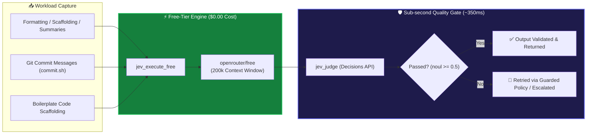
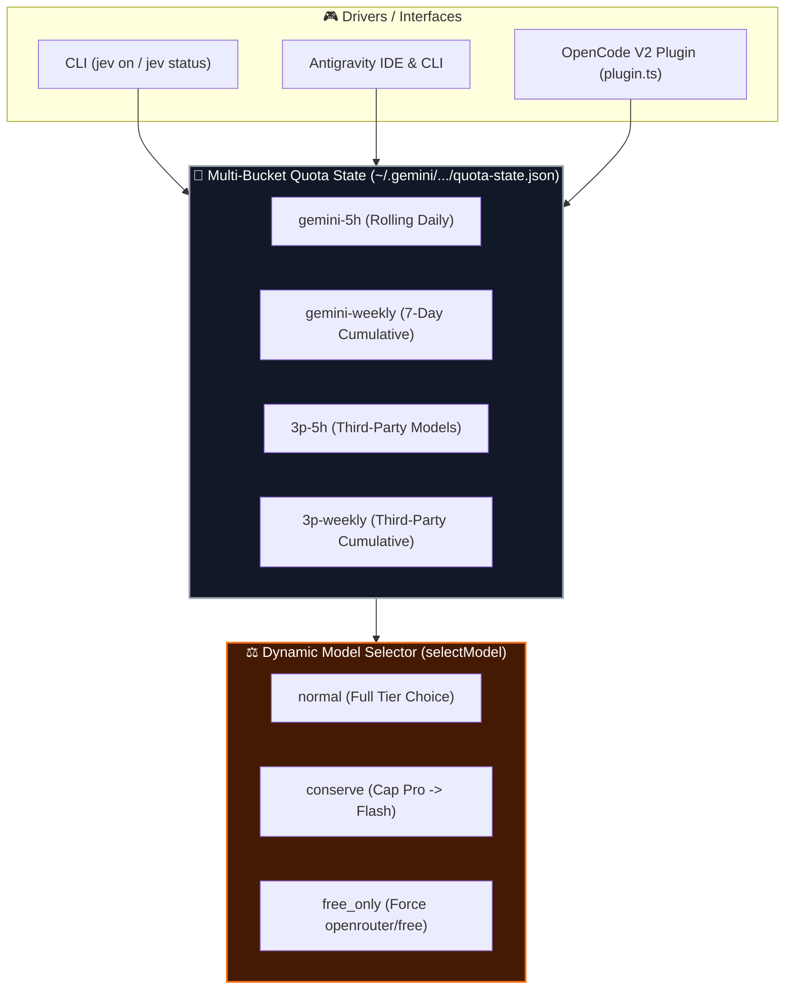

# TypeSafe Jev Plugin (Jev V2 - System 1 AI Coprocessor)

[](https://www.typescriptlang.org/)
[](https://bun.sh/)
[](LICENSE)
[](https://github.com/rockad/agentic-hub)

**Path:** `agentic-hub/plugins/jev`  
**Version:** 2.3.5  
**Runtime:** Bun / Node (ESM)  
**Dependencies:** TypeScript, Zod, OpenRouter SDK, Agent Framework Adapters

---

## 📖 Overview

The **TypeSafe Jev Plugin** (`plugins/jev`) is the **System 1 AI Coprocessor** for the `agentic-hub` ecosystem. Named after Daniel Kahneman's "System 1" (fast, intuitive, low-effort thinking), Jev handles the high-volume, low-stakes cognitive load of an AI agent loop so your primary agent (System 2) can focus on complex reasoning.

Jev acts as three things in a single layer:
1. **Probabilistic Decision Coprocessor:** Analyzes tasks and routes work to the most cost-effective execution tier before any token spend occurs.
2. **Free-Tier Offloading Engine:** Diverts boilerplate work (summaries, linting, formatting, commits) to free-tier models (`openrouter/free`), resulting in **$0.00 cost** and **0 quota consumption** for routine operations.
3. **Quality Gate Validator:** Runs sub-second micro-evaluations (`jev_judge`) to verify output quality before it reaches the user or is committed to source control.

**Primary Value Proposition:** It protects your paid subscription quota (specifically **Google AI Pro Gemini**), preventing wasted credits on routine tasks while accelerating agent loops through parallelized, cheaper execution.

---

## ✨ Key Features

### ⚙️ Operating Modes
Control the coprocessor's behavior via a toggleable state machine, persisted across sessions in `~/.config/jev/config.json`:

| Mode | Behavior | Use Case |
| :--- | :--- | :--- |
| `OFF` *(default)* | **Disabled.** No offloading, no dispatching, zero token overhead. Direct pass-through to primary model. | Default unconfigured state; emergency high-complexity tasks. |
| `ON-DEMAND` | **Manual Trigger.** Passive coprocessor; engages only when explicitly invoked or requested. | Auditing, debugging, or selective manual control over costs. |
| `ON` | **Always Active.** Jev automatically dispatches eligible tasks, offloads free-tier work, and guards quotas. | Daily development workflows; automatic quota protection and offloading. |

> [!IMPORTANT]
> **Default OFF (Opt-In Intent):** Jev is strictly **OFF by default** when unconfigured. No background decisions or external network calls occur until explicitly enabled by the user.
>
> **Migration Notice:** `mode.json` is completely deprecated and ignored, and can be safely deleted. `~/.config/jev/config.json` is the single canonical configuration store for global defaults (`defaults.mode`) and per-harness overrides (`harnesses.<harness>.mode`).
>
> **Shell Script Retirement:** `scripts/jev-mode` is retired. Mode switching and inspection are handled directly via the `/jev` slash command / skill inside agent harnesses (`/jev on`, `/jev on-demand`, `/jev off`, `/jev status`) and the `jev_set_mode` / `jev_get_mode` MCP tools.

### 🚀 Pre-flight Dispatch (`jev_dispatch` & `jev_batch_dispatch`)
Before a task hits the primary model, `jev_dispatch` runs a calibrated inference on the task metadata. It produces a **probability distribution** over:
- **Subagents:** Which specialized helper should handle the task?
- **Execution Tiers:** `openrouter_free`, `flash_lite`, `flash`, or `pro`.
- **Session Model Ceiling Clamping:** Dynamically clamps subagent recommendations $\le$ active session model tier (`Gemini 3.8 Flash`), preventing over-eager `pro` recommendations for routine CLI porting.
- **Scaffolding Detection:** Automatically detects package/crate creation tasks and flags `scaffoldFirst: true` to trigger Tier 0 `$0.00` mechanical boilerplate generation.
- **Dynamic Semantic Batch Dispatch (`jev_batch_dispatch`):** Decomposes multi-task roadmaps or phases into parallel and sequential execution waves, enforces dependency order, and applies safety concurrency caps ($\le 10$ simultaneous free workers). Routes tasks dynamically using the OpenRouter Decisions API (`~typesafe/jev-latest`), with automatic fallback to local token and description keyword scoring if offline or timed out. Configurable via `routing.strategy` (`"router"` | `"keyword"`) in `~/.config/jev/config.json`.

This prevents expensive models from processing routine formatting, simple search requests, or bounded ports.

### 🔍 Per-Harness Dynamic Subagent Discovery
Jev discovers candidate subagents dynamically from the filesystem without hardcoded persona assumptions:
- **Antigravity:** `<workspace>/.agents/agents/`
- **Claude Code:** `<workspace>/.claude/agents/`
- **OpenCode:** `<workspace>/.opencode/agents/`
- **Universal Shared Global:** `~/.agents/agents/` across all harnesses

Local workspace agents take precedence over universal shared agents with the same identifier, enabling clean per-project specialization while sharing common subagents across machines.

### 🆓 Free-Tier Offloading
Jev intercepts specific workload patterns and reroutes them to `openrouter/free` endpoints. This guarantees **$0.00 spend** and **0 quota usage** for:
- File/Code **Summaries**
- **Markdown** formatting and refactoring
- Standard **Git Commits** (`commit.sh`)
- Boilerplate scaffolding (`Cargo.toml`, `package.json`, CLI `clap` structs)
- Unit test generation

**Implementation:**
- `jev_execute_free`: Raw offloading wrapper with timeout handling.
- `jev_agent_free`: Specialized handler for agent-assistant interactions.
- `jev_execute_free_guarded`: Offloading wrapped in a retry + fallback policy to ensure failure never breaks the loop.

### 📝 Automated Semantic Commits
Integrates directly with the commit pipeline via `commit.sh` (or `scripts/commit.ts`):
1. `scripts/commit.ts` captures the staged diff.
2. `jev_dispatch` decides if the commit message needs an LLM.
3. `jev_agent_free` generates a conventional commit message.
4. `jev_judge` validates the message against the diff semantically.
5. Commit is finalized.

### 🛡️ Three-Tier Resilient Quality Gates (`jev_judge`)
A micro-evaluation engine designed for speed and bulletproof fault tolerance:
- **Tier 1 (Fast Bernoulli Decision):** OpenRouter Decisions API (`~typesafe/jev-latest` on `/api/alpha/decisions`, ~350ms).
- **Tier 2 (Chat Router Fallback):** OpenRouter chat completions with strict JSON Schema (`typesafe/jev-router`).
- **Tier 3 (Local Deterministic Judge):** If OpenRouter returns `404` (*"No models satisfy the decisions policy"*), network timeout, or connection failure, Jev automatically evaluates diff syntax, git merge conflict markers (`<<<<<<<`), compilation exit codes (`exit code: 1`), and non-empty assertions locally without throwing unhandled exceptions.

### 📊 Quota & Model Selection (`jev_quota`, `jev_select_model`)
Real-time telemetry tracks your subscription limits to prevent hard `429` errors:
- **5-Hour Bucket:** Tracks rolling usage for the day.
- **7-Day Bucket:** Tracks cumulative usage for the week.

`jev_select_model` automatically swaps your target model to a lower-tier alternative when thresholds are approached.

### 🔌 Dual Integration
Jev ships with native adapters for both major agent frameworks:
1. **Antigravity CLI:** Deep hooks into the Antigravity action pipeline.
2. **OpenCode V2:** Native plugin hooks into the OpenCode extension architecture. *(Note: `opencode serve` background service caches plugin modules in memory. Restart the service via `pkill -f "opencode serve"` after updating plugin source versions).*
3. **Claude Code:** A plugin with the MCP server plus hooks that advise and guard each turn. See the Claude Code section below.

---

## 📐 System 1 Decision & Execution Flows

### 1. Pre-Flight Dispatch & Reasoning Effort Governance Flow

```mermaid
flowchart TD
    A["👤 User Request / Task Prompt"] --> B["⚡ Jev Pre-Flight Dispatch (jev_dispatch)"]
    
    B --> C{"🔍 Subagent & Intent Evaluator"}
    C -->|Mechanical / Formatting| D["🟢 Low Effort (low)\n(formatter, syntax_checker, git_scribe)\n-30% Tokens, Min Latency"]
    C -->|Standard Work / Code| E["🔵 Medium Effort (medium)\n(code_engineer, research, general_developer)\nBalanced Reasoning Depth"]
    C -->|Complex Architecture| F["🟣 High Effort (high)\n(system_architect, security_auditor)\nMaximum CoT Depth"]
    
    D --> G{"📊 Quota Strategy Governor (readQuotaView)"}
    E --> G
    F --> G
    
    G -->|Strategy: normal| H["✅ Execute Calibrated Effort"]
    G -->|Strategy: conserve| I["⚠️ Cap High Effort -> medium"]
    G -->|Strategy: free_only (Free Model)| J["🆓 Retain medium / high on openrouter/free"]
    G -->|Strategy: free_only (Quota Model)| K["🔒 Force low Effort on Paid Quota Models"]
    
    H --> L["🤖 Subagent Execution"]
    I --> L
    J --> L
    K --> L

    style D fill:#1b4332,color:#fff,stroke:#2d6a4f,stroke-width:2px
    style E fill:#1e3a8a,color:#fff,stroke:#3b82f6,stroke-width:2px
    style F fill:#4c1d95,color:#fff,stroke:#8b5cf6,stroke-width:2px
    style G fill:#0f172a,color:#fff,stroke:#f59e0b,stroke-width:2px
```

### 2. Free-Tier Offloading & Micro-Evaluation Quality Gate



### 3. Multi-Bucket Quota Preservation Architecture



---

## 💰 Token & Cost Savings Comparison Matrix

| Workload Category | Monolithic Execution (No Jev) | TypeSafe Jev Coprocessor Engine | Paid Token Savings | Gemini Quota Burn | Latency Impact |
| :--- | :--- | :--- | :--- | :--- | :--- |
| **Mechanical Formatting & Scaffolding** | Paid Tier (`Gemini Pro` / `Flash`) @ high effort | Offloaded to `openrouter/free` via `jev_execute_free` @ `low` effort | **100% Paid Savings** | **0% Quota Burn ($0.00)** | ~600ms (Fast) |
| **Git Commit Generation (`commit.sh`)** | Primary Session Model (~2k tokens) | `jev_agent_free` + `jev_judge` validation (~350ms) | **100% Paid Savings** | **0% Quota Burn ($0.00)** | ~350ms (Sub-second) |
| **Documentation & Research (`research` / `docs_engineer`)** | High CoT reasoning budget | Calibrated `medium` effort + quota governor throttling | **~30% Token Savings** | **60% Reduced Burn** | ~1.2s |
| **Standard Feature Engineering (`code_engineer`)** | Unbounded reasoning tokens | Pre-flight `jev_dispatch` + `medium` effort governance | **~25% Token Savings** | **Optimal Quota Preservation** | ~2.5s |
| **Security Audits & RFC Architecture** | Uniform static reasoning budget | Dynamic `high` effort + `jev_judge` diff integrity check | Deepest CoT Reasoning Depth | Calibrated & Guarded | Extended CoT Depth |
| **Overall Monthly Benchmark** | High risk of 5-Hour / 7-Day Quota Exhaustion (`429`) | Guaranteed continuous operation under quota safety caps | **~45% Overall Token & Cost Savings** | **Quota Lifetime Extended 3x** | **Up to 4x Faster Turn Completion** |

---

## 🏗️ Architecture & Component Structure

```text
plugins/jev
├── src/
│   ├── core/                # Core engines (client, config, cache, discovery, egress, heuristics, graph)
│   ├── tools/               # MCP tool handlers (dispatch, execute-free, judge, mode, quota, route, score)
│   ├── audit/               # Compliance and drift detection (drift-detector.ts)
│   ├── index.ts             # Main MCP server entrypoint
│   ├── shared.ts            # Shared types and helpers across harnesses
│   └── tracing.ts           # OpenTelemetry and span logging
├── claude/                  # Claude Code hook adapter (hook.ts entry, logic.ts decisions)
│   └── hooks.json           # Claude Code hook registration
├── scripts/
│   ├── commit.ts            # Semantic commit generation pipeline
│   ├── commit.sh            # Shell wrapper for commit.ts
│   └── audit-agentic-gaps.ts# Agentic hub gap auditor
├── skills/
│   └── jev/                 # In-chat slash command skill
├── tests/                   # Bun unit test suite (config, cache, audit, egress, jev, etc.)
├── .env.example             # Template configuration
├── package.json
└── tsconfig.json
```

---

## ⚙️ Configuration

Create a `.env` file in the plugin root (`.env` is ignored by git via `.gitignore`).

### Environment Variables

| Variable | Description | Default |
| :--- | :--- | :--- |
| `JEV_OPENROUTER_API_KEY` | **Required.** API key for OpenRouter to access free-tier and decision endpoints. | *(None)* |
| `JEV_MODE` | Initial operating mode (`ON`, `ON-DEMAND`, `OFF`). Overridden by `config.json`. | `OFF` |
| `JEV_EGRESS_DENY` | Optional. Extra directories (separated by `:`) from which nothing may be sent. It can only add restrictions. | *(None)* |
| `JEV_ZDR` | Optional. Zero Data Retention enforcement mode (`off`, `on`, `strict`). Overridden by configuration files. | `off` |

### Canonical Configuration Store (`~/.config/jev/config.json`)

`~/.config/jev/config.json` is the **single canonical source of truth** for Jev settings across all harnesses (Antigravity, Claude Code, OpenCode). Legacy `mode.json` is completely deprecated and ignored.

Example configuration:

```json
{
  "defaults": {
    "mode": "off"
  },
  "harnesses": {
    "antigravity": {
      "mode": "on"
    },
    "claude-code": {
      "mode": "on"
    },
    "opencode": {
      "mode": "on-demand"
    }
  },
  "routing": {
    "strategy": "router"
  },
  "privacy": {
    "zdr": "off"
  }
}
```

#### Precedence & Scoping Rules

1. **Per-Harness Override:** `harnesses.<harness>.mode` takes precedence when running inside that harness (e.g. enabling a specific harness even if `defaults.mode` is `"off"`).
2. **Global Default:** Falls back to `defaults.mode` if no harness-specific override exists.
3. **Fallback Default:** If unconfigured, mode strictly defaults to **`off`** (Opt-In Intent).
4. **Routing Strategy:** `routing.strategy` selects between `"router"` (OpenRouter Decisions API `~typesafe/jev-latest` with local keyword fallback) and `"keyword"` (offline local description scoring only).

#### Harness Model Configuration

Jev maps execution tiers across supported agent harnesses to their native or configured models:

| Harness | Free Tier (`free`) | Cheap Tier (`cheap`) | Standard Tier (`standard`) | Deep Tier (`deep`) |
| :--- | :--- | :--- | :--- | :--- |
| **Antigravity** | `openrouter/free` | `flash_lite` | `flash` | `pro` |
| **Claude Code** | `openrouter/free` | `haiku` | `sonnet` | `opus` |
| **OpenCode** | `openrouter/free` | `~anthropic/claude-haiku-latest` | `~anthropic/claude-sonnet-latest` | `~anthropic/claude-opus-latest` |
| **CLI** | `openrouter/free` | `google/gemma-4-31b-it:free` | `typesafe/jev-router` | `typesafe/jev-router` |

### Outbound Data Control & Privacy (optional)

By default jev sends requests exactly as before. To keep some of your work away from OpenRouter, create `~/.config/jev/egress.json`. jev reads this file but never writes it:

```json
{
  "allowPaths": ["~/Work/public-repo", "~/Work/agentic-hub"],
  "denyPaths": ["~/Work/public-repo/private-notes"],
  "zdr": "on"
}
```

- With `allowPaths`, every outbound request is blocked unless the session directory lies under one of the listed paths. Without it, only `denyPaths` applies.
- The session directory is checked three ways: the hook's `cwd`, `CLAUDE_PROJECT_DIR`, and the process working directory. All three must pass.
- Paths are compared after resolving `~`, symlinks, and (on macOS) letter case.
- If `egress.json` is not valid JSON or has the wrong shape, everything is blocked. A broken policy never fails open.
- Blocked requests fail before any data leaves the machine. Hooks stay silent; MCP tools return an error.
- Requests to `localhost` / `127.0.0.1` (the local memory server) are not affected.
- While a policy is active, each sent and blocked request is logged to `~/.config/jev/egress-log.jsonl` with host, model, byte count, and ZDR audit markers (`zdr_policy`, `zdr_applied`). Request bodies are never logged.

**Limits.** The policy looks at *where the session runs*, not at *what the data is*. Text from a blocked directory that you paste into a prompt, or a file read by absolute path from an allowed session, is not detected.

> [!NOTE]
> **Batch Dispatch Outbound Data Notice:** When `routing.strategy` is set to `"router"` (the default), `jev_batch_dispatch` routes task descriptions and criteria to the OpenRouter Decisions API (`~typesafe/jev-latest`). These requests are strictly governed by your egress directory rules and Zero Data Retention (ZDR) policy. If an egress policy blocks the working directory, or if `zdr: "strict"` is active and ZDR is unavailable, dispatch automatically falls back to offline local keyword matching without leaking data.

#### 🔒 Zero Data Retention (ZDR) & Provider Data Policies

OpenRouter allows clients to enforce data privacy guardrails via provider routing constraints (`provider.zdr: true` and `provider.data_collection: "deny"`). When enabled, OpenRouter routes exclusively to upstream model providers with signed Zero Data Retention agreements that contractually commit to not retaining prompts or completions, and never training on customer data.

Jev provides first-class governance for ZDR across all coprocessor workflows:

##### Operational ZDR Policy Modes

| Mode | Behavior | Decisions API (`~typesafe/jev-latest`) | Free Offloading (`openrouter/free`) | Use Case |
| :--- | :--- | :--- | :--- | :--- |
| `off` *(default)* | Standard routing without ZDR or data collection restrictions. | Standard routing | Allowed (standard routing) | Development, public open-source code, or non-sensitive environments. |
| `on` *(recommended)* | Pragmatic privacy balance. Enforces ZDR and `data_collection: "deny"` on all System 1 Decisions API calls, leaving zero prompt retention footprint. Free generative offloading proceeds without ZDR headers but records audit markers. | Enforced ZDR (`zdr_applied: true`) | Allowed with audit marker (`zdr_applied: false`) | Recommended default for mixed development workflows needing quota protection and private decision routing. |
| `strict` | Zero-trust enforcement. Requires ZDR across 100% of outbound calls. Any request to endpoints lacking ZDR agreements is blocked locally before network transmission. | Enforced ZDR (`zdr_applied: true`) | Blocked locally (`JEV_ZDR_UNAVAILABLE`) | High-compliance, proprietary enterprise, or zero-trust environments where uncontracted data handling is prohibited. |

##### Configuration & Precedence

ZDR policy can be defined in multiple locations. Jev resolves the active policy using a strict precedence hierarchy (highest to lowest):

1. **`~/.config/jev/egress.json`** (Highest precedence):
   ```json
   {
     "zdr": "on"
   }
   ```
2. **`~/.config/jev/config.json`** (`privacy.zdr`):
   ```json
   {
     "privacy": {
       "zdr": "on"
     }
   }
   ```
3. **Environment Variable (`JEV_ZDR`)**:
   ```bash
   export JEV_ZDR=on      # Accepted values: "on" ("1", "true"), "strict", "off" ("0", "false")
   ```
4. **Default**: Falls back to `off` when unset.

##### The Free-Tier Trade-off: Pragmatic vs Zero-Trust

Free community models on OpenRouter (e.g. `openrouter/free`, `google/gemma-4-31b-it:free`) are hosted across diverse open endpoints that do not provide commercial Zero Data Retention contracts or signed enterprise data protection agreements.

- In **`on` mode**, Jev protects your proprietary codebase and system reasoning by enforcing ZDR on decision routing (`jev_dispatch`, `jev_judge`, `jev_route`) while still permitting $0.00 mechanical offloading (scaffolding, formatting, commits) to free endpoints. Each outbound offload records `"zdr_policy": "on"` and `"zdr_applied": false` in `~/.config/jev/egress-log.jsonl` for compliance auditing.
- In **`strict` mode**, Jev adopts a zero-trust posture: any attempt to route to an endpoint without verified ZDR compliance fails closed with a typed `JEV_ZDR_UNAVAILABLE` error (`EGRESS_ZDR_UNAVAILABLE_CODE`). No tokens leave the machine to unverified endpoints.

#### 🗂️ Local Telemetry & Log Files

Jev writes three local logs outside the Claude hook state. None holds prompt text. The audit report is the exception: `~/.config/jev/audit_report.json` (written by `scripts/audit-agentic-gaps.ts`) still quotes up to 160 characters of transcript text per incident, so it is not text-free like the other logs and is only protected by its `0600` mode.

| File | Written by | Content |
| :--- | :--- | :--- |
| `~/.gemini/antigravity-cli/jev_telemetry.jsonl` | every MCP tool, and the Claude hook | tool, harness, tier, model, latency, cost, quota fields |
| `~/.config/jev/egress-log.jsonl` | the egress guard while a policy or ZDR is active | host, model, byte count, session directories, ZDR markers |
| `~/.config/jev/claude_decisions.jsonl` | the Claude hook | recommendation, model names, tier and a prompt hash |

- Every file is created `0600` and its directory `0700`. Files and directories that already exist with looser modes (older releases wrote `0644` / `0755`) are tightened on the next write. The chmod is best-effort and never blocks or fails the caller.
- `privateDir` also tightens `~/.gemini/antigravity-cli/` to `0700`, a directory Antigravity owns (it holds the telemetry log); anything else that reads that directory as another user or group loses access.
- **Field change in `jev_telemetry.jsonl`:** `jev_dispatch` lines no longer carry `task` (the first 100 characters of the prompt). They carry `taskLen` (the task's length in characters) and `taskHash` (the first 12 hex characters of its sha256, stable for equal text) instead. Every other field is unchanged. Lines already in an existing file keep their old `task` text: delete or truncate the file if that matters to you.
- Nothing in the plugin reads the old `task` field; `src/audit/drift-detector.ts` and `scripts/audit-agentic-gaps.ts` use `tool`, `recommendedTier`, `timestamp` and `sessionId`.

---

## 🤖 Claude Code

Install from this repository's Claude Code marketplace (`.claude-plugin/marketplace.json` at the repo root):

```
/plugin marketplace add rockad/agentic-hub
/plugin install jev@agentic-hub
```

Put the key where the hooks and the MCP server both find it: `~/.config/jev/env` with
`JEV_OPENROUTER_API_KEY=...`. `bun` must be on `PATH`.

The plugin brings the `jev_*` MCP tools and four hooks (`claude/hooks.json` → `claude/hook.ts`).
The hooks act only in mode `on`. In `on-demand` and `off` they stay silent, and the MCP tools
remain callable on request.

| Event | What Jev does |
| :--- | :--- |
| `SessionStart`, `PostModelSwitch` | Remembers the session model in `~/.config/jev/claude-sessions/`. It is the ceiling for delegations. |
| `UserPromptSubmit` | Asks Jev (1.5 s budget) for a Claude subagent (`Explore`, `general-purpose`, `Plan`, `self`), a model (`openrouter_free`/`flash_lite` → `haiku`, `flash` → `sonnet`, `pro` → `opus`) and an effort, and adds them to the turn as context. |
| `PreToolUse` on `Agent` | Asks the user (a permission dialog) before a subagent runs on a stronger model than the session's, when the prompt did not name that model; a model the user named passes. Yes runs it on the stronger model; No cancels the call and stops the turn, and a comment typed with No lets the assistant continue. Nothing else asks: Jev's tier rating never opens a dialog, it is logged next to the model the call used. Opt-in `JEV_ELEVATION=clamp` runs the first such call in a prompt on the session model instead (see "Elevation" below). |

What the hooks do **not** do:

- They never change the model of a delegation, except under the opt-in `JEV_ELEVATION=clamp` (see
  "Elevation" below). Cheaper models are advised, not forced.
- They never block a turn. Any failure (no key, Jev down, malformed input) prints nothing and exits 0.
- They do not track Claude subscription limits. Claude Code exposes `rate_limits` only to the status
  line, not to hooks, so the quota strategy is whatever `readQuotaView` reports (usually `unknown`).

Decisions are logged to `~/.config/jev/claude_decisions.jsonl`.

**Precedence.** One order decides the model of a delegation: (1) an explicit instruction in the current
prompt, either a model named in an imperative (`use opus`, `run an opus subagent`) or a cost intent (`minimal
viable model`, `cheapest`, `as cheap as possible`); the effect is at most one tier step from the router's tier;
(2) the Jev guard (a `pro` recommendation on a session below opus: the turn context tells the assistant to ask
before using `opus` and to offer the cheaper option; naming `opus` satisfies it); (3) the standing rule (the
router's tier; on an opus session a `pro` recommendation is within the ceiling and needs no approval). The
turn context names the rule that applied (`rule: per your instruction | per the Jev guard | per standing rule`).
The `PreToolUse` guard passes a model the user named in the current prompt (or a stronger one) unchanged, with no
clamp and no dialog, and logs it as `elevation: "instructed"`. Jev cannot read the
user-level `CLAUDE.md`, so the standing rule is only reflected by the router's tier.

### Elevation (2.3.4)

An `Agent` call that names a model stronger than the session model is the one thing the hook asks about. What
happens depends on what the user said in the current prompt, and on one opt-in setting.

| Situation | What happens |
| :--- | :--- |
| Model at or below the session model, no model, `inherit`, a `Workflow`, unknown session model | Untouched. |
| The prompt names that model or a stronger one (`use opus`, `run an opus subagent`) | Passes unchanged, no dialog (the instruction is the approval). Logged as `elevation: "instructed"`. |
| **Default:** a stronger model, no such instruction | **Ask, on every such call** (a permission dialog, as in 2.3.3). Yes runs it on the requested model; No cancels the call and stops the turn; a comment typed with No lets the assistant continue, for example "continue on sonnet" (per the Claude Code documentation). Logged as `elevation: "asked"`. |
| The session model's alias is remapped (`ANTHROPIC_DEFAULT_SONNET_MODEL`, `_HAIKU_` or `_OPUS_MODEL` set for it) | Ask, in both modes: the clamp would set an alias that does not run on the session model. Under the opt-in it is logged with `clamp_skipped: "alias-remapped"`. |

The instruction check is `>=`: a model the user named covers a request for that model or a weaker one (`use opus`
covers an `opus` call and a `sonnet` call). A stored instruction counts only for its own prompt: the turn state
holds the `prompt_id` it was written for, and when `PreToolUse` sees a different one (a host-injected turn, for
example) the instruction is ignored and the call is logged with `intent_stale: true`. If either id is missing the
marker alone decides, as before. The advice in the turn context stays capped at the session model, as in 2.3.3.

#### Opt-in clamp: `JEV_ELEVATION=clamp`

Set the environment variable `JEV_ELEVATION=clamp` (the hook reads it from its environment; there is no config
key) and the first elevating call per session and prompt id is not asked about: the hook returns `allow` with
`updatedInput` (every original field, `model` set to the session model alias, for example `sonnet`) and a short
note for the assistant, so the work runs on the session model with no dialog. Logged as `elevation: "clamped"`
with `clamped_from` and `clamped_to`; the telemetry `modelUsed` is the model it ran on. The note says Jev ran the
delegation on the session model, that the assistant must not call again on its own, and that it should report the
result and ask the user in chat; a reply naming the stronger model passes.

**Limit, said plainly:** in an interactive session the clamp restarts on every new prompt. A background agent's
completion notification starts a new prompt with a new `prompt_id`, so the next elevating call is a "first" call
again and is clamped again. The dialog therefore appears only for a repeat inside the same prompt, and a user who
never types a prompt of their own between calls may never be asked. That is why the clamp is off by default.

The "once per prompt" state is one marker file per session in `~/.config/jev/claude-sessions/`
(`<session>.clamp-<prompt_id>`, mode 0600 like the other state, holding a hash of the clamped delegation, never
task text). It is created exclusively so parallel calls cannot both be first, and replaced when the prompt
changes; markers left behind are pruned after 7 days at SessionStart. When the state cannot be read or written,
or there is no prompt id, the call asks instead of clamping. A repeat's dialog mentions an earlier run on the
session model only when a clamp ran for the same `subagent_type` and `description` in this prompt. The default
mode never creates a marker and never returns `updatedInput`.

Fail-open: a hook crash, invalid stdin or a timeout means no output, and the call runs unchanged (on the model it
asked for).

Not seen by the hook: an `Agent` call with no `model` whose agent definition has `model: opus` in its front matter.
The hook only sees the tool input, so that call runs on opus with no dialog and no clamp.

Not verified here: the permission dialog itself (it is shown by Claude Code), whether the assistant follows the
clamp note, and how an agent definition's own front-matter `model` or `CLAUDE_CODE_SUBAGENT_MODEL` interacts with
the rewritten `model`.

### Release notes

- **2.3.5: telemetry privacy** (see "Local Telemetry & Log Files" above):
  - The telemetry log (`~/.gemini/antigravity-cli/jev_telemetry.jsonl`), the egress log and the audit report
    (`~/.config/jev/audit_report.json`) are written `0600` in `0700` directories. Files and directories that
    already exist with looser modes are tightened at write time (best-effort, never blocking). The audit report
    still quotes up to 160 characters of transcript text per incident, so it is not text-free like the other logs.
    `privateDir` also tightens `~/.gemini/antigravity-cli/`, a directory Antigravity owns.
  - `jev_dispatch` telemetry lines carry `taskLen` and `taskHash` (first 12 hex of the sha256) instead of up to
    100 characters of task text in `task`. Lines already written keep their old `task` text: nothing deletes
    them. To clear them, delete or truncate `~/.gemini/antigravity-cli/jev_telemetry.jsonl`.
  - The `private-fs` helper (`privateDir`, `privateFile`) is shared by the Claude hook and the tools.
  - Hermetic tests: run `bun run test`, which starts bun with a fresh temporary `HOME` (bun fixes `os.homedir()`
    at startup, so only a `HOME` set before it starts moves it). A `bunfig.toml` preload (`tests/setup-home.ts`)
    also clears the harness markers, `JEV_*` variables and credentials (`OPENROUTER_API_KEY`, anything matching
    KEY, TOKEN or SECRET), so the real `~/.agents`, `~/.config/jev` and a Claude Code or Antigravity shell
    no longer change test results. Plain `bun test` still passes but prints a warning that `os.homedir()` is real.
- **2.3.4: elevation reasons, intent fixes, opt-in clamp** (see "Elevation" above):
  - Default behaviour is the 2.3.3 dialog on every `Agent` call above the session model with no instruction
    naming it. The reason now says what each answer does: Yes runs it on the requested model; No cancels the call
    and stops the turn; a comment typed with No lets the assistant continue (for example "continue on sonnet").
  - Opt-in elevation clamp, `JEV_ELEVATION=clamp` (environment only, off by default): the first elevating call
    per session and prompt id runs on the session model (`allow` plus `updatedInput`, no dialog) and a repeat in
    the same prompt asks. In interactive sessions it restarts on every new prompt (a background agent's
    notification is a new prompt), so it asks only for a repeat inside one prompt; that is why it is not the
    default. A remapped session alias asks instead of clamping.
  - The decisions log gains `elevation` (`asked`, `clamped`, `instructed`), `clamped_from`, `clamped_to`,
    `clamp_skipped` and `intent_stale`; the telemetry `modelUsed` of a clamped call is the model it ran on.
  - A stored instruction is tied to its `prompt_id`: a different prompt id (a host-injected turn) does not
    inherit the previous prompt's "use opus". A model the user named covers a weaker request (`>=`).
  - A typographic apostrophe no longer turns "Don’t use opus" or "Don’t update the files" into an instruction
    (the intent parser and the edit-verb rule normalise U+2018, U+2019 and U+02BC).
  - The prompt-time directive no longer says a guard dialog follows a model the user named; the advice stays
    capped at the session model, as in 2.3.3. Status turns still send their trimmed text to Jev (only
    host-injected turns and pastes over 20 000 characters skip the call). Unchanged: `jev_batch_dispatch` and the
    stage rubric (2.3.5).

- **2.3.3** (backport of the cognitive-engine advisor work, see `docs/plans/parity-audit-2026-11-12.md`):
  - The intent parser ignores quoted, code-span, fenced, questioned, "if"-supposed, first-person and
    pasted-speaker text, and negated models ("do not use opus", "instead of opus", "not the cheapest");
    "compare with opus" is not an instruction and two models in one clause are ambiguous; "as cheap as possible"
    is a cost intent. A named model moves the tier at most one step from the router's tier. The advice and the
    log carry `by` and `routerTier`.
  - One ceiling sentence on every path (including "allows it" on an opus session) and a `rule:` label. On an
    opus session a `pro` rating is the standing rule and needs no approval. On a session below opus the ask
    stays and the advised model stays capped at the session model (as in 2.3.2) until the elevation clamp
    ships in 2.3.4 (below), which keeps the cap; the directive still reports the opus-level rating. A named model is the user's own
    approval: the Jev guard does not ask about it.
  - Log changes to know about: the `UserPromptSubmit` record no longer carries a `model` key (use
    `recommended_model`), and `tier` now means the advised tier, with `routerTier` present only when the
    user's instruction made it differ from the router's.
  - No advice and no Jev call for host-injected turns (`<task-notification>`, `<bash-*>`, `<local-command-*>`,
    `<system-reminder>`) and for pasted prompts over 20 000 characters. A status turn gets no advice line, but
    it still sends its trimmed text to Jev, because the check needs the recommendation. The task sent to Jev is
    trimmed to 2 000 characters.
  - Narrow, negation-aware edit rule for the read-only personas; whole-word keywords in the effort heuristic,
    the local pre-filter and the scaffold detector (`isFormattingTask`).
  - The decisions log gains `session_id` next to `session` (both kept), `event: 'agent_call'`, `user_intent`
    and `by`; the turn state gains `mode`, `at` and `staged`; the telemetry event gains `modelRecommended`
    (`modelUsed` stays as a deprecated alias). One `env_notice` field names a remapped `ANTHROPIC_DEFAULT_*_MODEL`
    alias or a `CLAUDE_CODE_EFFORT_LEVEL` override (names only, never blocking).
  - Pre-flight: `PreToolUse` now matches `Agent|Task|Workflow` and reminds once on a Workflow, on the third
    Agent call of a staged session, or on a turn that named a workflow, when no successful dispatch call from
    Claude Code is logged in the last 30 minutes. Whether Claude Code fires `PreToolUse` for the agents a
    Workflow launches is unverified. Dispatch telemetry lines now carry `harness: 'claude-code'` there.
  - The hook waits up to 1 s for pending telemetry appends before it exits, and creates its state directory
    and files owner-only (0700 / 0600). `jev_batch_dispatch` reads `tiers.free.concurrencyCap` (default 10).
  - Not in this release (2.3.5): the stage rubric in the router criteria, `kind` / `needsEdit` on batch stages,
    and Claude-aware `jev_dispatch` / `jev_batch_dispatch` wording and session model.

- **2.3.2** (see `docs/case-studies/2026-11-11-pretooluse-dialog-on-pinned-model.md`): `PreToolUse` on `Agent`
  no longer opens a permission dialog when Jev rates the task `pro`. The dialog fired on every delegation
  pinned to the session model (51 such dialogs between 2026-10-28 and 2026-11-11, against 4 for a model above
  the ceiling), because it scored the whole delegation brief and ignored the model the call asked for; and
  Claude Code treats No as a rejection that stops the
  assistant, so the old "or deny and run it on sonnet" wording could not work. The only gate left is the
  deterministic ceiling check (a model stronger than the session's), its reason now says what Yes and No do,
  and the delegation brief is no longer sent to Jev. The tier rating stays in the turn context and in the
  decisions log. `decideByTier` is removed.
- **2.3.1** (case-study fixes, see the case study above): whole-word tier keywords in `jev_batch_dispatch`
  ("information", "transformation" and "dump format" no longer count as formatting work); explicit model and
  cost instructions and the precedence order above; one consistent ceiling sentence in the Claude hook;
  Plan and Explore are never recommended for an editing task, and display-name aliases are dropped from the
  Claude persona list; `PreToolUse` logs `tier`, `recommended_model`, `requested_model` and a `turn` id shared
  with the prompt record, and the `UserPromptSubmit` telemetry field is now `modelRecommended` (it was
  `modelUsed`); a non-blocking pre-flight reminder on `Agent` calls when no `jev_dispatch` or
  `jev_batch_dispatch` call was logged in the last 10 minutes; the dispatch tools print `Agent(...)` wording
  and skip the Antigravity ceiling when the harness is `claude-code`. Not in this release: stage plans for
  Workflow scripts (5.4) and the design check for Workflow agents (5.8).

Case study: Model tiers for a multi-stream docs workflow (2026-11-09) shows where the hook and the batch dispatch fell short on a staged workflow, with proposed fixes. It moved to [`rockad/cognitive-engine`](https://github.com/rockad/cognitive-engine/blob/main/packages/jev/docs/case-studies/2026-11-09-model-tier-for-multi-stream-workflow.md), alongside the fixes (a pointer stays [here](docs/case-studies/2026-11-09-model-tier-for-multi-stream-workflow.md)).

---

## 📟 Slash Commands & Tool Interfaces

Operating modes and status are managed via the in-chat `/jev` slash command / skill inside agent harnesses and the `jev_set_mode` / `jev_get_mode` MCP tools. The legacy shell script (`scripts/jev-mode`) is retired.

| Interface | Command / Call | Description |
| :--- | :--- | :--- |
| **Slash Command** | `/jev` or `/jev status` | Inspects current quota and active mode from `~/.config/jev/config.json`. |
| **Slash Command** | `/jev on` | Sets active mode to `ON` (Always Active). |
| **Slash Command** | `/jev on-demand` | Sets active mode to `ON-DEMAND` (Passive Coprocessor). |
| **Slash Command** | `/jev off` | Sets active mode to `OFF` (Zero Overhead / Pass-through). |
| **MCP Tool** | `jev_get_mode()` | Programmatically queries active mode, resolved harness mode, and configuration. |
| **MCP Tool** | `jev_set_mode({ mode })` | Programmatically updates mode directly in `~/.config/jev/config.json`. |

---

## 🛠️ Development & Testing

```bash
# Install dependencies
bun install

# Run the test suite (fresh temporary HOME; plain `bun test` would see your real home)
bun run test
```
