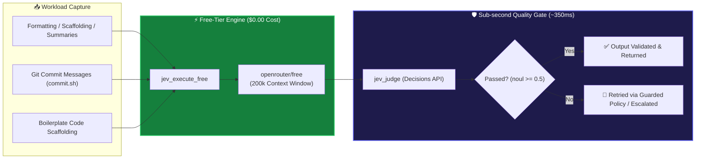
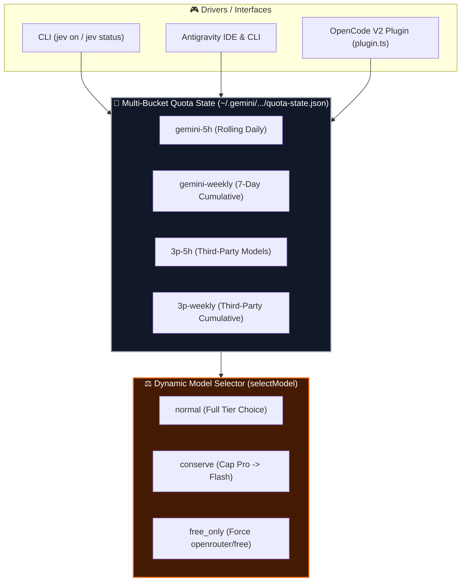

# TypeSafe Jev Plugin (Jev V2 - System 1 AI Coprocessor)

[](https://www.typescriptlang.org/)
[](https://bun.sh/)
[](LICENSE)
[](https://github.com/rockad/agentic-hub)

**Path:** `agentic-hub/plugins/jev`  
**Version:** 2.3.5  
**Runtime:** Bun / Node (ESM)  
**Dependencies:** TypeScript, Zod, OpenRouter SDK, Agent Framework Adapters

---

## 📖 Overview

The **TypeSafe Jev Plugin** (`plugins/jev`) is the **System 1 AI Coprocessor** for the `agentic-hub` ecosystem. Named after Daniel Kahneman's "System 1" (fast, intuitive, low-effort thinking), Jev handles the high-volume, low-stakes cognitive load of an AI agent loop so your primary agent (System 2) can focus on complex reasoning.

Jev acts as three things in a single layer:
1. **Probabilistic Decision Coprocessor:** Analyzes tasks and routes work to the most cost-effective execution tier before any token spend occurs.
2. **Free-Tier Offloading Engine:** Diverts boilerplate work (summaries, linting, formatting, commits) to free-tier models (`openrouter/free`), resulting in **$0.00 cost** and **0 quota consumption** for routine operations.
3. **Quality Gate Validator:** Runs sub-second micro-evaluations (`jev_judge`) to verify output quality before it reaches the user or is committed to source control.

**Primary Value Proposition:** It protects your paid subscription quota (specifically **Google AI Pro Gemini**), preventing wasted credits on routine tasks while accelerating agent loops through parallelized, cheaper execution.

---

## ✨ Key Features

### ⚙️ Operating Modes
Control the coprocessor's behavior via a toggleable state machine, persisted across sessions in `~/.config/jev/config.json`:

| Mode | Behavior | Use Case |
| :--- | :--- | :--- |
| `OFF` *(default)* | **Disabled.** No offloading, no dispatching, zero token overhead. Direct pass-through to primary model. | Default unconfigured state; emergency high-complexity tasks. |
| `ON-DEMAND` | **Manual Trigger.** Passive coprocessor; engages only when explicitly invoked or requested. | Auditing, debugging, or selective manual control over costs. |
| `ON` | **Always Active.** Jev automatically dispatches eligible tasks, offloads free-tier work, and guards quotas. | Daily development workflows; automatic quota protection and offloading. |

> [!IMPORTANT]
> **Default OFF (Opt-In Intent):** Jev is strictly **OFF by default** when unconfigured. No background decisions or external network calls occur until explicitly enabled by the user.
>
> **Migration Notice:** `mode.json` is completely deprecated and ignored, and can be safely deleted. `~/.config/jev/config.json` is the single canonical configuration store for global defaults (`defaults.mode`) and per-harness overrides (`harnesses.<harness>.mode`).
>
> **Shell Script Retirement:** `scripts/jev-mode` is retired. Mode switching and inspection are handled directly via the `/jev` slash command / skill inside agent harnesses (`/jev on`, `/jev on-demand`, `/jev off`, `/jev status`) and the `jev_set_mode` / `jev_get_mode` MCP tools.

### 🚀 Pre-flight Dispatch (`jev_dispatch` & `jev_batch_dispatch`)
Before a task hits the primary model, `jev_dispatch` runs a calibrated inference on the task metadata. It produces a **probability distribution** over:
- **Subagents:** Which specialized helper should handle the task?
- **Execution Tiers:** `openrouter_free`, `flash_lite`, `flash`, or `pro`.
- **Session Model Ceiling Clamping:** Dynamically clamps subagent recommendations $\le$ active session model tier (`Gemini 3.8 Flash`), preventing over-eager `pro` recommendations for routine CLI porting.
- **Scaffolding Detection:** Automatically detects package/crate creation tasks and flags `scaffoldFirst: true` to trigger Tier 0 `$0.00` mechanical boilerplate generation.
- **Dynamic Semantic Batch Dispatch (`jev_batch_dispatch`):** Decomposes multi-task roadmaps or phases into parallel and sequential execution waves, enforces dependency order, and applies safety concurrency caps ($\le 10$ simultaneous free workers). Routes tasks dynamically using the OpenRouter Decisions API (`~typesafe/jev-latest`), with automatic fallback to local token and description keyword scoring if offline or timed out. Configurable via `routing.strategy` (`"router"` | `"keyword"`) in `~/.config/jev/config.json`.
- **Stage schema on Claude Code (`kind`, `needsEdit`):** each `jev_batch_dispatch` task may carry two optional fields. `kind` is `mechanical` (haiku), `settled-edit` (sonnet) or `judgement` (opus), the stage rubric below, and it is used instead of guessing. `needsEdit: true` keeps read-only subagent types (`Plan`, `Explore`) and the free tier (text only, it cannot edit files) off the stage; `needsEdit: false` overrides edit wording in the task text. Without `needsEdit` the wording decides. Without `kind` the router is asked for each stage's tier under the rubric, then whole-word keywords offline; the result says which one set it (`tierSource`: `kind`, `router` or `keyword`). On other harnesses both fields are ignored and the output has no new keys.
- **Stage rubric:** "mechanical edit or checklist update -> haiku; spec or plan edit with a settled decision -> sonnet; judgement whose error is expensive -> opus". The router sees these lines in its tier criteria, the turn context repeats them on a delegation turn, and a prompt that names a workflow or workstreams gets a reminder to call `jev_batch_dispatch` with one task per stream.

This prevents expensive models from processing routine formatting, simple search requests, or bounded ports.

### 🔍 Per-Harness Dynamic Subagent Discovery
Jev discovers candidate subagents dynamically from the filesystem without hardcoded persona assumptions:
- **Antigravity:** `<workspace>/.agents/agents/`
- **Claude Code:** `<workspace>/.claude/agents/`
- **OpenCode:** `<workspace>/.opencode/agents/`
- **Universal Shared Global:** `~/.agents/agents/` across all harnesses

Local workspace agents take precedence over universal shared agents with the same identifier, enabling clean per-project specialization while sharing common subagents across machines.

### 🆓 Free-Tier Offloading
Jev intercepts specific workload patterns and reroutes them to `openrouter/free` endpoints. This guarantees **$0.00 spend** and **0 quota usage** for:
- File/Code **Summaries**
- **Markdown** formatting and refactoring
- Standard **Git Commits** (`commit.sh`)
- Boilerplate scaffolding (`Cargo.toml`, `package.json`, CLI `clap` structs)
- Unit test generation

**Implementation:**
- `jev_execute_free`: Raw offloading wrapper with timeout handling.
- `jev_agent_free`: Specialized handler for agent-assistant interactions.
- `jev_execute_free_guarded`: Offloading wrapped in a retry + fallback policy to ensure failure never breaks the loop.

### 📝 Automated Semantic Commits
Integrates directly with the commit pipeline via `commit.sh` (or `scripts/commit.ts`):
1. `scripts/commit.ts` captures the staged diff.
2. `jev_dispatch` decides if the commit message needs an LLM.
3. `jev_agent_free` generates a conventional commit message.
4. `jev_judge` validates the message against the diff semantically.
5. Commit is finalized.

### 🛡️ Three-Tier Resilient Quality Gates (`jev_judge`)
A micro-evaluation engine designed for speed and bulletproof fault tolerance:
- **Tier 1 (Fast Bernoulli Decision):** OpenRouter Decisions API (`~typesafe/jev-latest` on `/api/alpha/decisions`, ~350ms).
- **Tier 2 (Chat Router Fallback):** OpenRouter chat completions with strict JSON Schema (`typesafe/jev-router`).
- **Tier 3 (Local Deterministic Judge):** If OpenRouter returns `404` (*"No models satisfy the decisions policy"*), network timeout, or connection failure, Jev automatically evaluates diff syntax, git merge conflict markers (`<<<<<<<`), compilation exit codes (`exit code: 1`), and non-empty assertions locally without throwing unhandled exceptions.

### 📊 Quota & Model Selection (`jev_quota`, `jev_select_model`)
Real-time telemetry tracks your subscription limits to prevent hard `429` errors:
- **5-Hour Bucket:** Tracks rolling usage for the day.
- **7-Day Bucket:** Tracks cumulative usage for the week.

`jev_select_model` automatically swaps your target model to a lower-tier alternative when thresholds are approached.

### 🔌 Dual Integration
Jev ships with native adapters for both major agent frameworks:
1. **Antigravity CLI:** Deep hooks into the Antigravity action pipeline.
2. **OpenCode V2:** Native plugin hooks into the OpenCode extension architecture. *(Note: `opencode serve` background service caches plugin modules in memory. Restart the service via `pkill -f "opencode serve"` after updating plugin source versions).*
3. **Claude Code:** A plugin with the MCP server plus hooks that advise and guard each turn. See the Claude Code section below.

---

## 📐 System 1 Decision & Execution Flows

### 1. Pre-Flight Dispatch & Reasoning Effort Governance Flow

```mermaid
flowchart TD
    A["👤 User Request / Task Prompt"] --> B["⚡ Jev Pre-Flight Dispatch (jev_dispatch)"]
    
    B --> C{"🔍 Subagent & Intent Evaluator"}
    C -->|Mechanical / Formatting| D["🟢 Low Effort (low)\n(formatter, syntax_checker, git_scribe)\n-30% Tokens, Min Latency"]
    C -->|Standard Work / Code| E["🔵 Medium Effort (medium)\n(code_engineer, research, general_developer)\nBalanced Reasoning Depth"]
    C -->|Complex Architecture| F["🟣 High Effort (high)\n(system_architect, security_auditor)\nMaximum CoT Depth"]
    
    D --> G{"📊 Quota Strategy Governor (readQuotaView)"}
    E --> G
    F --> G
    
    G -->|Strategy: normal| H["✅ Execute Calibrated Effort"]
    G -->|Strategy: conserve| I["⚠️ Cap High Effort -> medium"]
    G -->|Strategy: free_only (Free Model)| J["🆓 Retain medium / high on openrouter/free"]
    G -->|Strategy: free_only (Quota Model)| K["🔒 Force low Effort on Paid Quota Models"]
    
    H --> L["🤖 Subagent Execution"]
    I --> L
    J --> L
    K --> L

    style D fill:#1b4332,color:#fff,stroke:#2d6a4f,stroke-width:2px
    style E fill:#1e3a8a,color:#fff,stroke:#3b82f6,stroke-width:2px
    style F fill:#4c1d95,color:#fff,stroke:#8b5cf6,stroke-width:2px
    style G fill:#0f172a,color:#fff,stroke:#f59e0b,stroke-width:2px
```

### 2. Free-Tier Offloading & Micro-Evaluation Quality Gate



### 3. Multi-Bucket Quota Preservation Architecture



---

## 💰 Token & Cost Savings Comparison Matrix

| Workload Category | Monolithic Execution (No Jev) | TypeSafe Jev Coprocessor Engine | Paid Token Savings | Gemini Quota Burn | Latency Impact |
| :--- | :--- | :--- | :--- | :--- | :--- |
| **Mechanical Formatting & Scaffolding** | Paid Tier (`Gemini Pro` / `Flash`) @ high effort | Offloaded to `openrouter/free` via `jev_execute_free` @ `low` effort | **100% Paid Savings** | **0% Quota Burn ($0.00)** | ~600ms (Fast) |
| **Git Commit Generation (`commit.sh`)** | Primary Session Model (~2k tokens) | `jev_agent_free` + `jev_judge` validation (~350ms) | **100% Paid Savings** | **0% Quota Burn ($0.00)** | ~350ms (Sub-second) |
| **Documentation & Research (`research` / `docs_engineer`)** | High CoT reasoning budget | Calibrated `medium` effort + quota governor throttling | **~30% Token Savings** | **60% Reduced Burn** | ~1.2s |
| **Standard Feature Engineering (`code_engineer`)** | Unbounded reasoning tokens | Pre-flight `jev_dispatch` + `medium` effort governance | **~25% Token Savings** | **Optimal Quota Preservation** | ~2.5s |
| **Security Audits & RFC Architecture** | Uniform static reasoning budget | Dynamic `high` effort + `jev_judge` diff integrity check | Deepest CoT Reasoning Depth | Calibrated & Guarded | Extended CoT Depth |
| **Overall Monthly Benchmark** | High risk of 5-Hour / 7-Day Quota Exhaustion (`429`) | Guaranteed continuous operation under quota safety caps | **~45% Overall Token & Cost Savings** | **Quota Lifetime Extended 3x** | **Up to 4x Faster Turn Completion** |

---

## 🏗️ Architecture & Component Structure

```text
plugins/jev
├── src/
│   ├── core/                # Core engines (client, config, cache, discovery, egress, heuristics, graph)
│   ├── tools/               # MCP tool handlers (dispatch, execute-free, judge, mode, quota, route, score),
│   │                        #   their strict input schemas, and schema.ts / validate.ts (call-time validation)
│   ├── audit/               # Compliance and drift detection (drift-detector.ts)
│   ├── server.ts            # createJevServer(): the MCP server, validating every call before its handler
│   ├── index.ts             # Main MCP server entrypoint (stdio)
│   ├── shared.ts            # Shared types and helpers across harnesses
│   └── tracing.ts           # OpenTelemetry and span logging
├── claude/                  # Claude Code hook adapter (hook.ts entry, logic.ts decisions)
│   ├── workflow-guard.ts    # Static Workflow script analysis (acorn, fail-closed)
│   ├── workflow-pin.ts      # Workflow drift recorder (script hashes keyed by tool_use_id)
│   ├── agent-definitions.ts # `.claude/agents/*.md` model/effort reader for the Workflow guard
│   ├── safe-read.ts         # Regular-file-only, non-blocking reader (a FIFO path never hangs a hook)
│   └── hooks.json           # Claude Code hook registration
├── scripts/
│   ├── commit.ts            # Semantic commit generation pipeline
│   ├── commit.sh            # Shell wrapper for commit.ts
│   └── audit-agentic-gaps.ts# Agentic hub gap auditor
├── skills/
│   └── jev/                 # In-chat slash command skill
├── tests/                   # Bun unit test suite (config, cache, audit, egress, jev, etc.)
├── .env.example             # Template configuration
├── package.json
└── tsconfig.json
```

---

## ⚙️ Configuration

Create a `.env` file in the plugin root (`.env` is ignored by git via `.gitignore`).

### Environment Variables

| Variable | Description | Default |
| :--- | :--- | :--- |
| `JEV_OPENROUTER_API_KEY` | **Required.** API key for OpenRouter to access free-tier and decision endpoints. | *(None)* |
| `JEV_MODE` | Initial operating mode (`ON`, `ON-DEMAND`, `OFF`). Overridden by `config.json`. | `OFF` |
| `JEV_EGRESS_DENY` | Optional. Extra directories (separated by `:`) from which nothing may be sent. It can only add restrictions. | *(None)* |
| `JEV_ZDR` | Optional. Zero Data Retention enforcement mode (`off`, `on`, `strict`). Overridden by configuration files. | `off` |

### Canonical Configuration Store (`~/.config/jev/config.json`)

`~/.config/jev/config.json` is the **single canonical source of truth** for Jev settings across all harnesses (Antigravity, Claude Code, OpenCode). Legacy `mode.json` is completely deprecated and ignored.

Example configuration:

```json
{
  "defaults": {
    "mode": "off"
  },
  "harnesses": {
    "antigravity": {
      "mode": "on"
    },
    "claude-code": {
      "mode": "on"
    },
    "opencode": {
      "mode": "on-demand"
    }
  },
  "routing": {
    "strategy": "router"
  },
  "privacy": {
    "zdr": "off"
  }
}
```

#### Precedence & Scoping Rules

1. **Per-Harness Override:** `harnesses.<harness>.mode` takes precedence when running inside that harness (e.g. enabling a specific harness even if `defaults.mode` is `"off"`).
2. **Global Default:** Falls back to `defaults.mode` if no harness-specific override exists.
3. **Fallback Default:** If unconfigured, mode strictly defaults to **`off`** (Opt-In Intent).
4. **Routing Strategy:** `routing.strategy` selects between `"router"` (OpenRouter Decisions API `~typesafe/jev-latest` with local keyword fallback) and `"keyword"` (offline local description scoring only).

#### Harness Model Configuration

Jev maps execution tiers across supported agent harnesses to their native or configured models:

| Harness | Free Tier (`free`) | Cheap Tier (`cheap`) | Standard Tier (`standard`) | Deep Tier (`deep`) |
| :--- | :--- | :--- | :--- | :--- |
| **Antigravity** | `openrouter/free` | `flash_lite` | `flash` | `pro` |
| **Claude Code** | `openrouter/free` | `haiku` | `sonnet` | `opus` |
| **OpenCode** | `openrouter/free` | `~anthropic/claude-haiku-latest` | `~anthropic/claude-sonnet-latest` | `~anthropic/claude-opus-latest` |
| **CLI** | `openrouter/free` | `google/gemma-4-31b-it:free` | `typesafe/jev-router` | `typesafe/jev-router` |

### Model catalogue (core)

> **Status: read by the Claude Code hooks for ranking, written by the refresh below.** The module (`src/core/catalogue.ts`, `src/core/lock.ts`) and its tests are in place. The Claude Code hooks read the cache file (one small read per hook run, never the network) to rank models for the elevation guard and the downgrade choice, and fall back to the family-only regex rank when there is no usable catalogue (see "Downgrade choice" below). The refresh below writes the file; the `ladder-agents` command only reads it. The tier map above stays what the decision engine uses.

The catalogue is a per-harness list of concrete model ids with a capability tier and a version, so a ladder can be built without a hard-coded model list. It lives in `~/.config/jev/models/<harness>.json` (directory `0700`, file `0600`, written atomically through a temp file and a rename):

```json
{
  "version": 1,
  "harness": "claude-code",
  "updated_at": "2026-11-12T10:00:00.000Z",
  "source": "probe",
  "models": [
    { "id": "claude-sonnet-5-5", "family": "sonnet", "version": [5, 5], "tier": "standard", "alias": "sonnet", "status": "ok", "strikes": 0, "last_ok": "2026-11-12T10:00:00.000Z" }
  ]
}
```

- `source` is `probe`, `openrouter`, `static` or `manual`; `status` is `ok`, `missing` or `needs-review`; `alias` is the native alias the harness resolves to that id, when known.
- Reading never throws. A missing, unreadable, corrupt or wrong-version file reads as "no catalogue", and `resolveTier` then falls back to the shipped alias defaults from the tier map above (`haiku`, `sonnet`, `opus` for Claude Code).
- A `-latest` version (`Infinity`) is stored as `null` in the file and revived on read.

**Heuristic.** The tier comes from the family in the id: `haiku` is `cheap`, `sonnet` is `standard`, `opus` and `fable` are `deep`. Any other family is `needs-review`: it is listed by `unknownIds` for a warning and never used by the ladder. Inside a tier a higher version is stronger, compared as number arrays (`claude-sonnet-5` < `claude-sonnet-5-5`, `claude-haiku-4-5` < `claude-haiku-5-5`); a new id such as `claude-sonnet-6` slots in without code changes. Ids parsed: `claude-<family>-<major>[-<minor>]`, a trailing date stamp is ignored, OpenRouter forms (`anthropic/claude-sonnet-4.5`, `~anthropic/claude-sonnet-latest`, `google/gemini-2.5-pro`, `openrouter/free`) and bare aliases (no version; `resolveAlias` maps one to the newest usable id of its family).

**Overrides.** An optional `models.overrides` object in `~/.config/jev/config.json`, read by a small tolerant reader (`loadOverrides`) that leaves the config loader and its `models` strings (`decision`, `router`, `fallback`) alone:

```json
{ "models": { "overrides": { "claude-sonnet-5": { "pin": true }, "claude-opus-4-5": { "ignore": true }, "claude-zephyr-1": { "tier": "standard" }, "claude-sonnet-4-5": { "rank": 10 } } } }
```

- `ignore` removes the id from the ladder.
- `tier` replaces the heuristic tier, and also makes a `needs-review` id usable.
- `rank` replaces version order inside the tier: ranked ids come first, higher rank first.
- `pin` puts the id first in its tier, ahead of ranked ids. A pin never revives a `missing` id.

**List prices.** A model entry may carry `price`: `{ "inputPerM": 2, "outputPerM": 10, "source": "openrouter", "at": "<ISO refresh time>" }`, USD per million tokens (`$2/$10 per 1M` in `jev-models list`, and in `--json`). It comes from the `pricing` fields of the public OpenRouter model list (`anthropic/claude-sonnet-5.5` maps to `claude-sonnet-5-5`; `:batch` and other `:` variants are ignored) and is attached by `refresh` only to a model the probe or list verified, never creating an entry. It is a proxy, not the real cost: on a subscription the cost is quota weight, so call it the **list price**. `priceOf(model)` is `inputPerM + outputPerM` (a deliberately simple figure) or `null` when unknown, and `cheaperThan(a, b)` is true only when both have a price and `a` is strictly lower; a downgrade offer should use these and say nothing about price when either is unknown. When OpenRouter cannot be reached the refresh still succeeds and keeps the previous prices. Prices are never fetched at hook time, only by `refresh`. Files without `price` load as before and a malformed price is dropped on read. Antigravity entries are not on OpenRouter and have none.

**Strikes rule** (`buildCatalogue`, one call per refresh round). A failed probe marks the id `missing` at once, and the ladder skips it from that moment; `strikes` counts consecutive failed probes and the id is deleted at the third. A successful probe resets `strikes` to 0, sets `status` to `ok` and updates `last_ok`. `markSuspect` (for a harness "model not found" report) sets `missing` and raises `strikes` to 1 at most, without touching `updated_at`. Ids not probed in a round are carried over unchanged.

**API** (exported from `src/core/index.ts`): `parseModelId`, `heuristicTier`, `compareVersions`, `compareModels`, `resolveAlias`, `loadOverrides`, `loadCatalogue`, `saveCatalogue`, `buildCatalogue`, `ladder`, `unknownIds`, `priceOf`, `cheaperThan`, `isStale` (older than 7 days) and `isVeryStale` (older than 3 times that), `resolveTier` (`{ ids, alias?, source: 'catalogue' | 'defaults', stale, veryStale }`), `markSuspect`, and the lock helper `tryLock(path, staleMs)` / `unlock(path)` for the future background refresh (exclusive create with pid and timestamp, stale or dead-owner takeover, never throws). Pure functions take `now` and `dir` so tests are deterministic; there is no network access and no process spawning.

### Model catalogue refresh

The refresh fills `~/.config/jev/models/<harness>.json` (the file described above). It is a command, a skill and an optional background job; the hooks do not use the result yet.

**Commands** (run with bun from the plugin directory, or `${CLAUDE_PLUGIN_ROOT}`):

```bash
bun scripts/jev-models.ts refresh [--harness claude-code|opencode|antigravity] [--max-calls N] [--quiet]
bun scripts/jev-models.ts status  [--harness ...]
bun scripts/jev-models.ts list    [--harness ...] [--json]
```

- The default harness is `claude-code`. `refresh` prints what is new, missing, recovered, removed and in need of review; `--quiet` prints nothing. `status` shows the file, age, source and ids by status. `list` shows the ladder per tier.
- The `/jev-refresh` skill runs `refresh` and summarises the output.

**What each harness does**

| Harness | Source | How | Cost |
| :--- | :--- | :--- | :--- |
| Claude Code | `probe` | Runs `claude -p "Reply OK" --model <id>` for each candidate, one after another. An id is available when the JSON result has `is_error: false` and `modelUsage` contains that id. The four aliases (`haiku`, `sonnet`, `opus`, `fable`) are probed first, so the catalogue records which concrete id each one resolves to and that id is verified by the same call. | Paid, capped |
| OpenCode | `openrouter` | `GET https://openrouter.ai/api/v1/models` (public, 10 s timeout): every `anthropic/*` id plus the ids already in the tier map. If the request fails, or the list has no `anthropic/*` id while the old catalogue had some, the old catalogue stays. Ids with characters outside the model-id set, or longer than 100, are ignored, and at most 200 `anthropic/*` ids are taken. | Free |
| Antigravity | `static` | Builds the catalogue from the configured tier map (`harnesses.antigravity.models`); each id gets the tier of its map key. | Free |

**Claude Code candidates.** Previous catalogue ids, then the built-in known ids (`claude-haiku-5-5`, `claude-haiku-4-5`, `claude-sonnet-5-5`, `claude-sonnet-5`, `claude-sonnet-4-5`, `claude-opus-5-5`, `claude-opus-5`, `claude-opus-4-5`, `claude-fable-5-2`), then `models.refresh.candidates`, then generated neighbours: for each family the next minor and the next major of its newest known version (`claude-sonnet-5-6`, `claude-sonnet-6`). A probe never records a failure for a speculative id the catalogue never had; a failure for an id the catalogue did have counts as a strike (missing at once, deleted after three refreshes in a row; a strike is counted once per successful refresh round, not once per probe). A probe counts as a failure only when it returned a JSON result with `is_error: true` and the narrow model-rejection message ("issue with the selected model ... may not exist or you may not have access"); free text without a parsed JSON result (a wrapper printing `node: not found`, a login prompt) is inconclusive. A probe that gets no answer at all (timeout, offline, rate limit, `claude` not installed) says nothing about the model and leaves it as it was; three such probes in a row stop the run. A round with no successful probe at all (aliases included) is inconclusive as a whole: it exits 1 and leaves the catalogue and its `updated_at` untouched.

**Cost cap.** `--max-calls` (default 20, hard, at most 25, so that the worst case of 25 probes at the 60 s timeout stays under the 30 minute lock stale time) limits the probe calls of one refresh, aliases included. A full default run is about 17 calls; the ids the cap cuts off are logged and listed as `not probed (call cap)` and are carried over unchanged. A real run of the four alias probes cost about $0.19 and took 13 seconds; the larger models cost more because of the cached system prompt, not the answer. A probe is kept lean: `--strict-mcp-config` with an empty `--mcp-config` (no MCP server starts), `--tools ""`, `--disable-slash-commands` and a one-line `--system-prompt`, which cut the request from about 14,000 input tokens to about 600. Measured per call with the installed Claude Code 2.1.323 (cold-cache figures vary with the prompt cache): `sonnet` $0.0149 before, $0.0063 with the MCP, tools and slash-command flags, $0.0024 with the system prompt too; `opus` $0.0299, $0.0131, $0.0048. That is about 84% less per probe, and the probe still reports the concrete model in `modelUsage`. Probes run with `--setting-sources project`, a temporary settings file that sets `disableAllHooks` and disables `jev@agentic-hub`, `--no-session-persistence`, a 60 s timeout that is enforced end to end (the probe runs in its own process group and the whole group is killed), stdin from `/dev/null`, and one stable empty working directory (`~/.config/jev/probe-cwd`, owner-only, reused, so Claude Code keeps a single project entry instead of one per probe), so a probe never triggers Jev's own hooks. The probe gets an allowlisted environment (`PATH`, `HOME`, `USER`, `LANG`, `TERM`, `TMPDIR`, `SHELL`, `XDG_*`, `ANTHROPIC_*` except that `ANTHROPIC_API_KEY` and `ANTHROPIC_AUTH_TOKEN` are excluded unless `models.refresh.useApiKey` is true, `CLAUDE_CODE_OAUTH_TOKEN`, `CLAUDE_CONFIG_DIR`, proxy and certificate variables), never `JEV_*` or `OPENROUTER_*` keys, and `CLAUDE_CODE_DISABLE_AUTO_MEMORY=1` so it writes no memory.

**Config keys** (all optional, under `models.refresh` in `~/.config/jev/config.json`; read by a tolerant reader, the config schema is unchanged):

```json
{ "models": { "refresh": { "enabled": true, "maxAgeDays": 7, "maxCalls": 20, "minRetryHours": 6, "useApiKey": false, "candidates": ["claude-sonnet-5-1"] } } }
```

- `enabled`: `false` turns the background refresh off (default on). The command and `/jev-refresh` still work.
- `maxAgeDays`: age after which the background refresh runs again (default 7).
- `maxCalls`: probe cap per refresh (default 20); `--max-calls` overrides it.
- `minRetryHours`: minimum hours between two background refresh attempts, whatever their result (default 6).
- `useApiKey`: probes use your subscription login and never see `ANTHROPIC_API_KEY` or `ANTHROPIC_AUTH_TOKEN` (an exported key would make every `claude -p` probe bill the API account, and the catalogue would describe that account); set it to `true` only for an API-key-only setup, and `jev-models status` points to it when the probes get no answer without a key (default `false`, boolean only).
- `candidates`: extra model ids to probe; ids with characters outside `A-Z a-z 0-9 . _ : / ~ -`, or longer than 100, are ignored.

**Background refresh.** At a Claude Code `SessionStart`, the hook starts a refresh in a detached process (`bun scripts/jev-models.ts refresh --harness claude-code --quiet`, stdio ignored) and returns at once. It starts only when all of these hold:

- Jev mode is `on` for Claude Code.
- `models.refresh.enabled` is not `false`, and the environment does not set `JEV_MODEL_REFRESH=off`.
- The Claude Code catalogue is missing or older than `maxAgeDays`.
- No refresh was attempted in the last `minRetryHours` (default 6). The trigger writes an attempt stamp (`~/.config/jev/models/claude-code.attempt.json`, time and result) when it starts a refresh, and the refresh writes it again when it ends, whatever the result, so a broken environment is not retried at every session start.
- No other refresh holds the lock (`~/.config/jev/models/claude-code.lock`, a pid, a timestamp and a heartbeat). A lock is taken over when its owner process is dead, or when both its timestamp and its heartbeat are older than 30 minutes; the refresh rewrites the heartbeat (atomically) after every probe, so a long run is never taken over. The hook hands the lock to the process it starts, so two sessions starting together run one refresh.
- `bun` and the script are found; otherwise it skips silently.

It never blocks and never throws, and a failure leaves the previous catalogue in place. A refresh run by hand while a background one is running exits with "another refresh is running" and probes nothing.

**To disable it:** set `models.refresh.enabled` to `false`, or run Jev in a mode other than `on`, or export `JEV_MODEL_REFRESH=off`. (`JEV_REFRESH_SCRIPT` points the trigger at another script instead of `scripts/jev-models.ts`; it exists for tests.)

**Notice** (`catalogueNotice(harness, modelId)` in `claude/refresh-trigger.ts`, not wired into the hooks yet): returns one line ending in "run /jev-refresh" when the catalogue is missing, the id is not in it, the id is marked missing or needs review, or the catalogue is older than `maxAgeDays`; otherwise null.

### Outbound Data Control & Privacy (optional)

By default jev sends requests exactly as before. To keep some of your work away from OpenRouter, create `~/.config/jev/egress.json`. jev reads this file but never writes it:

```json
{
  "allowPaths": ["~/Work/public-repo", "~/Work/agentic-hub"],
  "denyPaths": ["~/Work/public-repo/private-notes"],
  "zdr": "on"
}
```

- With `allowPaths`, every outbound request is blocked unless the session directory lies under one of the listed paths. Without it, only `denyPaths` applies.
- The session directory is checked three ways: the hook's `cwd`, `CLAUDE_PROJECT_DIR`, and the process working directory. All three must pass.
- Paths are compared after resolving `~`, symlinks, and (on macOS) letter case.
- If `egress.json` is not valid JSON or has the wrong shape, everything is blocked. A broken policy never fails open.
- Blocked requests fail before any data leaves the machine. Hooks stay silent; MCP tools return an error.
- Requests to `localhost` / `127.0.0.1` (the local memory server) are not affected.
- While a policy is active, each sent and blocked request is logged to `~/.config/jev/egress-log.jsonl` with host, model, byte count, and ZDR audit markers (`zdr_policy`, `zdr_applied`). Request bodies are never logged.

**Limits.** The policy looks at *where the session runs*, not at *what the data is*. Text from a blocked directory that you paste into a prompt, or a file read by absolute path from an allowed session, is not detected.

> [!NOTE]
> **Batch Dispatch Outbound Data Notice:** When `routing.strategy` is set to `"router"` (the default), `jev_batch_dispatch` routes task descriptions and criteria to the OpenRouter Decisions API (`~typesafe/jev-latest`). These requests are strictly governed by your egress directory rules and Zero Data Retention (ZDR) policy. If an egress policy blocks the working directory, or if `zdr: "strict"` is active and ZDR is unavailable, dispatch automatically falls back to offline local keyword matching without leaking data.

#### 🔒 Zero Data Retention (ZDR) & Provider Data Policies

OpenRouter allows clients to enforce data privacy guardrails via provider routing constraints (`provider.zdr: true` and `provider.data_collection: "deny"`). When enabled, OpenRouter routes exclusively to upstream model providers with signed Zero Data Retention agreements that contractually commit to not retaining prompts or completions, and never training on customer data.

Jev provides first-class governance for ZDR across all coprocessor workflows:

##### Operational ZDR Policy Modes

| Mode | Behavior | Decisions API (`~typesafe/jev-latest`) | Free Offloading (`openrouter/free`) | Use Case |
| :--- | :--- | :--- | :--- | :--- |
| `off` *(default)* | Standard routing without ZDR or data collection restrictions. | Standard routing | Allowed (standard routing) | Development, public open-source code, or non-sensitive environments. |
| `on` *(recommended)* | Pragmatic privacy balance. Enforces ZDR and `data_collection: "deny"` on all System 1 Decisions API calls, leaving zero prompt retention footprint. Free generative offloading proceeds without ZDR headers but records audit markers. | Enforced ZDR (`zdr_applied: true`) | Allowed with audit marker (`zdr_applied: false`) | Recommended default for mixed development workflows needing quota protection and private decision routing. |
| `strict` | Zero-trust enforcement. Requires ZDR across 100% of outbound calls. Any request to endpoints lacking ZDR agreements is blocked locally before network transmission. | Enforced ZDR (`zdr_applied: true`) | Blocked locally (`JEV_ZDR_UNAVAILABLE`) | High-compliance, proprietary enterprise, or zero-trust environments where uncontracted data handling is prohibited. |

##### Configuration & Precedence

ZDR policy can be defined in multiple locations. Jev resolves the active policy using a strict precedence hierarchy (highest to lowest):

1. **`~/.config/jev/egress.json`** (Highest precedence):
   ```json
   {
     "zdr": "on"
   }
   ```
2. **`~/.config/jev/config.json`** (`privacy.zdr`):
   ```json
   {
     "privacy": {
       "zdr": "on"
     }
   }
   ```
3. **Environment Variable (`JEV_ZDR`)**:
   ```bash
   export JEV_ZDR=on      # Accepted values: "on" ("1", "true"), "strict", "off" ("0", "false")
   ```
4. **Default**: Falls back to `off` when unset.

##### The Free-Tier Trade-off: Pragmatic vs Zero-Trust

Free community models on OpenRouter (e.g. `openrouter/free`, `google/gemma-4-31b-it:free`) are hosted across diverse open endpoints that do not provide commercial Zero Data Retention contracts or signed enterprise data protection agreements.

- In **`on` mode**, Jev protects your proprietary codebase and system reasoning by enforcing ZDR on decision routing (`jev_dispatch`, `jev_judge`, `jev_route`) while still permitting $0.00 mechanical offloading (scaffolding, formatting, commits) to free endpoints. Each outbound offload records `"zdr_policy": "on"` and `"zdr_applied": false` in `~/.config/jev/egress-log.jsonl` for compliance auditing.
- In **`strict` mode**, Jev adopts a zero-trust posture: any attempt to route to an endpoint without verified ZDR compliance fails closed with a typed `JEV_ZDR_UNAVAILABLE` error (`EGRESS_ZDR_UNAVAILABLE_CODE`). No tokens leave the machine to unverified endpoints.

#### 🗂️ Local Telemetry & Log Files

Jev writes three local logs outside the Claude hook state. None holds prompt text. The audit report is the exception: `~/.config/jev/audit_report.json` (written by `scripts/audit-agentic-gaps.ts`) still quotes up to 160 characters of transcript text per incident, so it is not text-free like the other logs and is only protected by its `0600` mode.

| File | Written by | Content |
| :--- | :--- | :--- |
| `~/.gemini/antigravity-cli/jev_telemetry.jsonl` | every MCP tool, and the Claude hook | tool, harness, tier, model, latency, cost, quota fields |
| `~/.config/jev/egress-log.jsonl` | the egress guard while a policy or ZDR is active | host, model, byte count, session directories, ZDR markers |
| `~/.config/jev/claude_decisions.jsonl` | the Claude hook | recommendation, model names, tier and a prompt hash |
| `~/.config/jev/antigravity_decisions.jsonl` | the Antigravity hook | subagent model, session ceiling, decisions, prompt length and hash |

- Every file is created `0600` and its directory `0700`. Files and directories that already exist with looser modes (older releases wrote `0644` / `0755`) are tightened on the next write. The chmod is best-effort and never blocks or fails the caller.
- `privateDir` also tightens `~/.gemini/antigravity-cli/` to `0700`, a directory Antigravity owns (it holds the telemetry log); anything else that reads that directory as another user or group loses access.
- **Field change in `jev_telemetry.jsonl`:** `jev_dispatch` lines no longer carry `task` (the first 100 characters of the prompt). They carry `taskLen` (the task's length in characters) and `taskHash` (the first 12 hex characters of its sha256, stable for equal text) instead. Every other field is unchanged. Lines already in an existing file keep their old `task` text: delete or truncate the file if that matters to you.
- Nothing in the plugin reads the old `task` field; `src/audit/drift-detector.ts` and `scripts/audit-agentic-gaps.ts` use `tool`, `recommendedTier`, `timestamp` and `sessionId`.

---

## 🪐 Google Antigravity

Antigravity loads the Jev plugin's lifecycle hooks automatically from `hooks.json` at the plugin root.

### `invoke_subagent` Tier Ceiling Guard (`PreToolUse`)

Guards `invoke_subagent` calls against the session model ceiling (`active_model` in `~/.gemini/antigravity-cli/quota-state.json` via Jev's governance helpers):

- **Model Extraction**: Reads flat `toolCall.args.Model` (and legacy `toolCall.args.Subagents[].Model` array shape).
- **Default Resolution**: Omitted and `inherit` models resolve to the session model (empirically confirmed via 4-call live control) and pass without elevation.
- **Elevation Flow**: A subagent call requesting `pro` on a session below Pro (e.g. Flash) triggers the choice flow:
  1. The hook **denies** the call with a reason prescribing `ask_question`:
     - Question text starts with `[jev-elevate:pro]` naming the subagent, requested model, and session ceiling.
     - Four vertical choices: `Yes, once`, `Yes, for the next 5 minutes`, `Yes, for this session`, `No, proceed on <session ceiling>`.
  2. The assistant asks the user via `ask_question`. The user's answer is captured by `PostToolUse` on `ask_question` and recorded as an approval in `~/.config/jev/antigravity-sessions/<conversationId>.approvals.json` (mode 0600, directory 0700, atomic write with lock). The answer is read **only** from the payload's `content` field (the ask_question step text, `A1: <chosen option>`, one `A<n>:` line per question; the marker question's own line is used) and must equal one of the prescribed labels exactly, after the `A1:` prefix and the `(Recommended)` tag are removed: `Yes, once` (scope `once`), `Yes, for the next 5 minutes` (`5min`), `Yes, for this session` (`session`). `No, proceed on <model>`, free text such as "No, not even once", a missing `content` field and anything else record nothing. The rest of the payload is never read as an answer: `toolCall.args` holds the option list the assistant wrote, so reading it would approve from the options alone. An approval is also recorded only after a denial for that model in the last 15 minutes. **Not verified:** whether the real `PostToolUse` payload of `ask_question` carries `content`: `hooks.md` lists only `toolCall`, `stepIdx` and `error`, and no real capture exists yet (the tests use a clearly marked synthetic payload, `tests/fixtures/agy-ask-question-posttooluse.synthetic.json`, built from the real step text recorded in Antigravity transcripts). If the field is absent, nothing is ever recorded and the choice flow ends in the third-attempt permission dialog.
  3. On a Yes answer, the retried `invoke_subagent` finds the approval and is **allowed**. On No, the assistant proceeds on the session model.
  4. **Backstop**: If the assistant retries an unapproved elevation without asking, the 3rd attempt falls back to the harness permission dialog (`ask`).
- **Prompt Overrides**: If the user prompt explicitly requests pro (e.g. `manual pro approval`, `gemini pro`, `argon`, `deep reasoning`), the call passes directly (`elevation: "instructed"`).
- **`JEV_ELEVATION` Overrides**:
  - `JEV_ELEVATION=dialog`: Immediately prompts the user via the permission dialog (`ask`).
  - `JEV_ELEVATION=clamp`: Rewrites `Model` to the session ceiling on the first attempt via `overwrite: { Model: "<ceiling>" }` (`elevation: "clamped"`).
- **Fail-Open & Privacy**: On any unexpected error, with Jev mode off, on malformed or empty stdin and for any call that needs no elevation, the hook prints `{}` (no decision), so Antigravity applies its normal permission check. It never prints `"decision": "allow"` for those: Antigravity documents `allow` as "Automatically allow the tool execution", so an explicit allow would approve every `invoke_subagent` call on Jev's say-so. `allow` is printed only where Jev deliberately approves: an approved elevation, an instructed model (`elevation: "instructed"`) and a `clamp` rewrite (`overwrite`). Decisions are logged to `~/.config/jev/antigravity_decisions.jsonl` (`decision: "pass"` for the no-decision case) with the prompt length and the first 12 hex of its sha256, the same fingerprint the telemetry lines use (never raw prompt text). The hook makes no network call, so it loads neither `~/.config/jev/env` nor the plugin `.env`.

---

## 🤖 Claude Code

Install from this repository's Claude Code marketplace (`.claude-plugin/marketplace.json` at the repo root):

```
/plugin marketplace add rockad/agentic-hub
/plugin install jev@agentic-hub
```

Put the key where the hooks and the MCP server both find it: `~/.config/jev/env` with
`JEV_OPENROUTER_API_KEY=...`. `bun` must be on `PATH`.

The plugin brings the `jev_*` MCP tools and its hooks (`claude/hooks.json` → `claude/hook.ts`).
The hooks act only in mode `on`. In `on-demand` and `off` they stay silent, and the MCP tools
remain callable on request.

| Event | What Jev does |
| :--- | :--- |
| `SessionStart`, `PostModelSwitch` | Remembers the session model in `~/.config/jev/claude-sessions/`. It is the ceiling for delegations. A session these never reached learns it from the transcript tail (see "How the session model is learned"). |
| `UserPromptSubmit` | Asks Jev (1.5 s budget) for a Claude subagent (`Explore`, `general-purpose`, `Plan`, `self`), a model (`openrouter_free`/`flash_lite` → `haiku`, `flash` → `sonnet`, `pro` → `opus`) and an effort, and adds them to the turn as context. |
| `PreToolUse` on `Agent` | Before a subagent runs on a stronger model than the session's (the model written on the call, or the one its definition's `model:`, `CLAUDE_CODE_SUBAGENT_MODEL` / `_FORCE` or a ladder name gives it: see "The model an `Agent` call will actually run on"), when the prompt did not name that model and no approval covers it: **denies the call with a reason that prescribes one question to the user** (Yes once, Yes for 5 minutes, Yes for this session, or No and proceed on the session model); the turn goes on. A model the user named passes. The third attempt of the same delegation in one prompt opens the permission dialog instead (see "Elevation choice (default)" below). `JEV_ELEVATION=dialog` is the 2.3.4 permission dialog on every such call, `JEV_ELEVATION=clamp` the opt-in clamp. Nothing else asks: Jev's tier rating never opens a dialog, it is logged next to the model the call used. |
| `PreToolUse` on `Agent` (downgrade) | Rates **the delegation itself** (its description and the start of its prompt, one router call, fail-open). When a cheaper model is enough and strictly cheaper by list price (and no instruction names the model): denies once with a reason that prescribes a question offering it, or, with `JEV_DOWNGRADE=auto`, runs the call on the cheapest sufficient alias. See "Downgrade choice" below. |
| `PostToolUse` on `AskUserQuestion` | Records the user's real answer to the elevation question as an approval, and the answer to the downgrade question as "answered" (the fourth answer also switches the downgrade question off for the session). Prints nothing. |
| `PreToolUse` on `Workflow` | The agents a workflow launches never reach `PreToolUse`, so the **script is analysed** (acorn, fail-closed): a literal model above the session model takes the same choice flow as an `Agent` call (deny with the prescribed `[jev-elevate:<model>]` question, approvals, the third attempt opens the dialog); anything the analysis cannot prove (a model from a variable, aliasing, spread, a parse error, ...) opens the permission dialog. A model the user named passes. See "Workflow guard" below. |
| `PostToolUse` on `Workflow` | Drift recorder: re-hashes the script files the guard analysed and logs `workflow_changed` when one differs; prints a message while Jev is on. No prompt. |

What the hooks do **not** do:

- They never change the model of a delegation, except under the opt-in `JEV_ELEVATION=clamp` (see
  "Elevation" below) and the opt-in `JEV_DOWNGRADE=auto` (see "Downgrade choice" below). Cheaper models are
  advised, or offered as a choice, not forced.
- They never block a turn. Any failure (no key, Jev down, malformed input) prints nothing and exits 0.
- They do not track Claude subscription limits. Claude Code exposes `rate_limits` only to the status
  line, not to hooks, so the quota strategy is whatever `readQuotaView` reports (usually `unknown`).

Decisions are logged to `~/.config/jev/claude_decisions.jsonl`.

**How the session model is learned.** Every guard (elevation, downgrade) compares against the session model, so
the hook needs it on every call.
1. `SessionStart` and `PostModelSwitch` store it (`~/.config/jev/claude-sessions/<session_id>.json`, no `source`
   field). That file is authoritative: the transcript is never consulted for a session that has one.
2. Fallback: a session that never reached those events (plugins reloaded mid-session with `/reload-plugins`, a
   resumed session, a headless `claude -p` run) has no such file. On `PreToolUse` and `UserPromptSubmit` the hook then reads the
   end of the session transcript named by `transcript_path` on its stdin, never the whole file: the last
   256 KB first, and if that holds no usable assistant line (a pasted image or a large `tool_result` is common),
   the 256 KB before it, and so on up to a cap of 2 MB in all. It takes the `message.model` of the last assistant line that is a
   Claude model id Jev can rank (`<synthetic>` and other providers' ids are skipped), and stores it in the same file with
   `source: "transcript"`, `updated_at`, `checked_at` and the transcript's `size` and `mtime_ms`. A single line
   longer than 256 KB is never parsed, so an assistant line that large counts as no line.
3. A transcript-learned model can go stale (a model switch while no hook ran), so each later call makes one `stat` of the
   transcript and reads it again only when its size or mtime differs from the stored values; the stored model is
   updated when the last assistant model differs. An unchanged transcript is not read again. Only when the
   transcript cannot be stat-ed does the older rule apply: re-check at most once every 60 seconds. A `SessionStart`
   or `PostModelSwitch` event overwrites it and makes it authoritative again, and the learner puts such a record back
   if it lands while the learner is writing.
4. A `SessionStart` payload that carries no `model` (a resume names only its `source`) deletes the session's record
   first, so a record an earlier run left can never outrank the transcript: the next call learns the model of the
   last turn (step 2). A payload that carries a model overwrites the record as before.

The transcript path is read only when it is a regular file that ends in `.jsonl` and whose real path is under
`~/.claude/projects` (a hostile `transcript_path` cannot make the hook read another file, and a FIFO named like a
transcript is never opened; symlinks are resolved first). The session id must be `[A-Za-z0-9_-]+` to name a file in
`claude-sessions/`, otherwise nothing is stored. A missing,
empty, corrupt or oversized-line transcript, or any read or write failure, means no session model, exactly as before.
No transcript content is stored or logged: only the model id. The decision log entries of `PreToolUse` and
`UserPromptSubmit` carry `session_model_source` (`"stored"`, `"transcript"`, or `null` when there is none).

**Precedence.** One order decides the model of a delegation: (1) an explicit instruction in the current
prompt, either a model named in an imperative (`use opus`, `run an opus subagent`) or a cost intent (`minimal
viable model`, `cheapest`, `as cheap as possible`); the effect is at most one tier step from the router's tier;
(2) the Jev guard (a `pro` recommendation on a session below opus: the turn context tells the assistant to ask
before using `opus` and to offer the cheaper option; naming `opus` satisfies it); (3) the standing rule (the
router's tier; on an opus session a `pro` recommendation is within the ceiling and needs no approval). The
turn context names the rule that applied (`rule: per your instruction | per the Jev guard | per standing rule`).
The `PreToolUse` guard passes a model the user named in the current prompt (or a stronger one) unchanged, with no
clamp and no dialog, and logs it as `elevation: "instructed"`. Jev cannot read the
user-level `CLAUDE.md`, so the standing rule is only reflected by the router's tier.

### Elevation choice (default)

Claude Code's permission dialog cannot offer "proceed without elevation": a plain No rejects the call and stops
the turn. The choice flow gives the user two real answers, "Yes, proceed on the elevated model" and "No, proceed
on the session model", and never "No, stop the turn". It rests on two verified facts: a `PreToolUse` hook
`deny` with a reason does not stop the turn (the assistant receives the reason and keeps working), and a
`PostToolUse` hook with matcher `AskUserQuestion` fires after the user has picked, with the question text mapped
to the chosen option label in `tool_response.answers`.

**The flow.**

1. The assistant calls `Agent` with a model above the session model, the prompt did not name it, and no approval
   covers it. The hook **denies** the call. The reason (under 800 characters) tells the assistant to ask the user
   with `AskUserQuestion`: one question whose text starts with the marker `[jev-elevate:<model>]` followed by a
   short question naming the `subagent_type`, the requested model, the session model and a 10-word task summary,
   with exactly four options, in this order:
   - `Yes, once`
   - `Yes, for the next 5 minutes`
   - `Yes, for this session`
   - `No, proceed on <session model>`
2. The user picks. The recorder (`hook.ts post-tool-use`, registered in `claude/hooks.json`) reads the question
   and the answer from the harness's `tool_response.answers` only (`tool_input` is what the assistant sent, so it
   never records anything) and writes an approval for a Yes, but only when Jev prescribed the question for that
   model (or a stronger one) in the last 15 minutes: by a deny, or by the turn directive. Any other answer is
   ignored. A No records nothing.
3. On a Yes the assistant launches the delegation again with the same model; the hook finds the approval and lets
   the call through with no dialog (logged `elevation: "approved"` with `approval_scope`). On a No it launches
   on the session model, or does the work directly. The next elevating call asks again.

The turn directive (`UserPromptSubmit`) prescribes the same question and options where Jev rates a task above the
session model, so a well-behaved assistant asks before its first `Agent` call; the deny is the fallback. The
directive keeps the `rule: per the Jev guard` label.

**Scopes.**

| Answer | Approval | Lasts |
| :--- | :--- | :--- |
| `Yes, once` | `scope: "once"` | One launch; 10 minutes to use it. Consumed atomically: of several parallel calls only one wins. |
| `Yes, for the next 5 minutes` | `scope: "5min"` | Five minutes from the answer. |
| `Yes, for this session` | `scope: "session"` | The session (bound to its `session_id`), no expiry. |
| `No, proceed on <session model>` | none | The next elevating call asks again. |

An approval for model M covers any requested model at or below M that is above the session model: an `opus`
approval covers a `sonnet` call on a `haiku` session; a `sonnet` approval does not cover `opus`. When several
approvals cover a call, a standing one (session, then 5 minutes) is used before a `once`, so the `once` is kept.
Approvals of one session never apply to another.

**Third-attempt backstop.** If the assistant does not ask the prescribed question, the hook counts denied
elevating attempts per session, `prompt_id` and delegation (subagent type and description). The first two attempts
of one delegation are denied; the **third attempt of the same delegation without an approval in the same prompt opens
the permission dialog** (the 2.3.4 reason: Yes runs it on the stronger model; No
cancels the call and stops the turn; a comment typed with No lets the assistant continue), logged
`elevation: "asked"`. A delegation whose description is reworded on every retry is a new delegation each time, so it
never reaches the dialog; it is still denied every time, and 20 denials in one prompt open the dialog whatever the
wording. Different delegations count separately, so several workstreams that are each denied, answered and
retried never reach it; twenty denials in one prompt open it whatever they were. **A new `prompt_id` resets the count**,
and background agent completions start new prompts, so the count restarts after each of those. A host that sends no
`prompt_id` is keyed on the stored turn and the time it was stored, and that counter also restarts after five quiet
minutes. If the counter cannot be written, the call asks instead of being denied again.

**`JEV_ELEVATION`** (environment only, read by the hook; there is no config key):

| Value | Behaviour |
| :--- | :--- |
| unset, `choice`, or any other value | The choice flow described here. |
| `dialog` | The 2.3.4 behaviour: the permission dialog on every elevating call (see "Elevation (2.3.4)" below). |
| `clamp` | The 2.3.4 opt-in clamp (see "Opt-in clamp" below). |

Unchanged: a call at or below the session model, with no model, an unknown or missing session
model (a `Workflow` is read by the Workflow guard, see "Workflow guard" below); a model the user named in the prompt (`elevation: "instructed"`); the remapped-alias ask under `clamp`; the
apostrophe and stale-intent fixes.

**State.** `<session_id>.approvals.json` in `~/.config/jev/claude-sessions/` (directory 0700, file 0600), written
atomically (temporary file, then rename) under a per-session lock (an exclusive `mkdir`; a lock older than 3
seconds is treated as stale; the holder writes a token file in it and removes it only while the token is still its
own). It holds the approvals (model, scope, creation time, expiry), the models Jev prescribed the question for
(model to time, kept 15 minutes) and the denied-attempt counter, never task text. Files left behind are pruned after 7 days at `SessionStart`. The recorder never throws,
always exits 0, prints nothing, and ignores any question without the marker and any malformed input.

**Limits, said plainly.**

- The flow needs the assistant to ask the prescribed question. If it asks in another form, or in plain chat, no
  approval is recorded and the call is denied again, until the third attempt opens the dialog.
- The recorder trusts the answer the harness reports for a question that starts with the marker, not the
  assistant's text about it; an assistant that fabricates a question still cannot answer for the user. It does
  not check that the question's wording or options match the prescription, only the marker and the label.
- A multi-select answer and a free-text "Other" answer record nothing.
- Interactive and headless: the flow needs a user to answer `AskUserQuestion`. In a headless run (`claude -p`)
  there is nobody to ask, so the assistant's question gets no real answer and the call keeps being denied until the
  dialog backstop. Use `JEV_ELEVATION=dialog` or `clamp` there, or name the model in the prompt.
- Not verified here: the whole flow end to end in a real interactive session (the pieces were verified
  separately: the deny keeps the turn going, and the answer reaches the `PostToolUse` hook), whether the assistant
  follows the prescription reliably, and how a hook `ask` dialog behaves in `auto` permission mode. (Claude Code does not fire
  `PreToolUse` for the agents a `Workflow` launches, verified on 2.1.323: see "Workflow guard".)

### Downgrade choice

The elevation guard only looks upward. The downgrade choice looks the other way: **every** `Agent` delegation is
rated on its own text, and when a cheaper model is enough and strictly cheaper by list price, the user gets the
choice instead of paying for the dearer one by default. It uses the same two verified facts as the elevation choice
(a `PreToolUse` `deny` keeps the turn going; a `PostToolUse` hook on `AskUserQuestion` sees the user's real answer).
The question is asked **at the call only**: the turn directive says nothing about it.

**The rating.** At `PreToolUse` the hook sends the call's `description` plus the first 1000 characters of its `prompt`
to the router (the tier question only, 1.5 s timeout, about 250 ms in practice). The answer carries a probability per
tier. The **needed tier** is the cheapest tier (`openrouter_free` < `flash_lite` < `flash` < `pro`) whose cumulative
probability of "it or a cheaper one" reaches the threshold (default `0.6`; ties go to the cheaper tier); without
probabilities the chosen tier counts as certain. `openrouter_free` and `flash_lite` need `haiku`, `flash` needs
`sonnet`, `pro` needs `opus`. The verdict is cached per call signature (subagent type plus description, hashed) for
10 minutes, so a retry does not call the router again. Any error, timeout, missing key, blocked egress or empty text
means no question: the call goes ahead.

**The candidates.** Catalogue steps (the ladder, "Model catalogue (core)" above) that are **sufficient** (their tier
is at or above the needed one), **strictly below** the requested model (family first) and **strictly cheaper** by
list price (`cheaperThan`, "List prices" above). A step or requested model with no price is not offered, with one
exception: the alias of the needed tier is offered by family rank alone, so the feature still works with no prices
or no catalogue. A step that an older version of the same family would only duplicate (newer or equal, and not
dearer) is dropped, and same-family older versions appear only when strictly cheaper. A call with **no `model`**
(or `inherit`) is judged against the **session model**; "No, keep" relaunches it with that model set explicitly.

**The flow (mode `ask`, the default).**

1. The assistant calls `Agent` and a cheaper model is enough. Nothing in the prompt named the requested model, no
   elevation decision applies to the call, the session did not switch the question off, and this delegation has not
   been asked about in the last 10 minutes. The hook **denies** the call. The reason (under 900 characters) tells the
   assistant to ask with `AskUserQuestion`: one question whose text starts with the marker
   `[jev-downgrade:<needed alias>]` followed by a short question naming the `subagent_type`, the requested model and
   the candidates, **and stating the evidence** ("Jev rates this flash_lite or cheaper, 86%"), both list prices when
   known ("haiku $0.1/$0.5 vs sonnet $2/$10 per 1M, list price") and Jev's advisory effort ("Jev suggests low
   effort; session effort is high"); at most four options, in this order:
   - `Yes, <cheapest sufficient model>`
   - at most one more `Yes, <model>` alternative (cheapest first; alternatives are dropped first when four would be exceeded)
   - `No, keep <requested model>`
   - `No, and don't ask again this session`
2. The user picks. The recorder (`hook.ts post-tool-use`) reads the question and the answer from the harness's
   `tool_response.answers` and records that this delegation was answered. **Any** answer counts, Yes variants and
   No alike; none of them grants an elevation, and the downgrade record is a separate file from the approvals. The
   fourth answer also writes a **session-scoped off entry** in that file (never `config.json`): for the rest of the
   session the hook evaluates nothing and makes no router call (`downgrade_skip: "session-off"`).
3. The assistant launches the delegation again with the chosen model; the retried call is allowed without being
   denied again (logged `downgrade: "answered"`). The answer holds for 10 minutes.

The question is asked **at most once per call signature per 10 minutes**: if the assistant skips the question and
retries, the retry passes (`downgrade: "skipped"`, `downgrade_skip: "already-asked"`). A downgrade is never stronger
than a hint: it never blocks a call for good.

**Not evaluated** (the call is left as it was, and the router is not called) when:
- the user's prompt named the requested model or a stronger one (`use opus`): that instruction is the answer;
- the requested model, or the session model for a call with no model, cannot be ranked, or the call's
  `subagent_type` is a ladder definition (`jev-ladder-<id>`, it already pins a model by name);
- nothing cheaper could be offered for any rating (a call already on the cheapest model);
- the elevation guard already decided the call (denied, asked, approved, instructed or clamped): one question at a time;
- the call is a `Workflow` (never rated; its agents never reach the hook, see "Workflow guard"), the session has no id, or the session switched
  the question off;
- any piece fails (no store, a failing lock, a corrupt state file): the call goes ahead exactly as it would without Jev.

A call whose turn rating said `self` is still evaluated: the delegation is what costs. A restricted subagent type
(`Explore`, `Plan`, `code-engineer`...) is evaluated at alias level only (see "Version limits").

**Modes and settings.** `models.downgrade.mode` in `~/.config/jev/config.json` (read by a tolerant reader; the config
types are unchanged), overridden by the environment variable `JEV_DOWNGRADE`:

| Value | Behaviour |
| :--- | :--- |
| `ask` (default; also an unset or invalid value) | The choice flow described above. A `Yes` option whose alias is remapped (`ANTHROPIC_DEFAULT_<ALIAS>_MODEL`) is left out, because that call would run on a model Jev did not rate; when no `Yes` option is left the question is not asked (`downgrade_skip: "alias-remapped"`), as in `auto`. |
| `auto` | No question: the call is allowed with `updatedInput` (the **full** original tool input with `model` set to the cheapest sufficient **alias**) and `additionalContext` that says what Jev did; logged `downgrade: "applied"` with `downgrade_from` and `downgrade_to`. An earlier answer for the delegation is respected (a user who kept `opus` is not overridden); a remapped alias (`ANTHROPIC_DEFAULT_<ALIAS>_MODEL`) skips it; a cheapest option that needs a ladder definition is not applied. |
| `off` | The hook never evaluates downgrades and never calls the router. |

| Setting | Env | Default | Meaning |
| :--- | :--- | :--- | :--- |
| `models.downgrade.mode` | `JEV_DOWNGRADE` | `ask` | `ask`, `auto` or `off` (the environment wins). |
| `models.downgrade.minProbability` | `JEV_DOWNGRADE_MIN_PROBABILITY` | `0.6` | Cumulative probability the needed tier must reach. Clamped to `0.5`..`0.95`; a value that is not a number is ignored. A higher value asks less often and leaves hard-to-call tasks on the dearer model. |

**Effort is advisory.** A hook cannot set effort: the suggested effort (`recEffort` in the turn state, from the
prompt's recommendation) appears in the question text, and the log records `effort_suggested` next to
`effort_session` (the `effort` field of the hook input, a string or an object holding one). Neither is enforced.

**Ranking.** The comparison uses the model catalogue (`~/.config/jev/models/claude-code.json`, "Model catalogue
(core)" above) when a usable one exists and knows both ids: tier first, then version, then the user's overrides.
Otherwise it falls back to the family-only regex rank (`haiku` < `sonnet` < `opus` < `fable`). Two details of the
catalogue order are worth knowing: inside the `deep` tier it is by version (opus 5.5 ranks above fable 5.2), so the
elevation guard, the approvals and a downgrade step all let the family ladder decide across families (an Opus 5.5
session calling `fable` is an elevation, a Fable session calling `opus` is not, an `opus` approval does not cover
`fable`) and use the catalogue only for versions inside one family and for ids a tier override moved; and an alias is
the newest id of its family. A missing,
corrupt or empty catalogue, or an id it does not list, falls back silently and never throws. A requested model that
nothing can rank is **unranked**: the downgrade logic ignores it, and with a catalogue in use the elevation guard
asks about it (the permission dialog) instead of letting it pass.

**Version limits, said plainly.** The `Agent` tool's `model` accepts only the aliases (`sonnet`, `opus`, `haiku`,
`fable`; a full id is rejected by input validation), so a version step inside an alias (`claude-sonnet-5` against
`claude-sonnet-5-5`) cannot be chosen per call. It can be chosen only through a **subagent definition** whose front
matter pins a full id (verified: a definition with `model: claude-sonnet-5` ran on `claude-sonnet-5`, also from a
plugin). So:

- The question offers alias-level steps by default.
- A non-alias ladder step is offered only for a `general-purpose` call, and only when its definition
  `jev-ladder-<id>` is among the subagents discovered for the session (the hook uses the existing discovery code
  path, 500 ms budget); it is offered as `<id> via jev-ladder-<id>` and the assistant launches that `subagent_type`
  with no `model`. A definition replaces the subagent type, so other types stay at alias level (a definition
  without a `tools` field inherits every tool, which would widen a restricted type such as a read-only explorer).
- The two sides of that are not done automatically: Jev installs nothing and rewrites no `subagent_type`.

**`ladder-agents`.** Writes the definitions for the catalogue's ladder steps into a directory you name:

```
bun scripts/jev-models.ts ladder-agents --dir <directory> [--harness claude-code] [--max-tier free|cheap|standard|deep]
```

One `jev-ladder-<id>.md` per ladder step (all tiers by default; `--max-tier standard` skips the opus and fable
definitions, and a bad tier writes nothing and exits 2; `missing` and `needs-review` ids and unsafe ids are left out).
The elevation guard reads a ladder definition's name: a call with no `model` whose `subagent_type` is
`jev-ladder-<id>` (or `<plugin>:jev-ladder-<id>`) is judged as a call for `<id>`, so an opus definition launched from a
sonnet session goes through the same choice flow as `model: "opus"`. Each definition has:
front matter `name`, `description` and `model: <full id>`, **no `tools` field**, a short general-purpose body. It writes
nowhere without `--dir` (exit 2), exits 1 with no usable catalogue, creates the directory if needed, overwrites only
files it generated (they carry a marker line) and skips any other file with the same name. Point `--dir` at a
directory Claude Code loads agents from (`~/.claude/agents` or a project's `.claude/agents`). The command lives in
`src/refresh/ladder-agents.ts`, with a minimal dispatch in `scripts/jev-models.ts`, so later subcommands can sit
beside it.

**State and logs.** `<session_id>.downgrade.json` in `~/.config/jev/claude-sessions/` (0700 directory, 0600 file),
written atomically under its own per-session lock; it holds the question's signature hash, the needed alias, which
prescribed label was chosen (a free-text "Other" answer is stored as `other`, never its text), expiry, each cached
rating (a signature hash and four probabilities) and the session-off entry, never task text. An older file with
entries only reads as before. A No to the elevation question (`No, proceed on <session model>`) also marks every
delegation answered for the same window, so the relaunch on the session model is not asked about again. The
`agent_call` record gains `downgrade` (`asked`, `answered`, `applied`, `skipped`), `downgrade_skip` (`already-asked`,
`session-off`, `no-rating`, `none-cheaper`, `no-task`, `egress`, `no-session`, `store-error`, `alias-remapped`,
`no-alias-option`), `downgrade_from`, `downgrade_to`, `downgrade_needed`, `downgrade_probability`, `downgrade_rated`,
`downgrade_rating` (`cached`), `downgrade_rating_ms`, `downgrade_hidden` (ladder ids that wait for a definition),
`taskLen` and `taskHash` (the delegation text's length and a short hash, as in the dispatch telemetry; **never the
text**), `effort_suggested` and `effort_session`; every existing field stays. In telemetry the `modelUsed` of an
applied downgrade is the model it ran on. When a hidden version step could be offered, the question tells the
assistant to ask the user to run `bun scripts/jev-models.ts ladder-agents --dir ~/.claude/agents`.

**Limits, said plainly.**

- The flow needs the assistant to ask the prescribed question; if it does not, the retry passes after the first deny.
- Each evaluated delegation sends its description and the first 1000 characters of its prompt to the router (egress
  policy and `ZDR` settings apply as for the turn rating); a delegation text is rated once per 10 minutes. The
  router's probabilities are a judgement of the text, not a measurement.
- Two parallel delegations that need the same alias share the marker, so one answer marks both answered.
- The recorder trusts the answer the harness reports for a question that starts with the marker, and does not check
  the wording or the options. A multi-select or free-text "Other" answer marks the question answered if the harness reports it as a string; the text is not stored.
- Interactive only: a headless run has nobody to answer, so the one deny is followed by the passing retry; use
  `JEV_DOWNGRADE=off` or `auto` there.
- Not verified here: the whole flow end to end in a real interactive session, whether the assistant follows the
  prescription reliably, and the exact shape of the `effort` hook field in every Claude Code version (a string and an
  object with `level` are read; anything else is ignored).

### Workflow guard

The agents a `Workflow` script launches never pass through `PreToolUse` (verified live on Claude Code 2.1.323: no
`PreToolUse` event fires for `agent(...)` inside a workflow), so `agent(..., {model: 'opus'})` in a script would
bypass the elevation guard. The hook does see the `Workflow` tool call itself, so it reads the script instead. The
design and the static analysis are cognitive-engine's (`packages/jev/src/workflow-guard.ts`, same owner), ported
with agentic-hub's own ranking, choice flow and state; every case of its six test files that applies is kept.

**What is read.** `tool_input.script` (inline), `scriptPath` (a file), a saved workflow `name` (`.claude/workflows/<name>.js|.mjs`
in the project, then the user config dir) and `workflow('name')` / `workflow({scriptPath})` references inside them,
one level deep. The script is parsed with `acorn` (pinned `8.19.0`) and every reference to the identifiers `agent`
and `workflow` is visited. Comments and strings that mention a model are never read as code.

**What is decided.**

| Script | Result |
| :--- | :--- |
| `agent(p)` with no model, `model: 'inherit'`, a literal at or below the session model | Passes. |
| A literal `model` above the session model (family-first order, the same as the `Agent` guard), no instruction naming it | The `Agent` choice flow, for the strongest model named: a covering approval passes; otherwise the call is **denied with the prescribed `[jev-elevate:<model>]` question** (the reason names the workflow by its script hash); the third denied attempt of the same script (a signature of the script hashes) in one prompt opens the permission dialog. `JEV_ELEVATION=dialog` and `clamp` ask at once: a script cannot be run on another model, so there is nothing to clamp. |
| The prompt names that model or a stronger one | Passes (`workflow_guard: "passed-instructed"`). |
| An `agentType` | Its definition's `model` and `effort` are read from `.claude/agents/*.md` (project up to the git root or `CLAUDE_PROJECT_DIR`, then the user config dir, then installed plugins); a built-in type runs on the session model; an explicit `model` on the call wins over the definition. |
| `effort` | A literal `xhigh` or `max` asks (an interim threshold with no spec behind it, cognitive-engine RFC 007); `low`, `medium`, `high` pass; any other value asks. |
| The environment | `CLAUDE_CODE_SUBAGENT_MODEL` (when the call and its definition set none), `CLAUDE_CODE_SUBAGENT_MODEL_FORCE` and `CLAUDE_CODE_WORKFLOW_SUBAGENT_MODEL` (replacing them) are read from the hook's environment and the resulting model is ranked like a written one. |
| `meta.phases[].model` | Ranked too, although in Claude Code it is only a progress hint: a false positive, never a miss. |

**Fail closed (the permission dialog, never a deny loop).** Everything the analysis does not understand asks, with
a reason that names `file:line:col`:

- aliasing `agent` or `workflow`, passing them as values, member or computed access to them, `.call` and tagged templates;
- spread arguments or options, computed keys, a `model` from a variable (`let`, a parameter, `args.model`), a template with `${}`, concatenation;
- a `const` with one binding initialised by a string literal (or a flat object of literals that is only read) **is** followed: `const M = 'opus'` then `model: M` is understood and ranked;
- the escape set (`this` outside a class body, `arguments`, `globalThis`, `global`, `window`, `self`, `Function`, `eval`, `Reflect`, `Proxy`, `process`, `require`, `Bun`, `Deno`, `module`, `exports`, `import.meta`) and the member names that reach the Function constructor or a prototype;
- dynamic `import()`, `import` declarations, `export ... from`;
- a parse error, an unreadable file (anything that is not a regular file, such as a FIFO, is unreadable and is never opened with a blocking read: a hook that blocks past its timeout lets the call through), a script over 512 KB, a `workflow()` nested more than one level, an unknown `agentType`, an `agentType` whose definition is unreadable or ambiguous, a model Jev cannot rank, a `tool_input` with none of `script`, `scriptPath`, `name`.

When a script has both an elevation and a fail-closed site, one permission dialog lists all of them.

**When the hook itself fails.** The guard's fail-closed decisions above hold only while the hook finishes inside its
5 s timeout. A hook that crashes, times out or cannot start (for example, `bun` is missing) lets the `Workflow` call
through unchecked: `claude/hooks.json` sets no `"onFailure"` on purpose, the same fail-open choice as every other Jev
hook, because a cost-control plugin must never block a session. People who want the opposite can add a separate
`PreToolUse` entry for `Workflow` alone, pointing at the same `pre-tool-use` command, with `"onFailure": "block"`;
a failed hook then blocks the call. Jev does not enable it.

**Drift recorder.** `PreToolUse` pins the sha256 of every script file it read under the call's `tool_use_id`
(`~/.config/jev/workflow-pins/`, directory 0700, file 0600, pruned after 14 days). `PostToolUse` on `Workflow`
re-hashes those files after the run and, when one differs, logs a `workflow_changed` event and (while Jev is on)
prints a message. There is deliberately no prompt on a hash difference: the run already happened. A denied call is
not pinned.

**Logging.** The `agent_call` decision-log entry of a Workflow carries `workflow_guard` (`allow`, `denied`, `asked`,
`passed-instructed`, `error`), `workflow_models` (the literal models that were ranked, in script order),
`workflow_scripts` (label, sha256 and byte length of every analysed text) and, on an elevation,
`workflow_highest`. The script text is never logged, and a script-supplied literal in a reason is clipped to 48
characters. An internal error fails open (the call passes, `workflow_guard: "error"`); an unparseable script is not
an internal error: it asks.

**Limits, said plainly.**

- Static analysis cannot be sound. This is a fail-closed filter, not a sandbox; the reference's `STILL_SLIPS` table of idioms known to pass is kept in `tests/workflow-guard-hardening.test.ts`.
- A model computed at run time (a variable, `args`, a call) asks; it is not ranked.
- `acorn` is loaded when the first Workflow is analysed, not when the hook starts: an install without it makes a Workflow ask (the script cannot be read) and does not disturb the other hooks.
- The model a workflow agent actually ran on is **not logged**: no hook sees it, and `SubagentStart` carries no model.
- No downgrade rating for a Workflow, and no clamp.
- Two versions inside one family (`claude-opus-4-8` against `claude-opus-5-5`) are not an elevation, as for the `Agent` tool.
- The script is checked as written. A file changing between the check and Claude Code's own read, or a saved workflow that Claude Code resolves differently, is not seen; the drift recorder reports it after the run.
- The subagent environment variables are read from the hook's own environment, assumed to match Claude Code's; the FORCE and workflow details were read from the 2.1.321 binary by cognitive-engine and are version-bound.
- Not verified here: a real interactive Workflow run through the deny, the question and the retry (the pieces are tested; the hook process was run with the captured payload, see the release note).

### Elevation (2.3.4)

This section describes the 2.3.4 behaviour, which is now `JEV_ELEVATION=dialog`; the default is the choice flow
above. An `Agent` call that names a model stronger than the session model is the one thing the hook asks about. What
happens depends on what the user said in the current prompt, and on one opt-in setting.

| Situation | What happens |
| :--- | :--- |
| Model at or below the session model, no model, `inherit`, unknown session model | Untouched. (A `Workflow` is read by the Workflow guard.) |
| The prompt names that model or a stronger one (`use opus`, `run an opus subagent`) | Passes unchanged, no dialog (the instruction is the approval). Logged as `elevation: "instructed"`. |
| **`JEV_ELEVATION=dialog`:** a stronger model, no such instruction | **Ask, on every such call** (a permission dialog, as in 2.3.3). Yes runs it on the requested model; No cancels the call and stops the turn; a comment typed with No lets the assistant continue, for example "continue on sonnet" (per the Claude Code documentation). Logged as `elevation: "asked"`. |
| The session model's alias is remapped (`ANTHROPIC_DEFAULT_SONNET_MODEL`, `_HAIKU_` or `_OPUS_MODEL` set for it) | Ask, in both modes: the clamp would set an alias that does not run on the session model. Under the opt-in it is logged with `clamp_skipped: "alias-remapped"`. |

The instruction check is `>=`: a model the user named covers a request for that model or a weaker one (`use opus`
covers an `opus` call and a `sonnet` call). A stored instruction counts only for its own prompt: the turn state
holds the `prompt_id` it was written for, and when `PreToolUse` sees a different one (a host-injected turn, for
example) the instruction is ignored and the call is logged with `intent_stale: true`. If either id is missing the
marker alone decides, as before. The advice in the turn context stays capped at the session model, as in 2.3.3.

#### Opt-in clamp: `JEV_ELEVATION=clamp`

Set the environment variable `JEV_ELEVATION=clamp` (the hook reads it from its environment; there is no config
key) and the first elevating call per session and prompt id is not asked about: the hook returns `allow` with
`updatedInput` (every original field, `model` set to the session model alias, for example `sonnet`) and a short
note for the assistant, so the work runs on the session model with no dialog. Logged as `elevation: "clamped"`
with `clamped_from` and `clamped_to`; the telemetry `modelUsed` is the model it ran on. The note says Jev ran the
delegation on the session model, that the assistant must not call again on its own, and that it should report the
result and ask the user in chat; a reply naming the stronger model passes.

**Limit, said plainly:** in an interactive session the clamp restarts on every new prompt. A background agent's
completion notification starts a new prompt with a new `prompt_id`, so the next elevating call is a "first" call
again and is clamped again. The dialog therefore appears only for a repeat inside the same prompt, and a user who
never types a prompt of their own between calls may never be asked. That is why the clamp is off by default.

The "once per prompt" state is one marker file per session in `~/.config/jev/claude-sessions/`
(`<session>.clamp-<prompt_id>`, mode 0600 like the other state, holding a hash of the clamped delegation, never
task text). It is created exclusively so parallel calls cannot both be first, and replaced when the prompt
changes; markers left behind are pruned after 7 days at SessionStart. When the state cannot be read or written,
or there is no prompt id, the call asks instead of clamping. A repeat's dialog mentions an earlier run on the
session model only when a clamp ran for the same `subagent_type` and `description` in this prompt. The default
mode never creates a marker and never returns `updatedInput`.

Fail-open: a hook crash, invalid stdin or a timeout means no output, and the call runs unchanged (on the model it
asked for).

#### The model an `Agent` call will actually run on

The hook does not rank only the `model` written on the call. `claude/agent-definitions.ts` (`resolveAgentModel`)
works out the model the call will run on, in this order, and that model goes through the same choice flow as an
explicit one (deny with the prescribed question, approvals, the attempt counter, the dialog backstop):

1. `CLAUDE_CODE_SUBAGENT_MODEL_FORCE` on (`1`, `true`, `yes`, `on`) with `CLAUDE_CODE_SUBAGENT_MODEL` set: that model
   replaces the call's and the definition's (`model_source: "env-force"`). Forced with no model variable: the session model.
2. The call's own `model` (`call`).
3. The `model:` of the definition behind `subagent_type`, read from the project, user and plugin agent directories
   as the Workflow guard reads them (`definition`). The lookup runs for every type, Claude Code's built-in names
   (`general-purpose`, `Explore`, `Plan`, `statusline-setup`, `claude-code-guide`, `claude`) included, because a user or
   project definition named like a built-in overrides it and keeps its own `model:`; a built-in name that no file
   claims is "built-in, no model" and inherits the session model. Both guards share this rule
   (`definitionOrBuiltin`). A custom type with no definition file passes, as before (Claude Code itself reports an
   unknown agent).
4. A `jev-ladder-<id>` name pin (`ladder`).
5. `CLAUDE_CODE_SUBAGENT_MODEL` (`env`).
6. Otherwise the session model (`inherit`), which passes.

`CLAUDE_CODE_WORKFLOW_SUBAGENT_MODEL` applies to agents inside a Workflow only and is not applied to the `Agent`
tool. The environment resolution is one function (`subagentModelCandidates`) shared with the Workflow guard. The hook
process's environment is assumed to match Claude Code's; the FORCE details were read from the 2.1.321 binary by
cognitive-engine and are version-bound.

The definition reader is cross-checked against Claude Code's own front matter pipeline (its block regex,
`Bun.YAML.parse`, then its quoting fallback; a copy of 2.1.312's, by cognitive-engine): wherever the strict reader and
that pipeline disagree on `name`, `model` or `effort` (a top-level flow mapping `{name: x, model: opus}`, a block
indented as a whole, a tab-indented line, a `---` inside a value, CR-only line endings, a number where a string is
expected, a `---` preceded by whitespace), that field is unreadable and the guard asks, where it used to read "no
model". Another file that claims the agent through a name only Claude Code can read (a flow mapping, an indented block,
`name: "\x68elper"`) makes the lookup ambiguous. Both guards use it. Without `Bun.YAML` only the strict reader runs,
plus a conservative rule for lines the fallback could re-quote.

A definition that decides the model but cannot be read (front matter the strict reader cannot establish, or two files
claiming the name) opens the permission dialog with the reason, on every such call; it never denies, so it cannot loop.
The deny and dialog reasons say where the model came from. Under `JEV_ELEVATION=clamp`, a forced model cannot be
clamped (the environment overrides the rewritten `model`), so it asks. The decisions log carries `model_source`
(`call`, `definition`, `env-force`, `ladder`, `env`, `inherit`) and never any definition text.

**Effort (interim, narrow).** A literal `xhigh` or `max` on the call's `effort`, or on the `effort:` of the definition
behind its `subagent_type`, opens the permission dialog (`effort_ask: true` in the log), with the Workflow guard's
wording (`effortReason`). Dialog only: never the model choice flow and never a deny; when the same call also has a
model verdict, that verdict goes first and the effort dialog follows on the retry. Unrecognised levels, non-string
values and any comparison with the session's effort are deliberately **not** checked on this path (cognitive-engine
RFC 007 says do not build further), and the Workflow guard is unchanged. The model ceiling does not bound effort;
the non-interim control is `maxEffortLevel: "high"` in the Claude Code settings.

Not verified here: the permission dialog itself (it is shown by Claude Code), whether the assistant follows the
clamp note, and the FORCE semantics on Claude Code versions other than 2.1.321.

### Release notes

- **2.3.15: Agent guard reads definitions and environment** (Claude Code `Agent`/`Task` PreToolUse guard; Jev mode `on` only):
  - The guard ranked only the `model` written on the call, so an agent definition with `model: opus`,
    `CLAUDE_CODE_SUBAGENT_MODEL=opus`, or `CLAUDE_CODE_SUBAGENT_MODEL_FORCE` with an explicit haiku on the call all
    passed with no question. It now resolves the model the call will run on (call, definition, ladder pin, environment,
    session) and runs it through the unchanged choice flow. See "The model an `Agent` call will actually run on".
  - The environment resolution is shared with the Workflow guard (`subagentModelCandidates` in
    `claude/agent-definitions.ts`); `CLAUDE_CODE_WORKFLOW_SUBAGENT_MODEL` stays Workflow-only.
  - An unreadable or ambiguous definition opens the permission dialog with the reason (never a deny).
  - Behaviour change: a definition with a model above the session model, or an environment that sets one, now
    triggers the elevation question where it passed silently before. Built-in types are not read from disk.
  - New decisions-log field on an `Agent` call: `model_source`. Never any definition text.
  - Interim narrow effort rule on the same path: a literal `xhigh` or `max` on the call or on its definition's
    `effort:` asks (dialog only, `effort_ask: true`). `maxEffortLevel: "high"` in the Claude Code settings is the
    non-interim control.
  - Front matter reader hardening (both guards): the strict reader is cross-checked against Claude Code's own
    pipeline; a disagreement makes the field unreadable (ask) instead of "no model". Closes three shapes read as no
    model before: a top-level flow mapping, a block indented as a whole, a tab-indented `model:` line. A file that
    claims the agent through a flow-mapping, indented or escape-encoded name makes the lookup ambiguous.
    Behaviour change: CR-only line endings and a `---` after leading whitespace are now unreadable (ask).
  - A `SessionStart` with no `model` (a resume) deletes the stale session record, so the transcript learner reads
    the last turn's model instead of trusting an older record.
- **2.3.14: strict tool-input validation** (the MCP server refuses a malformed call instead of defaulting it):
  - Found live: `jev_batch_dispatch` called with `description` for `task` and `dependsOn` for `dependencies`
    returned a plausible manifest with `task: ""`, `dependencies: []` and one stage. The server never checked
    arguments against the advertised schema, so a missing required field and any unknown key were accepted.
  - Every tool now declares its input once, as a strict zod schema beside the tool definition
    (`src/tools/*.ts`). The JSON schema clients see is derived from it with the SDK's own converter
    (`zod-json-schema-compat`, no new dependency), so the two cannot drift; objects now advertise
    `additionalProperties: false`. `src/tools/validate.ts` (`validateToolInput`) checks each call before its
    handler runs. The server moves to `src/server.ts` (`createJevServer`); `src/index.ts` only connects it to stdio.
  - Behaviour change: a call with a missing required field, an unknown key (at any depth), a wrong type or a bad
    enum value is now an `isError` result, not a handler run. No field became required and none was removed.
  - New `jev_batch_dispatch` checks before planning: blank `task` or `id`, duplicate ids, a dependency on the task
    itself, a dependency on an id no task has, a dependency cycle (as a path). `jev_dispatch` with an empty `task`
    is now an `isError` result in the same form (wording unchanged). See "Tool input validation".
  - Tests: `tests/tool-contract.test.ts` drives every tool through the real server over an in-memory transport.
- **2.3.13: antigravity invoke_subagent guard** (Antigravity PreToolUse guard for `invoke_subagent`, additive; Jev mode `on` only):
  - An Antigravity `PreToolUse` hook on `invoke_subagent` and `PostToolUse` on `ask_question`, registered via plugin-root `hooks.json`.
  - Guards `invoke_subagent` calls against the session model ceiling (`active_model` from `quota-state.json`).
  - Flat `args.Model` (and legacy `args.Subagents[].Model` array shape) are checked against the session ceiling.
  - Omitted and `inherit` models resolve to the session model (empirically settled by 4-call live control) and pass without elevation.
  - Explicit `Model: pro` on a Flash session triggers elevation choice flow: 1st/2nd attempts are denied with prescribed `ask_question` options (`[jev-elevate:pro]`: `Yes, once`, `Yes, for the next 5 minutes`, `Yes, for this session`, `No, proceed on <session model>`); 3rd attempt falls back to permission dialog (`ask`).
  - User approvals are recorded in `~/.config/jev/antigravity-sessions/<conversationId>.approvals.json` (0600 file mode, atomic write with lock).
  - Explicit `pro` override in user prompt passes (`elevation: "instructed"`).
  - `JEV_ELEVATION=dialog` asks immediately; `JEV_ELEVATION=clamp` rewrites `Model` to session ceiling on 1st attempt via `overwrite: { Model: <ceiling> }`.
  - Decisions logged to `antigravity_decisions.jsonl` with the prompt length and the 12-hex task fingerprint (never raw prompt text).
  - Fail-open on any error (never aborts an agent session) by printing `{}`, not `allow`, so the harness's own permission check stays in force; `allow` only where Jev deliberately approves.
  - The elevation answer is read only from the `content` field and must equal a prescribed label exactly (review fix: substring matching on the whole payload let the option list approve by itself). The hook no longer loads `~/.config/jev/env` or the plugin `.env`.
- **2.3.12: edit-capable persona swap on Claude Code only** (as in the reference, cognitive-engine #22; decided by the user):
  - `resolveEditCapableSubagent` leaves a read-only persona (`Plan`, `Explore`) as the router chose it on Antigravity,
    OpenCode and the CLI, in single and batch dispatch; before, it swapped to `self` there (2.3.1). Claude Code
    keeps the swap to `general-purpose`. The two parity cases that pinned this are un-skipped.
  - Because the persona is kept there, the execution guidance of an edit task given to a read-only persona on
    Antigravity, OpenCode and the CLI (single and batch dispatch) ends with "This persona is read-only; the edit
    may need another agent." Not added for a task that does not edit, for the free tier, or on Claude Code.
- **2.3.11: workflow guard** (additive; Jev mode `on` only):
  - The agents a `Workflow` script launches never pass through `PreToolUse` (verified on Claude Code 2.1.323), so
    `agent(..., {model: 'opus'})` in a script bypassed the elevation guard. `PreToolUse` on `Workflow` now reads the
    script (inline, `scriptPath`, a saved `name`, nested `workflow()` one level) with `acorn` and ranks every literal
    model against the session model. An elevation takes the `Agent` choice flow (deny with the prescribed
    `[jev-elevate:<model>]` question, approvals, a per-script attempt counter, the dialog on the third attempt); an
    instruction naming the model passes; everything the analysis cannot prove opens the permission dialog.
    See "Workflow guard".
  - Ported from cognitive-engine's `workflow-guard.ts` / `workflow-pin.ts` (same owner, same design, same fail-closed
    list). Adapted: ranking through `classifyElevation` (family-first), the choice flow and approvals, the decisions
    log, `claude/agent-definitions.ts` (a strict front matter reader, since agentic-hub had none), no project ceiling.
  - New `PostToolUse` matcher `Workflow` (`claude/hooks.json`): the drift recorder logs `workflow_changed` when a
    script file differs from the one analysed. New dependency: `acorn` 8.19.0.
  - New decisions-log fields on a Workflow call: `workflow_guard`, `workflow_models`, `workflow_scripts` (hashes and
    lengths, never script text), `workflow_highest`.
  - Behaviour change: a `Workflow` whose `tool_input` has none of `script`, `scriptPath` or `name` now asks (it was
    never inspected before), when Jev is on and the session model is known.
  - Real hook process, temp HOME, mode `on`, session model `claude-sonnet-5-5`, cognitive-engine's captured
    `PreToolUse.workflow-script.json` with `model: 'opus'`: stdout is a `deny` whose reason starts the prescribed
    `[jev-elevate:opus]` question; the same script with no model prints nothing and logs `workflow_guard: "allow"`.
- **2.3.10: session-model fallback** (found by live verification of 2.3.8; additive, fail-open):
  - A session whose `SessionStart` / `PostModelSwitch` never ran (plugins reloaded mid-session, a resumed or
    headless session) had no stored session model, so the elevation guard and the downgrade evaluation skipped
    every call: a model-less Agent call for "run date" in a Sonnet session passed with no question. The hook now
    learns the model from the end of the transcript (`transcript_path`, scanned back in 256 KB chunks up to 2 MB,
    last assistant `message.model` that ranks as a Claude model) when no stored model exists, and persists it with
    `source: "transcript"`, `size` and `mtime_ms`.
  - A transcript-learned model is re-read when the transcript's size or mtime changed (one `stat` per call; the
    60 second timer is only the fallback when the stat fails); a `SessionStart` / `PostModelSwitch` record stays
    authoritative, and is restored if it lands during the write. Only a regular `.jsonl` file under
    `~/.claude/projects` is read (a FIFO is never opened), and the session id must be `[A-Za-z0-9_-]+`.
  - `PreToolUse` and `UserPromptSubmit` log entries gain `session_model_source` (`stored` | `transcript`). No
    transcript content is logged.
  - New module `claude/session-model.ts`; `HookDeps.learnSessionModel` is the injection point.
- **2.3.9: batch schema** (case study 5.3, 5.4, 5.11; additive, the new fields are optional):
  - `jev_batch_dispatch` tasks take optional `kind` (`mechanical` | `settled-edit` | `judgement`) and
    `needsEdit` (boolean). On Claude Code `kind` sets the tier by the stage rubric (haiku, sonnet, opus); a
    stage with no `kind` is asked of the router under the rubric, then whole-word keywords offline. Each task
    reports `tierSource` and echoes `kind` / `needsEdit` when they were sent. On Antigravity, OpenCode and the
    CLI the fields are ignored and the output is unchanged, key for key.
  - Stage rubric (`src/stage-rubric.ts`): the three rubric lines are in the router's tier criteria, the
    prompt-time directive carries them on a delegation turn (not on `self`, a free-tier task or a model the
    user named), and a prompt naming a workflow or workstreams gets a reminder to call `jev_batch_dispatch` with
    one task per stream, naming `kind` and `needsEdit`. The pre-flight reminder names them too.
  - `editsFiles` guard: the free tier returns text and cannot edit files, so on Claude Code a stage the caller
    marks `needsEdit: true`, or whose wording says it edits ("Remove the stale files"), goes to `flash_lite`
    instead of `jev_execute_free`. The same test chooses the persona (no `Plan` or `Explore` for an edit stage).
    `jev_dispatch` applies the wording half of it. `needsEdit: false` overrides the wording.
  - Claude Code wording in the tool output: `Delegate via Agent(subagent_type, model)` and, inside a Workflow,
    `agent({ agentType, model })`; `self` maps to `general-purpose`; the free-tier text says it cannot edit
    files; the router is told the free tier has no Claude quota. Both tools report `activeSessionModel` from the
    session model the hook stores (`unknown` without it), and an opus recommendation on a session below opus
    says the Jev guard will ask before it runs (when the session model is unknown the guard fails open, so the
    note says the guard may not ask instead); the tier is never lowered. `jev_dispatch` also reports
    `sessionCeilingTier` from the Claude session instead of the Antigravity quota file.
  - Not changed: Antigravity, OpenCode and the CLI keep the `invoke_subagent` wording and the quota-file
    ceiling.

- **2.3.8: downgrade choice** (see "Downgrade choice" above; also needs the elevation choice and catalogue core below):
  - New `PreToolUse` evaluation on `Agent`: **every delegation is rated on its own text** (description plus the first
    1000 characters of its prompt; one router call, 1.5 s, fail-open; the verdict is cached for 10 minutes). The needed
    tier is the cheapest one whose cumulative probability reaches `models.downgrade.minProbability` (default `0.6`,
    `JEV_DOWNGRADE_MIN_PROBABILITY`, clamped to `0.5`..`0.95`). The catalogue steps that are sufficient, strictly
    below the requested model and strictly cheaper by list price are offered; with no usable price the alias of the
    needed tier is offered by family rank. With no instruction naming the model, no elevation decision and no answer
    for this delegation in 10 minutes, the call is denied once with a reason that prescribes one `AskUserQuestion`
    (marker `[jev-downgrade:<needed alias>]`, at most four options: `Yes, <cheapest sufficient>`, at most one more
    `Yes`, `No, keep <requested>`, `No, and don't ask again this session`; the question states the evidence, both
    list prices and the advisory effort). The retried call passes. A call with no `model` is judged against the session
    model. The fourth answer switches the question off for the session (session state only, never the config).
    Modes `ask` (default), `auto` (allow with `updatedInput` on the cheapest sufficient alias) and `off`, from
    `models.downgrade.mode` or `JEV_DOWNGRADE`.
  - The `PostToolUse` recorder on `AskUserQuestion` also records the downgrade answer (any label) in its own
    per-session file; it never grants an elevation and never touches the approvals.
  - Catalogue-backed ranking in the Claude hooks: models are compared by the catalogue (tier, version, overrides)
    when a usable one is cached, by the family regex otherwise; an unknown id is unranked (the elevation guard asks,
    the downgrade logic ignores it). Reads are one small file read per hook run and never throw.
  - New `bun scripts/jev-models.ts ladder-agents --dir <directory>`: writes `jev-ladder-<id>.md`
    general-purpose clones pinned to a full model id, for version steps inside an alias. Nothing is installed
    automatically.
  - The decisions log gains `downgrade`, `downgrade_skip`, `downgrade_from`, `downgrade_to`, `downgrade_needed`,
    `downgrade_probability`, `taskLen` and `taskHash` (never the delegation text), `effort_suggested` and
    `effort_session`; the turn state gains `recEffort`.
  - Not verified end to end: the real flow needs an interactive session.

- **2.3.7: model catalogue and refresh** (see "Model catalogue (core)" and "Model catalogue refresh" above):
  - New per-harness catalogue of concrete model ids with a capability tier (`free`, `cheap`, `standard`, `deep`) and
    a version, in `~/.config/jev/models/<harness>.json` (`0600`, written atomically). Ids that stop being listed are
    marked suspect and dropped only after three refreshes in a row miss them. Overrides and a lock are included.
  - A `SessionStart` hook starts a detached background refresh when the catalogue is missing or older than
    `models.refresh.maxAgeDays` (default 7). It probes the Claude Code aliases with a capped `claude` run in a stable
    working directory and a minimal environment, and lists OpenRouter models. At most 25 probe calls per refresh, a
    6 hour back-off between attempts (`models.refresh.minRetryHours`), a lock with a heartbeat, a process-group kill
    on timeout. A round where no probe gives a clear answer leaves the catalogue untouched.
  - New `jev-models` CLI (`refresh`, `status`, `list`) and `/jev-refresh` skill. Off with `JEV_MODEL_REFRESH=off` or
    `models.refresh.enabled: false`.
  - Nothing reads the catalogue yet: the hooks rank models as before. A later release uses it for the downgrade
    choice and ranking.
  - Not verified here: a refresh on an account that serves `fable`, and the Antigravity discoverer (needs a live run).
- **2.3.6: elevation choice** (see "Elevation choice (default)" above):
  - New default `JEV_ELEVATION=choice`: an `Agent` call above the session model with no instruction naming it and
    no valid approval is denied (the turn goes on) with a reason that prescribes one `AskUserQuestion` whose text
    starts with `[jev-elevate:<model>]` and whose four options are Yes once, Yes for the next 5 minutes, Yes for
    this session, and No (proceed on the session model). There is no "No, stop the turn".
  - New `PostToolUse` hook on `AskUserQuestion` (`hook.ts post-tool-use`, in `claude/hooks.json`) records the
    user's real answer as an approval: `once` (10 minutes to use it, consumed atomically), `5min`, `session`. An
    approval covers its model and anything below it above the session model. State is
    `<session_id>.approvals.json` (0600 in a 0700 directory), written atomically under a lock.
  - The third attempt of the same delegation without an approval in one prompt opens the 2.3.4 permission dialog; a new
    `prompt_id` resets the count (background agent completions start new prompts).
  - The turn directive prescribes the same question and options for a rating above the session model.
  - `JEV_ELEVATION=dialog` is the 2.3.4 behaviour (the old default); `clamp` is unchanged. Any other value means
    `choice`.
  - The decisions log gains `elevation: "denied"` and `"approved"`, `approval_scope` and `elevation_attempt`.
  - Not verified end to end: the real flow needs an interactive session.

- **2.3.5: telemetry privacy** (see "Local Telemetry & Log Files" above):
  - The telemetry log (`~/.gemini/antigravity-cli/jev_telemetry.jsonl`), the egress log and the audit report
    (`~/.config/jev/audit_report.json`) are written `0600` in `0700` directories. Files and directories that
    already exist with looser modes are tightened at write time (best-effort, never blocking). The audit report
    still quotes up to 160 characters of transcript text per incident, so it is not text-free like the other logs.
    `privateDir` also tightens `~/.gemini/antigravity-cli/`, a directory Antigravity owns.
  - `jev_dispatch` telemetry lines carry `taskLen` and `taskHash` (first 12 hex of the sha256) instead of up to
    100 characters of task text in `task`. Lines already written keep their old `task` text: nothing deletes
    them. To clear them, delete or truncate `~/.gemini/antigravity-cli/jev_telemetry.jsonl`.
  - The `private-fs` helper (`privateDir`, `privateFile`) is shared by the Claude hook and the tools.
  - Hermetic tests: run `bun run test`, which starts bun with a fresh temporary `HOME` (bun fixes `os.homedir()`
    at startup, so only a `HOME` set before it starts moves it). A `bunfig.toml` preload (`tests/setup-home.ts`)
    also clears the harness markers, `JEV_*` variables and credentials (`OPENROUTER_API_KEY`, anything matching
    KEY, TOKEN or SECRET), so the real `~/.agents`, `~/.config/jev` and a Claude Code or Antigravity shell
    no longer change test results. Plain `bun test` still passes but prints a warning that `os.homedir()` is real.
- **2.3.4: elevation reasons, intent fixes, opt-in clamp** (see "Elevation" above):
  - Default behaviour is the 2.3.3 dialog on every `Agent` call above the session model with no instruction
    naming it. The reason now says what each answer does: Yes runs it on the requested model; No cancels the call
    and stops the turn; a comment typed with No lets the assistant continue (for example "continue on sonnet").
  - Opt-in elevation clamp, `JEV_ELEVATION=clamp` (environment only, off by default): the first elevating call
    per session and prompt id runs on the session model (`allow` plus `updatedInput`, no dialog) and a repeat in
    the same prompt asks. In interactive sessions it restarts on every new prompt (a background agent's
    notification is a new prompt), so it asks only for a repeat inside one prompt; that is why it is not the
    default. A remapped session alias asks instead of clamping.
  - The decisions log gains `elevation` (`asked`, `clamped`, `instructed`), `clamped_from`, `clamped_to`,
    `clamp_skipped` and `intent_stale`; the telemetry `modelUsed` of a clamped call is the model it ran on.
  - A stored instruction is tied to its `prompt_id`: a different prompt id (a host-injected turn) does not
    inherit the previous prompt's "use opus". A model the user named covers a weaker request (`>=`).
  - A typographic apostrophe no longer turns "Don’t use opus" or "Don’t update the files" into an instruction
    (the intent parser and the edit-verb rule normalise U+2018, U+2019 and U+02BC).
  - The prompt-time directive no longer says a guard dialog follows a model the user named; the advice stays
    capped at the session model, as in 2.3.3. Status turns still send their trimmed text to Jev (only
    host-injected turns and pastes over 20 000 characters skip the call). Unchanged: `jev_batch_dispatch` and the
    stage rubric (2.3.5).

- **2.3.3** (backport of the cognitive-engine advisor work, see `docs/plans/parity-audit-2026-11-12.md`):
  - The intent parser ignores quoted, code-span, fenced, questioned, "if"-supposed, first-person and
    pasted-speaker text, and negated models ("do not use opus", "instead of opus", "not the cheapest");
    "compare with opus" is not an instruction and two models in one clause are ambiguous; "as cheap as possible"
    is a cost intent. A named model moves the tier at most one step from the router's tier. The advice and the
    log carry `by` and `routerTier`.
  - One ceiling sentence on every path (including "allows it" on an opus session) and a `rule:` label. On an
    opus session a `pro` rating is the standing rule and needs no approval. On a session below opus the ask
    stays and the advised model stays capped at the session model (as in 2.3.2) until the elevation clamp
    ships in 2.3.4 (below), which keeps the cap; the directive still reports the opus-level rating. A named model is the user's own
    approval: the Jev guard does not ask about it.
  - Log changes to know about: the `UserPromptSubmit` record no longer carries a `model` key (use
    `recommended_model`), and `tier` now means the advised tier, with `routerTier` present only when the
    user's instruction made it differ from the router's.
  - No advice and no Jev call for host-injected turns (`<task-notification>`, `<bash-*>`, `<local-command-*>`,
    `<system-reminder>`) and for pasted prompts over 20 000 characters. A status turn gets no advice line, but
    it still sends its trimmed text to Jev, because the check needs the recommendation. The task sent to Jev is
    trimmed to 2 000 characters.
  - Narrow, negation-aware edit rule for the read-only personas; whole-word keywords in the effort heuristic,
    the local pre-filter and the scaffold detector (`isFormattingTask`).
  - The decisions log gains `session_id` next to `session` (both kept), `event: 'agent_call'`, `user_intent`
    and `by`; the turn state gains `mode`, `at` and `staged`; the telemetry event gains `modelRecommended`
    (`modelUsed` stays as a deprecated alias). One `env_notice` field names a remapped `ANTHROPIC_DEFAULT_*_MODEL`
    alias or a `CLAUDE_CODE_EFFORT_LEVEL` override (names only, never blocking).
  - Pre-flight: `PreToolUse` now matches `Agent|Task|Workflow` and reminds once on a Workflow, on the third
    Agent call of a staged session, or on a turn that named a workflow, when no successful dispatch call from
    Claude Code is logged in the last 30 minutes. Whether Claude Code fires `PreToolUse` for the agents a
    Workflow launches is unverified. Dispatch telemetry lines now carry `harness: 'claude-code'` there.
  - The hook waits up to 1 s for pending telemetry appends before it exits, and creates its state directory
    and files owner-only (0700 / 0600). `jev_batch_dispatch` reads `tiers.free.concurrencyCap` (default 10).
  - Not in this release (2.3.5): the stage rubric in the router criteria, `kind` / `needsEdit` on batch stages,
    and Claude-aware `jev_dispatch` / `jev_batch_dispatch` wording and session model.

- **2.3.2** (see `docs/case-studies/2026-11-11-pretooluse-dialog-on-pinned-model.md`): `PreToolUse` on `Agent`
  no longer opens a permission dialog when Jev rates the task `pro`. The dialog fired on every delegation
  pinned to the session model (51 such dialogs between 2026-10-28 and 2026-11-11, against 4 for a model above
  the ceiling), because it scored the whole delegation brief and ignored the model the call asked for; and
  Claude Code treats No as a rejection that stops the
  assistant, so the old "or deny and run it on sonnet" wording could not work. The only gate left is the
  deterministic ceiling check (a model stronger than the session's), its reason now says what Yes and No do,
  and the delegation brief is no longer sent to Jev. The tier rating stays in the turn context and in the
  decisions log. `decideByTier` is removed.
- **2.3.1** (case-study fixes, see the case study above): whole-word tier keywords in `jev_batch_dispatch`
  ("information", "transformation" and "dump format" no longer count as formatting work); explicit model and
  cost instructions and the precedence order above; one consistent ceiling sentence in the Claude hook;
  Plan and Explore are never recommended for an editing task (on Claude Code only since 2.3.9; elsewhere the
  persona is kept since 2.3.12, before that it was swapped to `self`), and display-name aliases are dropped from the
  Claude persona list; `PreToolUse` logs `tier`, `recommended_model`, `requested_model` and a `turn` id shared
  with the prompt record, and the `UserPromptSubmit` telemetry field is now `modelRecommended` (it was
  `modelUsed`); a non-blocking pre-flight reminder on `Agent` calls when no `jev_dispatch` or
  `jev_batch_dispatch` call was logged in the last 10 minutes; the dispatch tools print `Agent(...)` wording
  and skip the Antigravity ceiling when the harness is `claude-code`. Not in this release: stage plans for
  Workflow scripts (5.4) and the design check for Workflow agents (5.8).

Case study: Model tiers for a multi-stream docs workflow (2026-11-09) shows where the hook and the batch dispatch fell short on a staged workflow, with proposed fixes. It moved to [`rockad/cognitive-engine`](https://github.com/rockad/cognitive-engine/blob/main/packages/jev/docs/case-studies/2026-11-09-model-tier-for-multi-stream-workflow.md), alongside the fixes (a pointer stays [here](docs/case-studies/2026-11-09-model-tier-for-multi-stream-workflow.md)).

---

## 📟 Slash Commands & Tool Interfaces

Operating modes and status are managed via the in-chat `/jev` slash command / skill inside agent harnesses and the `jev_set_mode` / `jev_get_mode` MCP tools. The legacy shell script (`scripts/jev-mode`) is retired.

| Interface | Command / Call | Description |
| :--- | :--- | :--- |
| **Slash Command** | `/jev` or `/jev status` | Inspects current quota and active mode from `~/.config/jev/config.json`. |
| **Slash Command** | `/jev on` | Sets active mode to `ON` (Always Active). |
| **Slash Command** | `/jev on-demand` | Sets active mode to `ON-DEMAND` (Passive Coprocessor). |
| **Slash Command** | `/jev off` | Sets active mode to `OFF` (Zero Overhead / Pass-through). |
| **MCP Tool** | `jev_get_mode()` | Programmatically queries active mode, resolved harness mode, and configuration. |
| **MCP Tool** | `jev_set_mode({ mode })` | Programmatically updates mode directly in `~/.config/jev/config.json`. |

### Tool input validation

Every `jev_*` MCP tool validates its arguments before it runs, against a strict schema: all fields are as
advertised in `tools/list` (which says `additionalProperties: false` at every object level), and nothing else is
accepted. The schema is defined once per tool (a zod object in `src/tools/*.ts`); the advertised JSON schema is
derived from it.

A call that does not match returns an MCP tool error (`isError: true`, one text block), never a defaulted result:

```text
Invalid arguments for tool jev_batch_dispatch: Required at tasks[0].task
Unrecognized key(s) in object: 'description', 'dependsOn' at tasks[0]
Unrecognized key 'description' at tasks[0]; did you mean 'task'?
Unrecognized key 'dependsOn' at tasks[0]; did you mean 'dependencies'?
```

- One issue per line, with the path (`tasks[0].task`) where there is one. A missing field is `Required`, a wrong
  type is `Expected string, received number`, a bad enum value lists the allowed values.
- An unknown key also gets a `did you mean` line when a schema key at that level is within edit distance 2
  (and not already sent), plus a fixed alias for the two known mistakes: `description` for `task` and `dependsOn` for
  `dependencies`.
- Argument-less tools (`jev_get_mode`, `jev_quota`) accept `{}` or no arguments, and reject any key.
- An unknown tool name is still the `Unknown tool` protocol error.

`jev_batch_dispatch` also checks the batch before planning it:

| Rule | Error line |
| :--- | :--- |
| `tasks` is not empty | `jev_batch_dispatch requires a non-empty "tasks" array` |
| `task` and `id` are not blank (after trim) | `Must be a non-empty string at tasks[1].task` |
| ids are unique | `Duplicate task id 'a' at tasks[0], tasks[2]` |
| no task depends on itself | `Task 'a' depends on itself at tasks[0].dependencies[0]` |
| every dependency names an existing id | `Unknown dependency 'zzz' at tasks[1].dependencies[0]: no task has that id` |
| no dependency cycle | `Dependency cycle: a -> b -> a` |

`jev_dispatch` with an empty `task` returns `jev_dispatch requires a non-empty "task" string` in the same error form.

---

## 🛠️ Development & Testing

```bash
# Install dependencies
bun install

# Run the test suite (fresh temporary HOME; plain `bun test` would see your real home)
bun run test
```
