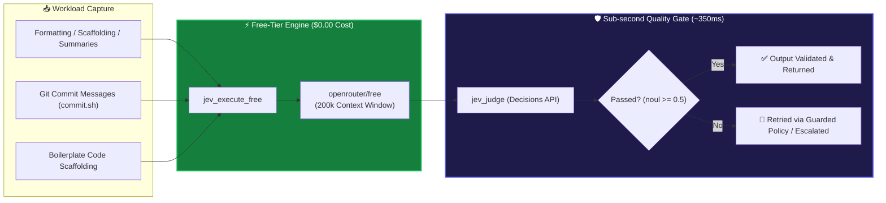
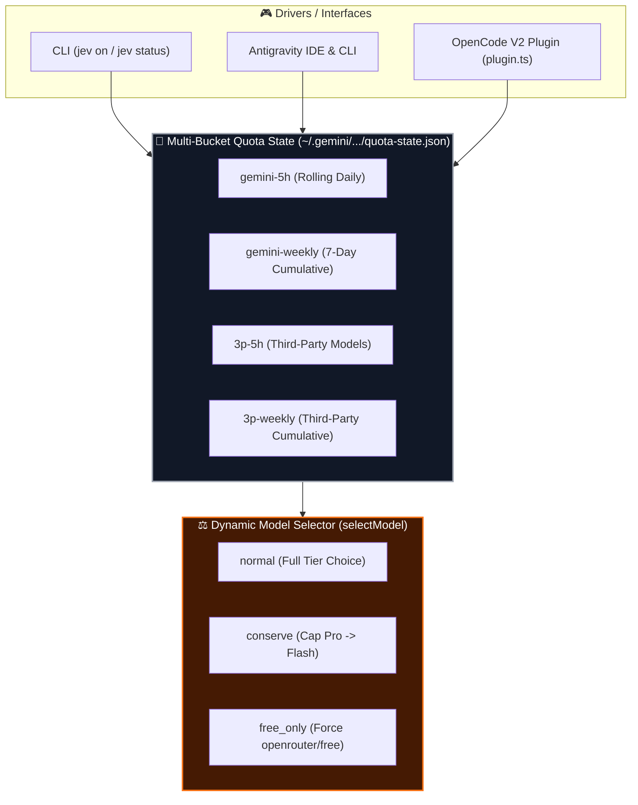

# TypeSafe Jev Plugin (Jev V2 - System 1 AI Coprocessor)

[](https://www.typescriptlang.org/)
[](https://bun.sh/)
[](LICENSE)
[](https://github.com/rockad/agentic-hub)

**Path:** `agentic-hub/plugins/jev`  
**Version:** 2.3.5  
**Runtime:** Bun / Node (ESM)  
**Dependencies:** TypeScript, Zod, OpenRouter SDK, Agent Framework Adapters

---

## 📖 Overview

The **TypeSafe Jev Plugin** (`plugins/jev`) is the **System 1 AI Coprocessor** for the `agentic-hub` ecosystem. Named after Daniel Kahneman's "System 1" (fast, intuitive, low-effort thinking), Jev handles the high-volume, low-stakes cognitive load of an AI agent loop so your primary agent (System 2) can focus on complex reasoning.

Jev acts as three things in a single layer:
1. **Probabilistic Decision Coprocessor:** Analyzes tasks and routes work to the most cost-effective execution tier before any token spend occurs.
2. **Free-Tier Offloading Engine:** Diverts boilerplate work (summaries, linting, formatting, commits) to free-tier models (`openrouter/free`), resulting in **$0.00 cost** and **0 quota consumption** for routine operations.
3. **Quality Gate Validator:** Runs sub-second micro-evaluations (`jev_judge`) to verify output quality before it reaches the user or is committed to source control.

**Primary Value Proposition:** It protects your paid subscription quota (specifically your **Google AI subscription** Gemini quota), preventing wasted credits on routine tasks while accelerating agent loops through parallelized, cheaper execution.

---

## ✨ Key Features

### ⚙️ Operating Modes
Control the coprocessor's behavior via a toggleable state machine, persisted across sessions in `~/.config/jev/config.json`. The three modes mean the same in every harness (Claude Code, Antigravity, and any later one):

| Mode | MCP tools | Telemetry rows | Quota notice | Decisions (deny, ask, clamp, approvals, downgrade, guards) | Routing advice (router call, directive, tier advice) | Cross-harness memory block (Recall call) |
| :--- | :--- | :--- | :--- | :--- | :--- | :--- |
| `off` *(default)* | disabled | none | none | none | none | none |
| `on-demand` | available | written (`PreInvocation` / `UserPromptSubmit` and `agent_call` rows) | one informational line, only when a pool is `conserve`, `free_only` or at 0 remaining | **none** | **none** | **none** |
| `on` | available | written | full quota directives | everything | everything | injected |

Mode `off` does nothing and writes nothing. Mode `on-demand` is a passive coprocessor: the `jev_*` tools answer when called, the hooks record what happens and, only for a low pool, add one line such as `[JEV] quota notice: Gemini is conserve (15% remaining). Informational only.` (the same text in every harness). Mode `on` is everything: pre-flight routing, the elevation and downgrade flows, the quota guards and the `run_command` / write guards. A mode change voids pending denials: every mode writer stamps `modeChangedAt` in `config.json`, and a denial or downgrade question issued before it is never approved by a later answer (an answer given in `on-demand` cannot approve a mode-`on` denial after switching back); the call is denied again with a fresh question.

> [!WARNING]
> **In on-demand Jev enforces nothing: a pro (Claude Code: opus) subagent runs without any approval prompt from Jev. The pro-approval rule then depends only on the agent following its instructions. Use mode `on` to have Jev enforce it.** This includes Antigravity: on-demand no longer sends a `pro` request to the native permission dialog (it did before 2.3.17), and a conserve or `free_only` pool, an unknown or `openrouter_free` Model and an omitted Model under Orchestrator pass too.

**One definition for every harness.** What a mode does is defined once, in `src/core/mode-policy.ts` (`modeBehaviour(mode)` returns `{ tools, decisions, routingAdvice, memoryContext, telemetry, quotaNotice }`, and `lowQuotaNotice(pool)` builds the one-line notice). The Claude Code and Antigravity hooks consult it instead of comparing the mode to `'on'` or `'on-demand'` themselves. **Any future harness adapter (OpenCode, Codex) must use it too**, so a mode cannot drift between harnesses.

> [!IMPORTANT]
> **Default OFF (Opt-In Intent):** Jev is strictly **OFF by default** when unconfigured. No background decisions or external network calls occur until explicitly enabled by the user.
>
> **Migration Notice:** `mode.json` is completely deprecated and ignored, and can be safely deleted. `~/.config/jev/config.json` is the single canonical configuration store for global defaults (`defaults.mode`) and per-harness overrides (`harnesses.<harness>.mode`).
>
> **Shell Script Retirement:** `scripts/jev-mode` is retired. Mode switching and inspection are handled directly via the `/jev` slash command / skill inside agent harnesses (`/jev on`, `/jev on-demand`, `/jev off`, `/jev status`) and the `jev_set_mode` / `jev_get_mode` MCP tools.

### 🚀 Pre-flight Dispatch (`jev_dispatch` & `jev_batch_dispatch`)
Before a task hits the primary model, `jev_dispatch` runs a calibrated inference on the task metadata. It produces a **probability distribution** over:
- **Subagents:** Which specialized helper should handle the task?
- **Execution Tiers:** `openrouter_free`, `flash_lite`, `flash`, or `pro`.
- **Session Model Ceiling Clamping:** Dynamically clamps subagent recommendations $\le$ active session model tier (`Gemini 3.8 Flash`), preventing over-eager `pro` recommendations for routine CLI porting.
- **Scaffolding Detection:** Automatically detects package/crate creation tasks and flags `scaffoldFirst: true` to trigger Tier 0 `$0.00` mechanical boilerplate generation.
- **Dynamic Semantic Batch Dispatch (`jev_batch_dispatch`):** Decomposes multi-task roadmaps or phases into parallel and sequential execution waves, enforces dependency order, and applies safety concurrency caps ($\le 10$ simultaneous free workers). Routes tasks dynamically using the OpenRouter Decisions API (`~typesafe/jev-latest`), with automatic fallback to local token and description keyword scoring if offline or timed out. Configurable via `routing.strategy` (`"router"` | `"keyword"`) in `~/.config/jev/config.json`.
- **Stage schema (`kind`, `needsEdit`):** each `jev_batch_dispatch` task may carry two optional fields. `kind` is `mechanical` (haiku), `settled-edit` (sonnet) or `judgement` (opus), the stage rubric below, and it is used instead of guessing. `needsEdit: true` keeps read-only subagent types (`Plan`, `Explore`) and the free tier (text only, it cannot edit files) off the stage; `needsEdit: false` overrides edit wording in the task text. Without `needsEdit` the wording decides. Without `kind` the router is asked for each stage's tier under the rubric, then whole-word keywords offline; the result says which one set it (`tierSource`: `kind`, `router` or `keyword`). On Antigravity and OpenCode the fields work per item: an item that sends `kind` (`flash_lite` / `flash` / `pro`) or `needsEdit` gets the rubric tier and the output keys `kind`, `needsEdit` and `tierSource` (`kind` or `keyword`, never `router`); a `judgement` stage is exempt from the session-model ceiling. An item that sends neither keeps the keyword tier and has no new keys. On every harness a stage that edits files (by `needsEdit` or wording) is kept off the free tier and off a read-only persona. On Claude Code a read-only `Plan` or `Explore` becomes `general-purpose`; on Antigravity, OpenCode and the CLI a read-only persona (`Plan`, `Explore`, `research`, `knowledge-researcher`) becomes `code-engineer`, `Code Engineer` or `self`, in that order.
- **Stage rubric:** "mechanical edit or checklist update -> haiku; spec or plan edit with a settled decision -> sonnet; judgement whose error is expensive -> opus". The router sees these lines in its tier criteria, the turn context repeats them on a delegation turn, and a prompt that names a workflow or workstreams gets a reminder to call `jev_batch_dispatch` with one task per stream.

This prevents expensive models from processing routine formatting, simple search requests, or bounded ports.

### 🔍 Per-Harness Dynamic Subagent Discovery
Jev discovers candidate subagents dynamically from the filesystem without hardcoded persona assumptions:
- **Antigravity:** `<workspace>/.agents/agents/`
- **Claude Code:** `<workspace>/.claude/agents/`
- **OpenCode:** `<workspace>/.opencode/agents/`
- **Universal Shared Global:** `~/.agents/agents/` across all harnesses

Local workspace agents take precedence over universal shared agents with the same identifier, enabling clean per-project specialization while sharing common subagents across machines.

### 🆓 Free-Tier Offloading
Jev intercepts specific workload patterns and reroutes them to `openrouter/free` endpoints. This guarantees **$0.00 spend** and **0 quota usage** for:
- File/Code **Summaries**
- **Markdown** formatting and refactoring
- Standard **Git Commits** (`commit.sh`)
- Boilerplate scaffolding (`Cargo.toml`, `package.json`, CLI `clap` structs)
- Unit test generation

**Implementation:**
- `jev_execute_free`: Raw offloading wrapper with timeout handling.
- `jev_agent_free`: Specialized handler for agent-assistant interactions.
- `jev_execute_free_guarded`: Offloading wrapped in a retry + fallback policy to ensure failure never breaks the loop.

### 📝 Automated Semantic Commits
Integrates directly with the commit pipeline via `commit.sh` (or `scripts/commit.ts`):
1. `scripts/commit.ts` captures the staged diff.
2. `jev_dispatch` decides if the commit message needs an LLM.
3. `jev_agent_free` generates a conventional commit message.
4. `jev_judge` validates the message against the diff semantically.
5. Commit is finalized.

### 🛡️ Three-Tier Resilient Quality Gates (`jev_judge`)
A micro-evaluation engine designed for speed and bulletproof fault tolerance:
- **Tier 1 (Fast Bernoulli Decision):** OpenRouter Decisions API (`~typesafe/jev-latest` on `/api/alpha/decisions`, ~350ms).
- **Tier 2 (Chat Router Fallback):** OpenRouter chat completions with strict JSON Schema (`typesafe/jev-router`).
- **Tier 3 (Local Deterministic Judge):** If OpenRouter returns `404` (*"No models satisfy the decisions policy"*), network timeout, or connection failure, Jev automatically evaluates diff syntax, git merge conflict markers (`<<<<<<<`), compilation exit codes (`exit code: 1`), and non-empty assertions locally without throwing unhandled exceptions.

### 📊 Quota & Model Selection (`jev_quota`, `jev_select_model`)
Real-time telemetry tracks your subscription limits to prevent hard `429` errors:
- **5-Hour Bucket:** Tracks rolling usage for the day.
- **7-Day Bucket:** Tracks cumulative usage for the week.

`jev_select_model` automatically swaps your target model to a lower-tier alternative when thresholds are approached.

### 🔌 Dual Integration
Jev ships with native adapters for both major agent frameworks:
1. **Antigravity CLI:** Deep hooks into the Antigravity action pipeline.
2. **OpenCode V2:** Native plugin hooks into the OpenCode extension architecture. *(Note: `opencode serve` background service caches plugin modules in memory. Restart the service via `pkill -f "opencode serve"` after updating plugin source versions).*
3. **Claude Code:** A plugin with the MCP server plus hooks that advise and guard each turn. See the Claude Code section below.

---

## 📐 System 1 Decision & Execution Flows

### 1. Pre-Flight Dispatch & Reasoning Effort Governance Flow

```mermaid
flowchart TD
    A["👤 User Request / Task Prompt"] --> B["⚡ Jev Pre-Flight Dispatch (jev_dispatch)"]
    
    B --> C{"🔍 Subagent & Intent Evaluator"}
    C -->|Mechanical / Formatting| D["🟢 Low Effort (low)\n(formatter, syntax_checker, git_scribe)\n-30% Tokens, Min Latency"]
    C -->|Standard Work / Code| E["🔵 Medium Effort (medium)\n(code_engineer, research, general_developer)\nBalanced Reasoning Depth"]
    C -->|Complex Architecture| F["🟣 High Effort (high)\n(system_architect, security_auditor)\nMaximum CoT Depth"]
    
    D --> G{"📊 Quota Strategy Governor (readQuotaView)"}
    E --> G
    F --> G
    
    G -->|Strategy: normal| H["✅ Execute Calibrated Effort"]
    G -->|Strategy: conserve| I["⚠️ Cap High Effort -> medium"]
    G -->|Strategy: free_only (Free Model)| J["🆓 Retain medium / high on openrouter/free"]
    G -->|Strategy: free_only (Quota Model)| K["🔒 Force low Effort on Paid Quota Models"]
    
    H --> L["🤖 Subagent Execution"]
    I --> L
    J --> L
    K --> L

    style D fill:#1b4332,color:#fff,stroke:#2d6a4f,stroke-width:2px
    style E fill:#1e3a8a,color:#fff,stroke:#3b82f6,stroke-width:2px
    style F fill:#4c1d95,color:#fff,stroke:#8b5cf6,stroke-width:2px
    style G fill:#0f172a,color:#fff,stroke:#f59e0b,stroke-width:2px
```

### 2. Free-Tier Offloading & Micro-Evaluation Quality Gate



### 3. Multi-Bucket Quota Preservation Architecture



---

## 💰 Token & Cost Savings Comparison Matrix

| Workload Category | Monolithic Execution (No Jev) | TypeSafe Jev Coprocessor Engine | Paid Token Savings | Gemini Quota Burn | Latency Impact |
| :--- | :--- | :--- | :--- | :--- | :--- |
| **Mechanical Formatting & Scaffolding** | Paid Tier (`Gemini Pro` / `Flash`) @ high effort | Offloaded to `openrouter/free` via `jev_execute_free` @ `low` effort | **100% Paid Savings** | **0% Quota Burn ($0.00)** | ~600ms (Fast) |
| **Git Commit Generation (`commit.sh`)** | Primary Session Model (~2k tokens) | `jev_agent_free` + `jev_judge` validation (~350ms) | **100% Paid Savings** | **0% Quota Burn ($0.00)** | ~350ms (Sub-second) |
| **Documentation & Research (`research` / `docs_engineer`)** | High CoT reasoning budget | Calibrated `medium` effort + quota governor throttling | **~30% Token Savings** | **60% Reduced Burn** | ~1.2s |
| **Standard Feature Engineering (`code_engineer`)** | Unbounded reasoning tokens | Pre-flight `jev_dispatch` + `medium` effort governance | **~25% Token Savings** | **Optimal Quota Preservation** | ~2.5s |
| **Security Audits & RFC Architecture** | Uniform static reasoning budget | Dynamic `high` effort + `jev_judge` diff integrity check | Deepest CoT Reasoning Depth | Calibrated & Guarded | Extended CoT Depth |
| **Overall Monthly Benchmark** | High risk of 5-Hour / 7-Day Quota Exhaustion (`429`) | Guaranteed continuous operation under quota safety caps | **~45% Overall Token & Cost Savings** | **Quota Lifetime Extended 3x** | **Up to 4x Faster Turn Completion** |

---

## 🏗️ Architecture & Component Structure

```text
plugins/jev
├── src/
│   ├── core/                # Core engines (client, config, cache, discovery, egress, heuristics, graph)
│   ├── tools/               # MCP tool handlers (dispatch, execute-free, judge, mode, quota, route, score),
│   │                        #   their strict input schemas, and schema.ts / validate.ts (call-time validation)
│   ├── audit/               # Compliance and drift detection (drift-detector.ts)
│   ├── server.ts            # createJevServer(): the MCP server, validating every call before its handler
│   ├── index.ts             # Main MCP server entrypoint (stdio)
│   ├── shared.ts            # Shared types and helpers across harnesses
│   └── tracing.ts           # OpenTelemetry and span logging
├── claude/                  # Claude Code hook adapter (hook.ts entry, logic.ts decisions)
│   ├── workflow-guard.ts    # Static Workflow script analysis (acorn, fail-closed)
│   ├── workflow-pin.ts      # Workflow drift recorder (script hashes keyed by tool_use_id) (adapter over src/core/workflow-pin.ts)
│   ├── agent-definitions.ts # `.claude/agents/*.md` model/effort reader for the Workflow guard
│   ├── safe-read.ts         # Re-export of src/core/safe-read.ts (regular-file-only, non-blocking reader)
│   └── hooks.json           # Claude Code hook registration
├── antigravity/             # Antigravity hook adapter (hook.ts entry, logic.ts decisions)
│   ├── workflow-guard.ts    # Static run_workflow script analysis (Python tokenizer, fail-closed)
│   └── workflow-pin.ts      # run_workflow drift recorder (adapter over src/core/workflow-pin.ts)
├── scripts/
│   ├── commit.ts            # Semantic commit generation pipeline
│   ├── commit.sh            # Shell wrapper for commit.ts
│   └── audit-agentic-gaps.ts# Agentic hub gap auditor
├── skills/
│   └── jev/                 # In-chat slash command skill
├── tests/                   # Bun unit test suite (config, cache, audit, egress, jev, etc.)
├── .env.example             # Template configuration
├── package.json
└── tsconfig.json
```

---

## ⚙️ Configuration

Create a `.env` file in the plugin root (`.env` is ignored by git via `.gitignore`).

### Environment Variables

| Variable | Description | Default |
| :--- | :--- | :--- |
| `JEV_OPENROUTER_API_KEY` | **Required.** API key for OpenRouter to access free-tier and decision endpoints. | *(None)* |
| `JEV_MODE` | Initial operating mode (`ON`, `ON-DEMAND`, `OFF`). Overridden by `config.json`. | `OFF` |
| `JEV_EGRESS_DENY` | Optional. Extra directories (separated by `:`) from which nothing may be sent. It can only add restrictions. | *(None)* |
| `JEV_ZDR` | Optional. Zero Data Retention enforcement mode (`off`, `on`, `strict`). Overridden by configuration files. | `off` |

### Canonical Configuration Store (`~/.config/jev/config.json`)

`~/.config/jev/config.json` is the **single canonical source of truth** for Jev settings across all harnesses (Antigravity, Claude Code, OpenCode). Legacy `mode.json` is completely deprecated and ignored.

Example configuration:

```json
{
  "defaults": {
    "mode": "off"
  },
  "harnesses": {
    "antigravity": {
      "mode": "on"
    },
    "claude-code": {
      "mode": "on"
    },
    "opencode": {
      "mode": "on-demand"
    }
  },
  "routing": {
    "strategy": "router"
  },
  "privacy": {
    "zdr": "off"
  }
}
```

#### Precedence & Scoping Rules

1. **Per-Harness Override:** `harnesses.<harness>.mode` takes precedence when running inside that harness (e.g. enabling a specific harness even if `defaults.mode` is `"off"`).
2. **Global Default:** Falls back to `defaults.mode` if no harness-specific override exists.
3. **Fallback Default:** If unconfigured, mode strictly defaults to **`off`** (Opt-In Intent).
4. **Routing Strategy:** `routing.strategy` selects between `"router"` (OpenRouter Decisions API `~typesafe/jev-latest` with local keyword fallback) and `"keyword"` (offline local description scoring only).

#### Harness Model Configuration

Jev maps execution tiers across supported agent harnesses to their native or configured models:

| Harness | Free Tier (`free`) | Cheap Tier (`cheap`) | Standard Tier (`standard`) | Deep Tier (`deep`) |
| :--- | :--- | :--- | :--- | :--- |
| **Antigravity** | `openrouter/free` | `flash_lite` | `flash` | `pro` |
| **Claude Code** | `openrouter/free` | `haiku` | `sonnet` | `opus` |
| **OpenCode** | `openrouter/free` | `~anthropic/claude-haiku-latest` | `~anthropic/claude-sonnet-latest` | `~anthropic/claude-opus-latest` |
| **CLI** | `openrouter/free` | `google/gemma-4-31b-it:free` | `typesafe/jev-router` | `typesafe/jev-router` |

### Model catalogue (core)

> **Status: read by the Claude Code hooks for ranking, written by the refresh below.** The module (`src/core/catalogue.ts`, `src/core/lock.ts`) and its tests are in place. The Claude Code hooks read the cache file (one small read per hook run, never the network) to rank models for the elevation guard and the downgrade choice, and fall back to the family-only regex rank when there is no usable catalogue (see "Downgrade choice" below). The refresh below writes the file; the `ladder-agents` command only reads it. The tier map above stays what the decision engine uses.

The catalogue is a per-harness list of concrete model ids with a capability tier and a version, so a ladder can be built without a hard-coded model list. It lives in `~/.config/jev/models/<harness>.json` (directory `0700`, file `0600`, written atomically through a temp file and a rename):

```json
{
  "version": 1,
  "harness": "claude-code",
  "updated_at": "2026-11-12T10:00:00.000Z",
  "source": "probe",
  "models": [
    { "id": "claude-sonnet-5-5", "family": "sonnet", "version": [5, 5], "tier": "standard", "alias": "sonnet", "status": "ok", "strikes": 0, "last_ok": "2026-11-12T10:00:00.000Z" }
  ]
}
```

- `source` is `probe`, `openrouter`, `static` or `manual`; `status` is `ok`, `missing` or `needs-review`; `alias` is the native alias the harness resolves to that id, when known.
- Reading never throws. A missing, unreadable, corrupt or wrong-version file reads as "no catalogue", and `resolveTier` then falls back to the shipped alias defaults from the tier map above (`haiku`, `sonnet`, `opus` for Claude Code).
- A `-latest` version (`Infinity`) is stored as `null` in the file and revived on read.

**Heuristic.** The tier comes from the family in the id: `haiku` is `cheap`, `sonnet` is `standard`, `opus` and `fable` are `deep`. Any other family is `needs-review`: it is listed by `unknownIds` for a warning and never used by the ladder. Inside a tier a higher version is stronger, compared as number arrays (`claude-sonnet-5` < `claude-sonnet-5-5`, `claude-haiku-4-5` < `claude-haiku-5-5`); a new id such as `claude-sonnet-6` slots in without code changes. Ids parsed: `claude-<family>-<major>[-<minor>]`, a trailing date stamp is ignored, OpenRouter forms (`anthropic/claude-sonnet-4.5`, `~anthropic/claude-sonnet-latest`, `google/gemini-2.5-pro`, `openrouter/free`) and bare aliases (no version; `resolveAlias` maps one to the newest usable id of its family).

**Overrides.** An optional `models.overrides` object in `~/.config/jev/config.json`, read by a small tolerant reader (`loadOverrides`) that leaves the config loader and its `models` strings (`decision`, `router`, `fallback`) alone:

```json
{ "models": { "overrides": { "claude-sonnet-5": { "pin": true }, "claude-opus-4-5": { "ignore": true }, "claude-zephyr-1": { "tier": "standard" }, "claude-sonnet-4-5": { "rank": 10 } } } }
```

- `ignore` removes the id from the ladder.
- `tier` replaces the heuristic tier, and also makes a `needs-review` id usable.
- `rank` replaces version order inside the tier: ranked ids come first, higher rank first.
- `pin` puts the id first in its tier, ahead of ranked ids. A pin never revives a `missing` id.

**List prices.** A model entry may carry `price`: `{ "inputPerM": 2, "outputPerM": 10, "source": "openrouter", "at": "<ISO refresh time>" }`, USD per million tokens (`$2/$10 per 1M` in `jev-models list`, and in `--json`). It comes from the `pricing` fields of the public OpenRouter model list (`anthropic/claude-sonnet-5.5` maps to `claude-sonnet-5-5`; `:batch` and other `:` variants are ignored) and is attached by `refresh` only to a model the probe or list verified, never creating an entry. It is a proxy, not the real cost: on a subscription the cost is quota weight, so call it the **list price**. `priceOf(model)` is `inputPerM + outputPerM` (a deliberately simple figure) or `null` when unknown, and `cheaperThan(a, b)` is true only when both have a price and `a` is strictly lower; a downgrade offer should use these and say nothing about price when either is unknown. When OpenRouter cannot be reached the refresh still succeeds and keeps the previous prices. Prices are never fetched at hook time, only by `refresh`. Files without `price` load as before and a malformed price is dropped on read. Antigravity entries are not on OpenRouter and have none.

**Strikes rule** (`buildCatalogue`, one call per refresh round). A failed probe marks the id `missing` at once, and the ladder skips it from that moment; `strikes` counts consecutive failed probes and the id is deleted at the third. A successful probe resets `strikes` to 0, sets `status` to `ok` and updates `last_ok`. `markSuspect` (for a harness "model not found" report) sets `missing` and raises `strikes` to 1 at most, without touching `updated_at`. Ids not probed in a round are carried over unchanged.

**API** (exported from `src/core/index.ts`): `parseModelId`, `heuristicTier`, `compareVersions`, `compareModels`, `resolveAlias`, `loadOverrides`, `loadCatalogue`, `saveCatalogue`, `buildCatalogue`, `ladder`, `unknownIds`, `priceOf`, `cheaperThan`, `isStale` (older than 7 days) and `isVeryStale` (older than 3 times that), `resolveTier` (`{ ids, alias?, source: 'catalogue' | 'defaults', stale, veryStale }`), `markSuspect`, and the lock helper `tryLock(path, staleMs)` / `unlock(path)` for the future background refresh (exclusive create with pid and timestamp, stale or dead-owner takeover, never throws). Pure functions take `now` and `dir` so tests are deterministic; there is no network access and no process spawning.

### Model catalogue refresh

The refresh fills `~/.config/jev/models/<harness>.json` (the file described above). It is a command, a skill and an optional background job; the hooks do not use the result yet.

**Commands** (run with bun from the plugin directory, or `${CLAUDE_PLUGIN_ROOT}`):

```bash
bun scripts/jev-models.ts refresh [--harness claude-code|opencode|antigravity] [--max-calls N] [--quiet]
bun scripts/jev-models.ts status  [--harness ...]
bun scripts/jev-models.ts list    [--harness ...] [--json]
```

- The default harness is `claude-code`. `refresh` prints what is new, missing, recovered, removed and in need of review; `--quiet` prints nothing. `status` shows the file, age, source and ids by status. `list` shows the ladder per tier.
- The `/jev-refresh` skill runs `refresh` and summarises the output.

**What each harness does**

| Harness | Source | How | Cost |
| :--- | :--- | :--- | :--- |
| Claude Code | `probe` | Runs `claude -p "Reply OK" --model <id>` for each candidate, one after another. An id is available when the JSON result has `is_error: false` and `modelUsage` contains that id. The four aliases (`haiku`, `sonnet`, `opus`, `fable`) are probed first, so the catalogue records which concrete id each one resolves to and that id is verified by the same call. | Paid, capped |
| OpenCode | `openrouter` | `GET https://openrouter.ai/api/v1/models` (public, 10 s timeout): every `anthropic/*` id plus the ids already in the tier map. If the request fails, or the list has no `anthropic/*` id while the old catalogue had some, the old catalogue stays. Ids with characters outside the model-id set, or longer than 100, are ignored, and at most 200 `anthropic/*` ids are taken. | Free |
| Antigravity | `static` | Builds the catalogue from the configured tier map (`harnesses.antigravity.models`); each id gets the tier of its map key. | Free |

**Claude Code candidates.** Previous catalogue ids, then the built-in known ids (`claude-haiku-5-5`, `claude-haiku-4-5`, `claude-sonnet-5-5`, `claude-sonnet-5`, `claude-sonnet-4-5`, `claude-opus-5-5`, `claude-opus-5`, `claude-opus-4-5`, `claude-fable-5-2`), then `models.refresh.candidates`, then generated neighbours: for each family the next minor and the next major of its newest known version (`claude-sonnet-5-6`, `claude-sonnet-6`). A probe never records a failure for a speculative id the catalogue never had; a failure for an id the catalogue did have counts as a strike (missing at once, deleted after three refreshes in a row; a strike is counted once per successful refresh round, not once per probe). A probe counts as a failure only when it returned a JSON result with `is_error: true` and the narrow model-rejection message ("issue with the selected model ... may not exist or you may not have access"); free text without a parsed JSON result (a wrapper printing `node: not found`, a login prompt) is inconclusive. A probe that gets no answer at all (timeout, offline, rate limit, `claude` not installed) says nothing about the model and leaves it as it was; three such probes in a row stop the run. A round with no successful probe at all (aliases included) is inconclusive as a whole: it exits 1 and leaves the catalogue and its `updated_at` untouched.

**Cost cap.** `--max-calls` (default 20, hard, at most 25, so that the worst case of 25 probes at the 60 s timeout stays under the 30 minute lock stale time) limits the probe calls of one refresh, aliases included. A full default run is about 17 calls; the ids the cap cuts off are logged and listed as `not probed (call cap)` and are carried over unchanged. A real run of the four alias probes cost about $0.19 and took 13 seconds; the larger models cost more because of the cached system prompt, not the answer. A probe is kept lean: `--strict-mcp-config` with an empty `--mcp-config` (no MCP server starts), `--tools ""`, `--disable-slash-commands` and a one-line `--system-prompt`, which cut the request from about 14,000 input tokens to about 600. Measured per call with the installed Claude Code 2.1.323 (cold-cache figures vary with the prompt cache): `sonnet` $0.0149 before, $0.0063 with the MCP, tools and slash-command flags, $0.0024 with the system prompt too; `opus` $0.0299, $0.0131, $0.0048. That is about 84% less per probe, and the probe still reports the concrete model in `modelUsage`. Probes run with `--setting-sources project`, a temporary settings file that sets `disableAllHooks` and disables `jev@agentic-hub`, `--no-session-persistence`, a 60 s timeout that is enforced end to end (the probe runs in its own process group and the whole group is killed), stdin from `/dev/null`, and one stable empty working directory (`~/.config/jev/probe-cwd`, owner-only, reused, so Claude Code keeps a single project entry instead of one per probe), so a probe never triggers Jev's own hooks. The probe gets an allowlisted environment (`PATH`, `HOME`, `USER`, `LANG`, `TERM`, `TMPDIR`, `SHELL`, `XDG_*`, `ANTHROPIC_*` except that `ANTHROPIC_API_KEY` and `ANTHROPIC_AUTH_TOKEN` are excluded unless `models.refresh.useApiKey` is true, `CLAUDE_CODE_OAUTH_TOKEN`, `CLAUDE_CONFIG_DIR`, proxy and certificate variables), never `JEV_*` or `OPENROUTER_*` keys, and `CLAUDE_CODE_DISABLE_AUTO_MEMORY=1` so it writes no memory.

**Config keys** (all optional, under `models.refresh` in `~/.config/jev/config.json`; read by a tolerant reader, the config schema is unchanged):

```json
{ "models": { "refresh": { "enabled": true, "maxAgeDays": 7, "maxCalls": 20, "minRetryHours": 6, "useApiKey": false, "candidates": ["claude-sonnet-5-1"] } } }
```

- `enabled`: `false` turns the background refresh off (default on). The command and `/jev-refresh` still work.
- `maxAgeDays`: age after which the background refresh runs again (default 7).
- `maxCalls`: probe cap per refresh (default 20); `--max-calls` overrides it.
- `minRetryHours`: minimum hours between two background refresh attempts, whatever their result (default 6).
- `useApiKey`: probes use your subscription login and never see `ANTHROPIC_API_KEY` or `ANTHROPIC_AUTH_TOKEN` (an exported key would make every `claude -p` probe bill the API account, and the catalogue would describe that account); set it to `true` only for an API-key-only setup, and `jev-models status` points to it when the probes get no answer without a key (default `false`, boolean only).
- `candidates`: extra model ids to probe; ids with characters outside `A-Z a-z 0-9 . _ : / ~ -`, or longer than 100, are ignored.

**Background refresh.** At a Claude Code `SessionStart`, the hook starts a refresh in a detached process (`bun scripts/jev-models.ts refresh --harness claude-code --quiet`, stdio ignored) and returns at once. It starts only when all of these hold:

- Jev mode is `on` for Claude Code.
- `models.refresh.enabled` is not `false`, and the environment does not set `JEV_MODEL_REFRESH=off`.
- The Claude Code catalogue is missing or older than `maxAgeDays`.
- No refresh was attempted in the last `minRetryHours` (default 6). The trigger writes an attempt stamp (`~/.config/jev/models/claude-code.attempt.json`, time and result) when it starts a refresh, and the refresh writes it again when it ends, whatever the result, so a broken environment is not retried at every session start.
- No other refresh holds the lock (`~/.config/jev/models/claude-code.lock`, a pid, a timestamp and a heartbeat). A lock is taken over when its owner process is dead, or when both its timestamp and its heartbeat are older than 30 minutes; the refresh rewrites the heartbeat (atomically) after every probe, so a long run is never taken over. The hook hands the lock to the process it starts, so two sessions starting together run one refresh.
- `bun` and the script are found; otherwise it skips silently.

It never blocks and never throws, and a failure leaves the previous catalogue in place. A refresh run by hand while a background one is running exits with "another refresh is running" and probes nothing.

**To disable it:** set `models.refresh.enabled` to `false`, or run Jev in a mode other than `on`, or export `JEV_MODEL_REFRESH=off`. (`JEV_REFRESH_SCRIPT` points the trigger at another script instead of `scripts/jev-models.ts`; it exists for tests.)

**Notice** (`catalogueNotice(harness, modelId)` in `claude/refresh-trigger.ts`, not wired into the hooks yet): returns one line ending in "run /jev-refresh" when the catalogue is missing, the id is not in it, the id is marked missing or needs review, or the catalogue is older than `maxAgeDays`; otherwise null.

### Outbound Data Control & Privacy (optional)

By default jev sends requests exactly as before. To keep some of your work away from OpenRouter, create `~/.config/jev/egress.json`. jev reads this file but never writes it:

```json
{
  "allowPaths": ["~/Work/public-repo", "~/Work/agentic-hub"],
  "denyPaths": ["~/Work/public-repo/private-notes"],
  "zdr": "on"
}
```

- With `allowPaths`, every outbound request is blocked unless the session directory lies under one of the listed paths. Without it, only `denyPaths` applies.
- The session directory is checked three ways: the hook's `cwd`, `CLAUDE_PROJECT_DIR`, and the process working directory. All three must pass.
- Paths are compared after resolving `~`, symlinks, and (on macOS) letter case.
- If `egress.json` is not valid JSON or has the wrong shape, everything is blocked. A broken policy never fails open.
- Blocked requests fail before any data leaves the machine. Hooks stay silent; MCP tools return an error.
- Requests to `localhost` / `127.0.0.1` (the local memory server) are not affected.
- While a policy is active, each sent and blocked request is logged to `~/.config/jev/egress-log.jsonl` with host, model, byte count, and ZDR audit markers (`zdr_policy`, `zdr_applied`). Request bodies are never logged.

**Limits.** The policy looks at *where the session runs*, not at *what the data is*. Text from a blocked directory that you paste into a prompt, or a file read by absolute path from an allowed session, is not detected.

> [!NOTE]
> **Batch Dispatch Outbound Data Notice:** When `routing.strategy` is set to `"router"` (the default), `jev_batch_dispatch` routes task descriptions and criteria to the OpenRouter Decisions API (`~typesafe/jev-latest`). These requests are strictly governed by your egress directory rules and Zero Data Retention (ZDR) policy. If an egress policy blocks the working directory, or if `zdr: "strict"` is active and ZDR is unavailable, dispatch automatically falls back to offline local keyword matching without leaking data.

#### 🔒 Zero Data Retention (ZDR) & Provider Data Policies

OpenRouter allows clients to enforce data privacy guardrails via provider routing constraints (`provider.zdr: true` and `provider.data_collection: "deny"`). When enabled, OpenRouter routes exclusively to upstream model providers with signed Zero Data Retention agreements that contractually commit to not retaining prompts or completions, and never training on customer data.

Jev provides first-class governance for ZDR across all coprocessor workflows:

##### Operational ZDR Policy Modes

| Mode | Behavior | Decisions API (`~typesafe/jev-latest`) | Free Offloading (`openrouter/free`) | Use Case |
| :--- | :--- | :--- | :--- | :--- |
| `off` *(default)* | Standard routing without ZDR or data collection restrictions. | Standard routing | Allowed (standard routing) | Development, public open-source code, or non-sensitive environments. |
| `on` *(recommended)* | Pragmatic privacy balance. Enforces ZDR and `data_collection: "deny"` on all System 1 Decisions API calls, leaving zero prompt retention footprint. Free generative offloading proceeds without ZDR headers but records audit markers. | Enforced ZDR (`zdr_applied: true`) | Allowed with audit marker (`zdr_applied: false`) | Recommended default for mixed development workflows needing quota protection and private decision routing. |
| `strict` | Zero-trust enforcement. Requires ZDR across 100% of outbound calls. Any request to endpoints lacking ZDR agreements is blocked locally before network transmission. | Enforced ZDR (`zdr_applied: true`) | Blocked locally (`JEV_ZDR_UNAVAILABLE`) | High-compliance, proprietary enterprise, or zero-trust environments where uncontracted data handling is prohibited. |

##### Configuration & Precedence

ZDR policy can be defined in multiple locations. Jev resolves the active policy using a strict precedence hierarchy (highest to lowest):

1. **`~/.config/jev/egress.json`** (Highest precedence):
   ```json
   {
     "zdr": "on"
   }
   ```
2. **`~/.config/jev/config.json`** (`privacy.zdr`):
   ```json
   {
     "privacy": {
       "zdr": "on"
     }
   }
   ```
3. **Environment Variable (`JEV_ZDR`)**:
   ```bash
   export JEV_ZDR=on      # Accepted values: "on" ("1", "true"), "strict", "off" ("0", "false")
   ```
4. **Default**: Falls back to `off` when unset.

##### The Free-Tier Trade-off: Pragmatic vs Zero-Trust

Free community models on OpenRouter (e.g. `openrouter/free`, `google/gemma-4-31b-it:free`) are hosted across diverse open endpoints that do not provide commercial Zero Data Retention contracts or signed enterprise data protection agreements.

- In **`on` mode**, Jev protects your proprietary codebase and system reasoning by enforcing ZDR on decision routing (`jev_dispatch`, `jev_judge`, `jev_route`) while still permitting $0.00 mechanical offloading (scaffolding, formatting, commits) to free endpoints. Each outbound offload records `"zdr_policy": "on"` and `"zdr_applied": false` in `~/.config/jev/egress-log.jsonl` for compliance auditing.
- In **`strict` mode**, Jev adopts a zero-trust posture: any attempt to route to an endpoint without verified ZDR compliance fails closed with a typed `JEV_ZDR_UNAVAILABLE` error (`EGRESS_ZDR_UNAVAILABLE_CODE`). No tokens leave the machine to unverified endpoints.

#### 🗂️ Local Telemetry & Log Files

Jev writes three local logs outside the Claude hook state. None holds prompt text. The audit report is the exception: `~/.config/jev/audit_report.json` (written by `scripts/audit-agentic-gaps.ts`) still quotes up to 160 characters of transcript text per incident, so it is not text-free like the other logs and is only protected by its `0600` mode.

| File | Written by | Content |
| :--- | :--- | :--- |
| `~/.gemini/antigravity-cli/jev_telemetry.jsonl` | every MCP tool, and the Claude hook | tool, harness, tier, model, latency, cost, quota fields |
| `~/.config/jev/egress-log.jsonl` | the egress guard while a policy or ZDR is active | host, model, byte count, session directories, ZDR markers |
| `~/.config/jev/claude_decisions.jsonl` | the Claude hook | recommendation, model names, tier and a prompt hash |
| `~/.config/jev/antigravity_decisions.jsonl` | the Antigravity hook | subagent model, session ceiling, decisions, prompt length and hash |

- Every file is created `0600` and its directory `0700`. Files and directories that already exist with looser modes (older releases wrote `0644` / `0755`) are tightened on the next write. The chmod is best-effort and never blocks or fails the caller.
- `privateDir` also tightens `~/.gemini/antigravity-cli/` to `0700`, a directory Antigravity owns (it holds the telemetry log); anything else that reads that directory as another user or group loses access.
- **Field change in `jev_telemetry.jsonl`:** `jev_dispatch` lines no longer carry `task` (the first 100 characters of the prompt). They carry `taskLen` (the task's length in characters) and `taskHash` (the first 12 hex characters of its sha256, stable for equal text) instead. Every other field is unchanged. Lines already in an existing file keep their old `task` text: delete or truncate the file if that matters to you.
- Nothing in the plugin reads the old `task` field; `src/audit/drift-detector.ts` and `scripts/audit-agentic-gaps.ts` use `tool`, `recommendedTier`, `timestamp` and `sessionId`.

---

## 🪐 Google Antigravity

Antigravity loads the Jev plugin's lifecycle hooks automatically from `hooks.json` at the plugin root.

### `invoke_subagent` Tier Ceiling Guard (`PreToolUse`)

Guards `invoke_subagent` calls against the session model ceiling (`active_model` in `~/.gemini/antigravity-cli/quota-state.json` via Jev's governance helpers):

- **Model Extraction**: Reads flat `toolCall.args.Model` (and legacy `toolCall.args.Subagents[].Model` array shape).
- **Default Resolution**: Omitted and `inherit` models resolve to the session model (empirically confirmed via 4-call live control) and pass without elevation.
- **Elevation Flow**: A subagent call requesting `pro` on a session below Pro (e.g. Flash) triggers the choice flow:
  1. The hook **denies** the call with a reason prescribing `ask_question`:
     - Question text starts with `[jev-elevate:pro]` naming the subagent, requested model, and session ceiling.
     - Four vertical choices: `Yes, once`, `Yes, for the next 5 minutes`, `Yes, for this session`, `No, proceed on <session ceiling>`.
  2. The assistant asks the user via `ask_question`. The user's answer is captured by `PostToolUse` on `ask_question` and recorded as an approval in `~/.config/jev/antigravity-sessions/<conversationId>.approvals.json` (mode 0600, directory 0700, atomic write with lock). Antigravity's real `PostToolUse` stdin carries `transcriptPath` and `stepIdx` (verified live; `content` is not sent directly on stdin). The hook reads the step content from the session transcript at `stepIdx` (or from `content` when present). For large transcripts, it reads a bounded tail window (last 1 MB, `TRANSCRIPT_TAIL_WINDOW_BYTES`) directly from disk without reading the full file, dropping any leading partial line. It matches against the prescribed labels exactly, after stripping the `A1:` prefix and `(Recommended)` tag: `Yes, once` (scope `once`), `Yes, for the next 5 minutes` (`5min`), `Yes, for this session` (`session`). `No, proceed on <model>`, free text such as "No, not even once", an unrecorded answer and anything else record nothing. The rest of the payload is never read as an answer: `toolCall.args` holds the option list the assistant wrote, so reading it would approve from the options alone. An approval is also recorded only after a denial for that model in the last 15 minutes.
  3. On a Yes answer, the retried `invoke_subagent` finds the approval and is **allowed**. On No, the assistant proceeds on the session model.
  4. **No dialog backstop**: the choice flow never returns `ask`. Under Antigravity auto-approve (permission preset TURBO, tool permission `always-proceed`) every `ask` is approved without a dialog being shown, so an `ask` on a repeated attempt would run the `pro` subagent unapproved (seen live at attempt 3). If the assistant retries an unapproved elevation without asking, every attempt is denied. From the 3rd attempt of the same delegation the reason also says plainly to stop retrying `pro` and to proceed with an explicit `Model: "<session ceiling>"` (for example `flash`) or ask the user again with `ask_question`. The pull fallback (reading the answer from the transcript) runs on every attempt, so a `Yes` answer that was recorded late is still honoured at attempt 3 and later, and is consumed once.
- **Prompt Overrides**: If the user prompt explicitly requests pro (e.g. `manual pro approval`, `gemini pro`, `gemini argon`, `claude opus`, `deep reasoning`, `cross-system architecture`), the call passes directly (`elevation: "instructed"`). Negated clauses (e.g. `I don't want you to use gemini pro`, `never let a subagent use gemini pro`, `Do not, under any circumstances, use gemini pro`) are detected and do not override. Bare `argon` is dropped to prevent collisions with hashing ("hash it with argon") or chemical names. The named model's rank and family must cover the requested subagent model ("use gemini pro" does not approve a Claude Opus request).
- **`JEV_ELEVATION` Overrides**:
  - `JEV_ELEVATION=dialog`: Immediately prompts the user via the permission dialog (`ask`). This is the only path that returns `ask` for an elevation, and the decision is never changed by what follows: when Antigravity auto-approve is detected (`permissionPreset` is `AGENT_PERMISSION_PRESET_TURBO` in `~/.gemini/config/config.json`, or `toolPermission` is `always-proceed` in `~/.gemini/antigravity-cli/settings.json`; best effort, a missing or malformed file counts as not detected) the decision row in `antigravity_decisions.jsonl` carries `auto_approve_warning: true`, because the dialog is then approved without being shown.
  - `JEV_ELEVATION=clamp`: Rewrites `Model` to the session ceiling on every attempt via `overwrite: { Model: "<ceiling>" }` (`elevation: "clamped"`, with `attempt_count`); a repeated attempt is clamped too, never asked.
- **On-demand makes no elevation decision**: in Jev mode `on-demand` every `invoke_subagent` passes, before any check: no deny, no `ask`, no `allow` with an overwrite, no approval read or recorded, no attempt counted, and `JEV_ELEVATION` has no effect. That covers a `pro` request above the session ceiling, an unknown or `openrouter_free` Model, an omitted or `inherit` Model under Orchestrator and a `conserve` or `free_only` pool. The hook still writes the `agent_call` telemetry row (`decision: "pass"`). Antigravity auto-approve detection (see above) is used only for the dialog-mode `auto_approve_warning`. Use mode `on` to have Jev enforce the pro-approval rule.
- **Conversation id**: the id on hook stdin is normalised once (`safeSessionId`: characters outside `A-Za-z0-9_-` are dropped) before it is used in a file name, and the approval store normalises it again; an id with nothing safe in it means no stored state and no file I/O, and the decision is made as usual. Log rows carry the normalised id.
- **Pull fallback**: when the `PostToolUse` recorder missed the answer, the retried `invoke_subagent` reads the answer to its own question from the transcript. A question that carries a tool call id is matched to the result row with that id; if that row is not there yet nothing is pulled (another tool's output is never read as the answer). The approval is stored and claimed in one locked store operation (`recordAndClaim`), so one answer allows exactly one run even when two pro calls evaluate in parallel; the call is allowed only when that claim returns the approval. If storing fails (a lock timeout) the call is denied as usual and the decision log row says `pull_fallback: "record_failed"`; if a parallel call claimed the approval first (a store without `recordAndClaim`, which falls back to record then claim) it says `pull_fallback: "claim_lost"`.
- **Mode `on` guards (`PreToolUse`)**: `run_command` commit gate (conflict markers in the staged, working-tree or untracked diff) and the multi-file write guard. The commit gate finds every `git commit` / `git add` in the command line with one segment walker, also used to resolve where each commit runs (quotes, `-C "dir with space"`, `-c k=v`, `env [-C dir]` / `VAR=` prefixes, `sh -c '...'`, `eval` and `$( )` / backtick bodies handled; a wrapper the walker does not know (`timeout 60 git commit`, `nice -n 5`, `xargs`, `flock f`) is still found by a later `git` word, so detection is never narrower than a plain text match). Every commit on the line is checked, not only the first. Quoted text such as `echo "git commit"` is not a commit, but an `echo` / `printf` (or a here-string) piped into a shell is: `echo 'git commit -m x' | sh` is walked as a command line.
  - **Directory changes**: `cd`, `pushd` and `popd` are followed with a real directory stack and previous directory, so `pushd clean && popd && git commit` and `cd clean; cd - && git commit` end in the workspace again; `D=dir; cd "$D"` and `$PWD` / `$OLDPWD` / `$HOME` are followed for what the line itself assigned. A `cd` inside `sh -c`, `$( )` or a `( )` subshell moves its own commit, while `eval cd dir` moves the commit after it (eval runs in the current shell). A `cd` that does not take effect in the shell does not move the commit: one backgrounded with `&` or in a pipeline stage before the last (`cd dir | true`), and one that may not have run (`false && cd dir; git commit`, `cd` after `||`, the last stage of a pipeline) keeps the directory before it as well; those are logged with the reasons `conditional` and `pipeline`. A step that cannot be resolved exactly (`popd` with nothing pushed, `cd -` with no previous directory, a bare `cd`, `$(...)` or an unknown variable, a glob, a directory that does not exist yet) keeps the directory before it as well as the one the walker would otherwise use, and leaves a `commit_gate` / `unresolved_cd` log row with the reasons (`popd`, `cd-`, `bare-cd`, `expansion`, `missing-dir`, ...), so a miss is visible. Known gap: `git -c alias.ci=commit ci` is not seen as a commit.
  - **`--git-dir` / `--work-tree`** (and `GIT_DIR` / `GIT_WORK_TREE` as a `VAR=` prefix, after `env`, or exported earlier in the line): the diff and the untracked scan run as `git --git-dir=<dir> --work-tree=<dir>` with the paths resolved against the commit's directory (after `-C`), so git's own rules apply (only a git dir: the cwd is the work tree; only a work tree: the repository is found from the cwd, and the work tree is checked as a directory too, to stay on the safe side).
  - The write guard counts a target by `path.resolve(cwd, target)` (kept relative to the workspace when inside it), so `src/a.ts`, `./src/a.ts` and `<cwd>/src/a.ts` are one file. The streak file, the approvals file and the pending-served list are each updated under a directory lock (`src/core/dir-lock.ts`, a timeout names the lock); on a lock timeout the write guard and the pending-served update fail open (skip the update, log one `lock_timeout` row).
- **Fail-Open & Privacy**: On any unexpected error, with Jev mode off, on malformed or empty stdin and for any call that needs no elevation, the PreToolUse hook exits 0 with empty stdout (empirically confirmed via live control: printing `{}` with no `decision` field is treated as a denial by Antigravity). It never prints `"decision": "allow"` for those: Antigravity documents `allow` as "Automatically allow the tool execution", so an explicit allow would approve every `invoke_subagent` call on Jev's say-so. `allow` is printed only where Jev deliberately approves: an approved elevation, an instructed model (`elevation: "instructed"`), a `clamp` rewrite (`overwrite`) and a downgrade rewrite (`overwrite`, see below). PostToolUse prints `{}` as specified by `hooks.md`. Decisions are logged to `~/.config/jev/antigravity_decisions.jsonl` (`decision: "pass"` for the no-decision case) with the prompt length and the first 12 hex of its sha256, the same fingerprint the telemetry lines use (never raw prompt text). The only network call the hook can make is the downgrade rating below (one router call, 1.5 s, fail-open); the key is loaded the way the MCP server loads it.

### `run_workflow` Static Guard (`PreToolUse` and `PostToolUse`, Jev mode `on`)

The agents a `run_workflow` script launches never pass through `PreToolUse[invoke_subagent]`, so a script that says `agent(..., model="pro")` would bypass the model ceiling. The hook sees the `run_workflow` call itself, so it reads the script (the inline `Script`, or the `ScriptPath` file, relative to `Cwd` then the hook's working directory; the lowercase spellings `script` / `script_path` are tolerated) and analyses it statically. Parity with the Claude Code `Workflow` guard (see "Workflow guard"): the same decisions, the same `[jev-elevate:<model>]` question flow, the same pin store.

- **Analyser** (`antigravity/workflow-guard.ts`): a deterministic Python tokenizer in pure TypeScript (no `python3` is ever run on the script text). Comments and string literals are skipped when locating `agent(...)` calls, every call is inspected wherever it sits (the Q3 shape of a nested `async def` passed by reference to `parallel(items, helper)`, with multi-line keyword calls, included), and `model` is read from the keyword or from positional slot 5 of `agent(prompt, schema, role, type_name="self", workspace="inherit", model=None)`.
- **Passes**: a model that is a single string literal at or below the session ceiling, `None`, an omitted model or `inherit` (not under an Orchestrator session, where the explicit-`Model` rule applies as it does to `invoke_subagent`), a model the user named in the prompt (`elevation: "instructed"`), and a `type_name` whose definition (`<workspace>/.agents/agents/<name>.md`, then `~/.agents/agents/`) sets a model at or below the ceiling.
- **Elevation** (a literal model above the ceiling, e.g. `"pro"`): the choice flow of `invoke_subagent`. A covering approval allows; otherwise the call is **denied** with a reason that prescribes one `ask_question` whose text starts with `[jev-elevate:pro]` and carries `(sha256:<12hex>)` of the analysed script (Yes once, Yes for the next 5 minutes, Yes for this session, No). It never asks, on any attempt; from the third attempt of the same script the reason adds the stop-retrying sentence. The same flow runs under `JEV_ELEVATION=clamp` (a script cannot be clamped). The `PostToolUse` recorder on `ask_question` records the answer unchanged.
- **Unverifiable** (fail closed): a `model` that is not a single plain string literal (a variable, an expression, an f-string, a concatenation, a conditional, bytes); `**kwargs` or `*args` inside `agent(...)`; any use of the name `agent` other than a direct call (aliasing, `parallel(items, agent)`, `.agent(...)`, `def agent`, `import ... as agent`, a decorator); `exec`, `eval`, `compile`, `importlib`, `__import__`, `globals`, `locals`, `vars`, `builtins` (an attribute such as `re.compile` is not one); an f-string naming one of those; a `type_name` that is not a literal while `model` is absent; a definition that cannot be found; an unrecognised model; a script that cannot be tokenized; a `ScriptPath` that is missing, unreadable, a directory or FIFO, or over 512 KB; an input with neither `Script` nor `ScriptPath`. The call is **denied with guidance** (the sites by position and reason, how many, what to change; never script text) and never asked.
- **`JEV_ELEVATION=dialog`**: the only mode that asks (an elevation or an unverifiable script), with `auto_approve_warning` logged when the harness auto-approves. It records nothing in the approval store.
- **Modes** (from `modeBehaviour`): `off` runs and writes nothing; `on-demand` makes no decision, so the call passes with no analysis and no pin (one `workflow_call` row with `workflow_guard: "skipped"`); `on` does everything above.
- **Pin store** (`antigravity/workflow-pin.ts`, shared with Claude Code in `src/core/workflow-pin.ts`): every allowed or asked call pins the sha256 of each analysed script under its `toolCall.id` in `~/.config/jev/antigravity-workflow-pins/` (directory 0700, files 0600, pruned after 14 days). `PostToolUse` on `run_workflow` re-hashes the files after the run and logs one `workflow_changed` row per file that differs (analysed and current sha256, never text; `harness: "antigravity"`). There is no prompt on a difference (the run already happened) and no approval is invalidated. Every decision is made on the current text, never on an earlier verdict. A pin written while Jev was on is consumed, and its drift logged, even if Jev was switched off before the run ended (off writes nothing).
- **Logging**: a `workflow_call` row in `antigravity_decisions.jsonl` carries the decision, the models found, the script labels, hashes and sizes, and counts; never the script, the prompt or the reason text.
- **Limits**: a fail-closed filter, not a sandbox. A local import (a sibling `.py` file or package next to the script or under its Cwd, or a relative import) is unverifiable, so a file that launches agents behind it is never silently skipped; other modules are not followed; a script cannot be held still between the analysis and the harness's own read of it (detection after the fact, see the pin store); the run's actual served model is not observable. The exact live shape of the `run_workflow` `PreToolUse` / `PostToolUse` envelope is unverified on a live Antigravity; the guard reads the documented parameter names with casing tolerance.

### `invoke_subagent` Downgrade Choice (`PreToolUse`, `[jev-downgrade:flash_lite]`)

The mirror of the Claude Code downgrade choice (see "Downgrade choice" above). Where the ceiling guard only looks upward, this looks the other way: a subagent that would run on `flash` is rated on its own text, and when a cheaper model is enough, `flash_lite` is offered (`ask`) or applied (`auto`). It runs in Jev mode `on` only, and only after every ceiling, quota and Orchestrator check has passed the call, so it never turns a deny, an ask or an elevation into an allow. Mode `off` and `on-demand` do nothing (a native `ask` cannot deliver a downgrade: approving it would mean "keep flash").

- **Candidates**: `invoke_subagent` with `Model: "flash"`, or with `Model` omitted or `inherit` on a standard `flash` session when a downgrade mode was set on purpose (`models.downgrade.mode` in `config.json` or `JEV_DOWNGRADE`; an explicit `flash` is evaluated with the default mode `ask`). Under Orchestrator an omitted or `inherit` Model is denied first by the explicit-`Model` rule and never reaches this step. A call whose prompt says to use flash (`use flash for the sweep`) is left alone, as is one with a `Subagents[]` array.
- **Rating**: one call to Jev's decisions router with the `Role` and the first 1000 characters of the `Prompt` (1500 ms timeout; a timeout, a missing key, an error or the egress policy means no downgrade). The verdict is cached per signature (SHA-256 of type, role and the prompt start; the model is not part of it) for 10 minutes. The threshold is `P(openrouter_free) + P(flash_lite) >= 0.6` (`models.downgrade.minProbability` / `JEV_DOWNGRADE_MIN_PROBABILITY`, clamped to `0.5`..`0.95`).
- **Mode `ask` (default)**: the first attempt is denied once with a reason that prescribes one `ask_question` whose text starts with the delegation's own marker `[jev-downgrade:flash_lite:<sig8>]` (`sig8` = the first 8 characters of the delegation's signature; the plain `[jev-downgrade:flash_lite]` is still accepted), with exactly three options: `Yes, flash_lite`, `No, keep flash`, `No, and don't ask again this session`. The assistant then re-invokes on `flash_lite` (Yes) or `flash` (either No). A retry that skipped the question passes (asked at most once per delegation per 10 minutes).
- **The answer** is recorded from `PostToolUse` on `ask_question` (bounded transcript tail around `stepIdx`, the same wait for a late row as the elevation question) and, independently, pulled at the next `PreToolUse` when the row arrived after `PostToolUse` returned. Only the user's answer row counts, and only an exact label (after the `A1:` prefix and a `(Recommended)` tag): `Yes, flash_lite` lets the retried delegation through as an `allow` + `overwrite: { Model: "flash_lite" }`; `No, keep flash` waives that delegation; the last label switches the question off for the conversation. An answer is bound to ONE delegation and closes its pending question once: a signed marker names the delegation it answers, a plain marker answers the oldest pending question only, and an ask may carry one marker question per delegation (each answer line is recorded for its own question, in any order, and consumed per question: the answer is stored under `<tool call id>#<question index>`, or under `step:<answer row step_index>#<question index>` when the transcript carries no tool call ids, as real Antigravity transcripts do, so the other questions of the same ask stay answerable, also when their answers are pulled late at `PreToolUse`; with plain markers the oldest pending delegation reads the first open question). PostToolUse waits once for the result row and reads every question's `A<n>` line from it (N questions cost one wait window). When a delegation is asked again after its first question ran out of the 10-minute window, the older question is replaced, so a single plain-marker answer closes it. The same answer read again, an older question's answer, or one for a delegation nothing is pending for records nothing. A question stays answerable for an hour, so a dialog left open for more than the 10-minute window still records its answer (the question is asked again after 10 minutes if it was not answered; `No, and don't ask again this session` counts the same). A pulled question counts only when its text starts with the marker. Which row is the answer: without tool call ids, `PostToolUse` records its `stepIdx` (the answer row's `step_index`) on the pending question(s), even when the row is not written yet, and the `PreToolUse` pull reads only that row, never the output of a tool that ran in parallel with the ask. With no recorded row, the first `GENERIC` row after the question is read only when the question was the planner step's single tool call; otherwise there is no answer and the delegation passes unchanged.
- **Mode `auto`**: no question; the call is `allow` with `overwrite: { Model: "flash_lite" }` for an explicit `flash`, and for an omitted or `inherit` Model (verified live on 2026-11-18: Antigravity serves `gemini-3.5-flash-lite` for all three). An earlier `No, keep flash` or the session-off answer is respected.
- **State and logs**: `<conversationId>.downgrade.json` in `~/.config/jev/antigravity-sessions/` (0600, its own lock; never the approvals file). The `agent_call` row in `antigravity_decisions.jsonl` gains `downgrade` (`asked`, `answered`, `applied`, `skipped`), `downgrade_skip`, `downgrade_from`, `downgrade_to`, `downgrade_via` (`auto` or `answer`), `downgrade_needed`, `downgrade_probability`, `downgrade_rated`, `downgrade_rating` (`cached`), `downgrade_rating_ms`, `downgrade_pull`, and the task's `taskLen` and `taskHash`, never the task text. The `ask_answer` row for a downgrade question carries `marker: "downgrade"`, `parsed: { choice }` and the outcome `recorded`, `no_row`, `rejected`, `not_asked` or `error`; an ask with several downgrade questions also logs `downgrade_questions` and `outcomes` (one outcome per question, in order).
- Printing nothing remains the pass-through: a candidate that is not downgraded exits 0 with empty stdout.

### Telemetry: `agent_call` rows and the recommendation (both harnesses)

Rows go to `jev_telemetry.jsonl`; the agent-usage collector snake-cases the keys. No row holds prompt text.

- **`agent_call`** (`PreToolUse`): `turn`, `sessionModel`, `sessionModelSource`, `decision`, `requestedModel`, `modelUsed`, `modelUsedSource`, `modelRecommended`, `recommendedTier`.
  - **`modelUsed` and `modelUsedSource` only when the call goes ahead** (`pass`, `allow`, and the native `ask`, where the run may or may not happen). A `decision: "deny"` row leaves both unset; `requestedModel` stays. On Claude Code the row also carries `decision` (`deny`, `ask`, `allow` for a clamp or an applied downgrade, else `pass`) and `requestedModel`; its recommendation fields are `modelRecommended` and `tierRecommended`.
  - **`modelRecommended` / `recommendedTier`** are attached whenever the turn's recommendation is known when the call arrives, whatever the decision.
  - **`callKey`** (Antigravity): the tool call id, else `step:<stepIdx>`, else a one-off `call:<time>-<random>`; also `call_key` in `antigravity_decisions.jsonl`.
  - **`recommendationPending: true`** (Antigravity, mode `on`): the row was written before the turn's recommendation existed (the `PreInvocation` hook is still running; hooks of one turn are not serialised). A late row follows when the pre-flight finishes. If it never does (the router timed out, no key), the row stays pending and no late row comes.
- **`agent_call_recommendation`** (Antigravity, `toolOrHook: "PreToolUse"`): written by the pre-flight for each pending call of the same `turn`. It repeats `callKey`, `decision`, `requestedModel` (and `modelUsed` / `modelUsedSource` when the call had them) and adds `modelRecommended`, `recommendedTier` and `recommendationLate: true`, so it needs no join. Pending calls are kept in `<conversationId>.turn-pending.json` (newest 20, 10 minutes) under `<conversationId>.turn.lock`, together with the turn state, so recording a call and writing the recommendation cannot cross. A lock timeout skips the record (fail open).
- **Claude Code** needs no late row: `UserPromptSubmit` is a blocking hook that stores the recommendation before the model can call a tool, so an `agent_call` has it or never will (Jev off, a short or pasted prompt, a status turn, Jev unreachable, a host-injected turn).

```json
{"harness":"antigravity","toolOrHook":"PreToolUse","event":"agent_call","turn":"0123456789ab","callKey":"call_1","decision":"deny","requestedModel":"pro","sessionModel":"gemini-3.8-flash-low","recommendationPending":true}
{"harness":"antigravity","toolOrHook":"PreToolUse","event":"agent_call_recommendation","turn":"0123456789ab","callKey":"call_1","decision":"deny","requestedModel":"pro","modelRecommended":"flash","recommendedTier":"flash","recommendationLate":true}
```

---

## 🤖 Claude Code

Install from this repository's Claude Code marketplace (`.claude-plugin/marketplace.json` at the repo root):

```
/plugin marketplace add rockad/agentic-hub
/plugin install jev@agentic-hub
```

Put the key where the hooks and the MCP server both find it: `~/.config/jev/env` with
`JEV_OPENROUTER_API_KEY=...`. `bun` must be on `PATH`.

The plugin brings the `jev_*` MCP tools and its hooks (`claude/hooks.json` → `claude/hook.ts`).
The hooks decide and advise only in mode `on`. In `on-demand` they make no decision and give no advice (no
router call, no directive, no deny, ask, clamp, downgrade or approval; `UserPromptSubmit` adds one informational
line only when a quota pool is low) but still write the telemetry rows: the prompt row and one `agent_call` row
with `decision: "pass"` for every `Agent`, `Task` and `Workflow` call. In `off` they stay silent and write
nothing. The MCP tools remain callable on request in `on-demand`. In `on-demand` an `opus` subagent runs
without any approval prompt from Jev: use mode `on` to have Jev enforce the approval rule.

| Event | What Jev does |
| :--- | :--- |
| `SessionStart`, `PostModelSwitch` | Remembers the session model in `~/.config/jev/claude-sessions/` (mode `on` and `on-demand`; mode `off` writes nothing). It is the ceiling for delegations. A session these never reached learns it from the transcript tail (see "How the session model is learned"). |
| `UserPromptSubmit` | Asks Jev (1.5 s budget) for a Claude subagent (`Explore`, `general-purpose`, `Plan`, `self`), a model (`openrouter_free`/`flash_lite` → `haiku`, `flash` → `sonnet`, `pro` → `opus`) and an effort, and adds them to the turn as context. |
| `PreToolUse` on `Agent` | Before a subagent runs on a stronger model than the session's (the model written on the call, or the one its definition's `model:`, `CLAUDE_CODE_SUBAGENT_MODEL` / `_FORCE` or a ladder name gives it: see "The model an `Agent` call will actually run on"), when the prompt did not name that model and no approval covers it: **denies the call with a reason that prescribes one question to the user** (Yes once, Yes for 5 minutes, Yes for this session, or No and proceed on the session model); the turn goes on. A model the user named passes. It never asks: every attempt is denied, and from the third attempt of the same delegation in one prompt the reason says to stop retrying (see "Elevation choice (default)" below). `JEV_ELEVATION=dialog` is the 2.3.4 permission dialog on every such call (the only mode that asks; it logs `auto_approve_warning` when `permission_mode` is `bypassPermissions` or `auto`), `JEV_ELEVATION=clamp` the opt-in clamp (every call is clamped, a repeat too). Outside dialog mode nothing asks (2.3.18): a model Jev cannot rank (not in the catalogue, unknown family) and a remapped session alias under clamp are **denied with guidance** (`re-invoke with opus, sonnet or haiku, or omit model / inherit`; `re-invoke with an explicit model at or below the session model`), an unreadable or ambiguous agent definition is denied with `re-invoke with an explicit model on the call` (an explicit call model does not read the definition, so it cannot loop), a forced subagent model (`CLAUDE_CODE_SUBAGENT_MODEL_FORCE`) **passes** as the user's own instruction (`elevation: "instructed"`, `instructed_by: "env-force"`, `forced_model`), and an effort of `xhigh` or `max` takes its own choice flow (see "Effort" below). Jev's tier rating never opens a dialog, it is logged next to the model the call used. |
| `PreToolUse` on `Agent` (downgrade) | Rates **the delegation itself** (its description and the start of its prompt, one router call, fail-open). When a cheaper model is enough and strictly cheaper by list price (and no instruction names the model): denies once with a reason that prescribes a question offering it, or, with `JEV_DOWNGRADE=auto`, runs the call on the cheapest sufficient alias. See "Downgrade choice" below. |
| `PostToolUse` on `AskUserQuestion` | Records the user's real answer to the elevation question as an approval, and the answer to the downgrade question as "answered" (the fourth answer also switches the downgrade question off for the session), in mode `on` only: approvals and downgrade answers are decisions, so on-demand and off record nothing. Prints nothing. |
| `PreToolUse` on `Workflow` | The agents a workflow launches never reach `PreToolUse`, so the **script is analysed** (acorn, fail-closed): a literal model above the session model takes the same choice flow as an `Agent` call (deny with the prescribed `[jev-elevate:<model>]` question, approvals, never a dialog: the third attempt adds the stop-retrying sentence), in clamp mode too (a script cannot be clamped); anything the analysis cannot prove (a model from a variable, aliasing, spread, a parse error, ...) is **denied with guidance** (the sites by position and reason, how many, what to change; never script text). Only `JEV_ELEVATION=dialog` opens the permission dialog. A model the user named passes. See "Workflow guard" below. |
| `PostToolUse` on `Workflow` | Drift recorder: re-hashes the script files the guard analysed and logs `workflow_changed` when one differs; prints a message while Jev is on. No prompt. Mode `off` does nothing at all (no log row, the pin is left for the next prune). |

What the hooks do **not** do:

- They never change the model of a delegation, except under the opt-in `JEV_ELEVATION=clamp` (see
  "Elevation" below) and the opt-in `JEV_DOWNGRADE=auto` (see "Downgrade choice" below). Cheaper models are
  advised, or offered as a choice, not forced.
- They never block a turn. Any failure (no key, Jev down, malformed input) prints nothing and exits 0.
- They do not track Claude subscription limits. Claude Code exposes `rate_limits` only to the status
  line, not to hooks, so the quota strategy is whatever `readQuotaView` reports (usually `unknown`).

Decisions are logged to `~/.config/jev/claude_decisions.jsonl`.

**How the session model is learned.** Every guard (elevation, downgrade) compares against the session model, so
the hook needs it on every call.
1. `SessionStart` and `PostModelSwitch` store it (`~/.config/jev/claude-sessions/<session_id>.json`, no `source`
   field). That file is authoritative: the transcript is never consulted for a session that has one.
2. Fallback: a session that never reached those events (plugins reloaded mid-session with `/reload-plugins`, a
   resumed session, a headless `claude -p` run) has no such file. On `PreToolUse` and `UserPromptSubmit` the hook then reads the
   end of the session transcript named by `transcript_path` on its stdin, never the whole file: the last
   256 KB first, and if that holds no usable assistant line (a pasted image or a large `tool_result` is common),
   the 256 KB before it, and so on up to a cap of 2 MB in all. It takes the `message.model` of the last assistant line that is a
   Claude model id Jev can rank (`<synthetic>` and other providers' ids are skipped), and stores it in the same file with
   `source: "transcript"`, `updated_at`, `checked_at` and the transcript's `size` and `mtime_ms`. A single line
   longer than 256 KB is never parsed, so an assistant line that large counts as no line.
3. A transcript-learned model can go stale (a model switch while no hook ran), so each later call makes one `stat` of the
   transcript and reads it again only when its size or mtime differs from the stored values; the stored model is
   updated when the last assistant model differs. An unchanged transcript is not read again. Only when the
   transcript cannot be stat-ed does the older rule apply: re-check at most once every 60 seconds. A `SessionStart`
   or `PostModelSwitch` event overwrites it and makes it authoritative again, and the learner puts such a record back
   if it lands while the learner is writing.
4. A `SessionStart` payload that carries no `model` (a resume names only its `source`) marks the session's record
   `stale: true` (written atomically, nothing else changes) instead of deleting it. A stale record never outranks the
   transcript: whenever the transcript yields a model, the next call learns it (step 2) and the record becomes a
   transcript-learned one. Until it does (a resumed session with no turn yet), the stale model stays the fallback, so
   the elevation guard keeps working across a resume instead of passing every elevation. A payload that carries a model
   overwrites the record as before.

The transcript path is read only when it is a regular file that ends in `.jsonl` and whose real path is under
`~/.claude/projects` (a hostile `transcript_path` cannot make the hook read another file, and a FIFO named like a
transcript is never opened; symlinks are resolved first). The session id must be `[A-Za-z0-9_-]+` to name a file in
`claude-sessions/`, otherwise nothing is stored. A missing,
empty, corrupt or oversized-line transcript, or any read or write failure, means no session model, exactly as before.
No transcript content is stored or logged: only the model id. The decision log entries of `PreToolUse` and
`UserPromptSubmit` carry `session_model_source` (`"stored"`, `"transcript"`, or `null` when there is none).

**Precedence.** One order decides the model of a delegation: (1) an explicit instruction in the current
prompt, either a model named in an imperative (`use opus`, `run an opus subagent`) or a cost intent (`minimal
viable model`, `cheapest`, `as cheap as possible`); the effect is at most one tier step from the router's tier;
(2) the Jev guard (a `pro` recommendation on a session below opus: the turn context tells the assistant to ask
before using `opus` and to offer the cheaper option; naming `opus` satisfies it); (3) the standing rule (the
router's tier; on an opus session a `pro` recommendation is within the ceiling and needs no approval). The
turn context names the rule that applied (`rule: per your instruction | per the Jev guard | per standing rule`).
The `PreToolUse` guard passes a model the user named in the current prompt (or a stronger one) unchanged, with no
clamp and no dialog, and logs it as `elevation: "instructed"`. Jev cannot read the
user-level `CLAUDE.md`, so the standing rule is only reflected by the router's tier.

### Elevation choice (default)

Claude Code's permission dialog cannot offer "proceed without elevation": a plain No rejects the call and stops
the turn. The choice flow gives the user two real answers, "Yes, proceed on the elevated model" and "No, proceed
on the session model", and never "No, stop the turn". It rests on two verified facts: a `PreToolUse` hook
`deny` with a reason does not stop the turn (the assistant receives the reason and keeps working), and a
`PostToolUse` hook with matcher `AskUserQuestion` fires after the user has picked, with the question text mapped
to the chosen option label in `tool_response.answers`.

**The flow.**

1. The assistant calls `Agent` with a model above the session model, the prompt did not name it, and no approval
   covers it. The hook **denies** the call. The reason (under 800 characters) tells the assistant to ask the user
   with `AskUserQuestion`: one question whose text starts with the marker `[jev-elevate:<model>]` followed by a
   short question naming the `subagent_type`, the requested model, the session model and a 10-word task summary,
   with exactly four options, in this order:
   - `Yes, once`
   - `Yes, for the next 5 minutes`
   - `Yes, for this session`
   - `No, proceed on <session model>`
2. The user picks. The recorder (`hook.ts post-tool-use`, registered in `claude/hooks.json`) reads the question
   and the answer from the harness's `tool_response.answers` only (`tool_input` is what the assistant sent, so it
   never records anything) and writes an approval for a Yes, but only when Jev prescribed the question for that
   model (or a stronger one) in the last 15 minutes: by a deny, or by the turn directive. Any other answer is
   ignored. A No records nothing.
3. On a Yes the assistant launches the delegation again with the same model; the hook finds the approval and lets
   the call through with no dialog (logged `elevation: "approved"` with `approval_scope`). On a No it launches
   on the session model, or does the work directly. The next elevating call asks again.

The turn directive (`UserPromptSubmit`) prescribes the same question and options where Jev rates a task above the
session model, so a well-behaved assistant asks before its first `Agent` call; the deny is the fallback. The
directive keeps the `rule: per the Jev guard` label.

**Scopes.**

| Answer | Approval | Lasts |
| :--- | :--- | :--- |
| `Yes, once` | `scope: "once"` | One launch; 10 minutes to use it. Consumed atomically: of several parallel calls only one wins. |
| `Yes, for the next 5 minutes` | `scope: "5min"` | Five minutes from the answer. |
| `Yes, for this session` | `scope: "session"` | The session (bound to its `session_id`), no expiry. |
| `No, proceed on <session model>` | none | The next elevating call asks again. |

An approval for model M covers any requested model at or below M that is above the session model: an `opus`
approval covers a `sonnet` call on a `haiku` session; a `sonnet` approval does not cover `opus`. When several
approvals cover a call, a standing one (session, then 5 minutes) is used before a `once`, so the `once` is kept.
Approvals of one session never apply to another.

**No dialog backstop: the choice flow never asks.** If the assistant does not ask the prescribed question, the hook counts denied
elevating attempts per session, `prompt_id` and delegation (subagent type and description). Every attempt without an
approval is denied (`elevation: "denied"`). A hook `ask` is answered without a dialog being shown under the Claude Code
permission modes `bypassPermissions` and `auto`, so an `ask` on a repeated attempt would run the stronger model
unapproved. From the **third attempt of the same delegation in the same prompt** the deny reason also says plainly
to stop retrying that model and to proceed with an explicit model at or below the session model, or to ask the user
again with `AskUserQuestion` (the same sentence as Antigravity, from `stopRetryingText` in `src/core`, apart from the
tool name). Different delegations count separately, so several workstreams that are each denied, answered and
retried never reach it; twenty denials in one prompt reach it whatever they were. **A new `prompt_id` resets the
count**, and background agent completions start new prompts, so the count restarts after each of those. A host that
sends no `prompt_id` is keyed on the stored turn and the time it was stored, and that counter also restarts after five
quiet minutes. If the counter cannot be written the call is still denied (the attempt number is then unknown, so
there is no stop-retrying sentence). An answer recorded late by the `PostToolUse` recorder still allows one run, on
any attempt.

**`JEV_ELEVATION`** (environment only, read by the hook; there is no config key):

| Value | Behaviour |
| :--- | :--- |
| unset, `choice`, or any other value | The choice flow described here. It never asks. |
| `dialog` | The 2.3.4 behaviour: the permission dialog on every elevating call (see "Elevation (2.3.4)" below). **The only mode that asks.** The decision is never changed by what follows: when the hook input's `permission_mode` is `bypassPermissions` or `auto` (the dialog is then answered without being shown to you) the `agent_call` row carries `auto_approve_warning: true`. |
| `clamp` | The opt-in clamp (see "Opt-in clamp" below): every elevating call, a repeat in the same prompt too, runs on the session model (`allow` + `updatedInput`). It never asks. |

`auto_approve_warning` treats `bypassPermissions` (permission prompts are skipped) and `auto` (a classifier answers them) as
the modes that approve without asking. `default` and `plan` show the dialog, `acceptEdits` approves file edits only (an
`Agent` call still prompts) and `dontAsk` denies whatever is not pre-approved, so none of those is flagged. Choice and clamp
never ask in either harness; dialog is the only mode that asks, and it warns when the harness auto-approves (Claude Code
`permission_mode`; Antigravity: permission preset TURBO or tool permission `always-proceed`).

Unchanged: a call at or below the session model, with no model, an unknown or missing session
model (a `Workflow` is read by the Workflow guard, see "Workflow guard" below); a model the user named in the prompt (`elevation: "instructed"`); the remapped-alias ask under `clamp`; the
apostrophe and stale-intent fixes.

**State.** `<session_id>.approvals.json` in `~/.config/jev/claude-sessions/` (directory 0700, file 0600), written
atomically (temporary file, then rename) under a per-session lock (an exclusive `mkdir`; a lock older than 3
seconds is treated as stale; the holder writes a token file in it and removes it only while the token is still its
own). It holds the approvals (model, scope, creation time, expiry), the models Jev prescribed the question for
(model to time, kept 15 minutes) and the denied-attempt counter, never task text. Files left behind are pruned after 7 days at `SessionStart`. The recorder never throws,
always exits 0, prints nothing, and ignores any question without the marker and any malformed input.

**Limits, said plainly.**

- The flow needs the assistant to ask the prescribed question. If it asks in another form, or in plain chat, no
  approval is recorded and the call is denied again (from the third attempt with the stop-retrying sentence).
- The recorder trusts the answer the harness reports for a question that starts with the marker, not the
  assistant's text about it; an assistant that fabricates a question still cannot answer for the user. It does
  not check that the question's wording or options match the prescription, only the marker and the label.
- A multi-select answer and a free-text "Other" answer record nothing.
- Interactive and headless: the flow needs a user to answer `AskUserQuestion`. In a headless run (`claude -p`)
  there is nobody to ask, so the assistant's question gets no real answer and the call keeps being denied (the
  stop-retrying sentence tells the assistant to proceed on an explicit model at or below the session model). Use
  `JEV_ELEVATION=dialog` or `clamp` there, or name the model in the prompt.
- Not verified here: the whole flow end to end in a real interactive session (the pieces were verified
  separately: the deny keeps the turn going, and the answer reaches the `PostToolUse` hook), whether the assistant
  follows the prescription reliably, and how a hook `ask` dialog behaves in `auto` permission mode. (Claude Code does not fire
  `PreToolUse` for the agents a `Workflow` launches, verified on 2.1.323: see "Workflow guard".)

### Downgrade choice

The elevation guard only looks upward. The downgrade choice looks the other way: **every** `Agent` delegation is
rated on its own text, and when a cheaper model is enough and strictly cheaper by list price, the user gets the
choice instead of paying for the dearer one by default. It uses the same two verified facts as the elevation choice
(a `PreToolUse` `deny` keeps the turn going; a `PostToolUse` hook on `AskUserQuestion` sees the user's real answer).
The question is asked **at the call only**: the turn directive says nothing about it.

**The rating.** At `PreToolUse` the hook sends the call's `description` plus the first 1000 characters of its `prompt`
to the router (the tier question only, 1.5 s timeout, about 250 ms in practice). The answer carries a probability per
tier. The **needed tier** is the cheapest tier (`openrouter_free` < `flash_lite` < `flash` < `pro`) whose cumulative
probability of "it or a cheaper one" reaches the threshold (default `0.6`; ties go to the cheaper tier); without
probabilities the chosen tier counts as certain. `openrouter_free` and `flash_lite` need `haiku`, `flash` needs
`sonnet`, `pro` needs `opus`. The verdict is cached per call signature (subagent type plus description, hashed) for
10 minutes, so a retry does not call the router again. Any error, timeout, missing key, blocked egress or empty text
means no question: the call goes ahead.

**The candidates.** Catalogue steps (the ladder, "Model catalogue (core)" above) that are **sufficient** (their tier
is at or above the needed one), **strictly below** the requested model (family first) and **strictly cheaper** by
list price (`cheaperThan`, "List prices" above). A step or requested model with no price is not offered, with one
exception: the alias of the needed tier is offered by family rank alone, so the feature still works with no prices
or no catalogue. A step that an older version of the same family would only duplicate (newer or equal, and not
dearer) is dropped, and same-family older versions appear only when strictly cheaper. A call with **no `model`**
(or `inherit`) is judged against the **session model**; "No, keep" relaunches it with that model set explicitly.

**The flow (mode `ask`, the default).**

1. The assistant calls `Agent` and a cheaper model is enough. Nothing in the prompt named the requested model, no
   elevation decision applies to the call, the session did not switch the question off, and this delegation has not
   been asked about in the last 10 minutes. The hook **denies** the call. The reason (under 900 characters) tells the
   assistant to ask with `AskUserQuestion`: one question whose text starts with the marker
   `[jev-downgrade:<needed alias>]` followed by a short question naming the `subagent_type`, the requested model and
   the candidates, **and stating the evidence** ("Jev rates this flash_lite or cheaper, 86%"), both list prices when
   known ("haiku $0.1/$0.5 vs sonnet $2/$10 per 1M, list price") and Jev's advisory effort ("Jev suggests low
   effort; session effort is high"); at most four options, in this order:
   - `Yes, <cheapest sufficient model>`
   - at most one more `Yes, <model>` alternative (cheapest first; alternatives are dropped first when four would be exceeded)
   - `No, keep <requested model>`
   - `No, and don't ask again this session`
2. The user picks. The recorder (`hook.ts post-tool-use`) reads the question and the answer from the harness's
   `tool_response.answers` and records that this delegation was answered. **Any** answer counts, Yes variants and
   No alike; none of them grants an elevation, and the downgrade record is a separate file from the approvals. The
   fourth answer also writes a **session-scoped off entry** in that file (never `config.json`): for the rest of the
   session the hook evaluates nothing and makes no router call (`downgrade_skip: "session-off"`).
3. The assistant launches the delegation again with the chosen model; the retried call is allowed without being
   denied again (logged `downgrade: "answered"`). The answer holds for 10 minutes.

The question is asked **at most once per call signature per 10 minutes**: if the assistant skips the question and
retries, the retry passes (`downgrade: "skipped"`, `downgrade_skip: "already-asked"`). A downgrade is never stronger
than a hint: it never blocks a call for good.

**Not evaluated** (the call is left as it was, and the router is not called) when:
- the user's prompt named the requested model or a stronger one (`use opus`): that instruction is the answer;
- the requested model, or the session model for a call with no model, cannot be ranked, or the call's
  `subagent_type` is a ladder definition (`jev-ladder-<id>`, it already pins a model by name);
- nothing cheaper could be offered for any rating (a call already on the cheapest model);
- the elevation guard already decided the call (denied, asked, approved, instructed or clamped): one question at a time;
- the call is a `Workflow` (never rated; its agents never reach the hook, see "Workflow guard"), the session has no id, or the session switched
  the question off;
- any piece fails (no store, a failing lock, a corrupt state file): the call goes ahead exactly as it would without Jev.

A call whose turn rating said `self` is still evaluated: the delegation is what costs. A restricted subagent type
(`Explore`, `Plan`, `code-engineer`...) is evaluated at alias level only (see "Version limits").

**Modes and settings.** `models.downgrade.mode` in `~/.config/jev/config.json` (read by a tolerant reader; the config
types are unchanged), overridden by the environment variable `JEV_DOWNGRADE`:

| Value | Behaviour |
| :--- | :--- |
| `ask` (default; also an unset or invalid value) | The choice flow described above. A `Yes` option whose alias is remapped (`ANTHROPIC_DEFAULT_<ALIAS>_MODEL`) is left out, because that call would run on a model Jev did not rate; when no `Yes` option is left the question is not asked (`downgrade_skip: "alias-remapped"`), as in `auto`. |
| `auto` | No question: the call is allowed with `updatedInput` (the **full** original tool input with `model` set to the cheapest sufficient **alias**) and `additionalContext` that says what Jev did; logged `downgrade: "applied"` with `downgrade_from` and `downgrade_to`. An earlier answer for the delegation is respected (a user who kept `opus` is not overridden); a remapped alias (`ANTHROPIC_DEFAULT_<ALIAS>_MODEL`) skips it; a cheapest option that needs a ladder definition is not applied. |
| `off` | The hook never evaluates downgrades and never calls the router. |

| Setting | Env | Default | Meaning |
| :--- | :--- | :--- | :--- |
| `models.downgrade.mode` | `JEV_DOWNGRADE` | `ask` | `ask`, `auto` or `off` (the environment wins). |
| `models.downgrade.minProbability` | `JEV_DOWNGRADE_MIN_PROBABILITY` | `0.6` | Cumulative probability the needed tier must reach. Clamped to `0.5`..`0.95`; a value that is not a number is ignored. A higher value asks less often and leaves hard-to-call tasks on the dearer model. |

**Effort is advisory.** A hook cannot set effort: the suggested effort (`recEffort` in the turn state, from the
prompt's recommendation) appears in the question text, and the log records `effort_suggested` next to
`effort_session` (the `effort` field of the hook input, a string or an object holding one). Neither is enforced.

**Ranking.** The comparison uses the model catalogue (`~/.config/jev/models/claude-code.json`, "Model catalogue
(core)" above) when a usable one exists and knows both ids: tier first, then version, then the user's overrides.
Otherwise it falls back to the family-only regex rank (`haiku` < `sonnet` < `opus` < `fable`). Two details of the
catalogue order are worth knowing: inside the `deep` tier it is by version (opus 5.5 ranks above fable 5.2), so the
elevation guard, the approvals and a downgrade step all let the family ladder decide across families (an Opus 5.5
session calling `fable` is an elevation, a Fable session calling `opus` is not, an `opus` approval does not cover
`fable`) and use the catalogue only for versions inside one family and for ids a tier override moved; and an alias is
the newest id of its family. A missing,
corrupt or empty catalogue, or an id it does not list, falls back silently and never throws. A requested model that
nothing can rank is **unranked**: the downgrade logic ignores it, and with a catalogue in use the elevation guard
asks about it (the permission dialog) instead of letting it pass.

**Version limits, said plainly.** The `Agent` tool's `model` accepts only the aliases (`sonnet`, `opus`, `haiku`,
`fable`; a full id is rejected by input validation), so a version step inside an alias (`claude-sonnet-5` against
`claude-sonnet-5-5`) cannot be chosen per call. It can be chosen only through a **subagent definition** whose front
matter pins a full id (verified: a definition with `model: claude-sonnet-5` ran on `claude-sonnet-5`, also from a
plugin). So:

- The question offers alias-level steps by default.
- A non-alias ladder step is offered only for a `general-purpose` call, and only when its definition
  `jev-ladder-<id>` is among the subagents discovered for the session (the hook uses the existing discovery code
  path, 500 ms budget); it is offered as `<id> via jev-ladder-<id>` and the assistant launches that `subagent_type`
  with no `model`. A definition replaces the subagent type, so other types stay at alias level (a definition
  without a `tools` field inherits every tool, which would widen a restricted type such as a read-only explorer).
- The two sides of that are not done automatically: Jev installs nothing and rewrites no `subagent_type`.

**`ladder-agents`.** Writes the definitions for the catalogue's ladder steps into a directory you name:

```
bun scripts/jev-models.ts ladder-agents --dir <directory> [--harness claude-code] [--max-tier free|cheap|standard|deep]
```

One `jev-ladder-<id>.md` per ladder step (all tiers by default; `--max-tier standard` skips the opus and fable
definitions, and a bad tier writes nothing and exits 2; `missing` and `needs-review` ids and unsafe ids are left out).
The elevation guard reads a ladder definition's name: a call with no `model` whose `subagent_type` is
`jev-ladder-<id>` (or `<plugin>:jev-ladder-<id>`) is judged as a call for `<id>`, so an opus definition launched from a
sonnet session goes through the same choice flow as `model: "opus"`. Each definition has:
front matter `name`, `description` and `model: <full id>`, **no `tools` field**, a short general-purpose body. It writes
nowhere without `--dir` (exit 2), exits 1 with no usable catalogue, creates the directory if needed, overwrites only
files it generated (they carry a marker line) and skips any other file with the same name. Point `--dir` at a
directory Claude Code loads agents from (`~/.claude/agents` or a project's `.claude/agents`). The command lives in
`src/refresh/ladder-agents.ts`, with a minimal dispatch in `scripts/jev-models.ts`, so later subcommands can sit
beside it.

**State and logs.** `<session_id>.downgrade.json` in `~/.config/jev/claude-sessions/` (0700 directory, 0600 file),
written atomically under its own per-session lock; it holds the question's signature hash, the needed alias, which
prescribed label was chosen (a free-text "Other" answer is stored as `other`, never its text), expiry, each cached
rating (a signature hash and four probabilities) and the session-off entry, never task text. An older file with
entries only reads as before. A No to the elevation question (`No, proceed on <session model>`) also marks every
delegation answered for the same window, so the relaunch on the session model is not asked about again. The
`agent_call` record gains `downgrade` (`asked`, `answered`, `applied`, `skipped`), `downgrade_skip` (`already-asked`,
`session-off`, `no-rating`, `none-cheaper`, `no-task`, `egress`, `no-session`, `store-error`, `alias-remapped`,
`no-alias-option`), `downgrade_from`, `downgrade_to`, `downgrade_needed`, `downgrade_probability`, `downgrade_rated`,
`downgrade_rating` (`cached`), `downgrade_rating_ms`, `downgrade_hidden` (ladder ids that wait for a definition),
`taskLen` and `taskHash` (the delegation text's length and a short hash, as in the dispatch telemetry; **never the
text**), `effort_suggested` and `effort_session`; every existing field stays. In telemetry the `modelUsed` of an
applied downgrade is the model it ran on. When a hidden version step could be offered, the question tells the
assistant to ask the user to run `bun scripts/jev-models.ts ladder-agents --dir ~/.claude/agents`.

**Limits, said plainly.**

- The flow needs the assistant to ask the prescribed question; if it does not, the retry passes after the first deny.
- Each evaluated delegation sends its description and the first 1000 characters of its prompt to the router (egress
  policy and `ZDR` settings apply as for the turn rating); a delegation text is rated once per 10 minutes. The
  router's probabilities are a judgement of the text, not a measurement.
- Two parallel delegations that need the same alias share the marker, so one answer marks both answered.
- The recorder trusts the answer the harness reports for a question that starts with the marker, and does not check
  the wording or the options. A multi-select or free-text "Other" answer marks the question answered if the harness reports it as a string; the text is not stored.
- Interactive only: a headless run has nobody to answer, so the one deny is followed by the passing retry; use
  `JEV_DOWNGRADE=off` or `auto` there.
- Not verified here: the whole flow end to end in a real interactive session, whether the assistant follows the
  prescription reliably, and the exact shape of the `effort` hook field in every Claude Code version (a string and an
  object with `level` are read; anything else is ignored).

### Workflow guard

The agents a `Workflow` script launches never pass through `PreToolUse` (verified live on Claude Code 2.1.323: no
`PreToolUse` event fires for `agent(...)` inside a workflow), so `agent(..., {model: 'opus'})` in a script would
bypass the elevation guard. The hook does see the `Workflow` tool call itself, so it reads the script instead. The
design and the static analysis are cognitive-engine's (`packages/jev/src/workflow-guard.ts`, same owner), ported
with agentic-hub's own ranking, choice flow and state; every case of its six test files that applies is kept.

**What is read.** `tool_input.script` (inline), `scriptPath` (a file), a saved workflow `name` (`.claude/workflows/<name>.js|.mjs`
in the project, then the user config dir) and `workflow('name')` / `workflow({scriptPath})` references inside them,
one level deep. The script is parsed with `acorn` (pinned `8.19.0`) and every reference to the identifiers `agent`
and `workflow` is visited. Comments and strings that mention a model are never read as code.

**What is decided.**

| Script | Result |
| :--- | :--- |
| `agent(p)` with no model, `model: 'inherit'`, a literal at or below the session model | Passes. |
| A literal `model` above the session model (family-first order, the same as the `Agent` guard), no instruction naming it | The `Agent` choice flow, for the strongest model named: a covering approval passes; otherwise the call is **denied with the prescribed `[jev-elevate:<model>]` question** (the reason names the workflow by its script hash); every denied attempt of the same script (a signature of the script hashes) in one prompt is denied again, never asked, and from the third the reason says to stop retrying. `JEV_ELEVATION=clamp` takes the same flow (a script cannot be run on another model, so there is nothing to clamp); `JEV_ELEVATION=dialog` asks at once. |
| The prompt names that model or a stronger one | Passes (`workflow_guard: "passed-instructed"`). |
| An `agentType` | Its definition's `model` and `effort` are read from `.claude/agents/*.md` (project up to the git root or `CLAUDE_PROJECT_DIR`, then the user config dir, then installed plugins); a built-in type runs on the session model; an explicit `model` on the call wins over the definition. |
| `effort` | A literal `xhigh` or `max` is an unverifiable site (an interim threshold with no spec behind it, cognitive-engine RFC 007): denied with guidance, or asked in dialog mode; `low`, `medium`, `high` pass; any other value is an unverifiable site too. |
| The environment | `CLAUDE_CODE_SUBAGENT_MODEL` (when the call and its definition set none), `CLAUDE_CODE_SUBAGENT_MODEL_FORCE` and `CLAUDE_CODE_WORKFLOW_SUBAGENT_MODEL` (replacing them) are read from the hook's environment and the resulting model is ranked like a written one. |
| `meta.phases[].model` | Ranked too, although in Claude Code it is only a progress hint: a false positive, never a miss. |

**Fail closed (a deny with guidance; the permission dialog only in `JEV_ELEVATION=dialog`).** Everything the analysis does not understand is stopped, with
a reason that names `file:line:col`:

- aliasing `agent` or `workflow`, passing them as values, member or computed access to them, `.call` and tagged templates;
- spread arguments or options, computed keys, a `model` from a variable (`let`, a parameter, `args.model`), a template with `${}`, concatenation;
- a `const` with one binding initialised by a string literal (or a flat object of literals that is only read) **is** followed: `const M = 'opus'` then `model: M` is understood and ranked;
- the escape set (`this` outside a class body, `arguments`, `globalThis`, `global`, `window`, `self`, `Function`, `eval`, `Reflect`, `Proxy`, `process`, `require`, `Bun`, `Deno`, `module`, `exports`, `import.meta`) and the member names that reach the Function constructor or a prototype;
- dynamic `import()`, `import` declarations, `export ... from`;
- a parse error, an unreadable file (anything that is not a regular file, such as a FIFO, is unreadable and is never opened with a blocking read: a hook that blocks past its timeout lets the call through), a script over 512 KB, a `workflow()` nested more than one level, an unknown `agentType`, an `agentType` whose definition is unreadable or ambiguous, a model Jev cannot rank, a `tool_input` with none of `script`, `scriptPath`, `name`.

When a script has both an elevation and a fail-closed site, one deny (one dialog in dialog mode) lists all of them; the unverifiable sites are fixed first, then the elevation takes the choice flow. The deny reason says how many sites Jev cannot verify and what to change (a literal model at or below the session model or `inherit`, a literal effort of `low`, `medium` or `high`, no variables, spreads or computed values), and the log row carries `workflow_guard: "denied-unverifiable"` and `workflow_reasons` (the site count), never script text.

**When the hook itself fails.** The guard's fail-closed decisions above hold only while the hook finishes inside its
5 s timeout. A hook that crashes, times out or cannot start (for example, `bun` is missing) lets the `Workflow` call
through unchecked: `claude/hooks.json` sets no `"onFailure"` on purpose, the same fail-open choice as every other Jev
hook, because a cost-control plugin must never block a session. People who want the opposite can add a separate
`PreToolUse` entry for `Workflow` alone, pointing at the same `pre-tool-use` command, with `"onFailure": "block"`;
a failed hook then blocks the call. Jev does not enable it.

**Drift recorder.** `PreToolUse` pins the sha256 of every script file it read under the call's `tool_use_id`
(`~/.config/jev/workflow-pins/`, directory 0700, file 0600, pruned after 14 days). `PostToolUse` on `Workflow`
re-hashes those files after the run and, when one differs, logs a `workflow_changed` event, marks the pin `drifted`
(kept as the record) and (while Jev is on) prints a message. There is deliberately no prompt on a hash difference: the run
already happened. A denied call is not pinned, and a pin is never read as a verdict: every `PreToolUse` analyses the file
from disk as it is now.

**Logging.** The `agent_call` decision-log entry of a Workflow carries `workflow_guard` (`allow`, `denied`, `asked`,
`passed-instructed`, `error`), `workflow_models` (the literal models that were ranked, in script order),
`workflow_scripts` (label, sha256 and byte length of every analysed text) and, on an elevation,
`workflow_highest`. The script text is never logged, and a script-supplied literal in a reason is clipped to 48
characters. An internal error fails open (the call passes, `workflow_guard: "error"`); an unparseable script is not
an internal error: it asks.

**Limits, said plainly.**

- Static analysis cannot be sound. This is a fail-closed filter, not a sandbox; the reference's `STILL_SLIPS` table of idioms known to pass is kept in `tests/workflow-guard-hardening.test.ts`.
- A model computed at run time (a variable, `args`, a call) asks; it is not ranked.
- A literal `xhigh`/`max` effort takes the `[jev-elevate-effort:<level>]` question (an instructed prompt passes); an unrecognised or non-literal effort asks. Every import (`import`, `export ... from`, `import()`, `require`), a local one included, is unverifiable.
- `acorn` is loaded when the first Workflow is analysed, not when the hook starts: an install without it makes a Workflow ask (the script cannot be read) and does not disturb the other hooks.
- The model a workflow agent actually ran on is **not logged**: no hook sees it, and `SubagentStart` carries no model.
- No downgrade rating for a Workflow, and no clamp.
- Two versions inside one family (`claude-opus-4-8` against `claude-opus-5-5`) are not an elevation, as for the `Agent` tool.
- The script is checked as written. A file changing between the check and Claude Code's own read, or a saved workflow that Claude Code resolves differently, is not seen; the drift recorder reports it after the run.
- The subagent environment variables are read from the hook's own environment, assumed to match Claude Code's; the FORCE and workflow details were read from the 2.1.321 binary by cognitive-engine and are version-bound.
- Not verified here: a real interactive Workflow run through the deny, the question and the retry (the pieces are tested; the hook process was run with the captured payload, see the release note).

### Elevation (2.3.4)

This section describes the 2.3.4 behaviour, which is now `JEV_ELEVATION=dialog`; the default is the choice flow
above. An `Agent` call that names a model stronger than the session model is the one thing the hook asks about. What
happens depends on what the user said in the current prompt, and on one opt-in setting.

| Situation | What happens |
| :--- | :--- |
| Model at or below the session model, no model, `inherit`, unknown session model | Untouched. (A `Workflow` is read by the Workflow guard.) |
| The prompt names that model or a stronger one (`use opus`, `run an opus subagent`) | Passes unchanged, no dialog (the instruction is the approval). Logged as `elevation: "instructed"`. |
| **`JEV_ELEVATION=dialog`:** a stronger model, no such instruction | **Ask, on every such call** (a permission dialog, as in 2.3.3). Yes runs it on the requested model; No cancels the call and stops the turn; a comment typed with No lets the assistant continue, for example "continue on sonnet" (per the Claude Code documentation). Logged as `elevation: "asked"`. |
| The session model's alias is remapped (`ANTHROPIC_DEFAULT_SONNET_MODEL`, `_HAIKU_` or `_OPUS_MODEL` set for it) | Ask, in dialog and clamp modes: the clamp would set an alias that does not run on the session model. Under the opt-in it is logged with `clamp_skipped: "alias-remapped"`. The choice flow is not affected. |

The instruction check is `>=`: a model the user named covers a request for that model or a weaker one (`use opus`
covers an `opus` call and a `sonnet` call). A stored instruction counts only for its own prompt: the turn state
holds the `prompt_id` it was written for, and when `PreToolUse` sees a different one (a host-injected turn, for
example) the instruction is ignored and the call is logged with `intent_stale: true`. If either id is missing the
marker alone decides, as before. The advice in the turn context stays capped at the session model, as in 2.3.3.

#### Opt-in clamp: `JEV_ELEVATION=clamp`

Set the environment variable `JEV_ELEVATION=clamp` (the hook reads it from its environment; there is no config
key) and no elevating call is asked about, the first of a prompt or a repeat: the hook returns `allow` with
`updatedInput` (every original field, `model` set to the session model alias, for example `sonnet`) and a short
note for the assistant, so the work runs on the session model with no dialog. Logged as `elevation: "clamped"`
with `clamped_from` and `clamped_to`; the telemetry `modelUsed` is the model it ran on. The note says Jev ran the
delegation on the session model, that the assistant must not call again on its own, and that it should report the
result and ask the user in chat; a reply naming the stronger model passes.

**The clamp never asks.** A repeated attempt in the same prompt is clamped exactly like the first (the same `allow` and
`updatedInput`, `decision: "allow"` and `modelUsedSource: "clamped"` in the telemetry), and so is a call with no prompt id
or a failing state store. Under a Claude Code permission mode that approves without asking (`bypassPermissions`, `auto`) a
dialog would run the stronger model unseen, which is why a repeat is not asked about. The decisions log carries
`elevation_attempt` (the per-delegation count of the choice-flow attempt counter, when it works). Older versions kept a
per-prompt marker file (`<session>.clamp-<prompt_id>`) so that only the first call was clamped; it is no longer written, and
markers an older version left behind are pruned after 7 days like the other session files. Two clamps cannot be done, and
neither asks any more (2.3.18). A remapped session alias (`ANTHROPIC_DEFAULT_<ALIAS>_MODEL`) is denied with `the session alias '<alias>' is remapped by ANTHROPIC_DEFAULT_<ALIAS>_MODEL, so Jev cannot clamp to it; re-invoke with an explicit model at or below the session model` (the log keeps `clamp_skipped: "alias-remapped"`). A forced subagent model is the user's own environment and passes (`elevation: "instructed"`, `instructed_by: "env-force"`, `forced_model`). The default mode never returns `updatedInput`.

Fail-open: a hook crash, invalid stdin or a timeout means no output, and the call runs unchanged (on the model it
asked for).

#### The model an `Agent` call will actually run on

The hook does not rank only the `model` written on the call. `claude/agent-definitions.ts` (`resolveAgentModel`)
works out the model the call will run on, in this order, and that model goes through the same choice flow as an
explicit one (deny with the prescribed question, approvals, the attempt counter and its stop-retrying text):

1. `CLAUDE_CODE_SUBAGENT_MODEL_FORCE` on (`1`, `true`, `yes`, `on`) with `CLAUDE_CODE_SUBAGENT_MODEL` set: that model
   replaces the call's and the definition's (`model_source: "env-force"`). Forced with no model variable: the session model.
2. The call's own `model` (`call`).
3. The `model:` of the definition behind `subagent_type`, read from the project, user and plugin agent directories
   as the Workflow guard reads them (`definition`). The lookup runs for every type, Claude Code's built-in names
   (`general-purpose`, `Explore`, `Plan`, `statusline-setup`, `claude-code-guide`, `claude`) included, because a user or
   project definition named like a built-in overrides it and keeps its own `model:`; a built-in name that no file
   claims is "built-in, no model" and inherits the session model. Both guards share this rule
   (`definitionOrBuiltin`). A custom type with no definition file passes, as before (Claude Code itself reports an
   unknown agent).
4. A `jev-ladder-<id>` name pin (`ladder`).
5. `CLAUDE_CODE_SUBAGENT_MODEL` (`env`).
6. Otherwise the session model (`inherit`), which passes.

`CLAUDE_CODE_WORKFLOW_SUBAGENT_MODEL` applies to agents inside a Workflow only and is not applied to the `Agent`
tool. The environment resolution is one function (`subagentModelCandidates`) shared with the Workflow guard. The hook
process's environment is assumed to match Claude Code's; the FORCE details were read from the 2.1.321 binary by
cognitive-engine and are version-bound.

**How the type is matched.** As in Claude Code: the exact name first; when no agent has it, a normalised comparison
(`NFKC`, lower case, white space, dashes and underscores removed) and a single match runs. So `Code_Reviewer`,
`CODE REVIEWER` and `code-reviewer` are one agent, `explore` is `Explore.md` and `General-Purpose` is
`general-purpose.md`, and the guard reads that file's `model:`. The comparison covers front matter names, file names
(for a file with no `name:`) and the built-in types. Several different names that normalise alike (two files, or a file
and a built-in) are ambiguous, and the call opens the permission dialog. An exact built-in name is the built-in, and a
namespaced `plugin:agent` name only looks in that plugin. A call with no `subagent_type` (or an empty one) is
`general-purpose`, so a project or user `general-purpose.md` with a `model:` above the session's applies to it. A type
that no file matches, loosely or not, still passes (see "Sources the hook cannot see").

**Plugin manifests.** An installed plugin's manifest `agents` field (`.claude-plugin/plugin.json`, else `plugin.json`:
a path to an agent file or directory, or an array of them) is honoured; when it is set, the plugin's `agents/`
directory is not read, as in Claude Code. Paths resolve inside the plugin directory only: an absolute path, a `..`
traversal or a symlink that leaves the plugin is dropped, and a field with no usable path leaves `agents/` in place.

**Sources the hook cannot see.** Agents defined only for a session are invisible to a hook: `--agents` on the command
line, the SDK `initialize.agents`, managed policy agents, and plugins whose agents live at paths the installed-plugin
registry does not reveal. A type that resolves to such an agent is indistinguishable from a type that does not exist, so
a plain "not found" passes (it cannot ask: that would block every legitimate call to these agents). A model above the
session's set in one of those agents is not caught by the Agent guard.

The definition reader is cross-checked against Claude Code's own front matter pipeline (its block regex,
`Bun.YAML.parse`, then its quoting fallback; a copy of 2.1.312's, by cognitive-engine): wherever the strict reader and
that pipeline disagree on `name`, `model` or `effort` (a top-level flow mapping `{name: x, model: opus}`, a block
indented as a whole, a tab-indented line, a `---` inside a value, CR-only line endings, a number where a string is
expected, a `---` preceded by whitespace), that field is unreadable and the guard asks, where it used to read "no
model". Another file that claims the agent through a name only Claude Code can read (a flow mapping, an indented block,
`name: "\x68elper"`) makes the lookup ambiguous. Both guards use it. Without `Bun.YAML` only the strict reader runs,
plus a conservative rule for lines the fallback could re-quote.

A definition that decides the model but cannot be read (front matter the strict reader cannot establish, or two files
claiming the name) is **denied** (2.3.18) with `re-invoke with an explicit model on the call`, naming the definition by its
subagent type only: the reader's text may quote the file, so it is never put in the reason or the log (the log says
`definition unreadable or ambiguous`). An explicit `model` on the call does not read the definition at all
(`resolveAgentModel` looks the definition up only when the call names no model and nothing is forced), so the retry
cannot loop: it passes, or takes the elevation flow when the model is above the session's. From the third attempt of
the same delegation the reason adds the stop-retrying sentence. Only `JEV_ELEVATION=dialog` still opens the permission
dialog for it. The deny and dialog reasons say where the model came from. A forced model
(`CLAUDE_CODE_SUBAGENT_MODEL_FORCE`) is the user's own environment, so in choice and clamp it **passes**, logged
`elevation: "instructed"` with `instructed_by: "env-force"` and `forced_model`; dialog mode still asks about it. A model
Jev cannot rank is denied with `Jev cannot rank '<model>' (not in the catalogue, unknown family); re-invoke with opus,
sonnet or haiku, or omit model / inherit` (dialog mode asks). The decisions log carries `model_source`
(`call`, `definition`, `env-force`, `ladder`, `env`, `inherit`) and never any definition text.

**Effort (interim, narrow).** A literal `xhigh` or `max` on the call's `effort`, or on the `effort:` of the definition
behind its `subagent_type`, is held for the user, with the Workflow guard's wording (`effortReason`). Since 2.3.18 it
never asks outside dialog mode: choice and clamp take an **effort choice flow** built on the same approval store as the
model elevation (`JEV_ELEVATION=dialog` keeps the permission dialog, `effort_ask: true` in the log):

- **Deny with a prescribed question.** The reason tells the assistant to ask with `AskUserQuestion`, one question whose
  text STARTS with the marker `[jev-elevate-effort:<level>]` (`xhigh` or `max`), with four options in this order:
  `Yes, once`, `Yes, for the next 5 minutes`, `Yes, for this session`, `No, run at high`. A Yes: launch the delegation
  again with the same effort. No: launch it with `effort: "high"`, which passes (a literal `low`, `medium` or `high` on the
  call overrides a definition's `effort:`, so the re-invoke clears a definition that says `max`).
- **The approval.** The `PostToolUse` recorder on `AskUserQuestion` records a Yes like an elevation answer, in the same
  per-session approvals file under the same lock (`effortApprovals`, `effortDenied`): only for a question Jev prescribed
  in the last 15 minutes, never in a mode without decisions (`modeBehaviour(mode).decisions`), never when the denial
  predates the last mode change (`denialPredatesModeChange`). A `once` is consumed by the first launch, `5min` expires,
  `session` stands. An approval of `max` covers `xhigh`; one of `xhigh` does not cover `max`. An effort answer never
  approves a model and a model answer never approves an effort. A `No` records nothing.
- **The next attempt** with a covering approval passes (`effort_decision: "approved"`, `effort_approval_scope`). Every
  other attempt is denied again, never asked, and from the third attempt of the same delegation in one prompt the reason
  adds the stop-retrying sentence (`stopRetryingText`, with `effort` as the field to set).
- **An instruction passes.** A prompt that names the effort ("use max effort", "run it at xhigh effort", "set the effort
  to max", `--effort max`) is the user's own instruction, parsed like a model instruction (imperative only; not in a
  question, a negation, a quote or a description) and stored with the turn (`intent.effort`). It covers a delegation at that
  level or below and logs `effort_decision: "instructed"`. It does not stand in for a model instruction.
- **A model verdict goes first**, as before: the same call also naming a model above the session gets the elevation
  question, and the effort question follows on the retry. Under clamp, a clamp's `allow` never hides an effort deny.

Without an approvals store the deny is still returned (no counter, so no stop-retrying text). Unrecognised levels, non-string
values and any comparison of a literal level with the session's effort are deliberately **not** checked on this path (cognitive-engine
RFC 007 says do not build further); the Workflow guard applies the same rule to a literal `xhigh`/`max` in a script (see "2.3.18: Workflow effort uses the choice question"). The model ceiling does not bound effort;
the non-interim control is `maxEffortLevel: "high"` in the Claude Code settings.

The Agent schema also accepts a relative `effort`, `"lower"` or `"higher"` (one step from the agent's normal effort).
`"higher"` is evaluated when its base is known: the base is the definition's `effort:` when it sets a recognised one,
else the session's effort from the hook input's `effort` field. The call takes the effort flow above (dialog mode: asks, `effort_ask: true`) when one
step up from that base is `xhigh` or `max` (the question is for the level it reaches), so `"higher"` on a `high` (or higher) session asks and on `low` or
`medium` passes. `"lower"` always passes. When the base is not available (the hook input carries no `effort`, or the
level is not one of low, medium, high, xhigh, max) nothing is guessed and the call passes: relative values are not
evaluated without a known base.

Not verified here: the permission dialog itself (it is shown by Claude Code), whether the assistant follows the
clamp note, and the FORCE semantics on Claude Code versions other than 2.1.321.

### Release notes

- **2.3.18: Claude Code never asks outside dialog mode** (Claude Code `Agent`/`Task`/`Workflow` PreToolUse guard; Jev mode `on`; the version fields are bumped with the release, not in this change):
  - In choice and clamp modes nothing returns `ask` any more: a harness that auto-approves (`permission_mode` `auto` or `bypassPermissions`) approves an `ask` without showing it, so every remaining path either passes or is denied with guidance. `JEV_ELEVATION=dialog` is the only mode that still asks, and it logs `auto_approve_warning`. This supersedes the "Still asking" list of 2.3.17.
  - **Unranked model** (not in the catalogue, unknown family): denied with `Jev cannot rank '<model>' (not in the catalogue, unknown family); re-invoke with opus, sonnet or haiku, or omit model / inherit`.
  - **Remapped session alias under clamp**: denied with `the session alias '<alias>' is remapped by ANTHROPIC_DEFAULT_<ALIAS>_MODEL, so Jev cannot clamp to it; re-invoke with an explicit model at or below the session model`; `clamp_skipped: "alias-remapped"` stays in the log.
  - **Forced subagent model** (`CLAUDE_CODE_SUBAGENT_MODEL_FORCE`): passes in choice and clamp, as the user's own instruction (`elevation: "instructed"`, `instructed_by: "env-force"`, `forced_model`). It used to turn clamp into a dialog.
  - **Unreadable or ambiguous agent definition**: denied with `re-invoke with an explicit model on the call`, naming the definition by subagent type only (the reader's text is never logged or put in the reason). An explicit model on the call does not read the definition, so the retry passes and cannot loop.
  - **Effort `xhigh` / `max`** (the interim effort rule): a choice flow on the existing approval store. Deny with the prescribed `[jev-elevate-effort:<level>]` question (Yes once, Yes for the next 5 minutes, Yes for this session, No run at high); the `PostToolUse` recorder records a Yes like an elevation answer; the next attempt passes; a prompt that names the effort passes as instructed; a model verdict keeps priority. A `No` re-invokes at `high`, which passes. New log fields: `effort_level`, `effort_decision` (`denied`, `approved`, `instructed`), `effort_approval_scope`.
  - **Workflow**: unverifiable scripts are denied with the sites and reasons (count and positions, never script text) and what to change; clamp applies the choice flow to an elevation (a script cannot be clamped); dialog mode keeps the dialog. `workflow_guard: "denied-unverifiable"`.
  - Behaviour change: calls that used to open a dialog are now denied, and a forced model that used to be asked about now passes. A hook that returned `ask` for these in `auto` mode was approving them unseen.

- **2.3.18: Antigravity Orchestrator execution worker** (Antigravity hooks; the version fields are bumped with the release, not in this change):
  - The Orchestrator reports two model ids in one conversation: planning turns run on the planner (`gemini-pro-orchestrator-g1-pro`, display name `Orchestrator (Argon)`) and execution turns on the worker (`gemini-flash-worker-agy`). Before this fix only the planner matched, so a `PreToolUse` carrying the worker id overwrote the stored session model with a non-Orchestrator one, which switched off the explicit-`Model` rule, the `flash` ceiling and the Orchestrator pools for the rest of the conversation.
  - `isOrchestratorPlanner` matches `/orchestrator/i`; `isOrchestratorWorker` matches the delimited tokens `flash-worker` or `worker-agy` (`gemini-flash-worker-agy`, `<family>-worker-agy`; not a bare `worker`). `isOrchestratorModel` stays "this is an Orchestrator session": the planner or the worker.
  - The Orchestrator identity is sticky: `writeAntigravitySessionModel` keeps a stored planner id as the session model (`<id>.model.json` and `latest.json`) when the worker id arrives, and records the worker id as `turn_model`. Any other id (a real `/model` switch) replaces it. Telemetry rows still carry the id the turn ran on (`sessionModel` from the hook input); the `agent_call` decision-log row adds `turn_model` when it differs from `session_model`.
  - Pools are unchanged (consolidated plan, 32.10): `flash` and `flash_lite` are judged against the Gemini execution pool, `pro` against the more constrained of Gemini and the frontier (Argon) pool, for the planner and the worker alike.

- **2.3.18: Antigravity pre-flight finishes within the hook timeout** (Antigravity `PreInvocation` hook, `antigravity/preflight.ts`; timing only, what modes `on` and `on-demand` do is unchanged; the version fields are bumped with the release, not in this change):
  - The waits of the pre-flight were added up one after the other and could pass the 5 s hook timeout in `hooks.json`: the router call (1500 ms), the Recall memory read (two 800 ms fetches, one after the other), the pending-served and turn locks (500 ms each), the telemetry flush (1000 ms) and the MCP auto-heal (1500 ms, synchronous). The worst case is now 3700 ms (1000 auto-heal + 450 flush + 1500 router + 250 turn lock + 500 telemetry flush), listed with the budgets in the comment above `PREFLIGHT_DEADLINE_MS`.
  - The Recall memory read (mode `on` only) starts at the beginning and overlaps the router call instead of following it; it has one 1000 ms budget. The router budget stays 1500 ms.
  - One overall deadline (`PREFLIGHT_DEADLINE_MS`, 3500 ms): every asynchronous wait is clipped to what is left, and when the deadline passes the hook prints what it has (the quota text and the mode directive, which is in place before the router call) and returns. A late or skipped step fails open and is logged as one `preflight_skipped` row (`step`: `router`, `memory` or `rest-of-preflight`; `reason`: `timeout`, `error` or `deadline`) in `antigravity_decisions.jsonl`. Mode `off` writes nothing, as before.
  - Tightened budgets: auto-heal 1500 to 750 ms (and 250 ms for the `which agy` probe, which had none), the pending-served flush lock and the turn-commit lock 500 to 250 ms for the pre-flight (`flushPendingServed` and `commitAntigravityTurn` take an optional lock wait; the other hooks keep 500 ms), the final telemetry flush 1000 to 500 ms.
  - The `pre_invocation` and late `agent_call_recommendation` telemetry rows are queued and flushed at the end instead of being awaited one by one before the directive is built.
  - `tests/antigravity-preflight-deadline.test.ts`: stubbed slow dependencies (never answering, 800 ms each in parallel, synchronous waits that already used the deadline) prove the hook returns within the deadline with valid output; `off` and `on-demand` are unchanged.

- **2.3.18: small fixes (mode helper, decisions log, answer matching)** (Antigravity and Claude Code hooks; the version fields are bumped with the release, not in this change):
  - **One mode helper everywhere.** Every mode check goes through `src/core/mode-policy.ts` (`modeBehaviour`, and the new `isModeOff`, true for `off` and for any unknown string). The Antigravity hook and pre-flight, `applyLowQuotaClamp`, the Claude Code catalogue refresh trigger and the workflow pin no longer compare the mode to a literal, so an unknown mode string behaves as `off` in both harnesses (before, the Antigravity hook ran its whole PreToolUse path for it and the clamp fell into the on-demand warning branch).
  - **The Antigravity sessions directory is created lazily.** `createAntigravityApprovalStore` no longer creates `antigravity-sessions` when it is built; the first call that really writes (a lock or a state file) creates it, and the reads that find no state (`claim`, `wasDeniedRecently`, `getAnswerStep`, `getAnswerQuestion`, `getConsumedAnswers`) neither lock nor create anything. A mode-`on-demand` PostToolUse creates no directory.
  - **`ask_question` answer matching.** A bare one-line answer (no `A<n>:` prefix) is now read only for question 0 of an ask not known to carry several questions (`askQuestionCount`, passed through `pollForAskAnswer(s)` and the transcript pull); with three questions it is nobody's answer, so it can no longer approve the elevation question in the middle. The hook records the first marker question of an ask, as the transcript pull reads it. Questions given as plain strings and as objects behave the same.
  - **One default Antigravity session model.** `DEFAULT_ANTIGRAVITY_SESSION_MODEL` (`src/core/session-defaults.ts`, `gemini-3.8-flash-low`) replaces the two defaults the PreToolUse evaluation (`gemini-3.8-flash-low`) and the pre-flight (`gemini-pro`) used, so an unknown session never gets a higher ceiling in one hook than in the other.
  - **`agent_call` rows are for `invoke_subagent` only.** The Antigravity PreToolUse hook writes the decisions-log row (and the telemetry row) only when the tool name is `invoke_subagent`; another name, or none, no longer produces a row (the row used to default its `tool_name` to `invoke_subagent`).
  - **Claude Code: a stale elevation decline is not recorded.** A `No, proceed on <model>` answered after a mode change, for a question asked before it, is no longer recorded as an answered `*` downgrade entry (`onPostToolUse` applies `denialPredatesModeChange` to the decline, through `ApprovalStore.deniedAt`, like the other recorders). With no stamp, or no denial on record, it is recorded as before.
  - Tests: `tests/v2318-small-fixes.test.ts`; `tests/antigravity-hook.test.ts` (the sessions directory is not created by building the store).

- **2.3.18: an approval is consumed only by a call that runs** (Claude Code `Agent`/`Task` PreToolUse guard; Jev mode `on`, choice flow; the version fields are bumped with the release, not in this change):
  - **One answer, one run.** The model gate and the effort gate only **peek** for a covering approval (`ApprovalStore.peek`, `peekEffort`: nothing is spent, not even an expiry pruned). Once every gate (model elevation, effort, unreadable definition, downgrade) has run and the verdict is allow, the approvals found are spent together by `ApprovalStore.consume` (`consumeApprovals`), under the store's lock, re-checking there. Before, a `Yes, once` for the model was spent by the elevation gate even when the same call was then denied by the effort gate (and a `once` effort answer by a downgrade deny), so the retry was denied for the model again. A call that loses the race for a `once` to a parallel call consumes nothing and is denied with the question for what is no longer covered. A standing approval (5 minutes, session) is never spent.
  - **The downgrade question still follows an accepted effort** (decided): an effort that was named by the user or covered by an approval does not skip the downgrade evaluation. The effort question comes first, the downgrade question after it; a downgrade deny does not spend the effort answer (consumed only at the commit).
  - Tests: `tests/agent-guard-effort.test.ts` ("one answer, one run", including "effort once + the downgrade question").

- **2.3.18: Workflow effort uses the choice question** (Claude Code `Workflow` PreToolUse guard; Jev mode `on`):
  - A literal `xhigh` or `max` `effort` on an `agent()` call, or on the `effort:` of an `agentType` definition, is its own site kind (`effort`), no longer "unverifiable". It follows the Agent rule: a prompt that names the effort passes (`passed-instructed`), otherwise the Workflow is **denied with the `[jev-elevate-effort:<level>]` question**, whose text names the held agents (for example "2 agents at max, 1 agent at xhigh; one answer covers the whole script"). The approval is for the highest level among the sites (`max` covers `xhigh`) and covers the whole script. Approvals are the Agent ones (once, 5 minutes, session), the model question comes first, and both are peeked and consumed together only when the Workflow runs. An unrecognised level or a non-literal effort stays unverifiable (denied with the sites); the closing sentence of that deny now says that `xhigh`/`max` is put to the user as a question once nothing else is unverifiable. Dialog mode asks, as before.
  - Log: `effort_level`, `effort_decision` (`denied`, `approved`), `effort_approval_scope`, `workflow_effort_sites` on the `agent_call` row. Antigravity's `run_workflow` has no effort concept (nothing in its analyser or its `invoke_subagent` guard reads one), so there is nothing to align there.
  - Tests: `tests/agent-guard-effort.test.ts` ("Workflow effort follows the Agent rule").

- **2.3.18: combined cost estimate on every `agent_call` row, telemetry only** (both harnesses):
  - Fields on every `agent_call` row, decisions log and telemetry alike, denied and on-demand rows too: `costEstimate`, `costRatio`, `costWeightsVersion` (`1`). `cost = W_model[tier] * W_effort[level]`, `ratio = cost(call) / cost(session)`. Model weights: `openrouter_free` 0, `flash_lite`/`haiku` 1, `flash`/`sonnet` 3, `pro`/`opus` 15 (`fable` counts as `pro`). Effort weights: `low` 0.5, `medium` 1, `high` 1.5, `xhigh` 2, `max` 3. A missing effort is the session's, else `medium`; Antigravity reads the effort from the `-low`/`-medium`/`-high`/`-xhigh` suffix of the requested or session model id, else `medium`. `costEstimate` is null when the call's model has no tier, `costRatio` is null when either side is unknown or the session's cost is 0. A Workflow row has the version and no estimate (its agents choose their own).
  - It is an estimate of what the call **requested** (not of what ran after a clamp or downgrade) and it **never changes a decision**: nothing reads it. One shared helper with a versioned weights table: `src/core/cost-estimate.ts` (`COST_WEIGHTS_VERSION`).
  - Tests: `tests/cost-estimate.test.ts`.

- **2.3.18: a local import is unverifiable** (both Workflow guards):
  - **Antigravity `run_workflow` (Python):** an `import` or `from ... import` whose top-level name is a sibling `<name>.py` file or `<name>/` package directory next to the script (a `ScriptPath`) or under its `Cwd` (the directory for an inline `Script`), and any relative import, is an unverifiable site (the imported file may launch agents the analysis never sees). Choice and clamp deny with "inline the agent(...) calls or remove the local import"; dialog mode asks as before. The standard library and installed packages stay allowed: only a sibling file or directory is checked.
  - **Claude Code `Workflow` (JS):** already covered, nothing to add: the acorn analysis treats every `import` declaration, `export ... from`, dynamic `import()` and `require` as unverifiable, local or not.
  - Tests: `tests/workflow-local-import.test.ts`.

- **2.3.18: drift marks the pin, and a pin is never a verdict** (both Workflow guards):
  - `PostToolUse` still logs `workflow_changed` for a script file that differs from the analysed one, and now **marks the pin `drifted`** (with the files and both hashes) and keeps it until it is pruned; an unchanged run still drops its pin. `PreToolUse` does not read the pin store at all: every call (a re-invocation, a resume, the same tool call id) analyses the file from disk as it is now and gets the normal verdict.
  - Tests: `tests/workflow-drift-fresh.test.ts` (a file changed after a check is analysed fresh on the next run in both harnesses), `tests/workflow-pin-mode.test.ts`, `tests/antigravity-workflow-hook-process.test.ts`.

- **2.3.18: Antigravity `run_workflow` static guard and pin store** (Antigravity `PreToolUse` / `PostToolUse` hooks, Jev mode `on`; parity with the Claude Code `Workflow` guard; the version fields are bumped with the release, not in this change):
  - **New guard** (`antigravity/workflow-guard.ts`): the script of a `run_workflow` call (`Script` or `ScriptPath`) is analysed on every call by a deterministic Python tokenizer in pure TypeScript (no subprocess), because the agents it launches never reach the `invoke_subagent` hook. See "`run_workflow` Static Guard" in the Antigravity section.
  - **Elevation**: a literal model above the session ceiling takes the `[jev-elevate:<model>]` choice flow with `(sha256:<12hex>)` of the script in the question: deny with the prescribed question, approvals (once, 5 minutes, session) are claimed, never `ask`, the stop-retrying sentence from the third attempt. Clamp mode runs the same flow (a script cannot be clamped).
  - **Unverifiable scripts are denied with guidance, never asked** (the sites by position and reason, what to change, no script text): a non-literal `model` (variable, f-string, expression), `*args` / `**kwargs` inside `agent(...)`, any use of `agent` other than a direct call, `exec` / `eval` / `compile` / `importlib` / `__import__` / `globals` / `locals` / `vars` / `builtins`, an unreadable, non-regular, oversized or missing `ScriptPath`, an Orchestrator session with an omitted or `inherit` model. The Q3 shape (nested `async def` passed to `parallel(...)`, multi-line keyword calls, `type_name="self"`) is scanned inside the helper. Only `JEV_ELEVATION=dialog` may ask. This supersedes the plan's `decision: "ask"` for these cases (auto-approve safety, as for every other 2.3.18 guard).
  - **Modes** from `modeBehaviour`: `off` runs and writes nothing, `on-demand` makes no decision (pass, no analysis, no pin, one `workflow_call` row marked `skipped`), `on` does everything.
  - **Pin store**: each allowed or asked call pins the sha256 of every analysed script under `toolCall.id` in `~/.config/jev/antigravity-workflow-pins/` (0700 / 0600, pruned after 14 days); `PostToolUse` on `run_workflow` re-hashes the files and logs `workflow_changed` (hashes only, no prompt, no approval invalidated).
  - **Shared code, Claude Code unchanged**: the pin store and the drift check moved to `src/core/workflow-pin.ts` (`claude/workflow-pin.ts` keeps its exports and its user-visible message; `MAX_SCRIPT_BYTES` and `ScriptFact` are re-exported from `claude/workflow-guard.ts`), and the non-blocking file reader moved to `src/core/safe-read.ts` (`claude/safe-read.ts` re-exports it so existing imports keep working).
  - **Wiring**: `hooks.json` matches `invoke_subagent|run_workflow` on `PreToolUse` and `ask_question|invoke_subagent|run_workflow` on `PostToolUse`; `resolveChoiceElevation` is exported from `antigravity/logic.ts` with an optional `reasonOverride` so the script-worded question reuses the same attempt counting.
  - Tests: `tests/antigravity-workflow-guard.test.ts` (tokenizer, analyser, the decision in choice, clamp, dialog and on-demand), `tests/antigravity-workflow-hook-process.test.ts` (the hook as a process in every mode, pin store, drift recorder, prune).
  - Unverified live: the exact `run_workflow` envelope (parameter names `Script`, `ScriptPath`, `Cwd`, `Args` per the documented skill, with casing tolerance); a `PostToolUse` user message for drift is not sent (only the log) because that output channel is unverified on Antigravity.

- **2.3.17: Antigravity downgrade choice** (`[jev-downgrade:flash_lite]`, parity with the Claude Code downgrade choice; Antigravity `invoke_subagent` hooks, Jev mode `on` only; see "`invoke_subagent` Downgrade Choice" in the Antigravity section):
  - **A mode change voids pending denials, and on-demand has no memory injection (both harnesses).** `jev_set_mode`, the `/jev` skill and `mcp-toggle` stamp `modeChangedAt` (`defaults.modeChangedAt`, or `harnesses.<harness>.modeChangedAt` for one harness) in `config.json`; the Antigravity pull fallback and recorder and the Claude Code `PostToolUse` recorder (elevation and downgrade alike) refuse a denial or question older than the stamp (`denialPredatesModeChange`, `src/core/mode-change.ts`), so an answer given in on-demand cannot approve a mode-`on` denial after switching back, and a config without the stamp puts no restriction on anything. On-demand makes no Recall call and injects no `[CROSS-HARNESS MEMORY]` block in either harness (`modeBehaviour(mode).memoryContext`, true only for `on`).
  - A subagent invoked with `Model: "flash"` (or with `Model` omitted or `inherit` on a standard `flash` session, when a downgrade mode is configured) is rated on its role and the first 1000 characters of its prompt through the decisions router (1500 ms, fail-open, cached 10 minutes per SHA-256 signature). When `P(openrouter_free) + P(flash_lite)` reaches `0.6`, mode `ask` (default) denies once with a prescribed `ask_question` (`Yes, flash_lite`, `No, keep flash`, `No, and don't ask again this session`) and mode `auto` rewrites the call with `allow` + `overwrite: { Model: "flash_lite" }`. Antigravity honours that overwrite for an explicit, an omitted and an `inherit` Model (live probe, 2026-11-18).
  - It runs only after the 2.3.16 checks (invalid tier, Orchestrator omitted or `inherit`, quota, ceiling and approval) have passed the call, so it never turns a deny into an allow, and under Orchestrator the explicit-`Model` rule still comes first. `JEV_DOWNGRADE=ask|auto|off` overrides `models.downgrade.mode`; Jev mode `off` and `on-demand` do nothing.
  - The answer is recorded by the `PostToolUse` recorder on `ask_question` (exact labels only) and, if the row arrives after `PostToolUse` returned, pulled from the transcript tail at the next `PreToolUse`. An answer is bound to one delegation (the question's marker carries `<sig8>` of its signature: `[jev-downgrade:flash_lite:<sig8>]`) and closes its pending question once, so it is never replayed and never decides another delegation, and an answer to a question nobody asked records nothing. A question stays answerable for an hour.
  - Shared with the Claude Code flow, moved to `src/core/`: the rating and the per-session state (`downgrade-state.ts`) and the timeout race (`with-timeout.ts`). `claude/downgrade.ts` re-exports them, so existing imports are unchanged. The approval store and the new `<conversationId>.downgrade.json` store both use the shared `withDirLock` from `src/core/dir-lock.ts` (from #72).
  - The `ask_answer` row of a downgrade question carries `marker: "downgrade"`; the `agent_call` row gains the `downgrade*` fields. The task text is never logged (length and a short hash only).
  - Elevation never returns `ask` in choice and clamp modes, in either harness (auto-approve safety): with auto-approve on, every hook `ask` is approved without a dialog, so the choice flow's attempt-3 dialog backstop let a `Model: "pro"` subagent run unapproved. Choice mode now denies on every attempt (the pull fallback runs on every attempt in Antigravity, so a late `Yes` answer is still honoured; Claude Code's `PostToolUse` recorder does the same), and from attempt 3 the deny reason tells the agent to stop retrying and proceed on an explicit session-ceiling model or ask the user again (`ask_question` in Antigravity, `AskUserQuestion` in Claude Code: one sentence, `stopRetryingText` in `src/core/elevation-text.ts`). Clamp mode clamps every attempt (`allow` + `overwrite` / `updatedInput`), with `attempt_count` / `elevation_attempt`; a repeat is no longer asked about. Dialog mode (`JEV_ELEVATION=dialog`) is the only mode that asks, and logs `auto_approve_warning: true` when the harness approves without showing the dialog (Antigravity: permission preset TURBO or tool permission `always-proceed`; Claude Code: the hook input's `permission_mode` is `bypassPermissions` or `auto`; the decision is unchanged). The Claude Code `Workflow` choice flow follows the same rule. Still asking, because the call cannot be clamped or decided: an unrankable model, an unreadable definition, an interim effort ask, a remapped session alias or a forced subagent model under clamp, and a `Workflow` under `dialog` or `clamp`. Jev mode `on-demand` no longer decides anything (see the next bullet). There is no Antigravity doctor or status output to carry the warning.
  - **Behaviour change: on-demand makes no decisions, in both harnesses.** In on-demand Jev enforces nothing: a pro (Claude Code: opus) subagent runs without any approval prompt from Jev. The pro-approval rule then depends only on the agent following its instructions. Use mode `on` to have Jev enforce it. Previously on-demand in Antigravity asked through the native dialog (an elevation above the ceiling, an Orchestrator with Model omitted or `inherit`, a `conserve` or `free_only` pool) and denied an unknown or `openrouter_free` Model; an interim change in this release denied under detected auto-approve, and that is superseded and removed. Now:
    - Antigravity: `evaluateAntigravitySubagentCall` returns `pass` for every `invoke_subagent` in on-demand, before any check (no deny, ask, overwrite, approval read or recorded, or attempt counted). The `agent_call` telemetry row is still written (`decision: "pass"`, `requestedModel`, `modelUsed` / `modelUsedSource` as for a pass in mode `on`, `sessionModel`; no recommendation fields and no `recommendationPending`). The `PreInvocation` hook runs no router call and injects no directive or tier advice; it writes the prompt telemetry row (no recommendation fields) and, only for a low pool, the one-line notice `[JEV] quota notice: <pool> is <conserve|free_only|exhausted> (<n>% remaining). Informational only.` instead of the former `QUOTA CONSERVE` / `QUOTA EMERGENCY` directives (mode `on` keeps those). The Argon-exhausted frontier pool follows the same rule: in on-demand it gets one shared notice line (`[JEV] quota notice: Argon is <free_only|exhausted> (<n>% remaining). Informational only.`, no `/model` advice, one line per low pool when the execution pool is low too), and the full `ARGON EXHAUSTED WARNING` with the model-switch advice is mode `on` only. The `PostToolUse` `ask_question` recorder records nothing in on-demand (no approval, no downgrade answer), so an answer given there cannot approve a stale denial from an earlier mode `on`; and `PreToolUse` skips the downgrade step entirely in on-demand, so its `agent_call` row has no `downgrade` or `downgrade_skip` field. The `run_command` / write guards were already mode `on` only. `detectAntigravityAutoApprove` is kept only for the dialog-mode `auto_approve_warning`.
    - Claude Code: `UserPromptSubmit` makes no dispatch call and injects no directive; it writes the prompt row (`sessionModel`, `sessionModelSource`, quota strategy) and the notice line only for a low pool. `PreToolUse` on `Agent`, `Task` and `Workflow` returns no output, as before, and writes an `agent_call` row with `decision: "pass"`, `requested_model`, `sessionModel` and, in the telemetry record, `modelUsed` / `modelUsedSource` from the shared `resolveModelUsed`. No approvals, elevation state, clamp or downgrade. The `PostToolUse` `AskUserQuestion` recorder records no approval, elevation decline or downgrade answer in on-demand or off. Mode `off` writes nothing from any hook entry point (`SessionStart` / `PostModelSwitch` leave the session-model record alone, the Workflow drift recorder writes no row and keeps the pin, the pin prune does not run); on-demand keeps the session-model record, because telemetry reports `sessionModel`. The `PostToolUse` Workflow drift recorder still only reports a changed script file, and in on-demand there is no pin to compare (pins are written only by the mode `on` guard).
    - One shared definition: `src/core/mode-policy.ts` (`modeBehaviour`, `lowQuotaNotice`, `quotaPoolLabel`) is consulted by both harnesses; see "Operating Modes".
  - Review fixes (#76, after the restack onto the reviewed #72):
    - One ask with several signed downgrade questions (one tool call id): each answer is consumed per question (`<tool call id>#<question index>`), so a late `PreToolUse` pull for delegation B still finds its own answer after A's was pulled.
    - `PostToolUse` polls once for the whole ask, not once per question.
    - A re-asked late question replaces its older pending entry.
    - The `ask_answer` row lists every question's outcome (`outcomes`).
    - `preflight.ts` uses the shared `withTimeout`; the lock timeout message names the lock (`dir lock timeout: <name>.downgrade.lock`), from the shared `src/core/dir-lock.ts` helper.
    - Tests no longer read real API keys under plain `bun test` (see "Hermetic tests").
  - Telemetry, both harnesses (same value rules, shared `resolveModelUsed` in `src/core/telemetry.ts`): every record that knows the session model carries `sessionModel` and `sessionModelSource`; the prompt record (`UserPromptSubmit` on Claude Code, `PreInvocation` on Antigravity) carries `modelRecommended` only, and the deprecated Claude Code `modelUsed` alias is removed; the `agent_call` record (unless its decision is `deny`: then neither field is set) carries `modelUsed` = the clamp's model, else the applied downgrade's, else the model the call will run on (on Claude Code the model the hook resolved: the forced subagent-model environment, the one the call named, the subagent definition's, a ladder pin or the subagent-model environment, reported as `requested`), else the session model, with `modelUsedSource` = `clamped`, `downgraded`, `requested` or `inherited` (`inherited` also when no model is known, and then `modelUsed` is absent). Claude Code `Workflow` rows carry no `modelUsed` or `modelUsedSource` (the agents a workflow launches choose their own models). The Antigravity `subagent_served` row carries `sessionModel` and `sessionModelSource` (null when unknown) and is written only when a served model was found (the decisions log keeps the row either way). `<conversationId>.turn.json` and `<conversationId>.turn-pending.json` expire with the session TTL, like `.write-guard.json`. Antigravity `agent_call` also carries `modelRecommended` and `recommendedTier` (from the per-conversation `<conversationId>.turn.json`, written atomically and only for a safe conversation id), joined to the `PreInvocation` row by `turn`; a call written before the pre-flight finished is marked `recommendationPending` and gets a late `agent_call_recommendation` row (see "Telemetry: `agent_call` rows and the recommendation"). No telemetry line holds prompt text.
- **2.3.16: Antigravity Orchestrator pools, preflight and write guards** (Antigravity hooks; the on-demand and `on` rules below apply to `invoke_subagent` only):
  - Orchestrator sessions read two pools from `quota-state.json`: execution (Gemini 5h and weekly) and frontier (the Argon or Carbon weekly bucket). `flash` and `flash_lite` are judged against the execution pool, `pro` against the more constrained of the two, and the Orchestrator subagent ceiling is `flash`.
  - A `PreInvocation` hook (`antigravity/preflight.ts`, a flat handler list in `hooks.json`; `PreToolUse` and `PostToolUse` keep the matcher plus hooks shape) persists the live session model, injects the quota directive (pool strategy and the actual remaining percentage, no hard-coded thresholds) and, in mode `on`, a pre-flight recommendation. In mode `on-demand` it injects only the one-line low-quota notice instead of the directive (2.3.17). Telemetry lines carry only the task length and fingerprint.
  - Mode `off` runs only the MCP auto-heal in that hook and prints `{}`: no session model file, no quota read, no injection, no telemetry.
  - Mode `on-demand` (as redefined in 2.3.17: no decisions in either harness) passes every `invoke_subagent` call; the deny, ask and quota rules described here are mode `on` only. It still writes the `agent_call` telemetry row.
  - The `ask_question` recorder waits for an answer row only when the question carries the `[jev-elevate:<model>]` marker; any other question returns at once with outcome `not_elevation`.
  - The served-model lookup never takes the parent conversation id as the child id, and reads the model of the first transcript row that names one (bounded head read).
  - Mode `on` guards (`antigravity/guards.ts`): the commit gate looks at added conflict-marker lines only (`<<<<<<< ` or `>>>>>>> `), diffs against `HEAD` for `-a`, `--all`, `-am` or a command that also runs `git add`, and runs the diff with `--no-color --no-ext-diff --no-textconv` so a `color.ui = always`, `diff.external` or textconv setting cannot hide a marker. When the command line runs `git add`, it also scans the repository's untracked, non-ignored text files (the hook runs before the add, so `git diff` cannot see them), capped at 2000 files, 1 MiB per file and 16 MiB in total (a cap is logged as `commit_gate` / `untracked_limit`). Git runs with a 3 s timeout and a 16 MiB buffer, and the gate passes through on any git error (logged as `commit_gate` / `git_error`). The multi-file write guard matches exempt paths as path segments, never records an empty path, passes through with a `write_guard` / `no_conversation_id` log line when the hook input has no conversation id, and prunes `*.write-guard.json` files older than two hours with the same throttled pass as the session model files.
  - Telemetry and quota paths resolve from `JEV_TELEMETRY_FILE`, `JEV_QUOTA_STATE_FILE` or `HOME` at call time, so a hermetic test run never reaches the real home. The tracing scope reports the package version instead of a hard-coded one. `JEV_QUOTA_LEGACY_FILE` overrides the legacy schema-1 quota fallback path. The commit gate treats a lone `=======` line (a Markdown setext underline) as a conflict only when the diff also adds a `<<<<<<<` or `>>>>>>>` marker line.
  - Review fixes (Antigravity hooks, mode `on` only where noted):
    - The commit gate finds the commit with the same segment walker the directory resolution uses (a quoted `-C` path with a space no longer skips it); the conversation id is normalised before it reaches a file name, and an id with nothing safe in it (`///`) means no stored state for that call (approvals are neither read nor written, and it never falls back to the shared `default-session` file).
    - The pull fallback no longer takes another tool's output as the answer and allows only an approval that was stored.
    - The pull fallback stores and claims the approval in one locked step (`recordAndClaim`), so one answer allows one run even when two pro calls evaluate in parallel (`pull_fallback: "claim_lost"` when a store without it loses the claim).
    - The commit gate checks every commit on the line, follows `popd`, `cd -` and `D=dir; cd "$D"` exactly (and keeps both directories, with an `unresolved_cd` log row, when a step cannot be resolved), walks `echo '...' | sh` as a command line, and runs its diff and untracked scan against `--git-dir` / `--work-tree` / `GIT_DIR` / `GIT_WORK_TREE`.
    - The pending-served list and the write-guard streak are updated under a shared directory lock (`src/core/dir-lock.ts`); the write guard counts resolved paths.
    - The Orchestrator variant (Carbon or Argon) follows the resolved active model, not a stale `quota-state.json` one. The served-model lookup defaults to `HOME` at call time. The Argon warning no longer prints a fixed `0%`, and the untracked commit-gate log rows carry `session_id`.
- **2.3.15: Agent guard reads definitions and environment** (Claude Code `Agent`/`Task` PreToolUse guard; Jev mode `on` only):
  - The guard ranked only the `model` written on the call, so an agent definition with `model: opus`,
    `CLAUDE_CODE_SUBAGENT_MODEL=opus`, or `CLAUDE_CODE_SUBAGENT_MODEL_FORCE` with an explicit haiku on the call all
    passed with no question. It now resolves the model the call will run on (call, definition, ladder pin, environment,
    session) and runs it through the unchanged choice flow. See "The model an `Agent` call will actually run on".
  - The environment resolution is shared with the Workflow guard (`subagentModelCandidates` in
    `claude/agent-definitions.ts`); `CLAUDE_CODE_WORKFLOW_SUBAGENT_MODEL` stays Workflow-only.
  - An unreadable or ambiguous definition opens the permission dialog with the reason (never a deny).
  - Behaviour change: a definition with a model above the session model, or an environment that sets one, now
    triggers the elevation question where it passed silently before. Built-in types are not read from disk.
  - New decisions-log field on an `Agent` call: `model_source`. Never any definition text.
  - Interim narrow effort rule on the same path: a literal `xhigh` or `max` on the call or on its definition's
    `effort:` asks (dialog only, `effort_ask: true`). `maxEffortLevel: "high"` in the Claude Code settings is the
    non-interim control.
  - Front matter reader hardening (both guards): the strict reader is cross-checked against Claude Code's own
    pipeline; a disagreement makes the field unreadable (ask) instead of "no model". Closes three shapes read as no
    model before: a top-level flow mapping, a block indented as a whole, a tab-indented `model:` line. A file that
    claims the agent through a flow-mapping, indented or escape-encoded name makes the lookup ambiguous.
    Behaviour change: CR-only line endings and a `---` after leading whitespace are now unreadable (ask).
  - A `SessionStart` with no `model` (a resume) marks the session record `stale` instead of deleting it: the
    transcript learner reads the last turn's model whenever the transcript has one, and the stale model stays the
    fallback until then. Deleting it dropped the guard (no session model, every elevation passed) on a resume whose
    transcript had no turn yet.
  - Review fixes (same release): the guard now matches the `subagent_type` as Claude Code does (an exact name, else the
    normalised name: `Code_Reviewer`, `CODE REVIEWER`, `explore`, `General-Purpose` read the file Claude Code would
    run, several matches ask), a call with no `subagent_type` is looked up as `general-purpose`, and a plugin
    manifest's `agents` paths are read (the `agents/` directory is skipped when the field is set). Agents defined
    only for a session (`--agents`, SDK `initialize.agents`, managed policy) stay invisible to a hook; a plain
    not-found still passes. A relative `effort: "higher"` asks when one step up from a known base (the definition's, else the session's effort) reaches xhigh; with no known base it is not guessed.
- **2.3.14: strict tool-input validation** (the MCP server refuses a malformed call instead of defaulting it):
  - Found live: `jev_batch_dispatch` called with `description` for `task` and `dependsOn` for `dependencies`
    returned a plausible manifest with `task: ""`, `dependencies: []` and one stage. The server never checked
    arguments against the advertised schema, so a missing required field and any unknown key were accepted.
  - Every tool now declares its input once, as a strict zod schema beside the tool definition
    (`src/tools/*.ts`). The JSON schema clients see is derived from it with the SDK's own converter
    (`zod-json-schema-compat`, no new dependency), so the two cannot drift; objects now advertise
    `additionalProperties: false`. `src/tools/validate.ts` (`validateToolInput`) checks each call before its
    handler runs. The server moves to `src/server.ts` (`createJevServer`); `src/index.ts` only connects it to stdio.
  - Behaviour change: a call with a missing required field, an unknown key (at any depth), a wrong type or a bad
    enum value is now an `isError` result, not a handler run. No field became required and none was removed.
  - New `jev_batch_dispatch` checks before planning: blank `task` or `id`, duplicate ids, a dependency on the task
    itself, a dependency on an id no task has, a dependency cycle (as a path). `jev_dispatch` with an empty `task`
    is now an `isError` result in the same form (wording unchanged). See "Tool input validation".
  - Tests: `tests/tool-contract.test.ts` drives every tool through the real server over an in-memory transport.
- **2.3.13: antigravity invoke_subagent guard** (Antigravity PreToolUse guard for `invoke_subagent`, additive; Jev mode `on` only):
  - An Antigravity `PreToolUse` hook on `invoke_subagent` and `PostToolUse` on `ask_question`, registered via plugin-root `hooks.json`.
  - Guards `invoke_subagent` calls against the session model ceiling (`active_model` from `quota-state.json`).
  - Flat `args.Model` (and legacy `args.Subagents[].Model` array shape) are checked against the session ceiling.
  - Omitted and `inherit` models resolve to the session model (empirically settled by 4-call live control) and pass without elevation.
  - Explicit `Model: pro` on a Flash session triggers elevation choice flow: 1st/2nd attempts are denied with prescribed `ask_question` options (`[jev-elevate:pro]`: `Yes, once`, `Yes, for the next 5 minutes`, `Yes, for this session`, `No, proceed on <session model>`); every further attempt is denied too (never `ask`), with a stop-retrying hint from the 3rd.
  - User approvals are recorded in `~/.config/jev/antigravity-sessions/<conversationId>.approvals.json` (0600 file mode, atomic write with lock).
  - Explicit `pro` override in user prompt passes (`elevation: "instructed"`).
  - `JEV_ELEVATION=dialog` asks immediately; `JEV_ELEVATION=clamp` rewrites `Model` to session ceiling on every attempt via `overwrite: { Model: <ceiling> }`.
  - Decisions logged to `antigravity_decisions.jsonl` with the prompt length and the 12-hex task fingerprint (never raw prompt text).
  - Fail-open on any error (never aborts an agent session) by printing `{}`, not `allow`, so the harness's own permission check stays in force; `allow` only where Jev deliberately approves.
  - The elevation answer is read only from the `content` field and must equal a prescribed label exactly (review fix: substring matching on the whole payload let the option list approve by itself). The hook no longer loads `~/.config/jev/env` or the plugin `.env`.
- **2.3.12: edit-capable persona swap on Claude Code only** (as in the reference, cognitive-engine #22; decided by the user; a later step, `resolveEditCapablePersona`, swaps a read-only persona for an edit task to `code-engineer`, `Code Engineer` or `self` outside Claude Code, so only the `resolveEditCapableSubagent` step below is Claude-only):
  - `resolveEditCapableSubagent` leaves a read-only persona (`Plan`, `Explore`) as the router chose it on Antigravity,
    OpenCode and the CLI, in single and batch dispatch; before, it swapped to `self` there (2.3.1). Claude Code
    keeps the swap to `general-purpose`. The two parity cases that pinned this are un-skipped.
  - Because the persona is kept there, the execution guidance of an edit task given to a read-only persona on
    Antigravity, OpenCode and the CLI (single and batch dispatch) ends with "This persona is read-only; the edit
    may need another agent." Not added for a task that does not edit, for the free tier, or on Claude Code.
- **2.3.11: workflow guard** (additive; Jev mode `on` only):
  - The agents a `Workflow` script launches never pass through `PreToolUse` (verified on Claude Code 2.1.323), so
    `agent(..., {model: 'opus'})` in a script bypassed the elevation guard. `PreToolUse` on `Workflow` now reads the
    script (inline, `scriptPath`, a saved `name`, nested `workflow()` one level) with `acorn` and ranks every literal
    model against the session model. An elevation takes the `Agent` choice flow (deny with the prescribed
    `[jev-elevate:<model>]` question, approvals, a per-script attempt counter; since 2.3.17 never a dialog); an
    instruction naming the model passes; everything the analysis cannot prove opens the permission dialog.
    See "Workflow guard".
  - Ported from cognitive-engine's `workflow-guard.ts` / `workflow-pin.ts` (same owner, same design, same fail-closed
    list). Adapted: ranking through `classifyElevation` (family-first), the choice flow and approvals, the decisions
    log, `claude/agent-definitions.ts` (a strict front matter reader, since agentic-hub had none), no project ceiling.
  - New `PostToolUse` matcher `Workflow` (`claude/hooks.json`): the drift recorder logs `workflow_changed` when a
    script file differs from the one analysed. New dependency: `acorn` 8.19.0.
  - New decisions-log fields on a Workflow call: `workflow_guard`, `workflow_models`, `workflow_scripts` (hashes and
    lengths, never script text), `workflow_highest`.
  - Behaviour change: a `Workflow` whose `tool_input` has none of `script`, `scriptPath` or `name` now asks (it was
    never inspected before), when Jev is on and the session model is known.
  - Real hook process, temp HOME, mode `on`, session model `claude-sonnet-5-5`, cognitive-engine's captured
    `PreToolUse.workflow-script.json` with `model: 'opus'`: stdout is a `deny` whose reason starts the prescribed
    `[jev-elevate:opus]` question; the same script with no model prints nothing and logs `workflow_guard: "allow"`.
- **2.3.10: session-model fallback** (found by live verification of 2.3.8; additive, fail-open):
  - A session whose `SessionStart` / `PostModelSwitch` never ran (plugins reloaded mid-session, a resumed or
    headless session) had no stored session model, so the elevation guard and the downgrade evaluation skipped
    every call: a model-less Agent call for "run date" in a Sonnet session passed with no question. The hook now
    learns the model from the end of the transcript (`transcript_path`, scanned back in 256 KB chunks up to 2 MB,
    last assistant `message.model` that ranks as a Claude model) when no stored model exists, and persists it with
    `source: "transcript"`, `size` and `mtime_ms`.
  - A transcript-learned model is re-read when the transcript's size or mtime changed (one `stat` per call; the
    60 second timer is only the fallback when the stat fails); a `SessionStart` / `PostModelSwitch` record stays
    authoritative, and is restored if it lands during the write. Only a regular `.jsonl` file under
    `~/.claude/projects` is read (a FIFO is never opened), and the session id must be `[A-Za-z0-9_-]+`.
  - `PreToolUse` and `UserPromptSubmit` log entries gain `session_model_source` (`stored` | `transcript`). No
    transcript content is logged.
  - New module `claude/session-model.ts`; `HookDeps.learnSessionModel` is the injection point.
- **2.3.9: batch schema** (case study 5.3, 5.4, 5.11; additive, the new fields are optional):
  - `jev_batch_dispatch` tasks take optional `kind` (`mechanical` | `settled-edit` | `judgement`) and
    `needsEdit` (boolean). On Claude Code `kind` sets the tier by the stage rubric (haiku, sonnet, opus); a
    stage with no `kind` is asked of the router under the rubric, then whole-word keywords offline. Each task
    reports `tierSource` and echoes `kind` / `needsEdit` when they were sent. On Antigravity, OpenCode and the
    CLI the fields are ignored and the output is unchanged, key for key.
  - Stage rubric (`src/stage-rubric.ts`): the three rubric lines are in the router's tier criteria, the
    prompt-time directive carries them on a delegation turn (not on `self`, a free-tier task or a model the
    user named), and a prompt naming a workflow or workstreams gets a reminder to call `jev_batch_dispatch` with
    one task per stream, naming `kind` and `needsEdit`. The pre-flight reminder names them too.
  - `editsFiles` guard: the free tier returns text and cannot edit files, so on Claude Code a stage the caller
    marks `needsEdit: true`, or whose wording says it edits ("Remove the stale files"), goes to `flash_lite`
    instead of `jev_execute_free`. The same test chooses the persona (no `Plan` or `Explore` for an edit stage).
    `jev_dispatch` applies the wording half of it. `needsEdit: false` overrides the wording.
  - Claude Code wording in the tool output: `Delegate via Agent(subagent_type, model)` and, inside a Workflow,
    `agent({ agentType, model })`; `self` maps to `general-purpose`; the free-tier text says it cannot edit
    files; the router is told the free tier has no Claude quota. Both tools report `activeSessionModel` from the
    session model the hook stores (`unknown` without it), and an opus recommendation on a session below opus
    says the Jev guard will ask before it runs (when the session model is unknown the guard fails open, so the
    note says the guard may not ask instead); the tier is never lowered. `jev_dispatch` also reports
    `sessionCeilingTier` from the Claude session instead of the Antigravity quota file.
  - Not changed: Antigravity, OpenCode and the CLI keep the `invoke_subagent` wording and the quota-file
    ceiling.

- **2.3.8: downgrade choice** (see "Downgrade choice" above; also needs the elevation choice and catalogue core below):
  - New `PreToolUse` evaluation on `Agent`: **every delegation is rated on its own text** (description plus the first
    1000 characters of its prompt; one router call, 1.5 s, fail-open; the verdict is cached for 10 minutes). The needed
    tier is the cheapest one whose cumulative probability reaches `models.downgrade.minProbability` (default `0.6`,
    `JEV_DOWNGRADE_MIN_PROBABILITY`, clamped to `0.5`..`0.95`). The catalogue steps that are sufficient, strictly
    below the requested model and strictly cheaper by list price are offered; with no usable price the alias of the
    needed tier is offered by family rank. With no instruction naming the model, no elevation decision and no answer
    for this delegation in 10 minutes, the call is denied once with a reason that prescribes one `AskUserQuestion`
    (marker `[jev-downgrade:<needed alias>]`, at most four options: `Yes, <cheapest sufficient>`, at most one more
    `Yes`, `No, keep <requested>`, `No, and don't ask again this session`; the question states the evidence, both
    list prices and the advisory effort). The retried call passes. A call with no `model` is judged against the session
    model. The fourth answer switches the question off for the session (session state only, never the config).
    Modes `ask` (default), `auto` (allow with `updatedInput` on the cheapest sufficient alias) and `off`, from
    `models.downgrade.mode` or `JEV_DOWNGRADE`.
  - The `PostToolUse` recorder on `AskUserQuestion` also records the downgrade answer (any label) in its own
    per-session file; it never grants an elevation and never touches the approvals.
  - Catalogue-backed ranking in the Claude hooks: models are compared by the catalogue (tier, version, overrides)
    when a usable one is cached, by the family regex otherwise; an unknown id is unranked (the elevation guard asks,
    the downgrade logic ignores it). Reads are one small file read per hook run and never throw.
  - New `bun scripts/jev-models.ts ladder-agents --dir <directory>`: writes `jev-ladder-<id>.md`
    general-purpose clones pinned to a full model id, for version steps inside an alias. Nothing is installed
    automatically.
  - The decisions log gains `downgrade`, `downgrade_skip`, `downgrade_from`, `downgrade_to`, `downgrade_needed`,
    `downgrade_probability`, `taskLen` and `taskHash` (never the delegation text), `effort_suggested` and
    `effort_session`; the turn state gains `recEffort`.
  - Not verified end to end: the real flow needs an interactive session.

- **2.3.7: model catalogue and refresh** (see "Model catalogue (core)" and "Model catalogue refresh" above):
  - New per-harness catalogue of concrete model ids with a capability tier (`free`, `cheap`, `standard`, `deep`) and
    a version, in `~/.config/jev/models/<harness>.json` (`0600`, written atomically). Ids that stop being listed are
    marked suspect and dropped only after three refreshes in a row miss them. Overrides and a lock are included.
  - A `SessionStart` hook starts a detached background refresh when the catalogue is missing or older than
    `models.refresh.maxAgeDays` (default 7). It probes the Claude Code aliases with a capped `claude` run in a stable
    working directory and a minimal environment, and lists OpenRouter models. At most 25 probe calls per refresh, a
    6 hour back-off between attempts (`models.refresh.minRetryHours`), a lock with a heartbeat, a process-group kill
    on timeout. A round where no probe gives a clear answer leaves the catalogue untouched.
  - New `jev-models` CLI (`refresh`, `status`, `list`) and `/jev-refresh` skill. Off with `JEV_MODEL_REFRESH=off` or
    `models.refresh.enabled: false`.
  - Nothing reads the catalogue yet: the hooks rank models as before. A later release uses it for the downgrade
    choice and ranking.
  - Not verified here: a refresh on an account that serves `fable`, and the Antigravity discoverer (needs a live run).
- **2.3.6: elevation choice** (see "Elevation choice (default)" above):
  - New default `JEV_ELEVATION=choice`: an `Agent` call above the session model with no instruction naming it and
    no valid approval is denied (the turn goes on) with a reason that prescribes one `AskUserQuestion` whose text
    starts with `[jev-elevate:<model>]` and whose four options are Yes once, Yes for the next 5 minutes, Yes for
    this session, and No (proceed on the session model). There is no "No, stop the turn".
  - New `PostToolUse` hook on `AskUserQuestion` (`hook.ts post-tool-use`, in `claude/hooks.json`) records the
    user's real answer as an approval: `once` (10 minutes to use it, consumed atomically), `5min`, `session`. An
    approval covers its model and anything below it above the session model. State is
    `<session_id>.approvals.json` (0600 in a 0700 directory), written atomically under a lock.
  - The third attempt of the same delegation without an approval in one prompt opened the 2.3.4 permission dialog (changed in
    2.3.17: it is a deny with a stop-retrying sentence, never a dialog); a new
    `prompt_id` resets the count (background agent completions start new prompts).
  - The turn directive prescribes the same question and options for a rating above the session model.
  - `JEV_ELEVATION=dialog` is the 2.3.4 behaviour (the old default); `clamp` is unchanged. Any other value means
    `choice`.
  - The decisions log gains `elevation: "denied"` and `"approved"`, `approval_scope` and `elevation_attempt`.
  - Not verified end to end: the real flow needs an interactive session.

- **2.3.5: telemetry privacy** (see "Local Telemetry & Log Files" above):
  - The telemetry log (`~/.gemini/antigravity-cli/jev_telemetry.jsonl`), the egress log and the audit report
    (`~/.config/jev/audit_report.json`) are written `0600` in `0700` directories. Files and directories that
    already exist with looser modes are tightened at write time (best-effort, never blocking). The audit report
    still quotes up to 160 characters of transcript text per incident, so it is not text-free like the other logs.
    `privateDir` also tightens `~/.gemini/antigravity-cli/`, a directory Antigravity owns.
  - `jev_dispatch` telemetry lines carry `taskLen` and `taskHash` (first 12 hex of the sha256) instead of up to
    100 characters of task text in `task`. Lines already written keep their old `task` text: nothing deletes
    them. To clear them, delete or truncate `~/.gemini/antigravity-cli/jev_telemetry.jsonl`.
  - The `private-fs` helper (`privateDir`, `privateFile`) is shared by the Claude hook and the tools.
  - Hermetic tests: run `bun run test`, which starts bun with a fresh temporary `HOME` (bun fixes `os.homedir()`
    at startup, so only a `HOME` set before it starts moves it). A `bunfig.toml` preload (`tests/setup-home.ts`)
    also clears the harness markers, `JEV_*` variables and credentials (`OPENROUTER_API_KEY`, anything matching
    KEY, TOKEN or SECRET), so the real `~/.agents`, `~/.config/jev` and a Claude Code or Antigravity shell
    no longer change test results. Plain `bun test` also passes and loads no real key: the secrets loader (`ensureSecretsLoaded`, `secretsFiles()` in `src/core/client.ts`) builds its file list from `HOME` at call time, `JEV_SECRETS_FILES` (a `path.delimiter`-separated list) replaces the list when set, and the preload pins it to a file inside the temporary home. A child process a test spawns sees the pinned list and the temporary `HOME` only when the spawn passes `env: { ...process.env }`: a `Bun.spawn` / `Bun.spawnSync` without `env` gets the environment bun started with, so `tests/spawn-env.test.ts` fails on any spawn of a bun process that omits it. The preload also pins `JEV_CONFIG_FILE` to a (missing) file in the temporary home, and the tracing config reads `JEV_CONFIG_FILE` / `HOME` at call time, so a developer's real `config.json` no longer reaches the tests under plain `bun test`. It still prints a warning that `os.homedir()` is real.
- **2.3.4: elevation reasons, intent fixes, opt-in clamp** (see "Elevation" above):
  - Default behaviour is the 2.3.3 dialog on every `Agent` call above the session model with no instruction
    naming it. The reason now says what each answer does: Yes runs it on the requested model; No cancels the call
    and stops the turn; a comment typed with No lets the assistant continue (for example "continue on sonnet").
  - Opt-in elevation clamp, `JEV_ELEVATION=clamp` (environment only, off by default): the first elevating call
    per session and prompt id runs on the session model (`allow` plus `updatedInput`, no dialog) and a repeat in
    the same prompt asks. In interactive sessions it restarts on every new prompt (a background agent's
    notification is a new prompt), so it asks only for a repeat inside one prompt; that is why it is not the
    default. A remapped session alias asks instead of clamping. (Changed in 2.3.17: a repeat in the same prompt is
    clamped too, never asked.)
  - The decisions log gains `elevation` (`asked`, `clamped`, `instructed`), `clamped_from`, `clamped_to`,
    `clamp_skipped` and `intent_stale`; the telemetry `modelUsed` of a clamped call is the model it ran on.
  - A stored instruction is tied to its `prompt_id`: a different prompt id (a host-injected turn) does not
    inherit the previous prompt's "use opus". A model the user named covers a weaker request (`>=`).
  - A typographic apostrophe no longer turns "Don’t use opus" or "Don’t update the files" into an instruction
    (the intent parser and the edit-verb rule normalise U+2018, U+2019 and U+02BC).
  - The prompt-time directive no longer says a guard dialog follows a model the user named; the advice stays
    capped at the session model, as in 2.3.3. Status turns still send their trimmed text to Jev (only
    host-injected turns and pastes over 20 000 characters skip the call). Unchanged: `jev_batch_dispatch` and the
    stage rubric (2.3.5).

- **2.3.3** (backport of the cognitive-engine advisor work, see `docs/plans/parity-audit-2026-11-12.md`):
  - The intent parser ignores quoted, code-span, fenced, questioned, "if"-supposed, first-person and
    pasted-speaker text, and negated models ("do not use opus", "instead of opus", "not the cheapest");
    "compare with opus" is not an instruction and two models in one clause are ambiguous; "as cheap as possible"
    is a cost intent. A named model moves the tier at most one step from the router's tier. The advice and the
    log carry `by` and `routerTier`.
  - One ceiling sentence on every path (including "allows it" on an opus session) and a `rule:` label. On an
    opus session a `pro` rating is the standing rule and needs no approval. On a session below opus the ask
    stays and the advised model stays capped at the session model (as in 2.3.2) until the elevation clamp
    ships in 2.3.4 (below), which keeps the cap; the directive still reports the opus-level rating. A named model is the user's own
    approval: the Jev guard does not ask about it.
  - Log changes to know about: the `UserPromptSubmit` record no longer carries a `model` key (use
    `recommended_model`), and `tier` now means the advised tier, with `routerTier` present only when the
    user's instruction made it differ from the router's.
  - No advice and no Jev call for host-injected turns (`<task-notification>`, `<bash-*>`, `<local-command-*>`,
    `<system-reminder>`) and for pasted prompts over 20 000 characters. A status turn gets no advice line, but
    it still sends its trimmed text to Jev, because the check needs the recommendation. The task sent to Jev is
    trimmed to 2 000 characters.
  - Narrow, negation-aware edit rule for the read-only personas; whole-word keywords in the effort heuristic,
    the local pre-filter and the scaffold detector (`isFormattingTask`).
  - The decisions log gains `session_id` next to `session` (both kept), `event: 'agent_call'`, `user_intent`
    and `by`; the turn state gains `mode`, `at` and `staged`; the telemetry event gains `modelRecommended`
    (`modelUsed` stays as a deprecated alias). One `env_notice` field names a remapped `ANTHROPIC_DEFAULT_*_MODEL`
    alias or a `CLAUDE_CODE_EFFORT_LEVEL` override (names only, never blocking).
  - Pre-flight: `PreToolUse` now matches `Agent|Task|Workflow` and reminds once on a Workflow, on the third
    Agent call of a staged session, or on a turn that named a workflow, when no successful dispatch call from
    Claude Code is logged in the last 30 minutes. Whether Claude Code fires `PreToolUse` for the agents a
    Workflow launches is unverified. Dispatch telemetry lines now carry `harness: 'claude-code'` there.
  - The hook waits up to 1 s for pending telemetry appends before it exits, and creates its state directory
    and files owner-only (0700 / 0600). `jev_batch_dispatch` reads `tiers.free.concurrencyCap` (default 10).
  - Not in this release (2.3.5): the stage rubric in the router criteria, `kind` / `needsEdit` on batch stages,
    and Claude-aware `jev_dispatch` / `jev_batch_dispatch` wording and session model.

- **2.3.2** (see `docs/case-studies/2026-11-11-pretooluse-dialog-on-pinned-model.md`): `PreToolUse` on `Agent`
  no longer opens a permission dialog when Jev rates the task `pro`. The dialog fired on every delegation
  pinned to the session model (51 such dialogs between 2026-10-28 and 2026-11-11, against 4 for a model above
  the ceiling), because it scored the whole delegation brief and ignored the model the call asked for; and
  Claude Code treats No as a rejection that stops the
  assistant, so the old "or deny and run it on sonnet" wording could not work. The only gate left is the
  deterministic ceiling check (a model stronger than the session's), its reason now says what Yes and No do,
  and the delegation brief is no longer sent to Jev. The tier rating stays in the turn context and in the
  decisions log. `decideByTier` is removed.
- **2.3.1** (case-study fixes, see the case study above): whole-word tier keywords in `jev_batch_dispatch`
  ("information", "transformation" and "dump format" no longer count as formatting work); explicit model and
  cost instructions and the precedence order above; one consistent ceiling sentence in the Claude hook;
  Plan and Explore are never recommended for an editing task (on Claude Code only since 2.3.9; elsewhere the
  persona is kept since 2.3.12, before that it was swapped to `self`), and display-name aliases are dropped from the
  Claude persona list; `PreToolUse` logs `tier`, `recommended_model`, `requested_model` and a `turn` id shared
  with the prompt record, and the `UserPromptSubmit` telemetry field is now `modelRecommended` (it was
  `modelUsed`); a non-blocking pre-flight reminder on `Agent` calls when no `jev_dispatch` or
  `jev_batch_dispatch` call was logged in the last 10 minutes; the dispatch tools print `Agent(...)` wording
  and skip the Antigravity ceiling when the harness is `claude-code`. Not in this release: stage plans for
  Workflow scripts (5.4) and the design check for Workflow agents (5.8).

Case study: Model tiers for a multi-stream docs workflow (2026-11-09) shows where the hook and the batch dispatch fell short on a staged workflow, with proposed fixes. It moved to [`rockad/cognitive-engine`](https://github.com/rockad/cognitive-engine/blob/main/packages/jev/docs/case-studies/2026-11-09-model-tier-for-multi-stream-workflow.md), alongside the fixes (a pointer stays [here](docs/case-studies/2026-11-09-model-tier-for-multi-stream-workflow.md)).

---

## 📟 Slash Commands & Tool Interfaces

Operating modes and status are managed via the in-chat `/jev` slash command / skill inside agent harnesses and the `jev_set_mode` / `jev_get_mode` MCP tools. The legacy shell script (`scripts/jev-mode`) is retired.

| Interface | Command / Call | Description |
| :--- | :--- | :--- |
| **Slash Command** | `/jev` or `/jev status` | Inspects current quota and active mode from `~/.config/jev/config.json`. |
| **Slash Command** | `/jev on` | Sets active mode to `ON` (Always Active). |
| **Slash Command** | `/jev on-demand` | Sets active mode to `ON-DEMAND` (Passive Coprocessor). |
| **Slash Command** | `/jev off` | Sets active mode to `OFF` (Zero Overhead / Pass-through). |
| **MCP Tool** | `jev_get_mode()` | Programmatically queries active mode, resolved harness mode, and configuration. |
| **MCP Tool** | `jev_set_mode({ mode })` | Programmatically updates mode directly in `~/.config/jev/config.json`. |

### Tool input validation

Every `jev_*` MCP tool validates its arguments before it runs, against a strict schema: all fields are as
advertised in `tools/list` (which says `additionalProperties: false` at every object level), and nothing else is
accepted. The schema is defined once per tool (a zod object in `src/tools/*.ts`); the advertised JSON schema is
derived from it.

A call that does not match returns an MCP tool error (`isError: true`, one text block), never a defaulted result:

```text
Invalid arguments for tool jev_batch_dispatch: Required at tasks[0].task
Unrecognized key(s) in object: 'description', 'dependsOn' at tasks[0]
Unrecognized key 'description' at tasks[0]; did you mean 'task'?
Unrecognized key 'dependsOn' at tasks[0]; did you mean 'dependencies'?
```

- One issue per line, with the path (`tasks[0].task`) where there is one. A missing field is `Required`, a wrong
  type is `Expected string, received number`, a bad enum value lists the allowed values.
- An unknown key also gets a `did you mean` line when a schema key at that level is within edit distance 2
  (and not already sent), plus a fixed alias for the two known mistakes: `description` for `task` and `dependsOn` for
  `dependencies`.
- Argument-less tools (`jev_get_mode`, `jev_quota`) accept `{}` or no arguments, and reject any key.
- An unknown tool name is still the `Unknown tool` protocol error.

`jev_batch_dispatch` also checks the batch before planning it:

| Rule | Error line |
| :--- | :--- |
| `tasks` is not empty | `jev_batch_dispatch requires a non-empty "tasks" array` |
| `task` and `id` are not blank (after trim) | `Must be a non-empty string at tasks[1].task` |
| ids are unique | `Duplicate task id 'a' at tasks[0], tasks[2]` |
| no task depends on itself | `Task 'a' depends on itself at tasks[0].dependencies[0]` |
| every dependency names an existing id | `Unknown dependency 'zzz' at tasks[1].dependencies[0]: no task has that id` |
| no dependency cycle | `Dependency cycle: a -> b -> a` |

`jev_dispatch` with an empty `task` returns `jev_dispatch requires a non-empty "task" string` in the same error form.

---

## 🛠️ Development & Testing

```bash
# Install dependencies
bun install

# Run the test suite (fresh temporary HOME; plain `bun test` would see your real home)
bun run test
```
