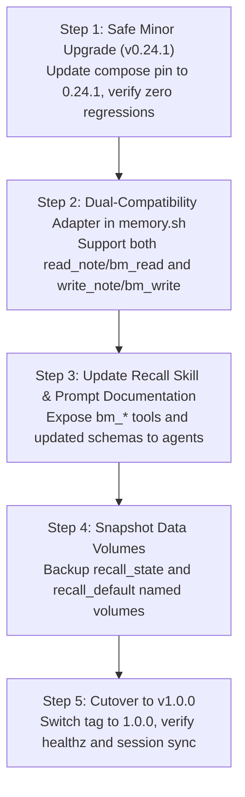

# Migration Plan: Basic Memory Minor Upgrade & v1.0.0 Evolution

## 1. Release Audit & Version Matrix

An inspection of the upstream releases for [`basicmachines-co/basic-memory`](https://github.com/basicmachines-co/basic-memory) reveals three key milestones:

| Version | Status | Tool API Surface | FastMCP Engine | Backwards Compatibility |
| :--- | :--- | :--- | :--- | :--- |
| **`0.23.2`** *(Current)* | Live Pin | Legacy: `read_note`, `write_note`, `search_notes` | FastMCP 3.x | Baseline |
| **`0.24.1`** *(Minor)* | Latest in 0.x | **Unbroken**: `read_note`, `write_note`, `search_notes` + POSIX verbs (`cat`, `grep`, `ls`, `find`) | FastMCP 4.1.3 (stateless) | **100% Drop-in Compatible** |
| **`1.0.0`** *(Major)* | Latest Major (`latest`) | **Breaking Rewrite**: `bm_read`, `bm_write`, `bm_search`, `bm_context` | FastMCP 4.1.3 (stateful by default) | **Breaking**: Requires script & skill refactoring |

> [!TIP]
> **Minor Version Recommendation (`v0.24.1`)**:
> `v0.24.1` is completely backwards-compatible with our current tooling while including upstream bug fixes:
> - Fixes wikilinks inside inline code blocks.
> - Fixes batch relation search cleanup.
> - Fixes inbound relation dangling on entity deletion.
> - Keeps `read_note` and `write_note` signatures intact.
> We can adopt `0.24.1` immediately with zero risk.

---

## 2. Breaking Changes in Basic Memory v1.0.0

To move to `1.0.0`, four distinct breaking contracts must be bridged:

### 2.1 Tool Namespace Renaming
Every MCP tool has been renamed with a `bm_` prefix:
- `read_note` ➔ **`bm_read`**
- `write_note` ➔ **`bm_write`**
- `search_notes` ➔ **`bm_search`**
- `edit_note` ➔ **`bm_edit`**
- `delete_note` ➔ **`bm_delete`**
- `list_directory` ➔ **`bm_list`**
- `build_context` ➔ **`bm_context`**

### 2.2 Argument Schema Changes
- **`bm_read`**: Replaces the abstract `identifier: "session-memory:<workspace>"` and `output_format: "json"` with path-based selectors, line range slicing (`lines: [1, 50]`), and section targeting.
- **`bm_write`**: Expects explicit relative file paths in the corpus rather than separate `title` / `directory` parameters.

### 2.3 FastMCP 4 Session Statefulness
FastMCP 4.x enforces session IDs by default. Stateless HTTP requests (like `curl` or single-shot tool calls from `scripts/memory.sh`) fail with:
```
{"jsonrpc":"2.0","error":{"code":-32600,"message":"Bad Request: Missing session ID"}}
```
`FASTMCP_STATELESS_HTTP=true` must be strictly configured in container environment variables.

---

## 3. Phased Migration Strategy



---

## 4. Phase Breakdown & Execution Checklist

### Phase 1: Safe Minor Upgrade (`0.23.2` ➔ `0.24.1`) — *Zero Risk*
- [ ] Update `docker-compose.yml` in `agentic-hub/plugins/memory`:
  ```yaml
  image: ghcr.io/basicmachines-co/basic-memory:${BASIC_MEMORY_TAG:-0.24.1}
  ```
- [ ] Pull and start container:
  ```bash
  docker compose -f ~/.gemini/config/plugins/memory/docker-compose.yml up -d
  ```
- [ ] Run `memory.sh status` and `memory.sh set` to verify zero regression.

---

### Phase 2: Script Adaptation in `memory.sh`
Update [`scripts/memory.sh`](~/projects/doppelganger/scripts/memory.sh) to detect which tool version the server exposes:
```bash
# Check whether server exposes bm_read (v1) or read_note (v0.x)
available_tools=$(curl -s -X POST "${RECALL_URL}" -d '{"jsonrpc":"2.0","id":1,"method":"tools/list"}')
if echo "$available_tools" | grep -q '"bm_read"'; then
  READ_TOOL="bm_read"
  WRITE_TOOL="bm_write"
else
  READ_TOOL="read_note"
  WRITE_TOOL="write_note"
fi
```
Adapt payload formatting:
- If `v1`: format note title as `${ws}.md` and extract YAML frontmatter via markdown parse.
- If `v0.x`: keep legacy `identifier: "session-memory:${ws}"`.

---

### Phase 3: Update Agent Skills & Tool Declarations
Update [`skills/recall/SKILL.md`](~/.gemini/antigravity-cli/skills/recall/SKILL.md) in both Antigravity and Claude Code scopes:
- Document `bm_read`, `bm_write`, `bm_search`, `bm_context`.
- Include examples with `path`, `lines`, and `content`.

---

### Phase 4: Database Volume Snapshot & Rollback Runbook
Before starting `1.0.0` against production databases:
1. Stop the current recall container:
   ```bash
   docker compose -f ~/.gemini/config/plugins/memory/docker-compose.yml stop recall
   ```
2. Snapshot the named volumes:
   ```bash
   docker run --rm -v memory_recall_state:/src -v /tmp:/dst alpine tar -czf /dst/recall_state_backup.tar.gz -C /src .
   docker run --rm -v memory_recall_default:/src -v /tmp:/dst alpine tar -czf /dst/recall_default_backup.tar.gz -C /src .
   ```
3. If `1.0.0` schema migration encounters an error, revert image pin to `0.24.1` and restore tar archives into the volumes.

---

### Phase 5: Cutover & Validation
1. Set `BASIC_MEMORY_TAG=1.0.0` in `.env`.
2. Run `docker compose up -d recall`.
3. Verify with:
   ```bash
   curl -s -X POST http://127.0.0.1:8110/mcp -d '{"jsonrpc":"2.0","id":1,"method":"tools/list"}'
   ./scripts/memory.sh status
   ./scripts/memory.sh search "session"
   ```
